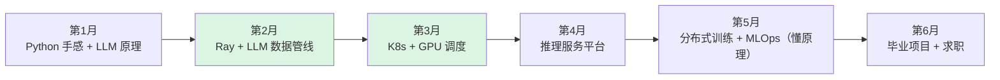
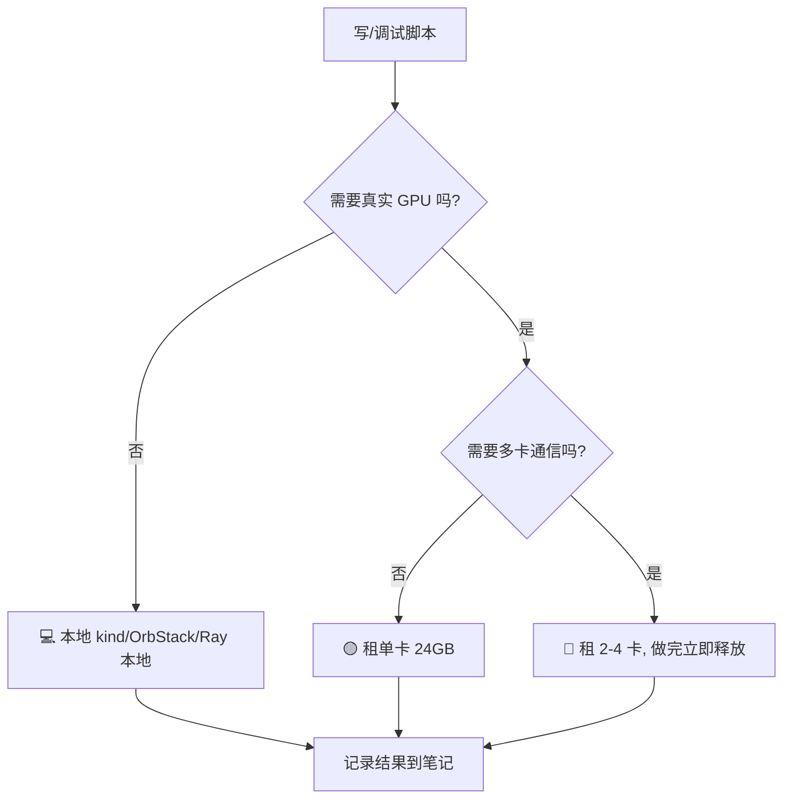
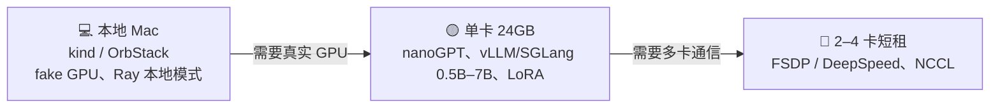
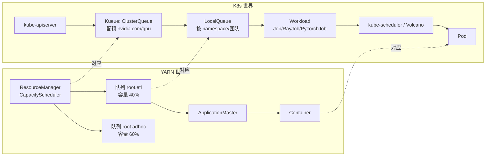
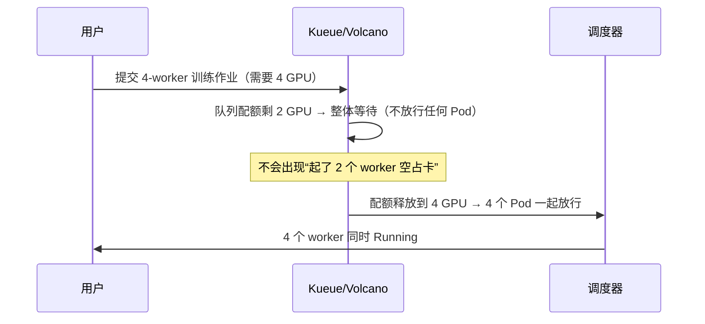
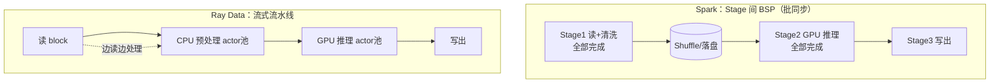
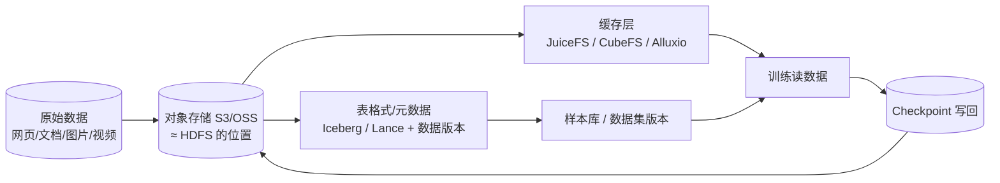

=== index | 首页 · 学习总览 | 开始
# 从大数据架构师到 AI Infra 架构师：6 个月自学教程

> 适合做过多年 Hadoop / Spark / Hive / 数仓 / 数据平台架构、很久没写代码、偏好文字和图解的读者。按周推进，每周约 10–15 小时（这是原指南给出的建议投入，不是精确测量值）。

> 快速入口：[实验资源与成本](/lab-cost.html) ｜ [参考资料库](/resources.html) ｜ [概念映射](/mapping.html)

## 你的进度

<div id="overview">加载中…（需要启用 JavaScript）</div>

## 一句话结论

**先做“LLM 数据基础设施（Data for AI）+ AI 计算平台/调度”，再向“推理服务平台”延伸。** 训练框架内核（Megatron 并行策略、CUDA kernel、通信优化）门槛最高，列为长期深入方向，不作为第一站。



（绿色两个月最能发挥大数据背景优势。）

## 怎么使用这个网站

1. 按左侧导航从第 1 月第 1 周开始，每周一页：**目标 → 概念图解 → 动手实验 → 检查清单**。
2. 每个实验都有资源标签，先看 [实验环境与资源标签](/lab-env.html)：
   - <span class="tag tag-local">💻 本地（kind/OrbStack，fake GPU）</span> 在 Mac 上免费完成
   - <span class="tag tag-gpu1">🟡 租单卡 GPU（24GB，AutoDL/RunPod）</span> 按小时租一张卡
   - <span class="tag tag-gpun">🔴 租多卡 GPU（2–4 卡，短时）</span> 只在少数实验里短时间租
3. 勾选清单会保存在当前浏览器，首页显示总进度。右上角可全文搜索。
4. 不熟悉的概念先看 [概念映射：大数据 → AI Infra](/mapping.html)。
5. **[实验资源与成本](/lab-cost.html)**：哪些实验本地就能做、什么时候才需要租卡。
6. **[参考资料库](/resources.html)**：按方向整理的书、文档、仓库、博客，标注难度和对应周。

## 课程结构

| 阶段 | 主题 | 关键产出 |
|---|---|---|
| 第 1 月 | 恢复 Python 手感 + LLM 原理 | nanoGPT 跑通记录；显存估算脚本 |
| 第 2 月 | Ray + LLM 数据管线 | Ray Data vs Spark 清洗去重对比；`ray.data.llm` 批量推理 |
| 第 3 月 | K8s + GPU 调度 | Kueue/Volcano 实验；“YARN 容量调度 vs Kueue/Volcano”笔记 |
| 第 4 月 | 推理服务平台 | vLLM vs SGLang 压测报告；带扩缩容与监控的推理服务 |
| 第 5 月 | 分布式训练 + MLOps | ZeRO/FSDP 显存对比 + MLflow 记录 |
| 第 6 月 | 毕业项目 + 求职 | 三选一毕业项目 + 技术博客 |

> 说明：本站内容由原《自学转型指南》扩写而来。具体命令以对应项目官方文档为准，软件版本更新很快，遇到报错请先查官方文档。所有“估算”都已标注；本站不提供任何 GPU 租用价格，请以平台页面实时价格为准。

=== lab-env | 实验环境与资源标签 | 开始
# 实验环境与资源标签

## 三类资源

| 标签 | 含义 | 适合做什么 |
|---|---|---|
| <span class="tag tag-local">💻 本地（kind/OrbStack，fake GPU）</span> | Mac 本机（OrbStack 或 Docker Desktop）+ kind 起 K8s 集群；需要“GPU”时用 run-ai 的 fake-gpu-operator 模拟 GPU 资源 | Python、Ray 本地模式、Spark 本地模式、K8s 调度（Kueue/Volcano/KubeRay）实验 |
| <span class="tag tag-gpu1">🟡 租单卡 GPU（24GB）</span> | AutoDL、RunPod 等平台按小时租一张 24GB 显存的卡 | vLLM/SGLang 推理、`ray.data.llm` 批量推理、GPU Operator、单卡 LoRA |
| <span class="tag tag-gpun">🔴 租多卡 GPU（2–4 卡，短时）</span> | 同平台租 2–4 卡的机器，做完立刻释放 | DeepSpeed ZeRO / FSDP 多卡对比、NCCL 测试、张量并行推理 |

> 费用：本站不写具体价格（价格经常变，也未逐一核实）。原则是**先在本地把脚本调通，再租卡只做“必须要 GPU”的那一步**，做完立即关机/释放，并在平台上设置余额提醒。



## 本地环境准备（Mac） {{local}}

```bash
# 1. 安装 Homebrew 后安装工具（OrbStack 也可以从官网下载）
brew install --cask orbstack        # 或使用 Docker Desktop
brew install kind kubectl helm python@3.12 uv

# 2. 建 Python 虚拟环境
mkdir -p ~/ai-infra-lab && cd ~/ai-infra-lab
# 第 1 周起用到的 numpy 2.5 需要 Python ≥ 3.12
uv venv --python 3.12 .venv && source .venv/bin/activate
uv pip install numpy pandas pyarrow "ray[data,default]" torch jupyter

# 3. 起一个 kind 集群（3 个节点，后面做调度实验用）
cat > kind.yaml <<'K'
kind: Cluster
apiVersion: kind.x-k8s.io/v1alpha4
nodes:
- role: control-plane
- role: worker
- role: worker
K
kind create cluster --name lab --config kind.yaml
kubectl get nodes
```

> Apple Silicon 提示：部分镜像只提供 amd64，遇到 `exec format error` 时找 arm64 版本或换镜像；PyTorch 在 Mac 上可用 `mps` 设备代替 CUDA 做小实验。

## 用 fake GPU 在本地模拟 GPU 节点 {{local}}

[fake-gpu-operator](https://github.com/run-ai/fake-gpu-operator) 能让 K8s 节点“看起来”有 `nvidia.com/gpu` 资源，用于练习调度，不能真正跑 CUDA。安装方法以该仓库 README 为准，大致流程是：给节点打标签 → 用 Helm 安装 → 查看节点的 `nvidia.com/gpu` 容量。

```bash
# 安装后检查（安装命令请按仓库 README 当前版本执行）
kubectl get nodes -o custom-columns=NAME:.metadata.name,GPU:.status.allocatable.nvidia\\.com/gpu
```

如果不想装它，也可以给节点“手动加扩展资源”来模拟（只影响调度，不影响运行）：

```bash
kubectl proxy &   # 在另一个终端
curl --header "Content-Type: application/json-patch+json" --request PATCH \
  --data '[{"op":"add","path":"/status/capacity/example.com~1gpu","value":"4"}]' \
  http://localhost:8001/api/v1/nodes/lab-worker/status
```

这是 K8s 官方文档里“为节点通告扩展资源”的做法，资源名用自定义的 `example.com/gpu`。

## 租用 GPU 的通用步骤 {{gpu1}}

1. 在 [AutoDL](https://www.autodl.com/) 或 [RunPod](https://www.runpod.io/) 注册，选择 24GB 显存的卡、带 PyTorch/CUDA 的镜像。
2. SSH 登录后先确认：
```bash
nvidia-smi                      # 看卡型号、显存、驱动版本
python -c "import torch;print(torch.cuda.is_available(), torch.cuda.get_device_name(0))"
df -h                           # 看数据盘位置，模型权重放数据盘
```
3. 模型下载放数据盘；国内平台下载 HuggingFace 模型可能需要镜像或平台自带的加速，按平台文档操作。
4. 实验时另开一个窗口跑 `watch -n 1 nvidia-smi` 观察显存和利用率。
5. **结束后：把结果文件拷回本地 → 关机/释放实例。**

## 实验记录模板

```text
实验名：
日期 / 资源（本地 / 单卡型号 / 多卡数量）：
软件版本（python、torch、ray、vllm…）：
改动的参数：
观测结果（显存、吞吐、延迟、GPU 利用率）：
和大数据经验的类比：
遇到的问题与解决：
```

=== lab-cost | 实验资源与成本 | 开始
# 实验资源与成本

> 结论：**约 80% 的实验可以在自己的 Mac 上免费完成**；真正需要 GPU 的只有少数几周，用一张 24GB 的租用卡即可；只有分布式训练那两周需要短时租 2–4 卡。本页不写任何具体价格——价格经常变化，请自行查看各平台（AutoDL、RunPod 等）的**官方价格页**，并在平台上设置余额提醒。

## 三档资源



### 1. 本地（约 80% 的实验） {{local}}
- **K8s 与调度**：在 OrbStack（或 Docker Desktop）上用 kind 起多节点集群；用 [fake-gpu-operator](https://github.com/run-ai/fake-gpu-operator) 或手动给节点打补丁加上 `nvidia.com/gpu` 扩展资源，就能练 Kueue 配额/抢占、Volcano Gang 调度、KubeRay —— 调度器只看资源数字，不需要真卡。
- **Ray / Ray Data**：笔记本上 `ray.init()` 本地模式，用几百 MB 的小数据（如 FineWeb 小样本）完成清洗、MinHash 去重、与 Spark 本地模式对比。
- **原理类**：分词实验、显存估算脚本、nanoGPT 字符级小模型（CPU/MPS 可跑）、gloo 后端模拟集合通信、MLflow、扩缩容逻辑练习。

### 2. 租单卡 24GB GPU {{gpu1}}
在 AutoDL、RunPod 等平台按小时租一张 24GB 显存的卡，用于：
- nanoGPT 默认配置训练、显存估算实测对照；
- vLLM / SGLang 部署与压测，模型选 **0.5B–7B**（7B 用 FP16 约占 14GB 权重，剩余显存给 KV Cache；更大的模型请用量化版）；
- `ray.data.llm` 批量推理；
- 单卡 LoRA 微调。

### 3. 短租 2–4 卡 {{gpuN}}
只在第 18–19 周：NCCL 带宽测试、FSDP / DeepSpeed ZeRO 多卡对比。**先在本地/单卡把脚本调通**，再租多卡机器跑完立即释放。

> ⚠️ **GPU Operator 的注意事项**：GPU Operator 要在宿主机上安装驱动、container toolkit 并运行特权容器，需要**完整虚拟机或裸金属 + root 权限**。很多平台提供的是“容器实例”（你本身就在容器里，没有 root/内核权限），装不了 GPU Operator，也跑不起完整 K8s 节点。第 12 周请选择能提供完整 VM（或裸金属）的产品。

## 省钱原则
1. 本地写好、调通脚本 → 租卡只跑“必须用 GPU”的那一步。
2. 模型、数据集提前下载到平台的持久化存储/数据盘，避免每次开机重复下载。
3. 做完立即关机或释放实例；设余额提醒。
4. 价格只看平台官方价格页，本站不提供报价。

## 每周实验资源一览

| 周 | 实验 | 资源档 |
|---|---|---|
| [W1](/m1w1.html) | 用 pandas/pyarrow 重写 ETL | {{local}} |
| [W2](/m1w2.html) | 分词器实验 + 前向流程图 | {{local}} |
| [W3](/m1w3.html) | nanoGPT：本地字符级 / 单卡默认配置 | {{local}} {{gpu1}} |
| [W4](/m1w4.html) | 显存估算脚本 + 实测对照 | {{local}} {{gpu1}} |
| [W5](/m2w1.html) | Ray Core Task/Actor 与 Spark 对照 | {{local}} |
| [W6](/m2w2.html) | Ray Data 清洗管线 | {{local}} |
| [W7](/m2w3.html) | MinHash 去重 + Spark 对比 | {{local}} |
| [W8](/m2w4.html) | `ray.data.llm` 批量推理 | {{gpu1}} |
| [W9](/m3w1.html) | kind 集群 + 模拟 GPU 资源 | {{local}} |
| [W10](/m3w2.html) | Kueue 队列、配额、抢占 | {{local}} |
| [W11](/m3w3.html) | Volcano Gang 调度 + KubeRay | {{local}} |
| [W12](/m3w4.html) | GPU Operator + vLLM Pod（需完整 VM + root） | {{gpu1}} |
| [W13](/m4w1.html) | PagedAttention / batching 纸笔推演 | {{none}} |
| [W14](/m4w2.html) | vLLM 部署与压测 | {{gpu1}} |
| [W15](/m4w3.html) | SGLang 对比 + 调参 | {{gpu1}} |
| [W16](/m4w4.html) | 扩缩容逻辑（本地）+ 真实模型监控 | {{local}} {{gpu1}} |
| [W17](/m5w1.html) | 并行策略全景（读 + 画图） | {{none}} |
| [W18](/m5w2.html) | gloo 本地模拟 + 多卡 nccl-tests | {{local}} {{gpuN}} |
| [W19](/m5w3.html) | ZeRO / FSDP 微调对比 | {{local}} {{gpuN}} |
| [W20](/m5w4.html) | MLflow 实验管理 | {{local}} |
| [W21](/m6w1.html) | 毕业项目设计 | {{none}} |
| [W22](/m6w2.html) | 毕业项目实现 | {{local}} {{gpu1}} |
| [W23](/m6w3.html) | 写技术博客 | {{none}} |
| [W24](/m6w4.html) | 简历与面试准备 | {{none}} |

统计：24 周中，只用本地/纸笔即可完成的有 14 周；需要单卡的 8 周（其中 4 周的本地部分可先做）；需要多卡的仅 2 周。

> 相关：[实验环境与资源标签](/lab-env.html)（环境搭建步骤）｜[参考资料库](/resources.html)

=== mapping | 概念映射：大数据 → AI Infra | 开始
# 概念映射：大数据 → AI Infra

本页把你熟悉的大数据概念“平移”到 AI Infra。原指南的核心判断是：**从 YARN 过渡到 K8s、Volcano/Kueue、Slurm、Ray，从 Spark 过渡到 Ray Data，概念上是平移，补上 GPU、模型和推理知识就行。**

## 总对照表

| 大数据中你熟悉的 | AI Infra 中对应的 |
|---|---|
| YARN 队列、容量调度、资源隔离 | K8s 加 Volcano/Kueue 的队列与配额，Slurm partition，Gang 调度 |
| Spark / MapReduce | Ray（Task/Actor），Ray Data 流式处理与 CPU/GPU 异构 pipeline |
| HDFS / 对象存储 / Alluxio | 用对象存储、JuiceFS、CubeFS 等加缓存来提供训练数据和保存 checkpoint |
| Hive / Iceberg / 数据湖 | 多模态数据湖、样本库、数据版本管理 |
| Flink 实时链路、高并发服务 | 在线推理服务、流式 token 输出、SLA 与限流降级 |
| 集群运维与成本治理 | GPU 利用率治理（MIG/MPS/vGPU）、Spot 实例、混部 |

## 1. YARN → K8s + Kueue / Volcano



| YARN | K8s + Kueue | K8s + Volcano |
|---|---|---|
| CapacityScheduler 队列层级 | ClusterQueue + Cohort（借用）+ LocalQueue | Queue（带 weight / capability） |
| 队列容量 / 最大容量 | nominalQuota / borrowingLimit | capability / deserved |
| 应用提交 | 创建 Job（带 `kueue.x-k8s.io/queue-name` 标签） | 创建 vcjob 或指定 schedulerName |
| AM 申请 Container | Kueue “准入”（admission）后 Pod 才被放行调度 | PodGroup 满足 minMember 才整体调度 |
| 抢占（preemption） | ClusterQueue 的 preemption 策略 | 插件化的 preempt/reclaim action |
| Node Label 分区 | ResourceFlavor（如不同 GPU 型号） | 节点亲和 / 队列与节点组绑定 |

**关键差异：Gang 调度。** Spark on YARN 的 executor 可以陆续拿到；分布式训练的 N 个 worker **必须同时就绪**，否则先起的 worker 空等占卡。Kueue 以“整个 workload 一起准入”、Volcano 以 PodGroup `minMember` 解决这一问题。



## 2. Spark → Ray / Ray Data



| Spark | Ray |
|---|---|
| Driver | Driver（运行 `ray.init()` 的脚本） |
| Executor | Worker 进程；有状态的用 **Actor** |
| RDD/DataFrame 分区 | Ray Data **block**（底层是 Arrow 表） |
| `mapPartitions` | `map_batches` |
| 广播变量 | Object Store 中的对象 / Actor 构造时加载模型 |
| `spark.executor.resource.gpu.amount` | `num_gpus=1`，CPU 与 GPU 算子分别设并发 |
| Stage 之间 BSP | 算子之间**流式执行**，CPU 与 GPU 同时忙 |

公开资料佐证：字节跳动用 Ray Data 处理 200TB 级多模态离线推理，文中对比了 Spark BSP 与 Ray 流水线执行（见 [转型案例](/cases.html)）。

## 3. HDFS → AI 数据湖



| 数据湖经验 | AI 数据湖中的新问题 |
|---|---|
| 小文件治理 | 海量图片/音频小文件；训练随机读，需要缓存与打包格式 |
| 分区与元数据 | 多模态样本的元数据、标签、质量分、去重指纹 |
| 表格式（Iceberg） | 也出现了面向多模态/向量的格式（如 Lance） |
| 数据血缘 / 版本 | 数据集版本必须和模型版本、评测结果对应 |
| 冷热分层 | Checkpoint 写入有突发大带宽需求 |

公开资料佐证：理想汽车用 JuiceFS 让大数据平台和 AI 平台共享数据；美团用 K8s 替代 YARN 并补齐 GPU 亲和、Gang 调度、抢占和故障恢复（见 [转型案例](/cases.html)）。

## 4. Flink/在线服务 → 推理服务

| 在线服务经验 | LLM 推理中的对应 |
|---|---|
| QPS、P99 延迟 | 吞吐（tokens/s）、**TTFT**（首 token 延迟）、**TPOT**（每个输出 token 延迟） |
| 连接池 / 批处理 | **continuous batching**（请求随来随并入 batch） |
| 缓存 | **KV Cache**、prefix cache |
| 内存池 / 分页 | **PagedAttention**（像操作系统分页一样管理 KV Cache） |
| 读写分离 | **PD 分离**（Prefill 与 Decode 放在不同实例） |
| 限流降级 | 按 token 预算限流、排队、拒绝 |

## 5. 集群成本治理 → GPU 利用率治理

| 大数据 | GPU |
|---|---|
| 资源超卖 / 混部 | MIG（硬件切分）、MPS（多进程共享）、vGPU |
| 抢占式实例 | Spot/竞价实例 + checkpoint 恢复 |
| 作业画像 | GPU 利用率、显存占用、SM 活跃度（DCGM 指标） |
