=== m1 | 第 1 月概览：恢复手感 + LLM 原理 | 第 1 月 · Python + LLM 原理
# 第 1 月：恢复手感 + 补 LLM 原理

## 本月目标
- 重新能写几百行的 Python 脚本（可以借助 AI 编程助手，但要读懂生成的代码）。
- 理解 Transformer、token、KV Cache；知道训练、微调、推理各自吃什么资源。
- 跑通 nanoGPT 的 Shakespeare 小例子，并写出显存估算脚本。

## 阅读
- Datawhale 的 [happy-llm](https://github.com/datawhalechina/happy-llm)（中文，从零讲解 LLM 原理）
- Karpathy 的 [nanoGPT](https://github.com/karpathy/nanoGPT) 代码
- 补充：[Attention Is All You Need](https://arxiv.org/abs/1706.03762) 原论文（只看图 1 和第 3 节即可）

## 周计划

| 周 | 主题 | 实验 | 资源 |
|---|---|---|---|
| [第 1 周](/m1w1.html) | Python 数据处理复健 | 用 pandas/pyarrow 重写一个熟悉的 ETL | {{local}} |
| [第 2 周](/m1w2.html) | Transformer 与 token | 分词器实验 + 画出前向流程 | {{local}} |
| [第 3 周](/m1w3.html) | 跑通 nanoGPT | Shakespeare 字符级训练 | {{local}} {{gpu1}} |
| [第 4 周](/m1w4.html) | 显存估算 | 写估算脚本并与实测对照 | {{local}} {{gpu1}} |

## 本月产出清单
- [ ] nanoGPT 跑通记录（含显存占用、训练速度）
- [ ] 显存估算脚本 + 与实测对照表
- [ ] 一篇笔记：用自己的话解释 KV Cache

=== m1w1 | 第 1 周：Python 数据处理复健 | 第 1 月 · Python + LLM 原理
# 第 1 周：Python 数据处理复健

> **本周一句话**：把你脑子里的“Hive SQL + ORC/Parquet + 向量化执行”这套肌肉记忆，迁移到单机 Python（pandas / NumPy / Arrow / Parquet / DuckDB）上，并真正弄懂它们**为什么快、为什么会爆内存**。这是后面 Ray Data、HuggingFace datasets、LLM 数据管线的地基——它们底层用的都是 Arrow。

**预计投入：约 10 小时**（阅读 ≈ 4h，动手 ≈ 4.5h，自测与产出 ≈ 1.5h），可分 5 天完成。{{local}}

**本周结束时你应该能：**

1. 不看笔记独立建好 Python 虚拟环境、装好固定版本的包，并解释“为什么我的包装了却 import 不到”。
2. 把三类典型 Hive SQL（聚合 + 去重计数、Join + 过滤、窗口函数 TopN）改写成 pandas，并用 DuckDB **对数**证明结果一致。
3. 说清楚 Python 循环慢在哪里、向量化快在哪里，并能估算一张表在 pandas 里要占多少内存。
4. 读懂一个 Parquet 文件的元数据（行组、列块、编码、min/max 统计），用实验证明列裁剪和谓词下推确实生效。
5. 用“分批流式聚合”处理比内存大的数据，并说清楚哪些指标可以分批合并、哪些不行。

> **验证说明**：本页所有命令和输出都在一台 Linux x86_64 机器（8 核、Python 3.12.15、numpy 2.5.4、pandas 3.0.6、pyarrow 26.0.0、duckdb 1.5.6）上实际运行过，输出是真实结果，只删掉了无关行。你在 Mac 上的**耗时和内存数字会不同**，但结论（谁快谁慢、行数、校验结果）应当一致。标“未在本站验证”的内容没有实际运行过。

---

## 1. 本周学习路线

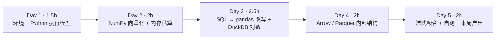

| 天 | 时间 | 先读（概念） | 再读（外部资料，按顺序） | 再做（实验） |
|---|---|---|---|---|
| Day 1 | ~1.5h | 本页 2.1、2.2 | ① [Python 官方教程：Virtual Environments and Packages](https://docs.python.org/3/tutorial/venv.html) 的 *Introduction / Creating Virtual Environments / Managing Packages with pip* 三节（20 分钟）；② [uv 文档：Python environments](https://docs.astral.sh/uv/pip/environments/) 的 *Creating a virtual environment / Using a virtual environment / Discovery of Python environments*（15 分钟） | 实验 0：建环境 |
| Day 2 | ~2h | 本页 2.3、2.4 | ③ [《Python for Data Analysis》第 3 版（免费在线版）](https://wesmckinney.com/book/) 第 4 章 *4.1 The NumPy ndarray* 和 *4.3 Universal Functions*（40 分钟，代码边看边敲） | 实验 1：造数据；实验 4：循环 vs 向量化、dtype 内存 |
| Day 3 | ~2.5h | 本页 2.5 | ④ [pandas：Comparison with SQL](https://pandas.pydata.org/docs/getting_started/comparison/comparison_with_sql.html) 全文（30 分钟，这是本周最该精读的一页）；⑤ 同书第 10 章 *10.1 How to Think About Group Operations*、*10.2 Data Aggregation*；第 8 章 *8.2 Combining and Merging Datasets*（40 分钟） | 实验 2：ETL 改写；实验 3：DuckDB 对数 |
| Day 4 | ~2h | 本页 2.6、2.7 | ⑥ [Parquet 官方：Concepts](https://parquet.apache.org/docs/concepts/) 和 [File Format](https://parquet.apache.org/docs/file-format/)（20 分钟）；⑦ [Arrow 列式格式规范](https://arrow.apache.org/docs/format/Columnar.html) 只读 *Validity bitmaps*、*Fixed-size Primitive Layout*、*Variable-size Binary Layout* 三小节（30 分钟）；⑧ [pyarrow：Reading and Writing Single Files（Parquet）](https://arrow.apache.org/docs/python/parquet/parquet.html) 的 *Inspecting the Parquet File Metadata*、*Filtering*（15 分钟） | 实验 5：解剖 Parquet、验证下推 |
| Day 5 | ~2h | 本页 2.8 | ⑨ [pandas：Scaling to large datasets](https://pandas.pydata.org/docs/user_guide/scale.html)（20 分钟）；⑩ [Wes McKinney：Apache Arrow and the "10 Things I Hate About pandas"](https://wesmckinney.com/blog/apache-arrow-pandas-internals/)（20 分钟，选读） | 实验 6：流式聚合；做自测题；写本周产出 |

> **读书版本提醒**：《Python for Data Analysis》第 3 版基于 pandas 2.0.0 和 Python 3.10 写成；本页用的是 pandas 3.0。两者最明显的差异是：pandas 3.0 默认把字符串列推断为新的 `str` 类型（装了 pyarrow 时由 Arrow 存储），并全面启用 Copy-on-Write。书里出现 `object` 字符串列或 `SettingWithCopyWarning` 的地方，以 [pandas 3.0 发布说明](https://pandas.pydata.org/docs/whatsnew/v3.0.0.html) 为准。

**每日打卡：**

- [ ] Day 1：读完 ①②，完成实验 0，能解释 `which python` 输出的路径为什么在 `.venv` 里
- [ ] Day 2：读完 ③，完成实验 1 和实验 4，手算出 events 表的内存并与实测对上
- [ ] Day 3：读完 ④⑤，完成实验 2、3，三条查询 DuckDB 对数全部 OK
- [ ] Day 4：读完 ⑥⑦⑧，完成实验 5，能画出 Parquet 文件结构图
- [ ] Day 5：完成实验 6、自测题、本周产出

---

## 2. 核心概念讲解

### 2.1 为什么 AI Infra 的第一周是“Python 数据处理”

你可能觉得：我要转的是 GPU 集群、推理服务，为什么第一周在写 pandas？原因有三个：

1. **AI Infra 的胶水语言是 Python。** 训练脚本（PyTorch）、数据管线（Ray Data、datatrove）、推理服务（vLLM、SGLang 的入口）、调度器之上的作业提交（KubeRay、Kubeflow Trainer SDK）都是 Python。你作为架构师不一定天天写，但必须**读得懂、改得动、能判断瓶颈在哪一层**。
2. **Arrow 是 AI 数据栈的“通用内存格式”。** [Ray Data](https://docs.ray.io/en/latest/data/data-internals.html) 的数据块（block）一般就是 Arrow 表，默认目标大小在 1 MiB～128 MiB 之间；[HuggingFace datasets](https://huggingface.co/docs/datasets/about_arrow) 用 Arrow 做本地缓存并通过内存映射读取；[Spark 也用 Arrow](https://spark.apache.org/docs/latest/api/python/tutorial/sql/arrow_pandas.html) 在 JVM 和 Python 进程之间高效传数据（`toPandas()`、pandas UDF）。这周在单机上把 Arrow 吃透，第 2 月学 Ray Data 时只需要加上“分布式”这一维。
3. **你的大数据直觉需要“换算表”。** 你知道 Hive 的向量化执行、ORC/Parquet 的谓词下推、MapReduce 的 combiner——这些在 Python 生态里都有直接对应物，但名字和默认行为不同。不建立这张换算表，你会在后面反复踩“为什么 32GB 的机器读 3GB 的 Parquet 就 OOM”这类坑。

| 你熟悉的（大数据） | 本周对应的（单机 Python） | 本质相同点 |
|---|---|---|
| Maven 依赖 / classpath / “jar 包冲突” | 虚拟环境（venv）+ site-packages + 锁定版本 | 一个进程只能看到一套依赖，版本必须可复现 |
| Hive 向量化执行（一次处理 1024 行） | NumPy / pandas 向量化运算 | 把“逐行解释执行”换成“对一整列跑 C 循环” |
| Hive SQL | pandas 链式 API / DuckDB SQL | 同样的关系代数：投影、过滤、聚合、连接、窗口 |
| ORC / Parquet（磁盘列存） | Parquet（磁盘）+ Arrow（内存） | 列存、编码、压缩、统计信息、按列读 |
| 谓词下推、列裁剪 | `pq.read_table(columns=, filters=)`、DuckDB 自动下推 | 能不读的数据就不读 |
| MapReduce combiner / 两阶段聚合 | 分批 `iter_batches` + 局部聚合 + 合并 | 可加指标先局部合并，再全局合并 |
| Kylin / Hive 的近似去重（HLL） | DuckDB `approx_count_distinct` | 去重计数不可加，要么保留明细，要么用概率结构 |

### 2.2 Python 环境：解释器、site-packages 与虚拟环境

**机制**：当你执行 `python script.py` 时，操作系统先按 `PATH` 找到一个 `python` 可执行文件；这个解释器启动后，会根据自己所在的位置决定去哪个 `site-packages` 目录找第三方包。`import pandas` 就是在这些目录里按顺序搜索 `pandas` 这个包。

**虚拟环境（venv）**本质上就是一个目录：里面有一个指向某个 Python 解释器的链接、一个独立的 `site-packages`，以及一个 `activate` 脚本。`source .venv/bin/activate` 做的事情非常朴素——把 `.venv/bin` 放到 `PATH` 最前面，于是你敲 `python` 时找到的是 `.venv/bin/python`，它只看 `.venv` 自己的 `site-packages`。

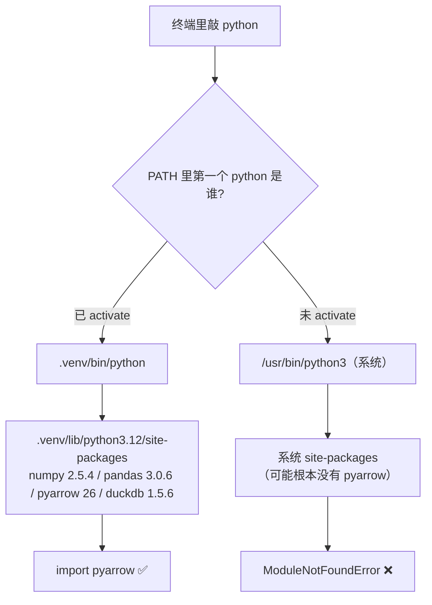

**类比**：这就是 Java 的 classpath。一个 JVM 进程只看到 classpath 上的那一套 jar；“我明明装了却找不到”几乎都是因为**运行时用的解释器不是你安装包时用的那个**——就像你把 jar 放进了 A 集群的 lib 目录，作业却提交到了 B 集群。

**pip 和 uv 的关系**：`pip` 是 Python 自带的包安装器；[uv](https://docs.astral.sh/uv/) 是用 Rust 写的替代品，官方称比 pip 快 10–100 倍，并且能自动下载指定版本的 Python 解释器。本站统一用 `uv venv` 建环境、`uv pip install` 装包。

**版本可复现**：AI 生态的包版本变化非常快（本页用的 numpy 2.5.4 就要求 Python ≥ 3.12，pandas 3.0 要求 Python ≥ 3.11）。架构师的习惯应当是：**每个实验目录都固定版本**（`pkg==x.y.z`），并把 `python -c "import ..., print(版本)"` 的输出记进实验记录。这和你在数据平台上固定 Spark/Hive 版本、写进作业元数据是同一种纪律。

### 2.3 Python 为什么“慢”：解释执行与装箱对象

**机制**：CPython（标准 Python 实现）是解释器，`for` 循环的每一次迭代都要：取出下一个元素（一个 Python 对象）→ 查它的类型 → 找到这个类型对应的 `*` 或 `==` 实现 → 产生一个**新的** Python 对象作为结果 → 引用计数加减。即使运算本身只是一条 CPU 乘法指令，周围的“簿记”开销也大得多。

更关键的是**数据布局**。一个 Python `list` 里存的不是数字本身，而是指向一个个独立 Python 对象的**指针**。每个整数、每个字符串都是一个带对象头的独立对象（在本机实测：`sys.getsizeof("view")` 是 45 字节，而字符串内容只有 4 字节）。

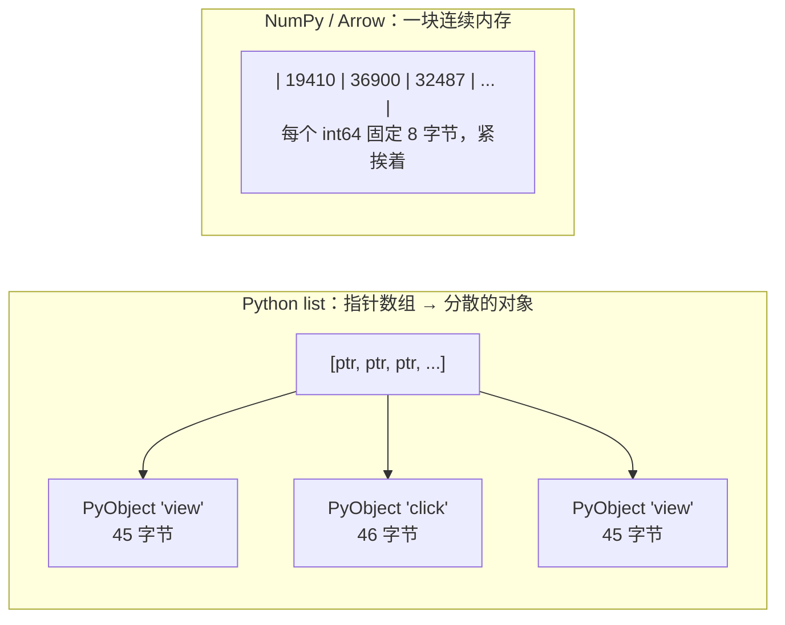

连续内存带来两个好处：①一个 C 循环就能顺序扫完，CPU 缓存和预取效率高，编译器还能用 SIMD 一次算多个值；②没有每个元素的对象头和指针。

**另一个限制：GIL。** 标准 CPython 有全局解释器锁（GIL），同一进程里同一时刻只有一个线程在执行 Python 字节码，所以“开多线程跑 Python 循环”通常不能用满多核（Python 3.13 起有实验性的 free-threaded 构建，但生态还在过渡中）。NumPy、Arrow、DuckDB 这类库在 C/C++ 层做重计算，可以绕开这一限制——实验里你会看到 DuckDB 默认就用满了 8 个线程。这也是为什么 Ray、Spark 的 Python worker 都是**多进程**模型。

### 2.4 向量化：把循环“下沉”到 C 里

**向量化**（vectorization）的意思是：用一条“对整列操作”的表达式，代替你自己写的逐行循环。比如：

```python
# 逐行：100 万次 Python 级迭代
out = [a * 0.9 if e == "buy" else a for e, a in zip(event, amount)]
# 向量化：3 次整列运算，每次内部是一个 C 循环
out = np.where(event == "buy", amount * 0.9, amount)
```

`event == "buy"` 一次性产生一个 100 万长度的布尔数组；`amount * 0.9` 一次性产生一个新的浮点数组；`np.where` 按布尔数组从两边挑值。每一步都是“对连续内存跑一遍 C 循环”。

**类比**：这正是 [Hive 向量化查询执行](https://cwiki.apache.org/confluence/display/Hive/Vectorized+Query+Execution) 的思想——Hive 一次处理一个 1024 行的块，块内每列存成原始类型数组，从而消除逐行解释的开销。区别只在于 NumPy 一次处理的是**整列**。

**实测**（实验 4，100 万行）：

| 写法 | 耗时 | 说明 |
|---|---|---|
| `for` 循环 + `zip` | 0.587 s | 每行一次 Python 迭代 |
| `np.where` 向量化 | 0.0171 s | 快约 34 倍 |
| `df.apply(..., axis=1)` | 3.574 s | **最慢**：看起来像 pandas API，其实每行都要构造一个 Series 对象再调用你的 Python 函数 |

> **经验法则**：在 pandas 里看到 `apply(axis=1)`、`iterrows()`、`for` 循环遍历行，先问一句“能不能改成整列运算或 `np.where` / `groupby().agg()` / `merge`？”。这和你 review Hive SQL 时看到 UDF 先想“能不能用内置函数”是同一条直觉。

**内存估算公式**（务必记住，后面算 GPU 显存用的是同一套思路）：

```text
表内存 ≈ 行数 × Σ(每列每行字节数)

定长列：int64 / float64 / datetime64 = 8 字节；int32 = 4；int8 / bool = 1
Arrow 字符串列（pandas 3 默认 str，底层 large_string）：8 字节偏移量 + 平均字符串字节数
Python object 字符串列：8 字节指针 + 每个字符串对象大小（短 ASCII 串约 41 + 长度 字节）
category 列：编码数组（取值少时 int8 = 1 字节）+ 一份很小的字典
```

**例题**：实验里的 `events` 表 100 万行，四列分别是 `user_id: int64`、`ts: datetime64`、`amount: float64`、`event: str`。`event` 取值 view/click/cart/buy，概率 0.75/0.17/0.05/0.03，平均长度 = 0.75×4 + 0.17×5 + 0.05×4 + 0.03×3 = 4.14 字节。

- `event` 用 Arrow 字符串：(8 + 4.14) × 1,000,000 ≈ 12.14 MB = **11.58 MiB**（实测 11.58 MiB ✅）
- `event` 用 Python object：(8 + 41 + 4.14) × 1,000,000 ≈ 53.14 MB = **50.68 MiB**（实测 50.68 MiB ✅）
- `event` 用 category：1 × 1,000,000 ≈ **0.95 MiB**（实测 0.95 MiB ✅）
- 整表：(8 + 8 + 8 + 12.14) × 1,000,000 ≈ **34.47 MiB**（实测 `memory_usage(deep=True)` 34.5 MiB ✅）

同一列数据，存法不同内存差 50 倍。这就是 pandas 3 把字符串默认改成 Arrow 存储的原因之一，也是你在数仓里坚持“低基数字段做字典编码”的同一道理。

### 2.5 DataFrame 思维：把 SQL 翻译成 pandas

**DataFrame 是什么**：可以把它想成“一张内存里的表”：若干**等长的列**（每列一个 dtype，底层是一块 NumPy 或 Arrow 内存），加上一个行索引（index）。和 Hive 表最大的不同有两点：

1. **立即执行（eager）**。pandas 每写一行代码就立刻算出完整的中间结果并放进内存；Spark/Hive 是先建执行计划（DAG），最后一起优化执行（lazy）。所以 pandas 不会帮你做谓词下推、列裁剪、Join 重排——**优化器就是你自己**。
2. **索引（index）**。groupby、merge 之后 pandas 会把分组键放进索引，这是 SQL 里没有的概念。初学阶段建议：聚合后一律 `.reset_index()`，把它变回普通列，就像 SQL 结果一样。

**SQL → pandas 对照表**（完整版见精读资料 ④）：

| SQL | pandas | 注意 |
|---|---|---|
| `SELECT a, b` | `df[["a", "b"]]` | 双层方括号得到 DataFrame |
| `WHERE x = 'buy'` | `df.loc[df["x"] == "buy"]` | 多条件用 `&` `\|` 并给每个条件加括号 |
| `GROUP BY k` + `count(*)` | `df.groupby("k").size()` | `size` 数行数（含空值）；`count` 数非空值 |
| `count(DISTINCT u)` | `.agg(uv=("u", "nunique"))` | 需要为每组维护去重集合，最贵 |
| `JOIN ... ON` | `a.merge(b, on="k", how="inner")` | 用 `validate="many_to_one"` 防止维表重复导致行数膨胀 |
| `ORDER BY g DESC LIMIT n` | `.sort_values("g", ascending=False).head(n)` | |
| `row_number() OVER (PARTITION BY p ORDER BY o)` | 先 `sort_values([p, o])`，再 `groupby(p).cumcount() + 1` | 排序决定名次，务必加稳定的次级排序键 |
| `sum(x) OVER (PARTITION BY p)` | `df.groupby(p)["x"].transform("sum")` | `transform` 返回与原表等长的结果 |

**groupby 的机制：split-apply-combine。** pandas 官方把 groupby 描述为三步：按键拆分（split）→ 对每组应用函数（apply）→ 把结果拼回去（combine）。实现上，pandas 先把分组键编码成整数组号（factorize），之后的 `sum`、`size` 等内置聚合就是“按组号把值累加到对应槽位”的 C 循环——这和 Hive/Spark 里的 **hash aggregation** 是一回事。

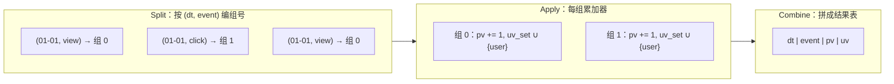

**为什么 `nunique` / `count(DISTINCT)` 最贵**：`sum`、`count` 每组只需要一个数字作累加器；`count(DISTINCT)` 每组要记住“见过哪些值”，内存与（组数 × 每组不同值个数）成正比，而且**不能简单相加合并**（2.8 节详细讲）。你在数仓里对 UV 类指标的所有经验，在这里一条都不作废。

**Copy-on-Write（pandas 3）**：pandas 3 起，任何取子集操作的结果都表现得像一份副本。所以 `df[df["event"] == "buy"]["amount"] = 0` 这种“链式赋值”**永远不会修改原表**（实验里会看到 `ChainedAssignmentError` 警告）。正确写法是一步到位：`df.loc[df["event"] == "buy", "amount"] = 0`。

### 2.6 Arrow：内存里的列式格式

[Apache Arrow](https://arrow.apache.org/docs/format/Columnar.html) 定义了一种**与语言无关的内存列式格式**。它规定了一列数据在内存里由哪几块缓冲区（buffer）组成：

- **有效位图（validity bitmap）**：每个值 1 个比特，1 表示非空、0 表示 NULL。所以 Arrow 里“空值”不需要占用一个特殊取值，整数列也能有 NULL。
- **定长列**（int64、float64、timestamp）：一块连续的值缓冲区，第 i 个值就在偏移 i × 8 字节处。
- **变长列**（字符串、二进制）：一块**偏移量缓冲区** + 一块**数据缓冲区**。第 i 个字符串是 `data[offsets[i] : offsets[i+1]]`。`string` 用 32 位偏移量，`large_string` 用 64 位偏移量。

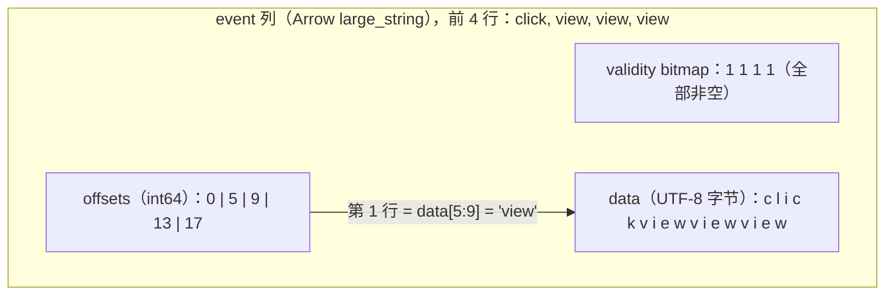

这正是 2.4 节公式里“8 字节偏移量 + 平均字符串长度”的来源。

**为什么 AI 栈都选 Arrow**：

1. **零拷贝（zero-copy）**：多个进程或多种语言只要遵守同一布局，就可以直接共享同一块内存，不需要序列化/反序列化。Ray Data 把 Arrow block 放进 Ray 的共享内存对象存储、Spark 在 JVM 与 Python 之间交换数据，都是这一思路。
2. **按块组织**：一张 Arrow 表由若干 **RecordBatch**（一批行，每列一段连续内存）组成，天然适合流式处理——Ray Data 的 block、pyarrow 的 `iter_batches` 都是这个粒度。
3. **与 Parquet 天然配对**：Parquet 是磁盘上的列存，Arrow 是内存里的列存，两者之间的转换是“解码 + 解压”，不需要行列转换。

**类比**：如果说 ORC/Parquet 是“HDFS 上的列存文件”，Arrow 就是“内存里的 ORC”，并且被设计成可以跨进程直接共享。

### 2.7 Parquet：文件内部结构、编码与下推

你对 ORC 的 stripe / index / footer 很熟悉，Parquet 几乎是同构的。[Parquet 官方 Concepts](https://parquet.apache.org/docs/concepts/) 的层次是：**文件 → 行组（row group）→ 列块（column chunk）→ 页（page）**，文件末尾的 **footer** 存放 schema 和每个行组、每个列块的元数据（偏移量、大小、编码、压缩、min/max 统计）。

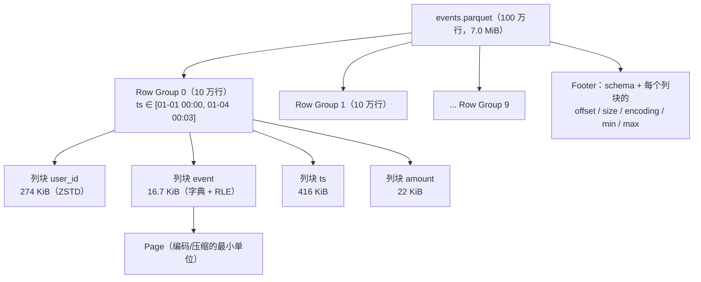

官方给出的并行粒度很能说明设计意图：**MapReduce 级并行按文件/行组，IO 按列块，编码/压缩按页**。官方还建议使用较大的行组（512MB～1GB），理由是整个行组可能需要一起读，最好正好落在一个 HDFS 块里——你会发现这条建议是为 HDFS 时代写的；在对象存储 + 单机/小 block 的 AI 数据管线里，行组大小要结合读取并行度和内存重新权衡（本周实验故意用 10 万行一个行组，方便观察）。

**三个让 Parquet 快的机制**：

1. **列裁剪（projection pushdown）**：只读需要的列块。`event` 列压缩后 16.7 KiB，`ts` 列 416 KiB——只查 `event` 时，`ts` 的字节根本不用从磁盘读出来。
2. **编码 + 压缩**：低基数列（`event` 只有 4 种值）走**字典编码**（存字典 + 小整数下标），下标再用 **RLE / bit-packing** 压紧，最后整页再用 ZSTD/Snappy 压缩。所以 `event` 列 10 万行编码后（压缩前）只有 25 KiB——平均每行约 2 比特。
3. **谓词下推（predicate pushdown）**：读文件前先看 footer 里每个行组的 min/max；如果 `WHERE ts >= '2026-01-10' AND ts < '2026-01-11'` 与某个行组的 `[min, max]` 不相交，整个行组直接跳过。**这个机制只有在数据按过滤列（近似）有序时才有效**——本周的数据按时间排序写入，所以 10 个行组里只需读 1 个；如果数据是乱序的，每个行组的 min/max 都覆盖全月，一个也跳不掉。这和你在数仓里“按日期分区 + 按常用过滤键排序（z-order / sort by）”是同一件事。

**例题：磁盘大小 ≠ 内存大小。** 实验在 1000 万行时测得：Parquet 文件 37.1 MiB，读进 pandas 后 344.7 MiB（约 9.3 倍），跑完三条查询进程峰值内存 1476 MiB（约为内存表的 4.3 倍、文件的 40 倍）。原因：读入时要**解压 + 解码**（字典编码的 `event` 被展开成一行一个字符串），计算时还会产生**中间结果**（`assign` 新列、`merge` 结果、排序副本）。pandas 作者 Wes McKinney 在 [这篇博客](https://wesmckinney.com/blog/apache-arrow-pandas-internals/) 里给出的经验法则是：**pandas 需要数据集大小 5～10 倍的内存**。所以评估“单机够不够”时，永远从**解码后的内存大小**算起，而不是从文件大小算起。

### 2.8 单机的边界：流式分批处理，以及什么时候该上分布式

当数据放不进内存时，第一选择不是马上上 Spark/Ray，而是**流式分批**：一次只读一个 batch（例如 20 万行），算出局部结果，再把局部结果合并。这就是 MapReduce 的 map + combiner + reduce，只是在一个进程里。

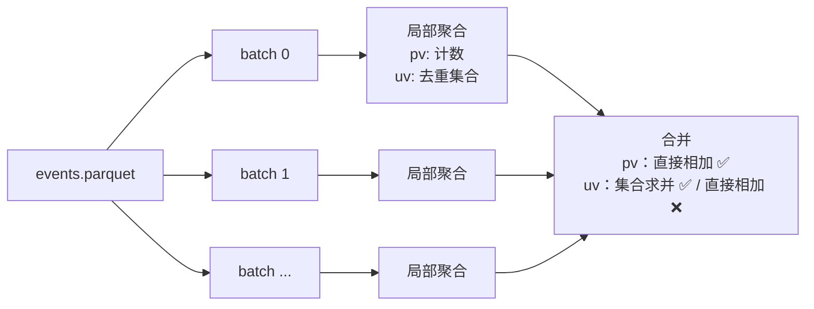

**可加性（additivity）是关键判断**：

| 指标类型 | 例子 | 分批合并方式 |
|---|---|---|
| 可加 | count、sum | 局部结果直接相加 |
| 可由可加量推出 | avg = sum / count、方差（用 count、sum、平方和） | 分别累加分子分母，最后再除 |
| 不可加 | count distinct、中位数、TopN | 保留明细（集合/全量排序），或用近似结构（HyperLogLog、t-digest） |

实验 6 会实测：在 100 万行、按时间有序的数据上，“把每批 UV 直接相加”在 120 个分组里错了 11 个（只有跨批次边界的那几天出错）；换成 1000 万行（每批 20 万行不到一天的数据量）时，120 个分组**全部出错**。错误是否“显形”取决于数据分布——这正是这类 bug 难以在小数据测试中发现的原因。

**什么时候该离开单机**（决策图）：

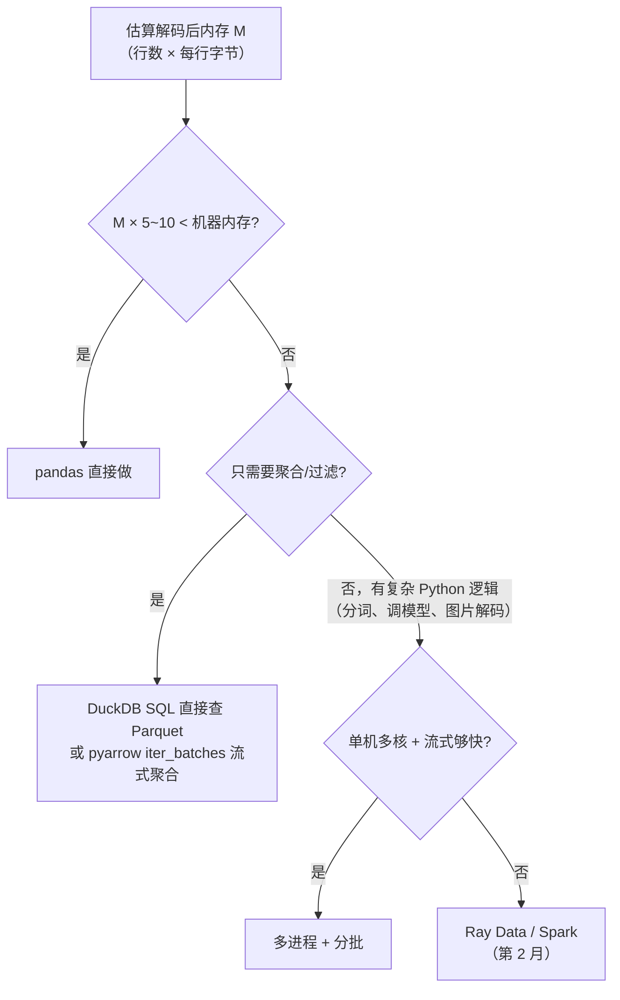

**架构视角**：在单机内存或流式处理能覆盖的规模上，DuckDB 这样的单机列式引擎往往比起一个集群更简单、更省（没有 shuffle 网络传输和调度开销）——具体拐点因数据和查询而异，要用你自己的基准测试说话。到了 LLM 数据管线，瓶颈往往不是“数据量”本身，而是**每行的处理逻辑很重**（分词、去重、用 GPU 跑模型打分）且需要 CPU/GPU 异构流水线——那才是 Ray Data 的主场。判断“该不该分布式”，是你作为架构师最值钱的能力之一。

---

## 3. 动手实验 {{local}}

所有实验在一个目录里完成，最后这个目录本身就是本周产出的一部分。**建议每个脚本都自己敲一遍（可以让 AI 助手补全，但每一行都要能解释）**，不要整段复制粘贴。

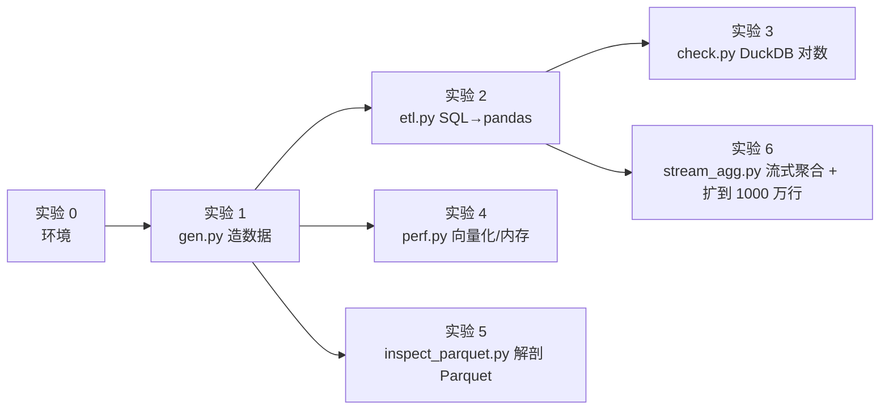

### 实验 0：建环境（15 分钟）

```bash
mkdir -p ~/ai-infra-lab/w1 && cd ~/ai-infra-lab
# numpy 2.5 需要 Python ≥ 3.12；本机没有 3.12 时 uv 会自动下载一份
uv venv --python 3.12 .venv
source .venv/bin/activate
uv pip install "numpy==2.5.4" "pandas==3.0.6" "pyarrow==26.0.0" "duckdb==1.5.6"
which python
python -c "import sys,numpy,pandas,pyarrow,duckdb; print(sys.version.split()[0], numpy.__version__, pandas.__version__, pyarrow.__version__, duckdb.__version__)"
```

**预期输出**（最后两行）：

```text
/Users/<你>/ai-infra-lab/.venv/bin/python
3.12.15 2.5.4 3.0.6 26.0.0 1.5.6
```

（Python 小版本号可能不同；本站在 Linux 上验证时 `which python` 显示的是对应 Linux 路径。）

**逐步解释**：

- `uv venv --python 3.12 .venv`：在当前目录创建虚拟环境目录 `.venv`。如果你之前用别的 Python 版本建过 `.venv`（例如按旧版实验环境页用了 3.11），这条命令会报 `A virtual environment already exists`，按提示加 `--clear` 重建即可（会清空里面已装的包，之后按需重装）。
- `source .venv/bin/activate`：把 `.venv/bin` 放到 `PATH` 最前面。**每开一个新终端都要重新执行一次**。
- 固定 `==` 版本：保证你和本页看到的行为一致。以后升级版本时，是一次**有意识的变更**，要记进实验记录。
- `which python`：确认用的是 `.venv` 里的解释器。这是排查一切“包找不到”问题的第一步。

### 实验 1：造一份“日志事实表 + 用户维表”（20 分钟）

在 `~/ai-infra-lab/w1/` 下创建 `gen.py`：

```python
"""造两张表：事件明细 events.parquet（事实表）+ 用户维表 users.parquet。"""
import argparse
import time

import numpy as np
import pandas as pd
import pyarrow as pa
import pyarrow.parquet as pq


def make_events(n: int, n_users: int, rng: np.random.Generator) -> pd.DataFrame:
    # 30 天内的随机时间点，排序后模拟“按时间追加写入”的日志表
    start = np.datetime64("2026-01-01T00:00:00")
    offsets = np.sort(rng.integers(0, 30 * 24 * 3600, n))
    event = rng.choice(["view", "click", "cart", "buy"], n, p=[0.75, 0.17, 0.05, 0.03])
    amount = np.where(event == "buy", rng.gamma(2.0, 60.0, n).round(2), 0.0)
    return pd.DataFrame({
        "user_id": rng.integers(0, n_users, n, dtype=np.int64),
        "event": event,
        "ts": start + offsets.astype("timedelta64[s]"),
        "amount": amount,
    })


def make_users(n_users: int, rng: np.random.Generator) -> pd.DataFrame:
    return pd.DataFrame({
        "user_id": np.arange(n_users, dtype=np.int64),
        "city": rng.choice(["北京", "上海", "广州", "深圳", "杭州", "成都"], n_users),
        "level": rng.choice(["L1", "L2", "L3"], n_users, p=[0.6, 0.3, 0.1]),
    })


def main() -> None:
    ap = argparse.ArgumentParser()
    ap.add_argument("--rows", type=int, default=1_000_000)
    ap.add_argument("--users", type=int, default=50_000)
    ap.add_argument("--row-group-size", type=int, default=100_000)
    ap.add_argument("--csv", action="store_true", help="同时写一份 CSV 用来比较大小")
    ap.add_argument("--seed", type=int, default=42)
    args = ap.parse_args()

    rng = np.random.default_rng(args.seed)  # 固定种子：每次生成同样的数据，结果可复现
    t = time.perf_counter()
    events = make_events(args.rows, args.users, rng)
    users = make_users(args.users, rng)
    pq.write_table(pa.Table.from_pandas(events, preserve_index=False), "events.parquet",
                   row_group_size=args.row_group_size, compression="zstd")
    users.to_parquet("users.parquet", index=False)
    if args.csv:
        events.to_csv("events.csv", index=False)
    print(events.head())
    print(events.dtypes)
    print(f"events={len(events):,} users={len(users):,} 耗时 {time.perf_counter() - t:.2f}s")


if __name__ == "__main__":
    main()
```

运行：

```bash
cd ~/ai-infra-lab/w1
python gen.py --csv
ls -lh
```

**预期输出**（本站实测）：

```text
   user_id  event                  ts  amount
0    19410  click 2026-01-01 00:00:00     0.0
1    36900   view 2026-01-01 00:00:02     0.0
2    32487   view 2026-01-01 00:00:03     0.0
3    47933   view 2026-01-01 00:00:05     0.0
4    26893  click 2026-01-01 00:00:06     0.0
user_id            int64
event                str
ts         datetime64[s]
amount           float64
dtype: object
events=1,000,000 users=50,000 耗时 1.46s
```

`ls -lh` 应看到 `events.csv` 约 33 MiB、`events.parquet` 约 7.0 MiB、`users.parquet` 约 0.3 MiB。因为固定了随机种子 `--seed 42`，同样的 numpy 版本下你生成的数据（以及后面所有行数、金额）应与本页一致；耗时会不同。

**逐段解释**：

- `np.random.default_rng(seed)`：NumPy 推荐的随机数生成器写法，固定种子保证可复现——就像造测试数据时固定样本，方便和别人对数。
- `np.sort(rng.integers(...))`：时间偏移**排序**后再生成 `ts`，模拟日志“按时间追加写入”。这一行决定了实验 5 里谓词下推能否生效，先记住它。
- `rng.choice([...], n, p=[...])`：按概率抽样生成 `event`，一次生成 100 万个，没有任何 Python 循环。
- `np.where(event == "buy", ..., 0.0)`：只有 buy 事件有金额，向量化的“CASE WHEN”。
- `pq.write_table(..., row_group_size=100_000, compression="zstd")`：每 10 万行一个行组，用 ZSTD 压缩。默认行组会更大，这里故意调小，方便实验 5 观察行组统计信息。
- `if __name__ == "__main__": main()`：Python 脚本的标准入口写法，让这个文件既能直接运行，也能被别的脚本 `import`。配合 `argparse`，它就是一个可以被调度系统（Airflow、K8s Job）调用的命令行程序。
- **dtype 观察**：`event` 显示为 `str`（pandas 3 的新字符串类型），`ts` 是 `datetime64[s]`（秒精度）。

### 实验 2：把三条 Hive SQL 改写成 pandas（45 分钟）

创建 `etl.py`。每个函数上方的注释就是等价 SQL——先读 SQL，再读 pandas，逐个子句对应：

```python
"""把三条典型的 Hive SQL 改写成 pandas。每段上方注释是等价 SQL。"""
import argparse
import resource
import time

import pandas as pd


def timed(label):
    def deco(fn):
        def wrap(*a, **kw):
            t = time.perf_counter()
            out = fn(*a, **kw)
            print(f"[{label}] {time.perf_counter() - t:.3f}s  rows={len(out)}")
            return out
        return wrap
    return deco


@timed("q1 daily pv/uv")
def q1_daily(ev: pd.DataFrame) -> pd.DataFrame:
    # SELECT to_date(ts) AS dt, event, count(*) AS pv, count(DISTINCT user_id) AS uv
    # FROM events GROUP BY to_date(ts), event
    return (ev.assign(dt=ev["ts"].dt.floor("D"))
              .groupby(["dt", "event"], observed=True)
              .agg(pv=("user_id", "size"), uv=("user_id", "nunique"))
              .reset_index())


@timed("q2 gmv by city/level")
def q2_gmv(ev: pd.DataFrame, users: pd.DataFrame) -> pd.DataFrame:
    # SELECT u.city, u.level, sum(e.amount) AS gmv, count(*) AS orders
    # FROM events e JOIN users u ON e.user_id = u.user_id
    # WHERE e.event = 'buy'
    # GROUP BY u.city, u.level ORDER BY gmv DESC
    buy = ev.loc[ev["event"] == "buy", ["user_id", "amount"]]
    return (buy.merge(users, on="user_id", how="inner")
               .groupby(["city", "level"], observed=True)
               .agg(gmv=("amount", "sum"), orders=("amount", "size"))
               .reset_index()
               .sort_values("gmv", ascending=False, ignore_index=True))


@timed("q3 top3 users per day")
def q3_top3(ev: pd.DataFrame) -> pd.DataFrame:
    # SELECT * FROM (
    #   SELECT dt, user_id, cnt,
    #          row_number() OVER (PARTITION BY dt ORDER BY cnt DESC, user_id) AS rn
    #   FROM (SELECT to_date(ts) dt, user_id, count(*) cnt FROM events GROUP BY 1, 2) t
    # ) x WHERE rn <= 3
    daily = (ev.assign(dt=ev["ts"].dt.floor("D"))
               .groupby(["dt", "user_id"]).size().rename("cnt").reset_index())
    daily = daily.sort_values(["dt", "cnt", "user_id"], ascending=[True, False, True])
    daily["rn"] = daily.groupby("dt").cumcount() + 1
    return daily[daily["rn"] <= 3].reset_index(drop=True)


def main() -> None:
    ap = argparse.ArgumentParser()
    ap.add_argument("--events", default="events.parquet")
    ap.add_argument("--users", default="users.parquet")
    args = ap.parse_args()

    t = time.perf_counter()
    ev = pd.read_parquet(args.events)
    users = pd.read_parquet(args.users)
    print(f"[read] {time.perf_counter() - t:.3f}s  events={len(ev):,}  "
          f"内存 {ev.memory_usage(deep=True).sum() / 2**20:.1f} MiB")

    r1, r2, r3 = q1_daily(ev), q2_gmv(ev, users), q3_top3(ev)
    r1.to_parquet("q1_daily.parquet", index=False)
    r2.to_parquet("q2_gmv.parquet", index=False)
    r3.to_parquet("q3_top3.parquet", index=False)
    print(r1.head(4), r2.head(3), r3.head(3), sep="\n\n")
    # Linux 上 ru_maxrss 单位是 KiB；macOS 上是字节（见页面说明）
    print(f"\n总耗时 {time.perf_counter() - t:.2f}s  峰值内存(ru_maxrss) "
          f"{resource.getrusage(resource.RUSAGE_SELF).ru_maxrss / 1024:.0f} MiB")


if __name__ == "__main__":
    main()
```

```bash
python etl.py
```

**预期输出**（本站实测，耗时会不同）：

```text
[read] 0.069s  events=1,000,000  内存 34.5 MiB
[q1 daily pv/uv] 0.154s  rows=120
[q2 gmv by city/level] 0.019s  rows=18
[q3 top3 users per day] 0.229s  rows=90
          dt  event     pv     uv
0 2026-01-01    buy   1007    995
1 2026-01-01   cart   1597   1572
2 2026-01-01  click   5823   5511
3 2026-01-01   view  24919  19611

  city level        gmv  orders
0   广州    L1  369391.02    3028
1   北京    L1  367541.64    3048
2   上海    L1  366105.88    3034

          dt  user_id  cnt  rn
0 2026-01-01     1560    7   1
1 2026-01-01     6887    6   2
2 2026-01-01     7908    6   3

总耗时 0.48s  峰值内存(ru_maxrss) 376 MiB
```

**逐段解释**：

- **装饰器 `@timed`**：`timed(label)` 返回一个包装函数，在调用前后计时。你不必马上会写装饰器，但要能读懂：它等价于 `q1_daily = timed("...")(q1_daily)`。
- **q1**：`ev.assign(dt=...)` 新增一列而不修改原表（返回新 DataFrame）；`dt.floor("D")` 把时间截到天，等价于 `to_date(ts)`；`.agg(pv=("user_id", "size"), uv=("user_id", "nunique"))` 是“命名聚合”，左边是输出列名，右边是 `(输入列, 聚合函数)`；`observed=True` 表示只输出实际出现过的分组组合（分组键是 category 类型时才有区别，写上是好习惯）。
- **q2**：先过滤、只取两列，再 `merge`——**手动做了谓词下推和列裁剪**，因为 pandas 不会替你优化。如果先 `merge` 整表再过滤，会多产生一个 100 万行 × 6 列的中间结果。
- **q3**：窗口函数没有一一对应的 API，用“排序 + `groupby().cumcount()`”实现 `row_number()`。排序键里加了 `user_id`，保证并列时名次稳定——和 SQL 里 `ORDER BY cnt DESC, user_id` 一样，否则两次运行的 Top3 可能不同。
- **`ru_maxrss`**：进程的峰值常驻内存。Linux 上单位是 KiB（所以除以 1024 得 MiB）；**macOS 上单位是字节**，在 Mac 上要改成除以 `2**20`，否则你会看到一个大得离谱的数。
- 注意 `[read]` 的内存 34.5 MiB 与 2.4 节的手算结果一致，而峰值内存 376 MiB 远大于它——其中包括 Python 解释器和几个库本身的加载开销，以及计算时的中间结果。

### 实验 3：用 DuckDB 跑原始 SQL 对数（20 分钟）

做数仓的人都知道：**改写之后不对数，等于没改写**。DuckDB 是一个嵌入式（进程内）列式 SQL 引擎，可以直接 `FROM 'xxx.parquet'` 查询文件。创建 `check.py`：

```python
"""对数：用 DuckDB 直接对 Parquet 跑原始 SQL，与 pandas 结果逐行比对。"""
import duckdb
import pandas as pd
from pandas.testing import assert_frame_equal

SQL = {
    "q1_daily": """
        SELECT date_trunc('day', ts) AS dt, event, count(*) AS pv, count(DISTINCT user_id) AS uv
        FROM 'events.parquet' GROUP BY 1, 2""",
    "q2_gmv": """
        SELECT u.city, u.level, sum(e.amount) AS gmv, count(*) AS orders
        FROM 'events.parquet' e JOIN 'users.parquet' u USING (user_id)
        WHERE e.event = 'buy' GROUP BY 1, 2""",
    "q3_top3": """
        SELECT * FROM (
          SELECT dt, user_id, cnt,
                 row_number() OVER (PARTITION BY dt ORDER BY cnt DESC, user_id) AS rn
          FROM (SELECT date_trunc('day', ts) AS dt, user_id, count(*) AS cnt
                FROM 'events.parquet' GROUP BY 1, 2)
        ) WHERE rn <= 3""",
}

for name, sql in SQL.items():
    want = duckdb.sql(sql).df()
    got = pd.read_parquet(f"{name}.parquet")
    keys = list(got.columns[:2])
    norm = lambda d: d.astype({c: "int64" for c in d.columns if d[c].dtype.kind in "iu"}) \
                      .sort_values(keys, ignore_index=True)
    # 浮点求和顺序不同会有极小误差，所以用 rtol 而不是精确相等
    assert_frame_equal(norm(got), norm(want), check_dtype=False, rtol=1e-9)
    print(f"{name}: OK ({len(got)} 行一致)")
```

```bash
python check.py
```

**预期输出**：

```text
q1_daily: OK (120 行一致)
q2_gmv: OK (18 行一致)
q3_top3: OK (90 行一致)
```

**逐段解释**：

- `duckdb.sql(sql).df()`：执行 SQL 并把结果转成 pandas DataFrame（中间经过 Arrow）。
- `norm`：两边的整数类型可能不同（DuckDB 的 `count` 是 int64，pandas 的可能是别的整数宽度），排序也不保证一致，所以先统一类型、按前两列排序再比较。
- `rtol=1e-9`：浮点数求和的顺序不同，结果可能差在最后几位，这是浮点运算的正常现象，不是 bug。你在 Hive 和 Spark 之间对金额时遇到过同样的问题。
- **故意制造一次失败**：把 `etl.py` 里 q3 的 `<= 3` 改成 `< 3` 重跑 `etl.py` 和 `check.py`，观察 `assert_frame_equal` 给出的差异报告，然后改回来。

### 实验 4：循环 vs 向量化，以及 dtype 的内存账（30 分钟）

创建 `perf.py`：

```python
"""两个实验：① Python 循环 vs 向量化；② 同一列用不同 dtype 的内存占用。"""
import time

import numpy as np
import pandas as pd

ev = pd.read_parquet("events.parquet")
n = len(ev)

# ① 给 buy 事件打 9 折：逐行循环 vs 向量化
t = time.perf_counter()
out = []
for e, a in zip(ev["event"], ev["amount"]):          # 每一行都在 Python 解释器里走一遍
    out.append(a * 0.9 if e == "buy" else a)
loop_s = time.perf_counter() - t

t = time.perf_counter()
vec = np.where(ev["event"] == "buy", ev["amount"] * 0.9, ev["amount"])   # 循环在 C 里完成
vec_s = time.perf_counter() - t
assert np.allclose(out, vec)
print(f"逐行循环 {loop_s:.3f}s | 向量化 {vec_s:.4f}s | 加速 {loop_s / vec_s:.0f}x")

t = time.perf_counter()
ev.apply(lambda r: r["amount"] * 0.9 if r["event"] == "buy" else r["amount"], axis=1)
print(f"df.apply(axis=1) {time.perf_counter() - t:.3f}s  ← 看起来像向量化，其实仍是逐行")

# ② 同一列 event（4 种取值、100 万行）的三种存法
for name, s in {
    "object（Python 字符串对象）": ev["event"].astype(object),
    "str（pandas 3 默认，Arrow 存储）": ev["event"],
    "category（字典编码）": ev["event"].astype("category"),
}.items():
    print(f"{name:32s} {s.memory_usage(deep=True) / 2**20:6.2f} MiB")
print(f"int64 列 user_id                 {ev['user_id'].memory_usage(deep=True) / 2**20:6.2f} MiB"
      f"  (= {n:,} 行 × 8 字节)")
```

```bash
python perf.py
```

**预期输出**（本站实测，耗时会不同）：

```text
逐行循环 0.587s | 向量化 0.0171s | 加速 34x
df.apply(axis=1) 3.574s  ← 看起来像向量化，其实仍是逐行
object（Python 字符串对象）              50.68 MiB
str（pandas 3 默认，Arrow 存储）         11.58 MiB
category（字典编码）                     0.95 MiB
int64 列 user_id                   7.63 MiB  (= 1,000,000 行 × 8 字节)
```

**怎么读这个结果**：

- 对照 2.4 节的例题，**先手算、再看实测**。三种字符串存法的内存应与手算结果对上；对不上就说明你对某种存储布局的理解有偏差，回去重读 2.4 和 2.6。
- `memory_usage(deep=True)`：`deep=True` 才会把 object 列里每个 Python 字符串对象的大小算进去；不加的话只算 8 字节指针，会严重低估。
- `assert np.allclose(out, vec)`：优化之后先断言结果一致，再谈性能。这是好习惯。

### 实验 5：解剖一个 Parquet 文件，验证列裁剪和谓词下推（40 分钟）

创建 `inspect_parquet.py`：

```python
"""看清 Parquet 文件的内部结构，并验证“列裁剪”和“谓词下推”。"""
import os
from datetime import datetime
import time

import pyarrow.compute as pc
import pyarrow.dataset as ds
import pyarrow.parquet as pq

f = pq.ParquetFile("events.parquet")
md = f.metadata
print(f"CSV {os.path.getsize('events.csv') / 2**20:.1f} MiB vs "
      f"Parquet {os.path.getsize('events.parquet') / 2**20:.1f} MiB")
print(f"行数={md.num_rows:,} 行组数={md.num_row_groups} 列数={md.num_columns}")
print(f.schema_arrow)

rg = md.row_group(0)
print(f"\n第 0 个行组：{rg.num_rows:,} 行")
for i in range(rg.num_columns):
    c = rg.column(i)
    s = c.statistics
    print(f"  {c.path_in_schema:8s} {c.compression:5s} 压缩后 {c.total_compressed_size / 1024:7.1f} KiB "
          f"解压后 {c.total_uncompressed_size / 1024:7.1f} KiB  编码 {c.encodings}  "
          f"min={s.min} max={s.max}")

print("\n每个行组 ts 的 [min, max]：")
for i in range(md.num_row_groups):
    s = md.row_group(i).column(2).statistics
    print(f"  rg{i}: {s.min} ~ {s.max}")


def bench(label, fn, repeat=5):
    best = min((lambda t: (fn(), time.perf_counter() - t)[1])(time.perf_counter()) for _ in range(repeat))
    print(f"{label:34s} {best * 1000:7.1f} ms")


print("\n--- 列裁剪（只读需要的列） ---")
bench("读全部 4 列", lambda: pq.read_table("events.parquet"))
bench("只读 user_id, event", lambda: pq.read_table("events.parquet", columns=["user_id", "event"]))

print("\n--- 谓词下推（按行组统计信息跳过） ---")
dset = ds.dataset("events.parquet")
lo, hi = datetime(2026, 1, 10), datetime(2026, 1, 11)
flt = (pc.field("ts") >= lo) & (pc.field("ts") < hi)   # WHERE ts >= '2026-01-10' AND ts < '2026-01-11'
frags = list(dset.get_fragments())
kept = [p.row_groups[0].id for fr in frags for p in fr.split_by_row_group(flt)]
print(f"过滤 2026-01-10 当天：{md.num_row_groups} 个行组里只需读 {len(kept)} 个 -> {kept}")
bench("全表读再过滤", lambda: pq.read_table("events.parquet").filter(flt))
bench("filters= 下推", lambda: pq.read_table("events.parquet", filters=flt))
print("下推结果行数:", pq.read_table("events.parquet", filters=flt).num_rows)
```

```bash
python inspect_parquet.py
```

**预期输出**（本站实测，耗时会不同）：

```text
CSV 33.4 MiB vs Parquet 7.0 MiB
行数=1,000,000 行组数=10 列数=4
user_id: int64
event: large_string
ts: timestamp[ms]
amount: double
-- schema metadata --
pandas: '{"index_columns": [], "column_indexes": [], "columns": [{"name":' + 535

第 0 个行组：100,000 行
  user_id  ZSTD  压缩后   274.4 KiB 解压后   528.6 KiB  编码 ('PLAIN', 'RLE', 'RLE_DICTIONARY')  min=0 max=49999
  event    ZSTD  压缩后    16.7 KiB 解压后    25.0 KiB  编码 ('PLAIN', 'RLE', 'RLE_DICTIONARY')  min=buy max=view
  ts       ZSTD  压缩后   416.2 KiB 解压后   845.3 KiB  编码 ('PLAIN', 'RLE', 'RLE_DICTIONARY')  min=2026-01-01 00:00:00 max=2026-01-04 00:03:40
  amount   ZSTD  压缩后    22.2 KiB 解压后    58.2 KiB  编码 ('PLAIN', 'RLE', 'RLE_DICTIONARY')  min=-0.0 max=656.29

每个行组 ts 的 [min, max]：
  rg0: 2026-01-01 00:00:00 ~ 2026-01-04 00:03:40
  rg1: 2026-01-04 00:03:41 ~ 2026-01-06 23:48:51
  rg2: 2026-01-06 23:48:59 ~ 2026-01-09 23:51:43
  rg3: 2026-01-09 23:51:46 ~ 2026-01-12 23:49:48
  rg4: 2026-01-12 23:49:55 ~ 2026-01-15 23:53:05
  rg5: 2026-01-15 23:53:05 ~ 2026-01-18 23:37:23
  rg6: 2026-01-18 23:37:23 ~ 2026-01-21 23:32:51
  rg7: 2026-01-21 23:32:51 ~ 2026-01-24 23:37:57
  rg8: 2026-01-24 23:38:05 ~ 2026-01-27 23:49:45
  rg9: 2026-01-27 23:49:47 ~ 2026-01-30 23:59:57

--- 列裁剪（只读需要的列） ---
读全部 4 列                                6.3 ms
只读 user_id, event                      3.8 ms

--- 谓词下推（按行组统计信息跳过） ---
过滤 2026-01-10 当天：10 个行组里只需读 1 个 -> [3]
全表读再过滤                                 8.2 ms
filters= 下推                            3.1 ms
下推结果行数: 33494
```

**怎么读这个结果**：

- **CSV 33.4 MiB vs Parquet 7.0 MiB**：列存 + 编码 + 压缩的综合效果。
- **schema 里的两个细节**：`event` 是 `large_string`（就是 2.6 节画的 64 位偏移布局）；`ts` 在 pandas 里是秒精度，写进 Parquet 后变成了 `timestamp[ms]`——pyarrow 写 Parquet 时把秒精度时间戳转换成了毫秒精度存储。**跨系统传数据时，时间精度和时区是最常见的“对不上数”来源之一**，和 Hive/Spark 之间 timestamp 对不齐是一类问题。
- **编码列表** 里出现 `RLE_DICTIONARY`：说明列块用了字典编码。`event` 压缩后仅 16.7 KiB，而 `ts`（几乎每行都不同）416 KiB。
- `amount` 的 `min=-0.0`：这是浮点统计信息对 0 的一种规范化写法，数值上等于 0。
- **行组的 ts 区间首尾相接、互不重叠**——这就是“按时间排序写入”的结果，所以 1 月 10 日的查询只需读 `rg3`。
- **耗时差距不大（毫秒级）**：因为文件只有 7 MiB 且已经在操作系统缓存里。在对象存储上读 TB 级数据时，“少读 90% 的字节”直接就是“少花 90% 的时间和流量费”。看比例，不要看绝对值。

再看 DuckDB 的执行计划，创建 `explain.py`：

```python
"""看 DuckDB 的执行计划：列裁剪和过滤条件是否被“推”进了 Parquet 扫描算子。"""
import duckdb

plan = duckdb.sql("""
    EXPLAIN
    SELECT event, count(*) AS pv
    FROM 'events.parquet'
    WHERE ts >= TIMESTAMP '2026-01-10' AND ts < TIMESTAMP '2026-01-11'
    GROUP BY event
""").fetchall()
print(plan[0][1])
```

```bash
python explain.py
```

**预期输出**（关键部分）：

```text
┌─────────────┴─────────────┐
│        PARQUET_SCAN       │
│    ────────────────────   │
│         Function:         │
│        PARQUET_SCAN       │
│                           │
│     Projections: event    │
│                           │
│          Filters:         │
│ ts>='2026-01-10 00:00:00':│
│ :TIMESTAMP AND ts<'2026-01│
│  -11 00:00:00'::TIMESTAMP │
│                           │
│       ~200,000 rows       │
└───────────────────────────┘
```

`Projections: event` 说明只读了 `event` 列（`ts` 只用于过滤），`Filters:` 说明过滤条件被下推进了扫描算子。`~200,000 rows` 是优化器的**行数估计**而不是实际行数（实际是 33,494 行）——和你看 Hive `EXPLAIN` 里的 Statistics 一样，估计值只用来做计划选择。**对比**：pandas 没有执行计划，这些优化全靠你手写 `columns=` 和 `filters=`。

### 实验 6：流式分批聚合 + 扩大到 1000 万行（45 分钟）

创建 `stream_agg.py`（需要先跑过实验 2，因为它要读 `q1_daily.parquet` 作为标准答案）：

```python
"""流式（分批）聚合：内存里一次只放一个 batch，像 MapReduce 的 map + combiner + reduce。"""
import resource
from collections import defaultdict

import pandas as pd
import pyarrow.parquet as pq

pf = pq.ParquetFile("events.parquet")
pv = defaultdict(int)          # 可加（additive）指标：分批求和即可合并
uv_sets = defaultdict(set)     # 去重计数不可加：必须保留明细（或用 HyperLogLog 近似）
uv_wrong = defaultdict(int)    # 错误示范：把每批的 UV 直接相加

for i, batch in enumerate(pf.iter_batches(batch_size=200_000, columns=["user_id", "event", "ts"])):
    df = batch.to_pandas()
    df["dt"] = df["ts"].dt.floor("D")
    g = df.groupby(["dt", "event"])["user_id"]
    for k, v in g.size().items():
        pv[k] += v
    for k, v in g.nunique().items():
        uv_wrong[k] += v
    for k, ids in g.unique().items():
        uv_sets[k].update(ids)
    print(f"batch {i}: {len(df):,} 行")

full = pd.read_parquet("q1_daily.parquet").set_index(["dt", "event"])
pv_ok = all(pv[k] == full.loc[k, "pv"] for k in full.index)
uv_ok = all(len(uv_sets[k]) == full.loc[k, "uv"] for k in full.index)
bad = sum(uv_wrong[k] != full.loc[k, "uv"] for k in full.index)
print(f"PV 与全量结果一致: {pv_ok}")
print(f"UV(集合合并) 与全量结果一致: {uv_ok}")
print(f"UV(每批相加) 出错的分组数: {bad} / {len(full)}")
print(f"峰值内存(ru_maxrss) {resource.getrusage(resource.RUSAGE_SELF).ru_maxrss / 1024:.0f} MiB")
```

```bash
python stream_agg.py
```

**预期输出**（100 万行）：

```text
batch 0: 200,000 行
batch 1: 200,000 行
batch 2: 200,000 行
batch 3: 200,000 行
batch 4: 200,000 行
PV 与全量结果一致: True
UV(集合合并) 与全量结果一致: True
UV(每批相加) 出错的分组数: 11 / 120
峰值内存(ru_maxrss) 288 MiB
```

**为什么“每批相加”只错 11 个**：数据按时间排序，每批 20 万行覆盖约 6 天，只有被批次边界切开的那几天，同一个用户才可能在两批里各被数一次。

**扩大到 1000 万行**（另建一个目录，避免覆盖 100 万行的结果；生成的数据约 37 MiB，运行时需要约 1.5 GiB 空闲内存）：

```bash
mkdir -p ~/ai-infra-lab/w1big && cd ~/ai-infra-lab/w1big
cp ../w1/*.py .
python gen.py --rows 10000000 --row-group-size 1000000
python etl.py
python check.py
python stream_agg.py
```

**本站实测**（只保留关键行）：

```text
events=10,000,000 users=50,000 耗时 3.00s
[read] 0.171s  events=10,000,000  内存 344.7 MiB
[q1 daily pv/uv] 1.550s  rows=120
[q2 gmv by city/level] 0.119s  rows=18
[q3 top3 users per day] 0.957s  rows=90
总耗时 2.81s  峰值内存(ru_maxrss) 1476 MiB
q1_daily: OK (120 行一致)
q2_gmv: OK (18 行一致)
q3_top3: OK (90 行一致)
PV 与全量结果一致: True
UV(集合合并) 与全量结果一致: True
UV(每批相加) 出错的分组数: 120 / 120
峰值内存(ru_maxrss) 490 MiB
```

**怎么读这个结果**：

- `events.parquet` 37.1 MiB → 内存 344.7 MiB → 全量计算峰值 1476 MiB；流式聚合峰值只有 490 MiB（其中相当一部分是去重集合本身）。这就是 2.7 节“磁盘大小 ≠ 内存大小”的实测版。
- 每批 20 万行已经不到一天的数据量，所以**每个分组都被切开**，“每批相加”的 UV 全部偏大。同一段错误代码，在 100 万行上“看起来基本对”，在 1000 万行上全错。
- 1000 万行时 q1 耗时 1.55s，其中大部分在 `nunique`。作为对比，本站用 DuckDB 跑同一条 q1 SQL 约 0.51s（8 线程）——pandas 的 groupby 主要在单线程里执行。

### 常见错误与排查

| 现象（真实报错） | 原因 | 解决 |
|---|---|---|
| `ModuleNotFoundError: No module named 'pyarrow'` | 当前 `python` 不是 `.venv` 里的那个（忘了 `activate`，或新开了终端） | `which python` 检查；`source ~/ai-infra-lab/.venv/bin/activate` |
| `ImportError: Unable to find a usable engine; tried using: 'pyarrow', 'fastparquet'.` | 环境里有 pandas 但没装 pyarrow，读写 Parquet 需要它 | `uv pip install "pyarrow==26.0.0"` |
| `error: Failed to create virtual environment` / `A virtual environment already exists at: .venv` | 目录里已经有一个虚拟环境 | 确认不需要后 `uv venv --clear --python 3.12 .venv` |
| `ChainedAssignmentError: A value is being set on a copy of a DataFrame or Series through chained assignment.` | `df[条件]["列"] = 值` 这种两步赋值，pandas 3 下永远不会改到原表 | 改成一步：`df.loc[条件, "列"] = 值` |
| join 后行数莫名变多（本站实测：维表混入 100 行重复后，100 万行 join 出 1,002,091 行） | 维表主键不唯一，一对多变多对多 | `merge(..., validate="many_to_one")`，重复时立即报 `MergeError: Merge keys are not unique in right dataset; not a many-to-one merge` |
| 进程被系统杀掉 / Mac 弹出“内存不足”（未在本站复现） | 解码后数据 × 中间结果超出内存 | 只读需要的列（`columns=`）、先过滤（`filters=`）、低基数列转 `category`、改用 `iter_batches` 流式处理或 DuckDB |
| Mac 上 `ru_maxrss` 显示成几十万 MiB | macOS 的 `ru_maxrss` 单位是字节，不是 KiB | Mac 上改成 `/ 2**20` |
| `check.py` 报浮点不相等 | 求和顺序不同导致的极小误差 | 用 `rtol` 容差比较；金额类业务可考虑用整数“分”存储 |

### 扩展练习（选做，每题 20–40 分钟）

1. **打乱顺序，看下推失效**：在 `gen.py` 里去掉 `np.sort(...)`（只改这一处），重新生成数据后跑 `inspect_parquet.py`。预测：每个行组的 ts 区间会变成什么样？“只需读几个行组”？再跑 `stream_agg.py`，“每批相加”会错多少个分组？先写下预测再运行。
2. **改用 category**：在 `etl.py` 读入后加一行 `ev["event"] = ev["event"].astype("category")`，比较 `[read]` 的内存和 q1 的耗时，并解释 `observed=True` 此时起什么作用（试试去掉它）。
3. **近似去重**：在 DuckDB 里用 `approx_count_distinct(user_id)` 替换 `count(DISTINCT user_id)`，计算每个分组的相对误差。本站在 1000 万行数据上测得平均相对误差约 8.6%、最大约 34%，误差比你想象的大还是小？查阅 DuckDB 文档，思考它和 Kylin 等 OLAP 引擎里 HLL 精度参数的关系，以及 UV 报表能否接受这样的误差。
4. **用你自己的 SQL**：挑一条你工作中写过的、带 Join 和窗口函数的 Hive SQL，造一份对应的假数据，用 pandas 改写，再用 DuckDB 跑原 SQL 对数（DuckDB 方言与 Hive 有差异，例如日期函数名不同，需要小幅改写）。
5. **把 `etl.py` 改成纯 pyarrow 实现**：用 `pyarrow.compute` 和 `Table.group_by().aggregate()` 实现 q1，比较与 pandas 的耗时和内存。

---

## 4. 精读指南

不要从头到尾读完所有资料。下面每份资料都给出**读哪里、重点看什么、读完要能回答的问题**。读的时候把答案写进本周笔记。

### ④ pandas：Comparison with SQL（本周最重要，30 分钟）

[链接](https://pandas.pydata.org/docs/getting_started/comparison/comparison_with_sql.html)

- **读哪里**：全文。重点看 *WHERE*、*GROUP BY*、*JOIN*、*UNION*，以及末尾 *pandas equivalents for some SQL analytic and aggregate functions* 里的 *Top n rows with offset* / *Top n rows per group*。
- **重点**：`groupby` 后 `size()` 和 `count()` 的区别；`merge` 的 `how` 参数与四种 JOIN 的对应；“每组 TopN”有几种写法。
- **读完回答**：
  1. `df.groupby("k").count()` 和 `df.groupby("k").size()` 在有空值时结果有何不同？分别对应 SQL 的什么？
  2. SQL 的 `UNION` 和 `UNION ALL` 在 pandas 里分别怎么写？
  3. 文中“每组 TopN”的写法和本页 q3 的写法有什么不同？哪种在并列时结果稳定？

### ③⑤ 《Python for Data Analysis》第 3 版（80 分钟）

[免费在线版](https://wesmckinney.com/book/)，作者就是 pandas 的创建者 Wes McKinney。

- **读哪里**：第 4 章 *4.1 The NumPy ndarray*、*4.3 Universal Functions*；第 8 章 *8.2 Combining and Merging Datasets*；第 10 章 *10.1 How to Think About Group Operations*、*10.2 Data Aggregation*。第 2、3 章（Python 语法与内置数据结构）如果语法生疏，可以快速翻一遍当字典用。
- **重点**：ndarray 的 dtype 与 shape；“通用函数（ufunc）”为什么快；merge 时的键重复问题；groupby 的 split-apply-combine 图。
- **读完回答**：
  1. ndarray 和 Python list 在内存上的根本区别是什么？（对照本页 2.3 节的图）
  2. 两张表在连接键上**都有重复值**时，merge 结果的行数怎么算？
  3. `agg` 和 `apply` 有什么区别？为什么内置聚合函数比自定义 `apply` 快？
- **注意**：本书基于 pandas 2.0；字符串 dtype 与链式赋值行为以 pandas 3.0 发布说明为准（见第 1 节提醒）。

### ⑥⑦⑧ Parquet / Arrow 规范与 pyarrow 文档（65 分钟）

- [Parquet Concepts](https://parquet.apache.org/docs/concepts/) 与 [File Format](https://parquet.apache.org/docs/file-format/)：把本页 2.7 节的结构图和官方定义对照一遍。**读完回答**：row group、column chunk、page 分别是什么的最小单位？为什么元数据放在文件**末尾**而不是开头（提示：想想写入时什么时候才知道每个列块的偏移和统计信息）？
- [Parquet：Configurations](https://parquet.apache.org/docs/file-format/configurations/)：读 *Row Group Size* 一段。**读完回答**：官方推荐 512MB–1GB 行组的理由是什么？在对象存储 + 小 block 的 Ray Data 场景下，这个理由还成立吗？
- [Arrow 列式格式](https://arrow.apache.org/docs/format/Columnar.html)：只读 *Validity bitmaps*、*Fixed-size Primitive Layout*、*Variable-size Binary Layout*。**读完回答**：画出字符串数组 `["ab", null, "cde"]` 的三块缓冲区内容（有效位图、偏移量、数据）。
- [pyarrow Parquet 文档](https://arrow.apache.org/docs/python/parquet/parquet.html)：读 *Inspecting the Parquet File Metadata* 和 *Filtering*。**读完回答**：`read_table(filters=...)` 能跳过行组的前提是什么？

### ⑨⑩ 单机的边界（40 分钟）

- [pandas：Scaling to large datasets](https://pandas.pydata.org/docs/user_guide/scale.html)：官方给出的几条建议是 *Load less data*、*Use efficient datatypes*、*Use chunking*、*Use Other Libraries*。**读完回答**：这四条分别对应本周哪个实验？
- [Wes McKinney：Apache Arrow and the "10 Things I Hate About pandas"](https://wesmckinney.com/blog/apache-arrow-pandas-internals/)（选读）：pandas 作者自己总结的 pandas 设计缺陷，以及 Arrow 想解决什么。**读完回答**：“5～10 倍内存”的经验法则从何而来？文中列出的问题有哪些在 pandas 3 + Arrow 字符串里已经缓解了？

### 背景阅读（不计入本周时间，有空再看）

- [廖维明《工程师的 AI 学习指南》](https://www.liaoweiming.org/blog/ai-learning-guide-for-engineers)（博客·入门）：大数据工程师转 AI 的亲历学习路径。
- [ai-system-design-guide：TRANSITION_GUIDE](https://github.com/ombharatiya/ai-system-design-guide/blob/main/TRANSITION_GUIDE.md)（仓库·入门）：Data/Platform Engineer 转 AI Infra 的技能差距梳理。读的时候标出你已经具备、只需“换名字”的技能。
- [Chip Huyen《AI Engineering》配套仓库](https://github.com/chiphuyen/aie-book)（书·入门）：从工程视角看基础模型应用全貌，帮助理解上层需求。
- [微软 AI-System 课程](https://github.com/microsoft/AI-System)（书·进阶）：AI 系统全景课程讲义（中英文），可先浏览目录，建立后面 24 周的全景图。

---

## 5. 自测题

先自己作答（写在纸上或笔记里），再展开答案核对。

<details>
<summary>1. 你在终端里 <code>uv pip install pyarrow</code> 成功了，但运行脚本时报 <code>ModuleNotFoundError: No module named 'pyarrow'</code>。列出两种可能原因和排查命令。</summary>

① 运行脚本的终端没有 `activate` 虚拟环境（或新开了终端），`python` 指向系统解释器；② 安装时激活的是另一个虚拟环境（在别的目录里），包装到了那个环境的 site-packages。排查：`which python` 看解释器路径；`python -c "import sys; print(sys.prefix)"` 看当前环境根目录；`uv pip list` 看当前环境里有没有 pyarrow。

</details>

<details>
<summary>2. 为什么 <code>df.apply(f, axis=1)</code> 比纯 Python 循环还慢？</summary>

`apply(axis=1)` 仍然是对每一行调用一次 Python 函数 `f`，而且每次调用前 pandas 要先把这一行构造成一个 Series 对象（有索引、有 dtype 推断），开销比直接 `zip` 两列取值更大。实验 4 实测：循环 0.587s，`apply(axis=1)` 3.574s。

</details>

<details>
<summary>3. 一张 5000 万行的表有 3 列：<code>user_id: int64</code>、<code>ts: datetime64</code>、<code>city: str</code>（平均 6 字节 UTF-8）。估算它在 pandas 3 里的内存；如果 <code>city</code> 只有 300 种取值，怎么优化？</summary>

每行 8 + 8 + (8 + 6) = 30 字节；30 × 5×10⁷ = 1.5×10⁹ 字节 ≈ 1.4 GiB。按 5～10 倍经验法则，做复杂计算需要约 7～14 GiB 内存。`city` 转 `category`：300 种取值时编码数组是 int16（本站实测 pandas 3.0.6：类别数 ≤126 用 int8，≥127 改用 int16），每行 2 字节，`city` 从 14 字节降到约 2 字节，整表约 18 字节/行 ≈ 0.84 GiB。

</details>

<details>
<summary>4. Parquet 的谓词下推为什么在本周实验里只读了 1 个行组？什么情况下它会完全失效？</summary>

读取前先看 footer 里每个行组 `ts` 列的 min/max，只有区间与过滤条件相交的行组才需要读。数据按 `ts` 排序写入，每个行组覆盖约 3 天且互不重叠，所以 1 月 10 日只落在 rg3。如果数据在 `ts` 上是乱序的，每个行组的 min/max 都接近整月范围，所有行组都与条件相交，一个也跳不掉。另外，如果过滤的是**没有统计信息**或统计信息无法用于判断的列/表达式，也无法跳过。

</details>

<details>
<summary>5. 一个 Parquet 文件 4 GB，机器内存 32 GB，用 pandas 读整表做 groupby 会不会 OOM？你需要先知道什么？</summary>

不能只看文件大小。需要先知道**解码后的内存大小**：压缩率和编码方式（字典编码的列读出来会展开）、列的 dtype（字符串列尤其关键）。本周实测 Parquet → pandas 膨胀约 9 倍，4 GB 文件可能变成 30+ GB 内存，再加计算中间结果，很可能 OOM。先用 `pq.ParquetFile(...).metadata` 看行数和各列 `total_uncompressed_size`，用小样本测 `memory_usage(deep=True)` 外推；再决定是只读部分列、流式处理，还是交给 DuckDB。

</details>

<details>
<summary>6. 为什么“把每批 UV 相加”是错的？在什么数据分布下它<b>碰巧</b>是对的？</summary>

去重计数不可加：同一个用户如果在两个批次里都出现，会被数两次。只有当同一分组内的同一用户**只可能出现在一个批次里**时，相加才正确——例如数据先按（分组键, user_id）分区/排序，保证同一键的所有行落在同一批。这正是 MapReduce 里按 key shuffle 后再在 reducer 端去重的原因。

</details>

<details>
<summary>7. 在 pandas 3 里写 <code>df[df["event"] == "buy"]["amount"] = 0</code> 会发生什么？正确写法是什么？</summary>

不会修改 `df`，并给出 `ChainedAssignmentError` 警告。原因是 Copy-on-Write：`df[条件]` 的结果总是表现得像一份副本，第二步赋值改的是这个临时副本。正确写法：`df.loc[df["event"] == "buy", "amount"] = 0`。

</details>

<details>
<summary>8. Arrow 的 <code>string</code> 和 <code>large_string</code> 区别是什么？对内存有什么影响？</summary>

两者布局相同（有效位图 + 偏移量 + 数据），区别是偏移量宽度：`string` 用 32 位，`large_string` 用 64 位。32 位偏移意味着单个数组的数据缓冲区不能超过约 2 GiB；64 位没有这个限制，但每行多 4 字节偏移量开销。本周实测的 `event` 列每行 8 字节偏移，正是 `large_string`。

</details>

<details>
<summary>9. 在 <code>etl.py</code> 的 q2 里，为什么先过滤再 merge？如果写成先 merge 再过滤，结果会不同吗？</summary>

结果相同（inner join 和过滤可交换），但性能和内存不同：先过滤只有约 3 万行 buy 事件参与 join；先 merge 会产生 100 万行 × 6 列的中间结果再丢掉 97%。pandas 是立即执行的，没有优化器替你做谓词下推，这件事必须你自己做。DuckDB/Spark 的优化器会自动完成。

</details>

<details>
<summary>10. DuckDB <code>EXPLAIN</code> 里的 <code>~200,000 rows</code> 是什么意思？实际行数是多少？</summary>

是优化器对 PARQUET_SCAN 输出行数的**估计值**，用于选择执行计划；实际满足条件的是 33,494 行（`inspect_parquet.py` 的输出）。和 Hive/Spark 一样，估计值可能偏差很大，不能当真实结果。

</details>

### 思考题（架构师视角，没有标准答案，写成 200–300 字的短文）

1. **单机 vs 分布式的拐点**：你的团队要每天处理 200 GB（Parquet 压缩后）的日志做特征统计。请用本周的内存估算方法给出一个判断流程：什么条件下用一台大内存机器 + DuckDB，什么条件下必须上 Spark/Ray？需要先测量哪些数字？
2. **行组大小的取舍**：Parquet 官方建议 512MB–1GB 的行组，Ray Data 的 block 目标是 1–128 MiB。如果你负责一个“写一次、被训练作业反复按列读取”的样本库，行组大小、排序键、文件大小分别怎么定？列出你会做的基准测试。
3. **对数机制的平台化**：本周你用 DuckDB 给 pandas 改写对数。如果公司要把几百个 Hive 作业迁移到 Python/Ray 管线，你会怎样把“对数”做成平台能力（抽样策略、容差规则、对不上时如何定位）？
4. **近似计算的边界**：实验中 `approx_count_distinct` 有可观的误差。哪些业务指标可以接受近似（给出误差上限），哪些必须精确？你会如何在数据产品里向使用方标注这一点？

---

## 6. 本周产出与掌握清单

### 本周产出（Deliverables）

把下面这些放进 `~/ai-infra-lab/w1/`，建议直接 `git init` 管理起来——这是你作品集的第一个提交：

1. **代码**：`gen.py`、`etl.py`、`check.py`、`perf.py`、`inspect_parquet.py`、`explain.py`、`stream_agg.py`，全部能一键运行。
2. **`README.md`（实验报告，500–1000 字）**，至少包含：
   - 环境与版本（复制实验 0 的版本输出）；
   - 一张表：你机器上 100 万行、1000 万行两档的各查询耗时与峰值内存；
   - 2.4 节内存公式的手算值 vs 实测值；
   - 列裁剪、谓词下推的实测结论（读了几个行组、耗时比例）；
   - 扩展练习 1 的“预测 vs 实际”。
3. **`sql_to_pandas.md`（换算表）**：用自己的话写一张 SQL → pandas 换算表（至少 10 行），其中至少 1 条来自你工作中真实写过的 Hive SQL（脱敏后）。
4. **一段“架构师笔记”**：从思考题中任选 1 题写成短文。

### 掌握清单

- [ ] 能用 `uv venv` / `uv pip` 建环境、固定版本安装，并用 `which python` 排查“包找不到”
- [ ] 跑通 gen.py 与 etl.py，输出的行数（120 / 18 / 90）与本页一致
- [ ] check.py 三条查询全部 OK，并亲手制造过一次对数失败、看懂差异报告
- [ ] 能不看资料画出 Python list 与 NumPy/Arrow 数组的内存布局对比图
- [ ] 能手算 events 表三种字符串存法的内存，并与 perf.py 实测对上
- [ ] 能画出 Parquet 的 文件 → 行组 → 列块 → 页 结构，并说出各层的作用
- [ ] 能用 inspect_parquet.py 和 DuckDB EXPLAIN 证明列裁剪与谓词下推生效
- [ ] 能解释为什么数据乱序会让谓词下推失效（完成扩展练习 1 更好）
- [ ] 能区分可加 / 不可加指标，并说出 UV 分批合并的两种正确做法
- [ ] 跑过 1000 万行档，能说出“文件大小 → 内存大小 → 峰值内存”的膨胀倍数
- [ ] 把一个自己工作中的 Hive SQL 改写成 pandas，并用 DuckDB 对数
- [ ] 读懂 AI 助手生成的每一行代码（不懂的逐行问）
- [ ] 完成本周 README.md 与 sql_to_pandas.md

---

## 参考资料

**本周主读（按学习路线顺序）：**

- [Python 官方教程：Virtual Environments and Packages](https://docs.python.org/3/tutorial/venv.html)（文档·入门）：虚拟环境与 pip 的官方说明
- [uv 文档](https://docs.astral.sh/uv/) ／ [uv：Python environments](https://docs.astral.sh/uv/pip/environments/)（文档·入门）：本站统一使用的环境与包管理工具
- [《Python for Data Analysis》第 3 版免费在线版](https://wesmckinney.com/book/)（书·入门）：pandas 作者写的 NumPy/pandas 教材，本周读第 4、8、10 章指定小节
- [pandas：Comparison with SQL](https://pandas.pydata.org/docs/getting_started/comparison/comparison_with_sql.html)（文档·入门）：SQL → pandas 官方对照
- [pandas：Group by: split-apply-combine](https://pandas.pydata.org/docs/user_guide/groupby.html)（文档·进阶）：groupby 的完整用户指南，遇到聚合问题时查
- [pandas 3.0.0 发布说明](https://pandas.pydata.org/docs/whatsnew/v3.0.0.html)（文档·进阶）：默认字符串类型与 Copy-on-Write 等变化
- [Parquet：Concepts](https://parquet.apache.org/docs/concepts/) ／ [File Format](https://parquet.apache.org/docs/file-format/)（文档·进阶）：行组、列块、页的官方定义
- [Apache Arrow 列式格式规范](https://arrow.apache.org/docs/format/Columnar.html)（文档·进阶）：内存布局（有效位图、偏移量、数据缓冲区）
- [pyarrow：Reading and Writing Single Files（Parquet）](https://arrow.apache.org/docs/python/parquet/parquet.html)（文档·入门）：元数据检查与过滤读取
- [DuckDB：Reading and Writing Parquet Files](https://duckdb.org/docs/current/data/parquet/overview.html)（文档·入门）：直接 SQL 查询 Parquet，见 *Partial Reading* 一节
- [pandas：Scaling to large datasets](https://pandas.pydata.org/docs/user_guide/scale.html)（文档·入门）：单机处理大数据的官方建议
- [Wes McKinney：Apache Arrow and the "10 Things I Hate About pandas"](https://wesmckinney.com/blog/apache-arrow-pandas-internals/)（博客·进阶）：pandas 内存问题与 Arrow 的由来

**为后面几周铺垫（本周只需知道存在）：**

- [Ray Data internals](https://docs.ray.io/en/latest/data/data-internals.html)（文档·进阶）：block 是 Arrow 表、流式执行、内存模型——第 2 月会回来精读
- [HuggingFace datasets：Datasets 🤝 Arrow](https://huggingface.co/docs/datasets/about_arrow)（文档·入门）：LLM 数据集为什么用 Arrow 做缓存和内存映射
- [Apache Arrow in PySpark](https://spark.apache.org/docs/latest/api/python/tutorial/sql/arrow_pandas.html)（文档·入门）：Spark 如何用 Arrow 与 pandas 交换数据
- [Hive：Vectorized Query Execution](https://cwiki.apache.org/confluence/display/Hive/Vectorized+Query+Execution)（文档·入门）：你熟悉的向量化执行，对照 NumPy 的向量化

> 完整列表见 [参考资料库](/resources.html)。

=== m1w2 | 第 2 周：Transformer、token 与 KV Cache | 第 1 月 · Python + LLM 原理
# 第 2 周：Transformer、token 与 KV Cache

> **本周一句话**：把 LLM 当成一个“查询引擎”来拆解——输入是 token 序列，执行计划是几十层一模一样的 Transformer Block，每生成一个 token 就是一次“查询”；而 **KV Cache** 就是这个引擎为了避免重复计算而维护的“物化中间结果”。弄懂它，后面 vLLM、PagedAttention、PD 分离、显存估算全都是在它之上做文章。

**预计投入：约 10 小时**（阅读 ≈ 4h，动手 ≈ 4h，自测与产出 ≈ 2h），可分 5 天完成。{{local}}

**本周结束时你应该能：**

1. 说清楚 token 是什么、BPE 分词器怎么把文本切成 token，以及为什么同一句中文在不同模型上的 token 数（也就是成本和上下文占用）能差 2～3 倍。
2. 不看资料画出 decoder-only Transformer 的一次前向：token id → embedding → N 个 Block（注意力 + MLP + 残差 + 归一化）→ logits → 采样，并标出每一步的张量形状。
3. 手算一个 4×4 的因果自注意力（Q·Kᵀ、缩放、掩码、softmax、加权求和），并用代码与 PyTorch 官方实现对数。
4. 解释推理的 Prefill / Decode 两阶段、KV Cache 为什么能把每步计算从“重算整个序列”变成“只算一个 token”，以及它为什么让显存随上下文长度和并发数线性增长。
5. 只看一个模型的 `config.json`，算出每个 token 的 KV Cache 字节数，并估算一张卡能同时服务多少个长上下文请求。

> **验证说明**：本页所有命令和输出都在一台 Linux x86_64 机器（8 核 CPU、无 GPU、Python 3.12.15、torch 2.14.1+cpu、transformers 5.20.2、tiktoken 0.14.0、numpy 2.5.4）上实际运行过，输出是真实结果，只删掉了下载进度条和警告行。你在 Mac 上的**耗时数字会不同**，但 token 数、张量形状、字节数和“开缓存 vs 关缓存结果一致”这些结论应当完全相同。实验代码也放在本站仓库的 `labs/w2/` 目录。

---

## 1. 本周学习路线

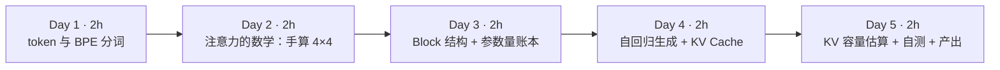

| 天 | 时间 | 先读（概念） | 再读（外部资料，按顺序） | 再做（实验） |
|---|---|---|---|---|
| Day 1 | ~2h | 本页 2.1、2.2 | ① [Hugging Face LLM Course 第 6 章：Byte-Pair Encoding tokenization](https://huggingface.co/learn/llm-course/chapter6/5) 全文（30 分钟，手跟一遍合并过程）；② [happy-llm 第五章](https://github.com/datawhalechina/happy-llm/tree/main/docs/chapter5) 的 *5.2 训练 Tokenizer* 中 *5.2.1～5.2.3* 三小节（20 分钟） | 实验 0：环境；实验 1：分词器对比 |
| Day 2 | ~2h | 本页 2.3、2.4 | ③ [The Illustrated Transformer](https://jalammar.github.io/illustrated-transformer/) 从开头读到 *The Residuals* 之前（40 分钟，重点是 *Self-Attention in Detail* 和 *Matrix Calculation of Self-Attention*）；④ [happy-llm 第二章](https://github.com/datawhalechina/happy-llm/tree/main/docs/chapter2) *2.1.1～2.1.6*（注意力、自注意力、掩码自注意力、多头注意力）（30 分钟） | 实验 2：手写注意力并对数 |
| Day 3 | ~2h | 本页 2.5、2.6 | ⑤ [The Illustrated GPT-2](https://jalammar.github.io/illustrated-gpt2/) 的 *Part 1* 和 *Part 2* 前半（40 分钟）；⑥ [nanoGPT model.py](https://github.com/karpathy/nanoGPT/blob/master/model.py) 读 `CausalSelfAttention`、`MLP`、`Block`、`GPT.forward` 四段（约 150 行，30 分钟） | 实验 3：跟踪 GPT-2 一次前向 |
| Day 4 | ~2h | 本页 2.7 | ⑦ [transformers 文档：Caching](https://huggingface.co/docs/transformers/en/cache_explanation)（20 分钟）；⑧ [Attention Is All You Need](https://arxiv.org/abs/1706.03762) 只看图 1、第 3.2 节（*Attention*）和公式 (1)（20 分钟） | 实验 4：开/关 KV Cache |
| Day 5 | ~2h | 本页 2.8 | ⑨ [GQA 论文](https://arxiv.org/abs/2305.13245) 只读摘要和图 2（15 分钟）；⑩ 打开 [Qwen2.5-7B-Instruct 的 config.json](https://huggingface.co/Qwen/Qwen2.5-7B-Instruct/blob/main/config.json) 对照本页公式（10 分钟） | 实验 5：KV 容量计算器；自测题；本周产出 |

> **读书版本提醒**：《The Illustrated Transformer》讲的是原论文的 **Encoder-Decoder** 结构（用于翻译）；今天的 GPT、Llama、Qwen 都是 **Decoder-only**——只保留 Decoder 那一半，并且去掉了“编码器-解码器注意力”。读到 Encoder 部分时，把注意力放在“自注意力怎么算”上，结构图以本页 2.6 节为准。

**每日打卡：**

- [ ] Day 1：读完 ①②，完成实验 0、1，能解释“为什么 GPT-2 切中文比 Qwen 多出近 3 倍 token”
- [ ] Day 2：读完 ③④，完成实验 2，能在纸上手算一行注意力权重
- [ ] Day 3：读完 ⑤⑥，完成实验 3，手算出 GPT-2 的参数量 ≈ 124M
- [ ] Day 4：读完 ⑦⑧，完成实验 4，能解释开缓存为什么快 3 倍以上且结果不变
- [ ] Day 5：完成实验 5、自测题、本周产出（KV Cache 笔记初稿）

---

## 2. 核心概念讲解

### 2.1 为什么架构师要关心 token

在大数据平台上，你习惯的计量单位是**行、字节、分区**：存储按 TB 计费，作业按 vCore·小时计费，SLA 按“T+1 几点前产出”约定。到了 LLM 平台，几乎所有指标的计量单位都换成了 **token**：

| 你熟悉的（大数据） | LLM 平台对应的 | 为什么重要 |
|---|---|---|
| 扫描数据量（字节） | 输入 token 数（prompt tokens） | API 按百万 token 计费；Prefill 计算量正比于输入 token 数 |
| 输出行数 | 输出 token 数（completion tokens） | 输出 token 通常比输入贵；Decode 一步只出一个 token，决定生成时长 |
| 单条 SQL 的最大扫描量 / 单行最大长度 | 上下文窗口（context length，例如 32K、128K） | 超过就报错或被截断；KV Cache 显存正比于它 |
| 吞吐（行/秒） | tokens/s（吞吐）、TTFT（首 token 延迟）、TPOT（每个输出 token 的间隔） | 推理服务 SLA 用这三个指标定义（第 4 月细讲） |
| 压缩比（ORC/Parquet） | “字符/token”比 | 同样的文本，分词器越适配语言，token 越少，越便宜，能塞进上下文的内容越多 |

所以 token 不是一个“NLP 细节”，而是**容量规划和成本核算的基本单位**。本周实验 1 会看到：同一句 32 个字符的中文，GPT-2 分词器切出 38 个 token，Qwen2.5 只切 13 个——在其他条件相同时，这意味着用前者处理中文要多算近 3 倍、多占近 3 倍 KV Cache。

### 2.2 分词：BPE 是一种“基于频率的字典编码”

**机制**：计算机里的文本是字节序列（UTF-8 中一个汉字通常占 3 字节）。模型不能直接吃字节或汉字，它需要一个**固定大小的词表**（vocabulary），把文本映射成整数 id 序列。

- 如果词表 = 所有单词：词表会无限大，遇到新词（“OrbStack”）就不认识。
- 如果词表 = 256 个字节：永远不会有不认识的词，但序列会很长（一个汉字 3 个 token），计算量和上下文占用都很大。

**BPE（Byte-Pair Encoding）** 是折中：从 256 个字节出发，在一个大语料上反复统计“哪两个相邻符号一起出现最频繁”，就把它们**合并成一个新符号**加入词表，直到词表达到目标大小（GPT-2 是 50257，Qwen2.5 是约 15 万）。分词时按学到的合并规则依次合并。

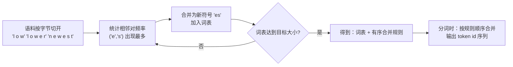

**类比**：这和你熟悉的 **Parquet/ORC 字典编码** 是同一个思想——高频出现的值用一个短编码表示。区别在于字典编码是对**整列值**建字典，BPE 是对**子串**建字典，且字典在训练模型之前就定死了，之后不能改（改了 id 就和模型权重对不上）。

**几个直接后果**（实验 1 会全部看到）：

1. **语料决定效率**。GPT-2 的分词器主要在英文网页上训练，中文常用词几乎没有被合并，一个汉字经常被拆成 2～3 个字节级 token（实验 1 里“大”是 1 个 token，“数”被拆成 2 个，“据”被拆成 3 个）。Qwen 的词表包含大量中文词（“大数据”“架构”“转型”都是单个 token）。
2. **数字的切法影响算术能力和计数**。Qwen2.5 把数字逐位切开（“2026”是 4 个 token），GPT-2 会把几位数字合成一个 token。这是分词器设计者的有意选择，不是 bug。
3. **空格是 token 的一部分**。`" count"`（带前导空格）和 `"count"` 是两个不同的 token。这就是为什么 prompt 末尾多一个空格有时会改变输出。
4. **分词器与模型是绑定的**。不同模型的 token id 互不通用；平台上做“按 token 计费/限流”时，必须用**目标模型自己的分词器**计数，不能拿 tiktoken 估 Qwen 的成本。

### 2.3 从 token id 到向量：Embedding 与张量形状

**机制**：token id 只是整数，模型首先要查一张表——**Embedding 矩阵**，形状 `(vocab_size, d_model)`。GPT-2 small 是 `(50257, 768)`：每个 token id 对应一行 768 维的浮点向量。再加上**位置向量**（GPT-2 用另一张可学习的 `(1024, 768)` 表，最多 1024 个位置；Llama/Qwen 改用 RoPE 旋转位置编码，不再是一张表），得到形状为 `(batch, seq_len, d_model)` 的张量，送入后面的 Block。

**类比**：Embedding 就是一次 **维表 Join**——事实表里只有 `token_id`，Join 上一张 50257 行 × 768 列的维表，把 id 换成一组“属性”。只不过这张维表的属性值不是人填的，而是训练时通过反向传播学出来的。

从这里开始，**形状**是读懂一切 LLM 代码的钥匙。记住三个字母：`B`（batch，一次处理几条序列）、`T`（序列长度，token 数）、`C` 或 `d_model`（隐藏维度）。整个 Transformer 主干里张量形状一直是 `(B, T, C)`，只有最后一步投影到词表时变成 `(B, T, vocab)`。实验 3 会把它们逐个打印出来。

### 2.4 自注意力：一次“软”的自连接查询

这是本周最重要的一节，请拿出纸笔。

**直觉**：读到“他把**它**放进了冰箱”时，要理解“它”，你会回头看前文找“它”指什么。自注意力就是让每个 token **回头看**它之前的所有 token，按“相关程度”加权汇总它们的信息。

**机制（单头）**：输入 `X` 形状 `(T, d_model)`。用三个可学习矩阵 `W_Q, W_K, W_V`（各 `d_model × d_head`）得到：

- `Q = X·W_Q`（Query，“我在找什么”）
- `K = X·W_K`（Key，“我能被怎样找到”）
- `V = X·W_V`（Value，“被找到后我提供什么内容”）

然后：

```text
scores  = Q · Kᵀ / sqrt(d_head)        # (T, T)，第 i 行 j 列 = token i 对 token j 的相关度
scores[j > i] = -inf                    # 因果掩码：不许看未来
weights = softmax(scores, 按行)         # 每行变成和为 1 的权重
output  = weights · V                   # (T, d_head)，每个 token 得到一个加权汇总
```

这就是论文公式 (1)：`Attention(Q,K,V) = softmax(QKᵀ/√d_k)·V`。

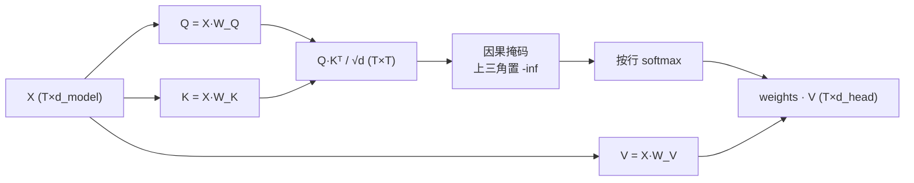

**数据库类比（建议记住）**：把它想成一次**自连接（self-join）+ 加权聚合**：

```sql
-- 伪 SQL：每个 token i 作为“查询”，去和 j <= i 的所有 token 做“模糊连接”
SELECT q.pos,
       SUM(softmax_weight(dot(q.query, k.key)) * k.value)  -- 加权求和，而不是精确匹配
FROM tokens q JOIN tokens k ON k.pos <= q.pos               -- 因果掩码 = 连接条件
GROUP BY q.pos;
```

普通 Join 是“键相等才匹配（权重 0 或 1）”，注意力是“每对都匹配，按相似度给 0～1 的权重”。`ON k.pos <= q.pos` 就是因果掩码。这个 Join 是 **T × T** 的——这正是注意力计算量随序列长度**平方**增长的原因，也是长上下文贵的根源。

**手算示例（实验 2 的真实数字）**：T=4，第 2 个 token（下标 1）的掩码后分数只有前两个有效。设它们 softmax 后为 `[0.705, 0.295, 0, 0]`，含义是：token 1 的输出 = 0.705 × V₀ + 0.295 × V₁。第 0 个 token 只能看自己，权重恒为 `[1, 0, 0, 0]`。

**为什么除以 √d_head**：Q、K 的每个分量大致是方差为 1 的随机数时，点积的方差约为 `d_head`。不缩放的话，`d_head=128` 时分数动辄几十，softmax 会退化成接近 one-hot，梯度几乎为 0、训练不动。除以 √d 让分数方差回到 1 左右。

**多头（Multi-Head）**：实际模型把 `d_model` 切成 `n_head` 份并行做上面的计算（GPT-2 small：12 头 × 64 维 = 768），每个头可以关注不同类型的关系（语法、指代、位置……），最后拼接起来再乘一个输出矩阵 `W_O`。计算上，这只是在张量里多了一个“头”维度：`(B, n_head, T, d_head)`——实验 4 打印的 KV Cache 形状就是这个。

**GQA（分组查询注意力）**：Llama 2 70B、Llama 3、Qwen2.5 等模型让**多个 Query 头共享一组 K/V 头**。例如 Qwen2.5-7B 有 28 个 Query 头，但只有 4 个 KV 头（7 个 Q 头共享一组 K/V）。效果几乎不降，KV Cache 却缩小到 1/7。记住：**算 KV Cache 时用的是 `num_key_value_heads`，不是 `num_attention_heads`**——这是显存估算里最常见的错误。

### 2.5 Transformer Block：注意力 + MLP + 残差 + 归一化

一个 decoder-only 模型就是**同一种 Block 堆叠 N 次**（GPT-2 small 12 层，Qwen2.5-7B 28 层，Llama 3 70B 80 层）。GPT-2 风格（Pre-LN）的一个 Block：

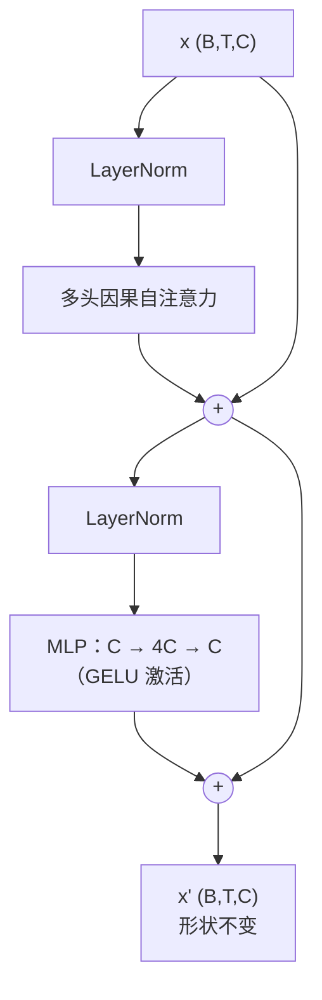

- **注意力**负责“token 之间交换信息”（跨行计算）。
- **MLP**（前馈网络）对每个 token **独立**做非线性变换（逐行计算），通常认为模型的大量“知识”存储在这里。
- **残差连接**（`x + f(x)`）：让信号和梯度可以绕过每一层直通，几十上百层才训练得动。
- **LayerNorm / RMSNorm**：把每个 token 的向量归一化到稳定的尺度。Llama/Qwen 用更省计算的 RMSNorm，MLP 用 SwiGLU（3 个矩阵而不是 2 个），位置编码用 RoPE——这些是“同一骨架上的零件升级”，happy-llm 第五章 *5.1* 用代码逐个实现了它们。

**类比**：一个 Block 像 ETL 管线里的一个 stage：注意力是一次“窗口函数”（每行看同一序列里之前的行），MLP 是一次“逐行 UDF”，残差是“保留原列，新结果作为增量加上去”。N 个 Block 就是 N 个 stage 串联，**每个 stage 的输入输出 schema 完全一样**（`(B,T,C)`），所以可以无限堆叠——这也是第 5 月“流水线并行”能按层切分模型的前提。

**参数量账本（以 GPT-2 small 为例，请手算一遍）**：设 `C = 768`、`V = 50257`、层数 `L = 12`。

| 部分 | 计算 | 参数量 |
|---|---|---|
| 词嵌入 wte | V × C = 50257 × 768 | 38,597,376 |
| 位置嵌入 wpe | 1024 × 768 | 786,432 |
| 每层注意力 | Q/K/V 三个 C×C + 输出 C×C = 4C² | 2,359,296 |
| 每层 MLP | C×4C + 4C×C = 8C² | 4,718,592 |
| 每层合计（忽略偏置和 LN） | 12C² | 7,077,888 |
| 12 层 | 12 × 12C² | 84,934,656 |
| 输出层 lm_head | 与 wte **共享权重**（weight tying） | 0 |
| **合计** | 38.6M + 0.8M + 84.9M + 偏置/LN ≈ | **≈ 124.4M** |

实验 4 会打印 `参数量=124.4M`，和手算吻合。这个 `每层 ≈ 12·C²` 的经验式非常好用：给你一个 `hidden_size=4096、32 层` 的模型，`12 × 4096² × 32 ≈ 6.4B`，再加上嵌入，就是 “7B” 量级——不过要注意 GQA 会让注意力部分小于 4C²，SwiGLU 会让 MLP 部分不等于 8C²，精确值请以模型卡为准。

### 2.6 一次前向：从文本到“下一个 token”

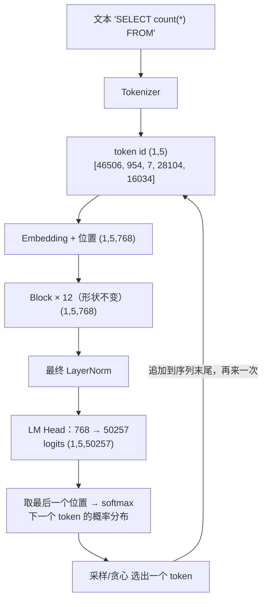

注意 logits 的形状是 `(1, 5, 50257)`——**每个位置**都预测了“它后面的 token”。训练时 5 个位置的预测都用来算 loss（一次前向得到 T 个训练样本，这是 Transformer 训练高效的原因之一，下周细讲）；推理时只用最后一个位置。

### 2.7 自回归生成：Prefill、Decode 与 KV Cache

**问题**：生成是一个 token 一个 token 进行的。生成第 101 个 token 时，模型需要第 1～100 个 token 在每一层的 K 和 V。如果每一步都把整个序列重新前向一遍，第 t 步的计算量正比于 t，生成 n 个 token 的总计算量正比于 n²——而且 t-1 个旧 token 的 K、V **每一步算出来都一模一样**（因果掩码保证了旧 token 看不到新 token，所以它们的 K/V 不会变）。

**解法**：把每层算过的 K、V 存起来，这就是 **KV Cache**。生成新 token 时，只需对这**一个**新 token 算 Q、K、V，把新的 K、V 追加进缓存，然后用新 Q 和缓存里**全部**的 K、V 做注意力。实验 2 的最后一行用 NumPy 证明了这一点：只用最后一行 Q + 完整 K/V，算出的结果和全量计算误差只有 1e-8。

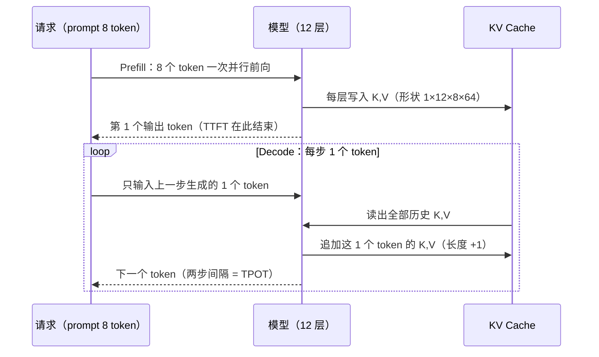

**两阶段的性格截然不同**：

| | Prefill（处理 prompt） | Decode（逐个生成） |
|---|---|---|
| 每步处理 token 数 | 整个 prompt（几百到几万） | 1（每条请求） |
| 主要计算 | 大矩阵 × 大矩阵（GEMM） | 向量 × 大矩阵（GEMV） |
| 瓶颈 | **算力**（compute-bound） | **显存带宽**（memory-bound）：每步都要把全部权重 + 全部 KV Cache 从显存读一遍 |
| 决定的指标 | TTFT（首 token 延迟） | TPOT（每个输出 token 的间隔） |
| 大数据类比 | 一次大批量扫描 + 聚合（批处理） | 高频点查询（OLTP 风格），每次查询都要“扫一遍索引” |

**Decode 为什么受带宽限制（一个估算）**：一个 7B 参数的 BF16 模型权重约 14 GB。Decode 每步（batch=1）都要把这 14 GB 从显存读进计算单元，却只做约 2 × 7×10⁹ = 1.4×10¹⁰ 次浮点运算（每个参数一次乘加 ≈ 2 FLOPs）。即使显存带宽有 3 TB/s，光读权重就要约 14 GB ÷ 3 TB/s ≈ 4.7 ms，此时算力绝大部分在空等数据。所以推理优化的核心思路是**一次读权重、服务很多请求**——把多个请求拼成一个 batch（第 4 月的 continuous batching），而这又要求显存里放得下这么多请求的 KV Cache。KV Cache 于是成为推理服务的**头号显存消费者和并发上限**。

**KV Cache 大小公式**（请背下来）：

```text
每个 token 的 KV 字节 = 2（K 和 V）× 层数 L × KV 头数 H_kv × 每头维度 d_head × 每元素字节数
一批请求的 KV 字节   = 每 token 字节 × 序列长度 T × 并发请求数 B
```

**算例 1（实验 4 实测验证）**：GPT-2 small，L=12，H_kv=12，d_head=64，fp32（4 字节），prompt 8 个 token：`2 × 12 × 12 × 64 × 8 × 4 = 589,824 字节`，与 PyTorch 里缓存张量的实际字节数**完全一致**。

**算例 2（真实生产模型）**：Qwen2.5-7B-Instruct 的 `config.json`：`num_hidden_layers=28`、`num_attention_heads=28`、`num_key_value_heads=4`、`hidden_size=3584`，所以 `d_head = 3584 / 28 = 128`。BF16 下：

- 每 token：2 × 28 × 4 × 128 × 2 = **57,344 字节 = 56 KiB**
- 一条 32K 上下文的请求：56 KiB × 32768 = **1.75 GiB**
- 权重约 7.6B × 2 字节 ≈ 15 GB；在一张 24 GB 卡上，扣掉权重和运行时开销后大约只剩几 GB 给 KV Cache——也就是说**满 32K 上下文的请求只能同时放下寥寥几条**。
- 如果没有 GQA（KV 头数 = 28），每 token 就是 392 KiB，同样的显存只能放 1/7 的请求。

**类比**：KV Cache 就像 OLAP 引擎为每个**活跃会话**维护的中间结果缓存——会话越多、每个会话越长，缓存越大；缓存满了就只能拒绝新会话、或者把旧会话换出（vLLM 里叫 preemption）。第 13 周的 PagedAttention 解决的正是“这块缓存怎么像操作系统分页一样管理、避免碎片”的问题。

### 2.8 用 config.json 做容量规划（架构师的日常）

把 2.5 和 2.7 合起来，你已经可以只凭一个 `config.json` 回答架构评审中的典型问题：

1. **权重多大？** 参数量 × 每参数字节（BF16=2，INT8=1，INT4≈0.5）。
2. **每 token 的 KV 多大？** 用 2.7 的公式，注意用 `num_key_value_heads`。
3. **一张卡能扛多少并发？** `(显存 − 权重 − 运行时预留) ÷ (每 token KV × 平均上下文长度)`。
4. **上下文翻倍会怎样？** KV 翻倍、可支持并发减半；Prefill 中注意力部分的计算量变为约 4 倍（T²）。

实验 5 把这几步写成一个小脚本。第 4 周会在此基础上加上训练显存估算，第 4 月部署 vLLM 时你会在启动日志里看到它打印的 “KV cache 可容纳多少 token”，届时可以和你的估算对照。

---

## 3. 动手实验 {{local}}

所有实验在 `~/ai-infra-lab/w2/` 下完成。不需要 GPU；GPT-2 small 在 CPU 上推理很快。实验 1、3、4 第一次运行时会从 Hugging Face 下载分词器和 GPT-2 权重（约 550 MB），国内网络如访问不畅，可设置环境变量 `HF_ENDPOINT=https://hf-mirror.com`（镜像站，非官方）。

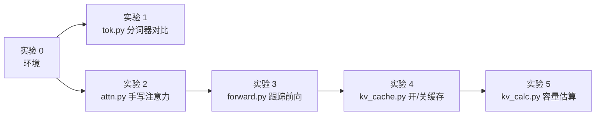

### 实验 0：建环境（15 分钟）

沿用第 1 周的 `~/ai-infra-lab/.venv`（Python 3.12），追加安装：

```bash
cd ~/ai-infra-lab && source .venv/bin/activate && mkdir -p w2 && cd w2
# Mac 上直接装 PyPI 的 torch 即可（自带 MPS 支持）；Linux 无 GPU 机器可加 --index-url https://download.pytorch.org/whl/cpu 装纯 CPU 版
uv pip install torch "transformers==5.20.2" "tiktoken==0.14.0"
python -c "import sys,torch,transformers,tiktoken,numpy;print(sys.version.split()[0],torch.__version__,transformers.__version__,tiktoken.__version__,numpy.__version__)"
```

**本站输出**：

```text
3.12.15 2.14.1+cpu 5.20.2 0.14.0 2.5.4
```

Mac 上 torch 版本号不带 `+cpu` 后缀，属正常。

### 实验 1：三种分词器对比（30 分钟）

`tok.py`：

```python
"""对比三种分词器：GPT-2（2019）、o200k_base（GPT-4o 系列）、Qwen2.5（中文友好）。"""
import tiktoken
from transformers import AutoTokenizer

TEXTS = {
    "英文": "The quick brown fox jumps over the lazy dog.",
    "中文": "大数据架构师转型 AI Infra，需要理解 KV Cache。",
    "SQL": "SELECT city, count(DISTINCT user_id) FROM events GROUP BY city;",
    "数字": "2026-10-20 12345678.90",
}

gpt2 = tiktoken.get_encoding("gpt2")
o200k = tiktoken.get_encoding("o200k_base")
qwen = AutoTokenizer.from_pretrained("Qwen/Qwen2.5-0.5B")  # 只下载分词器文件（几 MB）

print(f"词表大小: gpt2={gpt2.n_vocab} o200k={o200k.n_vocab} qwen2.5={len(qwen)}")
print(f"{'类型':<4} {'字符':>4} {'UTF8字节':>8} {'gpt2':>5} {'o200k':>6} {'qwen':>5}")
for name, s in TEXTS.items():
    n_g, n_o, n_q = len(gpt2.encode(s)), len(o200k.encode(s)), len(qwen.encode(s))
    print(f"{name:<4} {len(s):>5} {len(s.encode()):>9} {n_g:>5} {n_o:>6} {n_q:>5}")

s = TEXTS["中文"]
print("\nGPT-2 前 8 个 token 的字节:", [gpt2.decode_single_token_bytes(t) for t in gpt2.encode(s)[:8]])
print("Qwen 的切分:", [qwen.decode([i]) for i in qwen.encode(s)])
print("Qwen 切数字:", [qwen.decode([i]) for i in qwen.encode(TEXTS["数字"])][:12])
```

```bash
python tok.py
```

**本站输出**：

```text
词表大小: gpt2=50257 o200k=200019 qwen2.5=151665
类型     字符   UTF8字节  gpt2  o200k  qwen
英文      44        44    10     10    10
中文      32        60    38     14    13
SQL     63        63    19     16    16
数字      22        22    11     12    22

GPT-2 前 8 个 token 的字节: [b'\xe5\xa4\xa7', b'\xe6\x95', b'\xb0', b'\xe6', b'\x8d', b'\xae', b'\xe6', b'\x9e']
Qwen 的切分: ['大数据', '架构', '师', '转型', ' AI', ' Inf', 'ra', '，', '需要', '理解', ' KV', ' Cache', '。']
Qwen 切数字: ['2', '0', '2', '6', '-', '1', '0', '-', '2', '0', ' ', '1']
```

**逐步解释**：

- **英文三家都是 10 个 token**：常见英文单词在每个词表里都是单个 token（带前导空格）。
- **中文差距巨大**：32 个字符（60 字节 UTF-8），GPT-2 切成 38 个 token——比字符数还多；o200k（GPT-4o 时代的新词表，20 万词）和 Qwen 都只要 13～14 个。看“GPT-2 前 8 个 token 的字节”：`b'\xe5\xa4\xa7'` 是完整的“大”（3 字节），而“数”被拆成 `b'\xe6\x95'` + `b'\xb0'` 两个 token，“据”被拆成 3 个单字节 token。这些单个 token 解码出来不是合法汉字，只有拼起来才是。
- **SQL**：GPT-2 把 `DISTINCT` 切成 `D / IST / IN / CT` 4 段（大写关键字在网页语料里不常见）；新词表处理代码更好。
- **数字反过来了**：Qwen 逐位切数字（22 个字符 → 22 个 token），这是为了让模型做算术时每一位对齐。所以“哪个分词器更省”取决于你的数据——日志、ID、金额多的数据，要用真实样本测。
- `len(qwen)`（151665）是包含特殊 token 的总数；配置文件里的 `vocab_size` 可能更大（为了对齐矩阵尺寸预留了空位），以模型卡为准。

### 实验 2：用 NumPy 手写因果自注意力（40 分钟）

`attn.py`：

```python
"""用 NumPy 手写因果自注意力（单头），再与 PyTorch 官方实现对数。"""
import numpy as np
import torch
import torch.nn.functional as F

rng = np.random.default_rng(0)
T, d_model, d_head = 4, 8, 4            # 4 个 token，隐藏维 8，单头维度 4
x = rng.standard_normal((T, d_model)).astype(np.float32)   # 已经过 embedding 的输入
Wq, Wk, Wv = (rng.standard_normal((d_model, d_head)).astype(np.float32) * 0.5 for _ in range(3))

Q, K, V = x @ Wq, x @ Wk, x @ Wv        # 每个 (T, d_head)
scores = Q @ K.T / np.sqrt(d_head)      # (T, T)：第 i 行 = token i 对所有 token 的“相关度”
mask = np.triu(np.ones((T, T), dtype=bool), k=1)   # 上三角 = 未来位置
scores[mask] = -np.inf                  # 因果掩码：不许看未来
w = np.exp(scores - scores.max(axis=1, keepdims=True))
w = w / w.sum(axis=1, keepdims=True)    # softmax，每行和为 1
out = w @ V                             # (T, d_head)：按权重对 V 加权求和

np.set_printoptions(precision=3, suppress=True)
print("注意力权重（行=查询 token，列=被看的 token）:\n", w)
ref = F.scaled_dot_product_attention(torch.from_numpy(Q)[None], torch.from_numpy(K)[None],
                                     torch.from_numpy(V)[None], is_causal=True)[0].numpy()
print("与 PyTorch SDPA 最大误差:", float(np.abs(out - ref).max()))

# KV Cache 的本质：第 T 个 token 的输出只依赖 q_T 和 全部 K、V
q_last = Q[-1:]                          # 只算最后一个 token 的 Q
s_last = q_last @ K.T / np.sqrt(d_head)
w_last = np.exp(s_last - s_last.max()); w_last /= w_last.sum()
print("只用最后一行 Q + 缓存的 K/V 重算最后一个输出，误差:", float(np.abs(w_last @ V - out[-1]).max()))
```

**本站输出**：

```text
注意力权重（行=查询 token，列=被看的 token）:
 [[1.    0.    0.    0.   ]
 [0.705 0.295 0.    0.   ]
 [0.601 0.067 0.332 0.   ]
 [0.14  0.283 0.216 0.361]]
与 PyTorch SDPA 最大误差: 8.798115302965925e-08
只用最后一行 Q + 缓存的 K/V 重算最后一个输出，误差: 1.4740495934972841e-08
```

**逐步解释**：

- 权重矩阵是**下三角**的：右上角全是 0，这就是因果掩码的效果；每一行之和为 1（softmax）。第 0 行恒为 `[1,0,0,0]`——第一个 token 只能看自己。
- `scores - scores.max(...)`：softmax 的标准数值稳定写法，先减去每行最大值再取 exp，避免溢出，结果不变。`exp(-inf) = 0`，所以被掩码的位置权重严格为 0。
- 与 `F.scaled_dot_product_attention(..., is_causal=True)` 的误差在 1e-7 量级，说明手写版本正确。这个 PyTorch 函数在 GPU 上会自动选 FlashAttention 等高效内核——**算的是同一个公式，只是不把 T×T 矩阵完整写进显存**（第 4 月会再见到）。
- 最后一行是本周的关键证明：**最后一个 token 的输出，只需要它自己的 Q 和所有 token 的 K、V**。前面 token 的 Q 不再需要——所以缓存只存 K 和 V，叫 “KV” Cache 而不是 “QKV” Cache。

**动手改一改**：把 `mask` 那一行注释掉再运行，观察第 0 行不再是 `[1,0,0,0]`，与 SDPA 的误差变大——你刚刚实现了一个“会偷看答案”的 BERT 式双向注意力。

### 实验 3：跟踪 GPT-2 的一次前向（30 分钟）

`forward.py`：

```python
"""跟踪 GPT-2 一次前向：每一步的张量形状，以及下一个 token 的概率。"""
import torch
from transformers import AutoModelForCausalLM, AutoTokenizer

tok = AutoTokenizer.from_pretrained("openai-community/gpt2")
m = AutoModelForCausalLM.from_pretrained("openai-community/gpt2").eval()
ids = tok("SELECT count(*) FROM", return_tensors="pt").input_ids
print("① token id:", ids.tolist(), "->", [tok.decode([i]) for i in ids[0]])
with torch.no_grad():
    pos = torch.arange(ids.shape[1])
    h = m.transformer.wte(ids) + m.transformer.wpe(pos)          # 词向量 + 位置向量
    print("② embedding 后:", tuple(h.shape))
    for i, blk in enumerate(m.transformer.h):
        out = blk(h)
        h = out[0] if isinstance(out, tuple) else out   # 不同 transformers 版本返回 tuple 或 Tensor
        if i in (0, 11):
            print(f"③ 第 {i:>2} 个 Block 后:", tuple(h.shape))
    h = m.transformer.ln_f(h)
    logits = m.lm_head(h)                                        # 投影回词表
    print("④ logits:", tuple(logits.shape))
    p = logits[0, -1].softmax(-1)
    top = p.topk(5)
    print("⑤ 下一个 token 候选:", [(tok.decode([int(i)]), round(float(v), 3)) for v, i in zip(top.values, top.indices)])
    ref = m(ids).logits
    print("与 model(ids) 直接调用的最大误差:", float((ref - logits).abs().max()))
```

**本站输出**：

```text
① token id: [[46506, 954, 7, 28104, 16034]] -> ['SELECT', ' count', '(', '*)', ' FROM']
② embedding 后: (1, 5, 768)
③ 第  0 个 Block 后: (1, 5, 768)
③ 第 11 个 Block 后: (1, 5, 768)
④ logits: (1, 5, 50257)
⑤ 下一个 token 候选: [(' (', 0.033), (' t', 0.025), (" '", 0.016), (' r', 0.012), (' g', 0.012)]
与 model(ids) 直接调用的最大误差: 0.0
```

**逐步解释**：

- ① `*)` 被合成了一个 token——BPE 只看频率，不懂 SQL 语法。
- ②③ 进入 Block 之后形状一直是 `(1, 5, 768)`，12 个 Block 首尾形状相同（2.5 节“schema 不变的 stage”）。
- ④ logits 每个位置都有 50257 个分数；我们只取最后一个位置。
- ⑤ 最高的候选概率只有 3.3%：GPT-2 small 很小、训练数据里 SQL 不多，所以“FROM 后面接表名”这件事它把握不大。这是**基座模型**原始的概率分布，没有任何“对话”能力。
- 最后一行误差为 0：说明我们手动拆开的步骤和 `model(ids)` 内部做的完全一样。以后读任何模型源码，都可以用这个“拆开再对数”的方法验证理解。

### 实验 4：KV Cache 开与关（40 分钟）

`kv_cache.py`：

```python
"""用真实的 GPT-2（124M）观察 KV Cache：形状、字节数、开/关缓存的速度差。"""
import time

import torch
from transformers import AutoModelForCausalLM, AutoTokenizer

torch.manual_seed(0)
torch.set_num_threads(4)
tok = AutoTokenizer.from_pretrained("openai-community/gpt2")
model = AutoModelForCausalLM.from_pretrained("openai-community/gpt2").eval()
cfg = model.config
print(f"层数={cfg.n_layer} 头数={cfg.n_head} 隐藏维={cfg.n_embd} 每头维度={cfg.n_embd // cfg.n_head}")
print(f"参数量={sum(p.numel() for p in model.parameters()) / 1e6:.1f}M")

ids = tok("The data warehouse architect opened the notebook and", return_tensors="pt").input_ids
print("prompt token 数:", ids.shape[1])

# ① 一次前向（prefill），拿到缓存
with torch.no_grad():
    out = model(ids, use_cache=True)
kv = out.past_key_values
k0 = kv.layers[0].keys if hasattr(kv, "layers") else kv[0][0]
print("第 0 层 K 的形状 (batch, 头数, 序列长度, 每头维度):", tuple(k0.shape), k0.dtype)


def cache_bytes(cache) -> int:
    layers = cache.layers if hasattr(cache, "layers") else cache
    return sum(l.keys.numel() * l.keys.element_size() + l.values.numel() * l.values.element_size()
               if hasattr(l, "keys") else l[0].nbytes + l[1].nbytes for l in layers)


T = ids.shape[1]
formula = 2 * cfg.n_layer * cfg.n_head * (cfg.n_embd // cfg.n_head) * T * 1 * 4
print(f"实测缓存字节={cache_bytes(kv)}  公式 2×L×H×d×T×B×4字节={formula}")

# ② 生成 200 个新 token：开缓存 vs 关缓存（贪心解码，结果应完全相同）
for use_cache in (True, False):
    t = time.perf_counter()
    with torch.no_grad():
        g = model.generate(ids, max_new_tokens=200, min_new_tokens=200, do_sample=False,
                           use_cache=use_cache, pad_token_id=tok.eos_token_id)
    dt = time.perf_counter() - t
    print(f"use_cache={use_cache!s:<5} 生成 200 token 用时 {dt:6.2f}s  ≈{200 / dt:5.1f} token/s  末尾 id={g[0, -5:].tolist()}")
```

**本站输出**：

```text
层数=12 头数=12 隐藏维=768 每头维度=64
参数量=124.4M
prompt token 数: 8
第 0 层 K 的形状 (batch, 头数, 序列长度, 每头维度): (1, 12, 8, 64) torch.float32
实测缓存字节=589824  公式 2×L×H×d×T×B×4字节=589824
use_cache=True  生成 200 token 用时   2.61s  ≈ 76.7 token/s  末尾 id=[262, 749, 6942, 780, 340]
use_cache=False 生成 200 token 用时   8.91s  ≈ 22.4 token/s  末尾 id=[262, 749, 6942, 780, 340]
```

**逐步解释**：

- 缓存张量形状 `(1, 12, 8, 64)` = (batch, 头数, 序列长度, 每头维度)，正是 2.4 节说的多头布局；12 层每层一对 K、V。
- 实测字节数和公式**一字不差**：589,824 字节。这就是你以后估 KV 显存时所用公式的“单元测试”。
- 开缓存比关缓存快约 3.4 倍，且**生成结果完全相同**（末尾 token id 一致）：KV Cache 是纯粹的性能优化，不改变数学结果。序列越长差距越大——关缓存时第 t 步要重算 t 个 token。
- `cache_bytes` 里的 `hasattr` 判断是为了兼容不同版本 transformers 的缓存对象（新版是带 `.layers` 的 `DynamicCache`，旧版是 tuple 的 tuple）。

**动手改一改**：把 `max_new_tokens` 改成 50 和 400，记录两种模式的 token/s。画出“生成长度 vs 速度”的折线，你会看到关缓存模式随长度明显变慢，开缓存模式基本平稳。

### 实验 5：KV Cache 容量计算器（30 分钟）

`kv_calc.py`：读取任意模型的 `config.json`，算权重和 KV 容量。

```python
"""从 config.json 估算：权重大小、每 token KV、给定显存能放多少并发。"""
import argparse
import json
import urllib.request

ap = argparse.ArgumentParser()
ap.add_argument("--model", default="Qwen/Qwen2.5-7B-Instruct")
ap.add_argument("--params-b", type=float, required=True, help="参数量（十亿），以模型卡为准")
ap.add_argument("--gpu-gb", type=float, default=24)
ap.add_argument("--ctx", type=int, default=32768)
ap.add_argument("--reserve-gb", type=float, default=2, help="运行时/激活预留（经验值）")
a = ap.parse_args()

url = f"https://huggingface.co/{a.model}/raw/main/config.json"
c = json.load(urllib.request.urlopen(url))
L, H, Hkv, C = c["num_hidden_layers"], c["num_attention_heads"], c.get("num_key_value_heads", c["num_attention_heads"]), c["hidden_size"]
d = c.get("head_dim") or C // H
kv_tok = 2 * L * Hkv * d * 2                       # BF16 = 2 字节
w_gb = a.params_b * 1e9 * 2 / 2**30
free_gb = a.gpu_gb - w_gb - a.reserve_gb
print(f"{a.model}: L={L} H={H} H_kv={Hkv} d_head={d}")
print(f"权重(BF16) ≈ {w_gb:.1f} GiB；每 token KV = {kv_tok} B = {kv_tok/1024:.0f} KiB")
print(f"单条 {a.ctx} token 请求 KV = {kv_tok*a.ctx/2**30:.2f} GiB")
print(f"{a.gpu_gb:.0f} GB 卡剩余给 KV ≈ {free_gb:.1f} GiB → 约 {int(free_gb*2**30/kv_tok):,} 个 token，"
      f"≈ {free_gb*2**30/(kv_tok*a.ctx):.1f} 条满上下文请求")
if Hkv != H:
    print(f"若没有 GQA（H_kv={H}），每 token KV 将是 {2*L*H*d*2//1024} KiB，是现在的 {H//Hkv} 倍")
```

```bash
python kv_calc.py --params-b 7.61 --gpu-gb 24
python kv_calc.py --model Qwen/Qwen2.5-0.5B --params-b 0.49 --gpu-gb 24
```

（参数量 7.61B、0.49B 取自对应模型卡页面。）

**本站输出**：

```text
Qwen/Qwen2.5-7B-Instruct: L=28 H=28 H_kv=4 d_head=128
权重(BF16) ≈ 14.2 GiB；每 token KV = 57344 B = 56 KiB
单条 32768 token 请求 KV = 1.75 GiB
24 GB 卡剩余给 KV ≈ 7.8 GiB → 约 146,524 个 token，≈ 4.5 条满上下文请求
若没有 GQA（H_kv=28），每 token KV 将是 392 KiB，是现在的 7 倍
Qwen/Qwen2.5-0.5B: L=24 H=14 H_kv=2 d_head=64
权重(BF16) ≈ 0.9 GiB；每 token KV = 12288 B = 12 KiB
单条 32768 token 请求 KV = 0.38 GiB
24 GB 卡剩余给 KV ≈ 21.1 GiB → 约 1,842,636 个 token，≈ 56.2 条满上下文请求
若没有 GQA（H_kv=14），每 token KV 将是 84 KiB，是现在的 7 倍
```

**逐步解释**：

- 脚本只下载几 KB 的 `config.json`，不下载权重。`head_dim` 字段有的模型显式给出（应优先使用），没有时才用 `hidden_size / num_attention_heads` 推算。
- 结论很“架构师”：同一张 24 GB 卡，7B 模型只能放约 4.5 条满 32K 上下文的请求；0.5B 模型能放 56 条。这就是为什么推理平台要按“模型 × 上下文长度 × 并发”做容量规划，而不能只看“模型能不能装下”。
- 这是**粗估**：显卡标称 24 GB 被当作 24 GiB 处理；`--reserve-gb 2` 是假设值；真实框架（vLLM）还会预留 CUDA graph、激活等显存，并按 `gpu_memory_utilization` 比例使用。第 14 周你会拿 vLLM 启动日志里的真实数字回来校准。

### 常见错误与排查

| 现象（真实报错或现象） | 原因 | 解决 |
|---|---|---|
| `OSError: We couldn't connect to 'https://huggingface.co' ...` | 网络访问不到 Hugging Face | 设置 `export HF_ENDPOINT=https://hf-mirror.com`（第三方镜像）后重试；或在能联网时先下载，之后加 `HF_HUB_OFFLINE=1` 离线使用 |
| `ModuleNotFoundError: No module named 'torch'` | 没激活 `.venv` 或装在了别的环境 | `which python`；`source ~/ai-infra-lab/.venv/bin/activate` |
| `AttributeError: 'tuple' object has no attribute 'layers'`（或反过来） | transformers 版本不同，缓存对象类型不同 | 用本页 `hasattr` 写法兼容，或固定 `transformers==5.20.2` |
| 加载模型时打印大量 `Loading weights` 进度条 / 警告 | 正常日志 | 可忽略；`export TRANSFORMERS_VERBOSITY=error` 可静音 |
| Mac 上 `use_cache=False` 慢到难以等待 | CPU 线程数或机器负载不同 | 把 `max_new_tokens` 降到 100；去掉 `torch.set_num_threads(4)` 让 PyTorch 自动选择 |
| 想用 `device="mps"` 时报某个算子不支持 | MPS 后端算子覆盖不全 | 本周实验用 CPU 足够；或设 `PYTORCH_ENABLE_MPS_FALLBACK=1` 让不支持的算子回落到 CPU |
| kv_calc.py 对某些模型 `KeyError: 'num_hidden_layers'` | 该模型的 config 字段名不同（例如多模态模型把文本部分放在 `text_config` 里） | 打开 config.json 找到对应字段，手动填入 |

### 扩展练习（选做，每题 20–40 分钟）

1. **自己训练一个 BPE**：按 HF LLM Course 第 6 章 *Byte-Pair Encoding tokenization* 的代码，在你自己的一批 SQL 文本（几百条即可）上训练一个 500 词的 BPE，看看 `SELECT`、`GROUP BY` 会不会成为单个 token。思考：如果公司要训练一个专门写 SQL 的模型，词表应该怎么定？
2. **测你的业务数据**：拿 100 条真实（脱敏）日志或工单文本，用实验 1 的三种分词器统计“平均 token/字符”。按某个公开 API 的价格表，估算每月处理 1 亿条的成本差异。
3. **多头版注意力**：把实验 2 改成 2 个头（`d_model=8`，每头 4 维），手动切分、分别计算、拼接，再与 `torch.nn.MultiheadAttention` 或 SDPA 的多头输入对数。
4. **手写 KV Cache 生成循环**：不用 `generate`，自己写循环：第一步 `model(ids, use_cache=True)`，之后每步只喂入一个新 token 并传入 `past_key_values`，打印每一步缓存的序列长度。与实验 4 的结果对比 token id 是否一致。
5. **对比 GQA 模型**：用 `kv_calc.py` 计算 `Qwen/Qwen2.5-0.5B`、`Qwen/Qwen2.5-7B-Instruct` 以及 2～3 个你感兴趣的开源模型（看它们 config 里的 `num_key_value_heads`），做一张“每 token KV 字节”表。

---

## 4. 精读指南

### ①② 分词（50 分钟）

- [HF LLM Course：Byte-Pair Encoding tokenization](https://huggingface.co/learn/llm-course/chapter6/5)：**读哪里**：全文，包括 *Training algorithm*、*Tokenization algorithm*、*Implementing BPE*。**重点**：训练阶段和分词阶段是两个不同的过程；“byte-level” BPE 为什么永远不会出现未知 token。**读完回答**：① 合并规则为什么必须**有序**保存？② GPT-2 为什么从 256 个字节而不是从 Unicode 字符起步？
- [happy-llm 第五章](https://github.com/datawhalechina/happy-llm/tree/main/docs/chapter5) *5.2.1～5.2.3*：中文讲解 Word / Character / Subword 三类分词的取舍，包括 BPE、WordPiece、Unigram。**读完回答**：WordPiece 与 BPE 选择合并对的标准有什么不同？

### ③④ 注意力（70 分钟）

- [The Illustrated Transformer](https://jalammar.github.io/illustrated-transformer/)：**读哪里**：开头到 *The Residuals* 之前。**重点**：*Self-Attention in Detail* 的 6 步图、*Matrix Calculation of Self-Attention* 的矩阵形式、*The Beast With Many Heads*。**读完回答**：① 文中 Q、K、V 向量为什么是 64 维而嵌入是 512 维？② 多头注意力最后为什么还要乘一个 `W^O`？
- [happy-llm 第二章](https://github.com/datawhalechina/happy-llm/tree/main/docs/chapter2) *2.1.1～2.1.6*：中文 + PyTorch 代码实现注意力、掩码与多头。**读完回答**：文中掩码用 `torch.triu` 生成上三角矩阵，和本页实验 2 的 `np.triu(..., k=1)` 是不是同一件事？`k=1` 的含义是什么？

### ⑤⑥ GPT 结构与代码（70 分钟）

- [The Illustrated GPT-2](https://jalammar.github.io/illustrated-gpt2/)：**读哪里**：*Part 1: GPT2 And Language Modeling* 和 *Part 2: The Illustrated Self-Attention* 的前半。**重点**：decoder-only 结构、自回归生成、masked self-attention 图解。**读完回答**：作者如何解释“模型每次只输出一个 token”？
- [nanoGPT model.py](https://github.com/karpathy/nanoGPT/blob/master/model.py)：**读哪里**：`CausalSelfAttention.forward`、`MLP`、`Block`、`GPT.forward`。**重点**：`c_attn` 一次性算出 Q/K/V（一个 `C → 3C` 的线性层）；`view(...).transpose(1, 2)` 把形状从 `(B,T,C)` 变成 `(B,nh,T,hs)`；`self.transformer.wte.weight = self.lm_head.weight` 就是 weight tying。**读完回答**：把 `GPT.forward` 里每个张量的形状注释在代码旁边（这是本周产出之一）。

### ⑦⑧ KV Cache 与原论文（40 分钟）

- [transformers 文档：Caching](https://huggingface.co/docs/transformers/en/cache_explanation)：**重点**：缓存如何按层存放 K/V、`DynamicCache` 的含义、为什么“只需计算新 token 的 K/V”。**读完回答**：文中描述的缓存数据结构，与实验 4 打印的形状如何对应？
- [Attention Is All You Need](https://arxiv.org/abs/1706.03762)：只看图 1（左半 Encoder、右半 Decoder）、第 3.2.1 节公式 (1)、第 3.2.2 节多头。**读完回答**：论文里 `d_model=512, h=8`，每头维度是多少？和本页 GPT-2 的 `768/12` 是同一个关系吗？

### ⑨⑩ GQA 与真实 config（25 分钟）

- [GQA 论文](https://arxiv.org/abs/2305.13245)：只读摘要和图 2（MHA / GQA / MQA 三种结构对比）。**读完回答**：MQA 是 GQA 的哪种特例？为什么 GQA 主要节省的是推理而不是训练成本？
- [Qwen2.5-7B-Instruct config.json](https://huggingface.co/Qwen/Qwen2.5-7B-Instruct/blob/main/config.json)：逐个找到 `num_hidden_layers`、`num_attention_heads`、`num_key_value_heads`、`hidden_size`、`max_position_embeddings`、`vocab_size`，写出每 token KV 的计算过程。

### 背景阅读（不计入本周时间）

- [Build a Large Language Model (From Scratch) 配套代码](https://github.com/rasbt/LLMs-from-scratch)：第 2 章（处理文本数据）、第 3 章（实现注意力）、第 4 章（从零实现 GPT）的 notebook 都能在 Mac CPU 上跑，适合想“再从零写一遍”的你。
- [Lilian Weng：Attention? Attention!](https://lilianweng.github.io/posts/2018-06-24-attention/)：注意力机制的发展史综述，偏理论。
- [karpathy/minbpe](https://github.com/karpathy/minbpe)：几百行代码实现 BPE 分词器，配合扩展练习 1。
- [3Blue1Brown：Attention in transformers（图文版）](https://www.3blue1brown.com/lessons/attention)：以可视化方式讲注意力的几何直觉（页面含视频，也有完整文字版）。

---

## 5. 自测题

先自己作答，再展开核对。

<details>
<summary>1. 同一段 1000 字的中文客服对话，用 GPT-2 分词器和 Qwen2.5 分词器，token 数大概差多少？这对成本和上下文意味着什么？</summary>

按实验 1 的比例（32 字符：38 vs 13 token），GPT-2 约为 Qwen 的 2.9 倍，即约 1200 vs 400 token 量级（实际比例取决于文本内容，需要实测）。意味着：按 token 计费时成本近 3 倍；同样的上下文窗口能装下的对话只有 1/3；Prefill 计算量和 KV Cache 占用也近 3 倍。所以选模型时，“对目标语言的分词效率”是隐含成本项。

</details>

<details>
<summary>2. 为什么注意力分数要除以 √d_head？不除会怎样？</summary>

当 Q、K 各分量方差约为 1 时，点积的方差约为 d_head，标准差约 √d_head。不缩放时分数绝对值很大，softmax 输出接近 one-hot（几乎所有权重压到一个位置），梯度在其他位置接近 0，训练困难。除以 √d_head 让分数方差回到约 1。

</details>

<details>
<summary>3. KV Cache 为什么只缓存 K 和 V，不缓存 Q？</summary>

生成新 token 时，它的输出 = softmax(q_new · Kᵀ) · V，只需要**新 token 自己的 q** 和**所有 token 的 K、V**。旧 token 的 Q 只在计算旧 token 自己的输出时用过，之后再也不需要（实验 2 最后一行验证了这一点）。而由于因果掩码，旧 token 的 K、V 不会因为新 token 到来而改变，所以可以安全复用。

</details>

<details>
<summary>4. 一个模型 config：num_hidden_layers=32、num_attention_heads=32、num_key_value_heads=8、hidden_size=4096，BF16。算每 token KV 字节，以及 batch=16、每条 8K 上下文时 KV Cache 总大小。</summary>

d_head = 4096/32 = 128。每 token = 2 × 32 × 8 × 128 × 2 = 131,072 字节 = 128 KiB。总量 = 128 KiB × 8192 × 16 = 16 GiB。如果误用 num_attention_heads=32，会算成 64 GiB，高估 4 倍。

</details>

<details>
<summary>5. Prefill 和 Decode 分别受什么资源限制？为什么？</summary>

Prefill 一次处理 prompt 的全部 token，是矩阵乘矩阵，每读一次权重可以做很多次运算，主要受**算力**限制，决定 TTFT。Decode 每步每条请求只处理 1 个 token，是向量乘矩阵，每步都要把全部权重和 KV Cache 从显存读一遍却只做很少运算，主要受**显存带宽**限制，决定 TPOT。提高 Decode 效率的主要办法是把多条请求拼 batch，让一次权重读取服务多个请求。

</details>

<details>
<summary>6. 实验 4 中开缓存快了约 3.4 倍。如果生成 2000 个 token，差距会变大还是变小？为什么？</summary>

变大。关缓存时第 t 步要对整个长度为 t 的序列重新前向，总计算量约正比于 n²；开缓存时每步只算 1 个新 token 的投影和 MLP，注意力部分对缓存做一次线性扫描，总计算量增长慢得多。序列越长，节省越多（代价是缓存占用的内存随长度线性增长）。

</details>

<details>
<summary>7. GPT-2 small 每层参数约 12·C²，C=768。估算一个 C=5120、40 层的模型参数量（忽略嵌入）。</summary>

12 × 5120² × 40 = 12 × 26,214,400 × 40 ≈ 1.26×10¹⁰，约 12.6B。这是标准 MHA + 4 倍 MLP 的估算；如果模型用 GQA 或 SwiGLU，实际值会有出入，以模型卡为准。

</details>

<details>
<summary>8. 为什么说 Transformer 的注意力计算量随序列长度“平方”增长？KV Cache 的显存随长度怎样增长？</summary>

注意力要计算每对 token 的相关度，分数矩阵是 T×T，计算量 ∝ T²（Prefill 阶段尤为明显）。KV Cache 每个 token 存一份 K/V，显存 ∝ T（线性）。两者都是长上下文贵的原因，但分别作用在计算和显存上。

</details>

<details>
<summary>9. 平台要对用户“按 token 限流”，用 tiktoken 统一计数可以吗？</summary>

不可以。不同模型的分词器不同，同一段文本的 token 数可能差数倍（实验 1）。限流、计费、上下文长度检查都必须使用**目标模型自己的分词器**。推理框架（如 vLLM）返回的 usage 字段就是按模型自身分词器计算的，最可靠。

</details>

<details>
<summary>10. logits 形状是 (1, 5, 50257)。为什么训练时用全部 5 个位置，推理时只用最后一个？</summary>

每个位置的输出都在预测“下一个 token”。训练时 5 个位置分别有已知的正确答案（右移一位的序列），一次前向就得到 5 个训练样本，全部用来算 loss。推理时前面位置的“下一个 token”已知（就在输入里），只有最后一个位置的预测是新的，所以只取最后一个。

</details>

### 思考题（架构师视角，没有标准答案，写成 200–300 字的短文）

1. **token 作为计量单位**：你要为公司设计一个内部 LLM 网关，统一对接 3 个不同厂商/开源模型。计费、限流、配额、审计日志应该以什么为单位？如何保证不同模型之间的“token”可比？
2. **长上下文 vs 检索**：业务方要求“把整本 300 页的产品手册塞进 prompt”。用本周的 KV 公式和 Prefill 计算量分析它对一个 7B 模型服务的显存、TTFT 和并发的影响，并与“先检索相关段落再放进 prompt”的方案对比。
3. **KV Cache 与大数据缓存的异同**：对比 KV Cache 和你熟悉的某种缓存（例如 Spark 的 `cache()`、Alluxio、Kylin Cube）：生命周期、淘汰策略、共享粒度、失效条件分别有什么不同？哪些大数据缓存的设计思路可能迁移到推理服务上（提示：第 13 周的 prefix caching）？
4. **容量规划**：一个客服场景平均每个会话上下文 6K token、峰值 300 个并发会话，用 Qwen2.5-7B。用 `kv_calc.py` 的思路估算至少需要多少张 24 GB 卡（只考虑 KV 与权重），并列出你还需要哪些实测数据才能定稿。

---

## 6. 本周产出与掌握清单

### 本周产出（Deliverables）

放进 `~/ai-infra-lab/w2/` 并提交到 git：

1. **代码**：`tok.py`、`attn.py`、`forward.py`、`kv_cache.py`、`kv_calc.py`，全部能一键运行。
2. **`README.md`（实验报告，500–1000 字）**，至少包含：版本输出；分词对比表（加上你自己的业务样本）；KV Cache 开/关的速度对比（至少 3 个生成长度）；GPT-2 参数量手算过程。
3. **`model_shapes.md`**：把 nanoGPT `GPT.forward` 和 `CausalSelfAttention.forward` 中每一个张量的形状写在对应代码行旁边。
4. **KV Cache 笔记初稿（本月产出之一）**：用自己的话、不超过 800 字，向一位大数据同事解释“KV Cache 是什么、为什么需要、它占多少显存、为什么它决定了推理并发”，至少包含一张图和一个算例。

### 掌握清单

- [ ] 能解释 BPE 训练和分词的过程，并说出它和 Parquet 字典编码的相同与不同
- [ ] 能说明为什么同一句中文在不同分词器下 token 数相差数倍，以及这对成本/上下文的影响
- [ ] 能在纸上手算一行因果自注意力（分数、掩码、softmax、加权求和）
- [ ] 实验 2 与 PyTorch SDPA 对数通过，并能解释为什么只缓存 K 和 V
- [ ] 能画出 decoder-only Transformer 前向流程，并标出每一步张量形状
- [ ] 能手算 GPT-2 small 的参数量 ≈ 124M，并用 12·C²·L 粗估其他模型
- [ ] 能解释 Prefill 与 Decode 的区别、各自瓶颈、分别决定哪个延迟指标
- [ ] 能背出 KV Cache 公式，并知道必须用 num_key_value_heads
- [ ] 实验 4 实测字节数与公式一致，开/关缓存结果一致
- [ ] 能用 kv_calc.py 回答“一张 24 GB 卡能放多少条 32K 请求”
- [ ] 读完 nanoGPT model.py 的四个核心类并完成形状注释
- [ ] 写完 KV Cache 笔记初稿

---

## 参考资料

**本周主读（按学习路线顺序）：**

- [Hugging Face LLM Course：Byte-Pair Encoding tokenization](https://huggingface.co/learn/llm-course/chapter6/5)（课程·入门）：BPE 训练与分词算法，含可运行代码
- [Datawhale happy-llm（中文）](https://github.com/datawhalechina/happy-llm)（仓库·入门）：本周读第二章 2.1、第五章 5.2
- [The Illustrated Transformer（Jay Alammar）](https://jalammar.github.io/illustrated-transformer/)（博客·入门）：自注意力与多头的图解
- [The Illustrated GPT-2（Jay Alammar）](https://jalammar.github.io/illustrated-gpt2/)（博客·入门）：decoder-only 与自回归生成图解
- [nanoGPT model.py](https://github.com/karpathy/nanoGPT/blob/master/model.py)（仓库·入门）：约 300 行的 GPT 实现，读四个核心类
- [transformers 文档：Caching](https://huggingface.co/docs/transformers/en/cache_explanation)（文档·入门）：KV Cache 在 transformers 中的实现
- [Attention Is All You Need](https://arxiv.org/abs/1706.03762)（论文·进阶）：图 1 与第 3.2 节
- [GQA 论文](https://arxiv.org/abs/2305.13245)（论文·进阶）：分组查询注意力，KV Cache 缩小的来源
- [PyTorch：scaled_dot_product_attention](https://docs.pytorch.org/docs/stable/generated/torch.nn.functional.scaled_dot_product_attention.html)（文档·进阶）：实验 2 对数用的官方实现

**选读与背景：**

- [Build a Large Language Model (From Scratch) 配套代码（Raschka）](https://github.com/rasbt/LLMs-from-scratch)（仓库·入门）：第 2～4 章从零实现
- [karpathy/minbpe](https://github.com/karpathy/minbpe)（仓库·入门）：最小 BPE 实现
- [tiktoken](https://github.com/openai/tiktoken)（仓库·入门）：OpenAI 的 BPE 分词器库
- [Lilian Weng：Attention? Attention!](https://lilianweng.github.io/posts/2018-06-24-attention/)（博客·进阶）：注意力机制综述
- [3Blue1Brown：Attention in transformers](https://www.3blue1brown.com/lessons/attention)（博客·入门）：注意力的可视化直觉

> 完整列表见 [参考资料库](/resources.html)。

=== m1w3 | 第 3 周：跑通 nanoGPT | 第 1 月 · Python + LLM 原理
# 第 3 周：跑通 nanoGPT（原指南项目 1）

> **本周一句话**：亲手训练一个小 GPT，把“训练”从一个黑盒名词变成一个你能逐行解释的循环——取数据 → 前向算 loss → 反向算梯度 → 优化器更新——并且**测量**这个循环在内存里到底放了哪四类东西、各占多少。下周的显存估算、第 5 月的 ZeRO/FSDP，全都是在“切分这四类东西”。

**预计投入：约 10 小时**（阅读 ≈ 3.5h，动手 ≈ 4.5h，自测与产出 ≈ 2h），可分 5 天完成。{{local}} {{gpu1}}

**本周结束时你应该能：**

1. 在 Mac/CPU 上从零跑通 nanoGPT 的 Shakespeare 字符级训练，生成文本，并读懂训练日志里每一个数字（loss、time、mfu、tokens per iteration）。
2. 解释一次训练迭代的四个步骤，以及交叉熵 loss 的含义——包括为什么第 0 步的 loss 恰好约等于 4.17。
3. 说清楚训练时内存里同时存在的四类数据：**参数、梯度、优化器状态、激活值**，并用实验测出它们各自的大小，以及哪一类随 batch/序列长度增长。
4. 读懂 nanoGPT `train.py` 的主循环：学习率预热与余弦衰减、梯度累积、梯度裁剪、混合精度、checkpoint 保存。
5. （可选，需要租卡）在单张 GPU 上跑默认配置，对比 CPU 与 GPU 的速度差异。

> **验证说明**：本页 💻 标记的实验都在一台 Linux x86_64 机器（8 核 CPU、无 GPU、Python 3.12.15、torch 2.14.1+cpu、nanoGPT 提交 `3adf61e`）上实际运行过，输出为真实结果（删去了无关行）。Mac 上的耗时和内存会不同，但 loss 走势、参数量、各类内存的**比例关系**应一致。**实验 5（GPU）未在本站实测，需 GPU**，其中的数字均注明来自 nanoGPT 官方 README。

---

## 1. 本周学习路线

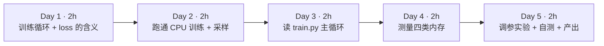

| 天 | 时间 | 先读（概念） | 再读（外部资料，按顺序） | 再做（实验） |
|---|---|---|---|---|
| Day 1 | ~2h | 本页 2.1、2.2、2.3 | ① [PyTorch 教程：Automatic Differentiation with torch.autograd](https://docs.pytorch.org/tutorials/beginner/basics/autogradqs_tutorial.html) 的 *Tensors, Functions and Computational graph*、*Computing Gradients*、*Disabling Gradient Tracking*（30 分钟）；② [PyTorch 教程：Optimizing Model Parameters](https://docs.pytorch.org/tutorials/beginner/basics/optimization_tutorial.html) 的 *Hyperparameters*、*Optimization Loop*（20 分钟） | 实验 0：环境与数据 |
| Day 2 | ~2h | 本页 2.4 | ③ [nanoGPT README](https://github.com/karpathy/nanoGPT) 的 *quick start* 一节（含 CPU 小配置那一段）（15 分钟） | 实验 1：CPU 训练；实验 2：采样 |
| Day 3 | ~2h | 本页 2.5、2.6 | ④ [nanoGPT train.py](https://github.com/karpathy/nanoGPT/blob/master/train.py) 全文（约 330 行，60 分钟，重点 `get_batch`、`get_lr`、`while True` 主循环）；⑤ [happy-llm 第四章](https://github.com/datawhalechina/happy-llm) *4.2 如何训练一个 LLM* 的 *4.2.1 Pretrain*（20 分钟） | 对照代码给主循环写注释 |
| Day 4 | ~2h | 本页 2.7 | ⑥ [PyTorch 教程：Hooks for autograd saved tensors](https://docs.pytorch.org/tutorials/intermediate/autograd_saved_tensors_hooks_tutorial.html) 前两节（20 分钟，理解实验 3 的测量原理）；⑦ [torch.optim.AdamW 文档](https://docs.pytorch.org/docs/stable/generated/torch.optim.AdamW.html) 的算法伪代码（15 分钟） | 实验 3：拆开测四类内存 |
| Day 5 | ~2h | 本页 2.8 | ⑧ [Raschka LLMs-from-scratch 第 5 章](https://github.com/rasbt/LLMs-from-scratch/tree/main/ch05) 浏览 `ch05.ipynb` 的训练循环部分（选读，30 分钟） | 实验 4：改参数观察；（可选）实验 5：GPU；自测题；本周产出 |

**每日打卡：**

- [ ] Day 1：读完 ①②，完成实验 0，能说出 `loss.backward()` 和 `optimizer.step()` 分别做了什么
- [ ] Day 2：完成实验 1、2，最终 val loss 在 1.9 左右，生成了“像莎士比亚格式”的文本
- [ ] Day 3：读完 ④⑤，能解释 `get_lr` 的三段和 `gradient_accumulation_steps` 的作用
- [ ] Day 4：读完 ⑥⑦，完成实验 3，四类内存测量值与手算一致
- [ ] Day 5：完成实验 4 记录表、自测题、本周产出

---

## 2. 核心概念讲解

### 2.1 训练在做什么：一个“拟合下一个字符”的优化问题

上周你看到：模型对每个位置输出一个“下一个 token 的概率分布”。**训练**就是不断调整模型的参数（GPT-2 small 有 1.24 亿个浮点数），让它在训练数据上给“真实的下一个 token”分配尽可能高的概率。

用数据仓库的话说：训练数据是一张巨大的事实表，每一行是 `(前文, 下一个 token)`；模型是一个有上亿个可调参数的“打分函数”；训练就是用这张表反复“回归拟合”这个函数。和你熟悉的 ETL 最大的区别是：**ETL 是一次扫描得到确定结果；训练是对同一份数据反复迭代几千到几十万次，每次只微调一点点参数**，而且每一步都依赖上一步的结果（天然串行，这是分布式训练难的根源）。

### 2.2 一次训练迭代的四个步骤

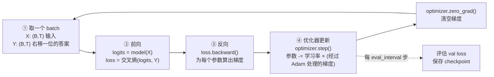

1. **取 batch**：从训练语料里随机切出 B 段长度为 T 的片段作为输入 X，把同样的片段**右移一位**作为答案 Y。一个 `(B, T)` 的 batch 实际包含 `B × T` 个“预测下一个 token”的样本（上周 2.6 节）。
2. **前向（forward）**：算出 logits `(B, T, vocab)`，再与 Y 计算交叉熵 loss（一个标量）。前向时 PyTorch 会记录计算图，并**保存反向需要的中间结果**——这就是“激活值”。
3. **反向（backward）**：`loss.backward()` 沿计算图反向应用链式法则，为**每一个参数**算出 `∂loss/∂参数`（梯度），存在 `param.grad` 里。梯度和参数**形状完全相同**。
4. **更新（step）**：优化器根据梯度修改参数。最简单的 SGD 是 `参数 -= lr × 梯度`；LLM 普遍用 **AdamW**，它为每个参数额外维护两个“动量”：梯度的滑动平均（一阶矩）和梯度平方的滑动平均（二阶矩），用它们来自适应地调整每个参数的步长。

**类比**：把第 ② 步想成执行一条 SQL 并记录完整的执行轨迹（lineage）；第 ③ 步是沿着 lineage 反向追溯“每个输入列对最终误差贡献了多少”；第 ④ 步是根据贡献度调整每个“参数列”的值。之所以要保存激活值，就像为了能做反向追溯，必须把每个 stage 的中间结果暂存下来——这正是训练比推理费内存的根本原因。

### 2.3 交叉熵 loss：为什么第 0 步是 4.17

**交叉熵**：模型给正确答案的概率记为 `p`，这一个样本的 loss 就是 `-ln(p)`；一个 batch 的 loss 是所有 `B × T` 个样本的平均。

- 模型完全猜对（p = 1）：loss = 0。
- 模型完全随机、在 V 个字符上平均分配概率（p = 1/V）：loss = ln(V)。

Shakespeare 字符级数据集的词表有 65 个字符，`ln(65) ≈ 4.174`。实验 1 的日志第一行是 `step 0: train loss 4.1676, val loss 4.1649`——**和理论值几乎完全一样**，说明刚初始化的模型确实在“均匀乱猜”。这是检查训练脚本是否正确的第一个“单元测试”：如果初始 loss 远大于 ln(V)，往往是初始化或数据有问题。

训练到最后 val loss ≈ 1.89，对应“正确字符的平均概率” ≈ `e^(-1.89) ≈ 0.15`，也就是说模型从 1/65 ≈ 1.5% 的瞎猜，提高到平均给正确答案约 15% 的概率（准确地说是几何平均）。nanoGPT README 中在 A100 上用默认大配置训练能到 val loss 1.4697（对应约 23%）。

**train loss vs val loss**：train loss 是在训练数据上测的，val loss 是在模型没见过的 10% 数据上测的。val loss 是判断模型好坏的依据；如果 train loss 持续下降而 val loss 开始上升，就是**过拟合**——模型在“背答案”。这和你在数据仓库里做 A/B 回测时“样本内 vs 样本外”的区别是一回事。

### 2.4 数据管线：memmap 随机切片

nanoGPT 的数据准备极其朴素：`prepare.py` 把整本莎士比亚（约 111 万字符）按字符映射成整数，以 `uint16` 写成一个扁平的二进制文件 `train.bin`（约 100 万 token × 2 字节 ≈ 2 MB）。训练时 `get_batch` 用 `np.memmap` 把这个文件**内存映射**，随机选 B 个起点，各切出 T+1 个 token：

```python
data = np.memmap('train.bin', dtype=np.uint16, mode='r')
ix = torch.randint(len(data) - block_size, (batch_size,))          # B 个随机起点
x = torch.stack([data[i:i+block_size] for i in ix])               # 输入
y = torch.stack([data[i+1:i+1+block_size] for i in ix])           # 右移一位 = 答案
```

| 你熟悉的（大数据） | nanoGPT 数据管线 | 说明 |
|---|---|---|
| 把文本表 tokenize 后落成列存文件 | `prepare.py` → `train.bin`（uint16 扁平数组） | 训练前一次性预处理，训练时只读 |
| 随机抽样（`TABLESAMPLE`） | `torch.randint` 随机起点 | 每步独立随机抽样，**不保证每条数据都被看到相同次数** |
| mmap / 页缓存 | `np.memmap` | 文件不整体读进内存，访问哪页才加载哪页；大语料（几百 GB）也能这样读 |
| 列存的定长编码 | `uint16` | 词表 < 65536 时 2 字节足够；GPT-2 的 50257 也恰好放得下 |

这种“扁平 token 文件 + 随机切片”的格式在大规模预训练中很常见（Megatron-LM 的 indexed dataset 也是预先分词后的二进制文件加索引）。第 2 月你会用 Ray Data 生产这样的文件。

### 2.5 学习率调度、梯度累积与梯度裁剪

读 `train.py` 时你会遇到几个训练工程里的“标准件”：

**学习率预热 + 余弦衰减**（`get_lr`）：

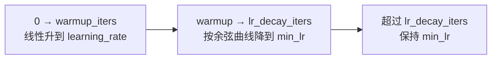

刚初始化时梯度方向很不可靠，先用小学习率“热身”；后期用小学习率精细收敛。Shakespeare 配置里 `learning_rate=1e-3、min_lr=1e-4、warmup_iters=100`。

**梯度累积**（`gradient_accumulation_steps`）：想要 batch=480 但显存只放得下 12？那就连续做 40 次前向+反向，每次 loss 除以 40，梯度在 `param.grad` 里**累加**，最后只做一次 `optimizer.step()`。数学上等价于一个大 batch，代价是时间变长。**类比**：MapReduce 里 combiner 先在本地累加部分结果，最后再一次性提交。nanoGPT 默认（训练 GPT-2 的配置）`gradient_accumulation_steps = 5 * 8`，单机 8 卡 DDP 时每卡分到 5 步。

**梯度裁剪**（`grad_clip = 1.0`）：如果所有梯度拼成的向量的范数超过 1.0，就整体缩放到 1.0。防止偶发的异常 batch 产生巨大梯度把模型“炸飞”（loss 突然变成 NaN）。这类似于数据管线里对异常值做截断，保护下游。

**混合精度**（`dtype`、`autocast`、`GradScaler`）：GPU 上用 bf16/fp16 做大部分矩阵运算，速度快、激活省一半内存；在 CPU 上 nanoGPT 不启用（`ctx = nullcontext()`）。fp16 动态范围小，需要 `GradScaler` 放大 loss 防止梯度下溢；bf16 不需要。第 4 周算显存时会用到“混合精度下每参数 16 字节”的口径。

### 2.6 读懂训练日志

实验 1 的日志有两类行：

```text
step 1000: train loss 1.9714, val loss 2.0528      ← 每 eval_interval 步做一次评估
iter 1000: loss 2.0455, time 194.07ms, mfu 0.08%  ← 每 log_interval 步一行
```

- `tokens per iteration will be: 768`：`gradient_accumulation_steps × B × T = 1 × 12 × 64`。**吞吐 = tokens per iter ÷ 每步时间**，这是比较不同硬件/配置时最该看的数字（实验 1 中约 768 ÷ 0.013s ≈ 5.9 万 token/s）。
- `time`：本步耗时。注意第 0 步很慢（283ms，包含各种初始化），评估步（如 iter 500、1000）也会偏慢（160～190ms），因为时间里包含了刚做完的评估；比较速度时要取稳态的普通步。
- `mfu`（Model FLOPs Utilization）：实际达到的 FLOPs ÷ 硬件峰值 FLOPs。nanoGPT 代码里把峰值**写死为 A100 的 bf16 峰值 312 TFLOPS**（`model.py` 的 `estimate_mfu`），所以在 CPU 或其他 GPU 上这个数字没有意义——在 CPU 上显示 0.08% 不代表你的 CPU 只用了 0.08%。到了 GPU 上它很重要：大模型训练的 MFU 通常是衡量集群效率的核心 KPI（第 5 月）。

**估算 FLOPs 的经验式**：训练每个 token 约需 `6 × N` 次浮点运算（N = 参数量；前向 2N，反向约 4N）。0.8M 参数的模型每 token 约 4.8 MFLOPs；上周说的推理每 token 约 2N。这个 “6N” 你会在 scaling law、训练成本估算里反复见到。

### 2.7 训练时内存里住着谁：四类数据

这是本周最重要的一节，也是下周显存估算的地基。

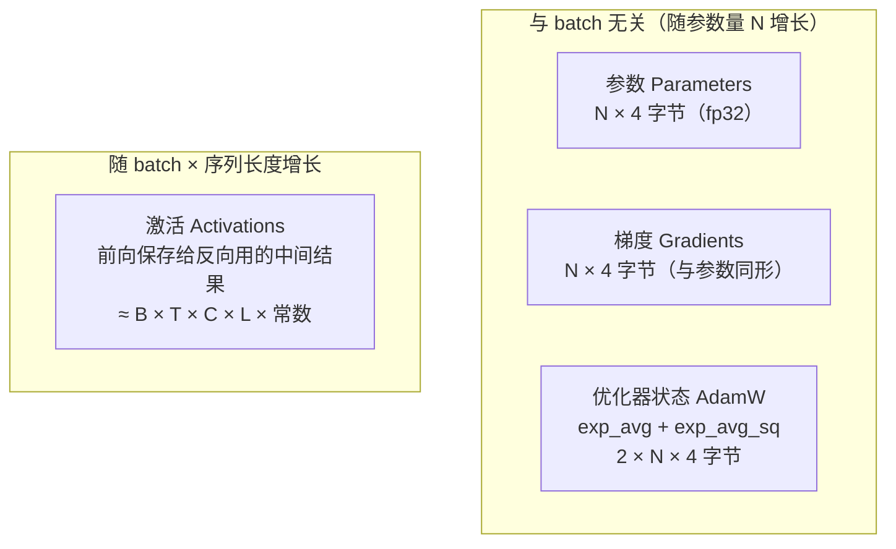

**固定部分**（纯 fp32 训练）：参数 4N + 梯度 4N + Adam 8N = **16N 字节**。0.8M 参数 → 约 12 MiB。实验 3 实测：参数 3.07 MiB、梯度 3.07 MiB、AdamW 状态 6.13 MiB，比例严格是 1 : 1 : 2。

**旁证**：实验 1 保存的 `ckpt.pt` 是 9.7 MB——正好约等于 参数 + Adam 两个状态（3 × 3.2 MB），因为 checkpoint 里存了 `model` 和 `optimizer` 的 state_dict（梯度不需要保存）。这也是为什么大模型的“训练 checkpoint”比“发布的权重文件”大好几倍。

**激活部分**：前向时每一层的输入、注意力的中间结果、MLP 的中间结果……只要反向需要，就得一直保留到反向用完。它与 `B × T`（一个 batch 的 token 数）成正比，与层数成正比，与隐藏维度成正比。实验 3 实测：

- B=12、T=64：激活 25 MiB，**已经是固定部分（12 MiB）的 2 倍**；
- B 翻倍或 T 翻倍：激活都变成 50 MiB（线性增长）；
- 换成 README 的 GPU 默认配置（B=64、T=256、6 层、C=384）：激活 2360 MiB，固定部分只有约 164 MiB——**激活占了 93%**。

**注意力的 T² 去哪了？** 朴素注意力要保存 `(B, heads, T, T)` 的分数矩阵，激活应该随 T 平方增长。实验 3 的对照显示：用朴素注意力时，T 从 64→128→256，激活从 28→62→148 MiB（超线性增长）；而用 PyTorch 的 `scaled_dot_product_attention`（SDPA）时 T=256 只有 100 MiB。这是因为 SDPA 的高效实现不把完整的 T×T 矩阵保存下来，反向时重新计算——这正是 FlashAttention 的思想，第 4 月会再讲。

**为什么这对架构师重要**：

1. 小模型 + 大 batch：瓶颈在激活 → 用梯度累积（减小每步 B）、激活检查点（activation checkpointing，用重算换内存）。
2. 大模型（7B+）：固定部分 16N 就已经是 112 GB 以上 → 单卡放不下 → 必须把参数/梯度/优化器状态切到多卡上（ZeRO-1/2/3、FSDP，第 19 周），或者只训练很少的参数（LoRA）。
3. 激活和固定部分的此消彼长，决定了你给训练任务申请资源时“卡数 × 单卡显存”的组合。

### 2.8 CPU、MPS 与 GPU：同一份代码，不同的速度

nanoGPT 用 `--device` 切换硬件：`cpu`、`mps`（Apple Silicon 的 GPU）、`cuda`（NVIDIA）。代码几乎不用改，这正是 PyTorch 的抽象价值。但性能差距巨大：README 中默认配置（10M 参数）在一张 A100 上约 3 分钟训练完 5000 步，val loss 1.4697；我们在 8 核 CPU 上只能跑缩小了约 13 倍参数量的小配置，2000 步约 33 秒，val loss 1.89。

- **Apple Silicon 的 MPS**：用 Mac 的统一内存，能跑比 CPU 快的训练，但 PyTorch 的 MPS 后端算子覆盖、`torch.compile` 支持不如 CUDA 完整（见 [PyTorch MPS 说明](https://docs.pytorch.org/docs/stable/notes/mps.html)）。本站没有 Mac 环境，MPS 速度**未在本站实测**，请你自己跑并填进记录表。
- **为什么要租卡跑一次**：不是为了 loss 更低，而是为了第一次亲眼看到 `nvidia-smi` 里显存占用、GPU 利用率、功耗，建立“GPU 训练长什么样”的体感，下周用它校准显存估算。

---

## 3. 动手实验

```mermaid
flowchart LR
  E0["实验 0<br/>clone + 数据准备"] --> E1["实验 1<br/>CPU 训练"] --> E2["实验 2<br/>采样生成"]
  E1 --> E3["实验 3<br/>mem_parts.py 测四类内存"]
  E3 --> E4["实验 4<br/>改参数观察"]
  E1 -.可选.-> E5["实验 5<br/>GPU 默认配置（未在本站实测）"]
```

### 实验 0：获取代码与数据（15 分钟）{{local}}

```bash
cd ~/ai-infra-lab && source .venv/bin/activate && mkdir -p w3
git clone https://github.com/karpathy/nanoGPT.git && cd nanoGPT
git log -1 --format='%h %ci'          # 记录你用的提交
uv pip install torch numpy requests   # torch 已在第 2 周装过；requests 用于下载数据
python data/shakespeare_char/prepare.py
ls -la data/shakespeare_char/
```

**本站输出**：

```text
3adf61e 2025-11-12 11:52:34 -0800
length of dataset in characters: 1,115,394
all the unique characters: 
 !$&',-.3:;?ABCDEFGHIJKLMNOPQRSTUVWXYZabcdefghijklmnopqrstuvwxyz
vocab size: 65
train has 1,003,854 tokens
val has 111,540 tokens
-rw-r--r-- 1 box box 1115394 Oct 20 10:12 input.txt
-rw-r--r-- 1 box box     703 Oct 20 10:12 meta.pkl
-rw-r--r-- 1 box box     2344 Oct 20 10:12 prepare.py
-rw-r--r-- 1 box box 2007708 Oct 20 10:12 train.bin
-rw-r--r-- 1 box box  223080 Oct 20 10:12 val.bin
```

**逐步解释**：

- `prepare.py` 下载 tiny shakespeare 文本（约 1.1 MB），统计出 65 个不同字符作为词表，前 90% 作训练集、后 10% 作验证集。
- `train.bin` 是 2,007,708 字节 = 1,003,854 个 token × 2 字节（uint16），和 2.4 节的计算一致。`meta.pkl` 保存字符↔id 的映射，采样时用它解码。
- 这里的“分词器”就是最朴素的字符级映射，词表只有 65；上周的 BPE 词表是 5 万～15 万。词表越小，序列越长、每步学到的“信息”越少，这也是字符级模型效果有限的原因。

### 实验 1：CPU 训练小配置（30 分钟）{{local}}

先在 `~/ai-infra-lab/w3/` 创建一个辅助脚本 `peak.py`，用来记录任意命令的耗时和峰值内存（macOS 自带的 `/usr/bin/time` 参数和 Linux 不同，用 Python 写一个两边通用的）：

```python
"""运行任意命令，结束后打印墙钟时间和子进程峰值内存（替代 /usr/bin/time -v）。
用法：python peak.py python train.py ...
"""
import resource
import subprocess
import sys
import time

t = time.perf_counter()
rc = subprocess.call(sys.argv[1:])
dt = time.perf_counter() - t
peak = resource.getrusage(resource.RUSAGE_CHILDREN).ru_maxrss
unit = 2**20 if sys.platform == "darwin" else 2**10   # macOS 单位是字节，Linux 是 KiB
print(f"[peak] 退出码={rc} 用时={dt:.1f}s 峰值内存={peak / unit:.0f} MiB", file=sys.stderr)
sys.exit(rc)
```

然后在 nanoGPT 目录运行 README 给出的 CPU 小配置：

```bash
python ../w3/peak.py python train.py config/train_shakespeare_char.py \
  --device=cpu --compile=False --eval_iters=20 --log_interval=1 \
  --block_size=64 --batch_size=12 --n_layer=4 --n_head=4 --n_embd=128 \
  --max_iters=2000 --lr_decay_iters=2000 --dropout=0.0 2>&1 | tee train_cpu.log
```

**本站输出**（节选；完整日志每步一行）：

```text
tokens per iteration will be: 768
number of parameters: 0.80M
step 0: train loss 4.1676, val loss 4.1649
iter 0: loss 4.1828, time 283.93ms, mfu -100.00%
iter 1: loss 4.1373, time 16.41ms, mfu -100.00%
iter 10: loss 3.7366, time 11.11ms, mfu 0.10%
iter 100: loss 2.6635, time 13.51ms, mfu 0.09%
step 250: train loss 2.4293, val loss 2.4447
step 500: train loss 2.2732, val loss 2.3141
iter 500: loss 2.3827, time 162.21ms, mfu 0.09%
step 750: train loss 2.1338, val loss 2.1905
step 1000: train loss 1.9714, val loss 2.0528
iter 1000: loss 2.0455, time 194.07ms, mfu 0.08%
step 1250: train loss 1.8756, val loss 2.0089
step 1500: train loss 1.8557, val loss 1.9225
step 1750: train loss 1.7790, val loss 1.8921
step 2000: train loss 1.7648, val loss 1.8857
iter 1999: loss 1.9002, time 12.21ms, mfu 0.09%
[peak] 退出码=0 用时=33.1s 峰值内存=366 MiB
```

**逐步解释**：

- **参数量 0.80M**：nanoGPT 打印的是“非嵌入参数量”（`get_num_params` 默认减去位置嵌入），所以和实验 3 的 804,096 略有出入。
- **loss 曲线**：4.17（随机猜）→ 2.43（学会了常见字母和空格）→ 1.89（学会了单词和“人名 + 冒号 + 换行”的剧本格式）。README 说 CPU 小配置能到约 1.88，与本站 1.8857 吻合。
- **val loss 略高于 train loss**，差距不大：没有明显过拟合（模型太小，背不下来）。
- **每步 11～17ms**（稳态），评估步明显更慢（见 2.6 节）。
- **峰值内存 366 MiB**：其中绝大部分是 Python + PyTorch 运行时本身（实验 4 中把 batch 翻倍只增加约 38 MiB），模型相关的数据只有几十 MiB（实验 3 会精确拆分）。
- README 说这个配置“约 3 分钟”，本站只用了 33 秒；速度取决于 CPU 型号与线程数，你的 Mac 上请记录自己的数字。

### 实验 2：采样生成（10 分钟）{{local}}

```bash
python sample.py --out_dir=out-shakespeare-char --device=cpu --num_samples=2 --max_new_tokens=300
ls -la out-shakespeare-char
```

**本站输出**（节选；采样有随机性，每次结果不同）：

```text
PUTUS:
Hese sirven in it Merember that me the wild not.

MERCUSUS:
O, say, noo siersting: in the his relower to my
the will him bout thing thy a moy a to therropp
And of his beod it my not sord not:
Now ild good grace to I clann with we was you,
---------------
-rw-r--r-- 1 box box 9678732 Oct 20 10:13 ckpt.pt
```

**逐步解释**：

- 模型学会了剧本**格式**（大写人名 + 冒号 + 换行 + 台词）、常见短词（and、the、my、good grace），但大多数长词是拼凑的“伪英文”。这对一个 80 万参数、只看了约 150 万个字符（2000 步 × 768 token）的模型已经很不错了。
- `ckpt.pt` 9,678,732 字节 ≈ 参数 + AdamW 两个状态（见 2.7 节“旁证”）。
- `sample.py` 默认 `temperature=0.8`、`top_k=200`。试试 `--temperature=0.1`（更保守、更重复）和 `--temperature=1.5`（更“放飞”），体会温度对采样的影响。

### 实验 3：拆开测量四类内存（40 分钟）{{local}}

把下面的 `mem_parts.py` 放进 **nanoGPT 目录**（它要 `import model`）：

```python
"""把一次训练迭代拆开，逐项测量：参数、梯度、AdamW 状态、激活（反向需要保存的张量）。
在 nanoGPT 目录下运行：python mem_parts.py --batch_size 12 --block_size 64
"""
import argparse

import torch
from model import GPT, GPTConfig  # nanoGPT 自带的 model.py

ap = argparse.ArgumentParser()
ap.add_argument("--batch_size", type=int, default=12)
ap.add_argument("--block_size", type=int, default=64)
ap.add_argument("--n_layer", type=int, default=4)
ap.add_argument("--n_head", type=int, default=4)
ap.add_argument("--n_embd", type=int, default=128)
ap.add_argument("--no-flash", action="store_true", help="改用朴素注意力（显式构造 T×T 矩阵）")
a = ap.parse_args()
MiB = 2**20

torch.manual_seed(0)
cfg = GPTConfig(block_size=a.block_size, vocab_size=65, n_layer=a.n_layer, n_head=a.n_head,
                n_embd=a.n_embd, dropout=0.0, bias=False)
model = GPT(cfg)
if a.no_flash:
    for blk in model.transformer.h:
        blk.attn.flash = False  # nanoGPT 只在非 flash 模式下才注册掩码 buffer，这里手动补上
        blk.attn.register_buffer("bias", torch.tril(torch.ones(a.block_size, a.block_size))
                                 .view(1, 1, a.block_size, a.block_size))
opt = model.configure_optimizers(weight_decay=0.1, learning_rate=1e-3, betas=(0.9, 0.99), device_type="cpu")

def nbytes(ts):
    return sum(t.numel() * t.element_size() for t in ts)

x = torch.randint(0, 65, (a.batch_size, a.block_size))
y = torch.randint(0, 65, (a.batch_size, a.block_size))

# ① 前向：用 saved_tensors_hooks 统计 autograd 为反向“存下来”的张量 = 激活
param_ptrs = {p.data_ptr() for p in model.parameters()}
saved = {}  # 按底层存储地址去重：同一块内存被多处保存只算一次；权重本身不算激活
def pack(t):
    ptr = t.untyped_storage().data_ptr()
    if ptr not in param_ptrs:
        saved[ptr] = t.untyped_storage().nbytes()
    return t
with torch.autograd.graph.saved_tensors_hooks(pack, lambda t: t):
    logits, loss = model(x, y)
act = sum(saved.values())

# ② 反向：产生梯度；③ 优化器 step：第一次 step 时才分配 exp_avg / exp_avg_sq
loss.backward()
grads = nbytes(p.grad for p in model.parameters() if p.grad is not None)
opt.step()
states = nbytes(v for s in opt.state.values() for v in s.values() if torch.is_tensor(v))
params = nbytes(model.parameters())

print(f"配置 B={a.batch_size} T={a.block_size} L={a.n_layer} C={a.n_embd} {'朴素注意力' if a.no_flash else 'SDPA'}  参数量={sum(p.numel() for p in model.parameters()):,}")
print(f"参数      {params / MiB:8.2f} MiB  (fp32 = 4 字节/参数)")
print(f"梯度      {grads / MiB:8.2f} MiB  (与参数同形状)")
print(f"AdamW状态 {states / MiB:8.2f} MiB  (exp_avg + exp_avg_sq = 2 × 参数)")
print(f"激活      {act / MiB:8.2f} MiB  (随 B×T 增长；去重后 {len(saved)} 块存储)")
print(f"合计      {(params + grads + states + act) / MiB:8.2f} MiB")
```

```bash
python mem_parts.py
python mem_parts.py --batch_size 24
python mem_parts.py --block_size 128
python mem_parts.py --batch_size 64 --block_size 256 --n_layer 6 --n_head 6 --n_embd 384   # GPU 默认配置的规模
```

**本站输出**（已删去 nanoGPT 打印的 `num decayed parameter tensors` 等行）：

```text
配置 B=12 T=64 L=4 C=128 SDPA  参数量=804,096
参数          3.07 MiB  (fp32 = 4 字节/参数)
梯度          3.07 MiB  (与参数同形状)
AdamW状态     6.13 MiB  (exp_avg + exp_avg_sq = 2 × 参数)
激活         25.05 MiB  (随 B×T 增长；去重后 61 块存储)
合计         37.32 MiB

配置 B=24 T=64 L=4 C=128 SDPA  参数量=804,096
...
激活         50.10 MiB  (随 B×T 增长；去重后 61 块存储)
合计         62.37 MiB

配置 B=12 T=128 L=4 C=128 SDPA  参数量=812,288
...
激活         50.10 MiB  (随 B×T 增长；去重后 61 块存储)
合计         62.50 MiB

配置 B=64 T=256 L=6 C=384 SDPA  参数量=10,745,088
参数         40.99 MiB  (fp32 = 4 字节/参数)
梯度         40.99 MiB  (与参数同形状)
AdamW状态    81.98 MiB  (exp_avg + exp_avg_sq = 2 × 参数)
激活       2360.19 MiB  (随 B×T 增长；去重后 87 块存储)
合计       2524.15 MiB
```

再对比朴素注意力与 SDPA：

```bash
for T in 64 128 256; do python mem_parts.py --no-flash --block_size $T | grep -E "配置|激活"; done
python mem_parts.py --block_size 256 | grep -E "配置|激活"
```

```text
配置 B=12 T=64 L=4 C=128 朴素注意力  参数量=804,096
激活         28.02 MiB  (随 B×T 增长；去重后 73 块存储)
配置 B=12 T=128 L=4 C=128 朴素注意力  参数量=812,288
激活         62.07 MiB  (随 B×T 增长；去重后 73 块存储)
配置 B=12 T=256 L=4 C=128 朴素注意力  参数量=828,672
激活        148.27 MiB  (随 B×T 增长；去重后 73 块存储)
配置 B=12 T=256 L=4 C=128 SDPA  参数量=828,672
激活        100.21 MiB  (随 B×T 增长；去重后 61 块存储)
```

**逐步解释**：

- **测量原理**：`saved_tensors_hooks` 会在 autograd 每次“为反向保存一个张量”时调用 `pack`。我们按底层存储地址去重（同一块内存可能被多个算子引用），并排除参数本身（Linear 层反向也会引用权重，但那不是新增内存）。这是一种**近似**测量：它统计的是反向需要的张量，不包括前向中途临时分配又立即释放的缓冲区，所以它是激活的下限而不是进程峰值。
- **参数 : 梯度 : AdamW = 1 : 1 : 2**，与 2.7 节公式一致。注意 `opt.step()` 之前 `opt.state` 是空的——AdamW 的两个状态在**第一次 step 时**才分配，这就是为什么很多训练任务“第一步没事、第二步 OOM”。
- **B 翻倍和 T 翻倍激活都恰好翻倍**（25.05 → 50.10）：用 SDPA 时激活对 token 总数 B×T 线性。参数量随 T 有微小变化，是因为位置嵌入表 `wpe` 的大小等于 `block_size × C`。
- **朴素注意力的激活随 T 超线性增长**（28 → 62 → 148），多出来的是每层保存的 `(B, heads, T, T)` 注意力矩阵；T=256 时比 SDPA 多出约 48 MiB。序列越长，这一项越可怕。
- **GPU 默认配置的规模**：激活 2.3 GiB，占总量的 93%。所以 README 里的默认配置在 CPU 上会很慢、在小显存卡上可能放不下，而参数本身只有 41 MiB。

### 实验 4：改参数观察速度与内存（30 分钟）{{local}}

各跑 300 步（不评估、不比较 loss，只看速度和内存）：

```bash
for extra in "--batch_size=12 --block_size=64" "--batch_size=24 --block_size=64" "--batch_size=12 --block_size=128"; do
  echo "== $extra"
  python ../w3/peak.py python train.py config/train_shakespeare_char.py --device=cpu --compile=False \
    --eval_iters=20 --log_interval=50 --n_layer=4 --n_head=4 --n_embd=128 \
    --max_iters=300 --lr_decay_iters=300 --dropout=0.0 --eval_interval=1000 --out_dir=/tmp/o $extra \
    2>&1 | grep -E "^iter (100|150|200|250):|peak"
done
```

**本站输出**：

```text
== --batch_size=12 --block_size=64
iter 100: loss 2.6635, time 15.29ms, mfu 0.08%
iter 150: loss 2.5341, time 13.45ms, mfu 0.08%
iter 200: loss 2.4769, time 17.07ms, mfu 0.08%
iter 250: loss 2.4711, time 11.40ms, mfu 0.09%
[peak] 退出码=0 用时=6.7s 峰值内存=365 MiB
== --batch_size=24 --block_size=64
iter 100: loss 2.5811, time 22.50ms, mfu 0.09%
iter 150: loss 2.3737, time 24.83ms, mfu 0.09%
iter 200: loss 2.3829, time 16.80ms, mfu 0.09%
iter 250: loss 2.3704, time 18.77ms, mfu 0.10%
[peak] 退出码=0 用时=9.1s 峰值内存=403 MiB
== --batch_size=12 --block_size=128
iter 100: loss 2.5639, time 18.36ms, mfu 0.16%
iter 150: loss 2.5243, time 20.45ms, mfu 0.16%
iter 200: loss 2.4352, time 17.41ms, mfu 0.16%
iter 250: loss 2.4421, time 19.58ms, mfu 0.15%
[peak] 退出码=0 用时=8.9s 峰值内存=404 MiB
```

**逐步解释**：

- token 数翻倍，每步时间只增加约 30～50%，而不是翻倍：小矩阵在 CPU 上没有“喂饱”计算单元，batch 越大并行效率越高。这就是 GPU 训练要尽量把 batch 做大的原因（直到显存或收敛性成为限制）。
- 峰值内存只增加约 38 MiB，和实验 3 中激活从 25→50 MiB 的增量同一量级（进程峰值还包含临时缓冲区）。
- 在 CPU 上 `mfu` 列请忽略（2.6 节）。但注意 T=128 的 mfu 估算比 B=24 高：nanoGPT 的 FLOPs 公式包含注意力的 T 相关项，T 越大每 token 的估算 FLOPs 越多。
- 每次运行的 loss 不同，是因为 batch 大小改变了随机抽样序列，不要拿 300 步的 loss 比较好坏。

**记录表（填你自己的 Mac 数字）**：

| 环境 | 配置 | 稳态每步耗时 (ms) | 峰值内存 / 显存 | 最终 val loss |
|---|---|---|---|---|
| 本站 Linux CPU（8 核） | 小配置 2000 步 | 11～17 | 366 MiB | 1.8857 |
| 你的 Mac CPU | 小配置 2000 步 | | | |
| 你的 Mac MPS（`--device=mps`） | 小配置 2000 步 | | | |
| GPU 24GB（实验 5，可选） | 默认配置 5000 步 | | | |

### 实验 5：租单卡跑默认配置（可选，60 分钟）{{gpu1}}

> ⚠️ **未在本站实测，需 GPU**。以下命令来自 [nanoGPT README](https://github.com/karpathy/nanoGPT) 的 *quick start* 一节；README 原文称默认配置“在一张 A100 上约 3 分钟，最佳 val loss 1.4697”。本站没有运行，**下面不提供输出**，请你把实测结果填进记录表。

```bash
# 在租来的 GPU 机器上（AutoDL / RunPod 等，选带 PyTorch 的镜像）
git clone https://github.com/karpathy/nanoGPT.git && cd nanoGPT
pip install torch numpy transformers datasets tiktoken wandb tqdm   # README 的依赖列表
python data/shakespeare_char/prepare.py
python train.py config/train_shakespeare_char.py      # 默认配置：6 层、6 头、384 维、B=64、T=256
# 另开一个终端观察 GPU
watch -n 1 nvidia-smi
# 训练结束后
python sample.py --out_dir=out-shakespeare-char
```

**观察要点**：

- `nvidia-smi` 里的显存占用会**明显大于**实验 3 估算的 2.5 GiB 左右：GPU 上默认启用 bf16 混合精度（激活减半），但 PyTorch 的 CUDA 缓存分配器会预留显存、CUDA 上下文本身也要几百 MB，`torch.compile` 还会额外占用。把差距和原因记进记录表——这正是下周要建立的“估算 vs 实测”误差分析。
- 用 `tokens per iteration`（README 默认配置是 64 × 256 = 16,384）除以每步时间得到吞吐，与 CPU 小配置对比。
- 如果遇到 `torch.compile` 报错，可加 `--compile=False` 重试（README 在 *troubleshooting* 一节有说明）。

### 常见错误与排查

| 现象（真实报错或现象） | 原因 | 解决 |
|---|---|---|
| `ModuleNotFoundError: No module named 'requests'`（运行 prepare.py 时） | 下载数据需要 requests | `uv pip install requests` |
| `ModuleNotFoundError: No module named 'model'`（运行 mem_parts.py 时） | 脚本不在 nanoGPT 目录 | 把 mem_parts.py 复制到 nanoGPT 目录再运行 |
| `AttributeError: 'CausalSelfAttention' object has no attribute 'bias'`（未在本站复现，按代码推断） | 只把 `flash` 设为 False，没注册掩码 buffer | 按本页写法补 `register_buffer("bias", ...)` |
| CPU 上报 `torch.compile` 相关错误 | CPU/Mac 上编译支持有限 | 加 `--compile=False`（README 的 CPU 命令已包含） |
| 训练很慢，`time` 每步上百毫秒 | 用了默认大配置，或机器上有其他负载 | 确认带上了全部小配置参数；关闭其他程序 |
| `--device=mps` 报某个算子未实现（未在本站复现） | MPS 后端算子覆盖不全 | 设 `PYTORCH_ENABLE_MPS_FALLBACK=1`，或改回 `cpu` |
| loss 变成 `nan` | 学习率过大或数值不稳定 | 降低 `--learning_rate`；确认 `grad_clip` 未被关掉 |
| 采样输出全是乱码 / 都是同一个字符 | 训练步数太少或 `out_dir` 指错（加载了别的 checkpoint） | 检查 `--out_dir`；确认训练日志里 val loss 已降到 2 以下 |

### 扩展练习（选做，每题 20–40 分钟）

1. **过拟合实验**：把 `--n_layer=6 --n_head=6 --n_embd=256 --max_iters=5000` 在 CPU 上跑（会慢很多，可以放着过夜），观察 train loss 与 val loss 的差距何时开始拉大。把 `--dropout=0.2` 加回去再跑一次对比。
2. **验证梯度累积的等价性**：用 `mem_parts.py` 的思路，分别做“B=24 一次反向”和“B=12 两次反向、loss 各除以 2、梯度累加”，比较两种方式得到的梯度（`p.grad`）最大差异。
3. **学习率调度可视化**：把 `train.py` 的 `get_lr` 复制出来，用 matplotlib 画出 Shakespeare 配置下 0～2000 步的学习率曲线。
4. **换数据**：把 `input.txt` 换成你自己的文本（例如一批 SQL 脚本，或中文小说——注意中文字符级词表会有几千个字符），重跑 prepare + train，观察初始 loss 是否等于 ln(词表大小)。
5. **算 6N**：用实验 1 的吞吐（token/s）× 6 × 参数量，估算你的 CPU 实际达到的 FLOPs，再和你 CPU 的理论峰值比较。

---

## 4. 精读指南

### ①② PyTorch 基础教程（50 分钟）

- [Automatic Differentiation with torch.autograd](https://docs.pytorch.org/tutorials/beginner/basics/autogradqs_tutorial.html)：**读哪里**：*Tensors, Functions and Computational graph*、*Computing Gradients*、*Disabling Gradient Tracking*。**重点**：计算图在前向时动态建立；`requires_grad`；`torch.no_grad()` 为什么能省内存。**读完回答**：① 为什么评估（`estimate_loss`）和采样时要包在 `torch.no_grad()` 里？② 对同一个图调用两次 `backward()` 会怎样？
- [Optimizing Model Parameters](https://docs.pytorch.org/tutorials/beginner/basics/optimization_tutorial.html)：**读哪里**：*Hyperparameters*、*Optimization Loop*。**读完回答**：教程里为什么每次迭代都要 `optimizer.zero_grad()`？如果忘了会发生什么？（提示：和梯度累积是同一个机制）

### ③④ nanoGPT 代码（75 分钟）

- [nanoGPT README](https://github.com/karpathy/nanoGPT)：*quick start* 一节全文。**读完回答**：CPU 小配置相比默认配置缩小了哪几个参数？每个参数对速度/内存/效果分别有什么影响？
- [nanoGPT train.py](https://github.com/karpathy/nanoGPT/blob/master/train.py)：**读哪里**：全文，重点 `get_batch`、`estimate_loss`、`get_lr`、主循环 `while True`。**重点**：`loss = loss / gradient_accumulation_steps`；`scaler.unscale_` 后再 `clip_grad_norm_`；`optimizer.zero_grad(set_to_none=True)`；DDP 相关的 `require_backward_grad_sync`（第 5 月会回来看）。**读完回答**：① 主循环里 `X, Y = get_batch('train')` 为什么放在 `backward()` 之前？（提示：GPU 上的异步执行）② checkpoint 什么条件下才保存？

### ⑤ happy-llm 4.2.1 Pretrain（20 分钟）

- [happy-llm](https://github.com/datawhalechina/happy-llm) 第四章 *4.2 如何训练一个 LLM* 的 *4.2.1 Pretrain*。**重点**：真实 LLM 预训练的数据规模、算力规模，以及与本周玩具实验的量级差距。**读完回答**：把本周实验的“参数量、训练 token 数”与文中提到的真实模型做一张对比表，各差几个数量级？

### ⑥⑦ 测量原理与 AdamW（35 分钟）

- [Hooks for autograd saved tensors](https://docs.pytorch.org/tutorials/intermediate/autograd_saved_tensors_hooks_tutorial.html)：前两节。**读完回答**：教程中用 hook 把保存的张量放到 CPU 或磁盘上，这和“激活卸载（activation offloading）”有什么关系？
- [torch.optim.AdamW](https://docs.pytorch.org/docs/stable/generated/torch.optim.AdamW.html)：只读算法伪代码。**读完回答**：伪代码里 `m_t`、`v_t` 分别对应实验 3 中的哪个状态？weight decay 在 AdamW 中是怎样作用的（与 Adam 的区别，见 [AdamW 论文](https://arxiv.org/abs/1711.05101) 摘要）？

### 背景阅读（不计入本周时间）

- [build-nanogpt](https://github.com/karpathy/build-nanogpt)：按 commit 逐步从空文件写到复现 GPT-2 124M，每个 commit 都很小，适合想深入的周末。
- [Raschka LLMs-from-scratch 第 5 章](https://github.com/rasbt/LLMs-from-scratch/tree/main/ch05)：另一种风格的预训练循环实现，带详细 notebook。
- [PyTorch：Automatic Mixed Precision](https://docs.pytorch.org/docs/stable/amp.html)：`autocast` 与 `GradScaler` 的官方说明。

---

## 5. 自测题

<details>
<summary>1. 字符级 Shakespeare 词表大小 65，为什么第 0 步 loss ≈ 4.17？如果换成词表 50257 的 GPT-2 BPE，初始 loss 应该约是多少？</summary>

随机初始化的模型对每个 token 近似均匀分配概率 1/V，交叉熵 = -ln(1/V) = ln(V)。ln(65) ≈ 4.174；ln(50257) ≈ 10.82。初始 loss 明显偏离 ln(V) 时，要怀疑初始化或数据有问题。

</details>

<details>
<summary>2. 训练时内存里有哪四类数据？哪些与 batch size 无关？纯 fp32 + AdamW 时固定部分每参数多少字节？</summary>

参数、梯度、优化器状态（AdamW 的 exp_avg、exp_avg_sq）、激活。前三类只与参数量有关、与 batch 无关；激活随 B×T 增长。纯 fp32：4 + 4 + 8 = 16 字节/参数（实验 3 实测比例 1:1:2）。混合精度时口径会变化，下周细讲。

</details>

<details>
<summary>3. 为什么很多训练任务“第一步正常、第二步才 OOM”或者“step 之后内存突然变大”？</summary>

AdamW 的状态在第一次 `optimizer.step()` 时才分配（实验 3：step 之前 `opt.state` 为空），一下子多出 2 倍参数大小的内存；同时梯度在第一次 backward 后才分配。PyTorch 缓存分配器的碎片也可能让后续步骤峰值更高。

</details>

<details>
<summary>4. 梯度累积 8 步、每步 micro-batch=4，与一次 batch=32 在数学上等价吗？各自的内存和时间有何差异？</summary>

在 loss 按累积步数缩放（除以 8）且没有 BatchNorm 这类依赖 batch 统计量的层时，梯度在数学上等价（浮点求和顺序不同会有极小误差）。内存：累积方式的激活只需 micro-batch=4 的量，显著更少；时间：8 次小前向/反向通常比 1 次大前向/反向慢，因为小矩阵利用率低。

</details>

<details>
<summary>5. 实验 3 中把 B 翻倍和把 T 翻倍，激活都恰好翻倍。为什么朴素注意力下 T 翻倍会超过 2 倍？</summary>

大部分激活（每层的输入、QKV、MLP 中间结果）形状是 (B, T, C) 或 (B, T, 4C)，对 B×T 线性。朴素注意力还要保存 (B, heads, T, T) 的注意力权重矩阵，对 T 是平方关系。SDPA 的高效实现不保存完整 T×T 矩阵（反向时重算），所以对 T 也是线性。

</details>

<details>
<summary>6. nanoGPT 在 CPU 上显示 mfu 0.08%，说明 CPU 利用率极低吗？</summary>

不能这么理解。`estimate_mfu` 里把分母写死为 A100 bf16 峰值 312 TFLOPS，所以在 CPU 上算出来的是“相对 A100 峰值的比例”，与 CPU 自己的利用率无关。要评估 CPU 效率，应该用 6N × token/s 估算实际 FLOPs，再除以该 CPU 的理论峰值。

</details>

<details>
<summary>7. ckpt.pt 有 9.7 MB，而参数只有约 3.2 MB。多出来的是什么？发布推理权重时需要它们吗？</summary>

checkpoint 保存了模型参数和优化器 state_dict（AdamW 的两个状态，各与参数同大小），合计约 3 × 3.2 MB。恢复训练需要优化器状态；推理不需要，只发布模型权重（而且常转成 bf16，再小一半）。这就是大模型训练 checkpoint 比发布权重大好几倍的原因，也是 checkpoint 存储/写入带宽成为训练平台问题的原因。

</details>

<details>
<summary>8. 为什么 train.py 里评估时 train loss 也要单独算一遍，而不是直接用训练日志里的 loss？</summary>

训练日志里的 loss 是单个 batch 的值，噪声很大，而且是在参数更新过程中的某一刻测的。`estimate_loss` 在固定参数下对训练集和验证集各取 `eval_iters` 个 batch 求平均，在相同条件下比较两者，才能判断是否过拟合。

</details>

<details>
<summary>9. 训练一个 token 约 6N FLOPs、推理（前向）一个 token 约 2N FLOPs，额外的 4N 来自哪里？</summary>

反向传播：对每个线性层，既要计算对输入的梯度（传给上一层），又要计算对权重的梯度，各约等于一次前向的计算量，合计约 4N。这个经验式忽略了注意力中与序列长度相关的项，在序列不太长时足够准确。

</details>

### 思考题（架构师视角，没有标准答案，写成 200–300 字的短文）

1. **训练 vs ETL 的调度差异**：Spark 作业可以随时被抢占、任务级重试；一个训练作业每步都依赖上一步、跨多卡同步。从本周对训练循环的理解出发，说明为什么训练作业更需要“定期 checkpoint + 整体重启”，以及 checkpoint 间隔应该如何权衡（写入开销 vs 故障损失）。
2. **四类内存与资源申请**：一个算法同学说“我的模型只有 1B 参数，给我一张 24 GB 卡就够了”。用本周的四类内存分析这句话在哪些情况下成立、哪些不成立，你会问他哪几个问题？
3. **数据管线的随机性**：nanoGPT 每步独立随机抽样，不保证每条数据被看到相同次数。大规模训练中，数据顺序、去重、可复现性为什么重要？如果训练中途挂了，从 checkpoint 恢复时数据读取位置该怎么处理？对比你熟悉的流处理 offset / 批处理分区重跑。
4. **CPU 能不能做训练**：本周你在 CPU 上训练了一个 0.8M 参数的模型。从内存、算力、带宽三个角度，说明为什么 CPU 集群不适合训练大模型，但又在 AI 平台里的哪些环节不可或缺。

---

## 6. 本周产出与掌握清单

### 本周产出（Deliverables）

放进 `~/ai-infra-lab/w3/` 并提交到 git（nanoGPT 本身不要提交进去，记录你用的提交号即可）：

1. **代码**：`peak.py`、`mem_parts.py`，以及你的训练命令脚本 `run_cpu.sh`。
2. **nanoGPT 跑通记录（本月产出之一）`README.md`**，至少包含：环境与版本；完整训练命令；loss 曲线（可从日志提取后用 matplotlib 画）；记录表（至少填 CPU，有 Mac 的填 MPS，租卡的填 GPU）；两段生成样本；实验 3 的四类内存表与手算对照。
3. **`train_loop_annotated.md`**：把 `train.py` 主循环（约 60 行）复制出来，逐行写中文注释，标出四个步骤和四类内存分别在哪一行产生/释放。
4. **一段“架构师笔记”**：从思考题中任选 1 题写成短文。

### 掌握清单

- [ ] 能画出训练迭代的四个步骤，并说出每一步对应的 PyTorch 调用
- [ ] 能解释交叉熵 loss，并预测任意词表大小下的初始 loss
- [ ] 在 CPU（或 Mac）上跑通小配置，val loss 降到 1.9 左右并生成文本
- [ ] 能读懂训练日志中的 tokens per iteration、time、mfu，并知道 mfu 在 CPU 上为何无意义
- [ ] 能解释 get_lr 的三段、梯度累积、梯度裁剪各自解决什么问题
- [ ] 能说出训练内存的四类数据，以及哪些随 batch 增长
- [ ] 跑通 mem_parts.py，参数 : 梯度 : AdamW = 1 : 1 : 2 与手算一致
- [ ] 能解释为什么 checkpoint 比参数大约 3 倍
- [ ] 能解释朴素注意力与 SDPA 激活增长方式的差异
- [ ] 能用 6N 估算训练 FLOPs
- [ ] 填完记录表（至少 CPU 一行）
- [ ] 完成 train_loop_annotated.md 与本周 README

---

## 参考资料

**本周主读（按学习路线顺序）：**

- [PyTorch 教程：Automatic Differentiation with torch.autograd](https://docs.pytorch.org/tutorials/beginner/basics/autogradqs_tutorial.html)（文档·入门）：计算图与反向传播
- [PyTorch 教程：Optimizing Model Parameters](https://docs.pytorch.org/tutorials/beginner/basics/optimization_tutorial.html)（文档·入门）：标准训练循环
- [nanoGPT](https://github.com/karpathy/nanoGPT)（仓库·入门）：本周实验对象，README 的 quick start 一节
- [nanoGPT train.py](https://github.com/karpathy/nanoGPT/blob/master/train.py)（仓库·入门）：约 330 行的完整训练循环
- [Datawhale happy-llm（中文）](https://github.com/datawhalechina/happy-llm)（仓库·入门）：第四章 4.2 如何训练一个 LLM
- [PyTorch 教程：Hooks for autograd saved tensors](https://docs.pytorch.org/tutorials/intermediate/autograd_saved_tensors_hooks_tutorial.html)（文档·进阶）：实验 3 测量激活的原理
- [torch.optim.AdamW](https://docs.pytorch.org/docs/stable/generated/torch.optim.AdamW.html)（文档·进阶）：AdamW 算法与两个状态

**选读与背景：**

- [build-nanogpt（Karpathy）](https://github.com/karpathy/build-nanogpt)（仓库·入门）：按 commit 逐步复现 GPT-2
- [Build a Large Language Model (From Scratch) 配套代码（Raschka）](https://github.com/rasbt/LLMs-from-scratch)（仓库·入门）：第 5 章预训练
- [AdamW 论文：Decoupled Weight Decay Regularization](https://arxiv.org/abs/1711.05101)（论文·进阶）：AdamW 的出处
- [PyTorch：Automatic Mixed Precision](https://docs.pytorch.org/docs/stable/amp.html)（文档·进阶）：autocast 与 GradScaler
- [PyTorch：MPS backend](https://docs.pytorch.org/docs/stable/notes/mps.html)（文档·入门）：在 Mac 上使用 Apple GPU

> 完整列表见 [参考资料库](/resources.html)。

=== m1w4 | 第 4 周：显存估算脚本 | 第 1 月 · Python + LLM 原理
# 第 4 周：显存估算脚本（原指南项目 2）

> **本周一句话**：把前三周的知识合成一个架构师每天都要用的工具——**只看 `config.json` 就能估算一个模型推理要多少显存、训练要多少显存、要几张卡**，并且用实测数据校准它，知道估算误差从哪里来。这相当于你在大数据平台上做“集群容量规划”的那套能力，换成了 GPU 显存这种更稀缺、更贵的资源。

**预计投入：约 10 小时**（阅读 ≈ 3.5h，动手 ≈ 4.5h，自测与产出 ≈ 2h），可分 5 天完成。{{local}} {{gpu1}}

**本周结束时你应该能：**

1. 从 `config.json` 手算一个 Llama/Qwen 类模型的参数量，误差在 1% 以内（对照模型卡）。
2. 估算推理显存 = 权重 + KV Cache + 运行时开销，并回答“24 GB 卡能不能跑 7B、能扛多少并发”。
3. 说清楚混合精度训练“每参数 16 字节”的来源，以及 ZeRO-1/2/3（FSDP）分别把哪部分切到多卡上、每卡还剩多少。
4. 用公式估算激活显存，并知道 batch、序列长度、dropout、注意力实现、重计算分别怎样改变它。
5. 用实测（本站 CPU 实测 + 你租卡的 GPU 实测）校准估算脚本，写出一份“估算 vs 实测”对照表和误差分析——这是本月的第二个产出。

> **验证说明**：本页 💻 标记的实验都在一台 Linux x86_64 机器（8 核 CPU、无 GPU、Python 3.12.15、torch 2.14.1+cpu、transformers 5.20.2）上实际运行过，输出为真实结果（删去了下载进度条和警告行）。CPU 上测的是“进程内存”，和 GPU 显存的组成不同，但**权重字节、KV 字节、梯度/优化器字节**这些与硬件无关的数字是完全一致的。**实验 5（GPU 实测）未在本站实测，需 GPU**，不提供输出，只给出官方文档出处。

---

## 1. 本周学习路线

```mermaid
flowchart LR
  D1["Day 1 · 2h<br/>从 config 数参数"] --> D2["Day 2 · 2h<br/>推理显存：权重 + KV"]
  D2 --> D3["Day 3 · 2h<br/>训练显存：16 字节 + ZeRO"]
  D3 --> D4["Day 4 · 2h<br/>激活显存与重计算"]
  D4 --> D5["Day 5 · 2h<br/>校准、对照表、自测、产出"]
```

| 天 | 时间 | 先读（概念） | 再读（外部资料，按顺序） | 再做（实验） |
|---|---|---|---|---|
| Day 1 | ~2h | 本页 2.1、2.2 | ① [EleutherAI：Transformer Math 101](https://blog.eleuther.ai/transformer-math/) 的开头到 *Engineering Takeaways for Compute Costs*（25 分钟，了解 C ≈ 6PD）；② 打开 [Qwen2.5-0.5B 模型卡](https://huggingface.co/Qwen/Qwen2.5-0.5B) 和它的 config.json，对照本页 2.2 手算（20 分钟） | 实验 1：mem_est.py 数参数 |
| Day 2 | ~2h | 本页 2.3 | ③ Transformer Math 101 的 *Inference* 一节（*Model Weights*、*Total Inference Memory*）（15 分钟）；④ [vLLM 文档：Conserving Memory](https://docs.vllm.ai/en/latest/configuration/conserving_memory.html)（15 分钟，看推理框架给了哪些省显存的旋钮） | 实验 2：CPU 上加载 Qwen2.5-0.5B 实测 |
| Day 3 | ~2h | 本页 2.4、2.5 | ⑤ Transformer Math 101 的 *Training* 一节（*Model Parameters*、*Optimizer States*、*Gradients*）和 *Distributed Training → Sharded Optimizers*（30 分钟）；⑥ [ZeRO 论文](https://arxiv.org/abs/1910.02054) 只读摘要、图 1 和第 3.1 节（30 分钟） | 实验 3：训练四类内存实测 vs 估算 |
| Day 4 | ~2h | 本页 2.6 | ⑦ Transformer Math 101 的 *Activations and Batch Size*（20 分钟）；⑧ [Korthikanti 等：Reducing Activation Recomputation in Large Transformer Models](https://arxiv.org/abs/2205.05198) 只读第 4.1 节（激活内存推导）和表 2（30 分钟） | 实验 4：dropout 与序列长度对激活的影响 |
| Day 5 | ~2h | 本页 2.7 | ⑨ [PyTorch：Understanding CUDA Memory Usage](https://docs.pytorch.org/docs/stable/torch_cuda_memory.html)（15 分钟）；⑩ [PyTorch CUDA semantics](https://docs.pytorch.org/docs/stable/notes/cuda.html) 的 *Memory management* 一节（15 分钟） | （可选）实验 5：GPU 实测；自测题；本周产出 |

**每日打卡：**

- [ ] Day 1：读完 ①②，手算 Qwen2.5-0.5B 参数量，与 mem_est.py 和模型卡（0.49B）一致
- [ ] Day 2：读完 ③④，完成实验 2，能解释“bf16 加载后进程内存几乎没涨”的原因
- [ ] Day 3：读完 ⑤⑥，完成实验 3，能背出 16 字节的五个组成部分和 ZeRO 三个阶段
- [ ] Day 4：读完 ⑦⑧，完成实验 4，能说出激活公式里每一项的来源
- [ ] Day 5：完成对照表、自测题、本周产出

---

## 2. 核心概念讲解

### 2.1 为什么显存估算是架构师的基本功

在 Hadoop/Spark 平台上，你做过类似的事：根据数据量估算 executor 内存、根据并发估算 YARN 队列容量、根据增长估算明年的机器采购。GPU 平台的不同在于：

| | 大数据集群 | GPU 集群 |
|---|---|---|
| 稀缺资源 | CPU 核、内存，单价相对便宜 | GPU 显存，单卡 24～80 GB（新卡更大），单价极高 |
| 超用的后果 | 溢写磁盘、变慢 | **直接 OOM 崩溃**，没有“慢一点也能跑”的退路（除非显式做卸载） |
| 估算依据 | 数据量 × 膨胀系数 | 参数量、精度、序列长度、batch、并行策略 |
| 规划粒度 | 节点 | 卡 → 机（8 卡）→ 机柜/集群，跨机通信代价陡增 |

“这个模型要几张卡？”是业务方、财务和算法团队最常问架构师的问题。本周的目标是你能在白板上 5 分钟给出一个**有依据的数量级答案**，再用实测校准。

### 2.2 从 config.json 数参数

上周你用 GPT-2 学了“每层 ≈ 12·C²”。现代模型（Llama、Qwen、Mistral）有三处不同，需要逐项数：

```mermaid
flowchart TB
  CFG["config.json<br/>hidden_size h / num_hidden_layers L<br/>num_attention_heads H / num_key_value_heads H_kv<br/>intermediate_size I / vocab_size V<br/>tie_word_embeddings"] --> E["嵌入：V × h"]
  CFG --> AT["每层注意力：<br/>Wq h×(H·d) + Wk、Wv 各 h×(H_kv·d) + Wo (H·d)×h<br/>（GQA：K、V 比 Q 小）"]
  CFG --> ML["每层 MLP（SwiGLU）：<br/>gate、up 各 h×I，down I×h = 3·h·I"]
  CFG --> HD["输出层 lm_head：<br/>共享嵌入则为 0，否则 V × h"]
  E --> SUM["总参数 = 嵌入 + L × (注意力 + MLP + 2 个 norm) + 最终 norm + lm_head"]
  AT --> SUM
  ML --> SUM
  HD --> SUM
```

**算例：Qwen2.5-7B-Instruct**（config：h=3584，L=28，H=28，H_kv=4，d=128，I=18944，V=152064，不共享嵌入）：

- 嵌入：152064 × 3584 ≈ 545M；lm_head 同样 545M
- 每层注意力：3584×3584 + 2×3584×512 + 3584×3584 ≈ 29.4M（加上 q/k/v 偏置）
- 每层 MLP：3 × 3584 × 18944 ≈ 203.7M（**MLP 占每层的 87%**）
- 每层合计 ≈ 233.1M，× 28 层 ≈ 6.53B
- 总计 ≈ 0.545 + 6.53 + 0.545 ≈ **7.616B**，模型卡写的是 7.61B ✅

**两个经验**：

1. 小模型里**嵌入占比很高**：Qwen2.5-0.5B 的 494M 参数中，嵌入就有 136M（28%），因为词表 15 万很大而 h 只有 896。这也是小模型常共享嵌入和输出层的原因。
2. 大模型里 **MLP 是大头**，注意力因为 GQA 变得更小。分析“剪枝/量化收益在哪”时这很有用。

### 2.3 推理显存：权重 + KV Cache + 开销

```text
推理显存 ≈ 权重（参数量 × 每参数字节） + KV Cache（第 2 周公式） + 运行时开销
```

**权重**：

| 精度 | 每参数字节 | 7.6B 模型权重 | 说明 |
|---|---|---|---|
| FP32 | 4 | 28.4 GiB | 推理几乎不用 |
| BF16 / FP16 | 2 | 14.2 GiB | 发布权重的默认格式 |
| INT8 / FP8 | 1 | 7.1 GiB | 需要量化，硬件/框架支持决定能否加速 |
| INT4 | ≈0.5 | ≈3.6 GiB | 外加缩放因子等少量开销，实际略大于 0.5 字节/参数 |

**运行时开销**：前向时的临时激活（推理不需要保存激活给反向，所以只是临时的）、CUDA 上下文（几百 MB）、框架预留。[EleutherAI Transformer Math 101](https://blog.eleuther.ai/transformer-math/) 的经验是“除权重外的前向开销 ≤ 20%”，给出 `总推理显存 ≈ 1.2 × 权重` 作为**能否装下**的粗判；但这条经验**没有算 KV Cache**——对于长上下文、高并发的推理服务，KV Cache 往往才是真正的大头（第 2 周算过：Qwen2.5-7B 一条 32K 请求的 KV 就是 1.75 GiB）。

**vLLM 的思路**（第 14 周细讲）：启动时先按 `gpu_memory_utilization`（默认 0.9）圈定总显存，减去权重和一次“试跑”测出的激活峰值，**剩下的全部预分配给 KV Cache**，并在日志里打印能容纳多少 token。所以对推理服务来说，正确的问题不是“装不装得下”，而是“剩多少给 KV、能扛多少并发”。

**一个反直觉的现象（实验 2 会看到）**：用 transformers 在 CPU 上以 bf16 加载 Qwen2.5-0.5B 后，进程内存几乎没有增长（本站一次运行只多了 34 MiB），直到开始生成才涨到 1.4 GiB。原因是 safetensors 格式支持**内存映射**：加载时只建立映射，真正读取某个权重时操作系统才把那一页从磁盘读进内存——和第 1 周 Parquet 的 mmap、第 3 周 nanoGPT 的 `np.memmap` 是同一个机制。而用 fp32 加载时需要把 bf16 文件转换成 fp32，必须真正分配内存，所以加载后立即涨了 1.9 GiB。**教训：测内存要在“真正跑过一次”之后测，否则会严重低估。**

### 2.4 训练显存：每参数 16 字节从哪来

第 3 周你测过纯 fp32 训练：参数 4 + 梯度 4 + AdamW 8 = 16 字节/参数。真实的大模型训练用**混合精度**（bf16 计算 + fp32 主权重），口径来自 [ZeRO 论文](https://arxiv.org/abs/1910.02054) 第 3.1 节：

```mermaid
pie title 混合精度 AdamW 每参数 16 字节（ZeRO 论文口径）
  "bf16/fp16 参数 2B（前向/反向用）" : 2
  "bf16/fp16 梯度 2B" : 2
  "fp32 主参数 4B（优化器更新用）" : 4
  "fp32 Adam 一阶矩 4B" : 4
  "fp32 Adam 二阶矩 4B" : 4
```

论文里把后三项合称为“优化器状态”，共 K=12 字节/参数。为什么要保留 fp32 主参数？因为每步的更新量 `lr × 梯度` 往往比参数本身小几个数量级，bf16 只有 8 位有效精度，直接在 bf16 上加会被“舍入掉”，训练就停滞了。

**混合精度并不省“固定部分”的显存**——16 字节和纯 fp32 一样，省的是**激活**（bf16 激活是 fp32 的一半）和**计算时间**（Tensor Core 的 bf16 吞吐远高于 fp32）。

**算一下**：7.6B 模型 × 16 字节 = 113.5 GiB，还没算激活。一张 80 GB 的卡装不下，这就是为什么“全参训练 7B”至少要多卡切分。

### 2.5 ZeRO / FSDP：把 16 字节切到多卡上

普通数据并行（DDP）中，每张卡都存一份**完整**的参数、梯度、优化器状态，N 张卡只是把数据分成 N 份。显存冗余 N 倍。ZeRO 的思路是：既然每张卡只处理 1/N 的数据，那 1/N 的优化器状态也只需要它负责更新的那部分。

| 阶段 | 每卡存什么 | 每卡固定显存（N_d 张卡） | 7.6B、8 卡时每卡 |
|---|---|---|---|
| DDP（无 ZeRO） | 全部 | 2Ψ + 2Ψ + 12Ψ = 16Ψ | 113.5 GiB |
| ZeRO-1 | 优化器状态切分 | 2Ψ + 2Ψ + 12Ψ/N_d | 39.0 GiB |
| ZeRO-2 | 再切梯度 | 2Ψ + 14Ψ/N_d | 26.6 GiB |
| ZeRO-3 / FSDP | 参数也切分 | 16Ψ/N_d | 14.2 GiB |

（Ψ = 参数量，数字由实验 1 的 `mem_est.py --gpus 8` 输出。）

```mermaid
flowchart LR
  subgraph DDP["DDP：每卡一份完整副本"]
    G1["卡1：P G O"]
    G2["卡2：P G O"]
  end
  subgraph Z3["ZeRO-3 / FSDP：每卡只存 1/N"]
    H1["卡1：P₁ G₁ O₁"]
    H2["卡2：P₂ G₂ O₂"]
  end
  Z3 -.计算某层前.-> AG["all-gather 临时拼出完整参数<br/>用完即丢"]
```

**代价是通信**：ZeRO-3 每一层前向和反向前都要从其他卡 all-gather 参数、反向后 reduce-scatter 梯度，通信量约为 DDP 的 1.5 倍（论文第 7 节）。**类比**：这和分布式数据库里“把一张大表按分片存放，查询时按需拉取”是同一个取舍——存储省了，网络贵了。第 5 月你会实测这个取舍。

**LoRA 的账**：冻结底座（bf16，2Ψ，不需要梯度和优化器状态），只训练很少的低秩适配器参数（通常 <1%）。7.6B 模型底座约 14.2 GiB，加激活，一张 24 GB 卡就有可能做微调——这就是 LoRA 流行的工程原因（第 19 周）。

### 2.6 激活显存：最难估、最容易被忽略

第 3 周你测到：小模型 + 大 batch 时，激活占训练内存的 90% 以上。激活的公式来自 [Korthikanti 等 2022](https://arxiv.org/abs/2205.05198)（NVIDIA Megatron 团队），[Transformer Math 101](https://blog.eleuther.ai/transformer-math/) 做了整理。在不用张量并行（t=1）、激活为 16 位时：

```text
每层激活（字节） = s · b · h · (34 + 5 · a · s / h)
                   ───────┬───────   ──────┬──────
                    与 s 线性的部分      注意力分数 + softmax + dropout mask，与 s² 成正比
总激活 = L × 每层激活
```

其中 s = 序列长度，b = micro-batch，h = 隐藏维度，a = 注意力头数，L = 层数。三种策略对应三个公式：

| 策略 | 每层激活 | 说明 |
|---|---|---|
| 不重计算 | sbh(34 + 5as/h) | 全部保存 |
| 选择性重计算 | sbh · 34 | 不保存注意力那块 s² 的中间结果，反向时重算（FlashAttention 的做法在效果上类似） |
| 全量重计算 | 2 · sbh | 每层只保存输入，反向时整层重算一遍前向，计算量增加最多约一次前向 |

**算例**：Qwen2.5-7B（h=3584，L=28，a=28），micro_batch=1、s=2048：不重计算约 21.8 GiB，选择性重计算约 6.5 GiB，全量重计算约 0.38 GiB（实验 1 输出）。这说明为什么**长序列训练几乎一定要开重计算**。

**公式没覆盖的“大头”：logits**。输出层产生 `b × s × V` 的 logits，V 是 15 万时，b=1、s=2048 的 fp32 logits 就是 1.16 GiB，还要再存 softmax 结果。实验 3 中 GPT-2（V=50257）b=4、s=256 的 logits 一项就是 196 MiB。很多“按公式估算显存够了但还是 OOM”的情况都出在这里。

**实测会和公式有差距**（实验 3、4 会看到约 28% 的偏差，dropout 打开时更大），原因包括：具体实现保存了哪些中间张量、是否用了融合内核、dropout 是否强制走了非融合的注意力路径、框架的临时缓冲区等。**公式用于定数量级和判断趋势，最终以实测为准**——这和你用“数据量 × 经验系数”估 Spark 内存、再看 Spark UI 校准，是完全一样的工作方式。

### 2.7 实测显存：要看哪几个数

在 GPU 上，PyTorch 提供几种不同口径的显存数字（见 [CUDA semantics: Memory management](https://docs.pytorch.org/docs/stable/notes/cuda.html)）：

| 口径 | 含义 | 和估算对照时 |
|---|---|---|
| `torch.cuda.memory_allocated()` | 当前被张量实际占用的显存 | 对照“权重 / KV / 参数+梯度+优化器” |
| `torch.cuda.max_memory_allocated()` | 自上次重置以来张量占用的峰值 | 对照“固定部分 + 激活峰值” |
| `torch.cuda.memory_reserved()` | 缓存分配器向驱动申请的总量（含空闲缓存块） | 通常大于 allocated，碎片多时差距大 |
| `nvidia-smi` 显示的进程显存 | reserved + CUDA 上下文 + 其他库（cuBLAS 工作区、NCCL 缓冲区等） | 最接近“这张卡还剩多少”，也是 OOM 的真实判据 |

**误差链条**：估算值 < allocated 峰值 < reserved < nvidia-smi。把这条链条上每一段差多少记下来，就是一份合格的误差分析。CPU 上的对应物是：张量字节（与 GPU 一致）< 进程 RSS（含运行时、分配器缓存、mmap 页）。

---

## 3. 动手实验

```mermaid
flowchart LR
  E1["实验 1<br/>mem_est.py 估算器"] --> E2["实验 2<br/>measure_infer.py<br/>推理实测（CPU）"]
  E1 --> E3["实验 3<br/>measure_train.py<br/>训练实测（CPU）"]
  E3 --> E4["实验 4<br/>dropout / 序列长度"]
  E2 -.可选.-> E5["实验 5<br/>GPU 实测（未在本站实测）"]
  E3 -.可选.-> E5
```

所有代码放在 `~/ai-infra-lab/w4/`，环境沿用前几周的 `.venv`，不需要新装包。

### 实验 1：写显存估算器 mem_est.py（60 分钟）{{local}}

```python
"""显存估算器：读 HF config.json，估算参数量、推理显存、训练显存。
适用于 Llama / Qwen2 / Mistral 这类“GQA 注意力 + SwiGLU MLP”的 decoder-only 模型。
所有结果都是估算（不含 CUDA 上下文、分配器碎片、通信缓冲区等）。
"""
import argparse
import json
import pathlib
import urllib.request

BYTES = {"fp32": 4, "bf16": 2, "fp16": 2, "int8": 1, "int4": 0.5}
GiB = 2**30


def load_config(model: str) -> dict:
    p = pathlib.Path(model)
    if p.exists():
        return json.loads(p.read_text())
    return json.load(urllib.request.urlopen(f"https://huggingface.co/{model}/raw/main/config.json"))


def count_params(c: dict) -> dict:
    h, L, V, I = c["hidden_size"], c["num_hidden_layers"], c["vocab_size"], c["intermediate_size"]
    H = c["num_attention_heads"]
    Hkv = c.get("num_key_value_heads", H)
    d = c.get("head_dim") or h // H
    qkv_bias = c.get("model_type") == "qwen2"            # Qwen2 的 q/k/v 投影带偏置
    attn = h * H * d + 2 * h * Hkv * d + H * d * h        # Wq + Wk + Wv + Wo
    if qkv_bias:
        attn += H * d + 2 * Hkv * d
    mlp = 3 * h * I                                        # SwiGLU：gate、up、down 三个矩阵
    norms = 2 * h                                          # 每层两个 RMSNorm
    embed = V * h
    head = 0 if c.get("tie_word_embeddings", False) else V * h
    total = embed + L * (attn + mlp + norms) + h + head
    return {"embed": embed, "per_layer": attn + mlp + norms, "attn": attn, "mlp": mlp,
            "head": head, "total": total, "L": L, "Hkv": Hkv, "d": d, "h": h, "H": H}


def main() -> None:
    ap = argparse.ArgumentParser()
    ap.add_argument("--model", default="Qwen/Qwen2.5-7B-Instruct", help="HF 模型名或本地 config.json 路径")
    ap.add_argument("--dtype", default="bf16", choices=BYTES)
    ap.add_argument("--kv-dtype", default="bf16", choices=BYTES)
    ap.add_argument("--seq", type=int, default=4096)
    ap.add_argument("--batch", type=int, default=8)
    ap.add_argument("--gpus", type=int, default=1, help="训练时的数据并行卡数（用于 ZeRO 切分）")
    ap.add_argument("--micro-batch", type=int, default=1)
    ap.add_argument("--train-seq", type=int, default=2048)
    a = ap.parse_args()

    c = load_config(a.model)
    p = count_params(c)
    N = p["total"]
    print(f"== {a.model}")
    print(f"参数量估算: {N / 1e9:.3f}B（嵌入 {p['embed'] / 1e6:.0f}M，每层 {p['per_layer'] / 1e6:.1f}M × {p['L']} 层，"
          f"lm_head {'共享' if p['head'] == 0 else f'{p['head'] / 1e6:.0f}M'}）")

    # ---- 推理 ----
    w = N * BYTES[a.dtype]
    kv_tok = 2 * p["L"] * p["Hkv"] * p["d"] * BYTES[a.kv_dtype]
    kv = kv_tok * a.seq * a.batch
    print(f"[推理] 权重 {a.dtype}: {w / GiB:.1f} GiB；KV 每 token {kv_tok / 1024:.0f} KiB；"
          f"batch={a.batch} × seq={a.seq} 的 KV: {kv / GiB:.1f} GiB；合计 ≈ {(w + kv) / GiB:.1f} GiB")

    # ---- 训练（混合精度 + AdamW）----
    # 口径来自 ZeRO 论文：bf16 参数 2 + bf16 梯度 2 + fp32 主参数 4 + Adam m 4 + Adam v 4 = 16 字节/参数
    n = a.gpus
    zero = {
        "无 ZeRO（DDP）": 2 * N + 2 * N + 12 * N,
        "ZeRO-1（切优化器状态）": 2 * N + 2 * N + 12 * N / n,
        "ZeRO-2（再切梯度）": 2 * N + (2 * N + 12 * N) / n,
        "ZeRO-3 / FSDP（全切）": 16 * N / n,
    }
    # 激活：Korthikanti et al. 2022（arXiv:2205.05198）每层 s·b·h·(34 + 5·a·s/h) 字节，
    # 假设 16 位激活、无张量并行、无重计算、含 dropout mask；用 FlashAttention 时 5as/h 项基本消失。
    s, b, h, H = a.train_seq, a.micro_batch, p["h"], p["H"]
    act_naive = p["L"] * s * b * h * (34 + 5 * H * s / h)
    act_flash = p["L"] * s * b * h * 34
    print(f"[训练] 混合精度 AdamW，固定部分 16 字节/参数，数据并行 {n} 卡时每卡：")
    for k, v in zero.items():
        print(f"    {k:<22} {v / GiB:8.1f} GiB")
    print(f"    + 激活（micro_batch={b}, seq={s}）：朴素注意力 ≈ {act_naive / GiB:.1f} GiB，"
          f"FlashAttention ≈ {act_flash / GiB:.1f} GiB（全量重计算可降到每层只存输入 ≈ {p['L'] * s * b * h * 2 / GiB:.2f} GiB）")
    lora = 2 * N  # 冻结的 bf16 底座；LoRA 适配器本身通常 < 1% 参数，这里忽略
    print(f"[LoRA] 底座 bf16 冻结 ≈ {lora / GiB:.1f} GiB + 适配器与其优化器状态（通常 < 1 GiB）+ 激活")


if __name__ == "__main__":
    main()
```

```bash
python mem_est.py                                        # 默认 Qwen2.5-7B-Instruct，单卡
python mem_est.py --model Qwen/Qwen2.5-0.5B
python mem_est.py --gpus 8 --seq 32768 --batch 4         # 7B，8 卡训练，推理 4 条 32K 请求
```

**本站输出**：

```text
== Qwen/Qwen2.5-7B-Instruct
参数量估算: 7.616B（嵌入 545M，每层 233.1M × 28 层，lm_head 545M）
[推理] 权重 bf16: 14.2 GiB；KV 每 token 56 KiB；batch=8 × seq=4096 的 KV: 1.8 GiB；合计 ≈ 15.9 GiB
[训练] 混合精度 AdamW，固定部分 16 字节/参数，数据并行 1 卡时每卡：
    无 ZeRO（DDP）               113.5 GiB
    ZeRO-1（切优化器状态）            113.5 GiB
    ZeRO-2（再切梯度）              113.5 GiB
    ZeRO-3 / FSDP（全切）         113.5 GiB
    + 激活（micro_batch=1, seq=2048）：朴素注意力 ≈ 21.8 GiB，FlashAttention ≈ 6.5 GiB（全量重计算可降到每层只存输入 ≈ 0.38 GiB）
[LoRA] 底座 bf16 冻结 ≈ 14.2 GiB + 适配器与其优化器状态（通常 < 1 GiB）+ 激活
== Qwen/Qwen2.5-0.5B
参数量估算: 0.494B（嵌入 136M，每层 14.9M × 24 层，lm_head 共享）
[推理] 权重 bf16: 0.9 GiB；KV 每 token 12 KiB；batch=8 × seq=4096 的 KV: 0.4 GiB；合计 ≈ 1.3 GiB
[训练] 混合精度 AdamW，固定部分 16 字节/参数，数据并行 1 卡时每卡：
    无 ZeRO（DDP）                 7.4 GiB
    ...
    + 激活（micro_batch=1, seq=2048）：朴素注意力 ≈ 8.0 GiB，FlashAttention ≈ 1.4 GiB（全量重计算可降到每层只存输入 ≈ 0.08 GiB）
[LoRA] 底座 bf16 冻结 ≈ 0.9 GiB + 适配器与其优化器状态（通常 < 1 GiB）+ 激活
（第三条命令，只看训练部分）
[训练] 混合精度 AdamW，固定部分 16 字节/参数，数据并行 8 卡时每卡：
    无 ZeRO（DDP）               113.5 GiB
    ZeRO-1（切优化器状态）             39.0 GiB
    ZeRO-2（再切梯度）               26.6 GiB
    ZeRO-3 / FSDP（全切）          14.2 GiB
```

**逐步解释**：

- **参数量与模型卡吻合**：7.616B vs 模型卡 7.61B；0.494B vs 0.49B。这说明 2.2 节的逐项计数是对的。如果你换一个模型对不上，最常见的原因是：MoE 模型（有多个专家 MLP）、`head_dim` 不等于 `h/H`、多模态模型的配置嵌套在 `text_config` 里——脚本只覆盖了最常见的稠密结构。
- **单卡时 ZeRO 各阶段相同**：只有一张卡，没有东西可以切。
- **0.5B 模型的激活比固定部分还大**（朴素注意力 8.0 GiB > 7.4 GiB）：因为 a·s/h = 14×2048/896 = 32，`5as/h = 160` 远大于 34。头数多、h 小的小模型，s² 那一项尤其显著。
- **7B 单卡**：推理 bf16 约 16 GiB（24 GB 卡可以），全参训练 113.5 GiB + 激活（不可能单卡），LoRA 约 14 GiB + 激活（24 GB 卡有希望）——这就是第 1 月概览里那个结论的完整推导。

### 实验 2：CPU 上加载 Qwen2.5-0.5B，实测推理内存（30 分钟）{{local}}

`measure_infer.py`（首次运行会下载约 1 GB 的权重）：

```python
"""在 CPU 上加载 Qwen2.5-0.5B，对比：估算的权重字节 vs 张量实际字节 vs 进程内存增量。"""
import argparse
import gc
import resource
import sys

import torch
from transformers import AutoModelForCausalLM, AutoTokenizer

ap = argparse.ArgumentParser()
ap.add_argument("--model", default="Qwen/Qwen2.5-0.5B")
ap.add_argument("--dtype", default="bfloat16", choices=["bfloat16", "float32"])
ap.add_argument("--gen", type=int, default=256, help="生成多少个 token 来观察 KV Cache")
a = ap.parse_args()
MiB = 2**20


def rss_mib() -> float:
    with open("/proc/self/status") as f:          # Linux；Mac 上见下方说明
        for line in f:
            if line.startswith("VmRSS"):
                return int(line.split()[1]) / 1024
    return float("nan")


base = rss_mib()
dtype = getattr(torch, a.dtype)
model = AutoModelForCausalLM.from_pretrained(a.model, dtype=dtype).eval()
gc.collect()
loaded = rss_mib()
n = sum(p.numel() for p in model.parameters())
tensor_bytes = sum(p.numel() * p.element_size() for p in model.parameters())
print(f"{a.model} dtype={a.dtype} 参数量={n / 1e9:.3f}B")
print(f"估算权重 = 参数量 × {torch.tensor([], dtype=dtype).element_size()} 字节 = {tensor_bytes / MiB:.0f} MiB（张量实际字节）")
print(f"进程 RSS：加载前 {base:.0f} MiB → 加载后 {loaded:.0f} MiB，增量 {loaded - base:.0f} MiB")

tok = AutoTokenizer.from_pretrained(a.model)
ids = tok("Data platform engineers moving into AI infrastructure should", return_tensors="pt").input_ids
with torch.no_grad():
    out = model.generate(ids, max_new_tokens=a.gen, min_new_tokens=a.gen, do_sample=False,
                         return_dict_in_generate=True, pad_token_id=tok.eos_token_id)
cache = out.past_key_values
kv = sum(l.keys.numel() * l.keys.element_size() + l.values.numel() * l.values.element_size() for l in cache.layers)
T = out.sequences.shape[1]
c = model.config
formula = 2 * c.num_hidden_layers * c.num_key_value_heads * (c.hidden_size // c.num_attention_heads) * T * torch.tensor([], dtype=dtype).element_size()
print(f"生成后序列长度 T={T}：KV Cache 实测 {kv / MiB:.2f} MiB，公式 {formula / MiB:.2f} MiB")
print(f"生成结束后进程 RSS {rss_mib():.0f} MiB（权重页已被真正读入内存）")
peak = resource.getrusage(resource.RUSAGE_SELF).ru_maxrss / (2**20 if sys.platform == "darwin" else 1024)
print(f"进程峰值 RSS {peak:.0f} MiB")
```

```bash
python measure_infer.py --dtype bfloat16
python measure_infer.py --dtype float32
```

**本站输出**：

```text
Qwen/Qwen2.5-0.5B dtype=bfloat16 参数量=0.494B
估算权重 = 参数量 × 2 字节 = 942 MiB（张量实际字节）
进程 RSS：加载前 321 MiB → 加载后 355 MiB，增量 34 MiB
生成后序列长度 T=264：KV Cache 实测 3.08 MiB，公式 3.09 MiB
生成结束后进程 RSS 1408 MiB（权重页已被真正读入内存）
进程峰值 RSS 1407 MiB

Qwen/Qwen2.5-0.5B dtype=float32 参数量=0.494B
估算权重 = 参数量 × 4 字节 = 1885 MiB（张量实际字节）
进程 RSS：加载前 321 MiB → 加载后 2230 MiB，增量 1909 MiB
生成后序列长度 T=264：KV Cache 实测 6.16 MiB，公式 6.19 MiB
生成结束后进程 RSS 2341 MiB（权重页已被真正读入内存）
进程峰值 RSS 3170 MiB
```

**逐步解释**：

- **张量字节 = 估算值**：942 MiB = 0.494B × 2 字节，与 `mem_est.py` 一致。这一项在 CPU 和 GPU 上完全相同。
- **bf16 加载后 RSS 只涨了 34 MiB**：safetensors 被内存映射，权重页还没被读入（2.3 节）。本站另一次运行时这个增量是 285 MiB——取决于操作系统页缓存里已有多少，**加载后立即测的 RSS 不可信**。生成一次后 RSS 达到 1408 MiB ≈ 321（运行时）+ 942（权重）+ 约 145（临时激活、分配器缓存等）。
- **fp32 加载立即占满**：bf16 文件要转换成 fp32，必须分配新内存（增量 1909 MiB ≈ 1885 MiB 权重）；峰值 3170 MiB 说明转换过程中有临时副本同时存在。**加载阶段的瞬时峰值**也是 OOM 的常见来源。
- **KV Cache 实测比公式略小**：公式按序列长度 264 算，但缓存里只有 263 个 token——最后一个生成的 token 还没被喂回模型，它的 K/V 尚未计算。3.08/3.09 ≈ 263/264。
- Mac 没有 `/proc/self/status`，`rss_mib()` 会返回 `nan`。可以 `uv pip install psutil` 后改用 `psutil.Process().memory_info().rss / 2**20`；峰值用 `ru_maxrss`（Mac 上单位是字节，脚本已处理）。

### 实验 3：训练四类内存，实测 vs 估算（30 分钟）{{local}}

`measure_train.py`：用 GPT-2 small 的结构**随机初始化**（不下载权重），跑一次训练迭代。

```python
"""GPT-2 small（124M，随机初始化，不需下载权重）一次训练迭代的内存账：实测 vs 估算。"""
import argparse

import torch
from transformers import GPT2Config, GPT2LMHeadModel

ap = argparse.ArgumentParser()
ap.add_argument("--batch", type=int, default=4)
ap.add_argument("--seq", type=int, default=256)
ap.add_argument("--dropout", type=float, default=0.1, help="GPT-2 默认 0.1；设 0 关闭全部 dropout")
a = ap.parse_args()
MiB = 2**20
torch.manual_seed(0)

cfg = GPT2Config(n_positions=1024, attn_implementation="sdpa",
                 resid_pdrop=a.dropout, embd_pdrop=a.dropout, attn_pdrop=a.dropout)
model = GPT2LMHeadModel(cfg).train()
opt = torch.optim.AdamW(model.parameters(), lr=1e-4)
N = sum(p.numel() for p in model.parameters())

x = torch.randint(0, cfg.vocab_size, (a.batch, a.seq))
param_ptrs = {p.data_ptr() for p in model.parameters()}
saved = {}
def pack(t):
    ptr = t.untyped_storage().data_ptr()
    if ptr not in param_ptrs:
        saved[ptr] = t.untyped_storage().nbytes()
    return t
with torch.autograd.graph.saved_tensors_hooks(pack, lambda t: t):
    loss = model(input_ids=x, labels=x).loss
act = sum(saved.values())
loss.backward()
opt.step()

P = sum(p.numel() * p.element_size() for p in model.parameters())
G = sum(p.grad.numel() * p.grad.element_size() for p in model.parameters())
S = sum(v.numel() * v.element_size() for st in opt.state.values() for v in st.values() if torch.is_tensor(v) and v.dim() > 0)
L, h, H, s, b = cfg.n_layer, cfg.n_embd, cfg.n_head, a.seq, a.batch
logits = b * s * cfg.vocab_size * 4
print(f"GPT-2 small 参数量 N={N:,}  batch={b} seq={s} dropout={a.dropout}  fp32 训练")
print(f"{'项目':<10}{'实测 MiB':>10}{'估算 MiB':>10}  估算口径")
print(f"{'参数':<10}{P / MiB:>10.1f}{4 * N / MiB:>10.1f}  4N")
print(f"{'梯度':<10}{G / MiB:>10.1f}{4 * N / MiB:>10.1f}  4N")
print(f"{'AdamW':<10}{S / MiB:>10.1f}{8 * N / MiB:>10.1f}  8N")
print(f"{'激活':<10}{act / MiB:>10.1f}{(L * s * b * h * 34 * 2 + logits * 2) / MiB:>10.1f}  Korthikanti 34sbh×L（16 位口径×2 换成 fp32）+ logits 及其 softmax")
print(f"logits 一项 = b×s×V×4 字节 = {logits / MiB:.1f} MiB（词表 {cfg.vocab_size}，常被忽略的大头）")
```

```bash
python measure_train.py --dropout 0
```

**本站输出**（`--dropout 0`）：

```text
GPT-2 small 参数量 N=124,439,808  batch=4 seq=256 dropout=0.0  fp32 训练
项目            实测 MiB    估算 MiB  估算口径
参数             474.7     474.7  4N
梯度             474.7     474.7  4N
AdamW          949.4     949.4  8N
激活            1283.1    1004.6  Korthikanti 34sbh×L（16 位口径×2 换成 fp32）+ logits 及其 softmax
logits 一项 = b×s×V×4 字节 = 196.3 MiB（词表 50257，常被忽略的大头）
```

**逐步解释**：

- **固定部分精确吻合**：参数、梯度、AdamW 状态的实测值与 4N / 4N / 8N 完全一致。这三项是“确定性”的，估算可以很准。
- **激活实测比估算高约 28%**（1283 vs 1005 MiB）：估算口径是把论文的 16 位激活乘 2 换算成 fp32，并单独加上 logits；但论文的“34”是针对 Megatron 实现推导的，transformers 的 GPT-2 实现保存的中间张量不完全相同（例如 GELU 的输入输出、LayerNorm 的统计量、loss 计算中的类型转换）。**激活估算的合理期望是“数量级正确、误差几十个百分点”**。
- **logits 一项 196 MiB**：占激活的 15%，而 Korthikanti 公式本身不含它。词表越大、序列越长，越要单独算。
- 本实验用 SDPA 注意力（`attn_implementation="sdpa"`），在 dropout=0 时不保存 T×T 矩阵，所以估算用的是“34”那一档。

### 实验 4：dropout 与序列长度如何改变激活（20 分钟）{{local}}

```bash
for d in 0.1 0; do for T in 256 512; do
  python measure_train.py --dropout $d --seq $T | sed -n '1p;6p'
done; done
```

**本站输出**：

```text
GPT-2 small 参数量 N=124,439,808  batch=4 seq=256 dropout=0.1  fp32 训练
激活            1717.5    1004.6  Korthikanti 34sbh×L（16 位口径×2 换成 fp32）+ logits 及其 softmax
GPT-2 small 参数量 N=124,439,808  batch=4 seq=512 dropout=0.1  fp32 训练
激活            4299.1    2009.3  Korthikanti 34sbh×L（16 位口径×2 换成 fp32）+ logits 及其 softmax
GPT-2 small 参数量 N=124,439,808  batch=4 seq=256 dropout=0.0  fp32 训练
激活            1283.1    1004.6  Korthikanti 34sbh×L（16 位口径×2 换成 fp32）+ logits 及其 softmax
GPT-2 small 参数量 N=124,439,808  batch=4 seq=512 dropout=0.0  fp32 训练
激活            2566.2    2009.3  Korthikanti 34sbh×L（16 位口径×2 换成 fp32）+ logits 及其 softmax
```

**逐步解释**：

- **dropout=0 时，序列翻倍、激活恰好翻倍**（1283 → 2566）：线性，与“34sbh”一档一致。
- **dropout=0.1 时，序列翻倍、激活变成 2.5 倍**（1717 → 4299）：超线性。在本站这个 CPU 环境下，注意力 dropout 打开后，注意力计算保存了与 s² 成正比的中间结果（注意力权重和 dropout mask），对应公式里的 `5as/h` 项。具体走哪条内核路径与 PyTorch 版本和硬件有关，GPU 上的行为请以实测为准。
- **启示**：同一个模型，仅仅一个 dropout 开关、一个注意力实现选项，就能让激活差出一倍多。现代 LLM 预训练通常把 dropout 设为 0（Qwen2.5 的 config 里 `attention_dropout` 为 0.0），一部分原因就是它和高效注意力内核不友好。
- 估算列在两种 dropout 下相同，因为脚本只用了“34”一档。作为扩展练习，你可以把 `5as/h` 项加进去，看能否更接近 dropout=0.1 的实测值。

### 实验 5：GPU 实测与对照表（可选，60 分钟）{{gpu1}}

> ⚠️ **未在本站实测，需 GPU**。本站没有 GPU，下面的代码依据 PyTorch 官方文档 [CUDA semantics: Memory management](https://docs.pytorch.org/docs/stable/notes/cuda.html) 与 [Understanding CUDA Memory Usage](https://docs.pytorch.org/docs/stable/torch_cuda_memory.html) 编写，**不提供输出**。建议与第 3 周实验 5 合并在同一次租卡中完成（24 GB 单卡足够）。

```python
"""gpu_measure.py：在 GPU 上测 Qwen2.5-1.5B 推理显存的各个口径。"""
import torch
from transformers import AutoModelForCausalLM, AutoTokenizer

name = "Qwen/Qwen2.5-1.5B"
torch.cuda.reset_peak_memory_stats()
model = AutoModelForCausalLM.from_pretrained(name, dtype=torch.bfloat16).cuda().eval()
GiB = 2**30
print("加载后 allocated:", torch.cuda.memory_allocated() / GiB, "GiB")
print("加载后 reserved :", torch.cuda.memory_reserved() / GiB, "GiB")

tok = AutoTokenizer.from_pretrained(name)
ids = tok(["hello"] * 8, return_tensors="pt").input_ids.cuda()   # batch=8
with torch.no_grad():
    model.generate(ids, max_new_tokens=1024, min_new_tokens=1024, do_sample=False)
print("生成峰值 allocated:", torch.cuda.max_memory_allocated() / GiB, "GiB")
print("生成后 reserved   :", torch.cuda.memory_reserved() / GiB, "GiB")
# 同时在另一个终端运行 nvidia-smi，记录该进程的显存
```

然后用 `python mem_est.py --model Qwen/Qwen2.5-1.5B --seq 1025 --batch 8` 得到估算值，填写下表：

| 模型 | 精度 | 估算权重 | 估算 KV | 实测 allocated（加载后） | 实测 max allocated（生成） | reserved | nvidia-smi | 误差主因 |
|---|---|---|---|---|---|---|---|---|
| Qwen2.5-0.5B（本站 CPU 实测） | bf16 | 942 MiB | 3.09 MiB（T=264） | 张量 942 MiB | — | — | 进程 RSS 1408 MiB | 运行时约 321 MiB + 临时缓冲 |
| GPT-2 small 训练（本站 CPU 实测） | fp32 | 参数+梯度+Adam 1899 MiB | — | 1899 MiB | 激活 1283 MiB（估算 1005） | — | — | 激活公式与实现差异、logits |
| Qwen2.5-1.5B（你的 GPU） | bf16 | | | | | | | |

**观察要点**：`memory_allocated` 应与估算权重非常接近；`max_memory_allocated - 加载后 allocated` 是 KV Cache + 临时激活；`nvidia-smi` 与 `reserved` 的差就是 CUDA 上下文和各种库的工作区。

### 常见错误与排查

| 现象（真实报错或现象） | 原因 | 解决 |
|---|---|---|
| `KeyError: 'intermediate_size'` 等（mem_est.py） | 模型不是 Llama/Qwen 式结构，或配置嵌套在 `text_config` 中 | 打开 config.json 手动确认字段；必要时传本地修改过的 config 路径 |
| 参数量与模型卡差很多 | MoE 模型（`num_experts` 等字段）、`head_dim` 特殊、嵌入共享判断错误 | 检查 `tie_word_embeddings`、`head_dim`；MoE 需要按专家数单独计 MLP |
| `urllib.error.HTTPError: HTTP Error 401`（读 config 时） | 门控模型（如部分 Llama）需要登录授权 | 在网页上申请访问后下载 config.json 到本地，用 `--model ./config.json` |
| 加载后 RSS 几乎不变，以为模型很小 | safetensors 内存映射，页面尚未读入 | 跑一次前向/生成后再测（实验 2） |
| fp32 加载时进程被杀 / 卡死 | 转换时临时双份内存（实验 2 峰值 3170 MiB） | 用 bf16 加载；或换更小的模型 |
| Mac 上 `rss_mib()` 输出 `nan` | macOS 没有 `/proc` | 安装 psutil，改用 `psutil.Process().memory_info().rss` |
| 实测激活与公式差很多 | dropout、注意力实现、重计算、logits 未计入 | 按实验 4 逐个开关排查；单独计算 logits |
| GPU 上 `nvidia-smi` 远大于 allocated（未在本站复现） | 缓存分配器预留 + CUDA 上下文 + 库工作区 | 正常现象；对照 2.7 节的误差链条记录每一段 |

### 扩展练习（选做，每题 20–40 分钟）

1. **支持 MoE**：找一个 MoE 模型的 config（例如 Qwen 系列的 MoE 版本，字段名以实际 config 为准），扩展 `count_params`，分别算“总参数”和“每 token 激活参数”。思考：推理显存按哪个算？计算量按哪个算？
2. **把 5as/h 加进实验 3 的估算**：修改 `measure_train.py` 的估算列，dropout>0 时加入 `5as/h` 项，看能否更接近 1717 / 4299 MiB。
3. **激活重计算实测**：在 `measure_train.py` 中加 `model.gradient_checkpointing_enable()`，重新测量激活，并与“全量重计算 2sbhL”的公式对照（注意 hook 统计的是保存的张量）。
4. **KV Cache 量化**：用 `mem_est.py --kv-dtype int8`、`fp16` 对比 7B 模型在 32K × 8 并发时的 KV 显存，查阅 vLLM 文档中 KV cache 量化的支持情况（不要求运行）。
5. **一张采购表**：假设业务要同时上线 Qwen2.5-7B 推理（峰值 200 并发、平均 4K 上下文）和每周一次的 7B LoRA 微调。用你的脚本估算推理需要几张 24 GB / 80 GB 卡，微调需要什么配置，写出关键假设。

---

## 4. 精读指南

### ①③⑤⑦ EleutherAI：Transformer Math 101（90 分钟，本周主读）

[链接](https://blog.eleuther.ai/transformer-math/)

- **读哪里**：全文按本周路线分 4 次读：开头 + *Compute Requirements*（C ≈ 6PD）→ *Inference* → *Training*（*Model Parameters*、*Optimizer States*、*Gradients*）→ *Activations and Batch Size* 和 *Distributed Training*。
- **重点**：每一类显存的“字节/参数”口径；为什么作者说推理“≈1.2 × 权重”；激活的三种重计算公式。
- **读完回答**：
  1. 文中给出的 AdamW、8-bit 优化器、SGD 各自需要多少字节/参数的优化器状态？
  2. C ≈ 6PD 中的 6 与第 3 周的“训练 6N FLOPs/token”是同一件事吗？
  3. 用文中的公式，估算 7B 模型在 1T token 上训练所需的总 FLOPs，以及在 1000 张标称 300 TFLOPS、MFU 40% 的卡上需要多少天。

### ⑥ ZeRO 论文（30 分钟）

[链接](https://arxiv.org/abs/1910.02054)

- **读哪里**：摘要、图 1（三阶段显存对比图）、第 3.1 节（*Model States: Optimizer States, Gradients and Parameters*）。
- **重点**：16 字节/参数的推导；K=12 的含义；图 1 中 7.5B 模型在 64 卡上各阶段每卡显存。
- **读完回答**：用图 1 的数字验证本页 2.5 节表格的公式；为什么 ZeRO-1、ZeRO-2 的通信量与 DDP 相同，而 ZeRO-3 增加了 50%？

### ⑧ Korthikanti 等：Reducing Activation Recomputation（30 分钟）

[链接](https://arxiv.org/abs/2205.05198)

- **读哪里**：第 4.1 节（*Activations Memory Per Transformer Layer*）逐项推导，以及表 2。
- **重点**：34 由哪些项相加得到（注意力块 11sbh + 5as²b，MLP 块 19sbh，两个 LayerNorm 4sbh）；dropout mask 每元素 1 字节。
- **读完回答**：在推导中找出“dropout mask”贡献了哪几项？如果模型完全不用 dropout，34 应该变成多少？这能否解释实验 3 中 dropout=0 时的实测与估算偏差方向？

### ②④⑨⑩ 模型卡、vLLM 与 PyTorch 显存文档（60 分钟）

- [Qwen2.5-0.5B 模型卡](https://huggingface.co/Qwen/Qwen2.5-0.5B)：找到参数量、层数、注意力头数（Q/KV）、上下文长度，与 config.json 逐项对照。
- [vLLM：Conserving Memory](https://docs.vllm.ai/en/latest/configuration/conserving_memory.html)：**读完回答**：文中提到了哪些减少显存的手段（张量并行、量化、`max_model_len`、`max_num_seqs`、`enforce_eager` 等）？各自牺牲了什么？
- [PyTorch：Understanding CUDA Memory Usage](https://docs.pytorch.org/docs/stable/torch_cuda_memory.html)：了解显存快照（memory snapshot）工具，第 5 月排查训练 OOM 时会用。
- [PyTorch CUDA semantics](https://docs.pytorch.org/docs/stable/notes/cuda.html) 的 *Memory management*：**读完回答**：为什么 `nvidia-smi` 显示的占用通常大于 `memory_allocated()`？`PYTORCH_CUDA_ALLOC_CONF` 能调什么？

### 背景阅读（不计入本周时间）

- [How to Scale Your Model（Google DeepMind）](https://jax-ml.github.io/scaling-book/) 的 [*All the Transformer Math You Need to Know*](https://jax-ml.github.io/scaling-book/transformers/) 一章：从 FLOPs 与字节角度系统地算 Transformer，进阶必读。
- [HuggingFace Ultra-Scale Playbook](https://huggingface.co/spaces/nanotron/ultrascale-playbook)：第 5 月主读，可以先看显存构成和激活重计算部分的交互图。
- [transformers：单卡高效训练方法](https://huggingface.co/docs/transformers/main/en/perf_train_gpu_one)：梯度累积、梯度检查点、混合精度、优化器选择对显存的影响一览。
- [Accelerate：Model memory estimator](https://huggingface.co/docs/accelerate/main/en/usage_guides/model_size_estimator)：官方的显存估算命令行工具，可以拿来和你的脚本对照。

---

## 5. 自测题

<details>
<summary>1. 一个模型 config：hidden_size=4096、num_hidden_layers=32、num_attention_heads=32、num_key_value_heads=8、intermediate_size=14336、vocab_size=128256、不共享嵌入。估算参数量。</summary>

d=128。每层注意力：4096×4096 + 2×4096×1024 + 4096×4096 = 16.78M + 8.39M + 16.78M ≈ 41.9M；MLP：3×4096×14336 ≈ 176.2M；每层 ≈ 218.1M（忽略 norm），×32 ≈ 6.98B。嵌入和 lm_head 各 128256×4096 ≈ 525M，共 1.05B。总计 ≈ 8.03B（这是一个“8B”量级模型）。

</details>

<details>
<summary>2. 24 GB 显存的卡，能否 bf16 推理一个 8B 模型？能否全参微调？LoRA 呢？</summary>

推理：权重约 8×2 = 16 GB（≈14.9 GiB），剩余几 GB 给 KV Cache 和开销，可以跑但并发和上下文有限。全参微调：混合精度 AdamW 固定部分约 16×8 = 128 GB，单卡不可能，需要多卡 ZeRO-3/FSDP 或 CPU 卸载。LoRA：冻结 bf16 底座约 16 GB + 很少的适配器参数和优化器状态 + 激活，在开启梯度检查点、较短序列时有可能放进 24 GB；量化底座（QLoRA）更宽裕。

</details>

<details>
<summary>3. 混合精度训练每参数 16 字节由哪五部分组成？为什么还要保留 fp32 主参数？</summary>

bf16/fp16 参数 2 + bf16/fp16 梯度 2 + fp32 主参数 4 + Adam 一阶矩 4 + 二阶矩 4。保留 fp32 主参数是因为每步更新量相对参数很小，在 bf16 的有限精度下直接累加会被舍入掉，导致训练停滞。

</details>

<details>
<summary>4. 7.6B 模型、8 卡数据并行，ZeRO-1/2/3 每卡固定显存各约多少？</summary>

Ψ=7.6B。ZeRO-1：4Ψ + 12Ψ/8 = 30.4 + 11.4 ≈ 41.8 GB（≈39.0 GiB）；ZeRO-2：2Ψ + 14Ψ/8 ≈ 15.2 + 13.3 ≈ 28.5 GB（≈26.6 GiB）；ZeRO-3：16Ψ/8 ≈ 15.2 GB（≈14.2 GiB）。都还要加上激活。

</details>

<details>
<summary>5. 为什么实验 2 中 bf16 加载后进程内存几乎没涨？这对测量方法有什么启示？</summary>

safetensors 通过内存映射加载，只建立映射，真正访问某个张量时操作系统才把对应页读入物理内存。所以加载后立即测 RSS 会严重低估。启示：测内存必须在完整执行过一次典型负载之后测，并且关注峰值（ru_maxrss / max_memory_allocated），而不是某一时刻的值。

</details>

<details>
<summary>6. 激活公式 sbh(34 + 5as/h) 中，哪部分与序列长度平方成正比？什么技术能消除它？</summary>

5as/h 项乘以 sbh 得到 5as²b，来自注意力分数矩阵、softmax 输出和注意力 dropout mask，与 s² 成正比。选择性重计算（不保存这些、反向时重算）或 FlashAttention 类内核（不物化完整 s×s 矩阵）可以消除它；同时把注意力 dropout 设为 0 也有助于走高效内核。

</details>

<details>
<summary>7. 估算显存时最常被遗漏的三项是什么？</summary>

① KV Cache（推理时用“1.2 × 权重”容易忽略并发和长上下文）；② logits（b×s×V，词表大时很可观，且常以 fp32 存储）；③ 运行时开销：CUDA 上下文、缓存分配器预留与碎片、通信缓冲区、加载/转换时的临时副本。其他还有 AdamW 状态在第一次 step 才分配导致的“延迟 OOM”。

</details>

<details>
<summary>8. 为什么说“混合精度训练不省固定显存，但省激活和时间”？</summary>

固定部分：bf16 参数 2 + bf16 梯度 2 + fp32 主参数和 Adam 状态 12 = 16 字节，与纯 fp32 的 4+4+8=16 相同。激活以 bf16 存储，比 fp32 小一半；矩阵乘用 Tensor Core 的 bf16 路径，吞吐远高于 fp32，所以训练更快。

</details>

<details>
<summary>9. KV Cache 实测 3.08 MiB 而公式 3.09 MiB，差在哪里？</summary>

公式按最终序列长度 264 计算，但最后一个生成的 token 还没有被喂回模型，它的 K/V 尚未计算，缓存里实际只有 263 个 token：3.09 × 263/264 ≈ 3.08。

</details>

### 思考题（架构师视角，没有标准答案，写成 200–300 字的短文）

1. **估算工具的平台化**：如果你要在公司 AI 平台的作业提交页面加一个“显存预估 + 推荐卡型/卡数”功能，输入应该有哪些？哪些靠公式、哪些必须靠历史实测数据回归？如何处理估算错误（低估导致 OOM、高估导致浪费）？
2. **推理 vs 训练的资源池**：推理需要大量 KV Cache、对延迟敏感；训练需要大显存放 16 字节/参数、对吞吐敏感。从本周的显存构成出发，讨论推理和训练应该共用一个 GPU 资源池还是分开，以及共用时的调度策略。
3. **误差预算**：本周实测中，确定性部分（权重、梯度、优化器）误差为 0，激活误差约 28%，进程总内存还有数百 MB 的运行时开销。如果你要给一个 70B 模型的训练申请资源，应该如何设置安全余量？对比你在 YARN/Spark 上设置 `memoryOverhead` 的经验。
4. **量化的真实收益**：INT4 让权重变成 1/4，但 KV Cache、激活、运行时开销不一定同比例下降。以“7B 模型、32K 上下文、8 并发”为例，计算 INT4 权重量化前后总显存的变化比例，并讨论什么场景下量化 KV Cache 比量化权重更重要。

---

## 6. 本周产出与掌握清单

### 本周产出（Deliverables）

放进 `~/ai-infra-lab/w4/` 并提交到 git：

1. **代码**：`mem_est.py`（本月产出之一）、`measure_infer.py`、`measure_train.py`；如果租了卡，还有 `gpu_measure.py`。
2. **`README.md`：估算 vs 实测对照表（本月产出之一）**，至少包含：
   - 3 个模型的参数量估算 vs 模型卡；
   - 实验 2、3 的对照数据（可直接用本站数字，再加上你 Mac 上的数字）；
   - 实验 4 的 dropout / 序列长度表；
   - 每一项误差的原因分析（参考 2.7 节的误差链条）；
   - （可选）GPU 实测一行。
3. **KV Cache 笔记定稿（本月产出之一）**：在第 2 周初稿基础上，补充本周的推理显存估算和“剩余显存 → 并发数”的推导。
4. **一段“架构师笔记”**：从思考题中任选 1 题写成短文。

### 掌握清单

- [ ] 能从 config.json 逐项计算 Llama/Qwen 类模型的参数量，误差 <1%
- [ ] 能说出小模型嵌入占比高、大模型 MLP 占比高的原因
- [ ] 能估算推理显存 = 权重 + KV + 开销，并说明“1.2 × 权重”经验的适用范围
- [ ] 能解释 safetensors 内存映射导致的“加载后内存没涨”现象
- [ ] 能背出混合精度 AdamW 16 字节/参数的五个组成部分
- [ ] 能写出 ZeRO-1/2/3 每卡固定显存公式，并说出代价（通信）
- [ ] 能写出激活公式的三种形式（不重计算 / 选择性 / 全量），并解释 5as/h 项
- [ ] 能说出 logits 这一项为什么常被遗漏、如何计算
- [ ] 跑通 mem_est.py、measure_infer.py、measure_train.py，确定性部分实测与估算一致
- [ ] 能解释 dropout 打开后激活随序列长度超线性增长的原因
- [ ] 能区分 memory_allocated、max_memory_allocated、memory_reserved、nvidia-smi 四种口径
- [ ] 能回答：“24GB 卡能不能全参微调 7B？为什么？LoRA 呢？”
- [ ] 完成估算 vs 实测对照表与 KV Cache 笔记定稿（本月产出）

---

## 参考资料

**本周主读（按学习路线顺序）：**

- [EleutherAI：Transformer Math 101](https://blog.eleuther.ai/transformer-math/)（博客·进阶）：训练/推理计算量与显存的系统整理，本周主读
- [Qwen2.5-0.5B 模型卡](https://huggingface.co/Qwen/Qwen2.5-0.5B)（文档·入门）：参数量与结构参数的权威来源
- [vLLM：Conserving Memory](https://docs.vllm.ai/en/latest/configuration/conserving_memory.html)（文档·进阶）：推理框架的省显存手段
- [ZeRO 论文](https://arxiv.org/abs/1910.02054)（论文·进阶）：16 字节/参数口径与三阶段切分
- [Reducing Activation Recomputation in Large Transformer Models](https://arxiv.org/abs/2205.05198)（论文·高级）：激活显存公式的出处
- [PyTorch：Understanding CUDA Memory Usage](https://docs.pytorch.org/docs/stable/torch_cuda_memory.html)（文档·进阶）：显存快照与排查
- [PyTorch：CUDA semantics](https://docs.pytorch.org/docs/stable/notes/cuda.html)（文档·进阶）：缓存分配器与显存口径

**选读与背景：**

- [How to Scale Your Model：All the Transformer Math You Need to Know](https://jax-ml.github.io/scaling-book/transformers/)（书·高级）：Transformer 的 FLOPs 与字节账
- [HuggingFace Ultra-Scale Playbook](https://huggingface.co/spaces/nanotron/ultrascale-playbook)（书·进阶）：第 5 月主读
- [transformers：单卡高效训练方法](https://huggingface.co/docs/transformers/main/en/perf_train_gpu_one)（文档·入门）：各种省显存技巧一览
- [Accelerate：Model memory estimator](https://huggingface.co/docs/accelerate/main/en/usage_guides/model_size_estimator)（文档·入门）：官方估算工具，可对照
- [LoRA 论文](https://arxiv.org/abs/2106.09685)（论文·进阶）：低秩适配，第 19 周会用
- [nanoGPT](https://github.com/karpathy/nanoGPT)（仓库·入门）：第 3 周实验对象

> 完整列表见 [参考资料库](/resources.html)。
