=== m2 | 第 2 月概览：Ray + LLM 数据管线 | 第 2 月 · Ray + 数据管线
# 第 2 月：Ray + LLM 数据管线（发挥大数据优势）

## 本月目标
- 掌握 Ray Core（Task/Actor）与 Ray Data 的执行模型，并能与 Spark 对比。
- 完成一条 LLM 预训练数据清洗管线：读 Parquet → 清洗 → MinHash 去重 → 质量过滤 → 写回 Parquet。
- 用 `ray.data.llm` + vLLM 做离线批量推理，观察 GPU 利用率。

## 阅读
- [Ray Data 文档](https://docs.ray.io/en/latest/data/data.html)
- [Ray Data 处理 LLM](https://docs.ray.io/en/latest/data/working-with-llms.html)
- [datatrove](https://github.com/huggingface/datatrove)、[NeMo Curator](https://github.com/NVIDIA/NeMo-Curator) 的 README 及示例
- 案例：[字节跳动 Ray Data 200TB 离线推理](https://www.anyscale.com/blog/how-bytedance-scales-offline-inference-with-multi-modal-llms-to-200TB-data)、[Anyscale 对比 Ray Data/Spark/SageMaker](https://www.anyscale.com/blog/offline-batch-inference-comparing-ray-apache-spark-and-sagemaker)

## 周计划

| 周 | 主题 | 实验 | 资源 |
|---|---|---|---|
| [第 5 周](/m2w1.html) | Ray Core | Task/Actor 与 Spark 概念对照 | {{local}} |
| [第 6 周](/m2w2.html) | Ray Data 清洗管线 | 读 Parquet → 清洗 → 质量过滤 | {{local}} |
| [第 7 周](/m2w3.html) | MinHash 去重 + Spark 对比 | 同一流程 Ray vs Spark | {{local}} |
| [第 8 周](/m2w4.html) | `ray.data.llm` 批量推理 | 万条数据打标签/摘要 | {{gpu1}} |

## 本月产出清单
- [ ] Ray Data 清洗去重管线代码 + 运行记录
- [ ] Spark 等价实现 + 代码与执行模型对比笔记
- [ ] 批量推理实验：吞吐与 GPU 利用率记录

=== m2w1 | 第 5 周：Ray Core 与 Spark 概念对照 | 第 2 月 · Ray + 数据管线
# 第 5 周：Ray Core 与 Spark 概念对照

> **本周一句话**：Ray 是 AI 时代的“分布式执行底座”——Ray Data、Ray Train、Ray Serve、vLLM 的多机部署、很多 RL 框架都跑在它上面。对你来说，它最容易的切入方式是：**拿 Spark 的执行模型做参照系**，逐个找出 Ray 的 Task / Actor / Object Store / GCS 分别对应什么、又在哪里刻意不同。弄清这些“不同”，你就理解了为什么 AI 负载选择了 Ray 而不是 Spark。

**预计投入：约 10 小时**（阅读 ≈ 3.5h，动手 ≈ 4.5h，自测与产出 ≈ 2h），可分 5 天完成。{{local}}

**本周结束时你应该能：**

1. 用 `@ray.remote` 写出 Task 和 Actor，解释 `ObjectRef`、`ray.get`、`ray.put`、`ray.wait` 各自的语义，并说出它们在 Spark 里最接近的概念。
2. 画出 Ray 集群架构（Head 节点、GCS、Raylet、Worker、Object Store），并与 Spark 的 Driver / Cluster Manager / Executor / BlockManager 对照。
3. 解释 Ray 的**资源声明式调度**（`num_cpus`、`num_gpus`、自定义资源）如何决定并发度，以及它和 YARN container 的区别。
4. 说清楚 Ray 的容错模型：Task 自动重试、应用异常不重试、Actor 重启后状态丢失、对象靠 lineage 重建——并与 Spark 的 RDD lineage 对比。
5. 用 Task 手写一个 MapReduce（map → 按 key 分区 → reduce），借此理解 Ray Data 底层在做什么；用 `ray status` / `ray summary tasks` 观察集群。

> **验证说明**：本页所有命令和输出都在一台 Linux x86_64 机器（8 核、16 GB 内存、Python 3.12.15、ray 2.59.0、numpy 2.5.4）上实际运行过，输出为真实结果（删去了 Ray 的 INFO 日志行，过长的 raylet 日志行做了截断）。脚本里用 `ray.init(num_cpus=4)` 把可用 CPU 固定为 4，所以你在 Mac 上应当得到相近的**耗时比例**；绝对耗时、进程号、ObjectRef 的 ID 每次都不同。

---

## 1. 本周学习路线

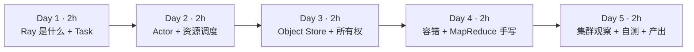

| 天 | 时间 | 先读（概念） | 再读（外部资料，按顺序） | 再做（实验） |
|---|---|---|---|---|
| Day 1 | ~2h | 本页 2.1、2.2 | ① [Ray Core：Key Concepts](https://docs.ray.io/en/latest/ray-core/key-concepts.html)（15 分钟）；② [Ray Core：Getting Started / Walkthrough](https://docs.ray.io/en/latest/ray-core/walkthrough.html)（20 分钟）；③ [Ray Core：Tasks](https://docs.ray.io/en/latest/ray-core/tasks.html) 读到 *Passing object refs to Ray tasks* 为止（20 分钟） | 实验 0：环境；实验 1：Task |
| Day 2 | ~2h | 本页 2.3、2.4 | ④ [Ray Core：Actors](https://docs.ray.io/en/latest/ray-core/actors.html) 读到 *Terminating Actors* 之前（25 分钟）；⑤ [Resources](https://docs.ray.io/en/latest/ray-core/scheduling/resources.html) 全文（20 分钟） | 实验 2：Actor 与“加载一次模型” |
| Day 3 | ~2h | 本页 2.5 | ⑥ [Ray Core：Objects](https://docs.ray.io/en/latest/ray-core/objects.html)（15 分钟）；⑦ [Serialization](https://docs.ray.io/en/latest/ray-core/objects/serialization.html) 的 *Overview* 和 *Plasma Object Store* 两节（15 分钟）；⑧ [Anti-pattern：Passing the same large argument by value repeatedly](https://docs.ray.io/en/latest/ray-core/patterns/pass-large-arg-by-value.html)（10 分钟） | 实验 3：Object Store |
| Day 4 | ~2h | 本页 2.6、2.7 | ⑨ [Fault Tolerance](https://docs.ray.io/en/latest/ray-core/fault-tolerance.html) 总览 + [Task Fault Tolerance](https://docs.ray.io/en/latest/ray-core/fault_tolerance/tasks.html) + [Actor Fault Tolerance](https://docs.ray.io/en/latest/ray-core/fault_tolerance/actors.html) 的 *Actor process failure* 一节（35 分钟） | 实验 4：容错；实验 5：手写 MapReduce |
| Day 5 | ~2h | 本页 2.8 | ⑩ [Ray 论文（OSDI'18）](https://arxiv.org/abs/1712.05889) 只读第 1、3、4 节（40 分钟，读设计动机和架构，不必看实验）；⑪ [Anti-pattern：Calling ray.get in a loop](https://docs.ray.io/en/latest/ray-core/patterns/ray-get-loop.html)（10 分钟） | 实验 6：ray.wait；实验 7：集群观察；自测题；本周产出 |

**每日打卡：**

- [ ] Day 1：读完 ①②③，完成实验 0、1，能解释“提交 16 个任务只用了 0.17 秒”意味着什么
- [ ] Day 2：读完 ④⑤，完成实验 2，能说出推理服务为什么用 Actor 而不用 Task
- [ ] Day 3：读完 ⑥⑦⑧，完成实验 3，能解释“按值传 8 次”比“put 一次”慢的原因
- [ ] Day 4：读完 ⑨，完成实验 4、5，能区分“进程崩溃”和“应用异常”的重试行为
- [ ] Day 5：读完 ⑩⑪，完成实验 6、7、自测题、本周产出

---

## 2. 核心概念讲解

### 2.1 为什么 AI 负载需要 Ray，而不是直接用 Spark

Spark 的核心抽象是 **RDD/DataFrame 上的批量转换**：你描述“对整个数据集做什么”，Spark 生成 DAG、切 stage、按分区调度 task。它对 ETL 极其高效，但 AI 负载有几类需求它不擅长：

| AI 负载的需求 | Spark 的处境 | Ray 的设计 |
|---|---|---|
| **有状态的常驻进程**：一个 GPU 上加载一次 7B 模型，反复处理请求 | executor 里没有“用户可寻址的长期状态”；mapPartitions 里加载模型，分区结束就丢 | **Actor**：一个带状态的进程，有句柄、可以反复调用 |
| **异构资源**：一部分步骤要 GPU，一部分只要 CPU，比例要能调 | 一个 Spark 应用的 executor 规格通常统一；GPU 调度能力有限 | 每个 Task/Actor 单独声明 `num_cpus`/`num_gpus`/自定义资源 |
| **细粒度、动态的任务图**：强化学习、超参搜索、在线推理，下一步做什么取决于上一步的结果 | DAG 在 action 触发时整体生成，task 粒度粗（秒级以上） | 任务在运行时动态提交，毫秒级调度，任务可以再提交任务 |
| **低延迟服务**：在线推理 | 不是为服务设计的 | Ray Serve 构建在 Actor 之上 |
| **Python 原生**：PyTorch、vLLM 都是 Python | PySpark 是 JVM + Python 双进程，数据要跨进程序列化（第 1 周提到的 Arrow 只能缓解） | 纯 Python API，worker 就是 Python 进程 |

所以一种常见的分工是：**Spark 继续做结构化 ETL 和数仓，Ray 做“需要 GPU、需要模型常驻、需要 Python 生态”的那部分**——例如 LLM 数据清洗中的模型打分、批量推理、分布式训练。第 2 月的四周就是沿着这条线展开的。

### 2.2 Task：远程执行的函数，返回的是“期票”

**机制**：给函数加上 `@ray.remote`，它就变成了可以在集群任意 worker 上执行的 **Task**。调用时写 `f.remote(x)`，**立刻**返回一个 `ObjectRef`（对象引用，像一张“期票”），真正的计算在后台异步进行。需要结果时调用 `ray.get(ref)`，这一步会阻塞直到结果就绪。

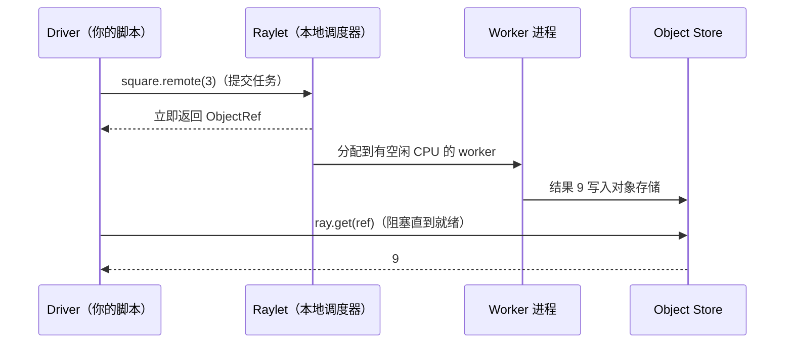

**和 Spark 的对照**：

| Spark | Ray | 关键差异 |
|---|---|---|
| transformation（惰性）+ action（触发） | `.remote()` 立即开始执行，`ray.get()` 只是取结果 | Ray **不是惰性的**：提交即调度，没有全局优化器 |
| task（由 DAGScheduler 根据分区自动切出） | Task（由你显式提交，一次调用 = 一个 task） | 粒度和数量完全由你控制 |
| stage 之间的依赖由 shuffle 决定 | 把一个 `ObjectRef` 作为参数传给另一个 task，就形成依赖 | 任务图是**运行时动态构建**的 |
| `collect()` | `ray.get()` | 都会把数据拉回 Driver，大结果都危险 |

实验 1 的 `add.remote(square.remote(3), square.remote(4))` 就是一个三节点的 DAG：Ray 会等两个 `square` 完成，再自动把结果（而不是 ObjectRef）传给 `add`。

**常见反模式**：在循环里每提交一个任务就 `ray.get` 一次——这会让任务完全串行。正确做法是先把所有任务提交出去拿到一组 ObjectRef，再一次性 `ray.get(list)`（官方文档 *Anti-pattern: Calling ray.get in a loop*）。

### 2.3 Actor：有状态的常驻进程

**机制**：给**类**加上 `@ray.remote`，`Cls.remote()` 会在集群中启动一个**专属的 worker 进程**，在里面执行 `__init__`，返回一个 **Actor 句柄**。之后 `handle.method.remote()` 都发给这个进程执行，状态（成员变量）在调用之间保留。同一个 Actor 上的方法调用默认**按提交顺序串行执行**（实验 2：`[1, 2, 3, 4, 5]`）。

**为什么推理用 Actor**：加载模型很慢（7B 模型从磁盘读到 GPU 要几十秒），推理一个 batch 很快。用 Task 的话每个 task 都得重新加载；用 Actor 的话**加载一次，反复使用**。实验 2 用 `sleep(2)` 模拟加载：8 个 batch 用 Task 需要 4.4 秒（每个 task 都“加载”一次，4 个 CPU 并行两轮），用 2 个 Actor 只需 2.5 秒（各加载一次）。真实场景里加载时间远大于推理时间，差距是数量级的。Ray Data 的 `map_batches(..., concurrency=N)` 传入一个类时，底层就是起 N 个这样的 Actor（下周会用到）。

**类比**：Actor 像一个**常驻的微服务实例**，或者 Spark Streaming 里每个 executor 上长期持有的连接池/缓存——只不过 Ray 让它变成了一等公民：有句柄、可以被传递给别的 task、可以命名（`options(name=...)`）后被其他程序找到。

### 2.4 资源声明式调度：并发度 = 资源 ÷ 每任务需求

Ray 的调度器不关心你的任务“实际”用了多少 CPU，只看**声明**：

- 每个节点启动时声明自己有多少资源（`ray.init(num_cpus=4)` 或自动探测，GPU 同理）；
- 每个 Task 默认声明 `num_cpus=1`；Actor 默认**调度时**需要 1 个 CPU、**运行时**占 0 个 CPU（官方文档 *Resources* 一节有说明，这意味着默认 Actor 不限制并发数，是常见的“超卖”来源）；
- 调度器把任务放到“剩余资源 ≥ 需求”的节点上，资源不够就排队。

实验 1 里：4 个 CPU、每任务 1 CPU → 同时跑 4 个，16 个 0.5 秒任务约 4 轮 = 2 秒（实测 2.4 秒，含 worker 进程启动）；改成 `num_cpus=2` → 同时只能跑 2 个，8 轮 = 4 秒（实测 4.0 秒）。

| YARN / Spark | Ray | 说明 |
|---|---|---|
| NodeManager 上报 vcores / memory | Raylet 上报 CPU / GPU / memory / 自定义资源 | 都是“逻辑资源” |
| `spark.executor.cores`、container 大小 | 每个 Task/Actor 的 `num_cpus`、`num_gpus` | Ray 的粒度更细：每个函数可以不同 |
| 节点标签（node label） | 自定义资源（如 `resources={"A100": 1}`）、节点标签 | 用来把任务约束到特定机型 |
| 资源是**硬隔离**（cgroup） | 默认**不隔离**：声明 1 CPU 的任务照样可以用满 8 核 | 需要自己保证“声明 ≈ 实际” |

**GPU 场景的关键**：`@ray.remote(num_gpus=1)` 会让 Ray 为该进程设置 `CUDA_VISIBLE_DEVICES`，保证不同任务拿到不同的卡；也支持 `num_gpus=0.5` 让两个小模型共享一张卡（Ray 只做记账，显存不会被隔离）。第 3 月学 K8s 调度时你会再次遇到“声明 vs 实际”的问题。

### 2.5 Object Store：共享内存里的不可变对象

Task 的返回值和 `ray.put()` 的对象都放进每个节点上的 **Object Store**（基于共享内存的 Plasma 存储）。要点：

1. **不可变**：对象一旦写入就不能修改（实验 3：worker 试图修改得到 `assignment destination is read-only`）。
2. **同节点零拷贝**：NumPy 数组（以及 Arrow 数据）在同一节点的多个 worker 之间是共享内存映射，读取不需要复制和反序列化。官方 *Serialization* 文档称之为 zero-copy deserialization。
3. **跨节点按需拉取**：worker 需要另一节点上的对象时，由 Object Store 之间传输。
4. **引用计数 + 溢写**：没有 ObjectRef 指向的对象会被回收；内存不够时溢写到磁盘（object spilling）。
5. **小对象不进共享内存**：很小的返回值直接存在调用方进程内存里（官方称为 in-process store），避免共享内存开销。

**一个对 Mac 用户很重要的细节**：官方文档 *Memory Management* 一节说明，Ray 默认用 30% 的可用内存做 Object Store，Linux 上放在 `/dev/shm`（共享内存），**macOS 上放在 `/tmp`（磁盘）**，性能会比 Linux 差。所以你在 Mac 上做实验 3 时，两种传参方式的差距可能和本站不同。

**实验 3 的启示**：把一个 191 MB 的数组**按值**传给 8 个任务，Ray 会为每次调用各做一次序列化和写入（0.53 秒）；先 `ray.put` 一次再传 ObjectRef，只存一份（0.07 秒）。这就是 Spark 的**广播变量**——`ray.put` + 传引用就是 Ray 版的 `sc.broadcast`。

**所有权（ownership）**：每个对象有一个“所有者”——创建它的那个 worker（调用 `.remote()` 或 `ray.put()` 的进程）。所有者负责记录这个对象的元数据和引用计数。如果所有者进程挂了，它拥有的对象也会变得不可用。这和 Spark 中“Driver 挂了整个应用就没了”类似，但粒度更细。读 Ray 论文和架构白皮书时会反复遇到这个概念。

### 2.6 Ray 集群架构：与 Spark 一一对照

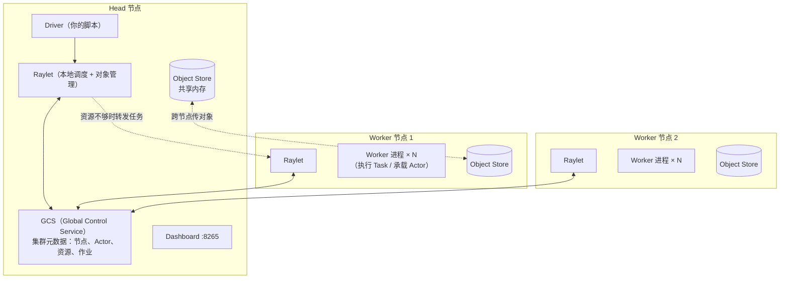

| Spark on YARN | Ray | 说明 |
|---|---|---|
| Driver（SparkContext） | Driver（调用 `ray.init()` 的脚本） | 都是用户程序入口 |
| ResourceManager | GCS + 各节点 Raylet | Ray 的调度是**分布式两级**的：先由本地 Raylet 尝试，资源不够再转发 |
| NodeManager + Executor JVM | Raylet + 一组 Worker 进程 | Ray 的 worker 是 Python 进程，按需启动、可复用 |
| BlockManager（缓存 RDD 分区） | Object Store（Plasma） | 都存中间结果，Ray 的是共享内存不可变对象 |
| DAGScheduler / TaskScheduler | 无全局 DAG 调度器，任务提交即由 Raylet 调度 | 这是 Ray 能做到毫秒级调度的原因，也是它“没有查询优化器”的原因 |
| Spark UI :4040 | Ray Dashboard :8265、`ray status`、State API（`ray list` / `ray summary`） | 实验 7 |
| `spark-submit` | `ray job submit` 或直接 `python script.py` 连接集群 | |

### 2.7 容错：重试、重启与 lineage

| 故障类型 | Ray 的默认行为 | 实验 4 实测 | Spark 的对应 |
|---|---|---|---|
| Task 执行中 worker 进程崩溃（OOM、段错误、机器宕机） | **自动重试**，默认最多 3 次（`max_retries`） | 偶数号任务第一次崩溃，被重试后成功，6 个结果齐全 | task 失败重试（`spark.task.maxFailures` 默认 4） |
| Task 抛出应用异常（如 ValueError） | **不重试**，异常包装成 `RayTaskError` 抛回 Driver；可用 `retry_exceptions=True` 开启 | `RayTaskError(ValueError) ... 脏数据` | 应用异常同样会计入失败重试 |
| Actor 进程崩溃 | 默认**不重启**（`max_restarts=0`）；设置后会重新执行 `__init__`，**内存状态丢失** | 重启后计数从 1 重新开始，pid 变了；重启期间的调用报 `ActorUnavailableError` | 无直接对应（Spark 没有用户 Actor） |
| 对象丢失（存它的节点挂了） | 通过 **lineage 重建**：重新执行生成它的 task | 未在本站实验 | RDD lineage 重算丢失的分区 |
| Head 节点 / GCS 挂了 | 默认整个集群不可用；生产上可以把 GCS 状态放外部 Redis 做高可用 | 未在本站实验 | Driver / RM 高可用 |

**架构师要记住的两点**：

1. **Actor 状态不会自动持久化**。如果 Actor 里有重要状态（例如累计的统计、处理到的 offset），要自己定期写 checkpoint——这和流处理里 Flink 的状态后端是同一个问题，但 Ray 不替你做。
2. **重试要求幂等**。被重试的 task 可能已经执行了一半（比如写了一半文件），写外部系统的 task 必须设计成可重入。这和你在 Spark 里处理“task 重试导致重复写”的经验完全一致。

### 2.8 从 Task 到 Ray Data：手写一次 MapReduce

下周的 Ray Data 会帮你自动完成分块、调度、流式执行、shuffle。但在用它之前，值得用 Task 手写一次 MapReduce，看看底下发生了什么（实验 5）：

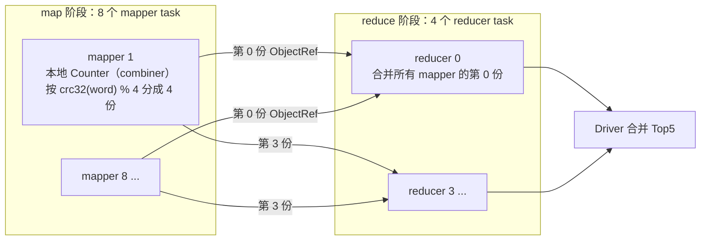

- `@ray.remote(num_returns=R)` 让一个 mapper 返回 R 个独立的 ObjectRef——每个对应一个 shuffle 分区，这就是 **shuffle write**。
- reducer 接收所有 mapper 的第 r 份——这就是 **shuffle read**。数据通过 Object Store 传递，不落 HDFS。
- **分区函数必须稳定**：Python 内置的 `hash(str)` 在每个进程里带随机盐（`PYTHONHASHSEED`），不同 mapper 进程对同一个单词可能算出不同的分区，导致同一个 key 被分到多个 reducer。实验 5 用 `zlib.crc32` 并检查“各 reducer 的 key 互不重叠: True”。这个坑在任何“多 Python 进程按 key 分区”的系统里都存在，PySpark 也需要处理同样的问题。

这就是“Ray 是比 Spark 更底层的积木”的含义：Spark 把 shuffle 作为内建能力，Ray Core 只给你 Task + Object Store，shuffle 由上层库（Ray Data）用这些积木实现。

---

## 3. 动手实验 {{local}}

所有脚本放在 `~/ai-infra-lab/w5/`。每个脚本都自己 `ray.init()` 启动一个临时的本地 Ray（脚本结束即销毁），只有实验 7 演示“先起集群、再连接”。

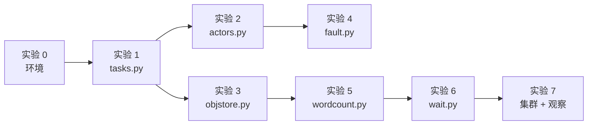

### 实验 0：安装 Ray（10 分钟）

```bash
cd ~/ai-infra-lab && source .venv/bin/activate && mkdir -p w5 && cd w5
uv pip install "ray[data,default]==2.59.0"
python -c "import sys,ray,numpy;print(sys.version.split()[0],ray.__version__,numpy.__version__)"
```

**本站输出**：

```text
3.12.15 2.59.0 2.5.4
```

`ray[default]` 包含 Dashboard 和集群命令行工具，`ray[data]` 是下周要用的 Ray Data。

### 实验 1：Task 并行与资源声明（25 分钟）

`tasks.py`：

```python
"""实验 1：Task 并行与资源声明。"""
import time

import ray

ray.init(num_cpus=4, include_dashboard=False)
print("集群资源:", ray.cluster_resources())


@ray.remote
def square(x):
    time.sleep(0.5)          # 模拟 0.5 秒的计算
    return x * x


t = time.time()
refs = [square.remote(i) for i in range(16)]   # 立即返回 ObjectRef，不阻塞
print("提交 16 个任务用时 %.3fs，拿到的是:" % (time.time() - t), refs[0])
print("结果:", ray.get(refs), "总用时 %.1fs" % (time.time() - t))


@ray.remote(num_cpus=2)       # 每个任务声明占 2 个 CPU
def square2(x):
    time.sleep(0.5)
    return x * x


t = time.time()
ray.get([square2.remote(i) for i in range(16)])
print("num_cpus=2 时 16 个任务总用时 %.1fs" % (time.time() - t))

# 任务可以嵌套、可以把 ObjectRef 当参数传给下一个任务（Ray 自动等待依赖）
@ray.remote
def add(a, b):
    return a + b

r = add.remote(square.remote(3), square.remote(4))   # 构成一个小 DAG
print("DAG 结果 3²+4² =", ray.get(r))
```

```bash
python tasks.py
```

**本站输出**：

```text
集群资源: {'node:__internal_head__': 1.0, 'node:172.30.0.2': 1.0, 'CPU': 4.0, 'memory': 4605907354.0, 'object_store_memory': 1973960294.0}
提交 16 个任务用时 0.166s，拿到的是: ObjectRef(c8ef45ccd0112571ffffffffffffffffffffffff0100000001000000)
结果: [0, 1, 4, 9, 16, 25, 36, 49, 64, 81, 100, 121, 144, 169, 196, 225] 总用时 2.4s
num_cpus=2 时 16 个任务总用时 4.0s
DAG 结果 3²+4² = 25
```

**逐步解释**：

- **集群资源**：`CPU: 4.0` 来自 `num_cpus=4`；`memory` 和 `object_store_memory` 是 Ray 根据本机可用内存自动计算的逻辑资源（单位字节，约 4.3 GiB 和 1.8 GiB）。
- **提交 16 个任务只用了 0.17 秒**：`.remote()` 是非阻塞的，提交完立刻返回 ObjectRef，这时任务还在排队或执行。
- **总用时 2.4 秒**：理论值 16 ÷ 4 × 0.5 = 2.0 秒，多出来的主要是第一次启动 worker 进程的开销。
- **`num_cpus=2` 用时 4.0 秒**：每个任务声明要 2 个 CPU，4 个 CPU 只能同时跑 2 个。注意任务**实际**只是在 sleep，几乎不用 CPU——Ray 按声明调度，不按实际用量。
- **DAG**：把 ObjectRef 传给 `add`，Ray 会先等两个 `square` 完成，再把**值**（9 和 16）传进去。

### 实验 2：Actor——有状态的常驻进程（25 分钟）

`actors.py`：

```python
"""实验 2：Actor——有状态的常驻进程。"""
import os
import time

import ray

ray.init(num_cpus=4, include_dashboard=False)


@ray.remote
class Counter:
    def __init__(self):
        self.n = 0
        self.pid = os.getpid()

    def add(self, k):
        self.n += k
        return self.n

    def where(self):
        return self.pid


c = Counter.remote()
print("Actor 内方法按提交顺序串行执行:", ray.get([c.add.remote(1) for _ in range(5)]))
print("Actor 进程 pid:", ray.get(c.where.remote()), " Driver pid:", os.getpid())


@ray.remote
class FakeModel:
    """模拟“加载一次模型、反复推理”：构造时慢，每次调用快。"""
    def __init__(self):
        time.sleep(2)                # 假装加载 2 秒权重
        self.w = 3

    def predict(self, batch):
        return [x * self.w for x in batch]


@ray.remote
def predict_task(batch):
    time.sleep(2)                    # Task 每次都要重新“加载模型”
    return [x * 3 for x in batch]


batches = [list(range(i, i + 4)) for i in range(0, 32, 4)]   # 8 个 batch
t = time.time()
ray.get([predict_task.remote(b) for b in batches])
print("用 Task（每次加载模型）处理 8 个 batch: %.1fs" % (time.time() - t))

t = time.time()
pool = [FakeModel.remote() for _ in range(2)]                  # 2 个常驻 Actor
out = ray.get([pool[i % 2].predict.remote(b) for i, b in enumerate(batches)])
print("用 2 个 Actor（各加载一次）处理 8 个 batch: %.1fs，首个结果 %s" % (time.time() - t, out[0]))
```

**本站输出**：

```text
Actor 内方法按提交顺序串行执行: [1, 2, 3, 4, 5]
Actor 进程 pid: 987712  Driver pid: 987480
用 Task（每次加载模型）处理 8 个 batch: 4.4s
用 2 个 Actor（各加载一次）处理 8 个 batch: 2.5s，首个结果 [0, 3, 6, 9]
```

**逐步解释**：

- 5 次 `add` 按顺序返回 1～5：同一个 Actor 的方法串行执行，所以不需要加锁。
- Actor 运行在**另一个进程**里（pid 不同于 Driver）。
- **Task 版 4.4 秒**：8 个 task、4 个 CPU，两轮，每轮都“加载模型” 2 秒。
- **Actor 版 2.5 秒**：2 个 Actor 构造时各“加载” 2 秒（并行），之后 8 次 `predict` 几乎不耗时。如果 batch 数增加到 800，Task 版会线性增长到约 400 秒，Actor 版基本不变——这就是推理场景必须用 Actor 的原因。
- `pool[i % 2]` 是最朴素的轮询负载均衡。Ray 提供了 `ray.util.ActorPool`，Ray Data 的 `map_batches` 会自动做这件事。

### 实验 3：Object Store 与“广播变量”（25 分钟）

`objstore.py`：

```python
"""实验 3：Object Store——按引用传递、零拷贝读取、“广播变量”。"""
import time

import numpy as np
import ray

ray.init(num_cpus=4, include_dashboard=False)

arr = np.random.default_rng(0).random(25_000_000)          # 200 MB 的 float64 数组
print("数组大小 %.0f MB" % (arr.nbytes / 2**20))


@ray.remote
def col_sum(a, i):
    return float(a[i::8].sum())


# ① 直接把大数组当参数传给 8 个任务：Ray 会为“每次调用”各序列化放入一次 Object Store
t = time.time()
ray.get([col_sum.remote(arr, i) for i in range(8)])
print("按值传 8 次: %.2fs" % (time.time() - t))

# ② 先 ray.put 一次，再传引用：只存一份，各 worker 通过共享内存读取
t = time.time()
ref = ray.put(arr)
ray.get([col_sum.remote(ref, i) for i in range(8)])
print("put 一次 + 传引用: %.2fs" % (time.time() - t))

# ③ 零拷贝：worker 拿到的 numpy 数组是只读的共享内存视图
@ray.remote
def try_write(a):
    try:
        a[0] = 1.0
        return "可写"
    except ValueError as e:
        return f"只读: {e}"

print(ray.get(try_write.remote(ref)))
```

**本站输出**：

```text
数组大小 191 MB
按值传 8 次: 0.53s
put 一次 + 传引用: 0.07s
只读: assignment destination is read-only
```

**逐步解释**：

- 2500 万个 float64 = 200,000,000 字节 ≈ 191 MiB（脚本里 `2**20` 为 1 MiB）。
- **按值传**：每次 `.remote(arr, i)` 时，Ray 都要把这个大数组序列化并写入 Object Store（官方文档称这是反模式：*Passing the same large argument by value repeatedly*）。
- **put 一次 + 传引用**：只写入一次，8 个 worker 通过共享内存读取同一份数据，零拷贝。差距约 7 倍，而且对象越大、任务越多、跨节点时差距越大。
- **只读**：worker 拿到的 NumPy 数组直接映射在共享内存上，不可修改。需要修改时先 `a = a.copy()`。
- 在 Mac 上 Object Store 位于 `/tmp`（见 2.5 节），两者的绝对耗时会不同。

### 实验 4：容错——重试、异常与 Actor 重启（30 分钟）

`fault.py`：

```python
"""实验 4：容错——Task 自动重试、应用异常、Actor 重启。"""
import os
import time

import ray

ray.init(num_cpus=2, include_dashboard=False)


MARK = "/tmp/ray_flaky_{}"
for i in range(6):
    if os.path.exists(MARK.format(i)):
        os.remove(MARK.format(i))


@ray.remote(max_retries=3)
def flaky(i):
    if i % 2 == 0 and not os.path.exists(MARK.format(i)):
        open(MARK.format(i), "w").close()
        os._exit(1)                 # 偶数号任务第一次执行时让 worker 进程崩溃（类似 executor 丢失）
    return i, os.getpid()


print("进程崩溃会被自动重试:", ray.get([flaky.remote(i) for i in range(6)]))


@ray.remote
def bad():
    raise ValueError("脏数据")      # 应用层异常：默认不重试，异常抛回 Driver


try:
    ray.get(bad.remote())
except ray.exceptions.RayTaskError as e:
    print("应用异常传回 Driver:", type(e).__name__, "|", str(e).splitlines()[-1])


@ray.remote(max_restarts=1)          # 进程挂了允许重启 1 次；方法调用默认不重试
class Svc:
    def __init__(self):
        self.calls = 0

    def ping(self):
        self.calls += 1
        return self.calls, os.getpid()

    def die(self):
        os._exit(1)


s = Svc.remote()
print("重启前:", ray.get(s.ping.remote()), ray.get(s.ping.remote()))
s.die.remote()
for _ in range(20):                  # 重启需要一点时间，期间调用会失败
    try:
        print("重启后（状态丢失、pid 变化）:", ray.get(s.ping.remote()))
        break
    except ray.exceptions.RayActorError as e:
        print("调用失败:", type(e).__name__)
        time.sleep(0.5)
```

**本站输出**（raylet 日志行已截断）：

```text
(raylet) A worker died or was killed while executing a task by an unexpected system error. To troubleshoot the problem, check the logs for the dead wor...
(raylet) Task flaky failed. There are 3 retries remaining, so the task will be retried. Error: 
进程崩溃会被自动重试: [(0, 991729), (1, 991628), (2, 991729), (3, 991729), (4, 991729), (5, 991729)]
应用异常传回 Driver: RayTaskError(ValueError) | ValueError: 脏数据
重启前: (1, 991814) (2, 991814)
调用失败: ActorUnavailableError
重启后（状态丢失、pid 变化）: (1, 991815)
```

**逐步解释**：

- **进程崩溃自动重试**：0、2、4 号任务第一次执行时调用 `os._exit(1)` 杀死自己所在的 worker 进程（用标记文件保证只崩一次），Ray 检测到 worker 异常退出，按 `max_retries=3` 重新调度，最终 6 个结果全部返回。raylet 打印的日志说明了原因和剩余重试次数。
- **应用异常不重试**：`ValueError` 被包装成 `RayTaskError(ValueError)` 在 `ray.get` 时抛出，Driver 可以 `try/except` 处理。真实数据管线里，一条脏数据引发的异常**不应该**无脑重试——重试一万次还是脏数据。
- **Actor 重启**：`max_restarts=1` 允许重启一次。`die()` 杀死进程后，Ray 重新启动一个进程并执行 `__init__`，所以 `calls` 从 1 重新开始、pid 从 991814 变为 991815。重启过程中的调用报 `ActorUnavailableError`，脚本里用循环重试。
- 重要：如果把 `fault.py` 里的 `max_restarts=1` 去掉，`die()` 之后的调用会得到 `ActorDiedError`，Actor 永久不可用。

### 实验 5：用 Task 手写 MapReduce（30 分钟）

`wordcount.py`：

```python
"""实验 5：用 Task 手写一个 MapReduce 词频统计（map → shuffle → reduce）。"""
import collections
import re
import time
import zlib

import ray

ray.init(num_cpus=4, include_dashboard=False)
R = 4                                    # reducer 个数（相当于 shuffle 分区数）

docs = ["the quick brown fox", "the lazy dog", "Ray and Spark", "the fox and the dog"] * 25_000


@ray.remote(num_returns=R)
def mapper(lines):
    parts = [collections.Counter() for _ in range(R)]
    for line in lines:
        for w in re.findall(r"\w+", line.lower()):
            parts[zlib.crc32(w.encode()) % R][w] += 1   # 本地先聚合（combiner），再按稳定哈希分区
    return parts


@ray.remote
def reducer(*parts):
    total = collections.Counter()
    for p in parts:
        total.update(p)
    return total


t = time.time()
chunks = [docs[i::8] for i in range(8)]                      # 8 个 map 分片
map_out = [mapper.remote(c) for c in chunks]                 # 每个返回 R 个 ObjectRef
reduced = [reducer.remote(*[m[r] for m in map_out]) for r in range(R)]
outs = ray.get(reduced)
keys = [set(c) for c in outs]
print("各 reducer 的 key 是否互不重叠:", all(not (keys[i] & keys[j]) for i in range(R) for j in range(i + 1, R)))
result = collections.Counter()
for c in outs:
    result.update(c)
print("Top5:", result.most_common(5), "用时 %.2fs" % (time.time() - t))
```

**本站输出**：

```text
各 reducer 的 key 是否互不重叠: True
Top5: [('the', 100000), ('dog', 50000), ('and', 50000), ('fox', 50000), ('brown', 25000)] 用时 0.34s
```

**逐步解释**：

- 4 句话 × 25,000 = 10 万行；`the` 在每组 4 句中出现 4 次，共 100,000 次，结果正确。（计数并列的词之间顺序不固定，你的 Top5 第 5 名可能是 `lazy`、`quick` 等其他计数为 25,000 的词。）
- `num_returns=R` + `m[r]`：mapper 输出 R 个分区，reducer r 只读每个 mapper 的第 r 个分区——标准的 hash shuffle。
- **combiner**：mapper 内部先用 `Counter` 本地聚合，再输出，大幅减少 shuffle 数据量（第 1 周讲过的“可加指标先局部合并”）。
- **稳定哈希**：试着把 `zlib.crc32(w.encode())` 改回 `hash(w)` 再运行，观察“各 reducer 的 key 是否互不重叠”是否变成 `False`（取决于各 worker 进程的随机哈希种子；最终 Top5 仍然正确，因为 Driver 把所有 reducer 的结果又合并了一遍——但在真实的分布式 reduce 里这就是错误结果）。

### 实验 6：ray.wait——先完成先处理（15 分钟）

`wait.py`：

```python
"""实验 6：ray.wait——谁先完成先处理，应对长尾任务。"""
import random
import time

import ray

ray.init(num_cpus=4, include_dashboard=False)


@ray.remote
def job(i):
    d = 3.0 if i == 0 else random.uniform(0.1, 0.5)   # 0 号是“长尾”任务
    time.sleep(d)
    return i, round(d, 2)


random.seed(1)
t = time.time()
pending = [job.remote(i) for i in range(8)]
while pending:
    done, pending = ray.wait(pending, num_returns=1)
    print("%.1fs 完成" % (time.time() - t), ray.get(done[0]))
```

**本站输出**：

```text
0.6s 完成 (2, 0.34)
0.7s 完成 (1, 0.43)
0.8s 完成 (3, 0.48)
0.8s 完成 (4, 0.26)
1.0s 完成 (7, 0.18)
1.1s 完成 (5, 0.42)
1.2s 完成 (6, 0.43)
3.3s 完成 (0, 3.0)
```

**逐步解释**：

- `ray.wait(pending, num_returns=1)` 返回“已完成的 1 个”和“剩余的”，结果按**完成顺序**而不是提交顺序处理。如果用 `ray.get(pending)`，前 7 个结果要陪 0 号长尾任务一起等到 3.3 秒。
- 4 号、7 号任务虽然很短，但要等前面的任务让出 CPU 才能开始，所以完成时间晚于自身耗时。
- 这是处理**长尾（straggler）**的基本手段，也是“控制在途任务数”（官方 *Pattern: Using ray.wait to limit the number of pending tasks*）的基础：当你要提交 100 万个任务时，不要一次全提交，而是保持最多 N 个在途，完成一个再补一个——这正是 Ray Data 的流式执行在做的事。

### 实验 7：起一个本地集群并观察（25 分钟）

前面的脚本都是“脚本内临时集群”。生产中是先启动集群，再由多个作业连接。`cluster_job.py`：

```python
"""连接到已启动的本地集群（ray start --head），提交一批任务后保留一个 Actor 以便观察。"""
import time

import ray

ray.init(address="auto")          # 连接现有集群，而不是在脚本里新建一个


@ray.remote
def work(i):
    time.sleep(0.2)
    return i


@ray.remote
class Keeper:
    def ping(self):
        return "ok"


ray.get([work.remote(i) for i in range(40)])
k = Keeper.options(name="keeper", lifetime="detached").remote()   # 具名、脱离 Driver 存活的 Actor
print(ray.get(k.ping.remote()))
```

```bash
export RAY_AUTH_MODE=token        # 见下方说明
ray start --head --num-cpus=4 --dashboard-host=127.0.0.1
python cluster_job.py
ray status
ray summary tasks
ray list actors
# 浏览器打开 http://127.0.0.1:8265 查看 Dashboard
ray stop
```

**本站输出**（节选）：

```text
ok
======== Autoscaler status: 2026-10-20 10:32:55.750649 ========
Node status
---------------------------------------------------------------
Active:
 1 node_ba64499a7dc04e0ea93ab904a149edec991cd4539db71c183cae7555
...
Resources
---------------------------------------------------------------
Total Usage:
 4.0/4.0 CPU
 0B/4.11GiB memory
 0B/1.76GiB object_store_memory
...
Pending Demands:
 {'CPU': 1.0}: 24+ pending tasks/actors

Table (group by func_name):
------------------------------------
    FUNC_OR_CLASS_NAME      STATE_COUNTS    TYPE
0   work                    FINISHED: 40    NORMAL_TASK
1   Keeper.ping             FINISHED: 1     ACTOR_TASK
2   keeper:Keeper.__init__  FINISHED: 1     ACTOR_CREATION_TASK

Table:
------------------------------
    ACTOR_ID                          CLASS_NAME    STATE      JOB_ID  NAME    NODE_ID   PID  RAY_NAMESPACE
 0  b0380525a360918a9c51b6fc01000000  Keeper        ALIVE    01000000  keeper  ba64...   993997  256e9c5a-...
```

**逐步解释**：

- **关于 `RAY_AUTH_MODE=token`**：本站使用的 Ray 2.59.0 在 `ray start` 时默认启用了**令牌认证**（启动日志：`Token authentication is enabled for this Ray cluster. Set RAY_AUTH_MODE=disabled to opt out.`），并把令牌写到 `~/.ray/auth_token`。不设置这个环境变量时，本站的 `ray status` 报错 `AuthenticationError: ... Authentication token is missing or incorrect. Note: RAY_AUTH_MODE is currently 'disabled'`。设置后 CLI 会读取令牌文件。详见 [Ray 文档：Token authentication](https://docs.ray.io/en/latest/ray-security/token-auth.html)。不同 Ray 版本的默认行为可能不同，以你本机的启动日志为准。
- **`ray status` 是 autoscaler 的周期性快照**：这次输出显示 4/4 CPU 在用、24+ 个任务等待——那是作业运行过程中采集的状态，作业已经结束但快照还没刷新。看实时状态请用 Dashboard 或 State API。
- **`ray summary tasks`**：按函数名统计任务状态，40 个 `work` 全部 FINISHED。这是 Ray 版的“Spark UI 的 stage 页面”。
- **`ray list actors`**：`keeper` 是 `lifetime="detached"` 的具名 Actor，Driver 脚本退出后它仍然 ALIVE，其他作业可以通过 `ray.get_actor("keeper", namespace=...)` 找到它。这是在 Ray 上实现“常驻服务”的方式（Ray Serve 就建立在类似机制上）。启动时 Ray 提示它在匿名 namespace 中，生产中应显式指定 `ray.init(namespace=...)`。
- Dashboard（8265 端口）里可以看到每个任务的时间线、每个 Actor 的日志、Object Store 用量，对应 Spark UI 的 Jobs / Executors / Storage 页面。

### 常见错误与排查

| 现象（真实报错或现象） | 原因 | 解决 |
|---|---|---|
| `ray.exceptions.AuthenticationError: RPC error: InvalidAuthToken ...`（`ray status` 等 CLI） | `ray start` 启用了令牌认证，但 CLI 没有读取令牌 | `export RAY_AUTH_MODE=token`；或启动集群前设置 `RAY_AUTH_MODE=disabled`（仅限本机实验） |
| `ray.exceptions.WorkerCrashedError: The worker died unexpectedly while executing this task` | task 所在进程崩溃且重试次数用完（本站一次随机崩溃版本的 fault.py 就遇到了） | 查看 `/tmp/ray/session_latest/logs/` 下对应 worker 日志；检查是否 OOM；提高 `max_retries` 只能缓解 |
| `RayTaskError(ValueError)` 等 | task 里抛了应用异常 | 修代码/数据；确需重试的用 `retry_exceptions=[具体异常]` |
| `ActorUnavailableError` / `ActorDiedError` | Actor 正在重启 / 已永久死亡 | 设置 `max_restarts`；调用方做重试；重要状态自己 checkpoint |
| `ValueError: assignment destination is read-only` | 修改了来自 Object Store 的 NumPy 数组 | 先 `.copy()` 再改 |
| 任务全部串行、速度没有提升 | 在循环里逐个 `ray.get` | 先收集所有 ObjectRef，再一次 `ray.get(list)` 或用 `ray.wait` |
| 声明 `num_cpus=1` 但一个任务吃满所有核 | Ray 不做 CPU 隔离；NumPy/PyTorch 内部多线程 | 设置 `OMP_NUM_THREADS` 等环境变量，或让声明与实际一致 |
| Mac 上大对象读写明显比本页慢 | macOS 上 Object Store 在 `/tmp`（磁盘）而不是 `/dev/shm` | 正常现象；减小对象或在 Linux 上做性能实验 |
| `ConnectionError: Could not find any running Ray instance`（`ray.init(address="auto")` 时，未在本站复现） | 没有先 `ray start --head` | 先启动集群，或去掉 `address` 参数改为脚本内临时集群 |

### 扩展练习（选做，每题 20–40 分钟）

1. **ActorPool**：把实验 2 的手工轮询换成 `ray.util.ActorPool` 的 `map`，比较代码量和行为（结果顺序是否保持）。
2. **嵌套任务与死锁**：写一个 task，内部再提交 4 个子 task 并 `ray.get` 它们；在 `num_cpus=2` 的集群上同时提交 4 个这样的父 task，观察会发生什么。阅读官方 *Nested Remote Functions* 文档中关于阻塞时释放 CPU 的说明，解释结果。
3. **控制在途任务数**：提交 10,000 个小任务，分别用“一次全提交”和“最多 100 个在途（`ray.wait` 补位）”两种方式，比较 Driver 进程内存和总耗时。
4. **lineage 重建（需要两个节点）**：在同一台机器上 `ray start --head` 后再 `ray start --address=... --num-cpus=2` 加入第二个“节点”，让一个 task 的结果落在第二个节点上，然后 `ray stop` 掉它，观察 `ray.get` 是否触发重算（阅读 *Object Fault Tolerance* 文档）。
5. **Spark 版本对照**：用 PySpark（下下周会装）写同样的 wordcount，对比两者的代码结构：哪些步骤 Spark 替你做了，Ray Core 需要你自己写？

---

## 4. 精读指南

### ①②③ Ray Core 入门（55 分钟）

- [Key Concepts](https://docs.ray.io/en/latest/ray-core/key-concepts.html)：**读完回答**：Ray Core 的三个核心原语是什么？官方文档如何描述 Actor 与 Task 的区别？
- [Walkthrough](https://docs.ray.io/en/latest/ray-core/walkthrough.html)：跟着跑一遍，和本页实验 1、2 对照。
- [Tasks](https://docs.ray.io/en/latest/ray-core/tasks.html)：读到 *Passing object refs to Ray tasks*。**重点**：指定资源、`num_returns`、把 ObjectRef 作为参数时 Ray 如何等待依赖。**读完回答**：把 ObjectRef 作为顶层参数和放在列表里作为参数，task 收到的东西有什么不同？

### ④⑤ Actor 与资源（45 分钟）

- [Actors](https://docs.ray.io/en/latest/ray-core/actors.html)：读到 *Terminating Actors* 之前。**读完回答**：Actor 方法默认串行执行；文档中提到的异步 Actor / 线程化 Actor 分别适合什么场景（第 4 月推理服务会用到）？
- [Resources](https://docs.ray.io/en/latest/ray-core/scheduling/resources.html)：**重点**：逻辑资源 vs 物理资源；Actor 默认的 CPU 声明；分数 GPU。**读完回答**：文档如何解释“Ray 不提供 CPU 隔离”？为什么默认 Actor 运行时占 0 个 CPU？

### ⑥⑦⑧ Object Store（40 分钟）

- [Objects](https://docs.ray.io/en/latest/ray-core/objects.html)：**读完回答**：对象为什么是不可变的？`ray.put` 返回的 ObjectRef 和 task 返回的 ObjectRef 有区别吗？
- [Serialization](https://docs.ray.io/en/latest/ray-core/objects/serialization.html) 的 *Overview*、*Plasma Object Store*：**读完回答**：哪些类型可以零拷贝读取？Plasma 与 Apache Arrow 有什么渊源？
- [Anti-pattern：Passing the same large argument by value repeatedly](https://docs.ray.io/en/latest/ray-core/patterns/pass-large-arg-by-value.html)：对照实验 3。

### ⑨ 容错（35 分钟）

- [Fault Tolerance](https://docs.ray.io/en/latest/ray-core/fault-tolerance.html)、[Task Fault Tolerance](https://docs.ray.io/en/latest/ray-core/fault_tolerance/tasks.html)、[Actor Fault Tolerance](https://docs.ray.io/en/latest/ray-core/fault_tolerance/actors.html)：**读完回答**：① 默认重试次数是多少？如何全局修改？② `max_task_retries` 与 `max_restarts` 的区别？③ 文档对“重试要求幂等”给出了什么建议？

### ⑩⑪ Ray 论文与反模式（50 分钟）

- [Ray: A Distributed Framework for Emerging AI Applications（OSDI'18）](https://arxiv.org/abs/1712.05889)：只读第 1 节（动机）、第 3 节（编程模型与计算模型）、第 4 节（架构：GCS、自底向上的分布式调度器、内存对象存储）。**读完回答**：论文为什么把控制状态集中到 GCS、而让调度“自底向上”？这与 Spark 的集中式 DAGScheduler 有何取舍？（注意：论文描述的是 2018 年的设计，部分细节已演进，如今的实现以官方文档为准。）
- [Anti-pattern：Calling ray.get in a loop](https://docs.ray.io/en/latest/ray-core/patterns/ray-get-loop.html)：对照实验 1、6。

### 背景阅读（不计入本周时间）

- [Ray 架构白皮书（Ray v2 Architecture，Google Docs）](https://docs.google.com/document/d/1tBw9A4j62ruI5omIJbMxly-la5w4q_TjyJgJL_jN2fI/preview)：官方的详细架构文档，包括所有权模型、对象管理、调度细节，适合想深入的周末阅读。
- [Ray Core：Design Patterns & Anti-patterns 目录](https://docs.ray.io/en/latest/ray-core/patterns/index.html)：一组短小的模式/反模式文档，每篇 5 分钟。
- [Spark：Cluster Mode Overview](https://spark.apache.org/docs/latest/cluster-overview.html)：用来和本页 2.6 节对照的 Spark 官方架构说明。
- [Ray Observability：Getting Started](https://docs.ray.io/en/latest/ray-observability/getting-started.html)：Dashboard 各页面说明。

---

## 5. 自测题

<details>
<summary>1. <code>f.remote(x)</code> 返回什么？为什么提交 16 个任务只用了 0.17 秒？</summary>

返回一个 `ObjectRef`（对结果对象的引用），调用是非阻塞的：任务被提交给调度器后立刻返回，计算在后台进行。0.17 秒只是提交的开销，真正的计算在 `ray.get` 等待期间完成。这与 Spark 的惰性求值不同——Ray 提交即开始调度执行。

</details>

<details>
<summary>2. 推理场景为什么用 Actor 而不是 Task？Ray Data 中对应的用法是什么？</summary>

模型加载代价远大于单次推理，Actor 在 `__init__` 中加载一次、在多次方法调用间保留状态，避免反复加载。Task 无状态，每次都要重新加载。Ray Data 中给 `map_batches` 传入一个类（而不是函数）并设置 `concurrency`，底层就会启动对应数量的 Actor 池。

</details>

<details>
<summary>3. 4 个 CPU 的集群，提交 16 个声明 <code>num_cpus=2</code> 的 0.5 秒任务，大约多久？如果任务实际只用了 0.1 个 CPU 呢？</summary>

同时只能运行 4/2 = 2 个，共 8 轮 × 0.5 秒 ≈ 4 秒（实验 1 实测 4.0 秒）。实际 CPU 用量不影响调度，仍然约 4 秒——Ray 按声明的逻辑资源调度，不按实际用量。声明过大会浪费资源，过小会导致超卖。

</details>

<details>
<summary>4. Ray 的 <code>ray.put</code> 对应 Spark 的什么？为什么按值传大对象给多个任务很慢？</summary>

对应广播变量（`sc.broadcast`）。按值传参时，每次调用都会把大对象序列化写入 Object Store，N 次调用就有 N 份；`ray.put` 一次后传 ObjectRef，只存一份，同节点 worker 通过共享内存零拷贝读取（实验 3：0.53 秒 vs 0.07 秒）。

</details>

<details>
<summary>5. Task 中 worker 进程崩溃和抛出 ValueError，Ray 的默认处理有何不同？为什么这样设计？</summary>

进程崩溃（系统故障）默认自动重试，最多 3 次；应用异常默认不重试，包装成 `RayTaskError` 抛回调用方。系统故障往往是暂时的（节点宕机、被抢占），重试可能成功；应用异常往往是确定性的（代码 bug、脏数据），重试大概率仍失败，还浪费资源。需要时可以用 `retry_exceptions` 显式开启。

</details>

<details>
<summary>6. Actor 设置 <code>max_restarts=1</code> 后进程崩溃，重启后它的成员变量还在吗？</summary>

不在。重启会启动新进程并重新执行 `__init__`，内存中的状态全部丢失（实验 4：计数从 1 重新开始）。需要保留的状态必须由应用自己定期持久化，并在 `__init__` 中恢复。

</details>

<details>
<summary>7. 手写 MapReduce 时为什么不能用 Python 内置 <code>hash()</code> 做分区？</summary>

Python 对 str/bytes 的哈希带有进程级随机盐（`PYTHONHASHSEED`），不同 worker 进程对同一个 key 可能算出不同的哈希值，导致同一个 key 被分到不同 reducer，reduce 结果错误。应使用稳定的哈希函数（如 `zlib.crc32`、`hashlib`）。

</details>

<details>
<summary>8. 把 Ray 的组件与 Spark on YARN 一一对应：GCS、Raylet、Worker 进程、Object Store、Dashboard。</summary>

GCS ≈ ResourceManager 中的集群元数据部分（节点、资源、应用/Actor 注册）；Raylet ≈ NodeManager + 本地任务调度器；Worker 进程 ≈ Executor（但每个是独立 Python 进程，按需起停）；Object Store ≈ BlockManager（存中间结果）；Dashboard ≈ Spark UI。主要差异：Ray 没有集中式 DAG 调度器，调度由各节点 Raylet 自底向上完成。

</details>

<details>
<summary>9. <code>ray.wait</code> 解决什么问题？举一个数据管线中的用例。</summary>

按完成顺序获取结果，避免被最慢的任务阻塞，并可以用来限制在途任务数。用例：处理 100 万个文件时保持最多 200 个在途任务，每完成一个就把结果写出并补提交一个新任务，既控制 Driver 内存和 Object Store 用量，又避免长尾任务拖住整个批次。

</details>

<details>
<summary>10. Ray 在 macOS 和 Linux 上的 Object Store 位置有何不同？会有什么影响？</summary>

官方文档说明：Linux 默认放在 `/dev/shm`（共享内存），macOS 放在 `/tmp`（磁盘）。macOS 上大对象读写性能会差一些，所以在 Mac 上做的性能测试结论不一定能直接推广到 Linux 生产集群。

</details>

### 思考题（架构师视角，没有标准答案，写成 200–300 字的短文）

1. **Spark 与 Ray 的边界**：你的团队现有一套成熟的 Spark 数仓。现在要做 LLM 预训练数据清洗（需要调用 GPU 上的质量打分模型）。哪些步骤留在 Spark、哪些迁到 Ray？两者之间用什么格式、什么存储交接？
2. **没有优化器的代价**：Spark SQL 有 Catalyst 优化器，会做谓词下推、Join 重排；Ray Core 完全没有，Ray Data 也只有很有限的优化。这对写管线的工程师提出了什么要求？平台层可以做什么来弥补？
3. **Actor 状态与容错**：设计一个用 Ray Actor 实现的“在线特征计数器”（例如统计每个用户最近 1 小时的点击数），说明你会如何做状态持久化和故障恢复，并对比 Flink 的做法。
4. **资源声明治理**：Ray 不做 CPU 隔离，按声明调度。在一个多团队共享的 Ray 集群上，如何防止“声明 1 个 CPU、实际吃满 32 核”的作业影响他人？（提示：第 3 月的 K8s + KubeRay 会给出一部分答案。）

---

## 6. 本周产出与掌握清单

### 本周产出（Deliverables）

放进 `~/ai-infra-lab/w5/` 并提交到 git：

1. **代码**：`tasks.py`、`actors.py`、`objstore.py`、`fault.py`、`wordcount.py`、`wait.py`、`cluster_job.py`。
2. **`README.md`（实验报告，500–1000 字）**：版本信息；每个实验在你 Mac 上的输出与本页的差异（特别是实验 3 的耗时比例）；Dashboard 截图 2 张（任务时间线、Actor 列表）。
3. **`spark_vs_ray.md`（对照表）**：至少 15 行“Spark 概念 ↔ Ray 概念 ↔ 关键差异”，覆盖执行模型、调度、存储、容错、观测五个方面，至少 3 行来自你工作中真实遇到过的 Spark 问题。
4. **一段“架构师笔记”**：从思考题中任选 1 题写成短文。

### 掌握清单

- [ ] 能写出 Task 和 Actor，解释 ObjectRef、ray.get、ray.put、ray.wait 的语义
- [ ] 能解释 Ray 的“提交即执行”与 Spark 惰性求值的区别
- [ ] 能说出推理场景用 Actor 的原因，并用实验 2 的数字佐证
- [ ] 能根据资源声明计算并发度，并说明 Ray 不做资源隔离
- [ ] 能解释 Object Store 的不可变、零拷贝、引用计数、溢写，以及 ray.put 与广播变量的对应
- [ ] 知道 macOS 上 Object Store 位于 /tmp 的影响
- [ ] 能画出 Ray 集群架构，并与 Spark on YARN 一一对照
- [ ] 能区分进程崩溃、应用异常、Actor 崩溃、对象丢失四种故障的默认处理
- [ ] 跑通手写 MapReduce，能解释 num_returns、combiner 和稳定哈希
- [ ] 能用 ray.wait 处理长尾、控制在途任务数
- [ ] 能起一个本地集群，用 ray status / ray summary / ray list / Dashboard 观察
- [ ] 完成 spark_vs_ray.md 对照表

---

## 参考资料

**本周主读（按学习路线顺序）：**

- [Ray Core：Key Concepts](https://docs.ray.io/en/latest/ray-core/key-concepts.html)（文档·入门）：Task / Actor / Object 三个原语
- [Ray Core 入门（Walkthrough）](https://docs.ray.io/en/latest/ray-core/walkthrough.html)（文档·入门）：Task/Actor/Object 基本用法
- [Ray Core：Tasks](https://docs.ray.io/en/latest/ray-core/tasks.html)（文档·入门）：远程函数、资源、多返回值
- [Ray Core：Actors](https://docs.ray.io/en/latest/ray-core/actors.html)（文档·入门）：有状态 worker
- [Ray：Resources](https://docs.ray.io/en/latest/ray-core/scheduling/resources.html)（文档·进阶）：逻辑资源与调度
- [Ray Core：Objects](https://docs.ray.io/en/latest/ray-core/objects.html)（文档·入门）：对象与引用
- [Ray：Serialization](https://docs.ray.io/en/latest/ray-core/objects/serialization.html)（文档·进阶）：Plasma 与零拷贝
- [Ray：Fault Tolerance](https://docs.ray.io/en/latest/ray-core/fault-tolerance.html)（文档·进阶）：任务、Actor、对象的容错
- [Ray 论文（OSDI'18）](https://arxiv.org/abs/1712.05889)（论文·进阶）：设计动机与架构
- [Ray Anti-pattern：Calling ray.get in a loop](https://docs.ray.io/en/latest/ray-core/patterns/ray-get-loop.html)（文档·入门）

**选读与背景：**

- [Ray v2 架构白皮书](https://docs.google.com/document/d/1tBw9A4j62ruI5omIJbMxly-la5w4q_TjyJgJL_jN2fI/preview)（文档·高级）：所有权、对象管理、调度细节
- [Ray Core 设计模式与反模式](https://docs.ray.io/en/latest/ray-core/patterns/index.html)（文档·进阶）
- [Ray：Token authentication](https://docs.ray.io/en/latest/ray-security/token-auth.html)（文档·入门）：实验 7 遇到的认证机制
- [Spark：Cluster Mode Overview](https://spark.apache.org/docs/latest/cluster-overview.html)（文档·入门）：对照用
- [DDIA《数据密集型应用系统设计》](https://dataintensive.net/)（书·进阶）：重读分布式部分对照 Ray
- [Anyscale 博客](https://www.anyscale.com/blog)（博客·进阶）：Ray 生态新动向

> 完整列表见 [参考资料库](/resources.html)。

=== m2w2 | 第 6 周：Ray Data 清洗管线 | 第 2 月 · Ray + 数据管线
# 第 6 周：Ray Data 清洗管线（原指南项目 3 上半部分）

> **本周一句话**：用 Ray Data 写一条真正的 LLM 预训练数据清洗管线——读多文件 Parquet → 规范化 → 启发式质量过滤 → 有状态 UDF 统计 token → 写回 Parquet，并且**看懂它的执行计划**：block、算子融合、流式执行、背压。这是你作为大数据架构师最能发挥优势的一周：概念和 Spark 高度相似，差别恰恰是面试和设计评审里最值得讲的地方。

**预计投入：约 10 小时**（阅读 ≈ 3.5h，动手 ≈ 4.5h，自测与产出 ≈ 2h），可分 5 天完成。{{local}}

**本周结束时你应该能：**

1. 说清楚 LLM 预训练数据清洗的标准步骤（抽取 → 语言识别 → 启发式过滤 → 去重 → 模型打分 → PII），以及 FineWeb、datatrove 等公开方案把每一步放在哪里。
2. 用 Ray Data 的 `read_parquet` / `map_batches` / `filter` / `groupby` / `write_parquet` 写出一条可运行的清洗管线，并用单进程 pandas 版本**对数**。
3. 解释 Ray Data 的执行模型：Dataset 与 block（默认 1–128 MiB）、惰性计划、算子融合、流式执行、背压、物化（materialize），并和 Spark 的 partition / stage / pipeline 对照。
4. 用函数 UDF（Task）和类 UDF（Actor 池）分别实现转换，知道什么时候必须用类、资源怎么声明。
5. 读懂 `Dataset.stats()` 的执行统计，并解释“为什么 1 个 CPU 时这条管线会卡住”。

> **验证说明**：本页所有命令和输出都在一台 Linux x86_64 机器（8 核、16 GB 内存、Python 3.12.15、ray 2.59.0、pandas 3.0.6、pyarrow 26.0.0、datasets 5.1.0、tiktoken 0.14.0）上实际运行过，输出为真实结果（删去了 Ray 的 INFO 日志与进度条）。数据来自 FineWeb `sample-10BT` 的前 5 万条（流式读取，顺序固定），所以**行数与各规则命中数**你应当能复现；耗时会因机器不同而不同。实验代码在本站仓库 `labs/w6/`。

---

## 1. 本周学习路线

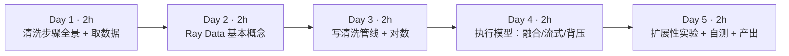

| 天 | 时间 | 先读（概念） | 再读（外部资料，按顺序） | 再做（实验） |
|---|---|---|---|---|
| Day 1 | ~2h | 本页 2.1、2.2 | ① [FineWeb 博客长文](https://huggingface.co/spaces/HuggingFaceFW/blogpost-fineweb-v1) 读 *What is good data?*、*Starting point: text extraction*、*Base filtering*、*Deduplicating the data* 三小节（40 分钟） | 实验 0：取数据 + 加脏 |
| Day 2 | ~2h | 本页 2.3 | ② [Ray Data：Key Concepts](https://docs.ray.io/en/latest/data/key-concepts.html)（20 分钟）；③ [Ray Data：Loading Data](https://docs.ray.io/en/latest/data/loading-data.html) 的 *Reading files* 一节（15 分钟）；④ [Inspecting Data](https://docs.ray.io/en/latest/data/inspecting-data.html)（10 分钟） | 实验 1：explore.py |
| Day 3 | ~2h | 本页 2.4 | ⑤ [Ray Data：Transforming Data](https://docs.ray.io/en/latest/data/transforming-data.html) 读 *Transforming rows*、*Transforming batches*、*Stateful transforms*（35 分钟）；⑥ [datatrove GopherQualityFilter 源码](https://github.com/huggingface/datatrove/blob/main/src/datatrove/pipeline/filters/gopher_quality_filter.py)（15 分钟） | 实验 2：clean_ray.py；实验 3：pandas 对数 |
| Day 4 | ~2h | 本页 2.5、2.6 | ⑦ [Ray Data Internals](https://docs.ray.io/en/latest/data/data-internals.html) 读 *Datasets and blocks*、*Plan optimization*、*Streaming execution*、*Memory model*（40 分钟） | 读懂实验 2 的执行统计 |
| Day 5 | ~2h | 本页 2.7 | ⑧ [Ray Data：Performance Tips](https://docs.ray.io/en/latest/data/performance-tips.html) 浏览目录并精读与本周相关的两三节（20 分钟） | 实验 4：CPU 数与卡死实验；自测题；本周产出 |

**每日打卡：**

- [ ] Day 1：读完 ①，完成实验 0，`dirty/` 下有 8 个文件共 52,500 行
- [ ] Day 2：读完 ②③④，完成实验 1，能解释 `Dataset isn't materialized` 的含义
- [ ] Day 3：读完 ⑤⑥，完成实验 2、3，Ray 版与 pandas 版各规则命中数完全一致
- [ ] Day 4：读完 ⑦，能指着执行统计说出哪些算子被融合了
- [ ] Day 5：完成实验 4、自测题、本周产出

---

## 2. 核心概念讲解

### 2.1 LLM 预训练数据清洗：一条“漏斗”

预训练语料的源头通常是 Common Crawl 这样的网页抓取：几十到上百 TB 的 WARC 文件，绝大部分是导航栏、广告、模板页、乱码和重复内容。清洗的目标是从中筛出“像人写的、有信息量的、不重复的”文本。FineWeb 的公开配方大致是：

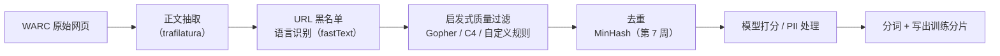

| 你熟悉的（数仓 ETL） | LLM 数据清洗 | 本质 |
|---|---|---|
| ODS 层接入原始日志 | WARC → 正文抽取 | 从半结构化原始数据里抽出有用字段 |
| 数据质量规则（空值率、取值范围、格式校验） | 启发式质量过滤（词数、平均词长、符号比例、停用词） | 用便宜的规则过滤明显的坏数据 |
| 主键去重 / 拉链表 | 精确去重 + 近似去重（MinHash） | 重复数据会让模型“背书”，浪费算力 |
| 数据血缘、质量报表 | 每条规则的命中统计、保留率漏斗 | 规则改动必须可解释、可回溯 |
| 维表打标签（UDF 调外部服务） | 质量分类模型打分（需要 GPU） | 昂贵的步骤放在漏斗后段，只处理少量数据 |

**设计原则和数仓一样**：便宜的规则放前面，昂贵的（模型打分、近似去重）放后面；每一步都要能统计“过滤了多少、为什么”。

### 2.2 启发式质量过滤：Gopher 规则

DeepMind 训练 Gopher 时公开了一组规则（[Gopher 论文](https://arxiv.org/abs/2112.11446) 附录），后来被 datatrove 等实现为标准过滤器。本周实现其中一个子集（阈值取自 datatrove `GopherQualityFilter` 的默认值）：

| 规则 | 阈值 | 拦截什么 | 实验 2 命中 |
|---|---|---|---|
| 词数 | 50 ≤ 词数 ≤ 100,000 | 过短的垃圾页、超长的数据堆 | too_short 2,804 |
| 平均词长 | 3 ≤ 平均词长 ≤ 10 | 符号堆砌（词太短）、base64/URL 堆（词太长） | avg_word_len 1,025 |
| 含字母词比例 | ≥ 80% | 数字表格、符号、模板页 | non_alpha 1,167 |
| 英文停用词 | 至少出现 8 个停用词中的 2 个 | 非自然语言、非英文 | few_stop_words 53 |
| 重复行比例（简化版） | 重复行 ≤ 30% | 模板页、页脚复读 | 0 |

**规则顺序会影响“归因”**：我们按顺序判定，命中第一条就记下原因。实验 0 注入了 2% 的中文页面，你可能以为它们会被“停用词”规则拦截——实际上中文没有空格，按空格切词只得到 1 个“词”，在第一条 `too_short` 就被拦下了。注入的“40 行重复页脚”同样先被 `non_alpha`（`|` 和 `2024` 不含字母）拦截，所以 `dup_lines` 计数为 0。**这也提醒你：按空格分词的规则只适用于英文**，处理中文必须先做语言识别，再用中文分词和中文专用规则——这正是很多中文语料项目要自己重写过滤器的原因。

### 2.3 Ray Data 的数据模型：Dataset 与 block

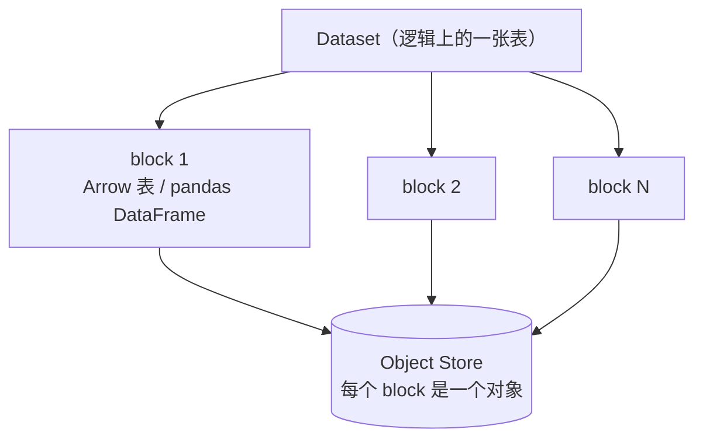

- **Dataset** 是一个分布式数据集的**执行计划**，创建时不读数据（实验 1：`Dataset isn't materialized`）。
- **block** 是 Ray Data 的基本处理单元，通常是一个 Arrow 表，存放在 Object Store 里。官方 *Ray Data Internals* 说明：Ray Data 尝试把 block 大小控制在 **1 MiB 到 128 MiB** 之间，可通过 `target_min_block_size` / `target_max_block_size` 调整。
- **schema**：读 Parquet 时直接来自文件元数据；字符串列显示为 `large_string`（第 1 周讲过：64 位偏移量的 Arrow 字符串）。

| Spark | Ray Data | 差异 |
|---|---|---|
| DataFrame / RDD | Dataset | 都是惰性的分布式数据集 |
| partition | block | Ray 的 block 存在 Object Store，可被任意 worker 零拷贝读取 |
| `spark.sql.files.maxPartitionBytes` | `target_max_block_size` | 控制分块粒度 |
| `cache()` / `persist()` | `materialize()` | 物化到 Object Store（内存不够会溢写磁盘） |
| `explain()` | `print(ds)`、`ds.stats()` | Ray 的计划简单得多，没有代价优化器 |

### 2.4 转换：函数 UDF 与类 UDF

`map_batches(fn, batch_format="pandas")` 会把每个 block（或其中一批行）转成 pandas DataFrame 交给你的函数，函数返回新的 DataFrame。两种形态：

| | 函数 UDF | 类 UDF |
|---|---|---|
| 写法 | `def normalize(df): ...` | `class TokenCounter: __init__ 加载; __call__(df)` |
| 底层执行 | 无状态 Ray **Task** | Ray **Actor 池**（上周的 Actor） |
| 适用 | 纯计算、规则过滤 | 需要加载模型/分词器/词典等昂贵资源 |
| 并发控制 | 由调度器根据资源自动决定 | `compute=ray.data.ActorPoolStrategy(size=2)` 固定池大小（或给出最小/最大值自动伸缩） |
| GPU | 可以，但每个 task 都要加载模型 | 推理的标准写法：`num_gpus=1` + 类 UDF |

本站 Ray 2.59.0 中，旧写法 `concurrency=2` 会提示 `The argument concurrency is deprecated in Ray 2.51. Please specify argument compute instead.`。网上很多教程仍用旧写法，以你安装版本的文档为准。

**过滤**：`filter(expr=col("reason") == "")` 用表达式过滤，Ray 会用 Arrow 原生实现；如果传 Python lambda（`filter(lambda row: ...)`），本站版本会警告 `Use 'expr' instead of 'fn' when possible for performant filters.`——逐行调用 Python 函数正是第 1 周讲的“慢”的根源。

### 2.5 执行模型：算子融合、流式执行、背压

实验 2 的执行统计（节选）：

```text
Operator 2 ReadFilesParquetV2->MapBatches(normalize)->MapBatches(quality): 8 tasks executed, 8 blocks produced in 6.0s
Operator 3 Filter(col('reason') == '')->Project->MapBatches(TokenCounter): 8 tasks executed, 8 blocks produced in 2.35s
Operator 4 Write: 8 tasks executed, 8 blocks produced in 1.57s
```

**算子融合**：`读文件 → normalize → quality` 被合并成**一个**物理算子（名字里用 `->` 连接）。官方文档称为 `OperatorFusionRule`：把一串 map 类算子合并，避免中间结果在算子之间序列化。这与 Spark 把窄依赖合并成一个 stage、Hive/Tez 把多个 map 合并成一个 vertex 是同一个思想。

**为什么 Filter 和 TokenCounter 没有和前面融合？** 两个原因：中间有 `materialize()` 和 `groupby`（实验里我们先物化，用于统计和过滤复用）；而且 TokenCounter 是 Actor 池，不能和 Task 型算子融合（计算资源形态不同）。

**流式执行**：官方文档原话是“与批量同步执行不同，Ray Data 的流式执行不等一个算子完成才开始下一个”。每个算子消费上游的 block 流、产出下游的 block 流，所以数据集可以比集群内存大。对比：

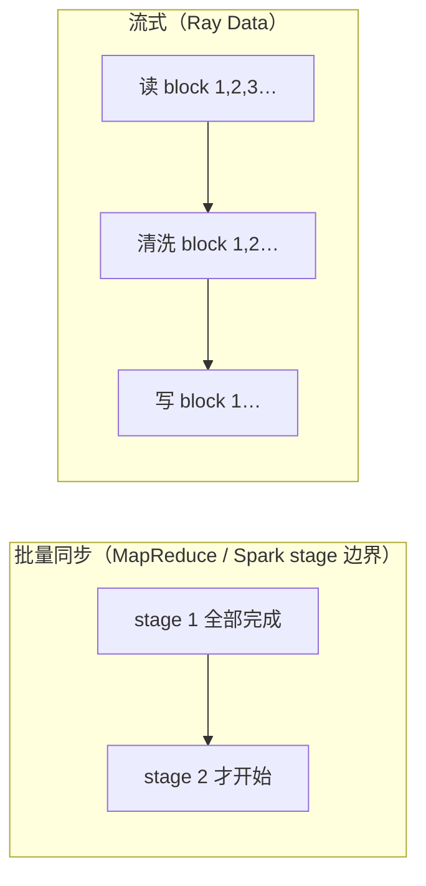

Spark 在**同一个 stage 内**其实也是流水线式的（迭代器逐行传递），区别主要在 stage 边界和**异构资源**：Ray Data 可以让 CPU 算子和 GPU 算子同时运行、各自按资源扩缩，GPU 不用等 CPU 阶段全部结束——这正是第 8 周批量推理的核心收益。

**背压（backpressure）**：如果下游慢（例如 GPU 推理），上游不能无限生产 block 塞满 Object Store。执行器的调度循环在给一个算子派发新输入前会检查三个条件：有输入、有足够资源、**没有被背压**（官方 *Streaming execution* 一节）。实验 4 的日志里你会看到 `backpressured:tasks(ResourceBudget)`。

**内存模型**：官方文档说明 Ray 把每个节点的内存分成三块：默认 30% 给 Object Store，10% 给系统开销，其余作为“逻辑内存”供任务申请。

### 2.6 物化与 groupby：什么时候会打断流式

- `materialize()`、`groupby().count()`、`sort()`、`random_shuffle()` 这类操作需要**看到全部数据**，会打断流式、产生全量的中间结果（相当于 Spark 的 shuffle）。
- 实验 2 中我们为了“按原因统计”和“过滤保留”复用同一份结果，选择先 `materialize()`。代价是 Object Store 里要放下全部 52,500 行（物化后 154 MiB）。数据量是内存的 10 倍时，正确做法是**把 reason 写进输出**，统计另跑一个轻量作业，或者在 UDF 里累计计数——这和你在 Spark 里避免对大表 `cache()` 的判断完全相同。
- groupby 使用 hash shuffle，需要启动一组聚合器（aggregator）占用 CPU。实验 4 会看到：只有 1 个 CPU 时，它和读取任务争抢资源，管线卡住。

### 2.7 扩展性：CPU 数、并行度与“资源死锁”

实验 4 把同一条管线分别放在 4、2、1 个 CPU 上：

| CPU | 总用时 | 读+清洗算子 | Token 统计算子 |
|---|---|---|---|
| 4 | 11.5s | 6.04s | 2.24s |
| 2 | 16.8s | 9.91s | 2.11s |
| 1 | **卡住**（90 秒超时后被终止） | — | — |

- 4 → 2 CPU，读+清洗从 6.0s 变成 9.9s：8 个 block 需要更多轮次。并不是严格的 2 倍，因为还有调度开销、文件读取和长尾 block。
- Token 统计在两种配置下都约 2.1～2.2s：它固定用 2 个 Actor（`ActorPoolStrategy(size=2)`），与集群 CPU 数无关。
- **1 CPU 卡住**：日志显示 `Limited available CPU resources for hash shuffle operation. Required: 0.25 CPUs, available: 0 CPUs`，以及 `Active & requested resources: 8.25/1 CPU`——groupby 的聚合器申请的资源总和远超集群容量，与读取任务互相等待。即使闯过这一关，后面的 `ActorPoolStrategy(size=2)` 也需要 2 个 CPU 才能启动两个 Actor。
- **架构师的教训**：Ray 上的“作业卡住不报错”往往是**资源申请无法被满足**，而不是代码 bug。排查顺序：看 Ray Data 进度日志里的 requested resources → `ray status` 的 Pending Demands → 检查 Actor 池大小、`num_cpus`/`num_gpus` 声明是否超过集群容量。

---

## 3. 动手实验 {{local}}

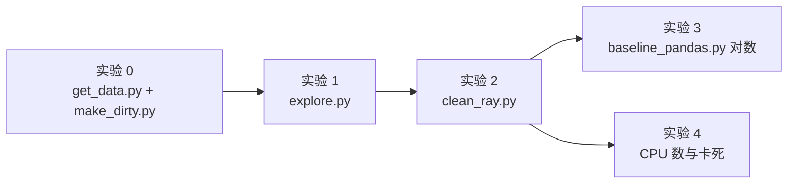

所有文件放在 `~/ai-infra-lab/w6/`。

### 实验 0：取 5 万条 FineWeb 并“加脏”（30 分钟）

```bash
cd ~/ai-infra-lab && source .venv/bin/activate && mkdir -p w6 && cd w6
uv pip install "datasets==5.1.0" "tiktoken==0.14.0"   # ray[data] 已在第 5 周安装
mkdir -p raw dirty
```

`get_data.py`：

```python
"""从 FineWeb 的 sample-10BT 子集流式抽取 5 万条，存成 5 个 Parquet 文件（模拟多文件原始数据）。"""
import pathlib
import time

import pyarrow as pa
import pyarrow.parquet as pq
from datasets import load_dataset

N, FILES = 50_000, 5
out = pathlib.Path("raw")
out.mkdir(exist_ok=True)
t = time.time()
ds = load_dataset("HuggingFaceFW/fineweb", name="sample-10BT", split="train", streaming=True)
rows = []
for r in ds:
    rows.append({"id": r["id"], "url": r["url"], "text": r["text"], "language_score": r["language_score"]})
    if len(rows) == N:
        break
per = N // FILES
for i in range(FILES):
    pq.write_table(pa.Table.from_pylist(rows[i * per:(i + 1) * per]), out / f"part-{i}.parquet")
size = sum(f.stat().st_size for f in out.glob("*.parquet"))
print(f"写出 {N} 条到 {FILES} 个文件，共 {size / 2**20:.1f} MiB，用时 {time.time() - t:.0f}s")
print("字段:", list(rows[0].keys()))
print("示例:", rows[0]["url"], "|", rows[0]["text"][:80].replace("\n", " "))
```

**本站输出**：

```text
写出 50000 条到 5 个文件，共 96.1 MiB，用时 13s
字段: ['id', 'url', 'text', 'language_score']
示例: http://daytimeroyaltyonline.com/single/?p=8906650&t=8780053 | |Viewing Single Post From: Spoilers for the Week of February 11th| |Lil||Feb 1 2
```

FineWeb 本身**已经清洗过**，直接拿来过滤几乎什么都不会被拦下。为了看到每条规则的效果，`make_dirty.py` 按固定随机种子注入 6 类常见问题：

```python
"""给干净的 FineWeb 样本“加脏”：模拟爬虫原始数据里常见的问题，方便观察每条清洗规则的效果。"""
import glob

import numpy as np
import pandas as pd
import pyarrow as pa
import pyarrow.parquet as pq

rng = np.random.default_rng(7)
df = pd.concat([pd.read_parquet(f) for f in sorted(glob.glob("raw/*.parquet"))], ignore_index=True)
n = len(df)


def pick(frac):
    return rng.choice(n, int(n * frac), replace=False)


df["text"] = df["text"].astype(object)
for i in pick(0.03):                                   # ① HTML 残留
    df.at[i, "text"] = "<div class='nav'><a href='/'>Home</a></div>\n" + df.at[i, "text"] + "\n<script>var x=1;</script>"
for i in pick(0.03):                                   # ② 过短的垃圾页
    df.at[i, "text"] = rng.choice(["Click here to subscribe!", "404 Not Found", "Loading...", "Accept cookies"])
for i in pick(0.02):                                   # ③ 符号/数字堆砌
    df.at[i, "text"] = " ".join(rng.choice(["#", "$$", "|", "---", "1234", "@@", "..."], 300))
for i in pick(0.02):                                   # ④ 非英文（中文）页面
    df.at[i, "text"] = "这是一段用于测试语言过滤的中文网页内容，" * 20
for i in pick(0.02):                                   # ⑤ 大量重复行（模板页）
    df.at[i, "text"] = "\n".join(["Copyright 2024 All rights reserved. Terms | Privacy"] * 40)
dups = df.iloc[pick(0.05)].copy()                      # ⑥ 5% 完全重复的文档（换个 id）
dups["id"] = dups["id"] + "-dup"
df = pd.concat([df, dups], ignore_index=True).sample(frac=1, random_state=7).reset_index(drop=True)

df["text"] = df["text"].astype(str)
for i, idx in enumerate(np.array_split(np.arange(len(df)), 8)):   # 切成 8 个文件
    pq.write_table(pa.Table.from_pandas(df.iloc[idx], preserve_index=False), f"dirty/part-{i}.parquet")
print("脏数据总行数:", len(df))
```

**本站输出**：

```text
脏数据总行数: 52500
```

**逐步解释**：

- `streaming=True`：不下载整个数据集（sample-10BT 有几十 GB），而是按需读取前 5 万条。访问 Hugging Face 不畅时可设 `HF_ENDPOINT`（见第 2 周）。
- 5 万条 + 5% 重复（2,500 条）= 52,500。①～⑤ 是**原地替换**文本，不改变行数。
- `sample(frac=1)` 打乱顺序，模拟真实数据里脏数据分散在各处；再切成 8 个文件。
- 注入的重复文档（⑥）本周的规则**不会**拦截——它们是正常文本，留给第 7 周的去重。

### 实验 1：读入并观察 Dataset（20 分钟）

`explore.py`：

```python
"""实验 1：用 Ray Data 读多文件 Parquet，看 Dataset / block / schema / 惰性执行。"""
import time

import ray

ray.init(num_cpus=4, include_dashboard=False)
ds = ray.data.read_parquet("dirty/")            # 只建执行计划，不读数据
print(ds)                                       # 打印逻辑计划
print("schema:", ds.schema())
t = time.time()
print("行数:", ds.count(), " 用时 %.2fs（count 可直接用 Parquet 元数据）" % (time.time() - t))

mat = ds.materialize()                          # 真正执行，把结果固化在 Object Store
print("物化后 block 数:", mat.num_blocks(), " 总字节 %.1f MiB" % (mat.size_bytes() / 2**20))
row = mat.take(1)[0]
print("一行样例:", {k: (v[:60] + "…" if isinstance(v, str) and len(v) > 60 else v) for k, v in row.items()})
```

**本站输出**：

```text
shape: (?, 4)
╭──────────────┬──────────────┬──────────────┬────────────────╮
│ id           ┆ url          ┆ text         ┆ language_score │
│ ---          ┆ ---          ┆ ---          ┆ ---            │
│ large_string ┆ large_string ┆ large_string ┆ double         │
╰──────────────┴──────────────┴──────────────┴────────────────╯
(Dataset isn't materialized)
schema: Column          Type
------          ----
id              large_string
url             large_string
text            large_string
language_score  double
行数: 52500  用时 0.85s（count 可直接用 Parquet 元数据）
物化后 block 数: 8  总字节 154.3 MiB
一行样例: {'id': '<urn:uuid:2337dea4-8c2e-41ac-a49a-7954a3ef65da>', 'url': 'https://ideas.repec.org/a/ucp/jlawec/v44y2001i1p199-232.html', 'text': 'Reversion Taxes, Contingent Benefits, and the Decline in Pen…', 'language_score': 0.8255221247673035}
```

**逐步解释**：

- `shape: (?, 4)`：行数未知，因为还没执行。这就是惰性计划。
- `count()` 很快：Parquet footer 里就有行数（第 1 周实验 5）。
- 物化后 **8 个 block**，对应 8 个输入文件；**154 MiB**，而磁盘上 Parquet 只有 94 MiB——解压后的 Arrow 内存表示更大（第 1 周讲过的“文件大小 ≠ 内存大小”）。
- `take(1)` 把一行拉回 Driver，类似 Spark 的 `take`。

### 实验 2：Ray Data 清洗管线（50 分钟）

把清洗规则单独放在 `clean_funcs.py`，Ray 版和 pandas 版共用（保证“对数”比较的是同一套逻辑）：

```python
"""清洗规则：Ray 版与 pandas 版共用。"""
import re

import numpy as np
import pandas as pd

TAG = re.compile(r"<[^>]+>")
WS = re.compile(r"[ \t]+")
STOP = {"the", "be", "to", "of", "and", "that", "have", "with"}   # Gopher 论文的 8 个停用词


def normalize(df: pd.DataFrame) -> pd.DataFrame:
    """去 HTML 标签、压缩空白、去掉空行。"""
    def one(t: str) -> str:
        t = TAG.sub(" ", t)
        lines = [WS.sub(" ", l).strip() for l in t.splitlines()]
        return "\n".join(l for l in lines if l)
    df["text"] = df["text"].map(one)
    return df


def quality(df: pd.DataFrame) -> pd.DataFrame:
    """为每行打上 reason（为空表示通过），不在这里删行，方便统计每条规则的命中数。"""
    reasons = []
    for t in df["text"]:
        words = t.split()
        n = len(words)
        lines = t.splitlines() or [""]
        alpha_words = sum(any(c.isalpha() for c in w) for w in words)
        if n < 50:
            r = "too_short"                                   # Gopher：少于 50 词
        elif n > 100_000:
            r = "too_long"
        elif not 3 <= np.mean([len(w) for w in words]) <= 10:
            r = "avg_word_len"                               # 平均词长不在 3–10
        elif alpha_words / n < 0.8:
            r = "non_alpha"                                  # 含字母的词不足 80%
        elif len(STOP & {w.lower() for w in words}) < 2:
            r = "few_stop_words"                             # 英文停用词少于 2 个（兼作粗糙的语言过滤）
        elif 1 - len(set(lines)) / len(lines) > 0.3:
            r = "dup_lines"                                  # 重复行占比 > 30%（Gopher 重复规则的简化版）
        else:
            r = ""
        reasons.append(r)
    df["reason"] = reasons
    return df
```

`clean_ray.py`：

```python
"""实验 2：Ray Data 清洗管线：规范化 → 启发式质量过滤（Gopher 规则子集）→ 统计 token → 写出。"""
import argparse
import time

import pandas as pd
import ray
from ray.data.expressions import col

from clean_funcs import normalize, quality

ap = argparse.ArgumentParser()
ap.add_argument("--input", default="dirty/")
ap.add_argument("--output", default="clean/")
ap.add_argument("--cpus", type=int, default=4)
a = ap.parse_args()
ray.init(num_cpus=a.cpus, include_dashboard=False)


class TokenCounter:
    """有状态 UDF：每个 Actor 只加载一次分词器（模拟“加载一次模型”）。"""
    def __init__(self):
        import tiktoken
        self.enc = tiktoken.get_encoding("gpt2")

    def __call__(self, df: pd.DataFrame) -> pd.DataFrame:
        df["n_tokens"] = [len(x) for x in self.enc.encode_ordinary_batch(df["text"].tolist())]
        return df


t = time.time()
ds = (ray.data.read_parquet(a.input)
      .map_batches(normalize, batch_format="pandas")
      .map_batches(quality, batch_format="pandas"))
tagged = ds.materialize()                                   # 物化一次，下面两处复用
print("按原因统计:")
for r in sorted(tagged.groupby("reason").count().take_all(), key=lambda x: -x["count()"]):
    print(f"  {r['reason'] or '(通过)':<16}{r['count()']:>7}")

kept = (tagged.filter(expr=col("reason") == "")             # 表达式过滤：走 Arrow 原生实现
        .drop_columns(["reason"])
        .map_batches(TokenCounter, batch_format="pandas",
                     compute=ray.data.ActorPoolStrategy(size=2)))   # 固定 2 个 Actor
kept.write_parquet(a.output)
print("清洗用时 %.1fs" % (time.time() - t))
print("---- 执行统计（节选）----")
for line in kept.stats().splitlines():
    if line.startswith("Operator") or "Remote wall time" in line or "tasks executed" in line:
        print(line.strip()[:150])

out = ray.data.read_parquet(a.output)
print("保留行数:", out.count(), " 总 token 数(GPT-2 分词):", out.sum("n_tokens"))
```

```bash
rm -rf clean && python clean_ray.py
```

**本站输出**：

```text
按原因统计:
  (通过)              47451
  too_short          2804
  non_alpha          1167
  avg_word_len       1025
  few_stop_words       53
清洗用时 11.8s
---- 执行统计（节选）----
Operator 0 ReadFiles:
Operator 1 ListFiles: 1 tasks executed, 8 blocks produced in 0.06s
* Remote wall time: 110.2us min, 55.88ms max, 7.1ms mean, 56.78ms total
Operator 2 ReadFilesParquetV2->MapBatches(normalize)->MapBatches(quality): 8 tasks executed, 8 blocks produced in 6.0s
* Remote wall time: 2.11s min, 2.42s max, 2.24s mean, 17.95s total
Operator 3 Filter(col('reason') == '')->Project->MapBatches(TokenCounter): 8 tasks executed, 8 blocks produced in 2.35s
* Remote wall time: 461.11ms min, 754.6ms max, 550.18ms mean, 4.4s total
Operator 4 Write: 8 tasks executed, 8 blocks produced in 1.57s
* Remote wall time: 68.5ms min, 92.98ms max, 83.58ms mean, 668.63ms total
保留行数: 47451  总 token 数(GPT-2 分词): 33414974
```

运行时你还会看到一行 `core_worker.cc ... has constructor arguments in the object store and max_restarts > 0 ...` 的日志：这是 Ray 内部对 Actor 池重启行为的提示（链接到 Ray 的一个 GitHub issue），不影响结果。

**逐步解释**：

- **漏斗**：52,500 → 47,451，过滤掉 5,049 行（9.6%）。注入的 HTML 残留（3%）会被 normalize 清掉而通过；其余四类“应被拦截”的注入（过短 3%、符号 2%、中文 2%、模板 2%）共约 4,500 行，加上 ⑥ 重复时被复制的约 5% 脏行，合计约 4,700 行；差额来自少量原本干净的 FineWeb 文档也触发了规则（例如少于 50 词的页面），以及注入时同一行被多次覆盖。想精确核对，可以在 `make_dirty.py` 里给注入行打上标签列，再做交叉表（扩展练习 1）。
- **中文页面去哪了**：被 `too_short` 拦截（2.2 节）。
- **Remote wall time 17.95s total vs 6.0s 墙钟**：8 个任务的执行时间总和约 18 秒，但 4 个 CPU 并行，墙钟只用了 6 秒。
- **总 token 数 3341 万**：这就是这份数据能提供的训练 token 量（用 GPT-2 分词器计）。做预训练数据规划时，最终交付的指标就是“多少 B token”。
- 输出目录 `clean/` 下有 8 个 Parquet 文件，文件名带随机前缀，这是 Ray Data 的默认命名。

### 实验 3：单进程 pandas 对数（20 分钟）

`baseline_pandas.py`：

```python
"""对照：同样的 normalize + quality 逻辑，用单进程 pandas 跑一遍。"""
import glob
import time

import pandas as pd

from clean_funcs import normalize, quality

t = time.time()
df = pd.concat([pd.read_parquet(f) for f in sorted(glob.glob("dirty/*.parquet"))], ignore_index=True)
df = quality(normalize(df))
print(df["reason"].replace("", "(通过)").value_counts().to_string())
print("单进程 pandas 用时 %.1fs" % (time.time() - t))
```

**本站输出**：

```text
reason
(通过)              47451
too_short          2804
non_alpha          1167
avg_word_len       1025
few_stop_words       53
单进程 pandas 用时 17.5s
```

**逐步解释**：

- **各规则命中数与 Ray 版完全一致**——分布式版本没有改变逻辑。第 1 周你用 DuckDB 给 pandas 对数，这周反过来用 pandas 给 Ray 对数：**每次把逻辑迁到新引擎，先在小数据上对数**，这是你从数仓迁移项目里带来的最有价值的习惯。
- pandas 单进程 17.5s 只做了规范化 + 质量判断；Ray 4 CPU 用 11.8s 完成了规范化、判断、统计、token 计数、写出全部步骤。数据量放大 100 倍时，pandas 版本会因为内存放不下而无法运行，Ray 版可以流式处理或加机器。

### 实验 4：CPU 数与“卡死”（30 分钟）

```bash
for c in 4 2; do rm -rf clean; echo "== cpus=$c"; python clean_ray.py --cpus $c | grep -E "清洗用时|Operator 2|Operator 3"; done
rm -rf clean; timeout 90 python clean_ray.py --cpus 1; echo "exit $?"
```

**本站输出**（4 和 2 CPU）：

```text
== cpus=4
清洗用时 11.5s
Operator 2 ReadFilesParquetV2->MapBatches(normalize)->MapBatches(quality): 8 tasks executed, 8 blocks produced in 6.04s
Operator 3 Filter(col('reason') == '')->Project->MapBatches(TokenCounter): 8 tasks executed, 8 blocks produced in 2.24s
== cpus=2
清洗用时 16.8s
Operator 2 ReadFilesParquetV2->MapBatches(normalize)->MapBatches(quality): 8 tasks executed, 8 blocks produced in 9.91s
Operator 3 Filter(col('reason') == '')->Project->MapBatches(TokenCounter): 8 tasks executed, 8 blocks produced in 2.11s
```

**1 CPU 时**（90 秒后被 `timeout` 终止，退出码 124；日志节选）：

```text
WARNING hash_shuffle.py -- Limited available CPU resources for hash shuffle operation. Required: 0.25 CPUs, available: 0 CPUs. ...
INFO logging_progress.py:227 -- Active & requested resources: 8.25/1 CPU, 1.0GiB/3.9GiB memory, 457.8KiB/856.6MiB object store
INFO logging_progress.py:233 --   Tasks: 8 [backpressured:tasks(ResourceBudget)]; Actors: 0; Queued blocks: 0 (0.0B); Resources: 8.2 CPU, 1.0GiB memory, 0.0B object store
exit 124
```

**逐步解释**：见 2.7 节。请你在 Mac 上也跑一遍，并试着修改：去掉 `groupby` 统计（改成在 pandas 里对输出做统计）、把 `ActorPoolStrategy(size=2)` 改为 `size=1`，看 1 CPU 时能否跑完。

### 常见错误与排查

| 现象（真实报错或现象） | 原因 | 解决 |
|---|---|---|
| 作业不报错但一直不结束，日志里 `requested resources` 超过集群容量 | 资源申请无法满足（实验 4） | 减小 Actor 池、减少 shuffle 类操作、加 CPU；看 `ray status` 的 Pending Demands |
| `The argument concurrency is deprecated in Ray 2.51. Please specify argument compute instead.` | 新版 API 变化 | 改用 `compute=ray.data.ActorPoolStrategy(size=N)` |
| `UserWarning: Use 'expr' instead of 'fn' when possible for performant filters.` | 用 Python lambda 逐行过滤 | 改用 `filter(expr=col(...) == ...)` |
| 写 make_dirty.py 时 `np.array_split(df, 8)` 切出来的不是 DataFrame（本站实测 numpy 2.5 + pandas 3.0 下返回 `numpy.ndarray`），后续写 Parquet 报错 | 新版 numpy 不再对 DataFrame 保留类型 | 对行号切分：`np.array_split(np.arange(len(df)), 8)` 再 `df.iloc[idx]` |
| `UnicodeDecodeError` / 乱码（未在本站复现） | 原始网页编码混乱 | 正文抽取阶段统一转 UTF-8；过滤器里对异常文本打标签而不是抛异常 |
| UDF 里某一行抛异常导致整个作业失败（未在本站复现） | 一条脏数据让 task 抛应用异常，Ray 默认不重试 | UDF 内部 try/except，把异常行标记为 `reason="error"` |
| 输出文件数量太多 / 太少 | 输出文件数跟随 block 数 | 写出前 `repartition(n)`，或调整 block 大小 |
| `materialize()` 后内存/磁盘暴涨 | 物化需要放下全量数据 | 避免物化大数据集；把统计列写进输出另行汇总 |

### 扩展练习（选做，每题 20–40 分钟）

1. **注入标签交叉表**：在 `make_dirty.py` 中给每行加一列 `inject`（none/html/short/symbol/zh/template/dup），清洗后统计 `inject × reason` 的交叉表，计算每条规则的召回率与误杀率。
2. **补上 Gopher 重复规则**：阅读 [datatrove GopherRepetitionFilter](https://github.com/huggingface/datatrove/blob/main/src/datatrove/pipeline/filters/gopher_repetition_filter.py)，实现“重复行字符占比”和“top n-gram 字符占比”中的一条，观察新增拦截。
3. **中文过滤器**：设计 3 条适用于中文的启发式规则（例如中文字符占比、标点比例、平均句长），用实验 0 注入的中文页验证。
4. **去掉物化**：重构 clean_ray.py，不调用 `materialize()`，让 reason 写进输出文件，再用第二个小作业统计。比较内存峰值（Dashboard 或 `ray status`）。
5. **block 大小**：用 `ray.data.DataContext.get_current().target_max_block_size` 把 block 上限调小（如 8 MiB），观察 block 数、任务数和总耗时的变化。

---

## 4. 精读指南

### ① FineWeb 博客长文（40 分钟）

[链接](https://huggingface.co/spaces/HuggingFaceFW/blogpost-fineweb-v1)（配套论文：[The FineWeb Datasets](https://arxiv.org/abs/2406.17557)）

- **读哪里**：*What is good data?*；*Starting point: text extraction*、*Base filtering*、*Deduplicating the data*。
- **重点**：他们如何用“小模型训练 + 基准评测”来判断一条过滤规则是否有用（ablation）；为什么从 WET 换成自己抽取正文。
- **读完回答**：① 文中 base filtering 包含哪几步？② 他们怎样评估“数据质量提升”？这和你在数仓里评估“数据质量规则有效”有何异同？

### ②③④ Ray Data 基础（45 分钟）

- [Key Concepts](https://docs.ray.io/en/latest/data/key-concepts.html)：**读完回答**：Dataset、block、operator 的关系；为什么说 Ray Data 是“流式”的？
- [Loading Data](https://docs.ray.io/en/latest/data/loading-data.html) 的 *Reading files*：**读完回答**：读 Parquet 时如何只读部分列、如何做过滤下推？（对照第 1 周）
- [Inspecting Data](https://docs.ray.io/en/latest/data/inspecting-data.html)：`schema`、`take`、`show`、`stats` 的用法。

### ⑤⑥ 转换与 Gopher 规则（50 分钟）

- [Transforming Data](https://docs.ray.io/en/latest/data/transforming-data.html)：读 *Transforming rows*、*Transforming batches*、*Stateful transforms*。**读完回答**：`map` 与 `map_batches` 的性能差异来自哪里？类 UDF 的 Actor 池如何设置最小/最大大小？
- [datatrove GopherQualityFilter](https://github.com/huggingface/datatrove/blob/main/src/datatrove/pipeline/filters/gopher_quality_filter.py)：**读完回答**：datatrove 统计词数时去掉了哪些“词”？本页的简化实现与它有哪些差别？

### ⑦ Ray Data Internals（40 分钟）

[链接](https://docs.ray.io/en/latest/data/data-internals.html)

- **读哪里**：*Datasets and blocks*（含 *Block size limiting*）、*Plan optimization*、*Streaming execution*（含 *The scheduling loop*）、*Memory model*。
- **读完回答**：① block 大小的默认上下限是多少？② 调度循环选择算子的三个条件是什么？多个算子可选时选哪个？③ 三个内存池各占多少？

### ⑧ Performance Tips（20 分钟）

[链接](https://docs.ray.io/en/latest/data/performance-tips.html)：浏览目录，挑与读取并行度、批大小、Actor 池相关的小节精读。**读完回答**：列出两条你可以立刻用到 clean_ray.py 上的优化。

### 背景阅读（不计入本周时间）

- [Ray Data 论文：The Streaming Batch Model for Efficient and Fault-Tolerant Heterogeneous Execution](https://arxiv.org/abs/2501.12407)：Ray Data 流式批处理模型的设计论文，第 8 周批量推理时会回来看。
- [datatrove](https://github.com/huggingface/datatrove)：FineWeb 用的生产级清洗/去重库，看它的 `examples/` 目录。
- [NeMo Curator](https://github.com/NVIDIA/NeMo-Curator)：NVIDIA 的 GPU 加速数据整理库。
- [RefinedWeb 论文](https://arxiv.org/abs/2306.01116)：Falcon 团队“只用网页数据”的清洗方案，可与 FineWeb 对照。

---

## 5. 自测题

<details>
<summary>1. 为什么启发式过滤放在去重和模型打分之前？</summary>

成本递增原则：启发式规则每条文档只需简单计数，极便宜；MinHash 去重需要计算签名并做跨文档比较；模型打分需要 GPU。先用便宜规则砍掉大部分明显垃圾，后面昂贵步骤处理的数据量就小得多。和数仓里“先过滤再 Join”是同一个道理。

</details>

<details>
<summary>2. 实验中注入的中文页面被哪条规则拦截？这暴露了什么问题？</summary>

被 `too_short` 拦截：中文没有空格，按空格切词只得到 1 个“词”。这说明基于空格分词的规则只适用于英文等空格分隔语言；处理多语言语料要先做语言识别，再对每种语言使用对应的分词和规则。

</details>

<details>
<summary>3. Ray Data 的 block 是什么？默认大小范围？和 Spark partition 的关键差别？</summary>

block 是 Ray Data 的基本处理单元，通常是一个 Arrow 表，作为对象存放在 Object Store 中。官方文档说明 Ray Data 尽量把 block 控制在 1 MiB～128 MiB。与 Spark partition 相比，block 存在共享内存对象存储里，可被同节点任意 worker 零拷贝读取，也可作为 ObjectRef 在任务间传递。

</details>

<details>
<summary>4. 什么时候必须用类 UDF？类 UDF 在底层对应什么？</summary>

需要昂贵的一次性初始化（加载模型、分词器、大词典、数据库连接池）时。类 UDF 在底层由 Ray Actor 池执行，每个 Actor 只执行一次 `__init__`，之后处理多个 batch。通过 `compute=ray.data.ActorPoolStrategy(...)` 控制池大小，GPU 推理时再声明 `num_gpus`。

</details>

<details>
<summary>5. 执行统计中 <code>ReadFilesParquetV2->MapBatches(normalize)->MapBatches(quality)</code> 说明了什么？</summary>

三个 map 类算子被算子融合（OperatorFusionRule）合并成一个物理算子，在同一个任务里依次执行，中间结果不需要序列化写入 Object Store。类似 Spark 把窄依赖合并进一个 stage。

</details>

<details>
<summary>6. 为什么 Ray 版和 pandas 版要“对数”？对数时要比较什么？</summary>

确认分布式改写没有改变业务逻辑（分块边界、类型转换、并发顺序都可能引入差异）。本周比较每条规则的命中数和保留行数；更严格时还可以比较输出内容的哈希或抽样逐行比对。

</details>

<details>
<summary>7. 为什么 1 个 CPU 时管线会卡住？如何排查？</summary>

groupby 的 hash shuffle 需要启动聚合器申请 CPU，加上读取任务、后续 Actor 池（需要 2 个 CPU），资源申请总量超过集群容量，任务互相等待（日志：`Required: 0.25 CPUs, available: 0 CPUs`、`requested resources: 8.25/1 CPU`）。排查：看 Ray Data 进度日志中的 requested resources、`ray status` 的 Pending Demands，检查 Actor 池大小与资源声明。

</details>

<details>
<summary>8. 物化后数据 154 MiB，而磁盘上 Parquet 只有 94 MiB，为什么？</summary>

Parquet 在磁盘上经过编码和压缩；读入内存后解压为 Arrow 列式表示（字符串带 64 位偏移量），体积变大。这与第 1 周的“文件大小 → 内存大小膨胀”是同一现象，做容量规划时必须按内存大小估算 Object Store。

</details>

<details>
<summary>9. `materialize()` 在什么情况下是合理的？什么情况下是危险的？</summary>

结果较小、需要被多次复用（如本周同时用于统计和过滤）时合理。数据量接近或超过集群 Object Store 容量时危险：会触发大量溢写甚至失败，并打断流式执行。大数据量时应把需要的信息写进输出，或拆成多个流式作业。

</details>

### 思考题（架构师视角，没有标准答案，写成 200–300 字的短文）

1. **规则治理**：公司有 30 条数据清洗规则，由不同算法同学维护。你会如何设计规则的版本管理、命中率监控、A/B 评估和回滚？对照你在数仓里管理数据质量规则的经验。
2. **Spark 还是 Ray Data**：本周的管线如果用 Spark 写会怎样？哪些部分 Spark 更强（例如 SQL、优化器、成熟的 shuffle），哪些部分 Ray Data 更合适？给出你的选型标准。
3. **可复现性**：预训练数据要求“任何时候都能复现某个版本的训练集”。从输入快照、代码版本、随机种子、规则顺序、输出命名几个方面，设计一个数据版本方案。
4. **中文语料**：如果要为中文大模型做清洗，你会如何改造本周的管线？哪些开源组件可以复用，哪些必须自研？

---

## 6. 本周产出与掌握清单

### 本周产出（Deliverables）

放进 `~/ai-infra-lab/w6/` 并提交到 git（`raw/`、`dirty/`、`clean/` 数据目录加入 `.gitignore`）：

1. **代码**：`get_data.py`、`make_dirty.py`、`explore.py`、`clean_funcs.py`、`clean_ray.py`、`baseline_pandas.py`。
2. **`README.md`（运行记录，本月产出之一的前半部分）**：环境版本；漏斗图（输入 → 各规则拦截 → 保留，附数字）；Ray 与 pandas 对数结果；不同 CPU 数的耗时表；执行统计截取与解读。
3. **`rules.md`**：本周每条规则的定义、阈值来源、命中数、你认为可能的误杀场景。
4. **一段“架构师笔记”**：从思考题中任选 1 题写成短文。

### 掌握清单

- [ ] 能画出 LLM 预训练数据清洗的完整漏斗，并说出每一步的成本特征
- [ ] 能说出 Gopher 规则的主要阈值，并解释“规则顺序影响归因”
- [ ] 知道按空格分词的规则不适用于中文
- [ ] 能解释 Dataset、block（1–128 MiB）、惰性计划、materialize
- [ ] 能写函数 UDF 与类 UDF，并说出类 UDF 底层是 Actor 池
- [ ] 会用表达式 filter，知道为什么比 lambda 快
- [ ] 跑通 clean_ray.py，各规则命中数与 pandas 版本完全一致
- [ ] 能从执行统计中识别算子融合，并解释哪些算子不能融合
- [ ] 能解释流式执行、背压和 Ray 的三个内存池
- [ ] 能解释 1 CPU 时作业卡住的原因并给出排查步骤
- [ ] 完成 README.md 与 rules.md

---

## 参考资料

**本周主读（按学习路线顺序）：**

- [FineWeb 博客长文](https://huggingface.co/spaces/HuggingFaceFW/blogpost-fineweb-v1)（博客·进阶）：公开的预训练数据清洗配方与消融方法
- [FineWeb 数据集](https://huggingface.co/datasets/HuggingFaceFW/fineweb)（文档·入门）：本周实验数据来源
- [Ray Data 文档](https://docs.ray.io/en/latest/data/data.html)（文档·入门）：总入口
- [Ray Data：Key Concepts](https://docs.ray.io/en/latest/data/key-concepts.html)（文档·入门）
- [Ray Data：Loading Data](https://docs.ray.io/en/latest/data/loading-data.html)（文档·入门）
- [Ray Data：Transforming Data](https://docs.ray.io/en/latest/data/transforming-data.html)（文档·入门）：map_batches 与有状态转换
- [Ray Data Internals](https://docs.ray.io/en/latest/data/data-internals.html)（文档·进阶）：block、融合、流式执行、内存模型
- [Ray Data：Performance Tips](https://docs.ray.io/en/latest/data/performance-tips.html)（文档·进阶）
- [datatrove GopherQualityFilter 源码](https://github.com/huggingface/datatrove/blob/main/src/datatrove/pipeline/filters/gopher_quality_filter.py)（仓库·进阶）：规则阈值来源
- [Gopher 论文](https://arxiv.org/abs/2112.11446)（论文·进阶）：附录中的质量过滤规则

**选读与背景：**

- [The FineWeb Datasets 论文](https://arxiv.org/abs/2406.17557)（论文·进阶）
- [Ray Data 论文：The Streaming Batch Model](https://arxiv.org/abs/2501.12407)（论文·高级）
- [datatrove](https://github.com/huggingface/datatrove)（仓库·进阶）：FineWeb 用的生产级管线
- [NeMo Curator](https://github.com/NVIDIA/NeMo-Curator)（仓库·进阶）：NVIDIA 的 GPU 加速数据整理库
- [RefinedWeb 论文](https://arxiv.org/abs/2306.01116)（论文·进阶）

> 完整列表见 [参考资料库](/resources.html)。

=== m2w3 | 第 7 周：MinHash 去重 + 与 Spark 对比 | 第 2 月 · Ray + 数据管线
# 第 7 周：MinHash 近似去重，以及 Ray Data 与 Spark 的正面对比（原指南项目 3 下半部分）

> **本周一句话**：把第 6 周清洗后的数据去重——先做精确去重，再用 **MinHash + LSH** 做近似去重；然后用你最熟悉的 **Spark** 把同一件事再做一遍，用真实数字比较两个引擎在“shuffle 密集型”任务上的差异。本周的核心收获不是 API，而是一条能讲给面试官听的结论：**Ray Data 强在异构、流式的 map 类计算；大规模 groupby/join 仍是 Spark 的主场**。

**预计投入：约 10 小时**（阅读 ≈ 3h，动手 ≈ 5h，自测与产出 ≈ 2h）。{{local}}

**本周结束时你应该能：**

1. 解释为什么预训练语料必须去重，以及精确去重、近似去重各解决什么问题。
2. 从第一性原理推导 MinHash：为什么“两个集合最小哈希相等的概率 = Jaccard 相似度”。
3. 用 LSH 的 band/row 公式 `P = 1-(1-s^r)^b` 计算候选概率与阈值，并**用它预测实验结果**（本周实验中预测 ≈ 35%，实测 37%）。
4. 用 Ray Data 和 Spark 各实现一遍去重管线，解释两者在 groupby 上 5～20 倍的耗时差异从何而来。
5. 说出 datatrove、BigCode 等生产方案的去重参数，并为自己的场景选择参数。

> **验证说明**：本页所有实验都在 Linux x86_64（8 核、Python 3.12.15）上实际运行：ray 2.59.0、datasketch 2.0.0、pandas 3.0.6、pyspark 4.2.0 + Eclipse Temurin JDK 17.0.20（解压版，无需 root）。输出为真实结果（删去了 INFO 日志和进度条）。输入是第 6 周 `clean/` 的 47,451 行，再注入 2,000 条近似重复；行数、命中数可复现，耗时因机器而异。实验代码在仓库 `labs/w7/`。

---

## 1. 本周学习路线

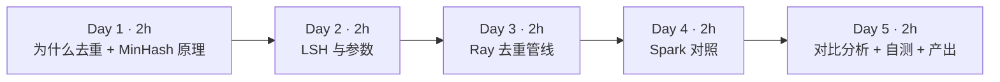

| 天 | 时间 | 先读（概念） | 再读（外部资料） | 再做（实验） |
|---|---|---|---|---|
| Day 1 | ~2h | 本页 2.1、2.2 | ① [Deduplicating Training Data Makes Language Models Better](https://arxiv.org/abs/2107.06499) 读摘要、第 1 节引言和第 2 节对重复现象的分析（40 分钟） | 实验 1：minhash_demo.py |
| Day 2 | ~2h | 本页 2.3、2.4 | ② [BigCode：Large-scale Near-deduplication](https://huggingface.co/blog/dedup) 读 *MinHash Walkthrough* 下的 Shingles、Fingerprint Computation、Locality Sensitive Hashing（40 分钟）；③ [datasketch MinHash LSH 文档](https://ekzhu.com/datasketch/lsh.html)（15 分钟） | 实验 2：近似重复的真实 Jaccard |
| Day 3 | ~2h | 本页 2.5 | ④ [Ray：GroupedData.map_groups API](https://docs.ray.io/en/latest/data/api/doc/ray.data.grouped_data.GroupedData.map_groups.html)（10 分钟） | 实验 3：dedup_ray.py 两种分桶写法 |
| Day 4 | ~2h | 本页 2.6 | ⑤ [Spark ML：Locality Sensitive Hashing](https://spark.apache.org/docs/latest/ml-features.html#locality-sensitive-hashing) 一节，含 *MinHash for Jaccard Distance* 与 *Approximate Similarity Join*（25 分钟） | 实验 4：dedup_spark.py |
| Day 5 | ~2h | 本页 2.7 | ⑥ [datatrove minhash.py](https://github.com/huggingface/datatrove/blob/main/src/datatrove/pipeline/dedup/minhash.py) 浏览配置类与四个阶段（30 分钟） | 实验 5：调参 b=32,r=4；自测题；产出 |

**每日打卡：**

- [ ] Day 1：读完 ①，跑通实验 1，能说出 MinHash 的核心性质
- [ ] Day 2：读完 ②③，跑通实验 2，能用公式算出 b=16,r=8 时 s=0.635 的候选概率
- [ ] Day 3：跑通实验 3，两种分桶写法结果一致，耗时差 20 倍以上
- [ ] Day 4：装好 JDK 17 + PySpark，跑通实验 4
- [ ] Day 5：完成实验 5、自测题、本周产出

---

## 2. 核心概念讲解

### 2.1 为什么要去重

Lee 等人在 ① 中发现，常用语料（C4 等）里存在大量重复：同一段模板文本出现成千上万次，训练集与验证集之间也有重叠。论文结论包括：去重后模型**逐字复述训练数据**的比例显著下降、以更少的训练步数达到相同或更好的效果，同时评测结果因减少训练/测试泄漏而更可信。

| 重复类型 | 例子 | 方法 | 成本 |
|---|---|---|---|
| 完全重复 | 同一页面被抓取多次、镜像站 | 文本哈希（md5/sha1）+ groupby | 低：一次 shuffle |
| 近似重复 | 转载时改了几个词、加了页脚、日期不同 | **MinHash + LSH** | 中：签名计算 + 分桶 shuffle |
| 子串重复 | 不同页面共享的长段落（版权声明） | 后缀数组精确子串去重（①的 ExactSubstr） | 高 |
| 语义重复 | 意思相同、措辞完全不同 | 向量嵌入 + 聚类（如 SemDeDup） | 很高：需要 GPU |

数仓视角：精确去重就是 `SELECT ... GROUP BY md5(text)`；近似去重相当于在没有主键的情况下做“模糊实体解析（entity resolution）”——你可能在客户主数据（MDM）项目里遇到过同一问题。

### 2.2 MinHash：用一个数估计 Jaccard

**第一步：shingling。** 把文档变成集合：按词切分，取所有连续 5 个词（5-gram，称为 shingle）。两篇文档的相似度定义为 Jaccard：

$$J(A,B)=\frac{|A\cap B|}{|A\cup B|}$$

直接两两计算 Jaccard 是 O(N²)：5 万篇就有 12.5 亿对，Common Crawl 级别（数十亿篇）根本不可能。

**第二步：MinHash。** 取一个随机哈希函数 h，对集合中所有元素求哈希，取最小值 `min_h(A)`。关键性质：

$$P[\min_h(A)=\min_h(B)] = J(A,B)$$

**直觉证明**：把 A∪B 中所有元素按 h 值排序，排第一的元素是 A∪B 中均匀随机的一个。它同时属于 A 和 B（即两个最小值相等）的概率，恰好是 |A∩B|/|A∪B|。

**第三步：签名。** 用 k 个独立哈希函数，得到长度为 k 的签名向量。两个签名对应位置相等的比例就是 J 的无偏估计，标准误约为 $\sqrt{J(1-J)/k}$。k=128、J=0.5 时约 0.044。实验 1 中真实 J=0.523，k=16 估出 0.312，k=128 估出 0.547，k=256 估出 0.500——**k 越大越准**，但签名越长，存储和计算越多。

| 你熟悉的 | MinHash | 共同点 |
|---|---|---|
| HyperLogLog（估 distinct count） | MinHash（估 Jaccard） | 都是“概率草图（sketch）”：用固定大小的摘要代替整个集合 |
| Bloom Filter | LSH 分桶 | 都允许少量误差换取巨大的空间与时间节省 |

### 2.3 LSH：用分桶避免两两比较

有了签名仍然要两两比较。LSH（局部敏感哈希）的办法是：把 k=b×r 个哈希值切成 **b 个 band，每个 band r 行**；对每个 band 的 r 个值求一次哈希作为“桶号”。**任意一个 band 落入同一个桶**，这两篇就成为候选对。

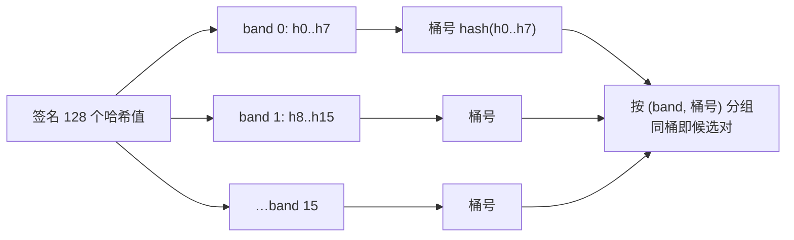

相似度为 s 的一对文档：一个 band 完全相同的概率是 $s^r$；b 个 band 至少一个相同：

$$P(\text{候选}) = 1-(1-s^r)^b$$

这是一条 S 形曲线，阈值（陡升点）约为 $(1/b)^{1/r}$。实验 1 的真实计算（k=128）：

| s | b=32,r=4 | b=16,r=8 | b=8,r=16 |
|---|---|---|---|
| 0.5 | 0.873 | 0.061 | 0.000 |
| 0.7 | 1.000 | 0.613 | 0.026 |
| 0.8 | 1.000 | 0.947 | 0.204 |
| 0.9 | 1.000 | 1.000 | 0.806 |
| 阈值近似 | 0.420 | 0.707 | 0.878 |

- **r 大（AND 放大）**：每个 band 更难相同 → 更少误报，但漏报增多。
- **b 大（OR 放大）**：机会更多 → 召回更高，但候选对更多。
- 在 shuffle 视角下：每篇文档产生 b 行 `(band, 桶号, doc_id)`，按 `(band, 桶号)` 分组。这就是一次标准的 **groupBy shuffle**，数据量是文档数 × b。

### 2.4 从候选对到删除：验证与连通分量

1. **（可选）验证**：对每个候选对计算真实 Jaccard（或签名估计），低于阈值则丢弃。BigCode 博客讨论过这一步的取舍：验证可以去掉误报，但代价不小。Spark 的 `approxSimilarityJoin` 内置了这一步（按距离阈值过滤）。
2. **连通分量**：A~B、B~C 时，A、B、C 应归为一簇，只保留一篇。小规模可在 Driver 用 union-find；大规模需要分布式连通分量（如 GraphFrames 或 datatrove 的专门阶段）。
3. **选择保留哪篇**：本周保留 id 最小的。生产中常保留质量分最高或抓取最早的。

### 2.5 Ray Data 实现：哪一步该交给谁

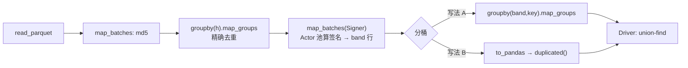

实验 3 的真实数字揭示了本周最重要的工程结论：

| 步骤 | Ray Data | 说明 |
|---|---|---|
| 精确去重（~47k 组的 groupby.map_groups） | 23.4s | 每组调用一次 Python 函数 |
| 签名 + 分桶，写法 A（~75 万行 groupby.map_groups） | **235.5s** | 75 万个小组，逐组调用 Python |
| 签名 + 分桶，写法 B（签名在 Ray 上，分桶在 Driver 用 pandas 向量化） | **9.9s** | 结果完全相同 |

单进程测量：2,000 篇文档做 shingle 用 0.50s、`MinHash.bulk` 用 0.60s，推算 4.7 万篇的签名总计算量约 26 CPU·秒，4 个 Actor 并行约 7 秒。也就是说写法 A 的两百多秒**几乎全花在了 groupby + 逐组 Python 调用上**。`map_groups` 的 API 文档也指出它要先按 key 做 shuffle 再对每组调用你的函数——组越多越小，开销越高。

写法 B 能用，是因为 band 表很窄（3 列、约 75 万行）可以放进单机内存；数据量放大 1000 倍时它就不成立了。那时有两条路：用聚合算子（如对 `(band,key)` 做 `count()`，再 join 回去）代替逐组 Python，或者把这一步交给 Spark。

### 2.6 Spark 实现：MinHashLSH 与 approxSimilarityJoin

Spark ML 自带 `MinHashLSH`：`RegexTokenizer → NGram(5) → HashingTF(binary) → MinHashLSH`，再用 `approxSimilarityJoin(A, B, 阈值)` 直接得到“Jaccard 距离 ≤ 阈值”的对。需要注意的两点（来自 Spark 官方文档）：

- **只有 OR 放大**：`numHashTables` 是 band 数，每个 band 当前固定 1 行（r=1）。文档原话说未来版本会实现 AND 放大。所以 Spark 的候选对很多，靠内置的距离验证过滤，代价是更多 shuffle 和计算。
- **空集合不能做 MinHash**：输入向量至少要有一个非零元素。本周代码过滤掉了不足 6 个词的文档，否则会报错。

| 维度 | Ray Data（实验 3 写法 B） | Spark（实验 4） |
|---|---|---|
| 精确去重 | 23.4s（map_groups） | **4.3s**（原生 groupBy + min，JVM 内执行，有 Catalyst 优化） |
| 近似去重 | **9.9s**（b=16,r=8，无验证） | 103.2s（8 张表 r=1 + 距离验证） |
| 召回（注入 2,000 条） | 741 条 | 1,843 条（阈值 J≥0.6） |
| 误删（非注入行） | 1 条 | 0 条（有验证） |

**这两列不是“谁更快”的比赛**：两边参数不同（阈值约 0.71 vs 0.6，有无验证），召回也不同。可以得出的结论是：

1. **原生 shuffle/聚合**：Spark 远比“Ray Data + 逐组 Python”高效。
2. **灵活的 Python 计算**（任意库、Actor 状态、GPU）：Ray 更自然。签名计算用 datasketch 很直接；在 Spark 里要么用内置的 r=1 方案，要么写 pandas UDF。
3. 生产中常见的组合是：**Spark 负责大规模 join/groupby/去重，Ray 负责模型推理、打分、tokenize 等异构计算**，中间用 Parquet 交接。这正是你作为大数据架构师的价值所在。

### 2.7 生产参数参考

| 方案 | shingle | 签名 | bands × rows | 备注 |
|---|---|---|---|---|
| 本周实验 | 5 词 | 128 | 16×8（及 32×4） | 阈值约 0.71 / 0.42 |
| datatrove `MinhashConfig`（看源码默认值） | 见源码 `n_grams` | 见源码 | 见源码 `num_buckets`、`hashes_per_bucket` | 分 4 个阶段：签名、分桶、聚类、过滤 |
| FineWeb 博客 | 5-gram | 112 | 14×8 | 博客中给出，目标约 75% 相似度 |

> datatrove 默认值可能随版本变化，以你阅读时的源码为准，所以本表不抄具体数字（FineWeb 一行来自其博客 *Deduplicating the data* 一节）。

---

## 3. 动手实验 {{local}}

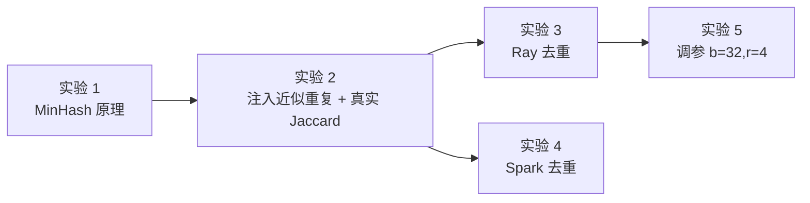

### 环境准备（20 分钟）

```bash
cd ~/ai-infra-lab && source .venv/bin/activate && mkdir -p w7 && cd w7
uv pip install "datasketch==2.0.0" "pyspark==4.2.0"
# Spark 需要 Java 17+。Mac：
brew install openjdk@17
export JAVA_HOME="$(brew --prefix openjdk@17)/libexec/openjdk.jdk/Contents/Home"
# Linux 无 root 时（本站做法）：从 Adoptium 下载 JDK 17 压缩包解压，再设置 JAVA_HOME
java -version
```

本实验依赖第 6 周的输出 `../w6/clean/`（47,451 行）。如果你删除了它，先回到 w6 重跑 `clean_ray.py`。**注意**：w6 实验 4 中 1 CPU 那次会先 `rm -rf clean`，卡死被终止后 `clean/` 就不存在了——本站写本周实验时就踩了这个坑（报错 `ValueError: No objects to concatenate`）。

### 实验 1：MinHash 与 LSH 原理（20 分钟）

```python
"""MinHash 与 LSH 的原理演示：Jaccard 真值 vs MinHash 估计，以及 band/row 的 S 曲线。"""
import re

from datasketch import MinHash

def shingles(text: str, n: int = 5) -> set:
    w = re.findall(r"\w+", text.lower())
    return {" ".join(w[i:i + n]) for i in range(max(1, len(w) - n + 1))}

a = ("Ray Data is a scalable data processing library for ML and AI workloads built on Ray. "
     "It provides flexible and performant APIs for distributed data processing such as batch inference, "
     "data preprocessing and ingest for ML training.")
b = a.replace("scalable", "highly scalable").replace("such as batch inference", "including offline batch inference")
c = "Apache Spark is a multi-language engine for executing data engineering, data science, and machine learning on single-node machines or clusters."

def mh(s, num_perm):
    m = MinHash(num_perm=num_perm, seed=1)
    for x in s:
        m.update(x.encode())
    return m

sa, sb, sc = shingles(a), shingles(b), shingles(c)
print(f"shingle 数: a={len(sa)} b={len(sb)} c={len(sc)}")
for name, x, y in [("a-b", sa, sb), ("a-c", sa, sc)]:
    true = len(x & y) / len(x | y)
    est = "  ".join(f"k={k}:{mh(x, k).jaccard(mh(y, k)):.3f}" for k in (16, 64, 128, 256))
    print(f"{name} 真实 Jaccard={true:.3f}  MinHash 估计 {est}")

print("\nLSH 候选概率 P = 1-(1-s^r)^b  （num_perm = b*r = 128）")
print("   s   " + "  ".join(f"b={b:>2},r={r:>2}" for b, r in [(32, 4), (16, 8), (8, 16)]))
for s in (0.3, 0.5, 0.7, 0.8, 0.9):
    print(f"  {s:.1f}  " + "  ".join(f"{1 - (1 - s ** r) ** b:>10.3f}" for b, r in [(32, 4), (16, 8), (8, 16)]))
for b, r in [(32, 4), (16, 8), (8, 16)]:
    print(f"b={b},r={r} 阈值近似 (1/b)^(1/r) = {(1 / b) ** (1 / r):.3f}")
```

**本站输出：**

```text
shingle 数: a=33 b=34 c=18
a-b 真实 Jaccard=0.523  MinHash 估计 k=16:0.312  k=64:0.641  k=128:0.547  k=256:0.500
a-c 真实 Jaccard=0.000  MinHash 估计 k=16:0.000  k=64:0.000  k=128:0.000  k=256:0.000

LSH 候选概率 P = 1-(1-s^r)^b  （num_perm = b*r = 128）
   s   b=32,r= 4  b=16,r= 8  b= 8,r=16
  0.3       0.229       0.001       0.000
  0.5       0.873       0.061       0.000
  0.7       1.000       0.613       0.026
  0.8       1.000       0.947       0.204
  0.9       1.000       1.000       0.806
b=32,r=4 阈值近似 (1/b)^(1/r) = 0.420
b=16,r=8 阈值近似 (1/b)^(1/r) = 0.707
b=8,r=16 阈值近似 (1/b)^(1/r) = 0.878
```

**逐步解释**：b 只改了两处措辞，Jaccard 就只剩 0.52——每改一个词会破坏包含它的最多 5 个 shingle。所以 **5-gram Jaccard 对改动非常敏感**，阈值不能定得太高。k=16 的估计误差很大（0.312 vs 0.523），k=64 也偏高，k≥128 才比较稳定。

### 实验 2：注入近似重复，测真实 Jaccard（20 分钟）

FineWeb 本身已去重，第 6 周注入的重复全是“完全重复”。为了测试近似去重，`make_neardup.py` 随机挑 2,000 篇，替换约 5% 的词并加一行页脚：

```python
"""在第 6 周的 clean/ 基础上，再注入 2,000 条“近似重复”：随机改写约 5% 的词并加一段页脚。"""
import glob

import numpy as np
import pandas as pd
import pyarrow as pa
import pyarrow.parquet as pq

rng = np.random.default_rng(42)
df = pd.concat([pd.read_parquet(f) for f in sorted(glob.glob("../w6/clean/*.parquet"))], ignore_index=True)
df = df[["id", "url", "text"]]
src = df.sample(2000, random_state=42)

def perturb(t: str) -> str:
    w = t.split()
    for i in rng.choice(len(w), max(1, len(w) // 20), replace=False):
        w[i] = rng.choice(["data", "the", "new", "great", "info", "more"])
    return " ".join(w) + "\nShare this article on social media."

nd = src.assign(id=src["id"] + "-near", text=src["text"].map(perturb))
out = pd.concat([df, nd], ignore_index=True).sample(frac=1, random_state=42).reset_index(drop=True)
import os; os.makedirs("input", exist_ok=True)
for i, idx in enumerate(np.array_split(np.arange(len(out)), 8)):
    pq.write_table(pa.Table.from_pandas(out.iloc[idx], preserve_index=False), f"input/part-{i}.parquet")
print(f"输入行数 {len(out)} = 清洗后 {len(df)} + 近似重复 {len(nd)}")
print("其中 id 带 -dup（第 6 周注入的完全重复）:", df["id"].str.endswith("-dup").sum())
```

```text
输入行数 49451 = 清洗后 47451 + 近似重复 2000
其中 id 带 -dup（第 6 周注入的完全重复）: 2255
```

（第 6 周注入了 2,500 条完全重复，其中 245 条是“脏行的复制品”，已被质量过滤拦掉。）

再算这 2,000 对的真实 Jaccard：

```python
"""注入的近似重复与原文之间的真实 Jaccard 分布：解释为什么阈值 0.7 时只抓到一部分。"""
import glob, re
import numpy as np, pandas as pd

def shingles(text, n=5):
    w = re.findall(r"\w+", text.lower())
    return {" ".join(w[i:i + n]) for i in range(max(1, len(w) - n + 1))}

df = pd.concat([pd.read_parquet(f) for f in glob.glob("input/*.parquet")]).set_index("id")
near = [i for i in df.index if i.endswith("-near")]
js = np.array([len((a := shingles(df.at[i[:-5], "text"])) & (b := shingles(df.at[i, "text"]))) / len(a | b) for i in near])
print(f"近似重复对 {len(js)} 个，Jaccard 中位数 {np.median(js):.3f}，均值 {js.mean():.3f}")
for lo, hi in [(0, .5), (.5, .6), (.6, .7), (.7, .8), (.8, 1.01)]:
    print(f"  [{lo:.1f}, {min(hi,1):.1f}) {((js >= lo) & (js < hi)).sum():5d}")
```

```text
近似重复对 2000 个，Jaccard 中位数 0.635，均值 0.635
  [0.0, 0.5)     0
  [0.5, 0.6)   143
  [0.6, 0.7)  1824
  [0.7, 0.8)    33
  [0.8, 1.0)     0
```

**先做预测**（这是本周最重要的练习）：改 5% 的词，一个 shingle 的 5 个词都没被改的概率约 0.95⁵ ≈ 0.77，所以 J ≈ 0.77/(2−0.77) ≈ 0.63，和实测 0.635 吻合。b=16,r=8 时：P = 1−(1−0.635⁸)¹⁶ ≈ 1−(1−0.0265)¹⁶ ≈ **0.35**。即预期大约只能抓到 700 条。下面验证。

### 实验 3：Ray Data 去重管线（50 分钟）

```python
"""Ray Data 版去重：① 精确去重（文本哈希）② MinHash + LSH 近似去重（band 分桶 + 连通分量）。"""
import argparse
import hashlib
import re
import time

import numpy as np
import pandas as pd
import ray
from datasketch import MinHash

ap = argparse.ArgumentParser()
ap.add_argument("--cpus", type=int, default=4)
ap.add_argument("--bands", type=int, default=16)
ap.add_argument("--rows", type=int, default=8)
ap.add_argument("--bucket", choices=["ray", "driver"], default="driver")
a = ap.parse_args()
NUM_PERM = a.bands * a.rows
ray.init(num_cpus=a.cpus, include_dashboard=False, log_to_driver=False)
ray.data.DataContext.get_current().enable_progress_bars = False

def shingles(text, n=5):
    w = re.findall(r"\w+", text.lower())
    return {" ".join(w[i:i + n]) for i in range(max(1, len(w) - n + 1))}

def add_hash(df: pd.DataFrame) -> pd.DataFrame:
    df["h"] = [hashlib.md5(t.encode()).hexdigest() for t in df["text"]]
    return df

class Signer:                                      # 类 UDF：每个 Actor 只做一次初始化
    def __init__(self):
        self.num_perm = NUM_PERM
    def __call__(self, df: pd.DataFrame) -> pd.DataFrame:
        sigs = MinHash.bulk([[s.encode() for s in shingles(t)] for t in df["text"]],
                            num_perm=self.num_perm, seed=1)     # 同一 seed → 所有 Actor 用同一组哈希函数
        rows = []
        for doc_id, m in zip(df["id"], sigs):
            hv = m.hashvalues
            for b in range(a.bands):               # 每个 band 一行：(band 号, band 内 r 个哈希值的摘要, 文档 id)
                key = hashlib.md5(hv[b * a.rows:(b + 1) * a.rows].tobytes()).hexdigest()[:16]
                rows.append((b, key, doc_id))
        return pd.DataFrame(rows, columns=["band", "key", "id"])

t0 = time.time()
ds = ray.data.read_parquet("input")
n_in = ds.count()

# ① 精确去重：同一哈希只保留 id 最小的一条
hashed = ds.map_batches(add_hash, batch_format="pandas").materialize()
keep = hashed.groupby("h").map_groups(lambda g: g.sort_values("id").head(1), batch_format="pandas")
exact = keep.drop_columns(["h"]).materialize()
n_exact = exact.count()
t1 = time.time()
print(f"输入 {n_in} 行 → 精确去重后 {n_exact} 行（去掉 {n_in - n_exact}），{t1 - t0:.1f}s")

# ② MinHash 签名 + LSH 分桶
bands = exact.map_batches(Signer, batch_format="pandas", compute=ray.data.ActorPoolStrategy(size=a.cpus))
if a.bucket == "ray":       # 写法 A：分桶也交给 Ray（groupby + map_groups，每个桶调用一次 Python 函数）
    buckets = bands.groupby(["band", "key"]).map_groups(
        lambda g: g if len(g) > 1 else g.iloc[0:0], batch_format="pandas")   # 只保留有碰撞的桶
    coll = buckets.to_pandas()
else:                      # 写法 B：签名在 Ray 上并行算，band 表（每文档 b 行、很窄）拉回 Driver 用 pandas 向量化分桶
    bt = bands.to_pandas()
    coll = bt[bt.duplicated(["band", "key"], keep=False)]
t2 = time.time()

# ③ 连通分量（Driver 上 union-find；碰撞边很少，可以放在单机）
parent = {}
def find(x):
    while parent.setdefault(x, x) != x:
        parent[x] = parent[parent[x]]
        x = parent[x]
    return x
for _, g in coll.groupby(["band", "key"]):
    ids = sorted(g["id"])
    for o in ids[1:]:
        ra, rb = find(ids[0]), find(o)
        if ra != rb:
            parent[max(ra, rb)] = min(ra, rb)
groups = {}
for x in parent:
    groups.setdefault(find(x), []).append(x)
drop = {x for root, mem in groups.items() for x in mem if x != root}
n_final = n_exact - len(drop)
print(f"MinHash(b={a.bands},r={a.rows},num_perm={NUM_PERM}) 碰撞行 {len(coll)}，重复簇 {len(groups)}，"
      f"删除 {len(drop)} → 最终 {n_final} 行，{t2 - t1:.1f}s（签名+分桶，分桶方式={a.bucket}）")
near = sum(x.endswith("-near") for x in drop)
print(f"删除的行中 -near 结尾 {near} 条（共注入 2000）；其他 {len(drop) - near} 条")
print(f"总用时 {time.time() - t0:.1f}s")
```

```bash
python dedup_ray.py                 # 写法 B（默认）：分桶在 Driver
python dedup_ray.py --bucket ray    # 写法 A：分桶用 Ray groupby.map_groups
```

**本站输出（写法 B）：**

```text
输入 49451 行 → 精确去重后 47194 行（去掉 2257），23.4s
MinHash(b=16,r=8,num_perm=128) 碰撞行 1924，重复簇 740，删除 742 → 最终 46452 行，9.9s（签名+分桶，分桶方式=driver）
删除的行中 -near 结尾 741 条（共注入 2000）；其他 1 条
总用时 33.5s
```

**本站输出（写法 A，修改前的版本，计数相同）：**

```text
输入 49451 行 → 精确去重后 47194 行（去掉 2257），23.5s
MinHash(b=16,r=8,num_perm=128) 碰撞行 1924，重复簇 740，删除 742 → 最终 46452 行，235.5s（签名+分桶）
删除的行中 -near 结尾 741 条（共注入 2000）；其他 1 条
总用时 259.1s
```

**逐步解释：**

- **精确去重删掉 2,257 行**：2,255 条注入的 `-dup`，外加 2 条 FineWeb 原本就存在的完全重复。
- **近似去重抓到 741/2000 = 37%**，与预测的 35% 吻合。这就是 LSH 公式的威力：**上线之前就能算出召回率**。
- **两种写法结果完全相同，耗时 9.9s vs 235.5s**：见 2.5 节。
- `Signer` 用类 UDF（Actor 池），`MinHash.bulk(..., seed=1)` 保证所有 Actor 使用同一组哈希函数——**如果不同 worker 的 seed 不同，签名之间就无法比较**，这是分布式 MinHash 最容易犯的错误。

### 实验 4：Spark 对照（40 分钟）

```python
"""PySpark 对照版：精确去重 + Spark ML MinHashLSH 近似去重（Jaccard 相似度 ≥ 0.6）。"""
import time

from pyspark.ml import Pipeline
from pyspark.ml.feature import HashingTF, MinHashLSH, NGram, RegexTokenizer
from pyspark.sql import SparkSession, functions as F

spark = (SparkSession.builder.master("local[4]").appName("dedup")
         .config("spark.driver.memory", "4g").config("spark.sql.shuffle.partitions", "16").getOrCreate())
spark.sparkContext.setLogLevel("ERROR")
t0 = time.time()
df = spark.read.parquet("input")
n_in = df.count()

# ① 精确去重：按文本 md5，保留 id 最小的一条
exact = (df.withColumn("h", F.md5("text"))
           .groupBy("h").agg(F.min("id").alias("id"), F.first("text").alias("text")).drop("h").cache())
n_exact = exact.count()
t1 = time.time()
print(f"输入 {n_in} 行 → 精确去重后 {n_exact} 行（去掉 {n_in - n_exact}），{t1 - t0:.1f}s")

# ② 特征：词 → 5-gram → 稀疏向量（二值）→ MinHashLSH
pipe = Pipeline(stages=[
    RegexTokenizer(inputCol="text", outputCol="words", pattern=r"\W+", toLowercase=True),
    NGram(n=5, inputCol="words", outputCol="grams"),
    HashingTF(inputCol="grams", outputCol="feat", numFeatures=1 << 22, binary=True),
    MinHashLSH(inputCol="feat", outputCol="hashes", numHashTables=8, seed=1),
])
feat = exact.filter(F.size(F.split("text", r"\W+")) >= 6)   # 至少要有一个 5-gram，否则向量为空会报错
model = pipe.fit(feat)
vec = model.transform(feat).cache()
pairs = (model.stages[-1].approxSimilarityJoin(vec, vec, 0.4, distCol="dist")   # Jaccard 距离 ≤ 0.4
         .select(F.col("datasetA.id").alias("a"), F.col("datasetB.id").alias("b"), "dist")
         .filter("a < b").cache())
drop = pairs.select(F.col("b").alias("id")).distinct()        # 简化：每对删掉 id 较大的（未做连通分量）
d = drop.toPandas()
n_pairs = pairs.count()
t2 = time.time()
near = d["id"].str.endswith("-near").sum()
print(f"MinHashLSH(numHashTables=8) 相似对 {n_pairs}，删除 {len(d)} → 最终 {n_exact - len(d)} 行，{t2 - t1:.1f}s")
print(f"删除的行中 -near 结尾 {near} 条（共注入 2000）；其他 {len(d) - near} 条")
print(f"总用时 {time.time() - t0:.1f}s")
```

**本站输出：**

```text
输入 49451 行 → 精确去重后 47194 行（去掉 2257），4.3s
MinHashLSH(numHashTables=8) 相似对 1843，删除 1843 → 最终 45351 行，103.2s
删除的行中 -near 结尾 1843 条（共注入 2000）；其他 0 条
总用时 107.5s
```

运行时还会出现：`FutureWarning: PySpark does not yet fully support pandas >= 3.0.0.`——PySpark 4.2.0 尚未完全适配 pandas 3，本实验只在 `toPandas()` 处用到，结果不受影响。

**逐步解释：**

- **精确去重 4.3s vs Ray 23.4s**：Spark 的 groupBy + `min` 在 JVM 内部用哈希聚合完成，没有逐组 Python 调用。
- **近似去重**：阈值是 Jaccard 距离 ≤ 0.4（相似度 ≥ 0.6），2,000 对中真实 J≥0.6 的有 1,857 对，Spark 找到 1,843 对，召回 99%，且**零误删**（内置距离验证）。代价是 103 秒：r=1 时候选对非常多，join 的计算和 shuffle 都很重。
- **简化之处**：直接删除每对中 id 较大的一方，没有做连通分量。对这批数据（每簇只有两篇）没有影响；簇更大时会误删或漏删，扩展练习 3 要你补上。
- 第一版代码在两处 action 都会重算 join（`toPandas` 和 `count` 各一次），总用时 121.7s；给 `pairs` 加 `.cache()` 后降到 107.5s。和你调 Spark 作业时一样：**多个 action 共享的中间结果要 cache**。

### 实验 5：调参，用 b=32,r=4 提高召回（20 分钟）

```bash
python dedup_ray.py --bands 32 --rows 4 --bucket ray
```

**本站输出（写法 A）：**

```text
输入 49451 行 → 精确去重后 47194 行（去掉 2257），24.0s
MinHash(b=32,r=4,num_perm=128) 碰撞行 21795，重复簇 2024，删除 2075 → 最终 45119 行，438.5s（签名+分桶）
删除的行中 -near 结尾 1992 条（共注入 2000）；其他 83 条
总用时 463.1s
```

**逐步解释：** 阈值降到约 0.42，召回升到 1992/2000 = 99.6%；但碰撞行从 1,924 涨到 21,795，还额外删除了 83 条非注入行。这些可能是 FineWeb 里本就存在的近似重复（例如同一站点模板很相似的页面），也可能是误报——**没有验证步骤就无法区分**。扩展练习 2 要你对这 83 条计算真实 Jaccard 并抽样人工检查。（用写法 B 跑这组参数，结果相同、用时短得多，请你自己测。）

### 常见错误与排查

| 现象（真实报错） | 原因 | 解决 |
|---|---|---|
| `ValueError: scheme must be specified explicitly when initializing from existing hash values or permutations ...`（本站实测） | datasketch 2.0 改变了从已有 permutations 构造 MinHash 的 API；网上旧教程多为 1.x 写法 | 用 `MinHash.bulk(..., seed=1)` 批量生成，或按提示显式传 `scheme` |
| `ValueError: No objects to concatenate`（本站实测） | 输入目录为空（w6 的 `clean/` 被删除） | 重跑 w6 `clean_ray.py` |
| 去重结果每次都不一样 / 几乎没有碰撞 | 不同 worker 的哈希 seed 不同 | 固定 seed，所有 worker 共用同一组哈希函数 |
| Spark 报错要求向量至少一个非零元素（官方文档注明空集合不能做 MinHash） | 文本太短，没有 5-gram | 先过滤短文本（本周代码 `size(split) >= 6`） |
| `FutureWarning: PySpark does not yet fully support pandas >= 3.0.0`（本站实测） | 版本适配滞后 | 本实验可忽略；生产中 Spark 环境用 pandas 2.x |
| Spark 日志 `Retried waiting for GCLocker too often allocating ...`（本站实测） | JVM 堆紧张 | 加大 `spark.driver.memory`，或减小 `numFeatures` |
| Ray 作业耗时远超预期 | groupby + map_groups 在大量小组上逐组调用 Python | 改用聚合算子、向量化处理，或交给 Spark |

### 扩展练习

1. **验证步骤**：在 Ray 版中为候选对计算签名估计的 Jaccard，丢弃 < 0.6 的，比较 b=32,r=4 时“其他 83 条”还剩多少。
2. **误报分析**：把那 83 条和它们的“同簇伙伴”打印出来，人工判断是真重复还是误报，写进报告。
3. **连通分量**：Spark 版加上连通分量（可用 GraphFrames，或迭代式标签传播），并构造一个三篇一簇的测试用例。
4. **向量化分桶**：不把 band 表拉回 Driver，而是用 Ray Data 的 `groupby(["band","key"]).count()` 加 join 实现写法 C，测耗时。
5. **参数选择**：如果业务要求“相似度 ≥ 0.8 的召回 ≥ 95%、≤ 0.5 的候选概率 ≤ 5%”，用公式搜索满足条件的 (b, r)，再实测验证。

---

## 4. 精读指南

### ① Deduplicating Training Data Makes Language Models Better（40 分钟）

[arXiv 2107.06499](https://arxiv.org/abs/2107.06499)

- **读哪里**：摘要、引言、对重复现象的统计；方法部分只需理解 ExactSubstr（后缀数组）和 NearDup（MinHash）各自的定位。
- **读完回答**：① 论文发现的“训练集—验证集重叠”会造成什么问题？② 去重对模型复述训练文本有什么影响？

### ② BigCode 近似去重博客（40 分钟）

[Large-scale Near-deduplication Behind BigCode](https://huggingface.co/blog/dedup)

- **读哪里**：*MinHash Walkthrough* 下的 *Shingles*、*Fingerprint Computation*、*Locality Sensitive Hashing*，以及参数表。
- **读完回答**：① 他们用什么方法把候选对聚成簇？② 文中如何讨论“是否需要验证候选对”？

### ③ datasketch MinHash LSH 文档（15 分钟）

[链接](https://ekzhu.com/datasketch/lsh.html)。**读完回答**：datasketch 的 `MinHashLSH(threshold=...)` 如何根据阈值自动选择 b 和 r？它为什么允许给误报和漏报设置权重？

### ⑤ Spark ML LSH（25 分钟）

[Locality Sensitive Hashing 一节](https://spark.apache.org/docs/latest/ml-features.html#locality-sensitive-hashing)，以及 [MinHashLSH API](https://spark.apache.org/docs/latest/api/python/reference/api/pyspark.ml.feature.MinHashLSH.html)。**读完回答**：`numHashTables` 对应 LSH 的 b 还是 r？文档对 AND 放大的说明是什么？

### ⑥ datatrove minhash.py（30 分钟）

[链接](https://github.com/huggingface/datatrove/blob/main/src/datatrove/pipeline/dedup/minhash.py)，配套 [examples/minhash_deduplication.py](https://github.com/huggingface/datatrove/blob/main/examples/minhash_deduplication.py)。**读完回答**：四个阶段（签名、分桶、聚类、过滤）分别输出什么？它为什么不依赖 Spark/Ray 的 shuffle，而是用文件做中间交换？这与 MapReduce 有何相似？

---

## 5. 自测题

<details>
<summary>1. 为什么“最小哈希相等的概率等于 Jaccard 相似度”？</summary>

在 A∪B 上，随机哈希函数使每个元素等概率成为最小值。最小值元素属于 A∩B 时两个集合的 min 相等，否则不等。所以概率 = |A∩B|/|A∪B| = J。

</details>

<details>
<summary>2. b=16, r=8 时，相似度 0.635 的一对被选为候选的概率是多少？实验验证了吗？</summary>

0.635⁸ ≈ 0.0265；1−(1−0.0265)¹⁶ ≈ 0.35。实验 3 抓到 741/2000 = 37%，与预测吻合。

</details>

<details>
<summary>3. 增大 r、增大 b 分别有什么效果？</summary>

增大 r（AND 放大）让曲线右移、更陡：误报少，漏报多。增大 b（OR 放大）让曲线左移：召回高，候选对多。k=b×r 固定时，两者此消彼长。

</details>

<details>
<summary>4. 为什么所有 worker 必须用同一组哈希函数？</summary>

MinHash 的比较是逐位置进行的：两个签名的第 i 位必须来自同一个哈希函数 hᵢ，否则相等的概率与 Jaccard 无关。分布式实现中通常固定 seed 或广播置换参数。

</details>

<details>
<summary>5. 实验 3 写法 A 和 B 耗时相差 20 多倍，原因是什么？B 的局限是什么？</summary>

A 对约 75 万个 (band, key) 小组做 groupby shuffle，并逐组调用 Python 函数，开销主要在逐组调度和调用上。B 把签名计算（重计算）放在 Ray 上并行，把窄的 band 表拉回 Driver 用 pandas 向量化 `duplicated()`。B 的局限是 band 表必须放得进单机内存。

</details>

<details>
<summary>6. Spark 的 MinHashLSH 与本周 Ray 实现在 LSH 结构上有什么不同？带来什么后果？</summary>

Spark 当前只支持 OR 放大：numHashTables 个 band，每个 band 1 行（r=1），所以候选对很多，需要 approxSimilarityJoin 内置的距离验证来过滤，计算和 shuffle 都更重（实验 4 用了 103s）。本周 Ray 实现 r=8，候选少，但没有验证。

</details>

<details>
<summary>7. 精确去重时 Spark 4.3s、Ray 23.4s，说明了什么？</summary>

Spark 的 groupBy + 聚合函数在 JVM 内用哈希聚合执行，有 Catalyst/Tungsten 优化；Ray 的 `map_groups` 要为每组调用 Python 函数。shuffle 密集、逻辑可用内置聚合表达的任务，Spark 更有优势。

</details>

<details>
<summary>8. 为什么近似去重的结果需要“连通分量”这一步？</summary>

候选关系有传递性：A~B、B~C 时，A 和 C 可能不在同一个桶里，但应归为同一簇。不做连通分量，可能保留重复，或删掉一簇中的全部文档。

</details>

### 思考题

1. **选型**：你要为公司搭建 10 TB 中文网页语料的去重管线。现有一个 Spark on YARN 集群和一个小型 Ray on K8s 集群（带 GPU）。你会怎样分配工作？中间数据如何交接？
2. **参数与业务**：去重过度会删掉合法的相似内容（如不同版本的法律条文），去重不足会让模型“背书”。你如何与算法团队一起确定阈值，又如何用小模型实验验证？
3. **增量去重**：每月新增 1 TB 数据，需要与历史语料去重。你会如何存储历史签名/桶，避免每次全量重算？（提示：类比数仓的增量合并和 HBase 索引。）

---

## 6. 本周产出与掌握清单

### 本周产出

1. **代码**：`minhash_demo.py`、`make_neardup.py`、`near_jaccard.py`、`dedup_ray.py`、`dedup_spark.py`。
2. **`README.md`（月度项目报告的下半部分）**：管线图；精确/近似去重的删除数；LSH 召回“预测 vs 实测”；Ray 与 Spark 对比表（耗时、召回、误删），以及你的结论。
3. **`engine-choice.md`**：一页纸写清“什么任务放 Spark，什么任务放 Ray”，给出至少 3 条判断标准，每条附本周或第 6 周的数据作为证据。

### 掌握清单

- [ ] 能说出精确、近似、子串、语义四类去重及其方法
- [ ] 能推导 MinHash 的核心性质
- [ ] 能用 `1-(1-s^r)^b` 计算候选概率和阈值
- [ ] 能用公式预测召回率，并用实验验证
- [ ] 知道分布式 MinHash 必须固定 seed
- [ ] 跑通 Ray 版两种分桶写法，并解释 20 多倍的耗时差异
- [ ] 跑通 Spark MinHashLSH，知道它只有 OR 放大
- [ ] 能解释连通分量的必要性
- [ ] 能给出 Spark 与 Ray Data 的选型标准，并附数据证据
- [ ] 完成 README.md 与 engine-choice.md

---

## 参考资料

- [Deduplicating Training Data Makes Language Models Better](https://arxiv.org/abs/2107.06499)（论文·进阶）：去重为何重要
- [Large-scale Near-deduplication Behind BigCode](https://huggingface.co/blog/dedup)（博客·进阶）：生产级 MinHash 去重的完整讲解
- [datasketch MinHash LSH](https://ekzhu.com/datasketch/lsh.html)（文档·入门）
- [datasketch MinHash](https://ekzhu.com/datasketch/minhash.html)（文档·入门）
- [Spark ML 特征：Locality Sensitive Hashing](https://spark.apache.org/docs/latest/ml-features.html#locality-sensitive-hashing)（文档·入门）
- [PySpark MinHashLSH API](https://spark.apache.org/docs/latest/api/python/reference/api/pyspark.ml.feature.MinHashLSH.html)（文档·入门）
- [PySpark 安装](https://spark.apache.org/docs/latest/api/python/getting_started/install.html)（文档·入门）
- [Eclipse Temurin JDK 下载](https://adoptium.net/temurin/releases/)（工具·入门）
- [Ray：GroupedData.map_groups](https://docs.ray.io/en/latest/data/api/doc/ray.data.grouped_data.GroupedData.map_groups.html)（文档·入门）
- [datatrove minhash.py](https://github.com/huggingface/datatrove/blob/main/src/datatrove/pipeline/dedup/minhash.py)（仓库·进阶）
- [datatrove MinHash 去重示例](https://github.com/huggingface/datatrove/blob/main/examples/minhash_deduplication.py)（仓库·进阶）

> 完整列表见 [参考资料库](/resources.html)。

=== m2w4 | 第 8 周：ray.data.llm 离线批量推理 | 第 2 月 · Ray + 数据管线
# 第 8 周：用 Ray Data 做 LLM 批量推理（ray.data.llm + vLLM）

> **本周一句话**：把第 6、7 周的“清洗 → 去重”管线接上**模型打分**这一步——用 Ray Data 的 Actor 池在 CPU 上给文档打“教育价值”分（本站实测），再学习官方 `ray.data.llm` + vLLM 在 GPU 上做同样的事（未在本站实测，需 GPU）。核心收获：**批量推理的吞吐由“数据切分 × 副本数 × 每副本并行度 × 批大小”共同决定**，而最常见的坑是数据切分——本周实验里，开 4 个 Actor 却只有 1 个在干活。

**预计投入：约 10 小时**（阅读 ≈ 3h，CPU 动手 ≈ 4h，GPU 动手（可选）≈ 1.5h，自测与产出 ≈ 1.5h）。{{gpu1}}

**本周结束时你应该能：**

1. 说清离线批量推理（offline batch inference）与在线服务（online serving）在目标、指标和架构上的差异。
2. 用 `map_batches` + 类 UDF + `ActorPoolStrategy` 写一个 CPU 批量推理作业，并解释每个参数对吞吐的影响。
3. 诊断“Actor 开了却没活干”：block 数 < Actor 数时的并行度上限。
4. 读懂 `ray.data.llm` 的处理器流水线（Preprocess → ChatTemplate → Tokenize → vLLM Engine → Detokenize → Postprocess），知道每个阶段是一个独立的 Actor 池。
5. 为一个 GPU 批量推理作业做容量估算，并列出 OOM 时的调参顺序。

> **验证说明**：第 3 节实验 1–3 在 Linux x86_64（8 核、无 GPU）上实际运行：Python 3.12.15、ray 2.59.0、torch 2.14.1+cpu、transformers 5.20.2，模型为 [HuggingFaceFW/fineweb-edu-classifier](https://huggingface.co/HuggingFaceFW/fineweb-edu-classifier)（约 0.1B 参数）。输出为真实结果，耗时含模型加载、因机器而异。**实验 4（vLLM）未在本站实测，需 GPU**：代码取自 Ray 官方文档，没有贴任何输出。代码在仓库 `labs/w8/`。

---

## 1. 本周学习路线

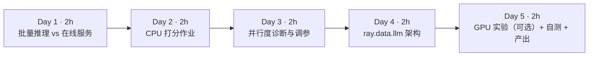

| 天 | 时间 | 先读 | 再读（外部资料） | 再做 |
|---|---|---|---|---|
| Day 1 | ~2h | 本页 2.1、2.2 | ① [Ray Data：End-to-end: Offline Batch Inference](https://docs.ray.io/en/latest/data/batch_inference.html)（30 分钟）；② [fineweb-edu-classifier 模型卡](https://huggingface.co/HuggingFaceFW/fineweb-edu-classifier)（15 分钟） | 环境准备，下载模型 |
| Day 2 | ~2h | 本页 2.3 | ③ [Transforming Data](https://docs.ray.io/en/latest/data/transforming-data.html) 回顾 *Stateful transforms*（15 分钟） | 实验 1：edu_score.py |
| Day 3 | ~2h | 本页 2.4 | — | 实验 2：并行度网格；实验 3：block 诊断 |
| Day 4 | ~2h | 本页 2.5、2.6 | ④ [Ray Data：Working with LLMs](https://docs.ray.io/en/latest/data/working-with-llms.html) 读 *Quickstart*、*Processor architecture*、*Scaling to multiple GPUs*、*Classification*、*Troubleshooting*（50 分钟）；⑤ [ray.data.llm API](https://docs.ray.io/en/latest/data/api/llm.html)（10 分钟） | — |
| Day 5 | ~2h | 本页 2.7 | ⑥ [vLLM 文档](https://docs.vllm.ai/en/latest/) 首页与快速开始（20 分钟） | 实验 4（有 GPU 时）；自测；产出 |

**每日打卡：**

- [ ] Day 1：读完 ①②，能说出离线推理与在线服务的三点区别
- [ ] Day 2：跑通实验 1，得到 int_score 分布
- [ ] Day 3：跑通实验 2、3，能解释“4 个 Actor 反而最慢”
- [ ] Day 4：读完 ④⑤，能画出 ray.data.llm 处理器流水线
- [ ] Day 5：完成自测题与产出（GPU 实验可选）

---

## 2. 核心概念讲解

### 2.1 离线批量推理 vs 在线服务

| 维度 | 离线批量推理（本周） | 在线服务（第 4 月） |
|---|---|---|
| 目标 | **吞吐**：单位成本处理尽可能多的数据 | **延迟**：TTFT、每 token 延迟、P99 |
| 输入 | 一个数据集（Parquet/对象存储） | 一个个用户请求 |
| 批处理 | 大批量、可以重排、可以等待 | 连续批处理（continuous batching），不能让用户等 |
| 失败处理 | 重试 block、断点续跑 | 请求级重试、降级 |
| 典型场景 | 质量打分、合成数据、嵌入、离线评测、标注 | 聊天、API |
| 大数据类比 | Spark 批作业 | 在线查询服务（HBase/Druid） |

LLM 数据管线中，模型打分放在漏斗最后：FineWeb-Edu 就是用分类器给 FineWeb 打分，保留高分文档。模型卡写明：分类器用 Llama3-70B-Instruct 生成的 45 万条标注训练，在 Snowflake-arctic-embed 上加回归头；建议用 `int_score >= 3` 作为筛选阈值。

### 2.2 为什么批量推理要用 Ray 而不是 Spark

1. **异构资源**：读、解码、分词用 CPU，模型用 GPU。Ray Data 的流式执行让 CPU 阶段和 GPU 阶段同时运行，各自扩缩（第 6 周 2.5 节）。Spark 的 stage 模型很难让 GPU 一直忙。
2. **有状态 Actor**：模型加载一次、处理很多批。Spark 的 pandas UDF 每个 executor 也能缓存模型，但对 GPU 的调度与隔离支持较弱。
3. **背压**：GPU 慢时上游自动降速，不会撑爆内存。

### 2.3 吞吐的四个旋钮


$$\text{有效并行度} = \min(\text{block 数},\ \text{Actor 数}) \times \text{每 Actor 并行度}$$

- **block 数**：Ray Data 把**一个 block**作为一个任务发给 Actor。block 少于 Actor 时，多出的 Actor 只是占着资源加载模型。
- **Actor 数 × 每 Actor 线程数**：CPU 上总量受核数限制；本周对比了 1×4、2×2、4×1。GPU 上一般每个 Actor 一张卡（`num_gpus=1`），或用张量并行让一个 Actor 占多张卡。
- **batch_size**：GPU 上批越大越能吃满算力，直到显存不够；CPU 上批的收益很小，padding 到“批内最长”反而浪费（实验 2：batch=64 比 16 慢）。
- 模型加载时间：每个 Actor 都要加载一次。Actor 多、作业短时，加载占比很高。

### 2.4 padding 的代价

一个批内的序列要 padding 到同一长度（`padding="longest"`）。批越大，“最长那条”越长，短文本浪费的计算越多。实验中平均输入 218 token（截断到 256）。缓解办法：按长度分桶后再成批；vLLM 这类推理引擎用 PagedAttention + 连续批处理，从机制上避免了 padding（第 4 月详讲）。

### 2.5 ray.data.llm 处理器架构（摘自官方文档）

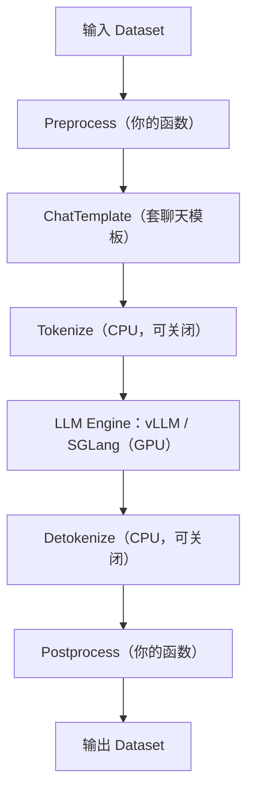

官方文档说明：**每个阶段都是一个独立的 Ray Actor 池**，CPU 和 GPU 阶段默认都是自动伸缩的池（ServeDeployment 阶段除外）。默认把分词/反分词拆成独立的 CPU 阶段（tokenization disaggregation），让 GPU 只做推理。

关键配置（`vLLMEngineProcessorConfig`）：

| 参数 | 含义 | 文档要点 |
|---|---|---|
| `model_source` | HF 模型 ID 或路径（也可以是 S3 路径） | gated 模型通过 `runtime_env` 传 HF_TOKEN |
| `concurrency` | vLLM 引擎副本数 | 整数 n 表示 1→n 自动伸缩；`(n, n)` 表示固定 n 个 |
| `batch_size` | 每批行数 | OOM 时先调小 |
| `engine_kwargs` | 直接传给 vLLM | `max_model_len`、`max_num_batched_tokens`、`gpu_memory_utilization`、`tensor_parallel_size` 等 |
| `task_type` | `generate` / `embed` / `classify` / `score` | 分类模型的 logits 放在 `embeddings` 字段 |
| `max_concurrent_batches` | 单个引擎 Actor 内同时执行的批数，默认 8 | 用来掩盖长尾 |
| `max_tasks_in_flight_per_actor` | 每个 Actor 排队的任务数，默认 16 | 小于前者会让 Actor 吃不饱 |
| `should_continue_on_error` | 行级容错 | 单行失败不让整个作业失败 |

**注意**：这里的 `concurrency` 是 `ray.data.llm` 配置类自己的参数，和第 6 周提到的 `map_batches(concurrency=...)` 弃用不是一回事。

**版本兼容**：文档 *Troubleshooting* 一节有“Ray 版本 ↔ 经过测试的 vLLM 版本”对照表（例如 Ray 2.58.0 ↔ vLLM 0.26.0）。本站写作时表中还没有 2.59 这一行，安装前请以最新表格为准。

### 2.6 容错与断点续跑

文档列出三层：**行级**（`should_continue_on_error=True`）、**Actor 级**（Actor 死亡后自动重启并重新加入池，默认开启）、**检查点恢复**（`DataContext.checkpoint_config = CheckpointConfig(id_column=..., checkpoint_path=...)`，要求管线以 read 开头、以 write 结尾，并且在后处理中保留 ID 列）。这和 Spark 作业失败后按分区重算、或者按日期分区补数的思路一致：**输出必须带可追溯的 ID，写出必须幂等**。

### 2.7 GPU 容量估算（为实验 4 做准备）

以 8B 模型、BF16 为例（方法见第 4 周）：权重约 8×10⁹×2 B ≈ 16 GB；剩余显存给 KV Cache，vLLM 默认 `gpu_memory_utilization=0.9`。24 GB 卡上 KV Cache 空间很紧，所以官方示例都设了 `max_model_len=4096`。文档给出的 OOM 调参顺序：减小 `batch_size` → 降低 `max_num_batched_tokens` → 减小 `max_model_len` → 把 `gpu_memory_utilization` 设为 0.75–0.85。

---

## 3. 动手实验

### 环境准备（CPU 部分，{{local}}）

```bash
cd ~/ai-infra-lab && source .venv/bin/activate && mkdir -p w8 && cd w8
uv pip install "torch==2.14.1" "transformers==5.20.2"    # Mac 用默认索引即可；Linux 无 GPU 可加 --index-url https://download.pytorch.org/whl/cpu
```

依赖第 6 周输出 `../w6/clean/`。

### 实验 1：CPU 批量打分（40 分钟）

```python
"""Ray Data 批量推理（CPU 版）：用 FineWeb-Edu 分类器给第 6 周的清洗结果打“教育价值”分。"""
import argparse
import os
import time

import numpy as np
import pandas as pd
import ray

ap = argparse.ArgumentParser()
ap.add_argument("--n", type=int, default=2000)          # 打分的文档数
ap.add_argument("--actors", type=int, default=2)        # Actor 池大小（相当于 GPU 版的模型副本数）
ap.add_argument("--threads", type=int, default=2)       # 每个 Actor 的 torch 线程数
ap.add_argument("--batch", type=int, default=16)
ap.add_argument("--maxlen", type=int, default=512)
ap.add_argument("--blocks", type=int, default=0)        # >0 时先 repartition 成这么多个 block
a = ap.parse_args()
ray.init(num_cpus=8, include_dashboard=False, log_to_driver=False)
ray.data.DataContext.get_current().enable_progress_bars = False
MODEL = "HuggingFaceFW/fineweb-edu-classifier"

class EduScorer:
    def __init__(self):                                   # 每个 Actor 只加载一次模型
        import torch
        from transformers import AutoModelForSequenceClassification, AutoTokenizer
        torch.set_num_threads(a.threads)
        self.torch = torch
        self.tok = AutoTokenizer.from_pretrained(MODEL)
        self.model = AutoModelForSequenceClassification.from_pretrained(MODEL).eval()

    def __call__(self, df: pd.DataFrame) -> pd.DataFrame:
        enc = self.tok(list(df["text"]), return_tensors="pt", padding="longest",
                       truncation=True, max_length=a.maxlen)
        with self.torch.inference_mode():
            s = self.model(**enc).logits.squeeze(-1).float().numpy()
        return pd.DataFrame({"id": df["id"], "score": s,
                             "int_score": np.clip(np.round(s), 0, 5).astype(int),
                             "n_tok": enc["attention_mask"].sum(1).numpy(),
                             "pid": os.getpid()})       # 记录是哪个 Actor 处理的

ds = ray.data.read_parquet("../w6/clean").select_columns(["id", "text"]).limit(a.n)
if a.blocks:
    ds = ds.repartition(a.blocks)
t0 = time.time()
out = ds.map_batches(EduScorer, batch_format="pandas", batch_size=a.batch,
                     compute=ray.data.ActorPoolStrategy(size=a.actors),
                     num_cpus=a.threads).to_pandas()
dt = time.time() - t0
print(f"actors={a.actors} threads={a.threads} batch={a.batch} blocks={a.blocks or '默认'}: {len(out)} 篇，{dt:.1f}s，"
      f"{len(out) / dt:.1f} 篇/s，{out['n_tok'].sum() / dt:.0f} token/s（含模型加载）")
print(f"实际参与计算的 Actor 数: {out['pid'].nunique()}")
print("int_score 分布:", out["int_score"].value_counts().sort_index().to_dict())
print(f"int_score>=3（FineWeb-Edu 的保留阈值）占比 {(out['int_score'] >= 3).mean():.1%}；平均输入 token {out['n_tok'].mean():.0f}")
```

```bash
python edu_score.py          # 默认 2000 篇、2 个 Actor × 2 线程、batch 16、maxlen 512
```

**本站输出**（这是加 `--blocks` 和 pid 统计之前的版本，计数相同）：

```text
actors=2 threads=2 batch=16: 2000 篇，644.6s，3.1 篇/s，1097 token/s（含模型加载）
int_score 分布: {0: 225, 1: 1224, 2: 434, 3: 105, 4: 12}
int_score>=3（FineWeb-Edu 的保留阈值）占比 5.9%；平均输入 token 354
```

**逐步解释：**

- 只有 **5.9%** 的文档达到 `int_score >= 3`。按这个比例，FineWeb-Edu 相对 FineWeb 只保留一小部分——这正是“质量换数量”的取舍。
- 吞吐只有 1,097 token/s：10 分钟才处理 2,000 篇。实验 3 会揭示其中一半的 CPU 其实闲着。
- 推算：用这个速度处理第 6 周的 47,451 篇需要约 4 小时。**这就是为什么模型打分必须放在漏斗最后、并且要上 GPU。**

### 实验 2：并行度网格（40 分钟）

```bash
for cfg in "1 4 16" "2 2 16" "4 1 16" "2 2 1" "2 2 64"; do set -- $cfg
  python edu_score.py --n 300 --maxlen 256 --actors $1 --threads $2 --batch $3 | grep -E "^actors|占比"
done
```

**本站输出**（加 pid 统计之前的版本）：

```text
actors=1 threads=4 batch=16: 300 篇，28.8s，10.4 篇/s，2276 token/s（含模型加载）
actors=2 threads=2 batch=16: 300 篇，47.1s，6.4 篇/s，1390 token/s（含模型加载）
actors=4 threads=1 batch=16: 300 篇，89.6s，3.3 篇/s，730 token/s（含模型加载）
actors=2 threads=2 batch=1: 300 篇，45.8s，6.6 篇/s，1430 token/s（含模型加载）
actors=2 threads=2 batch=64: 300 篇，53.8s，5.6 篇/s，1215 token/s（含模型加载）
```

（五次的 int_score 分布完全相同：`{0: 34, 1: 192, 2: 56, 3: 16, 4: 2}`，占比 6.0%，平均输入 218 token。）

**先停下来猜一猜**：总线程数都是 4，为什么 Actor 越多越慢，而且慢的比例几乎正好是 1 : 1.6 : 3.1？

### 实验 3：诊断——到底有几个 Actor 在干活（30 分钟）

加上 `pid` 列统计实际参与计算的 Actor 数，并用 `--blocks 8` 先 repartition：

```bash
python edu_score.py --n 300 --maxlen 256 --actors 4 --threads 1 --batch 16
python edu_score.py --n 300 --maxlen 256 --actors 4 --threads 1 --batch 16 --blocks 8
python edu_score.py --n 300 --maxlen 256 --actors 2 --threads 2 --batch 16 --blocks 8
```

**本站输出：**

```text
actors=4 threads=1 batch=16 blocks=默认: 300 篇，91.8s，3.3 篇/s，713 token/s（含模型加载）
实际参与计算的 Actor 数: 1
actors=4 threads=1 batch=16 blocks=8: 300 篇，27.4s，11.0 篇/s，2390 token/s（含模型加载）
实际参与计算的 Actor 数: 4
actors=2 threads=2 batch=16 blocks=8: 300 篇，26.8s，11.2 篇/s，2439 token/s（含模型加载）
实际参与计算的 Actor 数: 2
```

**逐步解释：**

- `limit(300)` 后数据只来自第一个文件的一个 block，**整个作业只有 1 个任务**，所以只有 1 个 Actor 干活，而它只有 `threads` 个线程。实验 2 的耗时比例 1 : 1.6 : 3.1 实际上反映的是“这一个 Actor 有 4、2、1 个线程”。
- repartition 成 8 个 block 后，4×1 从 91.8s 降到 27.4s（**3.4 倍**），与 1×4、2×2 基本持平——总算力相同，吞吐就相同。
- 实验 1 的 2,000 篇很可能有同样的问题（只有一个 Actor 工作），作为练习请你加 `--blocks 8` 重跑对比。
- **架构师的教训**：这和 Spark 里“输入只有 1 个分区，开 100 个 executor 也没用”一模一样。在 Ray Dashboard 或输出里确认**实际并行度**，是批量推理调优的第一步。GPU 上更贵：空闲的 Actor 会一直占着整张卡。

### 实验 4：vLLM 批量推理（未在本站实测，需 GPU）{{gpu1}}

> ⚠️ **未在本站实测，需 GPU**。以下代码摘自 Ray 官方文档 [Working with LLMs](https://docs.ray.io/en/latest/data/working-with-llms.html) 的 *Quickstart* 与 *Classification* 两节，**没有贴任何输出**。需要一张 NVIDIA GPU（官方示例用 8B 模型并设 `max_model_len=4096` 以适配测试卡）。没有 GPU 可以租按小时计费的云 GPU，或只阅读不运行。

安装（文档写法）：

```bash
pip install -U "ray[data, llm]>=2.53.0"
```

**4a. 文本生成（文档 Quickstart）：**

```python
import ray
from ray.data.llm import vLLMEngineProcessorConfig, build_processor

ds = ray.data.from_items([
    {"prompt": "What is machine learning?"},
    {"prompt": "Explain neural networks in one sentence."},
])
config = vLLMEngineProcessorConfig(
    model_source="unsloth/Llama-3.1-8B-Instruct",
    concurrency=1,            # 1 个 vLLM 引擎副本
    batch_size=32,
    engine_kwargs={"max_model_len": 4096},
)
processor = build_processor(
    config,
    preprocess=lambda row: {
        "messages": [{"role": "user", "content": row["prompt"]}],
        "sampling_params": {"temperature": 0.7, "max_tokens": 100},
    },
    postprocess=lambda row: {"prompt": row["prompt"], "response": row["generated_text"]},
)
for r in processor(ds).iter_rows():
    print(r["prompt"], "->", r["response"])
```

**4b. 把本周的打分迁到 GPU（文档 Classification 一节的写法）**：文档示例使用 `nvidia/nemocurator-fineweb-nemotron-4-edu-classifier`，`task_type="classify"`，关闭 chat template 和 detokenize 阶段，分数从 `row["embeddings"][0]` 取出：

```python
classification_config = vLLMEngineProcessorConfig(
    model_source="nvidia/nemocurator-fineweb-nemotron-4-edu-classifier",
    task_type="classify",
    engine_kwargs=dict(max_model_len=512, enforce_eager=True),
    batch_size=8,
    concurrency=1,
    chat_template_stage=False,
    detokenize_stage=False,
)
processor = build_processor(
    classification_config,
    preprocess=lambda row: dict(prompt=row["text"]),
    postprocess=lambda row: {"text": row["prompt"],
                             "edu_score": float(row["embeddings"][0])},
)
ds = ray.data.read_parquet("../w6/clean")
processor(ds).write_parquet("scored/")
```

**跑通后请自己记录**（不要抄别人的数字）：每秒处理文档数、GPU 利用率（`nvidia-smi`）、与实验 1 CPU 版的倍数；把 `concurrency` 与 `batch_size` 各改一次，观察变化。

### 常见错误与排查

| 现象 | 原因 | 解决 |
|---|---|---|
| 开了 N 个 Actor，吞吐没有提升（本站实测：只有 1 个在干活） | block 数 < Actor 数 | 先 `repartition(n)`，或调小 block 大小；输出中记录 pid/节点确认 |
| CPU 上 batch 越大越慢（本站实测 64 比 16 慢） | padding 到批内最长 | CPU 用中小批；按长度分桶 |
| 每个 Actor 启动都很慢 | 每个 Actor 都要加载模型（首次还要下载） | 预先下载到共享存储；作业足够长才多开 Actor |
| CUDA OOM（文档 Troubleshooting） | 批太大、上下文太长 | 依次调小 `batch_size`、`max_num_batched_tokens`、`max_model_len`、`gpu_memory_utilization` |
| `ImportError: libcudart.so.12: cannot open shared object file`（文档列出的已知问题） | NIXL EP 包与 CUDA/vLLM 不兼容 | 卸载或换成兼容的 `nixl_ep` |
| 大集群下载模型被限流（文档 Troubleshooting） | 每个副本都从 HF 下载 | 文档建议先上传到 S3/GCS，`model_source` 指向对象存储 |
| Ray 与 vLLM 版本冲突（未在本站复现） | 不在兼容表中的组合 | 按文档兼容表选择版本 |

### 扩展练习

1. 给实验 1 加 `--blocks 8` 重跑 2,000 篇，算出加速比。
2. 按 token 长度把文档分成 3 个桶，分别成批，测量对 CPU 吞吐的影响。
3. 把打分作业接在第 7 周的去重输出后面，写出 `score`、`int_score` 列，统计“去重 + 打分”的最终保留率。
4. 阅读文档 *Resiliency* 一节，为打分作业加上检查点配置，人为中断一次再续跑（CPU 版可用 `map_batches` 管线练习检查点）。
5. （GPU）完成实验 4b，并和 CPU 版对比每千篇成本。

---

## 4. 精读指南

- **① [Offline Batch Inference](https://docs.ray.io/en/latest/data/batch_inference.html)**（30 分钟）。**读完回答**：文档推荐的批量推理结构有哪几步？GPU 推理时 `num_gpus` 和 Actor 池大小如何配合？
- **② [fineweb-edu-classifier 模型卡](https://huggingface.co/HuggingFaceFW/fineweb-edu-classifier)**（15 分钟）。**读完回答**：分类器是怎么训练的？为什么建议阈值是 3？模型卡列出了哪些局限？
- **④ [Working with LLMs](https://docs.ray.io/en/latest/data/working-with-llms.html)**（50 分钟）。**读完回答**：① 处理器有哪几个阶段，哪些在 GPU 上？② `concurrency=4` 与 `concurrency=(4, 4)` 的区别？③ `max_concurrent_batches` 与 `max_tasks_in_flight_per_actor` 如何配合？④ 三层容错分别是什么？
- **⑤ [ray.data.llm API](https://docs.ray.io/en/latest/data/api/llm.html)**（10 分钟）：浏览有哪些配置类（vLLM、SGLang、HTTP、Serve 部署）。
- **⑥ [vLLM 文档](https://docs.vllm.ai/en/latest/)**（20 分钟）：只看首页对 PagedAttention、连续批处理的介绍，第 4 月会深入。
- **背景**：[FineWeb-Edu 数据集](https://huggingface.co/datasets/HuggingFaceFW/fineweb-edu)；[Ray Data 论文](https://arxiv.org/abs/2501.12407) 中关于异构 CPU/GPU 流水线的部分。

---

## 5. 自测题

<details>
<summary>1. 离线批量推理与在线服务的核心指标分别是什么？</summary>

离线批量推理追求吞吐、单位成本（每千篇/每百万 token 的成本）；在线服务追求延迟（TTFT、每 token 延迟、P99）和可用性。

</details>

<details>
<summary>2. 实验 2 中为什么 4 个 Actor 反而最慢？</summary>

`limit(300)` 后只有 1 个 block，Ray Data 按 block 派发任务，所以只有 1 个 Actor 在工作；它只有 1 个线程。repartition 成 8 个 block 后 4 个 Actor 都参与，耗时从 91.8s 降到 27.4s。

</details>

<details>
<summary>3. 有效并行度由什么决定？</summary>

min(block 数, Actor 数) × 每个 Actor 的并行度（CPU 线程或 GPU），并受集群总资源限制；batch_size 决定每次前向的效率。

</details>

<details>
<summary>4. CPU 上 batch=64 为什么比 batch=16 慢？GPU 上会怎样？</summary>

批内 padding 到最长序列，批越大浪费越多，而 CPU 从大批中获得的并行收益很小。GPU 上大批能更好地利用算力，通常吞吐随批增大而提升，直到显存不足或长度差异过大。

</details>

<details>
<summary>5. ray.data.llm 为什么把 tokenize/detokenize 拆成独立的 CPU 阶段？</summary>

让 GPU 阶段只做推理，避免分词占用 GPU Actor 的时间；CPU 阶段可以独立扩缩。文档提示：当 GPU 引擎已经饱和、分词不是瓶颈时，额外阶段未必有帮助。

</details>

<details>
<summary>6. GPU 推理遇到 CUDA OOM，按文档建议应如何调整？</summary>

依次：减小 batch_size（从 8–16 开始）、降低 max_num_batched_tokens、减小 max_model_len、把 gpu_memory_utilization 调到 0.75–0.85。

</details>

<details>
<summary>7. 检查点恢复对管线有什么要求？</summary>

管线以 read 开头、以 write 结尾；配置 CheckpointConfig 的 id_column；预处理和后处理都要保留 ID 列；只有已经写到 sink 的 block 才能被跳过。

</details>

### 思考题

1. **成本模型**：用实验 3 的 CPU 吞吐和一张云 GPU 的小时价（自己查），估算给 1 亿篇文档打分的成本和时间。哪一种更便宜？
2. **管线编排**：清洗（CPU）→ 去重（shuffle 密集）→ 打分（GPU）三步，你会做成一个 Ray 作业，还是 Spark + Ray 两个作业用 Parquet 交接？考虑容错、资源利用率和团队技能。
3. **打分模型的风险**：模型卡提到分类器可能偏向“看起来学术”的内容。如果你是数据负责人，怎样监控和纠正这种偏差？

---

## 6. 本周产出与掌握清单

### 本周产出

1. `labs/w8/edu_score.py` 以及运行记录 `README.md`：实验 1–3 的数字、“只有 1 个 Actor 在干活”的诊断过程。
2. **第 2 月项目报告**（汇总第 6–8 周）：清洗 → 去重 → 打分的漏斗图（每一步的行数）、各引擎耗时、你的 Spark/Ray 选型结论。
3. （有 GPU 时）实验 4 的运行记录，与 CPU 版对比。

### 掌握清单

- [ ] 能对比离线批量推理与在线服务
- [ ] 会用 map_batches + 类 UDF + ActorPoolStrategy 写批量推理
- [ ] 能用 pid 统计或 Dashboard 确认实际并行度
- [ ] 知道 block 数会限制 Actor 并行度，会用 repartition 修复
- [ ] 能解释 padding 与 batch_size 的关系
- [ ] 能画出 ray.data.llm 处理器流水线，知道每个阶段是一个 Actor 池
- [ ] 能说出 vLLMEngineProcessorConfig 的主要参数
- [ ] 能给出 GPU OOM 的调参顺序
- [ ] 知道三层容错与检查点恢复的要求
- [ ] 完成第 2 月项目报告

---

## 参考资料

- [Ray Data：Working with LLMs](https://docs.ray.io/en/latest/data/working-with-llms.html)（文档·进阶）
- [Ray Data：Offline Batch Inference](https://docs.ray.io/en/latest/data/batch_inference.html)（文档·入门）
- [ray.data.llm API](https://docs.ray.io/en/latest/data/api/llm.html)（文档·进阶）
- [fineweb-edu-classifier](https://huggingface.co/HuggingFaceFW/fineweb-edu-classifier)（模型·入门）
- [FineWeb-Edu 数据集](https://huggingface.co/datasets/HuggingFaceFW/fineweb-edu)（数据集·入门）
- [vLLM 文档](https://docs.vllm.ai/en/latest/)（文档·进阶）

> 完整列表见 [参考资料库](/resources.html)。
