=== m3 | 第 3 月概览：K8s + GPU 调度 | 第 3 月 · K8s + GPU 调度
# 第 3 月：K8s + GPU 调度

## 本月目标
- 搞懂 K8s 中 GPU 是怎么被“看见”和“分配”的（device plugin、GPU Operator）。
- 在没有 GPU 的本地集群上练熟 Kueue/Volcano 的队列、配额、Gang 调度与抢占。
- 用 KubeRay 在 K8s 上运行 Ray。
- 写出“YARN 容量调度 vs Kueue/Volcano”对比笔记（面试材料）。

## 阅读
- [K8s GPU 调度](https://kubernetes.io/docs/tasks/manage-gpus/scheduling-gpus/)
- [NVIDIA GPU Operator 文档](https://docs.nvidia.com/datacenter/cloud-native/gpu-operator/latest/index.html)
- [Kueue 文档](https://kueue.sigs.k8s.io/docs/)、[Volcano 文档](https://volcano.sh/en/docs/)
- [KubeRay（Ray on Kubernetes）](https://docs.ray.io/en/latest/cluster/kubernetes/index.html)
- [Slurm 文档](https://slurm.schedmd.com/documentation.html)（了解 partition 概念即可）

## 周计划

| 周 | 主题 | 实验 | 资源 |
|---|---|---|---|
| [第 9 周](/m3w1.html) | K8s 与 GPU 设备模型 | kind 集群 + 模拟 GPU 资源 | {{local}} |
| [第 10 周](/m3w2.html) | Kueue 队列与配额 | ClusterQueue/LocalQueue/借用/抢占 | {{local}} |
| [第 11 周](/m3w3.html) | Volcano Gang 调度 + KubeRay | PodGroup minMember；RayCluster | {{local}} |
| [第 12 周](/m3w4.html) | 真 GPU：GPU Operator + vLLM Pod | 单卡 K8s 节点 | {{gpu1}} |

## 本月产出清单
- [ ] Kueue 与 Volcano 实验 YAML 与观察记录
- [ ] 真实 GPU 上通过 K8s 运行 vLLM Pod
- [ ] 笔记：“YARN 容量调度 vs Kueue/Volcano”

=== m3w1 | 第 9 周：K8s 与 GPU 设备模型 | 第 3 月 · K8s + GPU 调度
# 第 9 周：K8s 与 GPU 设备模型

> **本周一句话**：搞清楚一张 GPU 是怎样从“插在服务器上的硬件”变成 K8s 里一个可调度的整数资源 `nvidia.com/gpu` 的，并亲手体验默认调度器在 GPU 场景下的三大痛点：**整卡分配、碎片化、分布式作业的“半调度死锁”**。这三个痛点就是后面三周 Kueue、Volcano、GPU Operator 存在的理由。

**预计投入：约 10 小时**（阅读 ≈ 4h，动手 ≈ 4h，自测与产出 ≈ 2h）。{{local}}

**本周结束时你应该能：**

1. 画出 GPU 节点的软件栈：驱动 → 容器工具包 → device plugin → kubelet → 调度器，并说出每一层的职责。
2. 解释 device plugin 的注册 / ListAndWatch / Allocate 流程，以及扩展资源的约束（整数、只写 limits、不能超卖）。
3. 用标签、污点/容忍、nodeSelector 和 ResourceQuota 管理异构 GPU 集群。
4. 复现并解释“GPU 碎片化”和“分布式作业部分调度导致的死锁”。
5. 说出 MIG、时间片、DRA 这几种“分卡/新分配方式”的定位。

> **验证说明（重要）**：本站环境没有 Docker、没有 GPU，kind/minikube 都无法运行。本周实验改用 **[KWOK](https://kwok.sigs.k8s.io/)（Kubernetes WithOut Kubelet）**：`kwokctl --runtime binary` 直接以普通进程启动**真实的** etcd、kube-apiserver、kube-scheduler、kube-controller-manager（本站为 K8s v1.36.1），节点和 Pod 的“运行”由 KWOK 模拟。因此 **API 校验、配额、调度决策、事件信息都是真的**（本页报错和事件均为真实输出），但容器不会真的运行，也不存在真实 GPU。凡是需要真实 GPU 驱动/容器的部分（device plugin 实际分配设备、`nvidia-smi`）都标注为“未在本站实测”。工具版本：kwokctl v0.8.0，kubectl v1.37.1。实验文件在仓库 `labs/w9/`。
>
> 你在 Mac 上可以照抄 KWOK 的做法（最轻量，推荐），也可以按 [实验环境](/lab-env.html) 用 kind；两者的命令只在“创建集群/节点”这一步不同。

---

## 1. 本周学习路线

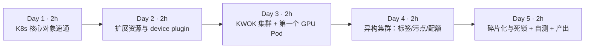

| 天 | 时间 | 先读 | 再读（外部资料） | 再做 |
|---|---|---|---|---|
| Day 1 | ~2h | 本页 2.1 | ① [Kubernetes 调度器](https://kubernetes.io/docs/concepts/scheduling-eviction/kube-scheduler/)（20 分钟）；② [为 Pod 和容器管理资源](https://kubernetes.io/docs/concepts/configuration/manage-resources-containers/) 读 requests/limits 与 *Extended resources* 两部分（30 分钟） | — |
| Day 2 | ~2h | 本页 2.2、2.3 | ③ [Device Plugins](https://kubernetes.io/docs/concepts/extend-kubernetes/compute-storage-net/device-plugins/)（40 分钟）；④ [Schedule GPUs](https://kubernetes.io/docs/tasks/manage-gpus/scheduling-gpus/)（15 分钟） | — |
| Day 3 | ~2h | 本页 2.4 | ⑤ [KWOK 文档首页](https://kwok.sigs.k8s.io/) 与 [kwokctl 二进制运行时](https://kwok.sigs.k8s.io/docs/user/kwokctl-platform-specific-binaries/)（15 分钟） | 实验 0、1、2 |
| Day 4 | ~2h | 本页 2.5 | ⑥ [污点和容忍](https://kubernetes.io/docs/concepts/scheduling-eviction/taint-and-toleration/)（20 分钟）；⑦ [Resource Quotas](https://kubernetes.io/docs/concepts/policy/resource-quotas/) 读扩展资源配额部分（15 分钟） | 实验 3、4 |
| Day 5 | ~2h | 本页 2.6、2.7 | ⑧ [NVIDIA k8s-device-plugin README](https://github.com/NVIDIA/k8s-device-plugin) 浏览时间片与 MIG 部分（20 分钟）；⑨ [Resource Bin Packing](https://kubernetes.io/docs/concepts/scheduling-eviction/resource-bin-packing/)（15 分钟） | 实验 5、6；自测；产出 |

**每日打卡：**

- [ ] Day 1：读完 ①②，能说出 requests 与 limits 在调度和运行时各自的作用
- [ ] Day 2：读完 ③④，能画出 device plugin 的注册与分配流程
- [ ] Day 3：KWOK 集群起来，第一个 GPU Pod 处于 Running
- [ ] Day 4：完成实验 3、4，见到配额拒绝与选择器不匹配的真实报错
- [ ] Day 5：复现“半调度死锁”，完成自测与产出

---

## 2. 核心概念讲解

### 2.1 K8s 核心对象：给 YARN 老兵的对照表

| YARN / Hadoop | Kubernetes | 说明 |
|---|---|---|
| ResourceManager | kube-apiserver + kube-scheduler + controller-manager | K8s 把“状态存储/API”、“调度”、“控制循环”拆成独立组件，状态都在 etcd |
| NodeManager | kubelet | 节点代理，负责拉起容器、上报资源 |
| Container | Pod（一个或多个容器） | Pod 是调度的最小单位 |
| ApplicationMaster | Operator / 控制器（如 Job、PyTorchJob、RayCluster 控制器） | 按“期望状态”不断调和（reconcile） |
| Queue（Capacity Scheduler） | Namespace + ResourceQuota；队列语义要靠 **Kueue**（第 10 周） | 原生 K8s 没有“队列”和“排队”概念 |
| Gang 调度（YARN 不原生支持） | **Volcano**，或 K8s 原生 [Gang Scheduling](https://kubernetes.io/docs/concepts/scheduling-eviction/gang-scheduling/)（v1.37 起 Beta，默认关闭）（第 11 周） | 默认配置下调度器逐个 Pod 调度 |
| yarn.io/gpu 资源类型 | 扩展资源 `nvidia.com/gpu` | 都是整数计数型资源 |

最关键的思维差异：**YARN 是“作业调度器”，K8s 默认调度器是“Pod 放置器”**。它一次只看一个 Pod，回答“这个 Pod 放在哪台机器上”，不关心这个 Pod 属于哪个作业、作业的其他 Pod 能否一起启动、是否应该排队。这一点在实验 6 中会直接变成死锁。

### 2.2 GPU 节点软件栈

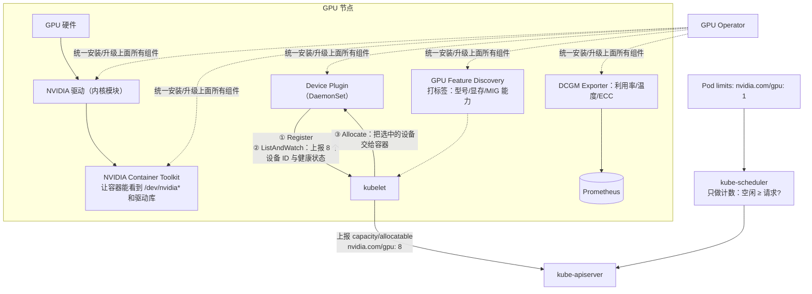

- **调度器只做计数**：它只知道节点上 `nvidia.com/gpu` 还剩几个，不知道是哪几张卡、卡之间的拓扑（NVLink/PCIe）、显存用了多少。
- **具体分配哪张卡由 kubelet + device plugin 决定**，发生在 Pod 已经被调度到节点之后。
- **GPU Operator**（第 12 周）把驱动、工具包、device plugin、GFD、DCGM 用一个 Operator 统一管理，类似 Cloudera Manager / Ambari 管理 Hadoop 组件。

### 2.3 Device Plugin 机制（读 ③ 时对照）

官方文档描述的流程：

1. device plugin 通过 kubelet 的 Unix socket 调用 `Register`，声明资源名（如 `nvidia.com/gpu`）。
2. kubelet 调用插件的 `ListAndWatch`，插件以流的方式持续上报设备列表与健康状态；kubelet 把健康设备数作为节点的 capacity/allocatable 上报给 API Server。
3. Pod 被调度到节点后，kubelet 调用 `Allocate`，插件返回让容器使用这些设备所需的信息（设备节点、环境变量、挂载等）。

**扩展资源的规则**（文档 *Extended resources* 一节；实验 2 用真实报错验证）：

- 只能是**整数**，不能写 `500m` 这样的小数。
- 可以只写 `limits`（此时 requests 自动等于 limits）；如果同时写，**requests 必须等于 limits**——扩展资源不能超卖。
- 不能在多个容器之间共享同一个设备（除非插件实现了时间片等共享机制）。

| 你熟悉的 | GPU 设备模型 |
|---|---|
| YARN 的 vcore 可以超卖（`yarn.nodemanager.resource.cpu-vcores` 设得比物理核多） | GPU 不能超卖：requests 必须等于 limits |
| YARN 的 GPU 隔离靠 cgroups devices + 节点上的 GPU 发现脚本 | K8s 靠 device plugin + 容器工具包 |
| 节点标签（node label）+ 队列映射 | 节点标签 + nodeSelector/亲和性 |

### 2.4 KWOK：用“假 kubelet”学调度

KWOK 的思路：控制面是真的，只有 kubelet 是假的。你创建带注解 `kwok.x-k8s.io/node: fake` 的 Node 对象，KWOK 控制器就替它维持心跳；Pod 被调度到这些节点后，KWOK 按预设的“阶段（stage）”把 Pod 状态改成 Running。

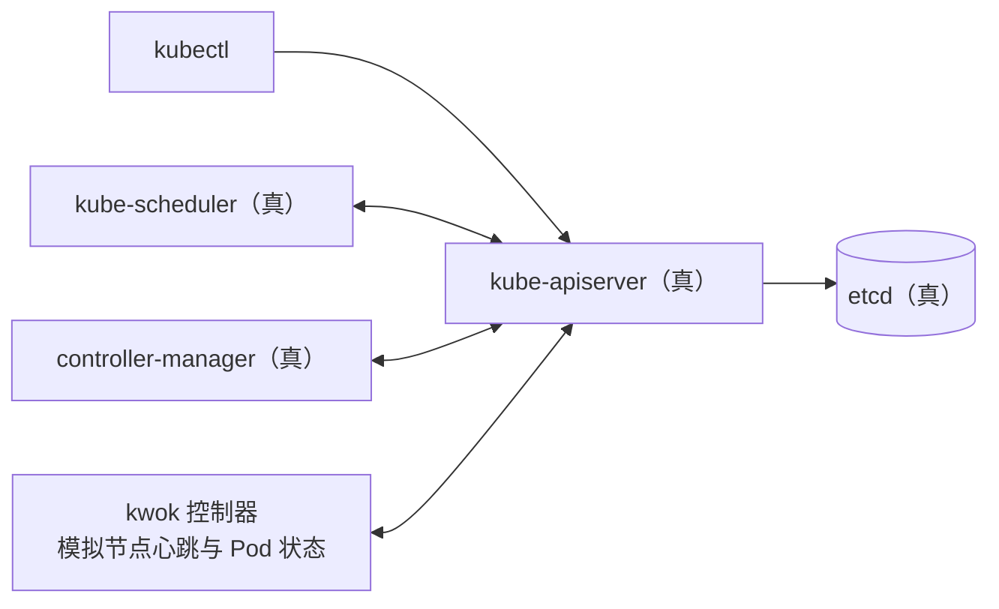

**适合**：学习调度、配额、优先级/抢占、队列系统、控制器行为；在笔记本上模拟上千节点的集群。**不适合**：任何需要容器真正运行的东西（镜像、网络、存储、GPU 驱动、device plugin 本身）。注意一个细节：KWOK 默认会让 **Job 管理的 Pod 很快进入 Succeeded**（本站实测：带 Job 的分布式作业瞬间“跑完”），所以实验 6 直接创建 worker Pod 来模拟训练作业。

### 2.5 异构 GPU 集群的三件套：标签、污点、配额

1. **标签 + nodeSelector/亲和性**：GPU Feature Discovery 会给节点打 `nvidia.com/gpu.product`、`nvidia.com/gpu.memory` 等标签，作业据此选择 A100 或 L4。
2. **污点 + 容忍**：给 GPU 节点打 `NoSchedule` 污点，没有容忍的普通 Pod 不会被放上来，避免 CPU 作业占住 GPU 机器的 CPU/内存导致 GPU 闲置。
3. **ResourceQuota**：按 Namespace 限制 GPU 总量。扩展资源的配额只能用 `requests.` 前缀（`requests.nvidia.com/gpu`）。

但 ResourceQuota 只是**硬上限 + 立即拒绝**：超额的 Pod 直接创建失败（实验 3），既不排队，也不能借用其他团队闲置的配额。这正是第 10 周 Kueue 要解决的问题。

### 2.6 默认调度器的两个 GPU 痛点

**痛点一：碎片化。** 集群总共空闲 6 张卡，但分散在不同节点上，一个需要 8 卡的作业依然无法调度（实验 5）。调度器的打分插件 `NodeResourcesFit` 默认用 `LeastAllocated` 策略，倾向于把 Pod 分散；文档 ⑨ 介绍了 `MostAllocated` 与 `RequestedToCapacityRatio` 两种“装箱（bin packing）”策略，可以给 `nvidia.com/gpu` 设置权重，让小任务尽量挤在同一台机器上，为大任务留出整机。

**痛点二：分布式作业的部分调度（死锁）。** 默认调度器逐个 Pod 调度。两个各需要 3×4 卡的训练作业同时到达，集群有 12 张卡：理想情况是一个先跑、一个排队。实际结果（实验 6）：两个作业**各拿到一部分 worker**，12 张卡全部被占用，但没有一个作业能凑齐 worker 开始训练——资源被白白锁住。解决办法是 **gang 调度**（All-or-nothing）：要么一个作业的所有 Pod 一起调度，要么一个都不调度。K8s 自身也在补这块：官方文档的 Gang Scheduling 页面写明该特性自 v1.37 起为 Beta、默认关闭，需要开启 `GenericWorkload` 特性门控并使用 PodGroup API（第 11 周实测）。

$$\text{GPU 有效利用率} = \frac{\text{在真正训练的作业占用的 GPU}}{\text{已分配的 GPU}}$$

实验 6 中已分配 12/12，有效利用率是 **0**。这比 YARN 上“容器申请到了但 AM 没起来”的情况更糟，因为分布式训练的 worker 会一直等待对方，不会超时释放。

### 2.7 分卡与新一代分配机制（概念了解）

| 机制 | 原理 | 隔离性 | 典型用途 |
|---|---|---|---|
| 整卡（默认） | 一个容器独占 N 张卡 | 强 | 训练、大模型推理 |
| 时间片（time-slicing） | device plugin 把一张卡“复制”成多个资源，容器轮流使用 | 弱：显存不隔离、互相影响 | 开发、小模型推理 |
| MIG（Multi-Instance GPU） | A100/H100 等在硬件上切成多个实例，各有独立显存与算力 | 强 | 多租户推理 |
| MPS | CUDA 层面多进程共享 | 中 | 小批推理吞吐 |
| DRA（Dynamic Resource Allocation） | K8s 新一代设备分配 API，按“设备类 + 声明（claim）”分配，可表达属性和共享 | 取决于驱动 | GPU 调度的演进方向 |

时间片和 MIG 的具体配置见 ⑧ README；DRA 见 [K8s DRA 文档](https://kubernetes.io/docs/concepts/scheduling-eviction/dynamic-resource-allocation/)。这些都需要真实 GPU，本站未实测。

---

## 3. 动手实验 {{local}}

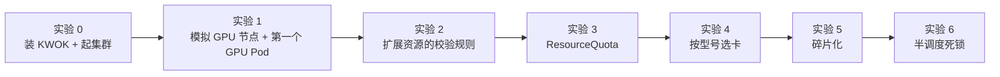

### 实验 0：安装 KWOK 并创建集群（20 分钟）

```bash
# Mac
brew install kwok kubectl
# Linux（本站做法，无需 root）
mkdir -p ~/.local/bin && export PATH=~/.local/bin:$PATH
curl -sLo ~/.local/bin/kwokctl https://github.com/kubernetes-sigs/kwok/releases/download/v0.8.0/kwokctl-linux-amd64
curl -sLo ~/.local/bin/kwok    https://github.com/kubernetes-sigs/kwok/releases/download/v0.8.0/kwok-linux-amd64
curl -sLo ~/.local/bin/kubectl https://dl.k8s.io/release/v1.37.1/bin/linux/amd64/kubectl
chmod +x ~/.local/bin/*

kwokctl create cluster --name lab --runtime binary    # 不需要 Docker：直接下载并启动 etcd/apiserver/scheduler 等二进制
kubectl config current-context
kubectl get ns
```

**本站输出**（创建过程日志较长，节选关键行）：

```text
..."msg":"Download",..."uri":"https://github.com/etcd-io/etcd/releases/download/v3.6.10/etcd-v3.6.10-linux-amd64.tar.gz"
..."msg":"Download",..."uri":"https://dl.k8s.io/release/v1.36.1/bin/linux/amd64/kube-apiserver"
..."msg":"Cluster is created","cluster":"lab","elapsed":{..."human":"11.653619573s"}
..."msg":"Cluster is started","cluster":"lab",...
kwok-lab
NAME              STATUS   AGE
default           Active   13s
kube-node-lease   Active   13s
kube-public       Active   13s
kube-system       Active   13s
```

> Mac 上 `--runtime binary` 需要 kwokctl 能下载到对应平台的二进制，参见 ⑤ 的“平台相关二进制”页面；如果遇到问题，可改用默认的 Docker 运行时（需要 Docker Desktop）。

### 实验 1：模拟 GPU 节点，跑第一个 GPU Pod（30 分钟）

`nodes.yaml`：两台 GPU 机器（8×A100、4×L4，都打了污点）和一台 CPU 机器：

```yaml
# 用 KWOK 模拟的 3 个节点：两台 8 卡 GPU 机器 + 一台纯 CPU 机器
# kwok.x-k8s.io/node: fake 注解表示由 KWOK 控制器“扮演”它的 kubelet
apiVersion: v1
kind: Node
metadata:
  name: gpu-node-0
  annotations: {kwok.x-k8s.io/node: fake}
  labels:
    type: kwok
    kubernetes.io/hostname: gpu-node-0
    nvidia.com/gpu.product: NVIDIA-A100-SXM4-80GB   # GPU Feature Discovery 会打的同名标签（这里手工模拟）
    nvidia.com/gpu.count: "8"
spec:
  taints:
  - {key: nvidia.com/gpu, value: present, effect: NoSchedule}   # 常见做法：GPU 节点打污点，防止普通 Pod 占用
status:
  capacity:   {cpu: "96", memory: 1024Gi, pods: "110", nvidia.com/gpu: "8"}
  allocatable: {cpu: "96", memory: 1024Gi, pods: "110", nvidia.com/gpu: "8"}
---
apiVersion: v1
kind: Node
metadata:
  name: gpu-node-1
  annotations: {kwok.x-k8s.io/node: fake}
  labels:
    type: kwok
    kubernetes.io/hostname: gpu-node-1
    nvidia.com/gpu.product: NVIDIA-L4
    nvidia.com/gpu.count: "4"
spec:
  taints:
  - {key: nvidia.com/gpu, value: present, effect: NoSchedule}
status:
  capacity:   {cpu: "48", memory: 192Gi, pods: "110", nvidia.com/gpu: "4"}
  allocatable: {cpu: "48", memory: 192Gi, pods: "110", nvidia.com/gpu: "4"}
---
apiVersion: v1
kind: Node
metadata:
  name: cpu-node-0
  annotations: {kwok.x-k8s.io/node: fake}
  labels: {type: kwok, kubernetes.io/hostname: cpu-node-0}
status:
  capacity:   {cpu: "32", memory: 128Gi, pods: "110"}
  allocatable: {cpu: "32", memory: 128Gi, pods: "110"}
```

`gpu-pod.yaml`：

```yaml
apiVersion: v1
kind: Pod
metadata:
  name: train-1gpu
spec:
  tolerations:
  - {key: nvidia.com/gpu, operator: Exists, effect: NoSchedule}
  containers:
  - name: main
    image: nvcr.io/nvidia/pytorch:24.05-py3   # KWOK 不会真的拉镜像
    resources:
      limits: {nvidia.com/gpu: 1}            # 扩展资源只写 limits，requests 自动等于 limits
```

```bash
kubectl apply -f nodes.yaml
kubectl get nodes -o custom-columns=NAME:.metadata.name,GPU:.status.allocatable.nvidia\\.com/gpu,PRODUCT:.metadata.labels.nvidia\\.com/gpu\\.product
kubectl apply -f gpu-pod.yaml && kubectl get pod -o wide
kubectl describe node gpu-node-0
```

**本站输出：**

```text
NAME         GPU      PRODUCT
cpu-node-0   <none>   <none>
gpu-node-0   8        NVIDIA-A100-SXM4-80GB
gpu-node-1   4        NVIDIA-L4
pod/train-1gpu created
NAME         READY   STATUS    RESTARTS   AGE   IP         NODE         NOMINATED NODE   READINESS GATES
train-1gpu   1/1     Running   0          3s    10.0.0.1   gpu-node-0   <none>           <none>
```

`describe node` 的关键部分（gpu-node-0 被占满 8 卡时）：

```text
Capacity:
  cpu:             96
  memory:          1Ti
  nvidia.com/gpu:  8
  pods:            110
Allocatable:
  cpu:             96
  memory:          1Ti
  nvidia.com/gpu:  8
  pods:            110
Allocated resources:
  (Total limits may be over 100 percent, i.e., overcommitted.)
  Resource           Requests  Limits
  --------           --------  ------
  cpu                0 (0%)    0 (0%)
  memory             0 (0%)    0 (0%)
  ephemeral-storage  0 (0%)    0 (0%)
  nvidia.com/gpu     8         8
```

**逐步解释：**

- 真实集群中 `capacity` 里的 `nvidia.com/gpu: 8` 由 device plugin 经 kubelet 上报；这里我们直接写在 Node 的 status 里，调度器看到的效果完全一样。
- `Allocated resources` 中 GPU 的 requests 与 limits 总是相等，也没有百分比——它是纯计数。
- 在真实集群中，容器启动后执行 `nvidia-smi` 只会看到分配给它的那张卡（**未在本站实测**，需要真实 GPU 节点与 device plugin）。

### 实验 2：扩展资源的校验规则（20 分钟）

`bad-requests.yaml`（requests 1、limits 2）、`bad-frac.yaml`（500m）、`notol.yaml`（没有容忍污点）：

```yaml
# 错误示范 1：GPU 的 requests 与 limits 不相等
apiVersion: v1
kind: Pod
metadata: {name: bad-req}
spec:
  containers:
  - name: main
    image: busybox
    resources:
      requests: {nvidia.com/gpu: 1}
      limits:   {nvidia.com/gpu: 2}
```

```yaml
# 错误示范 2：想要“半张卡”
apiVersion: v1
kind: Pod
metadata: {name: bad-frac}
spec:
  containers:
  - name: main
    image: busybox
    resources:
      limits: {nvidia.com/gpu: 500m}
```

```yaml
# 没有容忍 GPU 节点污点的 GPU Pod
apiVersion: v1
kind: Pod
metadata: {name: no-toleration}
spec:
  containers:
  - name: main
    image: busybox
    resources:
      limits: {nvidia.com/gpu: 1}
```

**本站输出：**

```text
== 1
The Pod "bad-req" is invalid: spec.containers[0].resources.requests: Invalid value: "1": must be equal to nvidia.com/gpu limit of 2
== 2
The Pod "bad-frac" is invalid: 
* spec.containers[0].resources.limits[nvidia.com/gpu]: Invalid value: "500m": must be an integer
* spec.containers[0].resources.requests[nvidia.com/gpu]: Invalid value: "500m": must be an integer
== 3
pod/no-toleration created
NAME            READY   STATUS    RESTARTS   AGE
no-toleration   0/1     Pending   0          3s
REASON             MSG
FailedScheduling   0/3 nodes are available: 1 Insufficient nvidia.com/gpu, 2 node(s) had untolerated taint(s). no new claims to deallocate, preemption: 0/3 nodes are available: 3 Preemption is not helpful for scheduling.
```

**逐步解释：**

- 前两个是 **API Server 的校验错误**，对象根本没有被创建——规则写死在 API 里，而不是调度器的策略。
- 第三个对象创建成功但 Pending。读懂 `FailedScheduling` 消息是 K8s 排障的基本功：3 个节点中，1 个（CPU 节点）`Insufficient nvidia.com/gpu`，2 个（GPU 节点）`had untolerated taint(s)`。`preemption: ... not helpful` 表示即使抢占低优先级 Pod 也无济于事。
- `no new claims to deallocate` 与 DRA（动态资源分配）的资源声明有关，本集群没有使用 DRA，可以忽略。

### 实验 3：用 ResourceQuota 限制团队 GPU（20 分钟）

辅助脚本 `mkpod.sh`（按名字、卡数、可选型号、命名空间创建 GPU Pod）与 `alloc.sh`（统计每个节点已分配的 GPU）：

```bash
#!/usr/bin/env bash
# 用法：./mkpod.sh 名字 GPU数 [nodeSelector产品] [命名空间]
name=$1; gpu=$2; product=${3:-}; ns=${4:-default}
sel=""; [ -n "$product" ] && sel="  nodeSelector: {nvidia.com/gpu.product: $product}"
kubectl apply -n "$ns" -f - <<YAML
apiVersion: v1
kind: Pod
metadata: {name: $name}
spec:
$sel
  tolerations: [{key: nvidia.com/gpu, operator: Exists, effect: NoSchedule}]
  containers:
  - {name: main, image: busybox, resources: {limits: {nvidia.com/gpu: $gpu}}}
YAML
```

```bash
#!/usr/bin/env bash
# 每个节点已分配的 GPU（等价于 kubectl describe node 里的 Allocated resources）
for n in gpu-node-0 gpu-node-1; do
  printf "%-11s " $n; kubectl describe node $n | grep -E "^\s+nvidia.com/gpu" | tail -1 | awk '{print "已分配 "$2" / 总量 '"$(kubectl get node $n -o jsonpath='{.status.allocatable.nvidia\.com/gpu}')"'"}'
done
```

`quota.yaml`：

```yaml
apiVersion: v1
kind: Namespace
metadata: {name: team-a}
---
# 给 team-a 的 GPU 配额：最多 4 张卡（扩展资源配额只能用 requests. 前缀）
apiVersion: v1
kind: ResourceQuota
metadata: {name: gpu-quota, namespace: team-a}
spec:
  hard:
    requests.nvidia.com/gpu: "4"
```

```bash
kubectl apply -f quota.yaml
./mkpod.sh a1 2 "" team-a; ./mkpod.sh a2 2 "" team-a; ./mkpod.sh a3 1 "" team-a
kubectl describe quota gpu-quota -n team-a
```

**本站输出：**

```text
namespace/team-a created
resourcequota/gpu-quota created
pod/a1 created
pod/a2 created
Error from server (Forbidden): error when creating "STDIN": pods "a3" is forbidden: exceeded quota: gpu-quota, requested: requests.nvidia.com/gpu=1, used: requests.nvidia.com/gpu=4, limited: requests.nvidia.com/gpu=4
Resource                 Used  Hard
--------                 ----  ----
requests.nvidia.com/gpu  4     4
```

**逐步解释**：配额在**准入（admission）阶段**检查，超额直接返回 403 Forbidden。对于批处理作业，这意味着提交方必须自己重试——相当于 YARN 队列满时直接拒绝提交，而不是让作业排队。对比第 10 周 Kueue：作业会进入队列等待，还能借用其他队列的闲置额度。

### 实验 4：按 GPU 型号调度（15 分钟）

```bash
./mkpod.sh want-l4 2 NVIDIA-L4
./mkpod.sh want-h100 1 NVIDIA-H100-80GB-HBM3
kubectl get pod want-l4 want-h100 -o custom-columns=NAME:.metadata.name,NODE:.spec.nodeName,STATUS:.status.phase
```

**本站输出：**

```text
NAME        NODE         STATUS
want-l4     gpu-node-1   Running
want-h100   <none>       Pending
0/3 nodes are available: 3 node(s) didn't match Pod's node affinity/selector. no new claims to deallocate, preemption: 0/3 nodes are available: 3 Preemption is not helpful for scheduling.
```

**逐步解释**：集群里没有 H100，Pod 会一直 Pending，**不会报错退出**。生产中要配合监控（Pending 时长告警）或在准入阶段校验型号。真实集群中这些型号标签由 GPU Feature Discovery 自动生成（见 [GFD 文档](https://github.com/NVIDIA/k8s-device-plugin/blob/main/docs/gpu-feature-discovery/README.md)），名字以实际节点为准。

### 实验 5：碎片化（15 分钟）

```bash
kubectl delete pod --all
for i in 1 2 3 4 5 6; do ./mkpod.sh small-$i 1 >/dev/null; done
kubectl get pod -o custom-columns=NAME:.metadata.name,NODE:.spec.nodeName,STATUS:.status.phase --no-headers | sort; ./alloc.sh
./mkpod.sh big-8 8; kubectl get pod big-8
```

**本站输出：**

```text
small-1   gpu-node-0   Running
small-2   gpu-node-0   Running
small-3   gpu-node-0   Running
small-4   gpu-node-0   Running
small-5   gpu-node-0   Running
small-6   gpu-node-0   Running
gpu-node-0  已分配 6 / 总量 8
gpu-node-1  已分配 0 / 总量 4
big-8   0/1   Pending   0     3s
0/3 nodes are available: 3 Insufficient nvidia.com/gpu. no new claims to deallocate, preemption: 0/3 nodes are available: 1 No preemption victims found for incoming pod, 2 Preemption is not helpful for scheduling.
```

**逐步解释：**

- 集群空闲 2+4 = 6 张卡，但 8 卡作业放不下：唯一的 8 卡机器上已经有 6 个 1 卡任务。如果这 6 个小任务当初放到别处（或者 L4 机器先放满），A100 整机就能留给大作业。
- 为什么 6 个小任务都落在 gpu-node-0？这些 Pod 没有 CPU/内存请求，默认打分（只按 CPU 和内存计算的 `LeastAllocated`）对两台机器打出同样的分，选择结果不受 GPU 用量影响。**默认调度器不会为“未来的大作业”预留整机**。
- `1 No preemption victims found`：6 个小任务和大作业优先级相同，不能被抢占。第 10 周会用 PriorityClass + Kueue 讨论抢占。

### 实验 6：分布式作业的“半调度死锁”（20 分钟）

```bash
#!/usr/bin/env bash
# 模拟两个分布式训练作业同时到达：每个作业 3 个 worker × 4 卡，worker 交替提交。
# 训练必须等同一作业的 worker 全部到齐才能开始。
# （KWOK 默认会让 Job 管理的 Pod 立即“完成”，所以这里直接建 Pod，相当于 PyTorchJob/RayCluster 控制器创建的 worker）
for i in 0 1 2; do
  for j in a b; do
kubectl apply -f - >/dev/null <<YAML
apiVersion: v1
kind: Pod
metadata: {name: job-$j-worker-$i, labels: {job: job-$j}}
spec:
  tolerations: [{key: nvidia.com/gpu, operator: Exists, effect: NoSchedule}]
  containers:
  - {name: worker, image: busybox, resources: {limits: {nvidia.com/gpu: 4}}}
YAML
  done
done
```

```bash
kubectl delete pod --all
./ddp-job.sh
kubectl get pod -o custom-columns=POD:.metadata.name,NODE:.spec.nodeName,STATUS:.status.phase --no-headers | sort; ./alloc.sh
```

**本站输出：**

```text
job-a-worker-0   gpu-node-0   Running
job-a-worker-1   gpu-node-1   Running
job-a-worker-2   <none>       Pending
job-b-worker-0   gpu-node-0   Running
job-b-worker-1   <none>       Pending
job-b-worker-2   <none>       Pending
gpu-node-0  已分配 8 / 总量 8
gpu-node-1  已分配 4 / 总量 4
```

**逐步解释：**

- 12 张卡全部被分配，但作业 A 只到齐 2/3 个 worker，作业 B 只有 1/3。分布式训练（如 PyTorch DDP 的 rendezvous）要等所有 worker 到齐才开始，于是**两个作业都卡住，GPU 有效利用率为 0**。
- 如果按作业整体调度：A 的 3 个 worker 正好可以放下（node-0 放 2 个、node-1 放 1 个），B 排队等待，A 完成后 B 再运行。
- 这就是 gang 调度要解决的问题（第 11 周用 Volcano 的 PodGroup 实现），而 Kueue（第 10 周）从“作业准入”的角度解决：资源不够整个作业就不放行，作业里的 Pod 根本不会被创建。

### 清理

```bash
kubectl delete pod --all
kwokctl delete cluster --name lab      # 本月后几周还要用，可以先保留
```

### 常见错误与排查

| 现象（真实报错） | 原因 | 解决 |
|---|---|---|
| `must be equal to nvidia.com/gpu limit of 2`（本站实测） | 扩展资源 requests ≠ limits | 只写 limits |
| `"500m": must be an integer`（本站实测） | 扩展资源不能是小数 | 用时间片/MIG 等机制分卡 |
| `had untolerated taint(s)`（本站实测） | GPU 节点有污点，Pod 没有容忍 | 加 tolerations（GPU Operator 或准入策略可以自动注入） |
| `didn't match Pod's node affinity/selector`（本站实测） | 标签不存在或写错 | `kubectl get nodes --show-labels` 核对 |
| `exceeded quota: gpu-quota ...`（本站实测） | 命名空间 GPU 配额用尽 | 等待释放、申请扩配额；或使用 Kueue 排队 |
| `Insufficient nvidia.com/gpu` 但总空闲足够（本站实测） | 碎片化：没有单个节点能放下 | bin packing 打分策略、整机预留、gang/队列 |
| 带 Job 的 Pod 在 KWOK 里立刻 Succeeded（本站实测） | KWOK 默认阶段会“完成” Job 的 Pod | 直接创建 Pod，或自定义 KWOK Stage |
| 真实集群节点上没有 `nvidia.com/gpu`（未在本站复现） | device plugin 没运行或驱动/工具包未就绪 | 检查 device plugin DaemonSet 日志；用 GPU Operator 统一安装 |

### 扩展练习

1. **装箱策略**：读 ⑨，写一个 `KubeSchedulerConfiguration`，`NodeResourcesFit` 使用 `MostAllocated` 并给 `nvidia.com/gpu` 设权重；通过 kwokctl 的调度器配置参数（`kwokctl create cluster --help` 查看）启动新集群，设计一组小任务 + 大任务的提交序列，对比碎片化程度。
2. **PriorityClass 与抢占**：创建高优先级 PriorityClass，重做实验 5 的大作业，观察小任务是否被抢占、事件如何变化。
3. **千节点模拟**：用脚本生成 1,000 个 KWOK GPU 节点，提交 5,000 个 Pod，测量调度吞吐（Pod/秒）。这是 KWOK 的典型用途。
4. **MIG 资源名**：阅读 ⑧ 中 MIG 策略（single / mixed）的说明，写出 mixed 策略下申请一个 `1g.10gb` 实例的 Pod YAML，并在 KWOK 节点上模拟对应的扩展资源。

---

## 4. 精读指南

- **① [Kubernetes 调度器](https://kubernetes.io/docs/concepts/scheduling-eviction/kube-scheduler/)**（20 分钟）。**读完回答**：调度分哪两个阶段（过滤 / 打分）？“可调度节点”是怎么得出的？
- **② [Manage Resources for Containers](https://kubernetes.io/docs/concepts/configuration/manage-resources-containers/)**（30 分钟）：读 requests/limits 与 *Extended resources*。**读完回答**：节点级扩展资源与集群级扩展资源有何区别？为什么扩展资源不能超卖？
- **③ [Device Plugins](https://kubernetes.io/docs/concepts/extend-kubernetes/compute-storage-net/device-plugins/)**（40 分钟）。**读完回答**：device plugin 的 gRPC 接口有哪些方法？kubelet 重启后插件需要做什么？插件如何报告设备不健康？
- **④ [Schedule GPUs](https://kubernetes.io/docs/tasks/manage-gpus/scheduling-gpus/)**（15 分钟）。**读完回答**：文档列出了使用 GPU 的哪些限制？如何用节点标签区分不同类型的 GPU？
- **⑥ [Taints and Tolerations](https://kubernetes.io/docs/concepts/scheduling-eviction/taint-and-toleration/)**（20 分钟）：`NoSchedule`、`PreferNoSchedule`、`NoExecute` 的区别。
- **⑦ [Resource Quotas](https://kubernetes.io/docs/concepts/policy/resource-quotas/)**（15 分钟）：扩展资源的配额写法。
- **⑧ [NVIDIA k8s-device-plugin](https://github.com/NVIDIA/k8s-device-plugin)**（20 分钟）：浏览安装方式、时间片（time-slicing）和 MIG 配置。**读完回答**：时间片模式下显存是否隔离？
- **⑨ [Resource Bin Packing](https://kubernetes.io/docs/concepts/scheduling-eviction/resource-bin-packing/)**（15 分钟）：`MostAllocated` 与 `RequestedToCapacityRatio` 的配置示例。
- **背景**：[NVIDIA GPU Operator 概览](https://docs.nvidia.com/datacenter/cloud-native/gpu-operator/latest/overview.html)（第 12 周精读）；[为节点通告扩展资源](https://kubernetes.io/docs/tasks/administer-cluster/extended-resource-node/)（kind 集群中手工模拟 GPU 的官方做法）。

---

## 5. 自测题

<details>
<summary>1. 调度器知道一个 GPU 节点的哪些信息？具体分配哪张卡由谁决定？</summary>

调度器只知道节点上 `nvidia.com/gpu` 的 capacity/allocatable 计数、已分配数以及节点标签和污点；不知道具体设备 ID、拓扑和显存使用。具体分配哪张卡由 kubelet 与 device plugin 在 Pod 调度到节点后通过 Allocate 完成。

</details>

<details>
<summary>2. 扩展资源有哪些硬性规则？分别会产生什么报错？</summary>

只能是整数（`must be an integer`）；requests 必须等于 limits，可以只写 limits（`must be equal to ... limit`）；不能超卖。这些规则由 API Server 校验，违反时对象不会被创建。

</details>

<details>
<summary>3. 为什么 GPU 节点通常要打污点？</summary>

防止不需要 GPU 的 Pod 被调度上来，占用该节点的 CPU、内存、Pod 数等资源，导致 GPU 作业无法放下、昂贵的 GPU 闲置。只有带对应容忍的 GPU 作业才能调度到这些节点。

</details>

<details>
<summary>4. ResourceQuota 用于 GPU 管理有什么不足？</summary>

它只是命名空间级别的硬上限，超额时在准入阶段直接拒绝，不支持排队、借用闲置配额、按作业整体准入或公平分享。这些由 Kueue 等队列系统提供。

</details>

<details>
<summary>5. 解释实验 6 的死锁，以及两类解决思路。</summary>

默认调度器逐个调度 Pod，两个作业的 worker 交替到达，各自获得部分 GPU，都无法凑齐所有 worker 开始训练，同时又占着资源不放。思路一：gang 调度（Volcano PodGroup 等），一个作业的 Pod 要么全部调度、要么都不调度；思路二：作业级准入（Kueue），资源不足以容纳整个作业时，作业保持挂起，不创建 Pod。

</details>

<details>
<summary>6. 什么是碎片化？有哪些缓解手段？</summary>

总空闲资源足够，但分散在多个节点上，没有单个节点能满足某个大请求。缓解：bin packing 打分策略（MostAllocated，并给 GPU 设权重）、为大作业预留整机节点池、按卡数划分节点池、队列系统中的拓扑感知调度、抢占/重排。

</details>

<details>
<summary>7. KWOK 的实验结果哪些可信、哪些不可信？</summary>

可信：API 校验、准入（配额）、调度器的过滤与打分决策、事件消息、控制器行为。不可信或不存在：容器运行、镜像拉取、网络、存储、device plugin 实际分配设备、GPU 性能。

</details>

<details>
<summary>8. 时间片和 MIG 有什么区别？</summary>

时间片由 device plugin 把一张卡暴露为多个资源，多个容器轮流使用，显存与故障不隔离；MIG 在硬件层面把支持的 GPU 切成多个实例，各自有独立的显存和计算单元，隔离强，但只在特定型号上可用，实例规格固定。

</details>

### 思考题

1. **YARN 迁移**：你的公司要把 Hadoop 集群上的 GPU 作业迁到 K8s。YARN 的哪些能力（队列、抢占、标签调度、ACL）在原生 K8s 中缺失？你会用哪些组件补齐？
2. **节点池设计**：有 32 台 8×A100 和 64 台 4×L4，用户包括大模型训练团队、推理服务团队和若干算法工程师的开发任务。你会如何划分节点池、设置标签/污点和配额？
3. **监控指标**：为 GPU 集群设计一组运营指标，至少包括“已分配率”和“有效利用率”，说明如何采集（提示：DCGM Exporter + kube-state-metrics）。

---

## 6. 本周产出与掌握清单

### 本周产出

1. `labs/w9/` 全部 YAML 与脚本，以及 `README.md`：每个实验的命令、真实输出和你的解释。
2. **一张 GPU 节点软件栈图**（自己画，标出每层的职责与故障时的现象）。
3. **`k8s-vs-yarn.md`**：一页对照表 + 一段“迁移时最需要补的三个能力”的分析，作为第 3 月项目报告的开篇。

### 掌握清单

- [ ] 能画出 GPU 节点从驱动到调度器的软件栈
- [ ] 能讲清 device plugin 的 Register / ListAndWatch / Allocate
- [ ] 能说出扩展资源的三条规则，并认得对应报错
- [ ] 会用 KWOK 起集群、模拟 GPU 节点
- [ ] 会用标签 + nodeSelector 选卡型，用污点 + 容忍保护 GPU 节点
- [ ] 会用 ResourceQuota 限制团队 GPU，知道它的局限
- [ ] 能读懂 `FailedScheduling` 事件的每一部分
- [ ] 能复现并解释碎片化
- [ ] 能复现并解释半调度死锁，说出 gang 调度与作业级准入两种解法
- [ ] 能说出时间片、MIG、DRA 的定位

---

## 参考资料

- [Kubernetes 调度器](https://kubernetes.io/docs/concepts/scheduling-eviction/kube-scheduler/)（文档·入门）
- [Manage Resources for Containers](https://kubernetes.io/docs/concepts/configuration/manage-resources-containers/)（文档·入门）
- [Device Plugins](https://kubernetes.io/docs/concepts/extend-kubernetes/compute-storage-net/device-plugins/)（文档·进阶）
- [Schedule GPUs](https://kubernetes.io/docs/tasks/manage-gpus/scheduling-gpus/)（文档·入门）
- [Taints and Tolerations](https://kubernetes.io/docs/concepts/scheduling-eviction/taint-and-toleration/)（文档·入门）
- [Resource Quotas](https://kubernetes.io/docs/concepts/policy/resource-quotas/)（文档·入门）
- [Resource Bin Packing](https://kubernetes.io/docs/concepts/scheduling-eviction/resource-bin-packing/)（文档·进阶）
- [Advertise Extended Resources for a Node](https://kubernetes.io/docs/tasks/administer-cluster/extended-resource-node/)（文档·入门）
- [KWOK](https://kwok.sigs.k8s.io/)（工具·入门）：无 Docker 的轻量 K8s 模拟集群
- [kwokctl 平台二进制运行时](https://kwok.sigs.k8s.io/docs/user/kwokctl-platform-specific-binaries/)（文档·入门）
- [NVIDIA k8s-device-plugin](https://github.com/NVIDIA/k8s-device-plugin)（仓库·进阶）
- [GPU Feature Discovery](https://github.com/NVIDIA/k8s-device-plugin/blob/main/docs/gpu-feature-discovery/README.md)（文档·进阶）
- [NVIDIA GPU Operator 概览](https://docs.nvidia.com/datacenter/cloud-native/gpu-operator/latest/overview.html)（文档·入门）

> 完整列表见 [参考资料库](/resources.html)。

=== m3w2 | 第 10 周：Kueue 队列、配额与抢占 | 第 3 月 · K8s + GPU 调度
# 第 10 周：Kueue —— 给 K8s 装上“YARN 式”的队列

> **本周一句话**：上周我们看到原生 K8s 只有“硬配额 + 立即拒绝”，分布式作业还会半调度死锁。本周用 **Kueue** 补上作业级的排队、配额借用、按 GPU 型号分配（ResourceFlavor）和抢占。你会发现它几乎就是 YARN Capacity Scheduler 的 K8s 版——这是你最能发挥经验优势的一周。

**预计投入：约 10 小时**（阅读 ≈ 3.5h，动手 ≈ 4.5h，自测与产出 ≈ 2h）。{{local}}

**本周结束时你应该能：**

1. 说清 Kueue 的对象模型：ResourceFlavor、ClusterQueue、LocalQueue、Cohort、Workload、WorkloadPriorityClass，并与 YARN 队列一一对照。
2. 解释 Kueue 的工作方式：**通过 Job 的 `suspend` 字段做作业级准入**，而不是替换 kube-scheduler。
3. 用 nominalQuota + cohort 实现团队间的配额借用，用 flavor 顺序实现“A100 不够就用 L4”。
4. 配置并观察两种抢占：cohort 内回收借出的额度（reclaimWithinCohort）、队列内按优先级抢占（withinClusterQueue）。
5. 读懂 Workload 的 pending 原因与抢占事件，用来排查“为什么我的作业不跑”。

> **验证说明**：本站没有 Docker。实验在 KWOK 模拟集群上完成（K8s v1.37.1，见第 9 周），Kueue v0.20.2 **从源码编译后以集群外普通进程运行**（详见实验 0 的说明）。Kueue 的准入、借用、抢占决策和事件都是真实的；Pod 的“运行”由 KWOK 模拟。本页所有输出均为真实输出。你在 Mac 上应使用 kind + 官方安装方式（实验 0 给出），结果应与本页一致。实验文件在仓库 `labs/w10/`。

---

## 1. 本周学习路线

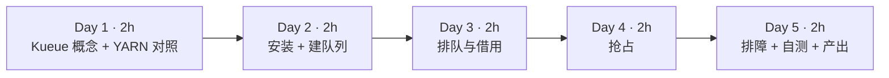

| 天 | 时间 | 先读 | 再读（外部资料） | 再做 |
|---|---|---|---|---|
| Day 1 | ~2h | 本页 2.1、2.2 | ① [Kueue Overview](https://kueue.sigs.k8s.io/docs/overview/)（20 分钟）；② [Concepts 总览](https://kueue.sigs.k8s.io/docs/concepts/)（15 分钟）；③ [Workload](https://kueue.sigs.k8s.io/docs/concepts/workload/)（15 分钟） | — |
| Day 2 | ~2h | 本页 2.3 | ④ [ResourceFlavor](https://kueue.sigs.k8s.io/docs/concepts/resource_flavor/)（15 分钟）；⑤ [ClusterQueue](https://kueue.sigs.k8s.io/docs/concepts/cluster_queue/) 读 Resources、Flavors、Cohort、FlavorFungibility（40 分钟）；⑥ [LocalQueue](https://kueue.sigs.k8s.io/docs/concepts/local_queue/)（5 分钟） | 实验 0、1 |
| Day 3 | ~2h | 本页 2.4 | ⑦ [Cohort](https://kueue.sigs.k8s.io/docs/concepts/cohort/)（15 分钟）；⑧ [Run a Job](https://kueue.sigs.k8s.io/docs/tasks/run/jobs/)（10 分钟） | 实验 2 |
| Day 4 | ~2h | 本页 2.5 | ⑨ [Preemption](https://kueue.sigs.k8s.io/docs/concepts/preemption/)（30 分钟）；⑩ [WorkloadPriorityClass](https://kueue.sigs.k8s.io/docs/concepts/workload_priority_class/)（10 分钟） | 实验 3、4 |
| Day 5 | ~2h | 本页 2.6 | ⑪ [Fair Sharing](https://kueue.sigs.k8s.io/docs/concepts/fair_sharing/)、⑫ [Topology Aware Scheduling](https://kueue.sigs.k8s.io/docs/concepts/topology_aware_scheduling/) 浏览（20 分钟） | 排障练习；自测；产出 |

**每日打卡：**

- [ ] Day 1：读完 ①②③，能写出 Kueue 对象与 YARN 队列的对照表
- [ ] Day 2：Kueue 运行起来，两个 ClusterQueue 就绪
- [ ] Day 3：复现“借用 A100 → 回退到 L4 → 第 4 个作业排队且不创建 Pod”
- [ ] Day 4：复现两种抢占，并读懂抢占事件
- [ ] Day 5：完成自测与产出

---

## 2. 核心概念讲解

### 2.1 Kueue 不是调度器，而是“准入控制器”

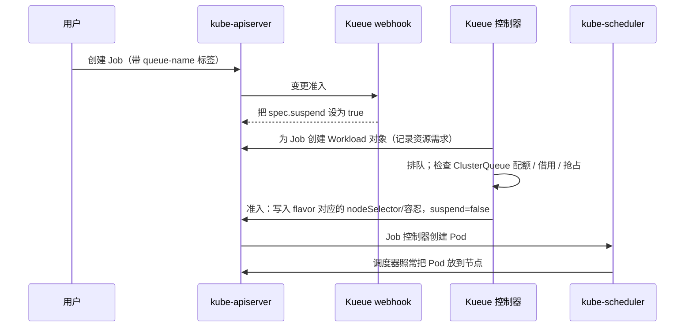

关键点：

- Kueue 管的是“**作业能否开始**”（准入，admission），Pod 放到哪个节点仍由 kube-scheduler 决定。两者分工明确，所以 Kueue 能和默认调度器、Volcano、甚至集群自动扩缩容一起用。
- 作业在被准入前**一个 Pod 都不创建**——这就从根本上避免了第 9 周的“半调度死锁”（实验 2 中第 4 个作业 `suspend=true`，没有任何 Pod）。
- Kueue 按 **Workload 的总需求**做准入：一个 2 worker × 2 卡的作业是“4 张卡”一起准入。注意这是**配额层面**的全有或全无；如果物理节点放不下（碎片化），Pod 仍可能 Pending，这时需要等待超时重排（`waitForPodsReady`）或拓扑感知调度（⑫）。

### 2.2 对象模型：和 YARN Capacity Scheduler 对照

| YARN Capacity Scheduler | Kueue | 说明 |
|---|---|---|
| 节点标签分区（node label partition） | **ResourceFlavor** | 一种“资源风味”，通过节点标签/污点对应到一组节点，如 A100、L4、Spot |
| 叶子队列 + capacity | **ClusterQueue** + `nominalQuota` | 每种 flavor、每种资源的名义配额 |
| 父队列（共享 capacity 的兄弟队列） | **Cohort** | 同一 cohort 的 ClusterQueue 之间可以互相借用闲置额度 |
| maximum-capacity | `borrowingLimit` / `lendingLimit` | 限制最多借多少、最多借出多少 |
| 用户提交到队列（`mapreduce.job.queuename`） | **LocalQueue**（命名空间内）→ ClusterQueue | 用户只看到自己命名空间里的 LocalQueue |
| Application | **Workload** | Kueue 为每个 Job 创建的“资源需求单” |
| 队列内应用优先级 | **WorkloadPriorityClass** | 只影响排队与抢占，不影响 Pod 调度优先级 |
| 抢占（preemption monitor） | `preemption.reclaimWithinCohort` / `withinClusterQueue` | 回收借出额度 / 队列内优先级抢占 |
| Fair Scheduler 的公平份额 | Fair Sharing（⑪） | 按份额公平地分配借用 |

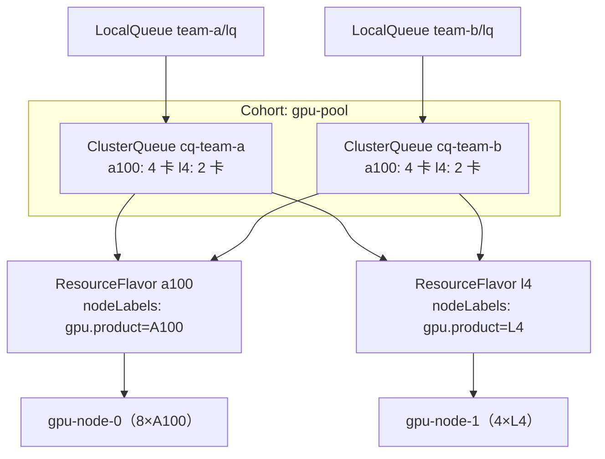

### 2.3 flavor 分配规则

ClusterQueue 的 `resourceGroups[].flavors` 是**有序列表**。Kueue 为一个 Workload 依次尝试每个 flavor：

- 当前 flavor 的**未用名义配额**足够 → 直接分配。
- 需要**借用**才够 → 由 `flavorFungibility.whenCanBorrow` 决定：默认 `MayStopSearch`（就借用当前 flavor，不再看后面的）。
- 需要**抢占**才够 → `whenCanPreempt` 默认 `TryNextFlavor`（先看下一个 flavor 能不能不抢占就放下）。

（以上默认值来自 ⑤ 的 FlavorFungibility 一节。）实验 2 中 a2 选择借用 A100，而不是去用 L4，正是 `MayStopSearch` 的结果。

准入后，Kueue 把 flavor 的 `nodeLabels`、`tolerations` 注入到 Pod 模板中，保证 Pod 落在对应的节点上（实验中可以看到准入后 Pod 带上了 `nvidia.com/gpu.product` 的 nodeSelector）。

### 2.4 借用与回收

$$\text{可用额度}_{CQ} = \text{nominalQuota}_{CQ} + \min\big(\text{borrowingLimit},\ \sum_{\text{cohort 其他 CQ}} \text{闲置额度}\big)$$

- 团队 B 空闲时，团队 A 可以借走 B 的额度（实验 2：A 的 A100 用到 8 张，其中借用 4 张）。
- B 有作业提交时，如果配置了 `reclaimWithinCohort`，Kueue 会**抢占** A 正在借用额度上运行的作业，把额度还给 B（实验 3）。
- 这与 YARN Capacity Scheduler 的“弹性队列 + 跨队列抢占”完全同构。区别在于 GPU 训练作业被抢占的代价很高（丢失未保存的训练进度），所以要配合**检查点**和合理的 `borrowingLimit`。

### 2.5 抢占的两种场景

| 场景 | 配置 | 实验 | 事件中的原因 |
|---|---|---|---|
| 回收借出的额度 | `reclaimWithinCohort: Any`（或 `LowerPriority`） | 实验 3 | `due to reclamation within the cohort` |
| 队列内高优先级挤掉低优先级 | `withinClusterQueue: LowerPriority` | 实验 4 | `due to prioritization in the ClusterQueue` |
| 借用时抢占其他队列的低优先级作业 | `borrowWithinCohort` | 扩展练习 | — |

被抢占的 Workload 会被**驱逐（Evicted）**：Kueue 把 Job 重新挂起（Pod 被删除），Workload 回到队列等待重新准入。

### 2.6 Kueue 的定位与生态

- 支持的作业类型很多：batch/Job、JobSet、Kubeflow 各类训练作业、RayJob/RayCluster、普通 Pod 等（见安装配置中的 `integrations.frameworks`）。第 11 周你会把 RayJob 交给 Kueue 管理。
- 公平共享（⑪）、拓扑感知调度（⑫，让一个作业的 Pod 尽量放在同一机架/同一 NVLink 域）、多集群（MultiKueue）都是进阶能力。
- 和 Volcano 的区别：Volcano 是一个完整的**批调度器**（替换或并行于 kube-scheduler，提供 gang 调度、队列等）；Kueue 只做**准入**，与默认调度器配合。第 11 周对比。

---

## 3. 动手实验 {{local}}

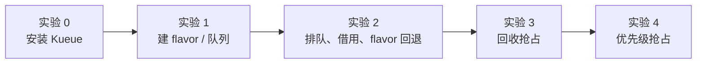

### 实验 0：安装 Kueue（30 分钟）

**推荐做法（Mac，kind，未在本站实测）**：按官方[安装文档](https://kueue.sigs.k8s.io/docs/installation/)，用 release 清单安装：

```bash
kind create cluster --name lab          # 或沿用实验环境页的 3 节点 kind 集群
kubectl apply --server-side -f https://github.com/kubernetes-sigs/kueue/releases/download/v0.20.2/manifests.yaml
kubectl -n kueue-system get pods        # 等 kueue-controller-manager Running
```

kind 中模拟 GPU 节点的方法见第 9 周背景阅读中的“为节点通告扩展资源”，再给节点打上 `nvidia.com/gpu.product` 标签。

**本站做法（KWOK + 集群外运行 Kueue）**：KWOK 中的 Pod 不会真正运行，所以 Kueue 控制器不能作为 Pod 部署。本站把 Kueue v0.20.2 用 Go 编译成二进制，在集群外运行，并让 webhook 地址指向 `https://127.0.0.1:19443`。为此做了三处改动：① 源码中写死的 metrics 证书目录 `/etc/kueue/metrics/certs` 改为可用环境变量 `KUEUE_METRICS_CERT_DIR` 覆盖（一行代码）；② 关闭 `VisibilityOnDemand` 特性门控（它同样依赖写死的 `/visibility` 证书目录）；③ 自签证书，webhook 配置中的 `service` 改为 `url`。启动脚本在仓库 `labs/w10/start-kueue-outofcluster.sh`，配置为：

```yaml
apiVersion: config.kueue.x-k8s.io/v1beta2
kind: Configuration
health: {healthProbeBindAddress: ":18081"}
metrics: {bindAddress: "0"}
webhook: {port: 19443, certDir: /home/box/kueue-run/certs}
leaderElection: {leaderElect: false}
internalCertManagement: {enable: false}
integrations:
  frameworks: ["batch/job"]
```

> 这只是在没有容器的环境里做实验的变通办法，**不要用于生产**。另外，为了让作业“运行”一段时间而不是瞬间完成，KWOK 集群加载了官方的 general 阶段配置（`kustomize/stage/pod/general`），作业通过注解 `pod-complete.stage.kwok.x-k8s.io/delay` 和 `.../jitter-delay` 控制运行时长（本站实测：只设 delay 不设 jitter-delay 时，Pod 仍会在几秒内完成）。

### 实验 1：创建 flavor、队列与优先级（20 分钟）

节点沿用第 9 周的 `nodes.yaml`（1 台 8×A100、1 台 4×L4）。`queues.yaml`：

```yaml
# 两种 GPU“风味”（ResourceFlavor）：按节点标签区分 A100 与 L4
apiVersion: kueue.x-k8s.io/v1beta2
kind: ResourceFlavor
metadata: {name: a100}
spec:
  nodeLabels: {nvidia.com/gpu.product: NVIDIA-A100-SXM4-80GB}
  tolerations: [{key: nvidia.com/gpu, operator: Exists, effect: NoSchedule}]
---
apiVersion: kueue.x-k8s.io/v1beta2
kind: ResourceFlavor
metadata: {name: l4}
spec:
  nodeLabels: {nvidia.com/gpu.product: NVIDIA-L4}
  tolerations: [{key: nvidia.com/gpu, operator: Exists, effect: NoSchedule}]
---
# 团队 A 的集群队列：A100 名义配额 4 张，可借用同一 cohort 中的闲置额度
apiVersion: kueue.x-k8s.io/v1beta2
kind: ClusterQueue
metadata: {name: cq-team-a}
spec:
  cohortName: gpu-pool
  namespaceSelector: {}
  queueingStrategy: BestEffortFIFO
  preemption:
    reclaimWithinCohort: Any            # 别人借走的我的额度，我需要时可以抢回
    withinClusterQueue: LowerPriority   # 队列内高优先级可以抢占低优先级
  resourceGroups:
  - coveredResources: ["cpu", "memory", "nvidia.com/gpu"]
    flavors:
    - name: a100
      resources:
      - {name: cpu, nominalQuota: 48}
      - {name: memory, nominalQuota: 512Gi}
      - {name: nvidia.com/gpu, nominalQuota: 4}
    - name: l4
      resources:
      - {name: cpu, nominalQuota: 24}
      - {name: memory, nominalQuota: 96Gi}
      - {name: nvidia.com/gpu, nominalQuota: 2}
---
apiVersion: kueue.x-k8s.io/v1beta2
kind: ClusterQueue
metadata: {name: cq-team-b}
spec:
  cohortName: gpu-pool
  namespaceSelector: {}
  queueingStrategy: BestEffortFIFO
  preemption:
    reclaimWithinCohort: Any            # 别人借走的我的额度，我需要时可以抢回
    withinClusterQueue: LowerPriority   # 队列内高优先级可以抢占低优先级
  resourceGroups:
  - coveredResources: ["cpu", "memory", "nvidia.com/gpu"]
    flavors:
    - name: a100
      resources:
      - {name: cpu, nominalQuota: 48}
      - {name: memory, nominalQuota: 512Gi}
      - {name: nvidia.com/gpu, nominalQuota: 4}
    - name: l4
      resources:
      - {name: cpu, nominalQuota: 24}
      - {name: memory, nominalQuota: 96Gi}
      - {name: nvidia.com/gpu, nominalQuota: 2}
---
apiVersion: v1
kind: Namespace
metadata: {name: team-a}
---
apiVersion: v1
kind: Namespace
metadata: {name: team-b}
---
apiVersion: kueue.x-k8s.io/v1beta2
kind: LocalQueue
metadata: {name: lq, namespace: team-a}
spec: {clusterQueue: cq-team-a}
---
apiVersion: kueue.x-k8s.io/v1beta2
kind: LocalQueue
metadata: {name: lq, namespace: team-b}
spec: {clusterQueue: cq-team-b}
---
# 作业优先级（Kueue 自己的优先级类，只影响排队与抢占，不影响 Pod 的调度优先级）
apiVersion: kueue.x-k8s.io/v1beta2
kind: WorkloadPriorityClass
metadata: {name: high}
value: 1000
---
apiVersion: kueue.x-k8s.io/v1beta2
kind: WorkloadPriorityClass
metadata: {name: low}
value: 100
```

```bash
kubectl apply -f queues.yaml
kubectl get clusterqueue
```

```text
NAME        COHORT     PENDING WORKLOADS
cq-team-a   gpu-pool   0
cq-team-b   gpu-pool   0
```

提交作业的脚本 `job.sh`（每个作业 N 个 worker，每个 worker 若干卡、8 核 CPU、64Gi 内存）：

```bash
#!/usr/bin/env bash
# 用法：./job.sh 命名空间 名字 worker数 每worker卡数 运行秒数 [优先级类]
# 生成一个提交到 Kueue LocalQueue “lq” 的分布式训练 Job。
ns=$1; name=$2; n=$3; gpu=$4; secs=$5; prio=${6:-}
plabel=""; [ -n "$prio" ] && plabel="    kueue.x-k8s.io/priority-class: $prio"
kubectl apply -n "$ns" -f - <<YAML
apiVersion: batch/v1
kind: Job
metadata:
  name: $name
  labels:
    kueue.x-k8s.io/queue-name: lq      # 关键：提交到哪个 LocalQueue
$plabel
spec:
  parallelism: $n
  completions: $n
  completionMode: Indexed
  template:
    metadata:
      annotations:
        pod-complete.stage.kwok.x-k8s.io/delay: "${secs}s"          # 仅 KWOK：模拟训练运行 $secs 秒
        pod-complete.stage.kwok.x-k8s.io/jitter-delay: "${secs}s"
    spec:
      restartPolicy: Never
      containers:
      - name: worker
        image: busybox
        resources:
          requests: {cpu: "8", memory: 64Gi}
          limits: {nvidia.com/gpu: $gpu}
YAML
```

观察状态的脚本 `status.sh`：

```bash
#!/usr/bin/env bash
# 查看 Kueue 工作负载、队列用量与 Pod 分布
echo "--- workloads"; kubectl get workloads.kueue.x-k8s.io -A -o custom-columns=NS:.metadata.namespace,NAME:.metadata.ownerReferences[0].name,PRIO:.spec.priority,ADMITTED:.status.conditions[?\(@.type==\"Admitted\"\)].status,FLAVOR:.status.admission.podSetAssignments[0].flavors.nvidia\\.com/gpu,EVICTED:.status.conditions[?\(@.type==\"Evicted\"\)].reason --sort-by=.metadata.creationTimestamp
echo "--- clusterqueues"; kubectl get clusterqueue -o custom-columns=NAME:.metadata.name,PENDING:.status.pendingWorkloads,ADMITTED:.status.admittedWorkloads
for cq in cq-team-a cq-team-b; do echo -n "$cq GPU 用量: "; kubectl get clusterqueue $cq -o jsonpath='{range .status.flavorsUsage[*]}{.name}={.resources[?(@.name=="nvidia.com/gpu")].total}(借用 {.resources[?(@.name=="nvidia.com/gpu")].borrowed}) {end}'; echo; done
echo "--- pods"; kubectl get pods -A -l batch.kubernetes.io/job-name --no-headers -o custom-columns=NS:.metadata.namespace,POD:.metadata.name,NODE:.spec.nodeName,STATUS:.status.phase 2>/dev/null | sort
```

> **坑**：K8s v1.37 开启 `GenericWorkload` 后，原生也有一个叫 `workloads` 的资源（`scheduling.k8s.io`）。此时 `kubectl get workloads` 查的是原生对象，会显示 `No resources found`——本站因此误以为 Kueue 没工作，排查了半天。务必写全名 `workloads.kueue.x-k8s.io`。

### 实验 2：排队、借用与 flavor 回退（40 分钟）

团队 A 连续提交 4 个作业，每个 2 worker × 2 卡 = 4 卡：

```bash
for i in 1 2 3 4; do ./job.sh team-a a$i 2 2 600 low; sleep 2; done
./status.sh
```

**本站输出：**

```text
--- workloads
NS       NAME   PRIO   ADMITTED   FLAVOR   EVICTED
team-a   a1     100    True       a100     <none>
team-a   a2     100    True       a100     <none>
team-a   a3     100    True       l4       <none>
team-a   a4     100    False      <none>   <none>
--- clusterqueues
NAME        PENDING   ADMITTED
cq-team-a   1         3
cq-team-b   0         0
cq-team-a GPU 用量: a100=8(借用 4) l4=4(借用 2) 
cq-team-b GPU 用量: a100=0(借用 0) l4=0(借用 0) 
--- pods
team-a   a1-0-x6zlx   gpu-node-0   Running
team-a   a1-1-2r6xl   gpu-node-0   Running
team-a   a2-0-5nqcw   gpu-node-0   Running
team-a   a2-1-k8s9d   gpu-node-0   Running
team-a   a3-0-r859s   gpu-node-1   Running
team-a   a3-1-4wrgt   gpu-node-1   Running
```

查看 a4 为什么排队：

```bash
kubectl get job -n team-a a4 -o jsonpath='a4 suspend={.spec.suspend}{"\n"}'
kubectl get workloads.kueue.x-k8s.io -n team-a -o jsonpath='{range .items[?(@.metadata.ownerReferences[0].name=="a4")]}{.status.conditions[?(@.type=="QuotaReserved")].message}{"\n"}{end}'
```

```text
a4 suspend=true
couldn't assign flavors to pod set main: insufficient unused quota for memory in flavor l4, 64Gi more needed, insufficient unused quota for nvidia.com/gpu in flavor a100, 4 more needed, insufficient unused quota for nvidia.com/gpu in flavor l4, 4 more needed
```

**逐步解释：**

- **a1**：用 A100 的名义配额（4 卡）。
- **a2**：A 的 A100 名义配额用完，但同 cohort 的 B 闲置，于是**借用** B 的 4 张 A100（`whenCanBorrow: MayStopSearch`）。
- **a3**：A100 全部用完（8/8），回退到下一个 flavor L4：A 自己的 2 张 + 借 B 的 2 张。
- **a4**：所有 flavor 都没有余量，Workload 排队；Job 保持 `suspend=true`，**没有创建任何 Pod**。对比第 9 周实验 6：这里不会出现“占着卡却凑不齐 worker”的情况。
- pending 消息逐个 flavor 列出缺口。它也揭示了一个细节：L4 flavor 的内存配额（96Gi）也不够——两个 worker 各 64Gi 已经超过。**配额要按 CPU、内存、GPU 一起设计**，否则 GPU 有余但内存配额先耗尽。

### 实验 3：团队 B 来了——回收借出的额度（20 分钟）

```bash
./job.sh team-b b1 2 2 600 low
./status.sh
kubectl get events -n team-a --field-selector reason=Preempted -o custom-columns=OBJ:.involvedObject.name,MSG:.message --no-headers
```

**本站输出：**

```text
--- workloads
NS       NAME   PRIO   ADMITTED   FLAVOR   EVICTED
team-a   a1     100    True       a100     <none>
team-a   a2     100    False      <none>   Preempted
team-a   a3     100    True       l4       <none>
team-a   a4     100    False      <none>   <none>
team-b   b1     100    True       a100     <none>
--- clusterqueues
NAME        PENDING   ADMITTED
cq-team-a   2         2
cq-team-b   0         1
cq-team-a GPU 用量: a100=4(借用 0) l4=4(借用 2) 
cq-team-b GPU 用量: a100=4(借用 0) l4=0(借用 0) 
--- pods
team-a   a1-0-x6zlx   gpu-node-0   Running
team-a   a1-1-2r6xl   gpu-node-0   Running
team-a   a3-0-r859s   gpu-node-1   Running
team-a   a3-1-4wrgt   gpu-node-1   Running
team-b   b1-0-mcxvk   gpu-node-0   Pending
team-b   b1-1-htzxg   gpu-node-0   Pending
job-a2-5bc65   Preempted to accommodate a workload (UID: 291d2bd9-...) due to reclamation within the cohort; preemptor path: /gpu-pool/cq-team-b; preemptee path: /gpu-pool/cq-team-a; preemptor effective priority: 100 (base: 100, boost: 0); preemptee effective priority: 100 (base: 100, boost: 0)
```

（UID 已截断。）约 5 秒后 b1 的两个 Pod 变为 Running：

```text
b1-0-mcxvk   1/1   Running   0     20s
b1-1-htzxg   1/1   Running   0     20s
```

**逐步解释：**

- 优先级相同，但 a2 是在**借用的额度**上运行，B 要回自己的名义配额，于是 a2 被抢占（`reclamation within the cohort`）。
- 刚准入时 b1 的 Pod 短暂 Pending：a2 的 Pod 还在终止中，物理 GPU 尚未释放。**配额层面已经腾出，物理层面稍后才腾出**，这个时间差在真实集群中可能是几十秒（取决于容器的优雅退出时间）。
- 注意 a3 仍在借用 L4（`借用 2`）：B 目前没有 L4 需求，所以不回收。
- a2 回到队列，额度空出来时会重新准入，从头开始运行——**作业需要自己做检查点**。

### 实验 4：高优先级作业——队列内抢占（20 分钟）

```bash
./job.sh team-a urgent 2 2 600 high
./status.sh
```

**本站输出：**

```text
--- workloads
NS       NAME     PRIO   ADMITTED   FLAVOR   EVICTED
team-a   a1       100    False      <none>   Preempted
team-a   a2       100    False      <none>   Preempted
team-a   a3       100    True       l4       <none>
team-a   a4       100    False      <none>   <none>
team-b   b1       100    True       a100     <none>
team-a   urgent   1000   True       a100     <none>
--- clusterqueues
NAME        PENDING   ADMITTED
cq-team-a   3         2
cq-team-b   0         1
cq-team-a GPU 用量: a100=4(借用 0) l4=4(借用 2) 
cq-team-b GPU 用量: a100=4(借用 0) l4=0(借用 0) 
--- pods
team-a   a1-1-2r6xl       gpu-node-0   Running
team-a   a3-0-r859s       gpu-node-1   Running
team-a   a3-1-4wrgt       gpu-node-1   Running
team-a   urgent-0-hbd85   gpu-node-0   Running
team-a   urgent-1-56jn9   <none>       Pending
team-b   b1-0-mcxvk       gpu-node-0   Running
team-b   b1-1-htzxg       gpu-node-0   Running
```

抢占事件：

```text
job-a1-559bc   Preempted to accommodate a workload (UID: 2fa1d8ed-...) due to prioritization in the ClusterQueue; preemptor path: /gpu-pool/cq-team-a; preemptee path: /gpu-pool/cq-team-a; preemptor effective priority: 1000 (base: 1000, boost: 0); preemptee effective priority: 100 (base: 100, boost: 0)
```

**逐步解释：**

- urgent（优先级 1000）在 A 的队列里没有余量，按 `withinClusterQueue: LowerPriority` 抢占了同队列的低优先级作业 a1（`prioritization in the ClusterQueue`）。
- 为什么抢 a1（A100）而不是 a3（L4）？urgent 的 flavor 列表里 A100 排在前面，抢占 a1 正好在 A100 上腾出 4 卡。
- 输出中能看到“交接期”：a1 的一个 Pod 仍在终止，urgent 的第二个 Pod 暂时 Pending，几秒后变为 ContainerCreating/Running。
- 如果 a4 一直排不上，你可能会想到“饥饿”问题——这正是公平共享（⑪）要处理的。

### 清理

```bash
kubectl delete job -A --all
```

### 常见错误与排查

| 现象 | 原因 | 解决 |
|---|---|---|
| `kubectl get workloads` 显示 No resources（本站实测，K8s 1.37 开启 GenericWorkload 时） | 与原生 `scheduling.k8s.io` Workload 重名 | 用 `workloads.kueue.x-k8s.io` |
| Job 创建后立即运行，没有被 Kueue 管理 | 没有 `kueue.x-k8s.io/queue-name` 标签，或命名空间不在管理范围 | 加标签；检查 `manageJobsWithoutQueueName`、`managedJobsNamespaceSelector` |
| Workload 一直 pending，消息 `insufficient unused quota ...`（本站实测） | 某种资源（常常是内存或 CPU）的配额先耗尽 | 按消息逐项核对 nominalQuota；GPU、CPU、内存一起设计 |
| 已准入但 Pod Pending（本站实测：抢占交接期） | 配额腾出但物理资源未释放；或碎片化 | 短暂的属于正常；长期 Pending 时配置 `waitForPodsReady` 让作业超时后重新排队 |
| `failed calling webhook ... connection refused`（本站实测） | Kueue 控制器未就绪或 webhook 地址错误 | 检查 `kueue-system` 中控制器 Pod 与 webhook Service |
| `no matches for kind "Workload" in version "kueue.x-k8s.io/v1beta2"`（本站实测，控制器启动早于 CRD 生效） | CRD 尚未 Established | 先 `kubectl wait --for condition=established crd --all` |
| 被抢占的训练从头开始 | 驱逐会删除 Pod | 训练代码做定期检查点；对长作业限制 `borrowingLimit` 或提高优先级 |

### 扩展练习

1. **borrowingLimit**：给 cq-team-a 的 A100 设置 `borrowingLimit: 2`，重做实验 2，看 a2 如何分配。
2. **whenCanBorrow: TryNextFlavor**：改为优先使用 L4 的未用额度而不是借 A100，比较结果。
3. **borrowWithinCohort**：阅读 ⑨，配置“借用时可以抢占其他队列的低优先级作业”，设计实验验证。
4. **waitForPodsReady**：阅读 Kueue 文档中的 “All-or-nothing with ready Pods” 相关配置，构造一个配额够、但物理节点放不下的场景（例如把 nominalQuota 设得比节点实际 GPU 多），观察作业是否超时后重新排队。
5. **RayJob 集成**：为第 11 周准备：阅读 Kueue 文档中运行 RayJob 的任务页，写出 RayJob 需要加的标签。

---

## 4. 精读指南

- **① [Overview](https://kueue.sigs.k8s.io/docs/overview/)**（20 分钟）。**读完回答**：Kueue 的设计原则中，为什么强调不重新实现已有的 K8s 功能（如调度、自动扩缩容）？
- **③ [Workload](https://kueue.sigs.k8s.io/docs/concepts/workload/)**（15 分钟）。**读完回答**：Workload 的 podSets 记录了什么？Workload 有哪些状态条件（QuotaReserved、Admitted、Evicted、Finished）？
- **④ [ResourceFlavor](https://kueue.sigs.k8s.io/docs/concepts/resource_flavor/)**（15 分钟）。**读完回答**：flavor 的 nodeLabels 与 tolerations 是如何作用到 Pod 上的？空 flavor（不带标签）适用于什么场景？
- **⑤ [ClusterQueue](https://kueue.sigs.k8s.io/docs/concepts/cluster_queue/)**（40 分钟）：重点读 resourceGroups、cohort、borrowingLimit/lendingLimit、FlavorFungibility、queueingStrategy（StrictFIFO vs BestEffortFIFO）。**读完回答**：StrictFIFO 下队头作业放不下时，后面的小作业会怎样？
- **⑦ [Cohort](https://kueue.sigs.k8s.io/docs/concepts/cohort/)**（15 分钟）：层级 cohort 如何表达“部门 → 团队”的配额树？
- **⑨ [Preemption](https://kueue.sigs.k8s.io/docs/concepts/preemption/)**（30 分钟）。**读完回答**：Kueue 选择被抢占对象的顺序是什么？`reclaimWithinCohort` 的三个取值有何区别？
- **⑪ [Fair Sharing](https://kueue.sigs.k8s.io/docs/concepts/fair_sharing/)、⑫ [Topology Aware Scheduling](https://kueue.sigs.k8s.io/docs/concepts/topology_aware_scheduling/)**（浏览）：了解它们解决的问题即可。
- **背景**：[Kueue GitHub 仓库](https://github.com/kubernetes-sigs/kueue)。

---

## 5. 自测题

<details>
<summary>1. Kueue 与 kube-scheduler 各负责什么？</summary>

Kueue 负责作业级准入：决定 Workload 能否开始（配额、借用、抢占、排队），通过 Job 的 suspend 字段控制，并注入 flavor 对应的节点选择与容忍。kube-scheduler 负责把已创建的 Pod 放到具体节点上。

</details>

<details>
<summary>2. 为什么 Kueue 能避免第 9 周的半调度死锁？它不能解决什么？</summary>

作业在准入前保持挂起、不创建 Pod，准入按整个 Workload 的总需求判断，所以不会出现多个作业各占一部分资源的情况。但这是配额层面的保证；如果配额与物理资源不一致或存在碎片化，已准入作业的 Pod 仍可能 Pending，需要 waitForPodsReady、拓扑感知调度或 gang 调度来补充。

</details>

<details>
<summary>3. 写出 Kueue 对象与 YARN Capacity Scheduler 的对应关系（至少 5 组）。</summary>

ResourceFlavor ↔ 节点标签分区；ClusterQueue + nominalQuota ↔ 叶子队列 capacity；Cohort ↔ 父队列/共享容量的兄弟队列；borrowingLimit ↔ maximum-capacity；LocalQueue ↔ 用户提交的队列名；Workload ↔ Application；WorkloadPriorityClass ↔ 应用优先级；reclaimWithinCohort ↔ 跨队列抢占。

</details>

<details>
<summary>4. 实验 2 中 a2 为什么借 A100 而不是用 L4？a3 为什么用 L4？</summary>

flavorFungibility.whenCanBorrow 默认 MayStopSearch：在 A100 上借用就能满足时停止搜索，所以 a2 借用 B 的 A100。到 a3 时，整个 cohort 的 A100 都已用完，连借用都不够，只能尝试下一个 flavor L4（自有 2 张 + 借用 2 张）。

</details>

<details>
<summary>5. 实验 3 中 a2 被抢占的原因是什么？优先级相同为什么还会被抢？</summary>

reclaimWithinCohort：a2 运行在借用的额度上，B 需要使用自己的名义配额时，Kueue 回收借出的额度，抢占在借用额度上运行的作业。回收与优先级无关（取值 Any 时）。

</details>

<details>
<summary>6. 被抢占的 Workload 会发生什么？对训练作业意味着什么？</summary>

Workload 被标记 Evicted，Job 重新挂起，Pod 被删除，Workload 回到队列等待重新准入。训练作业会丢失未保存的进度，因此需要定期检查点，并合理设置借用上限和优先级。

</details>

<details>
<summary>7. 一个作业的 Workload 显示 `insufficient unused quota for memory in flavor l4`，但 L4 的 GPU 还有余量，怎么办？</summary>

说明内存配额先于 GPU 耗尽。检查 ClusterQueue 中该 flavor 的内存 nominalQuota 是否与节点规格匹配，或者降低作业的内存请求。配额应按节点实际的 CPU/内存/GPU 比例一起设计。

</details>

### 思考题

1. **配额设计**：公司有 3 个部门、10 个团队，GPU 由平台部统一采购。请用层级 Cohort + ClusterQueue 设计一套配额树，说明 nominalQuota、borrowingLimit、lendingLimit 如何体现“部门保底 + 闲时共享 + 忙时回收”。
2. **抢占的代价**：训练作业被抢占可能损失数小时算力。你会制定怎样的抢占策略和作业规范（检查点间隔、可抢占标记、优先级审批）来平衡利用率与公平性？
3. **从 YARN 迁移**：把一套 YARN Capacity Scheduler 的队列配置（`capacity-scheduler.xml`）自动转换成 Kueue 对象，你会如何设计这个转换工具？哪些概念无法一一对应？

---

## 6. 本周产出与掌握清单

### 本周产出

1. `labs/w10/`：`queues.yaml`、`job.sh`、`status.sh` 与 `README.md`（实验 2–4 的输出与解释）。
2. **`kueue-vs-yarn.md`**：对象对照表 + 一份为你所在公司（或假想公司）设计的配额树。
3. 第 3 月项目报告的第二节：“作业级准入如何解决半调度死锁”，附实验 2 的输出作为证据。

### 掌握清单

- [ ] 能说出 Kueue 的 6 个核心对象及其与 YARN 的对应
- [ ] 能画出 Job → Workload → 准入 → Pod 的流程，并说明 suspend 的作用
- [ ] 会写 ResourceFlavor、ClusterQueue、LocalQueue
- [ ] 能解释 flavor 顺序与 FlavorFungibility 的默认行为
- [ ] 能复现并解释 cohort 内借用
- [ ] 能复现并解释回收抢占与优先级抢占
- [ ] 能读懂 Workload 的 pending 消息与 Preempted 事件
- [ ] 知道 `workloads` 资源重名的坑
- [ ] 知道 Kueue 不能解决的问题（物理碎片化），以及对应的补充手段
- [ ] 完成配额树设计

---

## 参考资料

- [Kueue Overview](https://kueue.sigs.k8s.io/docs/overview/)（文档·入门）
- [Kueue Concepts](https://kueue.sigs.k8s.io/docs/concepts/)（文档·入门）
- [Kueue：ClusterQueue](https://kueue.sigs.k8s.io/docs/concepts/cluster_queue/)（文档·进阶）
- [Kueue：LocalQueue](https://kueue.sigs.k8s.io/docs/concepts/local_queue/)（文档·入门）
- [Kueue：ResourceFlavor](https://kueue.sigs.k8s.io/docs/concepts/resource_flavor/)（文档·入门）
- [Kueue：Workload](https://kueue.sigs.k8s.io/docs/concepts/workload/)（文档·入门）
- [Kueue：Cohort](https://kueue.sigs.k8s.io/docs/concepts/cohort/)（文档·进阶）
- [Kueue：Preemption](https://kueue.sigs.k8s.io/docs/concepts/preemption/)（文档·进阶）
- [Kueue：WorkloadPriorityClass](https://kueue.sigs.k8s.io/docs/concepts/workload_priority_class/)（文档·入门）
- [Kueue：Fair Sharing](https://kueue.sigs.k8s.io/docs/concepts/fair_sharing/)（文档·高级）
- [Kueue：Topology Aware Scheduling](https://kueue.sigs.k8s.io/docs/concepts/topology_aware_scheduling/)（文档·高级）
- [Kueue 安装](https://kueue.sigs.k8s.io/docs/installation/)（文档·入门）
- [Kueue：Run a Job](https://kueue.sigs.k8s.io/docs/tasks/run/jobs/)（文档·入门）
- [Kueue GitHub](https://github.com/kubernetes-sigs/kueue)（仓库·进阶）

> 完整列表见 [参考资料库](/resources.html)。

=== m3w3 | 第 11 周：Volcano Gang 调度 + KubeRay | 第 3 月 · K8s + GPU 调度
# 第 11 周：Gang 调度（原生 PodGroup / Volcano）+ KubeRay

> **本周一句话**：第 9 周我们用两个“3 worker × 4 卡”的作业把默认调度器卡成了**半调度死锁**；上周 Kueue 在“准入”层面避免了它。本周从**调度器**层面解决同一个问题——gang 调度（全有或全无）。你会在同一个场景里依次试三种方案：K8s v1.37 原生 PodGroup、Volcano Job，以及用 KubeRay 把一个 Ray 集群作为整体交给 Volcano 调度。

**预计投入：约 10 小时**（阅读 ≈ 3.5h，动手 ≈ 4.5h，自测与产出 ≈ 2h）。{{local}}

**本周结束时你应该能：**

1. 解释 gang 调度的定义、它为什么能避免部分调度死锁，以及它和 Kueue 准入的分工。
2. 使用 K8s v1.37 原生 `PodGroup`（`scheduling.k8s.io/v1beta1`，Beta、默认关闭）给一组 Pod 声明 `minCount`。
3. 说出 Volcano 的对象模型（Job / PodGroup / Queue）和调度器的 action + plugin 架构，读懂 PodGroup 的 `Pending → Inqueue → Running` 状态。
4. 用 KubeRay 部署 RayCluster，并通过 `ray.io/scheduler-name: volcano` 让整个集群（head + 全部 worker）成为一个 gang。
5. 根据团队现状在“Kueue / Volcano / 原生 gang”之间做选型。

> **验证说明**：本站没有 Docker 和 GPU。实验仍在 KWOK 模拟集群 `lab2` 上进行（K8s v1.37.1，binary runtime，开启 `GenericWorkload` 特性门控与 `scheduling.k8s.io/v1beta1` API）。**Volcano v1.16.0** 的 vc-scheduler、vc-controller-manager 和 **KubeRay v1.7.1** 的 operator 均**从源码编译，以集群外普通进程运行**（没有安装 webhook）。调度决策、PodGroup 状态和事件都是真实的；Pod 的“运行”由 KWOK 模拟，没有真实容器，也没有真实 Ray 进程。本页所有输出均为真实输出。实验文件在仓库 `labs/w11/`。

---

## 1. 本周学习路线

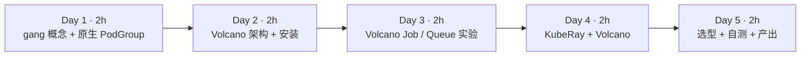

| 天 | 时间 | 先读 | 再读（外部资料） | 再做 |
|---|---|---|---|---|
| Day 1 | 2h | 2.1、2.2 | ① 原生 Gang Scheduling | 实验 1 |
| Day 2 | 2h | 2.3、2.4 | ② Volcano 文档、③ PodGroup、⑤ plugins | 实验 0 |
| Day 3 | 2h | 2.5 | ④ Queue、⑥ VolcanoJob | 实验 2、实验 3 |
| Day 4 | 2h | 2.6 | ⑦ KubeRay + Volcano、⑧ RayCluster 快速入门 | 实验 4 |
| Day 5 | 2h | 2.7 | ⑨ KubeRay + Kueue | 自测、本周产出 |

---

## 2. 核心概念讲解

### 2.1 gang 调度：全有或全无

分布式训练（DDP、Ray Train、MPI）的 N 个 worker 必须**同时**存在才能开始：任何一个缺席，其余的都只会在 `init_process_group` 里干等。默认 kube-scheduler 逐个 Pod 调度，于是两个作业可能各拿到一部分卡，谁都凑不齐——第 9 周实验 6 的死锁。

gang 调度的规则只有一句：**一组 Pod 中至少 `minMember` 个能同时放下时才一起绑定，否则一个都不绑定**。

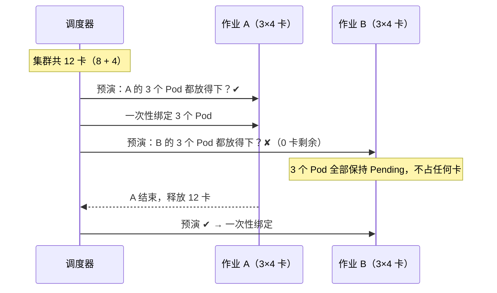

形式化地说，设作业 j 的 Pod 集合为 P_j，最小成员数为 m_j，调度器在一轮中给出的“暂定放置”为 X_j ⊆ P_j。gang 约束是：

$$|X_j| \ge m_j \;\Rightarrow\; \text{提交 } X_j, \qquad |X_j| < m_j \;\Rightarrow\; \text{全部回滚}$$

**大数据类比**：这就是 Spark 的 *barrier execution mode*（`rdd.barrier()`，所有 task 必须同时启动）在资源层面的版本；YARN 没有原生 gang，Spark barrier 模式需要集群“碰巧”有足够空槽，否则会等待并最终超时。

### 2.2 gang 与 Kueue 准入的分工

| 层面 | 解决的问题 | 本站对应 |
|---|---|---|
| 准入（Kueue） | “这个作业**现在应该开始吗**”：配额、借用、优先级、排队 | 第 10 周 |
| gang 调度（原生 PodGroup / Volcano） | “这个作业的 Pod **能不能同时放到节点上**”：物理放置的原子性 | 本周 |

Kueue 按配额判断，配额与物理资源不一致（碎片化、节点故障、配额超卖）时，已准入作业仍可能部分调度；gang 调度按真实节点空闲判断。两者可以叠加：Kueue 管排队和公平，调度器管原子放置。Volcano 则把两者做在一个系统里（Queue + gang）。

### 2.3 K8s v1.37 原生 Gang Scheduling

v1.37 起 Gang Scheduling 进入 Beta，但**默认关闭**（①）。在本站的 v1.37.1 上需要：

- 开启特性门控 `GenericWorkload=true`；
- 开启 API `scheduling.k8s.io/v1beta1=true`；
- 创建 `PodGroup`，`spec.schedulingPolicy.gang.minCount` 设置最小成员数；
- Pod 通过 `spec.schedulingGroup.podGroupName` 加入。

注意：**`GangScheduling` 不是特性门控名**（本站实测：写成门控会导致 apiserver 启动失败），正确做法是只开 `GenericWorkload`。这是一个仍在快速演进的 API，字段名以你所用版本的官方文档为准。

### 2.4 Volcano 架构

Volcano 是 CNCF 的批量调度系统，替换（或并存于）kube-scheduler。Pod 通过 `schedulerName: volcano` 选择它。

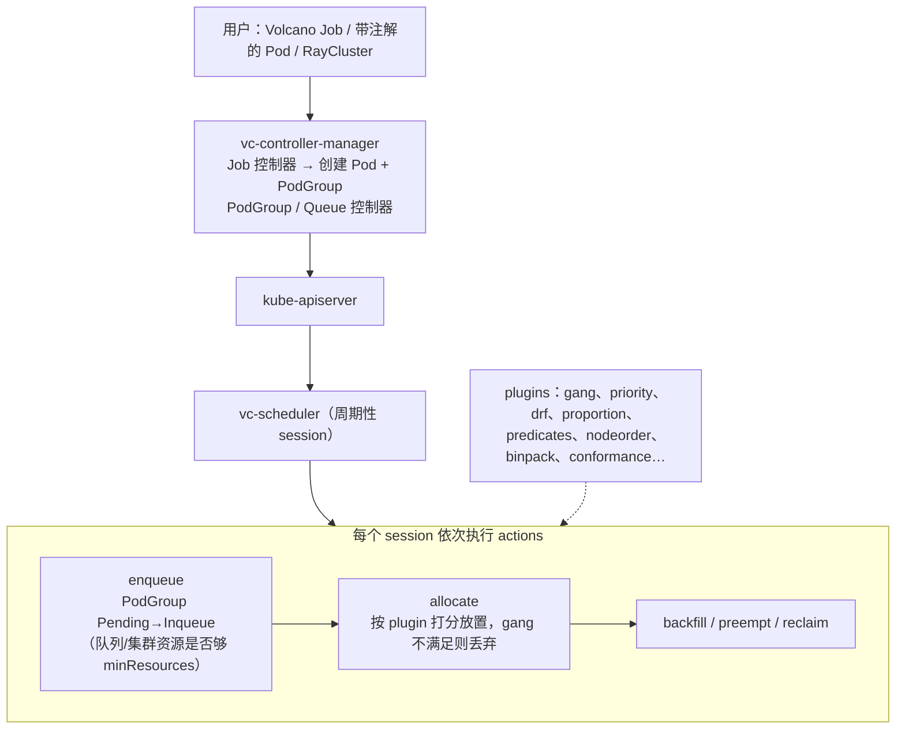

三个核心对象：

| Volcano 对象 | 作用 | 大数据类比 |
|---|---|---|
| `Job`（batch.volcano.sh） | 多 task 的批作业，`minAvailable` 即 gang 大小，含重启/失败策略 | YARN Application + AM 的容错逻辑 |
| `PodGroup`（scheduling.volcano.sh） | gang 单元：`minMember`、`minResources`、`queue` | Spark barrier stage |
| `Queue` | `weight`（按比例分空闲资源）、`capability`（硬上限）、`reclaimable` | Capacity Scheduler 队列（capacity / maximum-capacity） |

PodGroup 的状态机是排障关键：

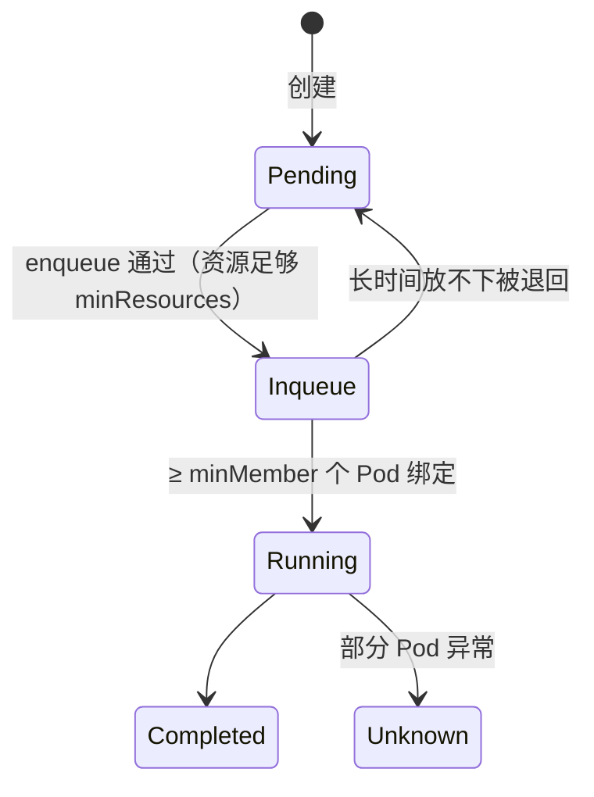

### 2.5 Volcano Queue：weight 与 capability

proportion 插件按 weight 计算每个队列的应得份额 deserved：

$$\text{deserved}_q = \min\Big(\text{request}_q,\; \text{capability}_q,\; \text{total} \cdot \frac{w_q}{\sum_{k \in \text{active}} w_k}\Big)$$

（多轮迭代，未用完的部分再按权重分给仍有需求的队列。）超过 deserved 的部分可被 `reclaim` 收回（若 `reclaimable: true`）。这与 YARN Capacity Scheduler 的 capacity/弹性/抢占几乎一一对应，也和 Kueue 的 nominalQuota + cohort 借用解决同一类问题。

### 2.6 KubeRay

KubeRay 是 Ray 官方的 K8s operator，提供三个 CRD：

| CRD | 含义 | 类比 |
|---|---|---|
| `RayCluster` | 一个长期运行的 Ray 集群（1 head + 若干 worker group，可自动扩缩） | 一个常驻的 Spark standalone 集群 |
| `RayJob` | 创建集群 → 提交作业 → 结束后可删除集群 | `spark-submit --deploy-mode cluster` |
| `RayService` | Ray Serve 在线服务，零停机升级 | 常驻服务 |

与调度器的集成（⑦）：operator 启动时带 `--batch-scheduler=volcano`（旧版本为 `--enable-batch-scheduler`），RayCluster 打上 `ray.io/scheduler-name: volcano` 标签后，operator 会为它创建一个 PodGroup，`minMember` = 1 + 各 worker group 的 `minReplicas` 之和，`minResources` = 这些 Pod 的资源总和，并把所有 Pod 的 `schedulerName` 设为 volcano。`volcano.sh/queue-name` 标签指定队列。

### 2.7 选型

| 场景 | 建议 |
|---|---|
| 已有 Job / JobSet / RayJob，主要诉求是多团队配额、借用、排队 | Kueue（不换调度器） |
| 需要 gang + 队列 + 批调度插件（binpack、拓扑、DRF）一体化，或 MPI/PyTorch 多角色作业 | Volcano |
| 只需要 gang，集群已在 v1.37+ 且愿意用 Beta 特性 | 原生 PodGroup（关注后续版本的 API 变化） |
| Kueue + 物理原子放置 | Kueue 负责准入，配合 waitForPodsReady 或调度器 gang |

---

## 3. 动手实验 {{local}}

本周所有实验使用同一个“死锁场景”：集群有 gpu-node-0（8 卡 A100，带污点）与 gpu-node-1（4 卡 L4），共 12 卡；两个作业各需 3 worker × 4 卡 = 12 卡。节点定义沿用第 9 周的 `labs/w9/nodes.yaml`。

### 实验 0：环境（30–60 分钟）

**Mac 上的推荐做法**：kind 集群 + 官方 Helm 安装：

```bash
helm repo add volcano-sh https://volcano-sh.github.io/helm-charts
helm install volcano volcano-sh/volcano -n volcano-system --create-namespace
helm repo add kuberay https://ray-project.github.io/kuberay-helm/
helm install kuberay-operator kuberay/kuberay-operator --set batchScheduler.name=volcano
```

（以上 Helm 命令来自官方文档，本站没有 Docker，**未在本站实测**；Helm values 名称请以你安装的 chart 版本的 values.yaml 为准。）

**本站做法**（无 Docker）：KWOK `lab2` 集群需要 v1.37 并开启原生 gang：

```bash
KWOK_KUBE_VERSION=v1.37.1 kwokctl create cluster --name lab2 --runtime binary \
  --enable-crds=Stage \
  --kube-feature-gates "GenericWorkload=true" \
  --kube-runtime-config "scheduling.k8s.io/v1beta1=true"
kubectl apply -f labs/w9/nodes.yaml
# 应用 KWOK 仓库 kustomize/stage/pod/general 中的 Pod 生命周期 stage
```

Volcano（v1.16.0）与 KubeRay（v1.7.1）从源码编译后在集群外运行：

```bash
# Volcano：安装 CRD，再启动调度器与控制器（kubeconfig 指向 lab2）
kubectl create -f installer/helm/chart/volcano/crd/bases/
./vc-scheduler --kubeconfig ~/.kube/config --scheduler-conf volcano-scheduler.conf
./vc-controller-manager --kubeconfig ~/.kube/config --leader-elect=false \
  --controllers='*,-jobflow-controller,-jobtemplate-controller,-sharding-controller,-colocation-config-controller,-hyperNode-controller'

# KubeRay：ray-operator 目录下 go build，安装 CRD 后启动
kubectl create -f config/crd/bases/
./kuberay-operator --batch-scheduler=volcano --metrics-addr=:28080 \
  --health-probe-bind-address=:28081 --leader-election-namespace=default
```

关掉那几个控制器，是因为它们依赖的 CRD（如 JobFlow）没有安装，启动时会一直等待（本站实测卡住）。KubeRay operator 启动日志（真实输出，节选）：

```text
{"level":"info","logger":"setup","msg":"Feature flag batch-scheduler is enabled","scheduler name":"volcano"}
{"level":"info","logger":"setup","msg":"Flag watchNamespace is not set. Watch custom resources in all namespaces."}
{"level":"info","logger":"setup","msg":"Setup manager"}
```

### 实验 1：原生 PodGroup 解开死锁（30 分钟）

与第 9 周实验 6 完全相同的提交顺序（a0、b0、a1、b1、a2、b2 交替），只是每个作业先建一个 gang PodGroup：

```bash
#!/usr/bin/env bash
# 与第 9 周实验 6 相同的两个作业（各 3 worker × 4 卡，交替提交），
# 区别：每个作业先创建一个 K8s 原生 PodGroup（gang 策略，minCount=3），worker 通过 spec.schedulingGroup 加入。
# 需要 K8s v1.37+，并开启 GenericWorkload 特性门控与 scheduling.k8s.io/v1beta1 API。
for j in a b; do
kubectl apply -f - >/dev/null <<YAML
apiVersion: scheduling.k8s.io/v1beta1
kind: PodGroup
metadata: {name: job-$j}
spec:
  schedulingPolicy:
    gang: {minCount: 3}     # 3 个 worker 要么一起调度，要么都不调度
YAML
done
for i in 0 1 2; do
  for j in a b; do
kubectl apply -f - >/dev/null <<YAML
apiVersion: v1
kind: Pod
metadata: {name: job-$j-worker-$i, labels: {job: job-$j}}
spec:
  schedulingGroup: {podGroupName: job-$j}
  tolerations: [{key: nvidia.com/gpu, operator: Exists, effect: NoSchedule}]
  containers:
  - {name: worker, image: busybox, resources: {limits: {nvidia.com/gpu: 4}}}
YAML
  done
done
```

```bash
./gang-native.sh; sleep 12
kubectl get pods -o wide | awk '{print $1,$3,$7}'
kubectl get podgroups.scheduling.k8s.io
kubectl get podgroups.scheduling.k8s.io job-b -o jsonpath='{range .status.conditions[*]}{.type}={.status} {.reason}: {.message}{"\n"}{end}'
```

真实输出：

```text
NAME STATUS NODE
job-a-worker-0 Running gpu-node-0
job-a-worker-1 Running gpu-node-0
job-a-worker-2 Running gpu-node-1
job-b-worker-0 Pending <none>
job-b-worker-1 Pending <none>
job-b-worker-2 Pending <none>
NAME    POLICY   WORKLOAD   STATUS          AGE
job-a   Gang     <none>     Scheduled       12s
job-b   Gang     <none>     Unschedulable   12s
PodGroupInitiallyScheduled=False Unschedulable: minCount (3) cannot be satisfied: 0 scheduled, 2 remaining, pod group preemption: No preemption victims found for incoming preemptor
```

对比第 9 周：那时 a、b 各占一部分卡，两边都卡住；现在 job-a 完整调度，job-b **一张卡都没占**。模拟 job-a 结束（删除它的 Pod）：

```bash
kubectl delete pod -l job=job-a --force --grace-period=0; sleep 12
kubectl get pods -o wide | awk '{print $1,$3,$7}'; kubectl get podgroups.scheduling.k8s.io
```

```text
NAME STATUS NODE
job-b-worker-0 Running gpu-node-0
job-b-worker-1 ContainerCreating gpu-node-1
job-b-worker-2 Running gpu-node-0
NAME    POLICY   WORKLOAD   STATUS      AGE
job-a   Gang     <none>     Scheduled   25s
job-b   Gang     <none>     Scheduled   25s
```

job-b 整体获得调度（`ContainerCreating` 是 KWOK 模拟的启动过渡态）。

### 实验 2：Volcano Job（40 分钟）

```bash
#!/usr/bin/env bash
# 用法：./vcjob.sh 名字 worker数 每worker卡数 [队列]
# 提交一个 Volcano Job：minAvailable=worker 数，即 gang 调度（全有或全无）
name=$1; n=$2; gpu=$3; q=${4:-default}
kubectl apply -f - <<YAML
apiVersion: batch.volcano.sh/v1alpha1
kind: Job
metadata: {name: $name}
spec:
  schedulerName: volcano
  queue: $q
  minAvailable: $n                 # gang：至少 $n 个 Pod 能同时调度才开始
  tasks:
  - name: worker
    replicas: $n
    template:
      metadata:
        annotations:              # 仅 KWOK：让 Pod 模拟运行 10 分钟
          pod-complete.stage.kwok.x-k8s.io/delay: "600s"
          pod-complete.stage.kwok.x-k8s.io/jitter-delay: "600s"
      spec:
        restartPolicy: Never
        tolerations: [{key: nvidia.com/gpu, operator: Exists, effect: NoSchedule}]
        containers:
        - {name: worker, image: busybox, resources: {limits: {nvidia.com/gpu: $gpu}}}
YAML
```

```bash
./vcjob.sh vc-a 3 4; ./vcjob.sh vc-b 3 4; sleep 15
kubectl get vcjob
kubectl get podgroups.scheduling.volcano.sh
```

真实结果：vc-a `Running 3/3`；vc-b `Pending`，其 PodGroup 停在 `Inqueue`，状态消息与 Pod 事件为：

```text
NotEnoughResources: 3/3 tasks in gang unschedulable: pod group is not ready, 3 Pending, 3 minAvailable; Pending: 3 Unschedulable
```

删除 vc-a（并强制删除残留在 Terminating 的 Pod，KWOK 下偶发）后，vc-b 整体调度：

```text
NAME   STATUS    MINAVAILABLE   RUNNINGS   AGE
vc-b   Running   3              3          3m
NAME STATUS NODE
vc-b-worker-0 Running gpu-node-0
vc-b-worker-1 Running gpu-node-0
vc-b-worker-2 Running gpu-node-1
```

注意：vc-a 删除后 vc-b 并没有立即运行——中间有一段时间我们同时提交了另一个 12 卡作业（实验 3 的 big-research），两个 gang 在每轮 session 中都只能“暂定”放下一部分（事件 `Pod ... can possibly be assigned to gpu-node-0, once minAvailable is satisfied`），谁都凑不齐。删除 big-research 后 vc-b 才在下一轮完整放下。这说明 **gang 保证不会“部分绑定”，但两个都需要整个集群的作业之间仍可能互相拖慢**；生产中要靠队列优先级、`enqueue` 资源判断和合理的作业规模避免。

### 实验 3：Volcano Queue（30 分钟）

```yaml
# Volcano 队列：research 最多使用 4 张 GPU（capability 是硬上限），weight 决定空闲资源按比例分配
apiVersion: scheduling.volcano.sh/v1beta1
kind: Queue
metadata: {name: research}
spec:
  weight: 1
  reclaimable: true
  capability:
    nvidia.com/gpu: 4
```

```bash
kubectl apply -f queue.yaml
./vcjob.sh big-research 3 4 research     # 需要 12 卡，超过 research 的 capability 4
sleep 10
kubectl get vcjob big-research
kubectl get podgroups.scheduling.volcano.sh -o jsonpath='{range .items[?(@.spec.queue=="research")]}{.status.phase}{" | "}{.status.conditions[-1].message}{"\n"}{end}'
kubectl get queues.scheduling.volcano.sh research -o jsonpath='{.status}{"\n"}'
```

真实输出：

```text
NAME           STATUS    MINAVAILABLE   RUNNINGS   AGE
big-research   Pending   3                         10s
Inqueue | 2/3 tasks in gang unschedulable: pod group is not ready, 3 Pending, 3 minAvailable; Pending: 1 Schedulable, 2 Unschedulable
{"allocated":{"cpu":"0","memory":"0"},"reservation":{},"state":"Open"}
```

作业没有运行（gang 不满足），但它的 PodGroup 进入了 `Inqueue`——在本站的调度器配置下，`capability` 没有在 enqueue 阶段把它挡住。是否在 enqueue 阶段按 capability 拒绝，取决于调度器配置中启用的插件（proportion / capacity）及其参数，本站**没有进一步深究**，请以 ④ 和你的 `volcano-scheduler.conf` 为准。练习时可以把作业改成 1×4 卡，观察它在 capability 内能否运行。

### 实验 4：KubeRay RayCluster 作为一个 gang（40 分钟）

```yaml
# RayCluster + Volcano：label 让 KubeRay 为整个集群创建一个 PodGroup（head + 全部 worker 的 gang）
apiVersion: ray.io/v1
kind: RayCluster
metadata:
  name: rc-gang
  labels:
    ray.io/scheduler-name: volcano
    volcano.sh/queue-name: default
spec:
  rayVersion: "2.59.0"
  headGroupSpec:
    rayStartParams: {}
    template:
      metadata:
        annotations: {pod-complete.stage.kwok.x-k8s.io/delay: "3600s", pod-complete.stage.kwok.x-k8s.io/jitter-delay: "3600s"}
      spec:
        tolerations: [{key: nvidia.com/gpu, operator: Exists, effect: NoSchedule}]
        containers:
        - name: ray-head
          image: rayproject/ray:2.59.0
          resources: {limits: {cpu: "1", memory: 2Gi}, requests: {cpu: "1", memory: 2Gi}}
  workerGroupSpecs:
  - groupName: gpu
    replicas: 3
    minReplicas: 3
    maxReplicas: 3
    rayStartParams: {}
    template:
      metadata:
        annotations: {pod-complete.stage.kwok.x-k8s.io/delay: "3600s", pod-complete.stage.kwok.x-k8s.io/jitter-delay: "3600s"}
      spec:
        tolerations: [{key: nvidia.com/gpu, operator: Exists, effect: NoSchedule}]
        containers:
        - name: ray-worker
          image: rayproject/ray:2.59.0
          resources: {limits: {nvidia.com/gpu: 4}, requests: {nvidia.com/gpu: 4}}
```

```bash
kubectl apply -f raycluster.yaml; sleep 20
kubectl get raycluster
kubectl get podgroups.scheduling.volcano.sh -o custom-columns=NAME:.metadata.name,MIN:.spec.minMember,RES:.spec.minResources,PHASE:.status.phase
```

刚提交时（vc-b 的 Pod 还在 Terminating）真实输出：

```text
NAME      DESIRED WORKERS   AVAILABLE WORKERS   CPUS   MEMORY   GPUS   STATUS   AGE
rc-gang   3                                     1      2Gi      12              20s
NAME             MIN   RES                                       PHASE
ray-rc-gang-pg   4     map[cpu:1 memory:2Gi nvidia.com/gpu:12]   Pending
```

operator 自动创建了 PodGroup `ray-rc-gang-pg`：`minMember=4`（1 head + 3 worker），`minResources` 是四个 Pod 资源之和。资源释放后：

```text
NAME      DESIRED WORKERS   AVAILABLE WORKERS   CPUS   MEMORY   GPUS   STATUS   AGE
rc-gang   3                 3                   1      2Gi      12     ready    55s
NAME             MIN   PHASE
ray-rc-gang-pg   4     Running
NAME STATUS NODE
rc-gang-gpu-worker-48rwf Running gpu-node-0
rc-gang-gpu-worker-jt8pg Running gpu-node-0
rc-gang-gpu-worker-qd5qk Running gpu-node-1
rc-gang-head-n6hzl Running gpu-node-0
```

再提交一个相同的 rc-gang2：

```text
NAME       DESIRED WORKERS   AVAILABLE WORKERS   CPUS   MEMORY   GPUS   STATUS   AGE
rc-gang    3                 3                   1      2Gi      12     ready    80s
rc-gang2   3                                     1      2Gi      12              20s
NAME              MIN   PHASE
ray-rc-gang-pg    4     Running
ray-rc-gang2-pg   4     Pending
rc-gang2-gpu-worker-7k84g Pending
rc-gang2-gpu-worker-9svrs Pending
rc-gang2-gpu-worker-hh2s6 Pending
rc-gang2-head-rmwd6 Pending
```

rc-gang2 的 PodGroup 停在 `Pending`（连 Inqueue 都没进，enqueue 阶段就判断集群放不下 minResources），head 也没有被单独调度——不会出现“head 起来了、worker 永远等不到”的半个 Ray 集群。

> 本站只验证了**调度层面**：KWOK 中没有真实 Ray 进程，`ready` 状态来自 KWOK 模拟的 Pod Ready。在真实集群上请按 ⑧ 用 `kubectl exec` 进 head 运行 `ray status` 确认 worker 已注册。

### 清理

```bash
kubectl delete raycluster --all; kubectl delete vcjob --all
kubectl delete podgroups.scheduling.k8s.io --all; kubectl delete pod --all --force --grace-period=0
kubectl delete queue.scheduling.volcano.sh research
```

### 常见错误与排查

| 现象 | 原因 | 解决 |
|---|---|---|
| apiserver 启动失败，提示未知特性门控（本站实测） | 把 `GangScheduling` 当成门控 | 只开 `GenericWorkload=true` + `scheduling.k8s.io/v1beta1` API |
| `podgroups` 指向了错误的资源 | 原生与 Volcano 都有 PodGroup | 用全名 `podgroups.scheduling.k8s.io` / `podgroups.scheduling.volcano.sh` |
| vc-controller-manager 启动后一直不工作（本站实测） | 等待未安装的 JobFlow 等 CRD | 安装完整 CRD，或用 `--controllers` 关掉对应控制器 |
| Pod 一直 Pending 且没有 Volcano 事件 | Pod 的 `schedulerName` 不是 volcano / Volcano 调度器没启动 | 检查 `spec.schedulerName` 与 vc-scheduler 日志 |
| 删除作业后新作业仍 Pending（本站实测） | 旧 Pod 卡在 Terminating（KWOK 下），或另一个大 gang 在竞争 | 强制删除残留 Pod；检查同时等待的其他作业 |
| PodGroup 停在 Pending | enqueue 判断资源不足以满足 minResources | 减小作业、等待资源，或调整队列 |
| KubeRay operator 启动报 `address already in use`（本站实测） | 默认端口与其他控制器冲突 | 改 `--metrics-addr` 与 `--health-probe-bind-address` |
| RayCluster 没有 PodGroup | operator 未开 batch-scheduler，或 RayCluster 缺 `ray.io/scheduler-name` 标签 | 两者都要配置 |

### 扩展练习

1. 把 rc-gang 的 worker `minReplicas` 改为 2、`replicas` 为 3，观察 PodGroup 的 `minMember` 如何变化，以及集群只剩 8 卡时能否启动。
2. 创建两个 weight 为 1:3 的队列，各提交多个 1×4 卡作业，记录稳态下各队列运行的作业数，与 2.5 的公式对照。
3. 阅读 ⑤ 中的 binpack 插件，设计实验比较开启前后小作业的放置位置（与第 9 周的碎片化问题关联）。
4. 阅读 ⑨，写出用 Kueue 管理 RayJob 所需的标签，并思考它与本周 Volcano 方案的差异。

---

## 4. 精读指南

- **① [K8s Gang Scheduling](https://kubernetes.io/docs/concepts/scheduling-eviction/gang-scheduling/)**（20 分钟）。**读完回答**：PodGroup 的 minCount 在什么时间点被检查？调度失败时整组 Pod 会怎样？
- **② [Volcano 文档首页](https://volcano.sh/en/docs/)**（20 分钟）：了解 Volcano 的定位与组件。
- **③ [PodGroup](https://volcano.sh/en/docs/podgroup/)**（15 分钟）。**读完回答**：PodGroup 有哪些 phase？minResources 的作用是什么？
- **④ [Queue](https://volcano.sh/en/docs/queue/)**（20 分钟）。**读完回答**：weight、capability、reclaimable 各控制什么？
- **⑤ [Plugins](https://volcano.sh/en/docs/plugins/)**（30 分钟）：重点读 gang、proportion、drf、binpack。
- **⑥ [VolcanoJob](https://volcano.sh/en/docs/vcjob/)**（20 分钟）：minAvailable、policies（如 PodEvicted → RestartJob）。
- **⑦ [KubeRay + Volcano](https://docs.ray.io/en/latest/cluster/kubernetes/k8s-ecosystem/volcano.html)**（20 分钟）。**读完回答**：RayCluster 需要哪些标签？PodGroup 的 minMember 如何计算？
- **⑧ [RayCluster 快速入门](https://docs.ray.io/en/latest/cluster/kubernetes/getting-started/raycluster-quick-start.html)** 与 [Ray on Kubernetes 总览](https://docs.ray.io/en/latest/cluster/kubernetes/index.html)（30 分钟）。
- **⑨ [KubeRay + Kueue](https://docs.ray.io/en/latest/cluster/kubernetes/k8s-ecosystem/kueue.html)**（20 分钟）。
- **源码**：[volcano-sh/volcano](https://github.com/volcano-sh/volcano)、[ray-project/kuberay](https://github.com/ray-project/kuberay)。

---

## 5. 自测题

<details>
<summary>1. 什么是 gang 调度？它如何避免第 9 周的死锁？</summary>

一组 Pod 只有在至少 minMember 个能同时放下时才一起绑定，否则全部不绑定。死锁的根源是两个作业各自占了部分资源并互相等待；gang 让放不下的作业一个资源都不占，资源全部留给能完整运行的作业。

</details>

<details>
<summary>2. 有了 Kueue 为什么还需要 gang 调度？</summary>

Kueue 按配额准入，不看实时的节点放置。配额与物理资源不一致、碎片化或节点故障时，已准入作业仍可能部分调度。gang 调度按真实节点空闲做原子放置。两者分别负责“该不该开始”和“能不能一起放下”。

</details>

<details>
<summary>3. 在 K8s v1.37 上启用原生 gang 需要哪些配置？</summary>

开启 GenericWorkload 特性门控和 scheduling.k8s.io/v1beta1 API；创建 PodGroup 并设置 spec.schedulingPolicy.gang.minCount；Pod 用 spec.schedulingGroup.podGroupName 加入。该功能在 v1.37 中为 Beta，默认关闭。

</details>

<details>
<summary>4. Volcano PodGroup 的 Pending 与 Inqueue 有何区别？</summary>

Pending 表示还没通过 enqueue（调度器认为资源不足以满足 minResources，或队列不允许）；Inqueue 表示已获准进入分配阶段，但可能仍因 gang 不满足而无法绑定。实验 4 的 rc-gang2 停在 Pending，实验 2 的 vc-b 停在 Inqueue。

</details>

<details>
<summary>5. KubeRay 如何让 RayCluster 成为一个 gang？</summary>

operator 开启 batch-scheduler=volcano，RayCluster 加 ray.io/scheduler-name: volcano 标签后，operator 创建 PodGroup，minMember = 1（head）+ 各 worker group 的 minReplicas，minResources 为这些 Pod 的资源和，并把 Pod 的 schedulerName 设为 volcano。实验中得到 ray-rc-gang-pg，minMember=4，GPU 12。

</details>

<details>
<summary>6. 用 YARN 概念解释 Volcano Queue 的 weight 与 capability。</summary>

weight 类似 Capacity Scheduler 的 capacity 比例（决定应得份额 deserved），capability 类似 maximum-capacity（硬上限），reclaimable 决定超出应得份额的资源能否被其他队列收回（类似跨队列抢占）。

</details>

<details>
<summary>7. 实验 2 中为什么 vc-a 删除后 vc-b 没有马上运行？</summary>

当时还有一个同样需要 12 卡的 big-research 在等待。每轮 session 两个 gang 都只能暂定放下一部分，gang 插件把不满足的分配全部丢弃，于是谁都没有绑定。删除 big-research 后 vc-b 才完整放下。gang 防止部分绑定，但不能自动解决大作业之间的竞争，需要优先级和队列策略。

</details>

### 思考题

1. 你们原来的 Spark 集群如果迁移到 K8s，哪些作业需要 gang（提示：barrier 模式、MPI 类作业）？哪些不需要？
2. gang 调度会让大作业长时间等待资源（饥饿），而小作业不断回填。你会如何结合优先级、预留（reservation）或 Kueue 来平衡？
3. 原生 PodGroup 成熟后，Volcano 的价值还剩哪些？请从队列、插件、作业生命周期三个方面讨论。

---

## 6. 本周产出与掌握清单

### 本周产出

- [ ] `labs/w11/` 中四个实验的 YAML/脚本与你自己的输出记录
- [ ] 一张图：同一个死锁场景在“默认调度器 / 原生 PodGroup / Volcano / KubeRay+Volcano”下的结果对比
- [ ] 一页选型笔记：Kueue vs Volcano vs 原生 gang（补充到本月产出“YARN 容量调度 vs Kueue/Volcano”）

### 掌握清单

- [ ] 能用一句话定义 gang 调度，并解释它与 Kueue 准入的分工
- [ ] 能在 v1.37 上配置原生 PodGroup 并读懂 Unschedulable 消息
- [ ] 能画出 Volcano 的 action/plugin 架构与 PodGroup 状态机
- [ ] 能写 Volcano Job 与 Queue，并解释 weight/capability
- [ ] 能让 RayCluster 通过 Volcano 作为整体调度，并说出 minMember 的计算方式
- [ ] 能根据场景给出调度方案选型

## 参考资料

- [K8s Gang Scheduling](https://kubernetes.io/docs/concepts/scheduling-eviction/gang-scheduling/)
- [Volcano 文档](https://volcano.sh/en/docs/) · [PodGroup](https://volcano.sh/en/docs/podgroup/) · [Queue](https://volcano.sh/en/docs/queue/) · [VolcanoJob](https://volcano.sh/en/docs/vcjob/) · [Plugins](https://volcano.sh/en/docs/plugins/)
- [KubeRay + Volcano](https://docs.ray.io/en/latest/cluster/kubernetes/k8s-ecosystem/volcano.html) · [KubeRay + Kueue](https://docs.ray.io/en/latest/cluster/kubernetes/k8s-ecosystem/kueue.html) · [RayCluster 快速入门](https://docs.ray.io/en/latest/cluster/kubernetes/getting-started/raycluster-quick-start.html)
- [volcano-sh/volcano](https://github.com/volcano-sh/volcano) · [ray-project/kuberay](https://github.com/ray-project/kuberay)

=== m3w4 | 第 12 周：GPU Operator + vLLM Pod | 第 3 月 · K8s + GPU 调度
# 第 12 周：真实 GPU 上的 GPU Operator + vLLM Pod

> **本周一句话**：前三周的 GPU 都是 KWOK“画”出来的。本周把它落到真实硬件上：用 **NVIDIA GPU Operator** 一次性装好驱动、容器工具包、device plugin、监控，再把 **vLLM** 作为 Deployment + Service 跑起来，在 K8s 里亲眼看到 `nvidia.com/gpu` 被分配，并完成第 3 月的核心产出——“YARN 容量调度 vs Kueue/Volcano”对比笔记。

**预计投入：约 10 小时**（阅读 ≈ 3h，GPU 机器上动手 ≈ 4h，笔记与自测 ≈ 3h；GPU 机器按 3–4 小时计费）。{{gpu1}}

**本周结束时你应该能：**

1. 说出 GPU Operator 管理的组件及各自职责，以及它们与第 9 周“GPU 节点软件栈”的对应。
2. 在单节点 K8s 上安装 GPU Operator，并用节点 allocatable 与验证 Pod 确认 GPU 可用。
3. 写出生产可用的 vLLM Deployment：GPU limits、型号选择、就绪探针、共享内存、Service。
4. 用 OpenAI 兼容接口调用 vLLM，并解释 Pod 启动慢的原因（拉镜像、下载权重、加载与 CUDA graph 捕获）。
5. 完成 YARN / Kueue / Volcano 的对比笔记。

> **验证说明（重要）**：本站没有 GPU。GPU Operator 安装、vLLM 推理均**未在本站实测，需 GPU**，命令与参数来自官方文档，页面中**没有任何虚构输出**。唯一实测的是“vLLM Deployment 在 KWOK 模拟集群上的调度行为”（实验 3），用来验证清单本身和 GPU 资源不足时的报错。实验文件在仓库 `labs/w12/`。

## 资源说明 {{gpu1}}

> 注意：GPU Operator 需要能管理宿主机驱动/容器运行时的环境。很多按小时计费的 GPU 平台给你的是**容器实例**（无法再在里面起完整 K8s 并安装驱动组件）。做本实验请选择提供**完整虚拟机/裸金属**且可 root 的 GPU 云主机；若只能拿到容器实例，可以退而求其次：直接用 `vllm serve` 体验，并把 K8s 部分留在本地模拟环境完成。

---

## 1. 本周学习路线

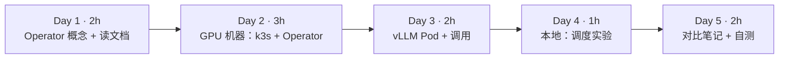

| 天 | 时间 | 先读 | 再读（外部资料） | 再做 |
|---|---|---|---|---|
| Day 1 | 2h | 2.1、2.2 | ① GPU Operator 概览、② Getting Started、③ 平台支持 | 准备 GPU 云主机（确认是 VM/裸金属） |
| Day 2 | 3h | 2.3 | ④ Container Toolkit、⑤ device plugin | 实验 1 |
| Day 3 | 2h | 2.4 | ⑦ vLLM on K8s、⑧ OpenAI 兼容服务 | 实验 2，释放机器 |
| Day 4 | 1h | — | ⑨ K8s 调度 GPU | 实验 3（本地 KWOK/kind） |
| Day 5 | 2h | 2.5 | ⑥ GPU 共享 | 对比笔记、自测 |

---

## 2. 核心概念讲解

### 2.1 为什么需要 GPU Operator

第 9 周我们画过 GPU 节点的软件栈：驱动 → container toolkit → device plugin → kubelet。手工在每台机器上装这些，版本要彼此匹配，升级时还要逐台操作。GPU Operator 用 K8s Operator 模式把它们都变成 DaemonSet，由一个 `ClusterPolicy` CR 统一声明。

**大数据类比**：像用 Ambari / Cloudera Manager 统一下发 HDFS、YARN NodeManager 的安装与配置，而不是逐台 ssh。

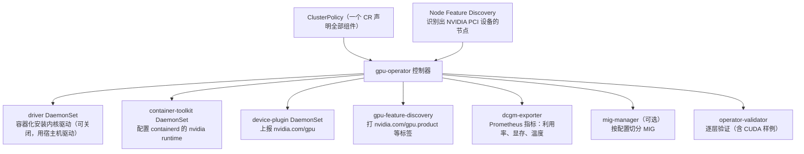

各组件的启动有依赖顺序：驱动就绪 → toolkit → device plugin 等；validator 会逐层验证。排障时按这个顺序看哪个 Pod 卡住。第 9–11 周 KWOK 节点上的 `nvidia.com/gpu.product` 标签，就是在模仿 gpu-feature-discovery 的输出。

### 2.2 驱动由谁装

| 方式 | 配置 | 适用 |
|---|---|---|
| Operator 容器化安装驱动 | 默认 | 干净的 VM，OS 在 ③ 平台支持列表中 |
| 使用宿主机已装驱动 | `driver.enabled=false` | 云厂商 GPU 镜像已预装驱动（常见） |

云主机镜像常已预装驱动，此时若仍让 Operator 装驱动会冲突，driver Pod 反复失败。先在宿主机运行 `nvidia-smi` 判断。

### 2.3 Pod 怎样拿到 GPU

1. Pod 写 `resources.limits: {nvidia.com/gpu: 1}`（扩展资源只能整数、写 limits，见第 9 周）。
2. 调度器按节点 allocatable 选点（实验 3 实测）。
3. kubelet 调用 device plugin 的 Allocate，拿到设备 ID。
4. 容器运行时通过 nvidia runtime 把对应的 `/dev/nvidia*` 和驱动库注入容器，容器内 `nvidia-smi` 只看到分到的卡。

### 2.4 vLLM Pod 的几个要点

- **启动时间**：拉镜像（vllm-openai 镜像体积很大）+ 下载权重 + 加载到显存 + 预分配 KV Cache / CUDA graph 捕获，可能需要数分钟。务必配置 readinessProbe（`/health`），否则 Service 会把请求发给尚未就绪的 Pod。
- **权重缓存**：每次重建 Pod 都重新下载很浪费，生产中用 PVC 或节点本地缓存挂到 HuggingFace 缓存目录；需要授权的模型通过 Secret 注入 `HF_TOKEN`。
- **共享内存**：多卡张量并行时进程间通信需要较大 `/dev/shm`，用 `emptyDir: {medium: Memory}` 挂载（⑦ 中有说明）。
- **显存预算**：`--max-model-len` 与 `--gpu-memory-utilization` 决定 KV Cache 大小；显存不够时会在启动阶段报错（第 4 月详细讲）。

### 2.5 第 3 月回顾：从 YARN 到 K8s 批调度

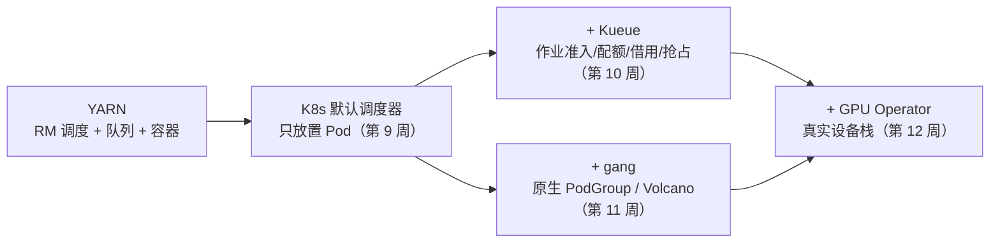

---

## 3. 动手实验

### 实验 1：单节点 K8s + GPU Operator（GPU 机器，约 1.5 小时）

> 未在本站实测，需 GPU。以下命令来自 k3s 与 GPU Operator 官方文档，具体参数以 ② 当前版本为准。

```bash
# 0. 确认宿主机情况
nvidia-smi                     # 能输出说明已预装驱动 → 下面加 --set driver.enabled=false
# 1. 单节点 K8s（以 k3s 为例；也可用 kubeadm）
curl -sfL https://get.k3s.io | sh -
export KUBECONFIG=/etc/rancher/k3s/k3s.yaml
# 2. 安装 GPU Operator
helm repo add nvidia https://helm.ngc.nvidia.com/nvidia && helm repo update
helm install --wait gpu-operator -n gpu-operator --create-namespace nvidia/gpu-operator
kubectl -n gpu-operator get pods
kubectl get node -o jsonpath='{.items[0].status.allocatable}'   # 应看到 nvidia.com/gpu
kubectl get node --show-labels | tr ',' '\n' | grep nvidia.com   # gpu-feature-discovery 打的标签
```

> k3s 使用 containerd 且配置路径与默认不同，GPU Operator 文档中有针对 k3s 的 toolkit 配置说明，遇到 toolkit 报错时查阅 ②。

验证 Pod（在容器中运行 `nvidia-smi`）：

```yaml
apiVersion: v1
kind: Pod
metadata: {name: gpu-smoke}
spec:
  restartPolicy: Never
  containers:
  - name: cuda
    image: nvcr.io/nvidia/cuda:12.4.1-base-ubuntu22.04   # 选与驱动兼容的 CUDA 版本
    command: ["nvidia-smi"]
    resources: {limits: {nvidia.com/gpu: 1}}
```

`kubectl logs gpu-smoke` 应显示一张 GPU。记录：Operator 各 Pod 的状态、allocatable 中的 GPU 数、GPU 型号标签。

### 实验 2：vLLM Deployment + 调用（GPU 机器，约 1 小时）

> 未在本站实测，需 GPU。

```yaml
# vLLM 推理服务：Deployment + Service。nodeSelector 用 GPU Feature Discovery 打的型号标签选 L4。
apiVersion: apps/v1
kind: Deployment
metadata: {name: vllm}
spec:
  replicas: 1
  selector: {matchLabels: {app: vllm}}
  template:
    metadata: {labels: {app: vllm}}
    spec:
      nodeSelector:
        nvidia.com/gpu.product: NVIDIA-L4
      tolerations: [{key: nvidia.com/gpu, operator: Exists, effect: NoSchedule}]
      containers:
      - name: vllm
        image: vllm/vllm-openai:latest      # 生产中请固定版本号
        args: ["--model", "Qwen/Qwen2.5-1.5B-Instruct", "--max-model-len", "4096"]
        ports: [{containerPort: 8000}]
        readinessProbe:                      # 模型加载完成前不接流量
          httpGet: {path: /health, port: 8000}
          initialDelaySeconds: 30
          periodSeconds: 10
        resources:
          limits: {nvidia.com/gpu: 1}
        volumeMounts: [{name: shm, mountPath: /dev/shm}]
      volumes:
      - name: shm                            # 张量并行时 NCCL 需要较大的共享内存
        emptyDir: {medium: Memory, sizeLimit: 2Gi}
---
apiVersion: v1
kind: Service
metadata: {name: vllm}
spec:
  selector: {app: vllm}
  ports: [{port: 8000, targetPort: 8000}]
```

在单节点 GPU 机器上，请删除 `nodeSelector`（或改成你的 GPU 型号标签）和 tolerations。

```bash
kubectl apply -f vllm.yaml && kubectl logs -f deploy/vllm
kubectl port-forward svc/vllm 8000:8000 &
curl localhost:8000/v1/models
curl localhost:8000/v1/chat/completions -H 'Content-Type: application/json' \
  -d '{"model":"Qwen/Qwen2.5-1.5B-Instruct","messages":[{"role":"user","content":"用一句话解释 KV Cache"}]}'
kubectl describe node | grep -A6 "Allocated resources"   # nvidia.com/gpu 已分配 1
```

记录：从 apply 到 Ready 的时间及各阶段耗时（看日志）、首个请求延迟、`nvidia-smi` 中显存占用。**完成后立即释放机器。**

### 实验 3：在模拟集群上验证清单与 GPU 不足（本地，20 分钟）{{local}}

在第 11 周的 KWOK `lab2` 集群（gpu-node-1 为 4 卡 L4）上应用同一份清单，检查清单是否被接受、`nodeSelector` 是否选中 L4 节点，并把副本扩到 5 观察资源不足。

```bash
kubectl apply -f labs/w12/vllm.yaml; sleep 10
kubectl get pods -o wide | awk '{print $1,$3,$7}'
kubectl scale deploy vllm --replicas=5; sleep 10
kubectl get pods -o wide | awk '{print $1,$3,$7}'
```

真实输出：

```text
deployment.apps/vllm created
service/vllm created
NAME STATUS NODE
vllm-c9f88d464-fxqkj Running gpu-node-1
---
deployment.apps/vllm scaled
NAME STATUS NODE
vllm-c9f88d464-2gn5g Pending <none>
vllm-c9f88d464-fxqkj Running gpu-node-1
vllm-c9f88d464-nmjl9 Running gpu-node-1
vllm-c9f88d464-qxjhf Running gpu-node-1
vllm-c9f88d464-sl6hs Running gpu-node-1
```

第 5 个副本的事件（真实输出）：

```text
0/3 nodes are available: 1 Insufficient nvidia.com/gpu, 2 node(s) didn't match Pod's node affinity/selector. preemption: 0/3 nodes are available: 1 No preemption victims found for incoming pod, 2 Preemption is not helpful for scheduling.
```

读法：L4 节点 4 卡已满（Insufficient），A100 节点和 CPU 节点被 nodeSelector 排除——即使 A100 上 8 张卡全空，这个副本也不会去。这正是“按型号选卡”的代价；若希望 L4 不够时退到 A100，应使用 Kueue 的 flavor 回退（第 10 周）或 nodeAffinity 的 preferred 规则。（KWOK 中 Pod 显示 Running 但没有容器真正运行。）

### 清理

```bash
kubectl delete -f labs/w12/vllm.yaml
# GPU 机器：helm uninstall gpu-operator -n gpu-operator；然后在云平台释放实例
```

### 常见错误与排查

以下来自官方文档的排障说明与通用经验，未在本站复现。

| 现象 | 可能原因 | 解决 |
|---|---|---|
| driver Pod 反复 CrashLoop | 宿主机已有驱动，或 OS/内核不在支持列表 | `driver.enabled=false`；对照 ③ |
| toolkit Pod 报错，GPU Pod 中看不到设备 | k3s 等发行版的 containerd 配置路径不同 | 按 ② 中对应发行版设置 toolkit 环境变量 |
| 节点 allocatable 中没有 nvidia.com/gpu | device plugin 未就绪（等待前序组件） | 按依赖顺序检查 operator 命名空间中的 Pod |
| vLLM Pod 长时间不 Ready | 拉镜像/下载权重慢 | 看日志判断阶段；预拉镜像、挂载权重缓存 |
| vLLM 启动时报显存不足 | max-model-len 太大或模型太大 | 降低 `--max-model-len`、调整 `--gpu-memory-utilization`、换小模型 |
| 需授权的模型下载 401/403 | 缺少 HF token | 用 Secret 注入 `HF_TOKEN` |
| `Insufficient nvidia.com/gpu`（本站实测） | 目标节点 GPU 已满或 selector 太严格 | 扩容、放宽 selector、或用 Kueue flavor |

### 扩展练习

1. 阅读 ⑥，在 GPU 机器上配置时间片共享（time-slicing），让节点上报多于物理卡数的 `nvidia.com/gpu`，同时运行两个 vLLM 小模型 Pod，观察性能与隔离性。
2. 部署 dcgm-exporter（Operator 默认包含）的指标到 Prometheus，找出 GPU 利用率与显存的指标名。
3. 用 Kueue 管理 vLLM 之外的批量推理 Job（第 8 周的离线推理改成 K8s Job），体会在线服务与离线批作业共享 GPU 的问题。

---

## 4. 精读指南

- **① [GPU Operator 概览](https://docs.nvidia.com/datacenter/cloud-native/gpu-operator/latest/index.html)**（20 分钟）。**读完回答**：Operator 管理哪些组件？
- **② [Getting Started](https://docs.nvidia.com/datacenter/cloud-native/gpu-operator/latest/getting-started.html)**（40 分钟）：重点是预装驱动、各发行版 containerd 配置、验证步骤。
- **③ [平台支持](https://docs.nvidia.com/datacenter/cloud-native/gpu-operator/latest/platform-support.html)**（10 分钟）：确认你租的机器 OS 与 GPU 在支持范围。
- **④ [NVIDIA Container Toolkit](https://docs.nvidia.com/datacenter/cloud-native/container-toolkit/latest/index.html)**（15 分钟）：容器如何看到 GPU。
- **⑤ [k8s-device-plugin](https://github.com/NVIDIA/k8s-device-plugin)**（20 分钟）：README 中的资源上报与共享配置。
- **⑥ [GPU 共享（time-slicing）](https://docs.nvidia.com/datacenter/cloud-native/gpu-operator/latest/gpu-sharing.html)**（20 分钟）。**读完回答**：时间片共享提供显存隔离吗？
- **⑦ [vLLM：Kubernetes 部署](https://docs.vllm.ai/en/latest/deployment/k8s.html)**（30 分钟）：PVC 缓存、Secret、shm、探针。
- **⑧ [vLLM OpenAI 兼容服务](https://docs.vllm.ai/en/latest/serving/openai_compatible_server.html)**（20 分钟）。
- **⑨ [K8s：调度 GPU](https://kubernetes.io/docs/tasks/manage-gpus/scheduling-gpus/)**（15 分钟）：官方对扩展资源与节点标签的说明。
- **源码**：[NVIDIA/gpu-operator](https://github.com/NVIDIA/gpu-operator)、[NVIDIA/dcgm-exporter](https://github.com/NVIDIA/dcgm-exporter)。

---

## 5. 自测题

<details>
<summary>1. GPU Operator 管理哪些组件？各自做什么？</summary>

驱动（容器化安装内核驱动，可关闭）、container toolkit（配置容器运行时以注入 GPU）、device plugin（上报 nvidia.com/gpu 并分配设备）、gpu-feature-discovery（打型号等节点标签）、dcgm-exporter（监控指标）、mig-manager（MIG 切分，可选）、validator（逐层验证）。依赖 NFD 识别 GPU 节点，统一由 ClusterPolicy 声明。

</details>

<details>
<summary>2. 云主机已预装驱动时应如何安装 Operator？为什么？</summary>

设置 driver.enabled=false，使用宿主机驱动；否则 Operator 的驱动容器会与已加载的内核模块冲突，driver Pod 失败，后续组件也无法就绪。

</details>

<details>
<summary>3. 为什么按小时计费的“容器实例”通常做不了本周实验？</summary>

GPU Operator 需要在宿主机层面安装驱动、修改容器运行时配置并运行特权 DaemonSet；容器实例里你本身就在一个容器中，无法控制宿主机，也通常无法运行完整的 K8s。

</details>

<details>
<summary>4. vLLM Deployment 为什么一定要有 readinessProbe？</summary>

vLLM 启动要拉镜像、下载并加载权重、预分配 KV Cache，可能需要数分钟。没有就绪探针时，容器一启动 Service 就会把流量转给它，请求会失败。

</details>

<details>
<summary>5. 实验 3 中第 5 个副本为什么不去空着的 A100 节点？如何让它“L4 不够用 A100”？</summary>

nodeSelector 要求 nvidia.com/gpu.product=NVIDIA-L4，A100 节点不匹配。可以用 nodeAffinity 的 preferredDuringScheduling 表达偏好，或用 Kueue 的 ResourceFlavor 顺序做回退。

</details>

<details>
<summary>6. 时间片共享与 MIG 的区别？</summary>

时间片共享让多个容器轮流使用同一张卡，没有显存和故障隔离；MIG 在硬件层面把支持的 GPU（如 A100/H100）切成多个实例，各有独立显存和计算单元，隔离性好但切分规格固定。

</details>

### 思考题

1. 在线推理服务（vLLM）与离线训练/批推理共享一个 GPU 集群时，你会用哪些机制（优先级、Kueue 队列、专用节点池、抢占）来保证在线服务的 SLA？
2. 对比 YARN 时代“NodeManager 统一部署”的经验，GPU 驱动升级在 K8s 集群中应该怎样滚动进行？

---

## 6. 本周产出与掌握清单

### 笔记模板：YARN 容量调度 vs Kueue/Volcano

| 维度 | YARN CapacityScheduler | Kueue | Volcano |
|---|---|---|---|
| 队列模型 | | | |
| 配额与借用 | | | |
| Gang 调度 | | | |
| 抢占 | | | |
| 异构资源（GPU 型号） | | | |
| 与生态集成（Spark/Ray/PyTorchJob） | | | |
| 适用场景 | | | |

提示：可以直接引用第 10、11 周你自己的实验输出作为每一格的证据。

## 参考资料

- [Stas Bekman：ml-engineering](https://github.com/stas00/ml-engineering)（书·进阶）：大模型训练/推理的硬件、网络、排障实战手册
- [vLLM 文档](https://docs.vllm.ai/en/latest/)（文档·入门）：部署、参数、OpenAI 兼容服务的权威说明
- [K8s：Dynamic Resource Allocation](https://kubernetes.io/docs/concepts/scheduling-eviction/dynamic-resource-allocation/)（文档·进阶）：新一代设备分配 API（DRA），GPU 调度的演进方向
- [NVIDIA GPU Operator 文档](https://docs.nvidia.com/datacenter/cloud-native/gpu-operator/latest/index.html)（文档·进阶）：驱动、container toolkit、device plugin、DCGM 一键部署
- [Slurm 文档](https://slurm.schedmd.com/documentation.html)（文档·入门）：HPC/训练集群常用调度器
- [Slurm Quick Start](https://slurm.schedmd.com/quickstart.html)（文档·入门）：sbatch/srun/partition 基本概念，快速建立与 K8s 的对照
- [ZOMI AISystem（中文）](https://github.com/chenzomi12/AISystem)（书·进阶）：AI 芯片、编译器、推理、训练系统的中文全景

> 完整列表见 [参考资料库](/resources.html)。

## 检查清单
- [ ] GPU Operator 组件全部 Running，节点出现 `nvidia.com/gpu`
- [ ] vLLM Pod 启动并能返回对话结果
- [ ] 完成对比笔记（第 3 月核心产出）
- [ ] 释放 GPU 机器
- [ ] 能画出 GPU Operator 组件图并说明依赖顺序
- [ ] 能解释实验 3 中调度失败消息的每一部分
