=== m4 | 第 4 月概览：推理服务平台 | 第 4 月 · 推理服务平台
# 第 4 月：推理服务平台

## 本月目标
- 理解 vLLM / SGLang 核心机制：PagedAttention、continuous batching、prefix cache、PD 分离、量化。
- 对同一 7B 量级模型分别用 vLLM 和 SGLang 部署，自写压测脚本统计吞吐、TTFT、TPOT。
- 搭建带自动扩缩容与监控（Prometheus/Grafana）的推理服务。

## 阅读
- [vLLM 文档](https://docs.vllm.ai/en/latest/)、[vLLM 博客](https://blog.vllm.ai/)
- [PagedAttention 论文](https://arxiv.org/abs/2309.06180)
- [SGLang 文档](https://docs.sglang.ai/)、[LMSYS 博客](https://lmsys.org/blog/)
- [llm-d](https://github.com/llm-d/llm-d)、[NVIDIA Dynamo](https://github.com/ai-dynamo/dynamo) 的 README
- [KServe](https://kserve.github.io/website/)、[Ray Serve](https://docs.ray.io/en/latest/serve/index.html)

## 周计划

| 周 | 主题 | 实验 | 资源 |
|---|---|---|---|
| [第 13 周](/m4w1.html) | 推理原理：PagedAttention 与 batching | 读论文 + 画图 | {{none}} |
| [第 14 周](/m4w2.html) | vLLM 部署与压测 | 自写压测脚本 | {{gpu1}} |
| [第 15 周](/m4w3.html) | SGLang 对比 + 调参 | batch / max_num_seqs / 量化 | {{gpu1}} |
| [第 16 周](/m4w4.html) | 扩缩容与监控 | Ray Serve/KServe + Prometheus/Grafana | {{local}} {{gpu1}} |

## 本月产出清单
- [ ] 压测脚本（可复用）
- [ ] vLLM vs SGLang 对比报告（含参数调优结果）
- [ ] 带监控面板的推理服务截图与架构图

=== m4w1 | 第 13 周：PagedAttention、continuous batching 与 PD 分离 | 第 4 月 · 推理服务平台
# 第 13 周：推理引擎核心机制——KV Cache、PagedAttention、continuous batching、PD 分离

> **本周一句话**：大模型推理的瓶颈不是算力，而是**显存里的 KV Cache** 和**怎样把很多请求塞进同一个 batch**。本周用一份真实的 `config.json` 算清 KV Cache 账，再用三个小程序亲手验证 PagedAttention 的显存收益、continuous batching 的吞吐收益，以及 KV Cache 本身带来的加速。下周你会在 vLLM 启动日志里看到同样的数字。

**预计投入：约 9 小时**（阅读 ≈ 4h，动手 ≈ 3h，自测与产出 ≈ 2h）。{{none}}

**本周结束时你应该能：**

1. 从 `config.json` 算出权重显存、每 token KV Cache 大小、给定显卡的并发上限，并解释 GQA 的作用。
2. 讲清 PagedAttention 的块表机制，以及它如何把显存利用率从“按最大长度预留”提升到接近 100%。
3. 讲清 continuous batching（迭代级调度）为什么同时改善吞吐和延迟。
4. 解释 prefill 与 decode 的资源特征差异，以及 PD 分离、prefix cache、量化各解决什么问题。

> **验证说明**：本周不需要 GPU。`kv_budget.py`、`paged_sim.py`、`batching_sim.py` 是纯计算/模拟程序，`kv_cache_cpu.py` 在本站 8 核 CPU 上用真实的 Qwen2.5-0.5B-Instruct（transformers 5.20.2、torch 2.14.1+cpu）运行。本页所有输出均为真实输出；其中两个模拟程序的**参数是假设值**（已在代码中注明），结论看趋势，不看绝对数值。实验文件在仓库 `labs/w13/`。

---

## 1. 本周学习路线

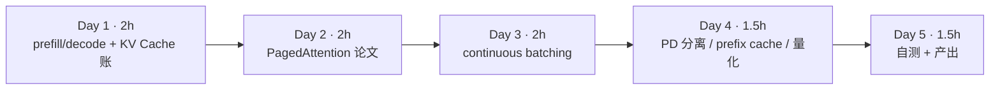

| 天 | 时间 | 先读 | 再读（外部资料） | 再做 |
|---|---|---|---|---|
| Day 1 | 2h | 2.1、2.2 | ⑤ Lilian Weng 推理优化综述（前半） | 实验 1、实验 4 |
| Day 2 | 2h | 2.3 | ① PagedAttention 论文、② vLLM 设计文档 | 实验 2 |
| Day 3 | 2h | 2.4 | ③ Orca 论文页、④ Inside vLLM | 实验 3 |
| Day 4 | 1.5h | 2.5、2.6 | ⑥ DistServe、⑦ prefix caching 设计、⑧ 量化文档 | — |
| Day 5 | 1.5h | — | — | 自测、本周产出 |

---

## 2. 核心概念讲解

### 2.1 一次推理的两个阶段

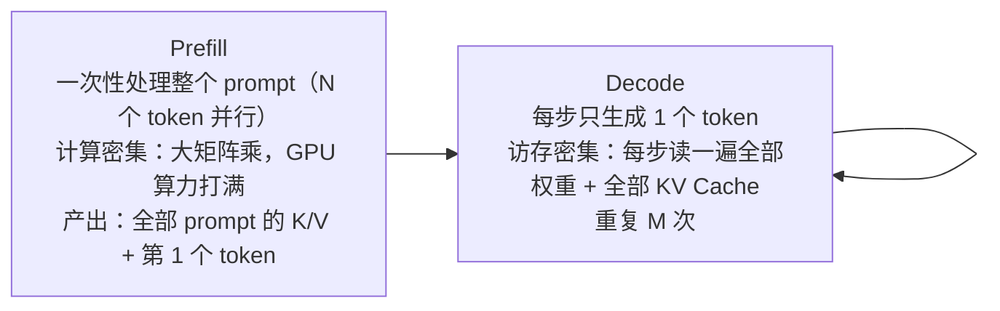

- **TTFT**（首 token 延迟）主要由排队 + prefill 决定；**TPOT**（每个输出 token 的间隔）由 decode 决定（下周压测的两个核心指标）。
- decode 时 batch 中有 1 个请求还是 32 个请求，读权重的开销几乎一样，所以**把更多请求塞进一个 batch 几乎是“免费”的吞吐**——前提是显存里放得下它们的 KV Cache。这就是本周所有技术的出发点。

**大数据类比**：prefill 像 Spark 的一次大 shuffle（吞吐型），decode 像逐条处理的流式算子（延迟型、受 I/O 限制）；把很多条记录攒成一批处理以摊薄固定开销，是你熟悉的老办法。

### 2.2 KV Cache 的账

注意力计算需要所有历史 token 的 Key 和 Value。缓存下来就不用每步重算——代价是显存：

$$\text{KV 字节/token} = 2 \times L \times n_{kv} \times d_{head} \times b$$

其中 2 表示 K 和 V，L 为层数，n_kv 为 KV 头数，d_head 为每头维度，b 为每个元素字节数（BF16 = 2）。

**GQA（Grouped-Query Attention，⑨）**：多个 Query 头共享一组 K/V 头。Qwen2.5-7B 有 28 个 Q 头、只有 4 个 KV 头，KV Cache 缩小为 1/7。

显卡上可用于 KV Cache 的显存：

$$M_{KV} = M_{GPU} \times u - M_{weights} - M_{act}$$

u 对应 vLLM 的 `--gpu-memory-utilization`。可并发的满长度请求数 ≈ M_KV ÷（KV 字节/token × 上下文长度）。

### 2.3 PagedAttention：给 KV Cache 做“分页”

早期系统给每个请求按**最大长度**预留一段连续显存。请求实际长度事先未知，预留的大部分都浪费了，还有外部碎片。PagedAttention（①）借鉴操作系统虚拟内存：

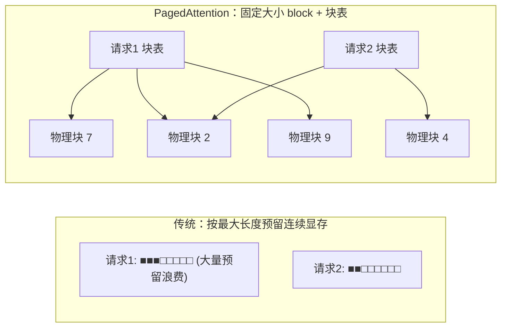

- KV Cache 被切成固定大小的 block（vLLM 默认 16 个 token），每个请求有一张**块表**，逻辑块 → 物理块。
- 按需分配：只有最后一个 block 可能没写满，浪费 < 1 个 block。
- 多个请求的相同前缀可以指向同一物理块（上图的物理块 2），引用计数 + 写时复制。这是 prefix cache 和并行采样（n>1、beam search）省显存的基础。

| 操作系统 | PagedAttention | 大数据类比 |
|---|---|---|
| 虚拟页 / 物理页框 | 逻辑块 / 物理块 | HDFS 文件的 block 与 DataNode 上的物理块 |
| 页表 | 块表 | NameNode 的 block map |
| 共享页 + 写时复制 | 共享前缀块 + 引用计数 | HDFS 快照共享未修改的 block |

### 2.4 continuous batching（迭代级调度）

静态 batch：凑齐一批一起跑，**整批最长的请求结束**后才放下一批进来。短请求结束后它的槽位就空着。Orca（③）提出按**迭代（每个 decode 步）**调度：每一步结束都检查，完成的请求立即离开，排队的请求立即补位。

```mermaid
gantt
  dateFormat X
  axisFormat %s
  section 静态 batch
  请求A(长) :0, 8
  请求B(短) :0, 3
  B 完成后空等 :3, 8
  请求C 等到整批结束 :8, 12
  section Continuous batching
  请求A(长) :0, 8
  请求B(短) :0, 3
  请求C 立即补位 :3, 7
```

大数据类比：静态 batch 像 MapReduce 一个 stage 等最慢的 task（长尾）；continuous batching 像 Spark 的动态 task 分配——executor 一空闲就领下一个 task。vLLM 的调度器在每一步决定：哪些请求继续 decode、哪些新请求做 prefill、KV 块不够时抢占谁（重算或换出到 CPU）。新版本还会把长 prompt 的 prefill 切块，与 decode 混在同一步（chunked prefill，见 ④），避免一个长 prompt 卡住所有人的 TPOT。

### 2.5 PD 分离

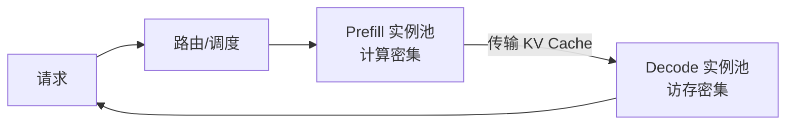

prefill 和 decode 混在同一组 GPU 上会互相干扰：长 prompt 的 prefill 拖慢正在 decode 的请求（TPOT 抖动），而为了 TPOT 限制 batch 又浪费 prefill 的算力。DistServe（⑥）把两者放到不同实例，分别按 TTFT 和 TPOT 目标选择并行度与实例数，代价是要在实例间传输 KV Cache（需要高速网络）。llm-d、NVIDIA Dynamo 等项目都在做这一层的调度与 KV 传输；vLLM 也提供了实验性的分离 prefill 功能（⑩）。

### 2.6 prefix cache 与量化

- **prefix cache**（⑦）：把已经算过的 block 按“前缀内容的哈希”留在显存，新请求前缀相同（同一个 system prompt、多轮对话的历史、few-shot 示例）就直接复用，跳过这部分 prefill，TTFT 下降。第 15 周会和 SGLang 的 RadixAttention 对比。
- **量化**（⑧）：把权重（有时也包括 KV Cache）从 16 位降到 8 位或 4 位。权重变小 → 显存省出来给 KV Cache，且 decode 每步读的字节更少 → 更快；代价是可能损失精度。常见格式有 AWQ、GPTQ、FP8，支持情况以引擎文档为准。实验 1 的第三组参数就是“KV Cache 用 8 位”的效果。

---

## 3. 动手实验 {{none}}

### 实验 1：用真实 config.json 算 KV Cache 账（30 分钟）

下载 Qwen2.5-7B-Instruct 的 [config.json](https://huggingface.co/Qwen/Qwen2.5-7B-Instruct/blob/main/config.json)：

```bash
curl -sL https://huggingface.co/Qwen/Qwen2.5-7B-Instruct/resolve/main/config.json -o qwen2.5-7b-config.json
```

```python
"""由 config.json 估算：权重显存、每 token 的 KV Cache、给定显卡上的 KV 容量与并发上限。
用法：python kv_budget.py qwen2.5-7b-config.json --gpu-gb 24 --util 0.9 --ctx 4096"""
import json, argparse
p = argparse.ArgumentParser()
p.add_argument("config"); p.add_argument("--gpu-gb", type=float, default=24)
p.add_argument("--util", type=float, default=0.9)      # 对应 vLLM --gpu-memory-utilization
p.add_argument("--act-gb", type=float, default=1.5)    # 激活/CUDA graph/碎片的经验预留（假设值）
p.add_argument("--ctx", type=int, default=4096); p.add_argument("--block", type=int, default=16)
p.add_argument("--wbytes", type=float, default=2); p.add_argument("--kvbytes", type=float, default=2)
a = p.parse_args(); c = json.load(open(a.config))
H, L, I, V = c["hidden_size"], c["num_hidden_layers"], c["intermediate_size"], c["vocab_size"]
nh, kvh = c["num_attention_heads"], c["num_key_value_heads"]; hd = H // nh
# 参数量：attention(q,o: H*H；k,v: H*kvh*hd，含 qkv bias) + MLP(3*H*I) + 2 个 RMSNorm；embedding 与 lm_head 不共享
attn = 2 * H * H + 2 * H * kvh * hd + (H + 2 * kvh * hd)
mlp = 3 * H * I
params = L * (attn + mlp + 2 * H) + V * H * (1 if c.get("tie_word_embeddings") else 2) + H
w_gb = params * a.wbytes / 1e9
kv_tok = 2 * L * kvh * hd * a.kvbytes                     # K 和 V，每层每个 KV 头 hd 维
budget = a.gpu_gb * a.util - w_gb - a.act_gb
toks = int(budget * 1e9 // kv_tok); blocks = toks // a.block
print(f"参数量 ≈ {params/1e9:.2f} B，权重 {w_gb:.2f} GB（{a.wbytes:g} 字节/参数）")
print(f"注意力：{nh} 个 Q 头、{kvh} 个 KV 头（GQA {nh//kvh}:1），head_dim={hd}")
print(f"每 token KV Cache = 2×{L}×{kvh}×{hd}×{a.kvbytes:g} = {kv_tok/1024:.0f} KiB")
print(f"若不用 GQA（KV 头 = {nh}）：{2*L*nh*hd*a.kvbytes/1024:.0f} KiB/token")
print(f"KV 预算 = {a.gpu_gb}×{a.util} - {w_gb:.2f} - {a.act_gb} = {budget:.2f} GB")
print(f"可容纳 {toks:,} 个 token = {blocks:,} 个 block（block={a.block}）")
print(f"上下文 {a.ctx} 满长度时最多并发 {toks // a.ctx} 个请求")
```

```bash
python kv_budget.py qwen2.5-7b-config.json                 # 24GB 卡（如 L4/4090）
python kv_budget.py qwen2.5-7b-config.json --gpu-gb 80     # 80GB 卡（A100/H100）
python kv_budget.py qwen2.5-7b-config.json --kvbytes 1     # KV Cache 用 8 位
```

真实输出：

```text
参数量 ≈ 7.62 B，权重 15.23 GB（2 字节/参数）
注意力：28 个 Q 头、4 个 KV 头（GQA 7:1），head_dim=128
每 token KV Cache = 2×28×4×128×2 = 56 KiB
若不用 GQA（KV 头 = 28）：392 KiB/token
KV 预算 = 24×0.9 - 15.23 - 1.5 = 4.87 GB
可容纳 84,904 个 token = 5,306 个 block（block=16）
上下文 4096 满长度时最多并发 20 个请求
===
KV 预算 = 80.0×0.9 - 15.23 - 1.5 = 55.27 GB
可容纳 963,810 个 token = 60,238 个 block（block=16）
上下文 4096 满长度时最多并发 235 个请求
===
每 token KV Cache = 2×28×4×128×1 = 28 KiB
可容纳 169,809 个 token = 10,613 个 block（block=16）
上下文 4096 满长度时最多并发 41 个请求
```

（第二、三组省略了与第一组相同的行。）解读：

- 算出的 7.62B 与官方公布的约 7.6B 一致，说明公式没漏项。
- 24GB 卡放下 7B BF16 权重后**只剩约 4.9GB 给 KV Cache**，满 4K 上下文只能并发约 20 个请求；80GB 卡的权重开销不变，KV 容量是 11 倍多。这就是“大显存卡吞吐高得不成比例”的原因。
- 没有 GQA 的话每 token 要 392KiB，24GB 卡上只能并发 2–3 个满长度请求。
- `--act-gb 1.5` 是经验预留的**假设值**；下周看 vLLM 启动日志里打印的 KV Cache 容量来校准。

### 实验 2：PagedAttention 的显存利用率（20 分钟）

```python
"""比较三种 KV Cache 分配方式的显存利用率（只做记账，不做计算）：
  contiguous：每个请求按 max_len 预留连续空间（早期系统做法）
  paged：按 block（16 token）按需分配，只有最后一个 block 有内部碎片
  paged+prefix：所有请求共享同一段 system prompt 的完整 block
"""
import random, argparse
p = argparse.ArgumentParser()
p.add_argument("--n", type=int, default=64); p.add_argument("--max-len", type=int, default=4096)
p.add_argument("--block", type=int, default=16); p.add_argument("--sys", type=int, default=512)
p.add_argument("--seed", type=int, default=0)
a = p.parse_args(); random.seed(a.seed)
# 某一时刻的 n 个在途请求：system prompt + 用户输入 + 已生成的 token
lens = [a.sys + random.randint(50, 1500) + random.randint(1, 800) for _ in range(a.n)]
used = sum(lens)
ceil = lambda x: -(-x // a.block)
contig = a.n * a.max_len
paged = sum(ceil(l) for l in lens) * a.block
shared = (a.sys // a.block) * a.block                     # 可共享的完整 block 部分
paged_pref = shared + sum(ceil(l - shared) for l in lens) * a.block
print(f"{a.n} 个在途请求，实际 token 数 {used:,}（平均 {used//a.n}）")
for name, alloc in [("contiguous(按 max_len 预留)", contig), ("paged(block=%d)" % a.block, paged),
                    ("paged + 共享 %d token 前缀" % a.sys, paged_pref)]:
    print(f"{name:<28} 分配 {alloc:>9,} token 槽位，逻辑token/物理槽位 {used/alloc:6.1%}，"
          f"同样显存可多容纳 {contig/alloc:4.1f}× 请求")
```

```text
64 个在途请求，实际 token 数 108,957（平均 1702）
contiguous(按 max_len 预留)     分配   262,144 token 槽位，逻辑token/物理槽位  41.6%，同样显存可多容纳  1.0× 请求
paged(block=16)              分配   109,440 token 槽位，逻辑token/物理槽位  99.6%，同样显存可多容纳  2.4× 请求
paged + 共享 512 token 前缀      分配    77,184 token 槽位，逻辑token/物理槽位 141.2%，同样显存可多容纳  3.4× 请求
```

- 按 max_len 预留时只有 41.6% 的槽位被真正使用；分页后浪费只剩每个请求最后一个 block 的零头（99.6%）。
- 共享 system prompt 后，**逻辑 token 数超过了物理槽位数**（141.2%）——同一份物理块被 64 个请求同时引用。
- 论文报告的现有系统 KV 显存利用率只有 20%–38%（①），比这里更低，因为真实系统还有外部碎片和更保守的预留。

### 实验 3：静态 batch vs continuous batching（30 分钟）

```python
"""静态 batch vs continuous batching 的离散步进模拟。
模型：每个 decode 步耗时 t = base + per_seq × batch（decode 访存受限，batch 增大时单步耗时增长很慢）；
prefill 简化为把请求的首 token 计入加入后的第一步。请求输出长度长短不一（长尾）。"""
import random, argparse, statistics
p = argparse.ArgumentParser()
p.add_argument("--n", type=int, default=256); p.add_argument("--batch", type=int, default=32)
p.add_argument("--base", type=float, default=20.0); p.add_argument("--per-seq", type=float, default=0.3)
p.add_argument("--seed", type=int, default=0)
a = p.parse_args(); random.seed(a.seed)
outs = [int(random.paretovariate(1.5) * 40) for _ in range(a.n)]   # 输出长度：多数短、少数很长
outs = [min(o, 2000) for o in outs]

def run(continuous):
    queue = list(range(a.n)); active = {}; t = 0.0; done = {}; steps = 0; slot_steps = 0
    while queue or active:
        if continuous or not active:                    # 静态：整批结束才补；连续：每步都补
            while queue and len(active) < a.batch:
                i = queue.pop(0); active[i] = outs[i]
        t += a.base + a.per_seq * len(active); steps += 1; slot_steps += a.batch
        for i in list(active):
            active[i] -= 1
            if active[i] <= 0: done[i] = t; del active[i]
    lat = list(done.values())
    return t, sum(outs) / t * 1000, statistics.mean(lat), sorted(lat)[int(.99 * len(lat))], sum(outs) / slot_steps

print(f"{a.n} 个请求同时到达，输出长度 p50={statistics.median(outs)} 均值={statistics.mean(outs):.0f} 最大={max(outs)}，batch 上限 {a.batch}")
for name, c in [("静态 batch", False), ("continuous batching", True)]:
    t, thr, mlat, p99, occ = run(c)
    print(f"{name:<20} 总耗时 {t/1000:6.1f}s 吞吐 {thr:7.1f} tok/s 平均完成时间 {mlat/1000:6.1f}s p99 {p99/1000:6.1f}s 槽位利用率 {occ:5.1%}")
```

```bash
python batching_sim.py               # batch 上限 32
python batching_sim.py --batch 128
```

真实输出：

```text
256 个请求同时到达，输出长度 p50=66.0 均值=114 最大=2000，batch 上限 32
静态 batch             总耗时  144.7s 吞吐   201.4 tok/s 平均完成时间   61.7s p99  139.4s 槽位利用率 13.4%
continuous batching  总耗时   60.4s 吞吐   482.6 tok/s 平均完成时间   12.9s p99   34.3s 槽位利用率 35.3%
===
256 个请求同时到达，输出长度 p50=66.0 均值=114 最大=2000，batch 上限 128
静态 batch             总耗时   81.9s 吞吐   355.8 tok/s 平均完成时间   23.5s p99   55.8s 槽位利用率  6.2%
continuous batching  总耗时   50.5s 吞吐   577.2 tok/s 平均完成时间    7.4s p99   24.5s 槽位利用率 10.9%
```

- 同样的 batch 上限，continuous batching 的吞吐是静态的 2.4 倍，平均完成时间降到约 1/5——**吞吐和延迟同时变好**，因为短请求不再被同批的长请求拖住。
- 槽位利用率都不高：最后阶段只剩那条 2000 token 的长请求在跑（长尾），队列已空，没有请求可补位。真实服务中请求持续到达，利用率会高得多。
- batch 上限从 32 提到 128，两种方式都变快——前提是显存放得下（回到实验 1 的 KV 账）。
- 单步耗时模型 `20ms + 0.3ms × batch` 是**假设值**，用来体现 decode 访存受限的特点，不代表任何具体 GPU。

### 实验 4：KV Cache 到底省了多少？（CPU 真实模型，20 分钟）

```python
"""在 CPU 上用真实小模型对比 有/无 KV Cache 的生成速度（transformers）。
无 cache 时每生成一个 token 都要把整个前缀重新算一遍：总计算量 O(n²)。"""
import time, torch, argparse
from transformers import AutoTokenizer, AutoModelForCausalLM
p = argparse.ArgumentParser(); p.add_argument("--model", default="Qwen/Qwen2.5-0.5B-Instruct")
p.add_argument("--new", type=int, default=128); a = p.parse_args()
torch.set_num_threads(8)
tok = AutoTokenizer.from_pretrained(a.model); m = AutoModelForCausalLM.from_pretrained(a.model, dtype=torch.float32).eval()
ids = tok("请用三句话介绍分布式文件系统 HDFS 的设计。" * 8, return_tensors="pt").input_ids
print(f"模型 {a.model}，prompt {ids.shape[1]} token，生成 {a.new} token（贪心，固定长度）")
for use_cache in (True, False):
    with torch.no_grad():
        t = time.perf_counter()
        m.generate(ids, max_new_tokens=a.new, min_new_tokens=a.new, do_sample=False, use_cache=use_cache)
        dt = time.perf_counter() - t
    print(f"use_cache={use_cache!s:<5} 耗时 {dt:6.2f}s  {a.new/dt:6.1f} token/s")
```

```bash
pip install torch transformers   # 第 2 月已安装
python kv_cache_cpu.py           # 首次运行会下载约 1GB 模型
```

真实输出（8 核 CPU）：

```text
模型 Qwen/Qwen2.5-0.5B-Instruct，prompt 104 token，生成 128 token（贪心，固定长度）
use_cache=True  耗时   5.33s    24.0 token/s
use_cache=False 耗时  24.77s     5.2 token/s
```

关掉 KV Cache 慢了 4.6 倍：每生成一个 token 都要把 104 + 已生成的全部 token 重新过一遍模型。生成越长差距越大（总计算量从 O(n) 变为 O(n²)）。这就是为什么推理引擎宁可花大量显存存 KV Cache——以及为什么显存管理成了核心问题。

### 常见错误与排查

| 现象 | 原因 | 解决 |
|---|---|---|
| 估算的参数量和官方差很多 | 漏了 embedding / lm_head，或误以为它们共享（看 `tie_word_embeddings`） | 逐项核对；7B 级模型 embedding+lm_head 约 1B |
| KV 每 token 算大了 7 倍 | 用 `num_attention_heads` 代替了 `num_key_value_heads` | GQA 模型用 KV 头数 |
| 估算并发比 vLLM 日志多 | 激活、CUDA graph、碎片的预留估少了 | 以日志中的 KV 块数为准，反推 `--act-gb` |
| `kv_cache_cpu.py` 下载失败 | 无法访问 HuggingFace | 设置 `HF_ENDPOINT` 镜像，或提前下载到本地目录后传路径 |
| 两次运行速度差很多 | CPU 线程数、首次加载的预热 | 固定 `torch.set_num_threads`，多跑几次取中位数 |

### 扩展练习

1. 对 Llama 或 DeepSeek 系列的某个模型下载 config.json，用 `kv_budget.py` 比较它们每 token 的 KV 大小（注意：MLA 架构的 DeepSeek 不能直接套这个公式，思考为什么）。
2. 修改 `paged_sim.py` 的 `--block` 为 1、16、256，观察利用率变化，并思考为什么 vLLM 不用 block=1（提示：块表开销与 kernel 访存效率）。
3. 修改 `batching_sim.py`，让请求按泊松过程持续到达，统计稳态下的 TTFT 分布。
4. 在 `kv_cache_cpu.py` 中把 `--new` 改为 32、128、256，画出两种方式耗时随生成长度的曲线。

---

## 4. 精读指南

- **① [PagedAttention 论文](https://arxiv.org/abs/2309.06180)**（90 分钟）：重点读第 2–4 节（问题、方法、调度与抢占）。**读完回答**：内部碎片、外部碎片、预留浪费分别指什么？KV 块不够时 vLLM 有哪两种抢占恢复方式？
- **② [vLLM PagedAttention 设计文档](https://docs.vllm.ai/en/latest/design/paged_attention.html)**（30 分钟，可略读 kernel 细节）。
- **③ [Orca（OSDI '22）](https://www.usenix.org/conference/osdi22/presentation/yu)**（30 分钟，读摘要与第 3 节）。**读完回答**：什么是 iteration-level scheduling 和 selective batching？
- **④ [Inside vLLM](https://blog.vllm.ai/2025/09/05/anatomy-of-vllm.html)**（60 分钟）：把调度器、KV 管理、chunked prefill、prefix cache、PD 分离串起来的官方长文。
- **⑤ [Lilian Weng：推理优化综述](https://lilianweng.github.io/posts/2023-01-10-inference-optimization/)**（45 分钟）。
- **⑥ [DistServe 论文](https://arxiv.org/abs/2401.09670)**（45 分钟，读第 1–3 节）。**读完回答**：为什么 prefill 和 decode 的最优并行策略不同？
- **⑦ [vLLM 自动前缀缓存设计](https://docs.vllm.ai/en/latest/design/prefix_caching.html)**（20 分钟）：block 哈希如何计算？淘汰策略是什么？
- **⑧ [vLLM 量化文档](https://docs.vllm.ai/en/latest/features/quantization/index.html)**（浏览）。
- **⑨ [GQA 论文](https://arxiv.org/abs/2305.13245)**（20 分钟，读摘要与图 2）。
- **⑩ [vLLM 分离 prefill](https://docs.vllm.ai/en/latest/features/disagg_prefill.html)**、[优化与调参](https://docs.vllm.ai/en/latest/configuration/optimization.html)（浏览，下周会用到）。

---

## 5. 自测题

<details>
<summary>1. prefill 和 decode 分别是计算密集还是访存密集？为什么？</summary>

prefill 一次处理整个 prompt 的多个 token，矩阵乘规模大，算力是瓶颈；decode 每步只处理 1 个新 token，却要读取全部权重和全部 KV Cache，访存带宽是瓶颈。因此 decode 阶段增大 batch 几乎不增加单步耗时。

</details>

<details>
<summary>2. 写出每 token KV Cache 的公式，并算出 Qwen2.5-7B（BF16）的值。</summary>

2 × 层数 × KV 头数 × head_dim × 字节数 = 2 × 28 × 4 × 128 × 2 = 57,344 字节 = 56 KiB。

</details>

<details>
<summary>3. 为什么 24GB 卡上 7B 模型的并发远低于 80GB 卡的 1/3？</summary>

权重显存（约 15GB）是固定开销，与卡大小无关。24GB 卡扣除权重和预留后只剩约 4.9GB 给 KV，80GB 卡剩约 55GB，KV 容量相差 11 倍以上，并发也相差约 11 倍。

</details>

<details>
<summary>4. PagedAttention 解决了哪几种浪费？共享前缀为什么能让“逻辑 token 数 > 物理槽位”？</summary>

解决了按最大长度预留造成的浪费、外部碎片，内部碎片被限制在最后一个 block 内。共享前缀时多个请求的块表指向同一批物理块（引用计数），同一份物理 KV 被多个请求逻辑使用，所以逻辑 token 数可以超过物理槽位数。

</details>

<details>
<summary>5. continuous batching 为什么同时提升吞吐和降低平均延迟？</summary>

静态 batch 中短请求结束后槽位空等，排队请求要等整批最长的请求结束；迭代级调度每步都让完成的请求离开、新请求补位，GPU 槽位一直被有用的工作占满（吞吐升高），短请求也不再被长请求拖住（延迟降低）。

</details>

<details>
<summary>6. PD 分离的收益和代价是什么？</summary>

收益：prefill 不再干扰 decode 的 TPOT，两类实例可以按各自的 SLO 独立选择并行策略与扩缩容。代价：需要在实例间传输 KV Cache（依赖高速网络），系统更复杂，小规模部署时可能得不偿失。

</details>

<details>
<summary>7. 实验 4 中关掉 KV Cache 为什么慢这么多？生成更长时差距会怎样？</summary>

没有缓存时每生成一个 token 都要重新计算整个前缀的注意力和全部层，总计算量随生成长度平方增长；有缓存时每步只计算一个新 token。生成越长差距越大。

</details>

### 思考题

1. 用你熟悉的 YARN 内存管理来类比：为什么“按最大值预留”在大数据里也很常见？它和 KV Cache 的预留浪费有什么相同和不同？
2. 如果你要给推理服务设计 SLO，TTFT 和 TPOT 分别应该定多少？对聊天、代码补全、离线批处理三种场景分别讨论。
3. prefix cache 命中率在什么业务里会很高？在什么业务里几乎没用？

---

## 6. 本周产出与掌握清单

### 本周产出

- [ ] 一张图：PagedAttention 块表 + 共享前缀示意（自己画）
- [ ] 你目标模型/目标显卡的 KV Cache 估算表（kv_budget.py 输出），留待下周用 vLLM 日志验证
- [ ] 一页笔记：五项技术（PagedAttention、continuous batching、prefix cache、PD 分离、量化）各自解决的问题

## 参考资料

- [PagedAttention（vLLM）论文](https://arxiv.org/abs/2309.06180)（论文·进阶）：KV Cache 分页管理的出处，第 13 周精读
- [vLLM 文档：PagedAttention 设计](https://docs.vllm.ai/en/latest/design/paged_attention.html)（文档·进阶）：论文思想在代码中如何落地
- [Inside vLLM: Anatomy of a High-Throughput LLM Inference System](https://blog.vllm.ai/2025/09/05/anatomy-of-vllm.html)（博客·进阶）：vLLM 官方博客长文，串起调度器、KV cache、prefix cache、PD 分离
- [DistServe 论文（PD 分离）](https://arxiv.org/abs/2401.09670)（论文·高级）：prefill/decode 分离的代表性论文
- [Lilian Weng：Large Transformer Model Inference Optimization](https://lilianweng.github.io/posts/2023-01-10-inference-optimization/)（博客·进阶）：量化、剪枝、KV 优化等推理优化技术综述
- [vLLM 博客](https://blog.vllm.ai/)（博客·进阶）：持续跟进推理引擎新特性
- [ZOMI AISystem（中文）](https://github.com/chenzomi12/AISystem)（书·进阶）：AI 芯片、编译器、推理、训练系统的中文全景

> 完整列表见 [参考资料库](/resources.html)。

## 检查清单
- [ ] 能画出 PagedAttention 块表示意图
- [ ] 能解释 continuous batching 为何提升吞吐
- [ ] 能说出 PD 分离的动机
- [ ] 完成 KV Cache 并发估算，留待下周验证
- [ ] 能从 config.json 手算每 token KV 大小，并解释 GQA
- [ ] 能解释 prefill/decode 的资源特征与 TTFT/TPOT 的关系

=== m4w2 | 第 14 周：vLLM 部署与压测 | 第 4 月 · 推理服务平台
# 第 14 周：vLLM 部署与压测——先学会“量”推理服务

> **本周一句话**：推理服务好不好，要用数字说话：**吞吐、TTFT、TPOT** 以及它们随并发的变化。本周先在本地 CPU 上搭一个**故意不做 batching** 的最小 OpenAI 兼容服务，用同一个压测脚本量出“排队导致 TTFT 爆炸”的现象，再量出 batch 带来的吞吐收益；然后上 GPU 用 vLLM 部署 7B 模型，对照上周的 KV Cache 估算，填完压测表。

**预计投入：约 10 小时**（阅读 ≈ 2.5h，本地动手 ≈ 3h，GPU 动手 ≈ 3h，自测与产出 ≈ 1.5h；GPU 机器约 3 小时）。{{local}} {{gpu1}}

**本周结束时你应该能：**

1. 准确定义吞吐、TTFT、TPOT（ITL）、端到端延迟和 goodput，并说出各自受哪个阶段影响。
2. 写出一个可复用的异步流式压测脚本，理解它的测量误差来源。
3. 用 vLLM 部署 OpenAI 兼容服务，从启动日志读出 KV Cache 容量并与估算对比。
4. 解释并发升高时吞吐、TTFT、TPOT 各自的变化规律，以及“无 batching”和“continuous batching”的本质差别。

> **验证说明**：本地部分（实验 1–3）在本站 8 核 CPU 上真实运行：Qwen2.5-0.5B-Instruct，transformers 5.20.2，torch 2.14.1+cpu，FastAPI 0.150.0，openai 3.35.1，输出均为真实输出。**vLLM 部分（实验 4–5）未在本站实测，需 GPU**，命令来自 vLLM 官方文档，页面中只有待你填写的空表，没有虚构数字。实验文件在仓库 `labs/w14/`。

---

## 1. 本周学习路线

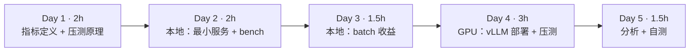

| 天 | 时间 | 先读 | 再读（外部资料） | 再做 |
|---|---|---|---|---|
| Day 1 | 2h | 2.1、2.2 | ⑥ LLM 推理指标、② OpenAI 兼容服务 | — |
| Day 2 | 2h | 2.3 | — | 实验 1、实验 2 |
| Day 3 | 1.5h | 2.4 | ④ Inside vLLM（调度器一节，复习） | 实验 3 |
| Day 4 | 3h | 2.5 | ① 快速入门、③ serve 参数、⑤ vllm bench serve | 实验 4、实验 5 |
| Day 5 | 1.5h | — | ⑦ 指标文档 | 填表、自测、产出 |

---

## 2. 核心概念讲解

### 2.1 指标定义

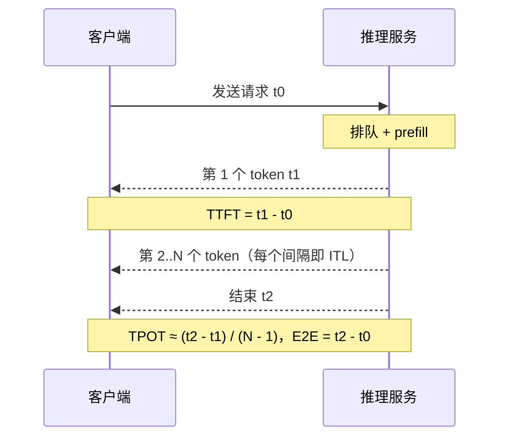

| 指标 | 定义 | 主要受什么影响 | 用户感受 |
|---|---|---|---|
| TTFT | 首 token 延迟 | **排队时间** + prefill（prompt 越长越大） | “多久开始回答” |
| TPOT / ITL | 输出 token 之间的平均间隔 | decode 单步耗时（batch 大小、模型大小、显存带宽） | “打字速度” |
| E2E 延迟 | TTFT + (N−1)×TPOT | 两者 + 输出长度 | 整段回答的等待 |
| 吞吐 | 单位时间输出 token 总数 | batch 大小、调度效率 | 成本（每卡每秒多少 token） |
| goodput | 满足 SLO（如 TTFT<1s 且 TPOT<50ms）的请求吞吐 | 吞吐与延迟的平衡 | 真正“有用”的吞吐 |

E2E 公式：

$$T_{E2E} = T_{TTFT} + (N_{out} - 1) \times T_{TPOT}$$

人类阅读速度大约每秒几个到十几个词，所以聊天场景 TPOT 只要明显快于阅读速度即可，TTFT 才是体验关键；离线批处理则只看吞吐。

**大数据类比**：吞吐 ≈ Spark 作业的 records/s，TTFT ≈ 作业排队 + 启动时间，TPOT ≈ 流处理的单条处理延迟，goodput ≈ 满足 SLA 的作业比例。

### 2.2 怎样写一个靠谱的压测脚本

- **流式**：只有流式响应才能测到 TTFT 和 TPOT。
- **控制并发而不是 QPS**：用信号量限制“同时在途”的请求数（闭环压测），简单且结果稳定；官方 `vllm bench serve` 还支持按泊松过程以固定请求率发送（开环压测），更接近真实流量（⑤）。
- **测量误差**：脚本按流式 chunk 计数，一个 chunk 可能包含多个 token（本站 mini_server 每请求约 57 个 chunk 对应 64 个 token）；客户端事件循环也会引入少量延迟。比较不同引擎时用**同一个脚本、同样的 prompt 和 max_tokens**。
- **预热**：首批请求包含模型/图编译等一次性开销，正式统计前先打一轮。
- **分位数**：看 p50 与 p95/p99，平均值会掩盖长尾（和你做 Spark 作业 SLA 时一样）。

### 2.3 没有 batching 时会怎样（排队论直觉）

如果服务一次只处理一个请求，每个请求的服务时间为 S，在并发 c 的闭环压测下，第 k 个到达的请求要先等前面 k−1 个：

$$T_{TTFT}^{(k)} \approx (k-1)\,S + T_{prefill}$$

吞吐恒为 1/S 个请求每秒，与并发无关；TPOT 不变；**TTFT 随并发线性增长**。实验 2 会直接量出这个现象。

### 2.4 batch 为什么能提高吞吐

上周讲过：decode 每步都要读一遍全部权重，batch 越大，这次读取被越多请求分摊。代价是单请求的每步耗时略增（TPOT 变大）。continuous batching 让这种分摊在请求随时到达、随时结束的情况下也能持续发生。实验 3 用静态 batch 在 CPU 上量出这条曲线。

### 2.5 vLLM 服务的组成

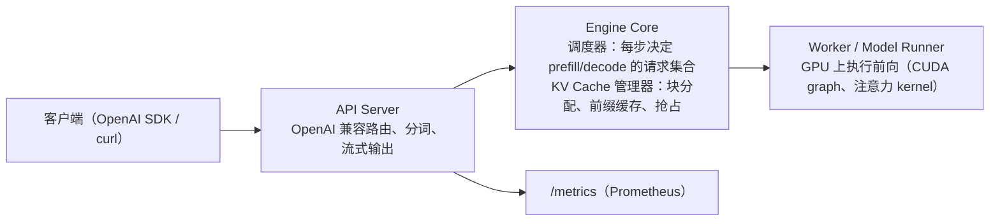

启动时 vLLM 会先加载权重，再做一次“试跑”测出峰值激活显存，剩下的按 `--gpu-memory-utilization` 全部切成 KV 块，并在日志中打印 KV Cache 容量与最大并发估计（字样以你的版本为准）——这正是上周 `kv_budget.py` 要校准的数。

常用参数（③、⑧）：

| 参数 | 作用 | 与上周的关系 |
|---|---|---|
| `--max-model-len` | 单请求最大上下文 | 太大可能导致 KV 不够放下一个满长度请求而启动失败 |
| `--gpu-memory-utilization` | vLLM 可使用的显存比例 | 公式中的 u |
| `--max-num-seqs` | 一个 batch 中最多的序列数 | batch 上限 |
| `--max-num-batched-tokens` | 每步最多处理的 token 数 | 控制 chunked prefill 的块大小 |
| `--enable-prefix-caching` | 前缀缓存（新版本中默认开启，以文档为准） | 上周 2.6 |
| `--tensor-parallel-size` | 张量并行卡数 | 第 5 月 |

---

## 3. 动手实验

### 实验 1：本地最小 OpenAI 兼容服务（40 分钟）{{local}}

```python
"""最小 OpenAI 兼容推理服务（CPU，transformers）：/v1/models、/v1/chat/completions（支持 stream）、/metrics。
刻意不做 batching：一个全局锁让请求逐个执行——用来对照 vLLM 的 continuous batching。
用法：python mini_server.py --model Qwen/Qwen2.5-0.5B-Instruct --port 8000"""
import argparse, asyncio, json, threading, time, uuid
import torch, uvicorn
from fastapi import FastAPI, Request
from fastapi.responses import StreamingResponse, Response
from prometheus_client import Histogram, Gauge, Counter, generate_latest, CONTENT_TYPE_LATEST
from transformers import AutoTokenizer, AutoModelForCausalLM, TextIteratorStreamer

p = argparse.ArgumentParser(); p.add_argument("--model", default="Qwen/Qwen2.5-0.5B-Instruct")
p.add_argument("--port", type=int, default=8000); p.add_argument("--threads", type=int, default=8)
a = p.parse_args(); torch.set_num_threads(a.threads)
tok = AutoTokenizer.from_pretrained(a.model)
model = AutoModelForCausalLM.from_pretrained(a.model, dtype=torch.float32).eval()
app = FastAPI(); lock = asyncio.Lock()
# 指标命名仿照 vLLM 的 vllm:* 指标（名称不同，含义相近）
TTFT = Histogram("mini_time_to_first_token_seconds", "TTFT", buckets=[.1, .25, .5, 1, 2, 4, 8, 16, 32, 64])
TPOT = Histogram("mini_time_per_output_token_seconds", "TPOT", buckets=[.01, .02, .04, .06, .08, .1, .15, .2, .5])
RUN = Gauge("mini_num_requests_running", "正在生成的请求数"); WAIT = Gauge("mini_num_requests_waiting", "排队中的请求数")
GEN = Counter("mini_generation_tokens_total", "已生成 token 总数")

def chunk(rid, text=None, finish=None):
    d = {"id": rid, "object": "chat.completion.chunk", "model": a.model,
         "choices": [{"index": 0, "delta": {"content": text} if text else {}, "finish_reason": finish}]}
    return f"data: {json.dumps(d, ensure_ascii=False)}\n\n"

@app.get("/v1/models")
def models(): return {"object": "list", "data": [{"id": a.model, "object": "model"}]}

@app.get("/metrics")
def metrics(): return Response(generate_latest(), media_type=CONTENT_TYPE_LATEST)

@app.post("/v1/chat/completions")
async def chat(req: Request):
    body = await req.json(); t0 = time.perf_counter(); rid = "chatcmpl-" + uuid.uuid4().hex[:8]
    ids = tok.apply_chat_template(body["messages"], add_generation_prompt=True, return_tensors="pt", return_dict=True)
    max_new = body.get("max_tokens", 128)
    async def gen():
        WAIT.inc()
        async with lock:                               # 无 batching：逐个请求独占模型
            WAIT.dec(); RUN.inc()
            streamer = TextIteratorStreamer(tok, skip_prompt=True, skip_special_tokens=True)
            th = threading.Thread(target=model.generate, kwargs=dict(**ids, max_new_tokens=max_new,
                                  do_sample=False, streamer=streamer)); th.start()
            first = None; n = 0; it = iter(streamer)
            while True:
                piece = await asyncio.to_thread(next, it, None)
                if piece is None: break
                if not piece: continue
                n += 1; GEN.inc()
                if first is None: first = time.perf_counter(); TTFT.observe(first - t0)
                yield chunk(rid, piece)
            th.join(); RUN.dec()
            if first and n > 1: TPOT.observe((time.perf_counter() - first) / (n - 1))
        yield chunk(rid, finish="stop"); yield "data: [DONE]\n\n"
    if body.get("stream"):
        return StreamingResponse(gen(), media_type="text/event-stream")
    text = "".join([json.loads(c[6:])["choices"][0]["delta"].get("content", "") async for c in gen() if c.startswith("data: {")])
    return {"id": rid, "object": "chat.completion", "model": a.model,
            "choices": [{"index": 0, "message": {"role": "assistant", "content": text}, "finish_reason": "stop"}]}

uvicorn.run(app, host="127.0.0.1", port=a.port, log_level="warning")
```

```bash
pip install torch transformers fastapi uvicorn prometheus_client openai
python mini_server.py &          # 首次运行下载约 1GB 模型
curl -s localhost:8000/v1/chat/completions -H 'Content-Type: application/json' \
  -d '{"model":"Qwen/Qwen2.5-0.5B-Instruct","max_tokens":60,"messages":[{"role":"user","content":"用一句话解释 KV Cache"}]}'
```

真实输出：

```json
{"id":"chatcmpl-b9af9c07","object":"chat.completion","model":"Qwen/Qwen2.5-0.5B-Instruct","choices":[{"index":0,"message":{"role":"assistant","content":"KV Cache，即键值对缓存，是一种在计算机系统中用于存储和检索数据的机制。它通过使用键（key）来标识数据，并使用对应的值（value）来提供快速访问的数据。这种缓存方式可以显著提高应用程序的性能，尤其是在需要频繁"},"finish_reason":"stop"}]}
```

服务能用了——但注意答案是**错的**：0.5B 模型把 Transformer 的 KV Cache 理解成了通用的键值缓存。这提醒我们：压测只衡量性能，质量要单独评估（第 15 周量化实验也要看回答质量）。

### 实验 2：压测——没有 batching 的服务（40 分钟）{{local}}

```python
# bench.py —— 并发流式请求，统计 TTFT / TPOT / 吞吐（对任何 OpenAI 兼容服务可用：vLLM、SGLang、mini_server）
import asyncio, time, argparse, statistics
from openai import AsyncOpenAI

async def one(cli, model, prompt, max_tokens):
    t0 = time.perf_counter(); first = None; n = 0
    stream = await cli.chat.completions.create(model=model, stream=True, max_tokens=max_tokens,
        messages=[{"role": "user", "content": prompt}])
    async for ch in stream:
        if ch.choices and ch.choices[0].delta.content:
            n += 1                        # 近似：按流式 chunk 计数（vLLM 通常 1 chunk ≈ 1 token）
            if first is None: first = time.perf_counter()
    t2 = time.perf_counter()
    return first - t0, (t2 - first) / max(n - 1, 1), n

async def main(a):
    cli = AsyncOpenAI(base_url=a.url, api_key="x", timeout=600)
    sem = asyncio.Semaphore(a.concurrency)
    async def run(i):
        async with sem:
            return await one(cli, a.model, f"写一段 300 字关于分布式系统的说明，编号{i}", a.max_tokens)
    t = time.perf_counter()
    res = await asyncio.gather(*[run(i) for i in range(a.n)])
    dur = time.perf_counter() - t
    ttft = [r[0] for r in res]; tpot = [r[1] for r in res]; toks = sum(r[2] for r in res)
    q = lambda xs, p: sorted(xs)[max(int(len(xs) * p) - 1, 0)]
    print(f"并发={a.concurrency} 请求={a.n} 耗时={dur:.1f}s 吞吐={toks/dur:.1f} tok/s")
    print(f"TTFT p50={statistics.median(ttft)*1000:.0f}ms p95={q(ttft,.95)*1000:.0f}ms")
    print(f"TPOT p50={statistics.median(tpot)*1000:.1f}ms p95={q(tpot,.95)*1000:.1f}ms")

p = argparse.ArgumentParser()
p.add_argument("--url", default="http://localhost:8000/v1")
p.add_argument("--model", default="Qwen/Qwen2.5-7B-Instruct")
p.add_argument("--n", type=int, default=200)
p.add_argument("--concurrency", type=int, default=16)
p.add_argument("--max-tokens", type=int, default=256)
asyncio.run(main(p.parse_args()))
```

```bash
for c in 1 4 8; do
  python bench.py --model Qwen/Qwen2.5-0.5B-Instruct --n 8 --max-tokens 64 --concurrency $c
done
```

真实输出：

```text
并发=1 请求=8 耗时=17.8s 吞吐=25.8 tok/s
TTFT p50=93ms p95=118ms
TPOT p50=36.0ms p95=43.3ms
并发=4 请求=8 耗时=17.3s 吞吐=26.6 tok/s
TTFT p50=6396ms p95=6510ms
TPOT p50=36.2ms p95=38.3ms
并发=8 请求=8 耗时=17.9s 吞吐=25.7 tok/s
TTFT p50=7941ms p95=13456ms
TPOT p50=38.3ms p95=39.9ms
```

完全符合 2.3 的预测：

- **吞吐不随并发变化**（约 26 tok/s）：服务一次只处理一个请求。
- **TPOT 不变**（约 36–38ms）：每个请求被处理时都独占模型。
- **TTFT 从 93ms 涨到 p95 13.5s**：并发 8 时最后一个请求要等前面 7 个全部结束（每个约 2.2s，7 × 2.2 ≈ 15s 的量级）。

服务暴露的 Prometheus 指标（真实输出，三轮共 25 个请求，含实验 1 的 1 个）：

```text
mini_time_to_first_token_seconds_count 25.0
mini_time_to_first_token_seconds_sum 102.93051125397324
mini_time_per_output_token_seconds_count 25.0
mini_time_per_output_token_seconds_sum 0.9393628345867003
mini_num_requests_running 0.0
mini_num_requests_waiting 0.0
mini_generation_tokens_total 1431.0
```

平均 TTFT = 102.9 / 25 ≈ 4.1s——服务端看到的排队代价。第 16 周会用 Prometheus 抓取这类指标做监控和扩缩容。

### 实验 3：batch 的收益（30 分钟）{{local}}

```python
"""同一模型，一次 generate 处理 1/4/8 条 prompt（静态 batch），看吞吐如何随 batch 变化。
说明：decode 每步都要读一遍全部权重，batch 越大，这次读取被越多请求分摊。"""
import time, torch
from transformers import AutoTokenizer, AutoModelForCausalLM
torch.set_num_threads(8); name = "Qwen/Qwen2.5-0.5B-Instruct"
tok = AutoTokenizer.from_pretrained(name, padding_side="left")
m = AutoModelForCausalLM.from_pretrained(name, dtype=torch.float32).eval()
new = 64
for b in (1, 4, 8, 16):
    prompts = [f"写一段关于分布式系统的说明，编号{i}" for i in range(b)]
    x = tok(prompts, return_tensors="pt", padding=True)
    with torch.no_grad():
        t = time.perf_counter()
        m.generate(**x, max_new_tokens=new, min_new_tokens=new, do_sample=False)
        dt = time.perf_counter() - t
    print(f"batch={b:<3} 耗时 {dt:5.2f}s 总吞吐 {b*new/dt:6.1f} tok/s 单请求速度 {new/dt:5.1f} tok/s")
```

真实输出：

```text
batch=1   耗时  2.43s 总吞吐   26.3 tok/s 单请求速度  26.3 tok/s
batch=4   耗时  3.34s 总吞吐   76.7 tok/s 单请求速度  19.2 tok/s
batch=8   耗时  4.03s 总吞吐  127.0 tok/s 单请求速度  15.9 tok/s
batch=16  耗时  4.78s 总吞吐  214.3 tok/s 单请求速度  13.4 tok/s
```

- batch 从 1 到 16，**总吞吐提升 8.1 倍**，耗时只增加约一倍。
- 代价是单请求速度从 26.3 降到 13.4 tok/s（TPOT 变大）——这就是吞吐与延迟的取舍，也是 `--max-num-seqs` 要调的东西。
- 把实验 2 的服务换成 vLLM，你会同时得到这条吞吐曲线和不爆炸的 TTFT。
- 在 GPU 上 batch 的收益通常更显著（decode 更明显地受访存限制）；CPU 上的具体倍数只代表本站环境。

### 实验 4：用 vLLM 部署 7B 模型（GPU，约 1 小时）{{gpu1}}

> 未在本站实测，需 GPU。命令来自 ① 与 ③，参数以你安装的版本文档为准。

```bash
pip install vllm
vllm serve Qwen/Qwen2.5-7B-Instruct --max-model-len 8192 --port 8000 2>&1 | tee vllm.log
# 另开终端
curl -s localhost:8000/v1/models
grep -iE "kv cache|concurrency" vllm.log    # 找到 KV Cache 容量与最大并发估计
```

用上周的脚本对同一张卡做估算，填表：

| 项目 | 上周估算（kv_budget.py） | vLLM 日志 |
|---|---|---|
| 显卡 / 显存 | | |
| 权重显存 | | |
| KV Cache 容量（token） | | |
| 8K 上下文最大并发 | | |

如果两者差别较大，调整 `--act-gb` 使估算与日志一致，记下你这张卡的经验值。

### 实验 5：压测 vLLM（GPU，约 1 小时）{{gpu1}}

> 未在本站实测，需 GPU。

```bash
pip install openai
python bench.py --n 20 --concurrency 4 --max-tokens 64       # 预热
for c in 1 4 16 64; do python bench.py --concurrency $c; done
# 对照官方压测工具（参数见 ⑤）
vllm bench serve --help
```

| 并发 | 吞吐 tok/s | TTFT p50/p95 | TPOT p50/p95 |
|---|---|---|---|
| 1 | | | |
| 4 | | | |
| 16 | | | |
| 64 | | | |

预期规律（请用你的数据验证或推翻）：吞吐随并发上升并在 batch/显存上限附近饱和；TPOT 缓慢增大；TTFT 在达到 KV 容量或 `--max-num-seqs` 之前基本平稳，超过后因排队快速上升。把这张表和实验 2 的表放在一起，就是本周最重要的产出。**压测完成后，若下周继续用 GPU 就保留环境，否则释放机器。**

### 清理

```bash
pkill -f mini_server.py
```

### 常见错误与排查

| 现象 | 原因 | 解决 |
|---|---|---|
| bench.py 报 `TypeError: unsupported operand ... NoneType`（first 为 None） | 服务没返回任何内容 chunk（模型名错、max_tokens=0、报错） | 先用 curl 单独请求确认 |
| `openai.APITimeoutError`（本站压测时将 timeout 设为 600s） | 无 batching 服务在高并发下排队很久 | 调大客户端 timeout，或降低并发 |
| TTFT 在并发 1 时也很大 | 首个请求包含预热开销 | 先预热再统计 |
| vLLM 启动报 KV Cache 不足以容纳 max_model_len | 显存不够放一个满长度请求 | 降低 `--max-model-len` 或提高 `--gpu-memory-utilization` |
| vLLM 启动 OOM | 其他进程占显存，或 utilization 设太高 | `nvidia-smi` 检查，调低 utilization |
| 两次压测结果差很多 | 缓存命中（同样的 prompt 命中 prefix cache）、预热、请求顺序 | 固定 prompt 集合，多次取中位数，注意 prefix cache 的影响 |

### 扩展练习

1. 给 `bench.py` 增加 `--rate` 参数，按泊松过程以固定请求率发送（开环压测），比较与闭环压测结果的差异。
2. 给 `bench.py` 增加 goodput 统计：TTFT<1s 且 TPOT<50ms 的请求比例与吞吐。
3. 修改 `mini_server.py`，把锁换成“每 200ms 收集一批请求做一次静态 batch”的简易批处理，重测实验 2，看 TTFT 与吞吐如何变化。
4. 在 vLLM 上用 `--max-num-seqs 8` 重测并发 64，观察 TTFT 如何因排队而上升。

---

## 4. 精读指南

- **① [vLLM 快速入门](https://docs.vllm.ai/en/latest/getting_started/quickstart.html)**（20 分钟）。
- **② [OpenAI 兼容服务](https://docs.vllm.ai/en/latest/serving/openai_compatible_server.html)**（30 分钟）：支持哪些接口和额外参数？
- **③ [vllm serve 参数](https://docs.vllm.ai/en/latest/cli/serve.html)** 与 **[Engine Args](https://docs.vllm.ai/en/latest/configuration/engine_args.html)**（30 分钟，查阅式）：重点看 2.5 表中的参数。
- **④ [Inside vLLM](https://blog.vllm.ai/2025/09/05/anatomy-of-vllm.html)**（复习调度器一节）。
- **⑤ [vllm bench serve](https://docs.vllm.ai/en/latest/cli/bench/serve.html)**、[压测说明](https://docs.vllm.ai/en/latest/contributing/benchmarks.html)、[benchmarks 目录](https://github.com/vllm-project/vllm/tree/main/benchmarks)（30 分钟）。**读完回答**：request-rate 与 max-concurrency 有何区别？
- **⑥ [LLM 推理指标（BentoML）](https://bentoml.com/llm/inference-optimization/llm-inference-metrics)**（20 分钟）：TTFT、ITL、goodput 的定义与取舍。
- **⑦ [vLLM 指标](https://docs.vllm.ai/en/latest/usage/metrics.html)**（20 分钟）：为第 16 周做准备。
- **⑧ [优化与调参](https://docs.vllm.ai/en/latest/configuration/optimization.html)**（20 分钟）：抢占、chunked prefill 的参数。
- 想在没有 GPU 的电脑上体验 vLLM，可参考 [CPU 安装说明](https://docs.vllm.ai/en/latest/getting_started/installation/cpu.html)（需要从源码构建，本站未尝试）。

---

## 5. 自测题

<details>
<summary>1. TTFT 主要受哪两部分影响？TPOT 呢？</summary>

TTFT = 排队时间 + prefill 时间（prompt 越长 prefill 越久）。TPOT 由 decode 单步耗时决定，受 batch 大小、模型大小和显存带宽影响。

</details>

<details>
<summary>2. 实验 2 中为什么吞吐与并发无关、TTFT 却线性增长？</summary>

服务用全局锁逐个处理请求，单位时间完成的工作量固定，吞吐就固定；每个请求处理时独占模型，TPOT 不变；新请求必须等前面所有请求结束，排队时间随并发线性增加，表现为 TTFT 增长。

</details>

<details>
<summary>3. 实验 3 中 batch=16 时为什么单请求速度下降了？这意味着什么取舍？</summary>

更大的 batch 每步计算更多，单步耗时增加，每个请求的 token 间隔（TPOT）变大；但同一步产出 16 个 token，总吞吐大幅提高。这是吞吐与单请求延迟的取舍，可用 max-num-seqs 等参数控制。

</details>

<details>
<summary>4. 闭环压测与开环压测的区别？</summary>

闭环：固定在途请求数，一个请求结束才发下一个，系统变慢时发送速率自动下降，结果稳定但可能低估排队。开环：按固定请求率（如泊松过程）发送，不管服务是否跟得上，更接近真实流量，能暴露过载时的排队爆炸。

</details>

<details>
<summary>5. 为什么 vLLM 能从日志里直接告诉你 KV Cache 容量？</summary>

启动时它加载权重后做一次试跑测出峰值激活显存，把 gpu-memory-utilization 允许的剩余显存全部预分配为 KV 块，所以块数（以及 token 容量、最大并发估计）在启动时就确定了。

</details>

<details>
<summary>6. 什么是 goodput？为什么它比吞吐更适合做容量规划？</summary>

goodput 是满足延迟 SLO 的请求所贡献的吞吐。只看吞吐时，可以把 batch 开得极大换来很高的吞吐，但大量请求的 TTFT/TPOT 不达标，对用户无意义。goodput 同时考虑了吞吐和延迟。

</details>

### 思考题

1. 你在大数据平台上做过哪些压测（如 HBase、Kafka）？它们的方法（预热、分位数、开环/闭环）哪些可以直接迁移过来？
2. 如果业务要求 TTFT p95 < 1s，你会如何根据压测表确定一台机器能承担的最大并发，并据此计算需要多少张卡？
3. 为什么压测时要特别留意 prefix cache？给出一个会让压测结果“虚高”的例子。

---

## 6. 本周产出与掌握清单

### 本周产出

- [ ] 可复用的 `bench.py`（压测脚本，本月产出之一）
- [ ] 本地无 batching 服务的压测表（实验 2）与 batch 收益表（实验 3）
- [ ] vLLM 压测表（实验 5）与 KV 估算 vs 日志对照表（实验 4）

## 参考资料

- [Inside vLLM: Anatomy of a High-Throughput LLM Inference System](https://blog.vllm.ai/2025/09/05/anatomy-of-vllm.html)（博客·进阶）：vLLM 官方博客长文，串起调度器、KV cache、prefix cache、PD 分离
- [vLLM 文档](https://docs.vllm.ai/en/latest/)（文档·入门）：部署、参数、OpenAI 兼容服务的权威说明
- [vLLM benchmarks](https://github.com/vllm-project/vllm/tree/main/benchmarks)（仓库·进阶）：官方压测脚本，对照自写压测结果
- [vLLM 博客](https://blog.vllm.ai/)（博客·进阶）：持续跟进推理引擎新特性

> 完整列表见 [参考资料库](/resources.html)。

## 检查清单
- [ ] vLLM 服务启动并记录 KV Cache 容量，与估算对比
- [ ] bench.py 跑通，填完上表
- [ ] 能解释：并发升高时吞吐与 TPOT 各自怎么变、为什么
- [ ] 能用实验 2 的数据解释无 batching 时 TTFT 为何线性增长
- [ ] 能说出 TTFT、TPOT、吞吐、goodput 的定义与影响因素

=== m4w3 | 第 15 周：SGLang 对比与参数调优 | 第 4 月 · 推理服务平台
# 第 15 周：SGLang 对比与参数调优

> **本周一句话**：同一个模型，换引擎、换参数，吞吐和延迟可以差出几倍。本周先在本地 CPU 上用真实模型量出两个最有代表性的“调参杠杆”——**前缀缓存**（TTFT 降到原来的约 5%）和**权重量化**（权重缩小近一半、速度提升，但输出变了）；再上 GPU 用 SGLang 部署同一模型，用上周的 `bench.py` 做公平对比，并完成至少 3 组 vLLM 调参实验。

**预计投入：约 10 小时**（阅读 ≈ 3h，本地动手 ≈ 2h，GPU 动手 ≈ 3.5h，报告 ≈ 1.5h；GPU 机器约 3–4 小时）。{{local}} {{gpu1}}

**本周结束时你应该能：**

1. 解释 SGLang 的 RadixAttention 与 vLLM 基于 block 哈希的前缀缓存有何异同，以及前缀缓存适用的业务。
2. 说出主要调参项（max-num-seqs、gpu-memory-utilization、max-model-len、prefix caching、量化）分别作用于哪个瓶颈。
3. 设计公平的引擎对比实验：同模型、同精度、同显卡、同压测脚本、同 prompt 集合。
4. 写出一份带版本信息、可复现的对比报告。

> **验证说明**：实验 1、2 在本站 8 核 CPU 上真实运行（Qwen2.5-0.5B-Instruct，transformers 5.20.2，torch 2.14.1+cpu），输出均为真实输出。**SGLang 部署与 GPU 调参（实验 3、4）未在本站实测，需 GPU**，命令来自官方文档，表格留空待你填写。实验文件在仓库 `labs/w15/`。

---

## 1. 本周学习路线

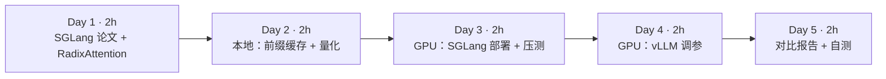

| 天 | 时间 | 先读 | 再读（外部资料） | 再做 |
|---|---|---|---|---|
| Day 1 | 2h | 2.1、2.2 | ① SGLang 论文、② LMSYS 博客 | — |
| Day 2 | 2h | 2.3、2.4 | ⑥ AWQ、⑦ GPTQ（摘要） | 实验 1、实验 2 |
| Day 3 | 2h | 2.5 | ③ SGLang 安装、④ 服务参数 | 实验 3 |
| Day 4 | 2h | 2.4 | ⑧ vLLM 优化与调参、⑨ vLLM AWQ | 实验 4 |
| Day 5 | 2h | — | — | 报告、自测 |

---

## 2. 核心概念讲解

### 2.1 SGLang 是什么

SGLang（①）由两部分组成：前端是一种用于编写多次调用 LLM 的程序（多轮、分支、结构化输出）的 Python DSL；后端运行时（今天大家说的“SGLang 推理服务”主要指它）与 vLLM 同属高性能推理引擎，同样有 paged KV、continuous batching、OpenAI 兼容接口。它的标志性设计是 **RadixAttention**：用一棵**基数树（radix tree）**管理所有请求的 KV Cache，自动发现并复用任意公共前缀。

### 2.2 RadixAttention vs block 哈希前缀缓存

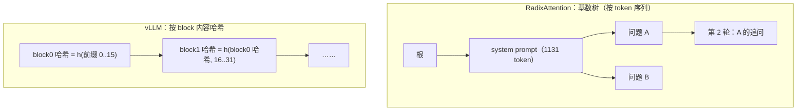

| 维度 | SGLang RadixAttention | vLLM 自动前缀缓存 |
|---|---|---|
| 数据结构 | 基数树，边上是 token 序列 | 每个完整 block 的链式哈希 → 物理块 |
| 复用粒度 | 任意长度前缀 | 整 block（默认 16 token），不足一块的尾巴不复用 |
| 淘汰 | 树的叶子按 LRU 淘汰 | 引用计数为 0 的块按 LRU 淘汰 |
| 调度配合 | cache-aware 调度：优先调度前缀命中多的请求（论文中的最长前缀优先） | 主要按到达顺序 |

两者思路一致：**把算过的 KV 当成缓存而不是用完即丢**。差别在组织方式和调度配合上。

**大数据类比**：像 Spark 的 `cache()`/`persist()`——中间结果被多个下游作业复用时才值得缓存；RadixAttention 的 cache-aware 调度，类似把需要同一份缓存数据的 task 优先排在一起执行（数据本地性）。

前缀缓存高收益的场景：同一个长 system prompt、多轮对话（每轮都带完整历史）、few-shot 示例、RAG 中的公共文档、Agent 多次调用共享的工具说明。几乎没收益的场景：每个请求的 prompt 完全不同（例如批量翻译不同文档）。

### 2.3 调参杠杆与它们作用的瓶颈

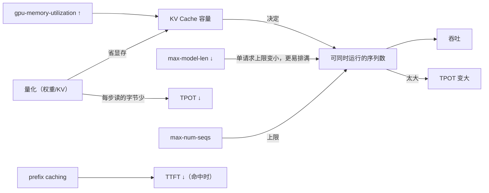

| 参数（vLLM 名称） | 作用于 | 典型取舍 |
|---|---|---|
| `--max-num-seqs` | batch 上限 | 大：吞吐高、TPOT 大；小：TPOT 小、排队多 |
| `--gpu-memory-utilization` | KV 容量 | 大：更多 KV 块；太大：OOM，与其他进程冲突 |
| `--max-model-len` | 单请求上下文上限 | 大：支持长文本；启动时需至少放得下一个满长度请求 |
| `--enable-prefix-caching` | TTFT | 命中率高时显著降低 TTFT；命中率低时几乎无开销 |
| `--max-num-batched-tokens` | 每步 token 预算 | 大：prefill 快、TPOT 抖动；小：decode 平稳 |
| 量化模型（AWQ/GPTQ/FP8） | 显存、TPOT | 更省、更快；需要评估质量 |

SGLang 对应参数名不同（如 `--mem-fraction-static` 对应显存占比，`--max-running-requests` 对应并发上限，以 ④ 为准）。

### 2.4 量化的基本原理

把一组权重 w 映射到 k 位整数：

$$q = \mathrm{round}\Big(\frac{w}{s}\Big) + z,\qquad \hat{w} = s\,(q - z)$$

s 为缩放因子，z 为零点。粒度越细（per-channel、per-group，例如每 128 个权重一组），误差越小。AWQ（⑥）根据激活大小保护少数“重要”权重通道；GPTQ（⑦）用二阶信息逐层补偿量化误差。两者都是**仅权重量化**（W4A16），推理时把权重反量化为 16 位计算，收益主要来自显存和带宽。FP8 则在新一代 GPU 上可以连同计算一起降精度。

### 2.5 公平对比的清单

1. 同一模型、同一精度（不要拿 SGLang 的 FP8 比 vLLM 的 BF16）。
2. 同一张卡、同一驱动，**同一时间只跑一个引擎**。
3. 同一压测脚本、同一 prompt 集合、同样 max_tokens，先预热。
4. 前缀缓存的开关状态一致，或分别报告。
5. 记录版本：引擎版本、CUDA、驱动、模型 revision。
6. 每组跑至少 3 次取中位数。

---

## 3. 动手实验

### 实验 1：前缀缓存的收益（本地 CPU，30 分钟）{{local}}

```python
"""前缀缓存的收益（CPU 真实模型）：多个请求共享同一段很长的 system prompt。
不复用：每个请求都 prefill 全部 token；复用：system prompt 的 KV 只算一次，之后每个请求只 prefill 自己的问题。
这里只测 prefill（即 TTFT 的计算部分）。"""
import copy, time, torch
from transformers import AutoTokenizer, AutoModelForCausalLM, DynamicCache
torch.set_num_threads(8); name = "Qwen/Qwen2.5-0.5B-Instruct"
tok = AutoTokenizer.from_pretrained(name); m = AutoModelForCausalLM.from_pretrained(name, dtype=torch.float32).eval()
system = "你是公司内部的数据平台助手。以下是平台规范：" + "所有 Hive 表必须按日期分区，保留 90 天；Spark 作业必须设置队列和最大 executor 数；" * 40
questions = ["Hive 表要保留多久？", "Spark 作业要设置什么？", "分区字段是什么？", "谁负责审批？"]
sys_ids = tok(system, return_tensors="pt").input_ids
q_ids = [tok(q, return_tensors="pt").input_ids for q in questions]
print(f"system prompt {sys_ids.shape[1]} token，问题平均 {sum(q.shape[1] for q in q_ids)/len(q_ids):.0f} token，共 {len(questions)} 个请求")
with torch.no_grad():
    m(torch.cat([sys_ids, q_ids[0]], 1))                        # 预热
    t = time.perf_counter()
    for q in q_ids: m(torch.cat([sys_ids, q], 1))               # 不复用：整段 prefill
    full = (time.perf_counter() - t) / len(q_ids)
    t = time.perf_counter(); cache = DynamicCache(); m(sys_ids, past_key_values=cache, use_cache=True)
    once = time.perf_counter() - t                              # 前缀只算一次
    t = time.perf_counter()
    for q in q_ids:
        c = copy.deepcopy(cache)                                # 每个请求从共享前缀出发（引擎中是共享块，不需复制）
        m(q, past_key_values=c, use_cache=True)
    reuse = (time.perf_counter() - t) / len(q_ids)
print(f"不复用：每请求 prefill {full*1000:7.1f} ms")
print(f"复用：  前缀一次性 {once*1000:7.1f} ms，之后每请求 {reuse*1000:7.1f} ms（含复制 cache 的开销）")
print(f"命中前缀后 TTFT 计算部分降为 {reuse/full:.1%}")
```

真实输出：

```text
system prompt 1131 token，问题平均 6 token，共 4 个请求
不复用：每请求 prefill  1493.6 ms
复用：  前缀一次性  1538.7 ms，之后每请求    67.8 ms（含复制 cache 的开销）
命中前缀后 TTFT 计算部分降为 4.5%
```

- 每个请求真正“新”的只有约 6 个 token，但不复用时要为 1137 个 token 做 prefill。
- 前缀算一次之后，后续请求的 prefill 从 1.49s 降到 68ms。这 68ms 还包括了 `deepcopy` 缓存的开销；推理引擎里多个请求直接引用同一批物理块（上周的引用计数），连这一步也省了。
- 首个请求没有收益（前缀一次性 1.54s）——**前缀缓存只对“第二次及以后”有效**，压测时要注意这一点（上周思考题 3）。

### 实验 2：权重量化的取舍（本地 CPU，20 分钟）{{local}}

```python
"""权重量化的直观体验（CPU）：PyTorch 动态 INT8 量化 Linear 层，比较权重大小、decode 速度与输出。
注意：这与 GPU 上 AWQ/GPTQ/FP8 的实现完全不同，只用于体会“更小的权重 ↔ 精度/速度”的取舍。"""
import time, torch, io
from transformers import AutoTokenizer, AutoModelForCausalLM
torch.set_num_threads(8); name = "Qwen/Qwen2.5-0.5B-Instruct"
tok = AutoTokenizer.from_pretrained(name)
msgs = [{"role": "user", "content": "列出 HDFS 的三个核心组件。"}]
ids = tok.apply_chat_template(msgs, add_generation_prompt=True, return_tensors="pt", return_dict=True)
def size_mb(model):
    b = io.BytesIO(); torch.save(model.state_dict(), b); return b.tell() / 1e6
def run(model, label):
    with torch.no_grad():
        model.generate(**ids, max_new_tokens=8)                 # 预热
        t = time.perf_counter(); out = model.generate(**ids, max_new_tokens=64, do_sample=False)
        dt = time.perf_counter() - t
    n = out.shape[1] - ids["input_ids"].shape[1]
    text = tok.decode(out[0, ids["input_ids"].shape[1]:], skip_special_tokens=True).replace("\n", " ")
    print(f"[{label}] 权重 {size_mb(model):6.0f} MB  {n/dt:5.1f} tok/s\n  输出：{text[:90]}")
m = AutoModelForCausalLM.from_pretrained(name, dtype=torch.float32).eval()
run(m, "FP32")
q = torch.ao.quantization.quantize_dynamic(m, {torch.nn.Linear}, dtype=torch.qint8)
run(q, "INT8 动态量化")
```

真实输出（省略了 PyTorch 的弃用警告，见排障表）：

```text
[FP32] 权重   1976 MB   29.3 tok/s
  输出：Hadoop Distributed File System（简称：HDFS）是一个分布式文件系统，它由多个节点组成，每个节点都负责处理一个或多个数据块。以下是HDFS的三个主要组
[INT8 动态量化] 权重   1039 MB   48.8 tok/s
  输出：在HDFS（Hadoop Distributed File System）中，三个主要的组件是：  1. NameNode：负责管理整个集群的资源和数据存储。 2. DataNod
```

- 速度提升 1.7 倍：decode 每步读的权重字节减少了。
- 权重只缩小到 53% 而不是 25%：只有 `nn.Linear` 被量化，词嵌入（Qwen2.5-0.5B 词表约 15 万、与 lm_head 共享）仍是 FP32。真实量化方案同样要决定哪些层量化、哪些保留。
- **输出变了**：贪心解码下哪怕一点数值误差也会改变某一步的选择，之后整段文字都不同。本例里量化版甚至更快进入了正题——但这只是一个样本，**质量必须在评测集上量化评估**，不能凭一两个例子下结论。
- PyTorch 已提示 `torch.ao.quantization` 这套接口将被弃用（迁移到 torchao，见 ⑩）；GPU 推理中用的是 AWQ/GPTQ/FP8 等完全不同的实现，本实验只用于体会取舍。

### 实验 3：SGLang 部署与对比（GPU，约 1.5 小时）{{gpu1}}

> 未在本站实测，需 GPU。安装方式与参数以 ③、④ 为准。

```bash
pip install "sglang[all]"     # 安装方式以 SGLang 文档为准
python -m sglang.launch_server --model-path Qwen/Qwen2.5-7B-Instruct --port 30000
# 另开终端：预热后压测（bench.py 来自第 14 周）
python bench.py --url http://localhost:30000/v1 --n 20 --concurrency 4 --max-tokens 64
for c in 1 4 16 64; do python bench.py --url http://localhost:30000/v1 --concurrency $c; done
```

同一时间只跑一个引擎，避免抢显存。压完 SGLang 后关闭它，再用相同命令压 vLLM（端口 8000）。

### 实验 4：vLLM 调参（GPU，约 2 小时）{{gpu1}}

> 未在本站实测，需 GPU。每组只改一个参数，其他保持默认；用并发 16 与 64 两组压测。

| 实验 | vLLM 参数 | 观察 |
|---|---|---|
| 最大并发序列 | `--max-num-seqs 16 / 64 / 256` | 吞吐与 TPOT 的取舍 |
| 显存占比 | `--gpu-memory-utilization 0.8 / 0.9` | 日志中 KV Cache 容量变化 |
| 上下文长度 | `--max-model-len 4096 / 16384` | 可并发数 |
| 前缀缓存 | 开/关 prefix caching（参数名见当前文档） | 相同 system prompt 下 TTFT 变化（可把实验 1 的长 system prompt 加进 bench.py） |
| 量化 | 换成 AWQ 量化模型，如 `Qwen/Qwen2.5-7B-Instruct-AWQ` | 显存、吞吐、回答质量 |

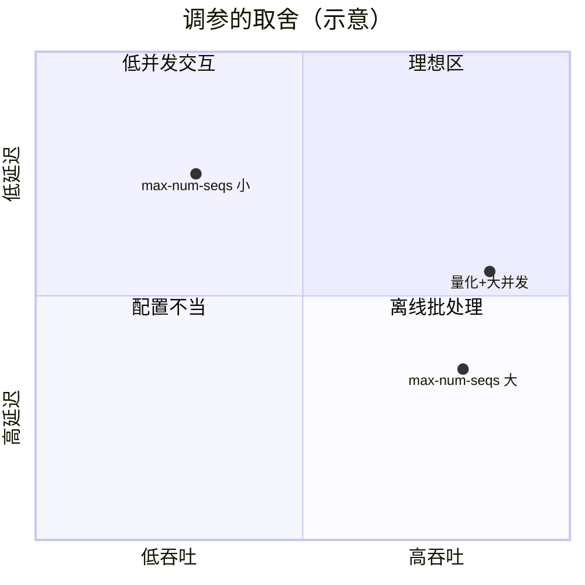

（上图位置仅为示意，请用你的实测数据替换结论。）

### 对比报告模板

| 指标（并发 16） | vLLM | SGLang |
|---|---|---|
| 吞吐 tok/s | | |
| TTFT p50 / p95 | | |
| TPOT p50 / p95 | | |
| 启动时间 | | |
| 显存占用 | | |

报告开头写清：显卡型号与显存、驱动/CUDA 版本、两个引擎的版本、模型与精度、压测参数（n、max_tokens、prompt 集合）、前缀缓存状态。

### 常见错误与排查

| 现象 | 原因 | 解决 |
|---|---|---|
| `torch.ao.quantization ... deprecated` 警告（本站实测） | PyTorch 正在把量化迁移到 torchao | 不影响本实验；新项目用 torchao |
| 量化后权重没有缩小到 1/4（本站实测） | 只量化了 Linear，嵌入层仍为 FP32 | 正常；说明量化范围是设计选择 |
| 前缀缓存“没效果” | 前缀不完全相同（时间戳、用户名放在 system prompt 开头）；vLLM 不足一个 block 的部分不复用 | 把可变内容放到 prompt 末尾 |
| 两个引擎同时启动后一个 OOM | 都按比例预占显存 | 一次只跑一个 |
| SGLang 与 vLLM 结果差异大 | 精度、前缀缓存、默认参数不同 | 按 2.5 清单逐项对齐 |
| AWQ 模型启动失败 | 版本不支持该量化格式或该显卡 | 查 ⑨ 的支持矩阵 |

### 扩展练习

1. 修改 `prefix_reuse.py`，让 system prompt 长度取 128、512、2048 token，画出“复用后 TTFT / 不复用 TTFT”的曲线。
2. 在 `bench.py` 中加入 `--system-file` 参数，所有请求带上同一段长 system prompt，在 GPU 上比较 vLLM 前缀缓存开/关、SGLang 的 TTFT。
3. 构造多轮对话压测（每轮带完整历史），比较两个引擎的 TTFT 随轮数的变化。
4. 用一个小评测集（例如 50 道选择题）比较 BF16 与 AWQ 模型的准确率。

---

## 4. 精读指南

- **① [SGLang 论文](https://arxiv.org/abs/2312.07104)**（90 分钟）：重点读 RadixAttention 一节与 cache-aware 调度。**读完回答**：为什么最长前缀优先的调度能提高命中率？它可能带来什么公平性问题？
- **② [LMSYS 博客：SGLang 发布](https://lmsys.org/blog/2024-01-17-sglang/)**（20 分钟）与 [LMSYS 博客列表](https://lmsys.org/blog/)（浏览后续性能文章）。
- **③ [SGLang 安装](https://docs.sglang.ai/get_started/install.html)**、[SGLang 文档首页](https://docs.sglang.ai/)（20 分钟）。
- **④ [SGLang 服务参数](https://docs.sglang.ai/advanced_features/server_arguments.html)**（30 分钟，查阅式）：找到与 vLLM 2.3 表对应的参数。
- **⑤ [SGLang 源码](https://github.com/sgl-project/sglang)**（选读）：找到 radix cache 的实现文件。
- **⑥ [AWQ 论文](https://arxiv.org/abs/2306.00978)**、**⑦ [GPTQ 论文](https://arxiv.org/abs/2210.17323)**（各 20 分钟，读摘要与方法图）。
- **⑧ [vLLM 优化与调参](https://docs.vllm.ai/en/latest/configuration/optimization.html)**（30 分钟）。
- **⑨ [vLLM AutoAWQ](https://docs.vllm.ai/en/latest/features/quantization/auto_awq.html)** 与 [量化总览](https://docs.vllm.ai/en/latest/features/quantization/index.html)（20 分钟）；模型示例：[Qwen2.5-7B-Instruct-AWQ](https://huggingface.co/Qwen/Qwen2.5-7B-Instruct-AWQ)。
- **⑩ [PyTorch 量化文档](https://docs.pytorch.org/docs/stable/quantization.html)** 与 [torchao](https://github.com/pytorch/ao)（浏览）。

---

## 5. 自测题

<details>
<summary>1. RadixAttention 与 vLLM 前缀缓存的主要区别？</summary>

RadixAttention 用基数树按 token 序列组织 KV，可复用任意长度的公共前缀，并配合 cache-aware 调度优先运行命中多的请求；vLLM 按完整 block 的链式哈希查找物理块，复用粒度为整块。两者都把 KV 当缓存，按 LRU 淘汰不再被引用的部分。

</details>

<details>
<summary>2. 实验 1 中为什么首个请求没有收益？对压测有什么启示？</summary>

前缀的 KV 必须先被算出一次才能复用，首个请求承担全部 prefill。压测时如果所有请求共享前缀，结果会比真实业务（前缀多样）更好；要么关闭前缀缓存测基线，要么按真实命中率构造 prompt。

</details>

<details>
<summary>3. 实验 2 中量化为什么变快了？为什么输出不同？</summary>

decode 受访存限制，INT8 权重字节数约为 FP32 的 1/4（Linear 部分），每步读取更少，速度提升。量化带来数值误差，贪心解码在某一步选择了不同的 token，后续生成随之完全不同；质量需要在评测集上评估。

</details>

<details>
<summary>4. 调大 max-num-seqs 一定会提高吞吐吗？</summary>

不一定。吞吐受 KV Cache 容量限制：KV 块不够时实际运行的序列数达不到上限，甚至频繁抢占（重算或换出）反而降低吞吐；同时 TPOT 会变大。应结合 KV 容量和延迟 SLO 一起调。

</details>

<details>
<summary>5. 列出公平对比两个推理引擎时必须对齐的至少 4 项。</summary>

同一模型与精度；同一显卡与驱动，单独运行；同一压测脚本、prompt 集合与 max_tokens，并预热；前缀缓存等特性开关一致；记录版本；多次运行取中位数。

</details>

<details>
<summary>6. AWQ/GPTQ 这类 W4A16 量化的收益主要来自哪里？</summary>

权重以 4 位存储，显存占用大幅降低（可以放更多 KV Cache 或在更小的卡上运行），decode 时读取的权重字节更少；计算时仍反量化为 16 位，所以收益主要来自显存与带宽，而不是更快的矩阵乘。

</details>

### 思考题

1. 一个 RAG 服务，每个请求带 3 篇检索文档（文档来自 1 万篇的库）。前缀缓存能帮多少？如何调整 prompt 结构提高命中率？
2. 你会如何向业务方解释“量化后答案变了但不一定变差”？你会设计怎样的验收标准？
3. 引擎更新很快，半年后你的对比报告就过时了。如何把对比流程做成可重复执行的流水线（联系你做大数据 CI 的经验）？

---

## 6. 本周产出与掌握清单

### 本周产出

- [ ] 本地前缀缓存与量化实验记录（实验 1、2）
- [ ] vLLM vs SGLang 对比报告（含版本信息与参数调优结果，本月产出之一）

## 参考资料

- [SGLang 论文（RadixAttention）](https://arxiv.org/abs/2312.07104)（论文·进阶）：理解 SGLang 的前缀缓存与 vLLM 的差异
- [vLLM benchmarks](https://github.com/vllm-project/vllm/tree/main/benchmarks)（仓库·进阶）：官方压测脚本，对照自写压测结果
- [SGLang 文档](https://docs.sglang.ai/)（文档·入门）：SGLang 部署与参数
- [LMSYS / SGLang 博客](https://lmsys.org/blog/)（博客·进阶）：SGLang 新特性与性能分析

> 完整列表见 [参考资料库](/resources.html)。

## 检查清单
- [ ] SGLang 部署并压测
- [ ] 至少完成 3 组调参实验
- [ ] 写出对比报告（注明软件版本、模型、卡型号）
- [ ] 释放 GPU
- [ ] 能解释 RadixAttention 与 block 哈希前缀缓存的区别
- [ ] 能用实验 2 说明量化的收益与风险

=== m4w4 | 第 16 周：自动扩缩容与监控 | 第 4 月 · 推理服务平台
# 第 16 周：自动扩缩容与监控——把推理服务变成“平台”

> **本周一句话**：单个 vLLM 实例只是一个进程；平台要能**看见**（指标、面板、告警）并**自动应对负载**（扩缩容）。本周在本地用 Ray Serve 亲眼看到副本数 1 → 6 → 1 的扩缩过程，用 Prometheus 抓取第 14 周 mini_server 的 TTFT/TPOT 直方图并写出 PromQL，最后讨论“按什么指标扩缩容”——这是你大数据平台经验最能派上用场的一周。

**预计投入：约 10 小时**（阅读 ≈ 3h，本地动手 ≈ 4h，GPU 动手 ≈ 1.5h，产出 ≈ 1.5h）。{{local}} {{gpu1}}

**本周结束时你应该能：**

1. 配置 Ray Serve 的 autoscaling，解释 target_ongoing_requests、max_ongoing_requests、扩/缩容延迟的含义和计算方式。
2. 用 Prometheus 抓取推理服务指标，用 `histogram_quantile`、`rate` 写出 TTFT p95、吞吐、排队数的查询，并理解直方图分位数的误差。
3. 说出 vLLM 的关键指标，并为推理服务设计面板与告警。
4. 比较 Ray Serve、KServe、K8s HPA/KEDA 三种扩缩容方式，论证“按什么指标扩缩容”。

> **验证说明**：实验 1、2 在本站 8 核 CPU 上真实运行：Ray 2.59.0（Ray Serve），Prometheus 3.15.0（官方二进制，无需 Docker），被监控对象是第 14 周的 mini_server（Qwen2.5-0.5B）。输出均为真实输出。**实验 3（真实 vLLM + Grafana）未在本站实测，需 GPU**。实验文件在仓库 `labs/w16/`。

---

## 1. 本周学习路线

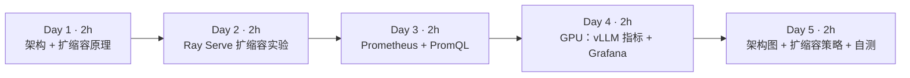

| 天 | 时间 | 先读 | 再读（外部资料） | 再做 |
|---|---|---|---|---|
| Day 1 | 2h | 2.1、2.2 | ① Ray Serve 概览、② autoscaling 指南 | — |
| Day 2 | 2h | 2.3 | ③ 高级 autoscaling | 实验 1 |
| Day 3 | 2h | 2.4 | ⑤ Prometheus 入门、⑥ 直方图实践 | 实验 2 |
| Day 4 | 2h | 2.5 | ⑦ vLLM 指标、⑧ Grafana + Prometheus | 实验 3 |
| Day 5 | 2h | 2.6 | ⑨ HPA、⑩ KEDA Prometheus scaler、⑪ llm-d / Dynamo README | 本周产出 |

---

## 2. 核心概念讲解

### 2.1 推理平台架构

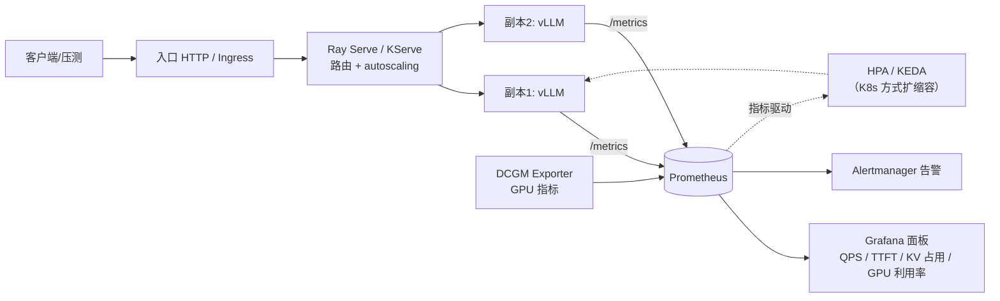

**大数据类比**：这套架构你很熟——Prometheus/Grafana 监控 YARN 队列和 HBase RegionServer，按队列积压扩容 Flink TaskManager。差别在于：推理服务的“单元”是一张或几张 GPU，**冷启动很慢**（拉镜像 + 加载权重要几分钟），而且**最贵**，扩缩容策略要更谨慎。

### 2.2 Ray Serve 的扩缩容算法

Ray Serve 按**在途请求数**（ongoing requests：正在处理 + 排队）扩缩容（②）：

$$\text{desired} = \Big\lceil \frac{\text{过去 look\_back 窗口内的平均总在途请求数}}{\text{target\_ongoing\_requests}} \Big\rceil$$

再被限制在 [min_replicas, max_replicas] 内；需要持续超过 `upscale_delay_s` 才扩，持续低于 `downscale_delay_s` 才缩（防抖）。`max_ongoing_requests` 是单副本的硬上限：超过后请求在路由层排队，不再发给该副本。

| 参数 | 含义 | 类比 |
|---|---|---|
| target_ongoing_requests | 期望每副本的平均在途请求 | Flink 反压阈值 / Kafka consumer lag 目标 |
| max_ongoing_requests | 单副本并发上限 | 引擎的 max-num-seqs |
| upscale/downscale_delay_s | 扩/缩容前需持续的时间 | YARN 节点退役的等待期 |
| min/max_replicas | 副本数范围 | 集群弹性上下限 |

### 2.3 按什么指标扩缩容

| 指标 | 优点 | 缺点 |
|---|---|---|
| CPU/GPU 利用率 | 通用、HPA 原生支持 | GPU 利用率在 decode 阶段常常“看起来很高”但还能塞更多请求；不反映排队 |
| QPS | 简单直观 | 请求长度差异巨大，同样 QPS 负载可差 10 倍 |
| 在途/排队请求数 | 直接反映“处理不过来” | 需要服务暴露该指标 |
| KV Cache 使用率 | 直接反映显存容量瓶颈 | 接近 100% 时已经开始抢占，偏晚 |
| TTFT/TPOT p95 | 直接对应 SLO | 滞后、噪声大，适合告警而不是作为唯一扩容信号 |

实践中常用：**排队请求数（或在途请求数）作为主信号，KV 使用率和 TTFT p95 作为辅助/告警**。由于冷启动很慢，可以设置较高的 min_replicas，或按业务时段做预测性扩容。

### 2.4 Prometheus 指标与 PromQL 基础

- **Counter**（只增不减，如生成 token 总数）：用 `rate(x[2m])` 求每秒速率。
- **Gauge**（可增可减，如排队数）：直接看，或 `max_over_time`。
- **Histogram**（分桶计数，如 TTFT）：`_bucket{le="..."}` 累积计数，用 `histogram_quantile(0.95, sum by (le) (rate(x_bucket[2m])))` 估计分位数。

直方图分位数是**在桶内线性插值**的估计值，桶的边界决定精度（⑥）。实验 2 会看到它与客户端精确统计的差异。

### 2.5 vLLM 的关键指标

vLLM 在 `/metrics` 暴露 `vllm:` 前缀的指标（⑦，名称随版本变化，以你的实际输出为准），常用的有：运行中/排队中的请求数、KV Cache 使用率、TTFT 与 ITL 直方图、端到端延迟直方图、prompt/生成 token 计数器、抢占次数。配合 DCGM Exporter 的 GPU 利用率、显存、温度，就是一张完整的推理面板。

### 2.6 三种扩缩容方式

| 方式 | 扩缩对象 | 信号 | 适合 |
|---|---|---|---|
| Ray Serve autoscaling | Ray actor 副本 | 在途请求数（内建） | 已在用 Ray、Python 原生，支持多模型组合（Ray Serve LLM，④） |
| KServe | InferenceService 的 Pod（底层可用 Knative 或 HPA/KEDA） | 并发数/QPS 或自定义指标 | K8s 标准化模型服务 |
| K8s HPA / KEDA | Deployment 的 Pod | CPU/内存、自定义指标、Prometheus 查询（KEDA） | 已有 K8s + Prometheus 体系 |

更进一步的 llm-d、NVIDIA Dynamo 还在做 KV 感知路由（把请求发给已缓存其前缀的副本）、PD 分离的独立扩缩容——这是上周前缀缓存和第 13 周 PD 分离在平台层的延伸。

---

## 3. 动手实验

### 实验 1：Ray Serve 自动扩缩容（本地，40 分钟）{{local}}

```python
"""Ray Serve 自动扩缩容练习：用 CPU 假模型（每请求 0.5s）观察副本数随负载变化。"""
import asyncio
from ray import serve

@serve.deployment(
    ray_actor_options={"num_cpus": 0.5},
    max_ongoing_requests=4,                  # 单副本最多同时处理 4 个请求（类比引擎的 max-num-seqs）
    autoscaling_config={
        "min_replicas": 1, "max_replicas": 6,
        "target_ongoing_requests": 2,        # 期望每个副本平均 2 个在途请求
        "upscale_delay_s": 3, "downscale_delay_s": 10,
        "metrics_interval_s": 1, "look_back_period_s": 3,
    })
class FakeLLM:
    async def __call__(self, req):
        await asyncio.sleep(0.5)             # 模拟一次推理
        return {"text": "ok"}

app = FakeLLM.bind()
```

```python
"""启动 serve_demo，分三个阶段施加负载（并发 2 → 16 → 0），每秒记录副本数与延迟。"""
import asyncio, time, statistics, httpx, ray
from ray import serve
from serve_demo import app

ray.init(num_cpus=8, include_dashboard=False, logging_level="ERROR")
serve.run(app, route_prefix="/", blocking=False)
URL = "http://127.0.0.1:8000/"; lat = []

def replicas():
    st = serve.status().applications["default"].deployments["FakeLLM"]
    return st.replica_states.get("RUNNING", 0), st.replica_states

async def worker(cli, stop):
    while time.time() < stop:
        t = time.perf_counter(); await cli.get(URL); lat.append(time.perf_counter() - t)

async def phase(name, conc, secs):
    global lat; lat = []; stop = time.time() + secs
    async with httpx.AsyncClient(timeout=60) as cli:
        tasks = [asyncio.create_task(worker(cli, stop)) for _ in range(conc)]
        t0 = time.time()
        while time.time() < stop:
            await asyncio.sleep(3); r, states = replicas()
            p50 = statistics.median(lat) if lat else 0
            print(f"[{name}] t={time.time()-t0:4.0f}s 并发={conc:<2} 运行副本={r} 状态={dict(states)} 近期延迟p50={p50*1000:5.0f}ms", flush=True)
            lat = []
        await asyncio.gather(*tasks)

async def main():
    await phase("低负载", 2, 12)
    await phase("高负载", 16, 30)
    await phase("空闲", 0, 30)
asyncio.run(main())
serve.shutdown(); ray.shutdown()
```

```bash
pip install "ray[serve]" httpx
python load_and_watch.py
```

真实输出：

```text
[低负载] t=   3s 并发=2  运行副本=1 状态={'RUNNING': 1} 近期延迟p50=  510ms
[低负载] t=   6s 并发=2  运行副本=1 状态={'RUNNING': 1} 近期延迟p50=  509ms
[低负载] t=   9s 并发=2  运行副本=1 状态={'RUNNING': 1} 近期延迟p50=  508ms
[低负载] t=  12s 并发=2  运行副本=1 状态={'RUNNING': 1} 近期延迟p50=  509ms
[高负载] t=   3s 并发=16 运行副本=1 状态={'RUNNING': 1} 近期延迟p50= 1721ms
[高负载] t=   6s 并发=16 运行副本=6 状态={'RUNNING': 6} 近期延迟p50= 1123ms
[高负载] t=   9s 并发=16 运行副本=6 状态={'RUNNING': 6} 近期延迟p50=  507ms
...（t=12s 到 t=30s 均为 6 个副本，p50 约 507–509ms）
[空闲] t=   3s 并发=0  运行副本=6 状态={'RUNNING': 6} 近期延迟p50=    0ms
[空闲] t=   6s 并发=0  运行副本=6 状态={'RUNNING': 6} 近期延迟p50=    0ms
[空闲] t=   9s 并发=0  运行副本=6 状态={'RUNNING': 6} 近期延迟p50=    0ms
[空闲] t=  12s 并发=0  运行副本=1 状态={'STOPPING': 5, 'RUNNING': 1} 近期延迟p50=    0ms
[空闲] t=  15s 并发=0  运行副本=1 状态={'RUNNING': 1} 近期延迟p50=    0ms
```

逐段解读：

- **低负载**：并发 2 = target 2 × 1 副本，保持 1 个副本，延迟就是 0.5s 的“推理时间”。
- **高负载开始**：16 个并发打到 1 个副本，副本最多同时处理 4 个（max_ongoing_requests），其余在路由层排队，p50 涨到 1.7s。
- **扩容**：按公式 desired = ⌈16 / 2⌉ = 8，被 max_replicas 限制为 6。3 秒的 upscale_delay 之后直接扩到 6 个。6 副本 × 4 = 24 ≥ 16，排队消失，延迟回到 0.5s。
- **缩容**：负载归零后等了约 10 秒（downscale_delay_s）才缩回 1 个副本，中间可见 5 个副本处于 STOPPING。
- 假模型的“冷启动”只要几百毫秒；**真实 vLLM 副本的冷启动是分钟级**，扩容期间排队会持续得多。这正是生产中要设置较高 min_replicas 和更保守 downscale_delay 的原因。

### 实验 2：Prometheus 抓取推理指标（本地，40 分钟）{{local}}

Prometheus 是单个 Go 二进制文件，从 [GitHub Releases](https://github.com/prometheus/prometheus/releases) 下载解压即可运行，不需要 Docker。

```yaml
# 抓取第 14 周的 mini_server（生产中把 targets 换成 vLLM 的 host:8000，指标前缀为 vllm:）
global: {scrape_interval: 5s}
scrape_configs:
  - job_name: llm
    static_configs: [{targets: ["127.0.0.1:8000"]}]
```

```bash
#!/usr/bin/env bash
# 通过 Prometheus HTTP API 执行 PromQL（与 Grafana 面板里填的表达式相同）
q() { echo "## $1"; curl -s "http://127.0.0.1:9090/api/v1/query" --data-urlencode "query=$1" |
      python3 -c "import json,sys;[print(r['metric'].get('job',''),r['value'][1]) for r in json.load(sys.stdin)['data']['result']]"; }
q 'up'
q 'histogram_quantile(0.95, sum by (le) (rate(mini_time_to_first_token_seconds_bucket[2m])))'
q 'histogram_quantile(0.50, sum by (le) (rate(mini_time_per_output_token_seconds_bucket[2m])))'
q 'rate(mini_generation_tokens_total[2m])'
q 'max_over_time(mini_num_requests_waiting[2m])'
```

```bash
python ../w14/mini_server.py &                                  # 第 14 周的服务
./prometheus --config.file=prometheus.yml --web.listen-address=127.0.0.1:9090 &
python ../w14/bench.py --model x --n 12 --max-tokens 48 --concurrency 6
sleep 8; ./queries.sh
```

真实输出：

```text
并发=6 请求=12 耗时=20.3s 吞吐=25.5 tok/s
TTFT p50=8340ms p95=8593ms
TPOT p50=37.8ms p95=40.1ms
## up
llm 1
## histogram_quantile(0.95, sum by (le) (rate(mini_time_to_first_token_seconds_bucket[2m])))
 15.42857142857143
## histogram_quantile(0.50, sum by (le) (rate(mini_time_per_output_token_seconds_bucket[2m])))
 0.032125472621798074
## rate(mini_generation_tokens_total[2m])
llm 4.45253
## max_over_time(mini_num_requests_waiting[2m])
llm 5
```

三个值得细看的地方：

1. **服务端 TTFT p95 = 15.4s，客户端 p95 = 8.6s**，差这么多？TTFT 直方图的桶边界是 …8、16、32…，大部分请求落在 (8, 16] 桶里，`histogram_quantile` 在桶内线性插值，算出 15.4s。这不是服务出错，而是**桶设计太粗**。按你的 SLO 设计桶边界（例如 SLO 是 1s，就在 0.5–2s 之间多放几个桶）。
2. **服务端 TPOT p50 = 32ms，客户端 38ms**：同样受桶影响（落在 (0.02, 0.04] 桶），另外客户端按 chunk 计数（第 14 周说明过的误差）。
3. **吞吐 4.45 tok/s 远小于压测的 25.5 tok/s**：`rate(...[2m])` 是 2 分钟窗口的平均值，压测只有 20 秒，其余时间服务空闲。做面板时窗口要和你关心的时间尺度匹配。

`max_over_time(mini_num_requests_waiting[2m]) = 5`：并发 6、服务一次处理 1 个，最多 5 个在排队——这就是 2.3 推荐的扩容信号。

### 实验 3：真实 vLLM + Grafana（GPU，约 1.5 小时）{{gpu1}}

> 未在本站实测，需 GPU。

```bash
# vLLM 自带 Prometheus 指标（指标名以实际输出为准）
curl -s localhost:8000/metrics | grep -E "^vllm:" | cut -d'{' -f1 | sort -u | head -40
# Prometheus：用实验 2 的二进制和 prometheus.yml（targets 指向 vLLM）
# Grafana：同样可下载官方二进制运行，或在有 Docker 的机器上：
docker run -d --network host grafana/grafana
```

在 Grafana 中添加 Prometheus 数据源（⑧），画出：请求数（运行/排队）、TTFT p50/p95、ITL p50/p95、KV Cache 使用率、生成吞吐、GPU 利用率（若部署了 DCGM Exporter）。用第 14 周的 `bench.py` 逐级加压，截图保存面板——这是本月产出之一。

K8s 方向：可参考 [prometheus-community/helm-charts](https://github.com/prometheus-community/helm-charts) 的 kube-prometheus-stack，结合 KServe 或 KEDA（⑩，用 Prometheus 查询结果作为扩缩容信号）部署。

### 清理

```bash
pkill -f mini_server.py; pkill -f prometheus; rm -rf data/   # Prometheus 默认数据目录
```

### 常见错误与排查

| 现象 | 原因 | 解决 |
|---|---|---|
| `ModuleNotFoundError: No module named 'httpx'`（本站实测） | 压测脚本依赖未安装 | `pip install httpx` |
| 副本数始终不变 | 用了同步 `time.sleep` 阻塞事件循环，或负载没超过 target | 在 async 方法中用 `await asyncio.sleep`；检查并发是否足够 |
| 扩容到 max 仍然排队 | max_replicas × max_ongoing_requests < 并发 | 提高上限或扩大集群资源 |
| 缩容太快导致来回抖动 | downscale_delay_s 太短 | 调大；真实 GPU 服务建议分钟级 |
| Prometheus `up` = 0 | 目标地址错、服务未启动、/metrics 路径不对 | 浏览器打开 `http://127.0.0.1:9090/targets` 查看错误 |
| 直方图分位数和客户端差很多（本站实测） | 桶边界太粗 | 按 SLO 设计桶 |
| `rate()` 结果偏小（本站实测） | 窗口内有空闲时间 | 匹配窗口与观察尺度 |

### 扩展练习

1. 修改 `serve_demo.py` 的 `target_ongoing_requests` 为 1 和 4，重做实验 1，记录稳态副本数与延迟。
2. 给 `mini_server.py` 的 TTFT 直方图改用更细的桶（如 0.5、1、2、4、6、8、10、12），重做实验 2，对比 `histogram_quantile` 与客户端 p95。
3. 写一条告警规则：TTFT p95 连续 5 分钟大于 2s 时触发（Prometheus alerting rule 语法）。
4. 阅读 ⑩，写出一个 KEDA ScaledObject：当 vLLM 排队请求数 > 5 时扩容。

---

## 4. 精读指南

- **① [Ray Serve 概览](https://docs.ray.io/en/latest/serve/index.html)**（30 分钟）。
- **② [Ray Serve autoscaling 指南](https://docs.ray.io/en/latest/serve/autoscaling-guide.html)**（30 分钟）。**读完回答**：target_ongoing_requests 与 max_ongoing_requests 的关系？
- **③ [高级 autoscaling](https://docs.ray.io/en/latest/serve/advanced-guides/advanced-autoscaling.html)**（30 分钟）：各参数的完整含义与调参建议。
- **④ [Ray Serve LLM](https://docs.ray.io/en/latest/serve/llm/index.html)**（20 分钟）：Ray Serve 如何集成 vLLM。
- **⑤ [Prometheus 入门](https://prometheus.io/docs/prometheus/latest/getting_started/)** 与 [PromQL 函数](https://prometheus.io/docs/prometheus/latest/querying/functions/)（40 分钟）。
- **⑥ [直方图与 Summary 实践](https://prometheus.io/docs/practices/histograms/)**（20 分钟）。**读完回答**：为什么分位数估计的误差取决于桶的宽度？
- **⑦ [vLLM 指标](https://docs.vllm.ai/en/latest/usage/metrics.html)**（20 分钟）。
- **⑧ [Grafana + Prometheus 入门](https://grafana.com/docs/grafana/latest/getting-started/get-started-grafana-prometheus/)**（20 分钟）。
- **⑨ [K8s HPA](https://kubernetes.io/docs/tasks/run-application/horizontal-pod-autoscale/)**、**⑩ [KEDA Prometheus scaler](https://keda.sh/docs/latest/scalers/prometheus/)**（各 20 分钟）。
- **⑪ [KServe](https://kserve.github.io/website/)、[llm-d](https://github.com/llm-d/llm-d)、[NVIDIA Dynamo](https://github.com/ai-dynamo/dynamo)**（浏览 README，了解业界方向）。

---

## 5. 自测题

<details>
<summary>1. 实验 1 中并发 16 时为什么扩到 6 而不是 8？</summary>

Ray Serve 按平均在途请求数 / target_ongoing_requests 计算期望副本数：16 / 2 = 8，再被 max_replicas=6 限制为 6。

</details>

<details>
<summary>2. 为什么缩容比扩容慢？真实 GPU 服务应如何设置？</summary>

downscale_delay_s（10s）大于 upscale_delay_s（3s），用来防止负载短暂下降时反复缩容又扩容。真实 vLLM 冷启动是分钟级，缩容后再扩容的代价很大，因此缩容延迟应更长（分钟级），并保留足够的 min_replicas。

</details>

<details>
<summary>3. 为什么 GPU 利用率不适合作为推理服务唯一的扩容信号？</summary>

decode 阶段受访存限制，GPU 利用率可能显示很高，但仍有 KV 容量可以接纳更多请求；它也不反映请求排队。排队/在途请求数更直接地反映“处理不过来”。

</details>

<details>
<summary>4. 实验 2 中服务端 TTFT p95 为何是 15.4s 而客户端是 8.6s？</summary>

histogram_quantile 在桶内线性插值，大多数观测值落在 (8,16] 这个很宽的桶里，估计值被插值到接近 16。这是桶边界设计太粗导致的估计误差，应按 SLO 设计更细的桶。

</details>

<details>
<summary>5. Counter、Gauge、Histogram 各适合什么指标？分别怎样查询？</summary>

Counter 适合累计量（请求数、token 数），用 rate 求速率；Gauge 适合瞬时量（排队数、KV 使用率），直接看或用 max_over_time/avg_over_time；Histogram 适合分布（TTFT、ITL），用 histogram_quantile 配合 rate 求分位数。

</details>

<details>
<summary>6. 比较 Ray Serve autoscaling 与 KEDA 的扩缩容。</summary>

Ray Serve 在 Ray 集群内按内建的在途请求数扩缩 actor 副本，配置简单，适合 Python/Ray 体系；KEDA 在 K8s 上按外部指标（如 Prometheus 查询）扩缩 Deployment 的 Pod，可与任何暴露指标的服务配合，适合已有 K8s + Prometheus 的平台。

</details>

### 思考题

1. 你的推理服务白天高峰是夜间的 10 倍，冷启动 5 分钟。你会如何组合 min_replicas、预测性扩容与基于排队数的扩容？
2. 多个模型共享一个 GPU 池时，扩缩容与第 3 月的 Kueue/Volcano 队列应如何配合？
3. 把你在大数据平台上做过的一个监控面板（如 YARN 队列、Kafka lag）“翻译”成推理平台上的对应面板，列出每个图表的 PromQL。

---

## 6. 本周产出与掌握清单

### 本周产出

- [ ] 实验 1 的扩缩容记录（副本数与延迟随时间变化）
- [ ] 实验 2 的 PromQL 清单，以及（有 GPU 时）vLLM 的 Grafana 面板截图
- [ ] 自己的推理平台架构图与一页扩缩容策略说明（本月产出之一）

## 参考资料

- [Ray Serve 文档](https://docs.ray.io/en/latest/serve/index.html)（文档·入门）：Python 原生的模型服务与自动扩缩容
- [KServe](https://kserve.github.io/website/)（文档·进阶）：K8s 上的标准模型服务 CRD
- [llm-d](https://github.com/llm-d/llm-d)（仓库·高级）：K8s 原生分布式推理（PD 分离、KV 感知路由）
- [NVIDIA Dynamo](https://github.com/ai-dynamo/dynamo)（仓库·高级）：数据中心级分布式推理框架，了解业界方向
- [prometheus-community helm-charts](https://github.com/prometheus-community/helm-charts)（仓库·入门）：kube-prometheus-stack 监控推理服务

> 完整列表见 [参考资料库](/resources.html)。

## 检查清单
- [ ] 本地观察到 Serve 副本随负载扩缩
- [ ] 抓到 vLLM `/metrics` 并在 Grafana 出图
- [ ] 画出自己的推理平台架构图
- [ ] 写下：按什么指标扩缩容更合理（QPS？排队请求数？KV Cache 占用？）
- [ ] 能写出 TTFT p95、吞吐、排队数的 PromQL，并解释直方图分位数误差
