=== m5 | 第 5 月概览：分布式训练与 MLOps | 第 5 月 · 分布式训练 + MLOps
# 第 5 月：分布式训练与 MLOps（达到“懂原理”的程度）

## 本月目标
- 能讲清 DP / TP / PP / EP、ZeRO 1/2/3、FSDP、checkpoint 的原理与资源取舍——架构师要做到“懂原理、能评估”，不要求会写 kernel。
- 在 2 张 GPU 上对比 ZeRO-2/3 或 FSDP 的显存与速度，用 MLflow 记录实验。

## 阅读
- [HuggingFace Ultra-Scale Playbook](https://huggingface.co/spaces/nanotron/ultrascale-playbook)（重点推荐，图文讲解各种并行）
- [How to Scale Your Model](https://jax-ml.github.io/scaling-book/)
- [stas00/ml-engineering](https://github.com/stas00/ml-engineering)
- [DeepSpeed ZeRO 教程](https://www.deepspeed.ai/tutorials/zero/)、[Megatron-LM](https://github.com/NVIDIA/Megatron-LM)、[PyTorch FSDP 教程](https://docs.pytorch.org/tutorials/intermediate/FSDP_tutorial.html)
- [Lilian Weng：How to Train Really Large Models on Many GPUs?](https://lilianweng.github.io/posts/2021-09-25-train-large/)

## 周计划

| 周 | 主题 | 实验 | 资源 |
|---|---|---|---|
| [第 17 周](/m5w1.html) | 并行策略全景 | 读 Playbook + 画图 | {{none}} |
| [第 18 周](/m5w2.html) | 通信与 NCCL | 本地 gloo 模拟 + 多卡 nccl-tests | {{local}} {{gpuN}} |
| [第 19 周](/m5w3.html) | ZeRO / FSDP 微调对比 | 2 卡 LoRA/全参对比 | {{gpuN}} |
| [第 20 周](/m5w4.html) | MLOps：MLflow 实验管理 | 记录与对比实验 | {{local}} |

## 本月产出清单
- [ ] 并行策略图解笔记
- [ ] ZeRO/FSDP 显存与速度对比表
- [ ] MLflow 实验记录截图

=== m5w1 | 第 17 周：并行策略全景 | 第 5 月 · 分布式训练 + MLOps
# 第 17 周：并行策略全景（DP / ZeRO / TP / PP / EP）

> **本周一句话**：大模型训练放不进一张卡，就要“切”——切数据（DP）、切状态（ZeRO/FSDP）、切矩阵（TP）、切层（PP）、切专家（EP）。每种切法都对应一种通信模式，而通信模式决定了**网络拓扑、故障域和 checkpoint 形态**，这正是架构师要参与评估的平台问题。本周用算账 + 在 CPU 上真实运行的张量并行和 FSDP 小程序把它们弄清楚。

**预计投入：约 10 小时**（阅读 ≈ 5h，动手 ≈ 3h，自测与产出 ≈ 2h）。{{none}}

**本周结束时你应该能：**

1. 画出五种并行“切的是什么”、通信原语是什么、发生在什么时候。
2. 用“每参数 16 字节”的口径算出 DP、ZeRO-1/2/3 的每卡显存，并解释为何 ZeRO-3 需要额外通信。
3. 解释 Megatron 式张量并行为何“列切 + 行切”只需一次 AllReduce，以及为什么 TP 一般限于机内。
4. 计算流水线气泡比例，说出 micro-batch 数如何影响它。
5. 说出 3D 并行的组合原则（TP 机内、PP 跨机、DP 最外层）。

> **验证说明**：本周不需要 GPU。`zero_mem.py`、`pp_bubble.py` 是纯计算；`tp_demo.py` 和 `fsdp_shard.py` 用 `torchrun` 在本站 CPU 上以 gloo 后端启动 2/4 个进程**真实运行**（torch 2.14.1+cpu，FSDP2 `fully_shard` API）。本页所有输出均为真实输出。实验文件在仓库 `labs/w17/`。

---

## 1. 本周学习路线

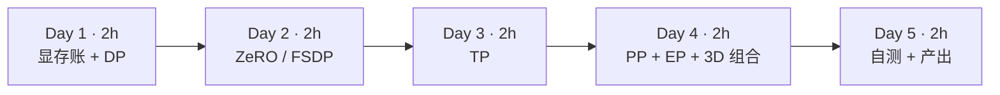

| 天 | 时间 | 先读 | 再读（外部资料） | 再做 |
|---|---|---|---|---|
| Day 1 | 2h | 2.1、2.2 | ① Playbook：单卡训练与 DP 章节 | 实验 1 |
| Day 2 | 2h | 2.3 | ① Playbook：ZeRO 章节、⑥ ZeRO 论文（摘要+图 1） | 实验 2 |
| Day 3 | 2h | 2.4 | ① Playbook：TP 章节、④ Megatron 论文第 3 节 | 实验 3 |
| Day 4 | 2h | 2.5、2.6、2.7 | ① Playbook：PP、EP 章节、⑦ GPipe 摘要、⑧ Megatron 3D 并行论文 | 实验 4 |
| Day 5 | 2h | — | ③ Lilian Weng 综述（复习） | 自测、产出 |

---

## 2. 核心概念讲解

### 2.1 训练时显存里有什么

混合精度 + Adam 下，每个参数要占：

| 项 | 字节/参数 | 说明 |
|---|---|---|
| BF16 参数 | 2 | 前向/反向用 |
| BF16 梯度 | 2 | 反向产出 |
| FP32 主参数 | 4 | 优化器更新用，避免精度损失 |
| Adam 动量 + 方差 | 8 | 两个 FP32 状态 |
| **合计** | **16** | 不含激活 |

所以 7B 模型光状态就要 112GB，一张 80GB 卡放不下——还没算激活（与 batch × 序列长度成正比，用激活重计算换显存）。这就是一切并行的出发点。

### 2.2 五种并行

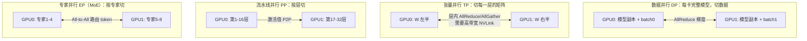

| 方式 | 切什么 | 通信 | 频率 | 省显存 | 大数据类比 |
|---|---|---|---|---|---|
| DP | 数据 | 梯度 AllReduce | 每步一次（可与反向重叠） | 不省 | 每个 executor 处理不同分区，最后聚合 |
| ZeRO-3/FSDP | 参数/梯度/优化器状态 | 参数 AllGather + 梯度 ReduceScatter | 每层每步 | 很省 | 状态分片存储，用时拉取 |
| TP | 层内矩阵 | AllReduce（激活） | 每层前向反向各若干次 | 省 | 宽表按列切分 |
| PP | 层 | 激活/梯度 P2P | 每个 micro-batch | 省 | 多 Stage 流水线 |
| EP | MoE 专家 | All-to-All（token 路由） | 每个 MoE 层 | 省（MoE） | 按 key shuffle 到不同 reducer |

### 2.3 ZeRO：消除 DP 中的冗余

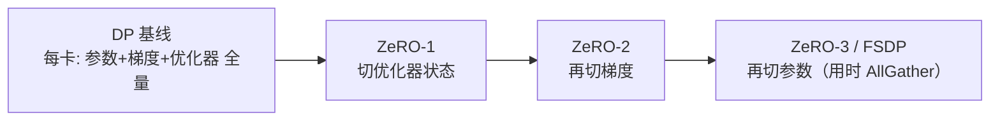

设参数量为 Ψ、卡数为 N（⑥）：

$$M_{DP} = 16\Psi,\quad M_{Z1} = 4\Psi + \frac{12\Psi}{N},\quad M_{Z2} = 2\Psi + \frac{14\Psi}{N},\quad M_{Z3} = \frac{16\Psi}{N}$$

通信量：DP 的 AllReduce 每卡约 2Ψ（= ReduceScatter + AllGather，下周细讲）；ZeRO-1/2 不增加通信（只是把 AllReduce 拆成 ReduceScatter + 各自更新 + AllGather）；ZeRO-3 前向、反向都要 AllGather 参数，通信约为 DP 的 1.5 倍。PyTorch 的 FSDP 与 ZeRO-3 思路相同（第 19 周对比）。

### 2.4 张量并行（Megatron 方式）

MLP 是 Y = GeLU(XA)·B。把 A **按列**切成 [A₁, A₂]，B **按行**切成 [B₁; B₂]：

$$Y = \mathrm{GeLU}(XA_1)B_1 + \mathrm{GeLU}(XA_2)B_2$$

每张卡算一项，GeLU 是逐元素运算可以在本地做，**最后一次 AllReduce 把两项相加**。注意力层同理按头切分。代价是**每一层前向、反向都要通信**，且通信在关键路径上难以隐藏，所以 TP 需要 NVLink 级带宽，通常 TP 度 ≤ 单机卡数（8）。

### 2.5 流水线并行与气泡

把层切成 p 个 stage，batch 切成 m 个 micro-batch 依次流过。开始和结束时总有 stage 空闲（气泡）：

$$\text{气泡比例} = \frac{p-1}{m+p-1}$$

m 越大气泡越小，但 micro-batch 太小又会降低每卡计算效率，并增加激活显存（1F1B 调度可以限制在途激活数量，⑧）。PP 只在相邻 stage 之间传激活，通信量小，适合**跨机**。

### 2.6 专家并行（MoE）

MoE 层有很多个专家 FFN，每个 token 只路由到少数几个（如 top-2）。把专家分到不同卡上，每个 MoE 层前后各需一次 **All-to-All**：把 token 发给拥有对应专家的卡，算完再发回来（⑨ GShard）。负载不均衡（热门专家）是主要挑战。

### 2.7 3D 并行的组合原则

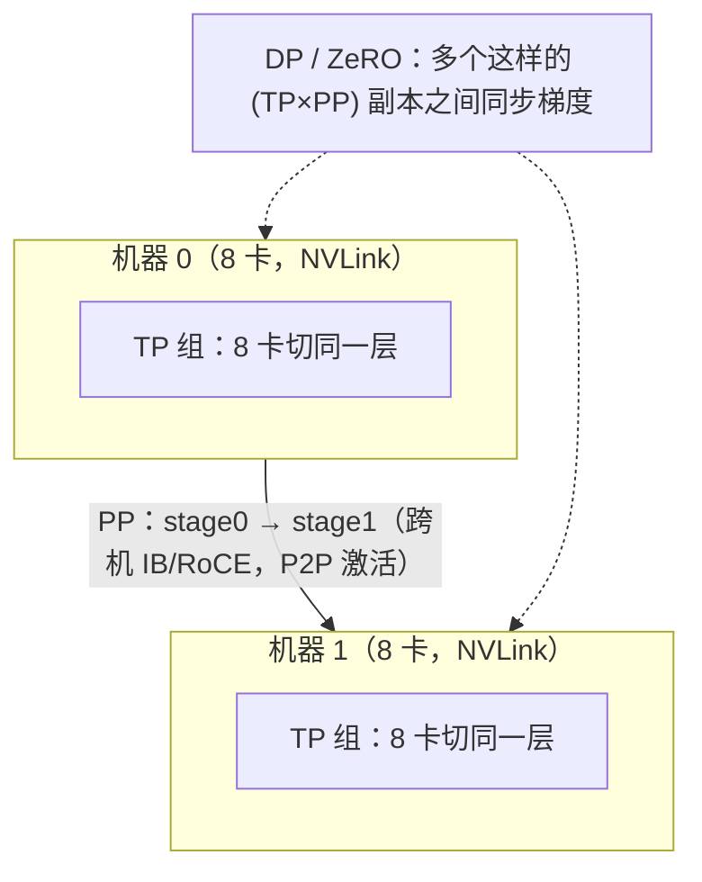

原则：**通信最密集的放在带宽最高的链路上**——TP 放机内 NVLink，PP 跨机，DP（或 ZeRO）在最外层（⑧）。总卡数 = TP × PP × DP。

**架构师视角**：并行策略直接决定平台需求——TP 要求同机 NVLink（调度时整机分配，联系第 11 周 gang 与拓扑感知调度）；PP/DP 需要高速机间网络；ZeRO-3/FSDP 的 checkpoint 是分片的（恢复时需要相同或可重分片的布局）；任何一卡故障都会让整个作业停下（联系第 19 周的弹性训练）。

---

## 3. 动手实验 {{none}}

### 实验 1：ZeRO 显存估算（20 分钟）

```python
"""混合精度 + Adam 训练的每卡显存估算（不含激活）。口径：每参数 2(bf16 参数) + 2(bf16 梯度) + 12(fp32 主参数+动量+方差) = 16 字节。
用法：python zero_mem.py --params 7e9 --gpus 8"""
import argparse
p = argparse.ArgumentParser(); p.add_argument("--params", type=float, default=7e9); p.add_argument("--gpus", type=int, default=8)
a = p.parse_args(); P, N = a.params, a.gpus
P_, G_, O_ = 2 * P, 2 * P, 12 * P
rows = [("DP（无分片）", P_ + G_ + O_), ("ZeRO-1（切优化器）", P_ + G_ + O_ / N),
        ("ZeRO-2（再切梯度）", P_ + (G_ + O_) / N), ("ZeRO-3 / FSDP（再切参数）", (P_ + G_ + O_) / N)]
print(f"模型 {P/1e9:g}B 参数，{N} 卡；参数 {P_/1e9:.0f}GB + 梯度 {G_/1e9:.0f}GB + 优化器 {O_/1e9:.0f}GB = {(P_+G_+O_)/1e9:.0f}GB")
for name, b in rows: print(f"{name:<22} 每卡 {b/1e9:7.1f} GB")
```

```bash
python zero_mem.py               # 7B，8 卡
python zero_mem.py --gpus 2      # 7B，2 卡
```

真实输出：

```text
模型 7B 参数，8 卡；参数 14GB + 梯度 14GB + 优化器 84GB = 112GB
DP（无分片）                每卡   112.0 GB
ZeRO-1（切优化器）           每卡    38.5 GB
ZeRO-2（再切梯度）           每卡    26.2 GB
ZeRO-3 / FSDP（再切参数）    每卡    14.0 GB
模型 7B 参数，2 卡；参数 14GB + 梯度 14GB + 优化器 84GB = 112GB
DP（无分片）                每卡   112.0 GB
ZeRO-1（切优化器）           每卡    70.0 GB
ZeRO-2（再切梯度）           每卡    63.0 GB
ZeRO-3 / FSDP（再切参数）    每卡    56.0 GB
```

- 优化器状态占了 75%（84/112GB），所以 ZeRO-1 一步就省下大半。
- 8 卡 ZeRO-3 每卡只需 14GB 状态，80GB 卡上剩下的空间可以放激活；2 卡就不够了（56GB + 激活），这就是为什么第 19 周用 2 卡时要么用 LoRA，要么用小模型做全参对比。
- 这是**估算**：不含激活、临时缓冲区和碎片。与 ⑥ 论文图 1 的数字对照（论文用 Ψ=7.5B、N=64）。

### 实验 2：FSDP 真的把状态切开了吗？（30 分钟）

```python
"""FSDP2（fully_shard）在 CPU/gloo 上的分片演示：每个 rank 实际持有多少参数与优化器状态，训练一步后与 DDP 结果一致。
用法：torchrun --nproc_per_node=N fsdp_shard.py"""
import torch, torch.nn as nn, torch.distributed as dist
from torch.distributed.fsdp import fully_shard
from torch.nn.parallel import DistributedDataParallel as DDP
dist.init_process_group("gloo"); r, n = dist.get_rank(), dist.get_world_size()
def make():
    torch.manual_seed(0)
    return nn.Sequential(*[nn.Sequential(nn.Linear(1024, 4096), nn.ReLU(), nn.Linear(4096, 1024)) for _ in range(4)])
def local_numel(m): return sum((p.to_local() if hasattr(p, "to_local") else p).numel() for p in m.parameters())
def step(m):
    opt = torch.optim.Adam(m.parameters(), lr=1e-3); torch.manual_seed(100 + r)
    loss = m(torch.randn(8, 1024)).pow(2).mean(); loss.backward(); opt.step()
    st = sum((v.to_local() if hasattr(v, "to_local") else v).numel() for s in opt.state.values() for v in s.values() if torch.is_tensor(v) and v.dim() > 0)
    return st
ddp = DDP(make()); s_ddp = step(ddp)
fs = make()
for blk in fs: fully_shard(blk)                       # 每个子块一个分片单元（用时 AllGather，用完释放）
fully_shard(fs); s_fs = step(fs)
total = sum(p.numel() for p in make().parameters())
full = {k: v.full_tensor() if hasattr(v, "full_tensor") else v for k, v in fs.state_dict().items()}
diff = max((full[k] - v).abs().max().item() for k, v in ddp.module.state_dict().items())
print(f"rank {r}/{n}: 模型共 {total/1e6:.1f}M 参数 | DDP 本地参数 {local_numel(ddp)/1e6:.1f}M 优化器状态 {s_ddp/1e6:.1f}M | "
      f"FSDP 本地参数 {local_numel(fs)/1e6:.1f}M 优化器状态 {s_fs/1e6:.1f}M | 一步后与 DDP 参数最大差 {diff:.1e}", flush=True)
dist.destroy_process_group()
```

```bash
torchrun --nproc_per_node=2 fsdp_shard.py
torchrun --nproc_per_node=4 fsdp_shard.py
```

真实输出：

```text
rank 1/2: 模型共 33.6M 参数 | DDP 本地参数 33.6M 优化器状态 67.1M | FSDP 本地参数 16.8M 优化器状态 33.6M | 一步后与 DDP 参数最大差 0.0e+00
rank 0/2: 模型共 33.6M 参数 | DDP 本地参数 33.6M 优化器状态 67.1M | FSDP 本地参数 16.8M 优化器状态 33.6M | 一步后与 DDP 参数最大差 0.0e+00
rank 0/4: 模型共 33.6M 参数 | DDP 本地参数 33.6M 优化器状态 67.1M | FSDP 本地参数 8.4M 优化器状态 16.8M | 一步后与 DDP 参数最大差 3.7e-09
rank 2/4: ...（4 个 rank 相同）
```

- DDP 每个 rank 都持有完整的 33.6M 参数和 67.1M 优化器状态（Adam 的两个状态 = 2× 参数量）。
- FSDP 下每个 rank 只持有 1/N：2 卡 16.8M，4 卡 8.4M，优化器状态同比例缩小——这就是 2.3 公式中 ÷N 的那部分。
- 训练一步后，FSDP 汇总出的完整参数与 DDP 一致（4 卡时 3.7e-09 是浮点求和顺序不同造成的舍入差），**分片不改变数学结果**，只改变数据放在哪里、何时通信。

### 实验 3：张量并行的“列切 + 行切”（20 分钟）

```python
"""张量并行的最小演示（2 进程，gloo/CPU）：MLP 的第一层按列切、第二层按行切（Megatron 方式），
每层只需一次 AllReduce，结果与单机完全一致。用法：torchrun --nproc_per_node=2 tp_demo.py"""
import torch, torch.distributed as dist
dist.init_process_group("gloo"); r, n = dist.get_rank(), dist.get_world_size()
torch.manual_seed(0)                                   # 所有进程生成相同的完整权重，便于对照
x = torch.randn(4, 8); A = torch.randn(8, 16); B = torch.randn(16, 8)
ref = torch.relu(x @ A) @ B                            # 单机结果
A_i = A.chunk(n, dim=1)[r]                             # 列切：每个 rank 得到 8×(16/n)
B_i = B.chunk(n, dim=0)[r]                             # 行切：每个 rank 得到 (16/n)×8
y = torch.relu(x @ A_i) @ B_i                          # 本地计算，激活无需通信（GeLU/ReLU 逐元素）
dist.all_reduce(y)                                     # 部分和相加：整个 MLP 只此一次通信
print(f"rank {r}: A 分片 {tuple(A_i.shape)} B 分片 {tuple(B_i.shape)}，与单机结果最大误差 {(y-ref).abs().max():.2e}", flush=True)
dist.destroy_process_group()
```

```bash
torchrun --nproc_per_node=2 tp_demo.py
torchrun --nproc_per_node=4 tp_demo.py
```

真实输出（2 进程）：

```text
rank 0: A 分片 (8, 8) B 分片 (8, 8)，与单机结果最大误差 9.54e-07
rank 1: A 分片 (8, 8) B 分片 (8, 8)，与单机结果最大误差 9.54e-07
```

4 进程时每个 rank 的分片为 A (8, 4)、B (4, 8)，误差同样为 9.54e-07。整个 MLP 只做了一次 `all_reduce`。如果把两层都按列切，中间就必须先 AllGather 激活——多一次通信。真实框架里每层前向 1 次、反向 1 次这样的通信，每个 Transformer 层（注意力 + MLP）共 4 次，所以 TP 对带宽极其敏感（④）。

### 实验 4：流水线气泡（10 分钟）

```python
"""流水线并行的气泡比例：GPipe/1F1B 调度下，p 个 stage、m 个 micro-batch，空闲占比 = (p-1)/(m+p-1)。"""
for p in (2, 4, 8):
    print(f"stage={p}: " + "  ".join(f"m={m}:{(p-1)/(m+p-1):5.1%}" for m in (1, 4, 8, 32)))
```

```text
stage=2: m=1:50.0%  m=4:20.0%  m=8:11.1%  m=32: 3.0%
stage=4: m=1:75.0%  m=4:42.9%  m=8:27.3%  m=32: 8.6%
stage=8: m=1:87.5%  m=4:63.6%  m=8:46.7%  m=32:17.9%
```

8 个 stage 时，要把气泡压到 20% 以下需要 32 个 micro-batch。这说明 PP 度不宜过大，且需要足够大的全局 batch 支撑——这又和 DP 度、收敛性相互制约。

### 常见错误与排查

| 现象 | 原因 | 解决 |
|---|---|---|
| 多进程输出混在同一行（本站实测） | 多个进程同时写 stdout 且未刷新 | `print(..., flush=True)`，或只让 rank 0 打印 |
| `torchrun` 卡住不动 | 某个进程没有调用对应的集合通信（各 rank 代码路径不一致） | 确保所有 rank 执行相同的通信序列 |
| 端口被占用 `Address already in use` | 上次运行未退出 | `--master_port` 换端口，或结束残留进程 |
| FSDP 汇总参数与 DDP 有 1e-9 级差异（本站实测） | 浮点求和顺序不同 | 正常；关注是否在 1e-6 以内 |
| 估算显存够但实际 OOM | 激活、临时缓冲、碎片未计入 | 激活重计算、减小 micro-batch、留 10–20% 余量 |

### 扩展练习

1. 修改 `tp_demo.py`，两层都按列切，补上必要的 `all_gather`，验证结果并数一数通信次数。
2. 在 `fsdp_shard.py` 中去掉对子块的 `fully_shard`，只对根模块调用，思考此时 AllGather 的粒度变化对峰值显存有什么影响。
3. 用 `zero_mem.py` 计算 70B 模型在 64 卡上的各阶段每卡显存，与 ⑥ 论文中的数字对比。
4. 阅读 ② 中关于 roofline 的章节，估算 TP=8 时一个 Transformer 层的通信时间与计算时间之比（假设 NVLink 带宽与 GPU 算力的公开规格）。

---

## 4. 精读指南

- **① [HuggingFace Ultra-Scale Playbook](https://huggingface.co/spaces/nanotron/ultrascale-playbook)**（本月主读，本周约 3 小时）：DP、ZeRO、TP、PP、EP 章节。**读完回答**：为什么 ZeRO-3 的通信量是 DP 的 1.5 倍？
- **② [How to Scale Your Model](https://jax-ml.github.io/scaling-book/)**（选读）：从 roofline 算通信与计算的比值。
- **③ [Lilian Weng：How to Train Really Large Models on Many GPUs?](https://lilianweng.github.io/posts/2021-09-25-train-large/)**（45 分钟）。
- **④ [Megatron-LM 论文](https://arxiv.org/abs/1909.08053)**（40 分钟，第 3 节）。**读完回答**：自注意力层如何做张量并行？
- **⑤ [Megatron-LM 仓库](https://github.com/NVIDIA/Megatron-LM)**、[nanotron](https://github.com/huggingface/nanotron)（浏览 README 中的并行参数）。
- **⑥ [ZeRO 论文](https://arxiv.org/abs/1910.02054)**（40 分钟，第 1、5 节与图 1）。
- **⑦ [GPipe 论文](https://arxiv.org/abs/1811.06965)**（20 分钟，摘要与图 2）。
- **⑧ [Megatron 3D 并行论文](https://arxiv.org/abs/2104.04473)**（40 分钟）：PTD-P 组合与 1F1B 交错调度。
- **⑨ [GShard 论文](https://arxiv.org/abs/2006.16668)**（选读，MoE 与专家并行）。
- **⑩ [PyTorch fully_shard](https://docs.pytorch.org/docs/stable/distributed.fsdp.fully_shard.html)**、[FSDP 教程](https://docs.pytorch.org/tutorials/intermediate/FSDP_tutorial.html)、[张量并行 API](https://docs.pytorch.org/docs/stable/distributed.tensor.parallel.html)（查阅式）。
- 中文全景参考：[微软 AI-System](https://github.com/microsoft/AI-System)、[ZOMI AISystem](https://github.com/chenzomi12/AISystem)。

---

## 5. 自测题

<details>
<summary>1. 为什么混合精度 Adam 训练每参数约需 16 字节？</summary>

BF16 参数 2 + BF16 梯度 2 + FP32 主参数 4 + Adam 动量 4 + 方差 4 = 16 字节，不含激活。

</details>

<details>
<summary>2. ZeRO-1/2/3 各切了什么？哪一级开始增加通信量？</summary>

ZeRO-1 切优化器状态，ZeRO-2 再切梯度，ZeRO-3 再切参数。ZeRO-1/2 的通信量与 DP 相同（AllReduce 拆成 ReduceScatter + AllGather）；ZeRO-3 需要在前向和反向时 AllGather 参数，通信量约为 DP 的 1.5 倍。

</details>

<details>
<summary>3. Megatron MLP 为什么第一层列切、第二层行切？</summary>

第一层列切后每张卡得到部分输出特征，GeLU 逐元素可本地计算；第二层行切正好接收这部分特征并产出部分和，最后一次 AllReduce 相加即可。整个 MLP 前向只需一次通信，避免了中间激活的 AllGather。

</details>

<details>
<summary>4. 为什么 TP 一般限于机内，PP 可以跨机？</summary>

TP 每层都要通信且在关键路径上，需要 NVLink 级带宽；PP 只在相邻 stage 间传递激活，通信量小，机间网络足以承担。

</details>

<details>
<summary>5. 4 个 stage、8 个 micro-batch 的气泡比例是多少？如何减小？</summary>

(4−1)/(8+4−1) = 3/11 ≈ 27.3%。增加 micro-batch 数、减少 stage 数，或使用交错式（interleaved）1F1B 调度。

</details>

<details>
<summary>6. 专家并行使用什么通信原语？主要挑战是什么？</summary>

All-to-All：把 token 发送到拥有对应专家的卡，计算后再发回。主要挑战是负载不均衡（热门专家过载）和 All-to-All 对网络的压力。

</details>

<details>
<summary>7. 16 卡（2 台 8 卡机）训练一个放不进单卡的模型，你会怎样组合并行？</summary>

TP=8 放在每台机器内部（NVLink），PP=2 跨两台机器；若模型能在 TP=8 下放入单机，也可以用 TP=8 × DP=2（或 ZeRO）。原则是通信最密集的维度放在带宽最高的链路上。

</details>

### 思考题

1. 从平台角度看，TP=8 的作业要求“整机 8 卡”，这对第 3 月的调度（Kueue/Volcano、拓扑感知）提出了什么要求？
2. ZeRO-3/FSDP 的 checkpoint 是分片的。如果作业从 16 卡扩到 32 卡恢复，需要什么能力？（提示：PyTorch Distributed Checkpoint 的重分片）
3. 用你熟悉的 Spark shuffle 来类比 All-to-All：哪些优化（如合并小消息、数据倾斜处理）可以迁移到 MoE 训练？

---

## 6. 本周产出与掌握清单

### 本周产出

- [ ] 一张图：五种并行的切分方式与通信原语（自己画）
- [ ] 7B、70B 模型在 8/64 卡上的 ZeRO 显存估算表
- [ ] 笔记：并行策略对平台的要求（网络、调度、checkpoint、故障域）

## 参考资料

- [HuggingFace Ultra-Scale Playbook](https://huggingface.co/spaces/nanotron/ultrascale-playbook)（书·进阶）：图解 DP/TP/PP/ZeRO 与通信开销，第 5 月主读
- [How to Scale Your Model（Google DeepMind）](https://jax-ml.github.io/scaling-book/)（书·高级）：从 roofline 和显存/算力算账讲并行，适合进阶
- [Lilian Weng：How to Train Really Large Models on Many GPUs?](https://lilianweng.github.io/posts/2021-09-25-train-large/)（博客·进阶）：一篇读懂各种并行与显存优化技术的综述
- [Megatron-LM 论文](https://arxiv.org/abs/1909.08053)（论文·高级）：张量并行的原始论文，训练岗面试常问
- [Megatron-LM](https://github.com/NVIDIA/Megatron-LM)（仓库·高级）：大规模训练事实标准框架，读 README 了解并行配置
- [nanotron](https://github.com/huggingface/nanotron)（仓库·进阶）：Playbook 配套的精简 3D 并行训练库，代码比 Megatron 好读
- [微软 AI-System 课程](https://github.com/microsoft/AI-System)（书·进阶）：AI 系统全景课程讲义（中英文）
- [ZOMI AISystem（中文）](https://github.com/chenzomi12/AISystem)（书·进阶）：AI 芯片、编译器、推理、训练系统的中文全景

> 完整列表见 [参考资料库](/resources.html)。

## 检查清单
- [ ] 读完 Ultra-Scale Playbook 中数据并行、ZeRO、张量并行、流水线并行章节
- [ ] 能画出 4 种并行的切分方式和通信原语
- [ ] 完成 ZeRO 各阶段显存估算
- [ ] 能解释 TP 为什么一般放在一台机器内部
- [ ] 能计算流水线气泡比例并说明如何减小
- [ ] 能说出 3D 并行的组合原则

=== m5w2 | 第 18 周：集合通信与 NCCL | 第 5 月 · 分布式训练 + MLOps
# 第 18 周：集合通信与 NCCL

> **本周一句话**：上周的五种并行，落到底层就是五六个**集合通信原语**。本周在 CPU 上用 `torch.distributed`（gloo 后端）把 AllReduce、AllGather、ReduceScatter、Broadcast、All-to-All 全部跑一遍，**亲手写一个 Ring AllReduce** 并验证“每卡通信量 ≈ 2 倍数据量、与卡数基本无关”，再用仿 nccl-tests 的脚本学会读 algbw/busbw。有多卡机器时用真正的 nccl-tests 量 NVLink 与 PCIe 的差距。

**预计投入：约 9 小时**（阅读 ≈ 3.5h，本地动手 ≈ 3h，多卡动手 ≈ 1h，自测与产出 ≈ 1.5h）。{{local}} {{gpuN}}

**本周结束时你应该能：**

1. 说出每个集合通信原语的输入输出语义，以及它在哪种并行中出现。
2. 推导 Ring AllReduce 的通信量与时间模型，解释为什么 AllReduce = ReduceScatter + AllGather。
3. 读懂 nccl-tests 的 algbw 与 busbw，以及 `nvidia-smi topo -m` 的拓扑输出。
4. 知道 NCCL 排障的常用环境变量和思路。

> **验证说明**：实验 1–3 用 `torchrun` 在本站 CPU 上以 gloo 后端启动 4 个进程**真实运行**（torch 2.14.1+cpu），输出均为真实输出；gloo 走本机回环，**带宽数字只代表本站 CPU 环境，与 GPU/NCCL 无可比性**，用来学习测量方法。**实验 4（nccl-tests）未在本站实测，需多卡 GPU**。实验文件在仓库 `labs/w18/`。

---

## 1. 本周学习路线


| 天 | 时间 | 先读 | 再读（外部资料） | 再做 |
|---|---|---|---|---|
| Day 1 | 2h | 2.1、2.2 | ③ NCCL 集合通信说明、④ PyTorch 分布式教程 | 实验 1 |
| Day 2 | 2h | 2.3 | ① Playbook 附录中的集合通信部分 | 实验 2 |
| Day 3 | 2h | 2.4、2.5 | ⑤ nccl-tests PERFORMANCE.md | 实验 3 |
| Day 4 | 1.5h | — | ⑥ nccl-tests README | 实验 4（多卡） |
| Day 5 | 1.5h | 2.6 | ⑦ NCCL 环境变量、⑧ ml-engineering 网络章节 | 自测、产出 |

---

## 2. 核心概念讲解

### 2.1 五个原语

设 n 个 rank，rank i 持有数据 xᵢ：

| 原语 | 输入 | 输出（每个 rank） | 大数据类比 |
|---|---|---|---|
| AllReduce | xᵢ | Σ xᵢ（全部相同） | `reduce` 之后再广播结果 |
| AllGather | xᵢ | [x₀, x₁, …, xₙ₋₁] | `collect` 到每个节点 |
| ReduceScatter | xᵢ = [xᵢ⁰, …, xᵢⁿ⁻¹] | rank j 得到 Σᵢ xᵢʲ | 按 key 分区的 `reduceByKey` |
| Broadcast | x₀ | x₀ | 广播变量 |
| All-to-All | xᵢ = [xᵢ⁰, …, xᵢⁿ⁻¹] | rank j 得到 [x₀ʲ, x₁ʲ, …] | **shuffle** |

### 2.2 原语 ↔ 并行策略

| 并行 | 用到的原语 | 时机 |
|---|---|---|
| DP | AllReduce（梯度） | 反向传播中按桶触发，与计算重叠 |
| ZeRO-1/2 | ReduceScatter（梯度）+ AllGather（更新后的参数） | 每步 |
| ZeRO-3 / FSDP | AllGather（参数，前向和反向各一次）+ ReduceScatter（梯度） | 每层每步 |
| TP | AllReduce（激活/梯度），或 AllGather + ReduceScatter（序列并行） | 每层前向/反向 |
| PP | Send/Recv（点对点） | 每个 micro-batch |
| EP（MoE） | All-to-All | 每个 MoE 层前后 |
| 初始化 | Broadcast（rank 0 的初始参数） | 启动时 |

### 2.3 Ring AllReduce

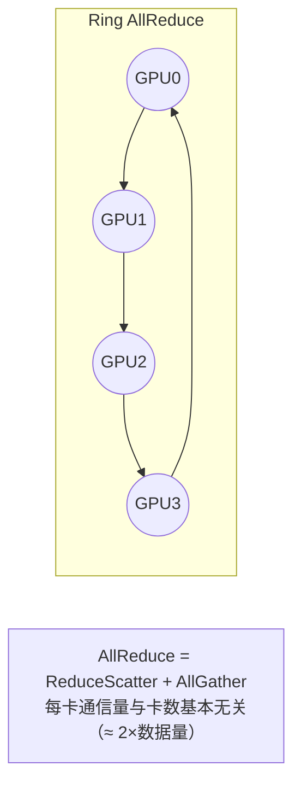

数据切成 n 块，排成环，每步每个 rank 只给右邻居发一块：

1. **ReduceScatter 阶段**（n−1 步）：每步把收到的块累加到自己对应的块上。结束后每个 rank 恰好持有某一块的全体之和。
2. **AllGather 阶段**（n−1 步）：把完成的块沿环传一圈，每个 rank 都得到全部结果。

每个 rank 发送的数据量：

$$V = 2(n-1)\cdot\frac{S}{n} \;\approx\; 2S$$

时间模型（α 为每步延迟，β 为每字节传输时间）：

$$T \approx 2(n-1)\,\alpha + 2\frac{n-1}{n}\,S\,\beta$$

结论：**大消息时由带宽项主导，几乎与卡数无关；小消息时由延迟项主导，随卡数线性增长**。所以框架要把小梯度合并成“桶”（DDP 的 bucket）再通信；NCCL 在大规模和小消息时还会选择树形算法。

### 2.4 algbw 与 busbw

nccl-tests 报告两种带宽（⑤）：

$$\text{algbw} = \frac{S}{t},\qquad \text{busbw}_{AllReduce} = \text{algbw}\times\frac{2(n-1)}{n}$$

busbw 把算法本身的通信放大系数折算进去，反映**硬件链路的实际利用**，可以直接和链路峰值带宽（NVLink、PCIe、IB 的规格）比较，也可以跨不同卡数比较。

### 2.5 GPU 互联拓扑

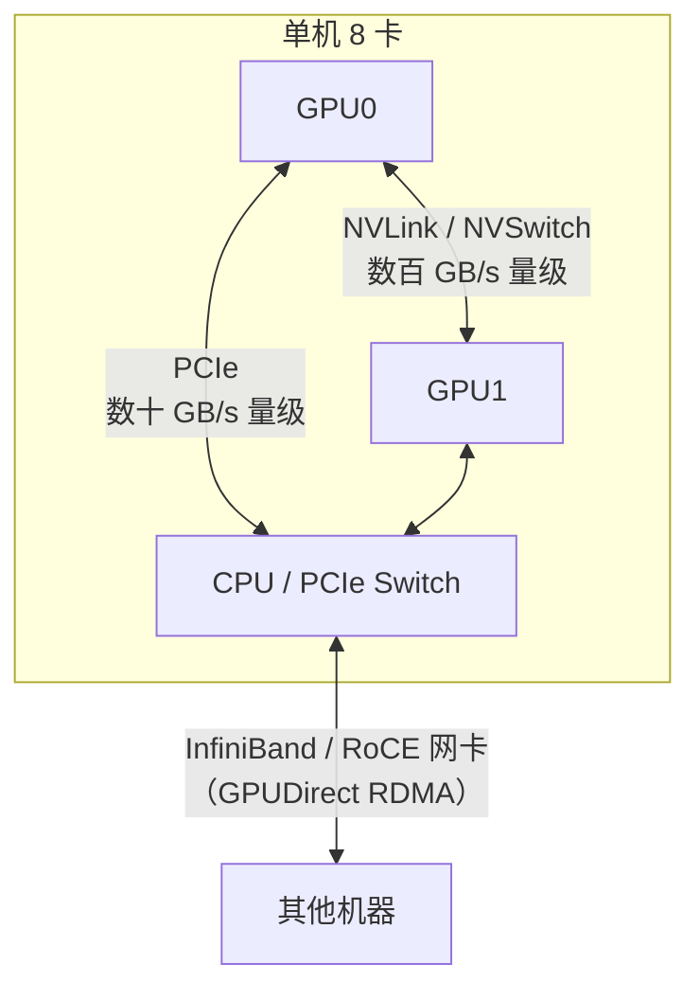

`nvidia-smi topo -m` 的矩阵中，`NV#` 表示 # 条 NVLink 直连；`PIX/PXB` 经过 PCIe 交换芯片；`PHB` 经过 CPU 的 PCIe 主桥；`SYS` 要跨 CPU 插槽（NUMA）。从 NV# 到 SYS 带宽依次下降。租卡时要特别留意：很多廉价多卡机是 PCIe 互联，TP 性能会很差。

### 2.6 NCCL 排障要点

- `NCCL_DEBUG=INFO`：打印选用的网卡、传输方式（P2P/SHM/NET）、拓扑与算法。**首先看它**。
- `NCCL_SOCKET_IFNAME`：多网卡时指定用于引导的网卡（错选 docker0 等虚拟网卡是常见坑）。
- `NCCL_IB_DISABLE`、`NCCL_P2P_DISABLE`：排查时用来隔离问题。
- 卡住（hang）：常见原因是各 rank 调用集合通信的顺序/形状不一致，或某个 rank 已崩溃；PyTorch 的 `TORCH_NCCL_ASYNC_ERROR_HANDLING`/超时设置可让作业报错退出而不是永远挂住。

具体变量含义以 ⑦ 为准。**大数据类比**：这和排查 Spark shuffle 慢/卡住几乎一样——先看走的是哪张网卡、哪种传输，再看是否有掉队的节点（straggler）。

---

## 3. 动手实验

### 实验 1：五个原语一次看全（本地，30 分钟）{{local}}

```python
"""五个集合通信原语一次看全（gloo/CPU）。用法：torchrun --nproc_per_node=4 collectives.py"""
import torch, torch.distributed as dist
dist.init_process_group("gloo"); r, n = dist.get_rank(), dist.get_world_size()
def show(name, val):                                   # 按 rank 顺序打印，避免输出交错
    for i in range(n):
        if i == r: print(f"rank {r} {name:<15} {val}", flush=True)
        dist.barrier()
x = torch.tensor([float(r + 1)]); dist.all_reduce(x); show("all_reduce", x.tolist())
out = [torch.zeros(1) for _ in range(n)]; dist.all_gather(out, torch.tensor([float(r)])); show("all_gather", [t.item() for t in out])
inp = [torch.tensor([float(10 * r + j)]) for j in range(n)]          # rank r 的第 j 块
rs = torch.zeros(1); dist.reduce_scatter(rs, inp); show("reduce_scatter", rs.tolist())
b = torch.tensor([float(r)]) if r == 0 else torch.zeros(1); b += 42 if r == 0 else 0
dist.broadcast(b, src=0); show("broadcast", b.tolist())
a2a_in = [torch.tensor([float(10 * r + j)]) for j in range(n)]       # 发给 rank j 的数据
a2a_out = [torch.zeros(1) for _ in range(n)]
try:
    dist.all_to_all(a2a_out, a2a_in); show("all_to_all", [t.item() for t in a2a_out])
except Exception as e:
    show("all_to_all", f"不支持：{type(e).__name__}: {str(e)[:60]}")
dist.destroy_process_group()
```

```bash
torchrun --nproc_per_node=4 collectives.py
```

真实输出：

```text
rank 0 all_reduce      [10.0]
rank 1 all_reduce      [10.0]
rank 2 all_reduce      [10.0]
rank 3 all_reduce      [10.0]
rank 0 all_gather      [0.0, 1.0, 2.0, 3.0]
rank 1 all_gather      [0.0, 1.0, 2.0, 3.0]
rank 2 all_gather      [0.0, 1.0, 2.0, 3.0]
rank 3 all_gather      [0.0, 1.0, 2.0, 3.0]
rank 0 reduce_scatter  [60.0]
rank 1 reduce_scatter  [64.0]
rank 2 reduce_scatter  [68.0]
rank 3 reduce_scatter  [72.0]
rank 0 broadcast       [42.0]
rank 1 broadcast       [42.0]
rank 2 broadcast       [42.0]
rank 3 broadcast       [42.0]
rank 0 all_to_all      [0.0, 10.0, 20.0, 30.0]
rank 1 all_to_all      [1.0, 11.0, 21.0, 31.0]
rank 2 all_to_all      [2.0, 12.0, 22.0, 32.0]
rank 3 all_to_all      [3.0, 13.0, 23.0, 33.0]
```

验算：all_reduce 1+2+3+4=10；reduce_scatter 中 rank j 得到 Σᵣ(10r + j) = 60 + 4j；all_to_all 中 rank j 收到的是每个 rank 发给它的第 j 块（10r + j）——这正是矩阵转置，也就是 shuffle。

### 实验 2：手写 Ring AllReduce（本地，45 分钟）{{local}}

```python
"""手写 Ring AllReduce（ReduceScatter + AllGather，各 n-1 步，只用相邻 rank 的 send/recv），与 dist.all_reduce 对比。
用法：torchrun --nproc_per_node=4 ring_allreduce.py"""
import torch, torch.distributed as dist
dist.init_process_group("gloo"); r, n = dist.get_rank(), dist.get_world_size()
torch.manual_seed(r); data = torch.randn(n * 1000)
ref = data.clone(); dist.all_reduce(ref)
chunks = list(data.clone().chunk(n)); right, left = (r + 1) % n, (r - 1) % n
sent = 0
for step in range(n - 1):                                # 阶段 1：ReduceScatter
    s, rcv = (r - step) % n, (r - step - 1) % n
    buf = torch.empty_like(chunks[rcv])
    req = dist.isend(chunks[s], right); dist.recv(buf, left); req.wait()
    chunks[rcv] += buf; sent += chunks[s].numel()
# 此时 chunks[(r+1)%n] 是全体之和的第 (r+1)%n 块
for step in range(n - 1):                                # 阶段 2：AllGather
    s, rcv = (r + 1 - step) % n, (r - step) % n
    buf = torch.empty_like(chunks[rcv])
    req = dist.isend(chunks[s], right); dist.recv(buf, left); req.wait()
    chunks[rcv] = buf; sent += chunks[s].numel()
out = torch.cat(chunks)
print(f"rank {r}: 与 dist.all_reduce 最大误差 {(out-ref).abs().max():.1e}，本 rank 发送 {sent} 个元素 = "
      f"{sent/data.numel():.2f}× 数据量（理论 2(n-1)/n = {2*(n-1)/n:.2f}）\n", end="", flush=True)
dist.destroy_process_group()
```

```bash
torchrun --nproc_per_node=4 ring_allreduce.py
```

真实输出（4 个 rank 相同）：

```text
rank 0: 与 dist.all_reduce 最大误差 9.5e-07，本 rank 发送 6000 个元素 = 1.50× 数据量（理论 2(n-1)/n = 1.50）
```

- 结果与库函数一致（9.5e-07 是浮点累加顺序不同造成的）。
- 每个 rank 发送 1.5 倍的数据量，恰好等于 2(n−1)/n。n=8 时为 1.75，n→∞ 时趋近 2——**与卡数基本无关**。
- 代码里用 `isend` + `recv`：如果所有 rank 都先阻塞 `send` 再 `recv`，大消息时可能互相等待而死锁。这和 NCCL 内部的实现思想一致，只是 NCCL 还做了分块流水、多通道并行。

### 实验 3：学会读带宽（本地，30 分钟）{{local}}

```python
"""仿 nccl-tests 的 all_reduce 带宽测试（gloo/CPU）：algbw = 数据量/时间，busbw = algbw × 2(n-1)/n。
用法：torchrun --nproc_per_node=4 bw_bench.py"""
import time, torch, torch.distributed as dist
dist.init_process_group("gloo"); r, n = dist.get_rank(), dist.get_world_size()
if r == 0: print(f"{'size':>10} {'time(ms)':>10} {'algbw(GB/s)':>12} {'busbw(GB/s)':>12}", flush=True)
for size in [2**k for k in range(10, 29, 3)]:              # 1KB … 256MB
    x = torch.ones(size // 4)                               # float32
    for _ in range(2): dist.all_reduce(x)                   # 预热
    iters = 20 if size < 2**24 else 5
    dist.barrier(); t = time.perf_counter()
    for _ in range(iters): dist.all_reduce(x)
    dt = (time.perf_counter() - t) / iters
    if r == 0:
        alg = size / dt / 1e9
        print(f"{size:>10} {dt*1000:>10.3f} {alg:>12.3f} {alg*2*(n-1)/n:>12.3f}", flush=True)
dist.destroy_process_group()
```

```bash
torchrun --nproc_per_node=4 bw_bench.py
```

真实输出（本站 CPU，gloo，4 进程）：

```text
      size   time(ms)  algbw(GB/s)  busbw(GB/s)
      1024      0.583        0.002        0.003
      8192      0.546        0.015        0.023
     65536      0.356        0.184        0.276
    524288      0.550        0.953        1.430
   4194304      2.102        1.995        2.993
  33554432     13.367        2.510        3.765
 268435456    146.339        1.834        2.752
```

- **小消息（≤ 64KB）耗时几乎不变（约 0.4–0.6ms）**：延迟项 2(n−1)α 主导，带宽极低。这就是 DDP 要把梯度合并成桶的原因。
- **大消息时 busbw 在 3–4 GB/s 附近饱和**：带宽项主导；256MB 时略降，可能与内存带宽/缓存有关（本站未深究）。
- 这条“先升后平”的曲线形状，与你在 GPU 上用 nccl-tests 看到的一致，只是数值会高出两三个数量级。

### 实验 4：多卡 nccl-tests（GPU，约 1 小时）{{gpuN}}

> 未在本站实测，需多卡 GPU。命令来自 ⑥。

```bash
nvidia-smi topo -m                 # 看卡间连接：NVLink(NV#) 还是 PCIe(PHB/SYS)
git clone https://github.com/NVIDIA/nccl-tests.git && cd nccl-tests
make                               # 需要 CUDA 与 NCCL；路径参数见 nccl-tests README
./build/all_reduce_perf -b 8 -e 1G -f 2 -g 2
NCCL_DEBUG=INFO ./build/all_reduce_perf -b 1G -e 1G -g 2 2>&1 | grep -iE "via|channel|ring|tree" | head
```

记录 `busbw`（总线带宽）随消息大小变化，与实验 3 的曲线形状对照；把大消息时的 busbw 与该机型 NVLink/PCIe 规格对比。如果平台机器是 PCIe 互联，带宽会明显低于 NVLink——这就是 TP 偏好机内 NVLink 的原因。

> 本实验可以和第 19 周安排在同一次租用中完成，减少开关机次数。

### 常见错误与排查

| 现象 | 原因 | 解决 |
|---|---|---|
| 多 rank 输出交错在一行（本站实测） | 并发写 stdout | 按 rank 轮流打印 + barrier（实验 1 的 `show`），或只让 rank 0 打印 |
| 手写环形通信卡住 | 所有 rank 先阻塞 send 再 recv | 用 isend/irecv，或奇偶 rank 交换顺序 |
| 作业永远挂住 | 某 rank 少调用一次集合通信、形状不一致或已崩溃 | 设置超时；检查各 rank 代码路径；看崩溃 rank 的日志 |
| NCCL 选错网卡、带宽极低 | 自动探测到虚拟网卡 | `NCCL_DEBUG=INFO` 确认；用 `NCCL_SOCKET_IFNAME` 指定 |
| 多卡带宽远低于预期 | PCIe 互联或跨 NUMA | `nvidia-smi topo -m` 确认拓扑；选 NVLink 机型 |
| gloo 不支持某原语 | 不同后端支持的原语不同 | 查 ② 的后端支持表；GPU 训练用 NCCL |

### 扩展练习

1. 把 `ring_allreduce.py` 改成测时版本，与 `dist.all_reduce` 比较大消息时的耗时，思考库实现做了哪些优化。
2. 用 `bw_bench.py` 分别以 2、4、8 个进程运行，比较小消息耗时随进程数的变化，验证延迟项 2(n−1)α。
3. 实现基于 all_to_all 的“MoE token 路由”：每个 rank 有 8 个 token，各自随机选一个目标 rank，交换后统计每个 rank 收到多少 token（负载均衡问题）。
4. 阅读 ⑤，写出 AllGather 与 ReduceScatter 的 busbw 换算系数并解释。

---

## 4. 精读指南

- **① [Ultra-Scale Playbook](https://huggingface.co/spaces/nanotron/ultrascale-playbook)**：附录中的集合通信与 Ring AllReduce 图解（40 分钟）。
- **② [PyTorch Distributed](https://docs.pytorch.org/docs/stable/distributed.html)**（30 分钟）：后端（gloo/NCCL/MPI）支持哪些原语、在什么设备上。
- **③ [NCCL 集合通信说明](https://docs.nvidia.com/deeplearning/nccl/user-guide/docs/usage/collectives.html)**（20 分钟），[NCCL 用户指南](https://docs.nvidia.com/deeplearning/nccl/user-guide/docs/index.html)（浏览）。
- **④ [PyTorch 分布式教程](https://docs.pytorch.org/tutorials/intermediate/dist_tuto.html)**（40 分钟）：教程中也实现了 Ring AllReduce，与实验 2 对照。
- **⑤ [nccl-tests PERFORMANCE.md](https://github.com/NVIDIA/nccl-tests/blob/master/doc/PERFORMANCE.md)**（20 分钟）。**读完回答**：为什么 busbw 能跨卡数比较？
- **⑥ [nccl-tests](https://github.com/NVIDIA/nccl-tests)**、[NCCL 源码](https://github.com/NVIDIA/nccl)（README）。
- **⑦ [NCCL 环境变量](https://docs.nvidia.com/deeplearning/nccl/user-guide/docs/env.html)**（查阅式）。
- **⑧ [ml-engineering：网络章节](https://github.com/stas00/ml-engineering/tree/master/network)**（40 分钟）与 [全书](https://github.com/stas00/ml-engineering)：NVLink/IB 的实际数字与排障经验。
- **⑨ [torchrun](https://docs.pytorch.org/docs/stable/elastic/run.html)**（20 分钟）：多机启动参数与弹性。

---

## 5. 自测题

<details>
<summary>1. AllReduce 与 ReduceScatter + AllGather 是什么关系？</summary>

AllReduce 可以分解为先 ReduceScatter（每个 rank 得到一块的全局和）再 AllGather（把各块收集到每个 rank）。Ring AllReduce 就是这样实现的，ZeRO 也利用这种分解，在两步之间只更新自己负责的那块参数。

</details>

<details>
<summary>2. 为什么 Ring AllReduce 每卡通信量与卡数基本无关？</summary>

每卡发送 2(n−1)·S/n 的数据，n 增大时趋近 2S，与 n 基本无关。增加卡数主要增加步数（延迟项），大消息时影响很小。

</details>

<details>
<summary>3. 实验 3 中小消息为什么带宽极低？对训练框架有什么启示？</summary>

小消息时每步固定延迟（α）占主导，传输时间可以忽略，耗时几乎不随大小变化，有效带宽极低。框架应把许多小梯度合并成较大的桶再通信，并让通信与反向计算重叠。

</details>

<details>
<summary>4. 列出每种并行使用的通信原语。</summary>

DP：AllReduce；ZeRO-1/2：ReduceScatter + AllGather；ZeRO-3/FSDP：AllGather（参数）+ ReduceScatter（梯度）；TP：AllReduce（或序列并行下的 AllGather/ReduceScatter）；PP：Send/Recv；EP：All-to-All；初始化：Broadcast。

</details>

<details>
<summary>5. busbw 与 algbw 有何区别？</summary>

algbw = 数据量/耗时，是从应用角度看的带宽；busbw 乘以算法的通信放大系数（AllReduce 为 2(n−1)/n），反映链路实际传输的速率，可以和硬件峰值以及不同卡数的结果直接比较。

</details>

<details>
<summary>6. nvidia-smi topo -m 中 NV4、PHB、SYS 分别表示什么？</summary>

NV4：两卡间有 4 条 NVLink 直连；PHB：通过 CPU 的 PCIe 主桥通信；SYS：需要跨 CPU 插槽（经过 NUMA 互联），带宽最低。

</details>

### 思考题

1. 把 All-to-All 与 Spark shuffle 做详细对比：数据量、对网络的压力、数据倾斜的影响和应对方法。
2. 一个 1024 卡的训练作业突然变慢 30%，你会如何定位是某台机器/某张网卡的问题？（提示：straggler、NCCL 日志、逐机 nccl-tests）
3. 为什么大规模训练集群的网络常常设计成“轨道优化（rail-optimized）”拓扑？查阅 ⑧ 后用自己的话解释。

---

## 6. 本周产出与掌握清单

### 本周产出

- [ ] 实验 1–3 的代码与输出，特别是手写 Ring AllReduce
- [ ] 本地带宽曲线（实验 3），有多卡时补上 nccl-tests 曲线（实验 4）
- [ ] 笔记：通信原语 ↔ 并行策略对应表 + NCCL 排障清单

## 参考资料

- [HuggingFace Ultra-Scale Playbook](https://huggingface.co/spaces/nanotron/ultrascale-playbook)（书·进阶）：图解 DP/TP/PP/ZeRO 与通信开销，第 5 月主读
- [NCCL](https://github.com/NVIDIA/nccl)（仓库·高级）：集合通信库本体，了解 all-reduce 等原语的实现位置
- [nccl-tests](https://github.com/NVIDIA/nccl-tests)（仓库·进阶）：第 18 周测多卡通信带宽用的标准工具
- [Stas Bekman：ml-engineering](https://github.com/stas00/ml-engineering)（书·进阶）：大模型训练/推理的硬件、网络、排障实战手册

> 完整列表见 [参考资料库](/resources.html)。

## 检查清单
- [ ] 本地 torchrun 跑通 all_reduce / all_gather
- [ ] 看懂 `nvidia-smi topo -m` 输出
- [ ] （多卡）记录 nccl-tests 带宽曲线
- [ ] 笔记：通信原语 ↔ 并行策略对应关系
- [ ] 能推导 Ring AllReduce 的通信量与时间模型
- [ ] 能解释 algbw 与 busbw 的区别

=== m5w3 | 第 19 周：ZeRO / FSDP 微调对比 | 第 5 月 · 分布式训练 + MLOps
# 第 19 周：ZeRO / FSDP 微调对比

> **本周一句话**：把前两周的理论落到一次真实的微调上。先在本地 CPU 上用 2 个进程对 SmolLM2-135M 做**全参训练**，量出 DDP 与 FSDP 的每进程状态大小、峰值内存和每步耗时（状态减半、速度慢了约 1.6 倍、loss 完全一致）；再用 HF Trainer + LoRA 把微调脚本调通并接上 MLflow；最后在 2 卡 GPU 机器上用 DeepSpeed ZeRO-2/3 完成正式对比。

**预计投入：约 10 小时**（阅读 ≈ 3h，本地动手 ≈ 3h，多卡动手 ≈ 2.5h，报告 ≈ 1.5h；2 卡机器约 2–3 小时）。{{local}} {{gpuN}}

**本周结束时你应该能：**

1. 用实测数据说明 DDP 与 FSDP/ZeRO-3 在显存（内存）与速度上的取舍，并能拆解“状态”与“激活”各占多少。
2. 解释 LoRA 为什么大幅降低训练显存，以及它与 ZeRO 组合时各级 ZeRO 的差异来自哪里。
3. 写出可在 CPU 调通、在多卡直接运行的微调脚本（Trainer + PEFT + DeepSpeed 配置 + MLflow）。
4. 说出分布式训练作业在平台上需要的能力：分片 checkpoint、弹性与故障恢复、K8s 训练作业 CRD。

> **验证说明**：实验 1、2 在本站 CPU 上真实运行（torch 2.14.1+cpu，transformers 5.20.2，peft 0.21.2，mlflow 3.17.1；数据为第 7 周的 FineWeb 样本 `labs/w7/input`），输出均为真实输出。**DeepSpeed ZeRO-2/3 的多卡运行（实验 3）未在本站实测，需多卡 GPU**；DeepSpeed 在本站没有安装。实验文件在仓库 `labs/w19/`。

---

## 1. 本周学习路线

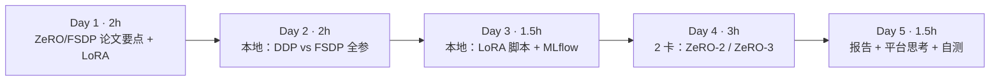

| 天 | 时间 | 先读 | 再读（外部资料） | 再做 |
|---|---|---|---|---|
| Day 1 | 2h | 2.1、2.2 | ② FSDP 论文（第 3 节）、⑥ LoRA 论文（摘要+图 1） | — |
| Day 2 | 2h | 2.3 | ⑤ HF FSDP 指南 | 实验 1 |
| Day 3 | 1.5h | 2.4 | ⑦ PEFT 文档 | 实验 2 |
| Day 4 | 3h | — | ③ DeepSpeed ZeRO 教程、④ 配置说明、⑧ HF DeepSpeed 集成 | 实验 3 |
| Day 5 | 1.5h | 2.5 | ⑩ Kubeflow Trainer、⑪ DLRover、⑨ 分布式 checkpoint | 报告、自测 |

---

## 2. 核心概念讲解

### 2.1 FSDP 与 ZeRO-3 是同一个思想

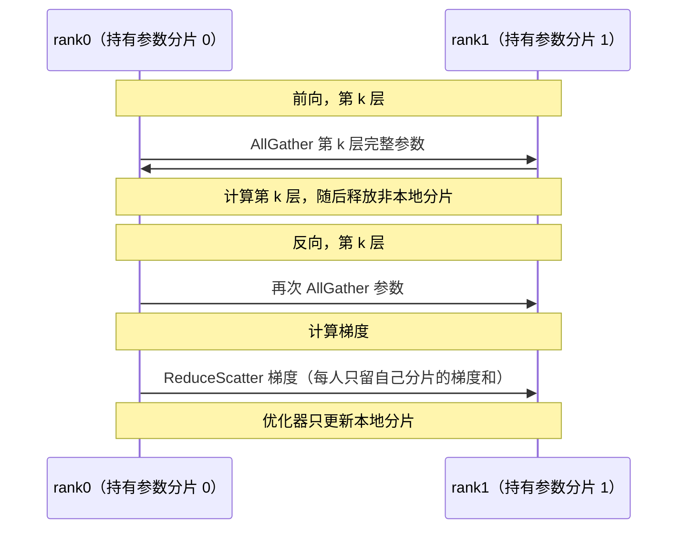

DeepSpeed ZeRO-3 和 PyTorch FSDP（②）都在“用时 AllGather、用完释放”。区别主要在工程上：FSDP 是 PyTorch 原生组件，新版 FSDP2（`fully_shard`）基于 DTensor 按参数分片；DeepSpeed 提供更多附加功能（CPU/NVMe offload、更多配置项）。HF Trainer/Accelerate 两者都支持，切换只需改配置（⑤、⑧）。

**分片单元（wrap 粒度）**：每个 Transformer 层作为一个单元，前向时一次只需要 AllGather 一层的完整参数，峰值显存 ≈ 分片状态 + 一层完整参数 + 激活。粒度太粗省不了显存，太细通信次数多。

### 2.2 训练时内存的组成

$$M_{peak} \approx \underbrace{M_{参数}+M_{梯度}+M_{优化器}}_{\text{状态：DDP 全量，FSDP } \div N} + \underbrace{M_{激活}}_{\propto\, batch \times seq} + M_{临时缓冲}$$

实验 1 会看到：模型很小时，**激活与框架开销占了峰值的大头**，状态减半对峰值的影响没有想象的大；模型越大，状态占比越高，ZeRO/FSDP 的收益越明显。

### 2.3 为什么 FSDP 更慢

每层前向和反向都多了 AllGather，通信量约为 DDP 的 1.5 倍（第 17 周）。GPU 上框架会把下一层的 AllGather 与当前层的计算重叠（prefetch），隐藏大部分通信；CPU/gloo 上重叠效果差，所以实验 1 中慢得比较明显。

### 2.4 LoRA

LoRA（⑥）冻结原始权重 W，只训练一个低秩增量：

$$W' = W + \frac{\alpha}{r}BA,\qquad B \in \mathbb{R}^{d\times r},\; A \in \mathbb{R}^{r\times k},\; r \ll \min(d,k)$$

可训练参数极少（实验 2 中只有 0.22%），所以梯度和优化器状态几乎为零，显存主要是冻结的权重 + 激活。与 ZeRO 组合时：ZeRO-1/2 切的是（很小的）优化器状态和梯度，几乎省不了什么；**ZeRO-3 会把冻结的权重也切开**，这才是 LoRA 场景下 ZeRO-2 与 ZeRO-3 显存差异的主要来源。

### 2.5 训练作业对平台的要求

| 需求 | 为什么 | 平台能力 |
|---|---|---|
| 分片 checkpoint | FSDP/ZeRO-3 的状态分散在各 rank；恢复时卡数可能变化 | PyTorch Distributed Checkpoint（⑨）支持重分片 |
| gang 调度 | 所有 rank 必须同时在线 | 第 11 周的 Volcano/原生 PodGroup |
| 故障恢复/弹性 | 千卡作业中任何一卡故障都会停下整个作业 | torchrun 弹性、DLRover（⑪） |
| 训练作业 CRD | 统一描述 master/worker、环境变量、重启策略 | Kubeflow Trainer（⑩） |

**大数据类比**：这和 Spark 作业的 checkpoint（RDD checkpoint、Structured Streaming 的 offset/state checkpoint）、YARN AM 失败重试是同一类问题，只是训练作业的状态更大、同步更严格（一个 rank 掉了全部都得停）。

---

## 3. 动手实验

### 实验 1：DDP vs FSDP 全参训练（本地 CPU，40 分钟）{{local}}

```python
"""全参训练 SmolLM2-135M：DDP vs FSDP2，2 个 CPU 进程（gloo）。比较每 rank 持有的参数/梯度/优化器状态字节数、峰值内存与每步耗时。
用法：torchrun --nproc_per_node=2 shard_compare.py ddp|fsdp"""
import sys, time, resource, torch, torch.distributed as dist
import pyarrow.parquet as pq
from transformers import AutoTokenizer, AutoModelForCausalLM
from torch.distributed.fsdp import fully_shard
from torch.nn.parallel import DistributedDataParallel as DDP
mode = sys.argv[1]; dist.init_process_group("gloo"); r, n = dist.get_rank(), dist.get_world_size()
torch.set_num_threads(4); torch.manual_seed(0)
name = "HuggingFaceTB/SmolLM2-135M"
tok = AutoTokenizer.from_pretrained(name); tok.pad_token = tok.pad_token or tok.eos_token  # SmolLM2 没有 pad token（本站实测报错）
model = AutoModelForCausalLM.from_pretrained(name, dtype=torch.float32)
if mode == "ddp":
    model = DDP(model)
else:
    for layer in model.model.layers: fully_shard(layer)  # 每个 Transformer 层一个分片单元
    fully_shard(model)
opt = torch.optim.AdamW(model.parameters(), lr=1e-5)
texts = pq.read_table("../w7/input/part-0.parquet", columns=["text"]).column("text").to_pylist()
def local(t): return t.to_local() if hasattr(t, "to_local") else t
times = []
for step in range(6):
    batch = tok(texts[(step * n + r) * 2:(step * n + r) * 2 + 2], return_tensors="pt", truncation=True, max_length=128, padding="max_length")
    t = time.perf_counter()
    out = model(**batch, labels=batch.input_ids); out.loss.backward(); opt.step(); opt.zero_grad(set_to_none=False)
    times.append(time.perf_counter() - t)
mb = lambda xs: sum(local(x).numel() * local(x).element_size() for x in xs) / 1e6
p_mb = mb(list(model.parameters())); g_mb = mb([p.grad for p in model.parameters() if p.grad is not None])
o_mb = mb([v for s in opt.state.values() for v in s.values() if torch.is_tensor(v) and v.dim() > 0])
peak = resource.getrusage(resource.RUSAGE_SELF).ru_maxrss / 1024
loss = out.loss.detach(); dist.all_reduce(loss); loss /= n
msg = (f"[{mode}] rank {r}: 参数 {p_mb:6.0f}MB 梯度 {g_mb:6.0f}MB 优化器 {o_mb:6.0f}MB 合计 {p_mb+g_mb+o_mb:6.0f}MB | "
       f"进程峰值内存 {peak:6.0f}MB | 每步 {sum(times[1:])/len(times[1:]):.2f}s | 第 6 步 loss {loss.item():.3f}")
for i in range(n):
    if i == r: print(msg, flush=True)
    dist.barrier()
dist.destroy_process_group()
```

```bash
torchrun --nproc_per_node=2 shard_compare.py ddp
torchrun --nproc_per_node=2 shard_compare.py fsdp
```

真实输出：

```text
[ddp] rank 0: 参数    538MB 梯度    538MB 优化器   1076MB 合计   2152MB | 进程峰值内存   4144MB | 每步 1.17s | 第 6 步 loss 3.686
[ddp] rank 1: 参数    538MB 梯度    538MB 优化器   1076MB 合计   2152MB | 进程峰值内存   4151MB | 每步 1.17s | 第 6 步 loss 3.686
[fsdp] rank 0: 参数    269MB 梯度    269MB 优化器    538MB 合计   1076MB | 进程峰值内存   3430MB | 每步 1.84s | 第 6 步 loss 3.686
[fsdp] rank 1: 参数    269MB 梯度    269MB 优化器    538MB 合计   1076MB | 进程峰值内存   3358MB | 每步 1.85s | 第 6 步 loss 3.686
```

解读：

- **状态精确减半**：134.5M 参数 × 4 字节 = 538MB；AdamW 两个状态 = 1076MB。FSDP 下每个 rank 各持一半。
- **峰值内存只降了约 750MB（17%）**，而不是状态减少的 1076MB 全部体现：峰值还包括加载阶段的完整模型（脚本先加载完整模型再分片）、激活（batch 2 × 128 token，词表 49152 的 logits 就不小）和框架开销。模型越大，状态占比越高，差距越明显。
- **每步慢了约 1.6 倍**：多出的 AllGather/ReduceScatter 在 CPU/gloo 上无法与计算很好地重叠。
- **loss 完全一致（3.686）**：分片不改变数学结果。
- 第一次运行时 batch 4 × 256 token 导致进程被系统 OOM killer 杀掉（本站实测，表现为 gloo `Connection reset by peer`，见排障表），降到 batch 2 × 128 后正常。这正是“状态之外，激活也要算进预算”的直接体验。

### 实验 2：LoRA 微调脚本在 CPU 上调通 + MLflow（本地，30 分钟）{{local}}

```python
# ft.py —— HF Trainer + PEFT LoRA 微调；可选 --deepspeed 配置；指标写入 MLflow
# 本地 CPU 调通：python ft.py --steps 15        多卡：deepspeed --num_gpus 2 ft.py --deepspeed ds_z2.json
import argparse, time, torch, mlflow
from datasets import load_dataset
from transformers import AutoTokenizer, AutoModelForCausalLM, TrainingArguments, Trainer, DataCollatorForLanguageModeling
from peft import LoraConfig, get_peft_model
p = argparse.ArgumentParser()
p.add_argument("--model", default="Qwen/Qwen2.5-0.5B"); p.add_argument("--steps", type=int, default=100)
p.add_argument("--deepspeed", default=None); p.add_argument("--data", default="../w7/input/part-0.parquet")
p.add_argument("--run-name", default=None); p.add_argument("--max-len", type=int, default=128)
a = p.parse_args()
cuda = torch.cuda.is_available()
tok = AutoTokenizer.from_pretrained(a.model); tok.pad_token = tok.pad_token or tok.eos_token
model = AutoModelForCausalLM.from_pretrained(a.model, dtype=torch.bfloat16 if cuda else torch.float32)
model = get_peft_model(model, LoraConfig(r=16, lora_alpha=32, target_modules=["q_proj", "v_proj"], task_type="CAUSAL_LM"))
model.print_trainable_parameters()
ds = load_dataset("parquet", data_files=a.data, split="train").select(range(2000))   # 第 7 周的语料样本
ds = ds.map(lambda b: tok(b["text"], truncation=True, max_length=a.max_len), batched=True, remove_columns=ds.column_names)
mlflow.set_experiment("finetune")
args = TrainingArguments(output_dir="out", per_device_train_batch_size=2 if not cuda else 4, max_steps=a.steps,
                         bf16=cuda, logging_steps=5, report_to=["mlflow"], run_name=a.run_name,
                         save_strategy="no", deepspeed=a.deepspeed)
t = time.perf_counter()
Trainer(model=model, args=args, train_dataset=ds, data_collator=DataCollatorForLanguageModeling(tok, mlm=False)).train()
dt = time.perf_counter() - t
print(f"总耗时 {dt:.1f}s，每步 {dt/a.steps:.2f}s，峰值显存 GB: " + (f"{torch.cuda.max_memory_allocated()/1e9:.1f}" if cuda else "n/a (CPU)"))
```

```bash
pip install torch transformers datasets peft accelerate mlflow
export MLFLOW_TRACKING_URI=sqlite:///$PWD/../mlflow.db       # 第 20 周继续使用这个库
python ft.py --steps 15 --run-name lora-cpu-0.5b
```

真实输出（省略了进度条与警告）：

```text
trainable params: 1,081,344 || all params: 495,114,112 || trainable%: 0.2184
{'loss': '3.601', 'grad_norm': '1.41', 'learning_rate': '3.667e-05', 'epoch': '0.005'}
{'loss': '3.245', 'grad_norm': '1.378', 'learning_rate': '2e-05', 'epoch': '0.01'}
{'loss': '2.85', 'grad_norm': '1.225', 'learning_rate': '3.333e-06', 'epoch': '0.015'}
{'train_runtime': '11.32', 'train_samples_per_second': '2.65', 'train_steps_per_second': '1.325', 'train_loss': '3.232', 'epoch': '0.015'}
总耗时 12.6s，每步 0.84s，峰值显存 GB: n/a (CPU)
```

- 可训练参数只有 108 万（0.22%）：q_proj、v_proj 上 r=16 的低秩矩阵。
- 比实验 1 的 135M 全参（每步 1.17s）更大的 0.5B 模型，LoRA 每步只要 0.84s——反向只需要为极少量参数计算权重梯度，优化器几乎没有工作。
- `report_to=["mlflow"]` 已经把参数和 loss 曲线写进了 MLflow，下周直接查看。
- 15 步 loss 从 3.6 降到 2.85 只说明流程跑通，不代表效果。

### 实验 3：2 卡 ZeRO-2 vs ZeRO-3（GPU，约 2.5 小时）{{gpuN}}

> 未在本站实测，需多卡 GPU。命令与配置以 ③、④、⑧ 为准。

```json
// ds_z2.json（ds_z3.json 把 stage 改成 3）
{ "zero_optimization": {"stage": 2},
  "bf16": {"enabled": "auto"},
  "train_micro_batch_size_per_gpu": "auto",
  "gradient_accumulation_steps": "auto" }
```

```bash
pip install deepspeed
export MLFLOW_TRACKING_URI=sqlite:///$PWD/mlflow.db
deepspeed --num_gpus 2 ft.py --deepspeed ds_z2.json --run-name z2-lora
deepspeed --num_gpus 2 ft.py --deepspeed ds_z3.json --run-name z3-lora
# 想看到明显差异：对小模型做全参对比（去掉 get_peft_model 一行，或另写一个开关）
```

| 配置 | 模型 | 每卡峰值显存 | 每步耗时 | 最终 loss |
|---|---|---|---|---|
| ZeRO-2 + LoRA | | | | |
| ZeRO-3 + LoRA | | | | |
| ZeRO-3 全参（可选，小模型） | | | | |

> 提示：LoRA 下可训练参数很少，ZeRO-2/3 的显存差异主要来自冻结参数是否被切分（2.4）；想看到明显差异，可以对小模型做全参微调对比。完成后把 `mlflow.db`（或 `mlruns/`）拷回本地，**立即释放多卡实例**。

### 常见错误与排查

| 现象 | 原因 | 解决 |
|---|---|---|
| `Asking to pad but the tokenizer does not have a padding token`（本站实测，SmolLM2） | 部分模型的 tokenizer 没有 pad token | `tok.pad_token = tok.eos_token` |
| gloo `Connection reset by peer`、退出码 -9（本站实测） | 某个 rank 被系统 OOM killer 杀掉，另一个 rank 通信失败 | 看 `dmesg`；减小 batch/序列长度；不要只看幸存 rank 的报错 |
| 被 OOM 时只看到 NCCL/gloo 错误 | 真正的错误在第一个死掉的 rank 上 | 查看所有 rank 的日志，找最早的异常 |
| ZeRO-3 下保存的模型文件很小或无法加载 | 保存的是分片状态 | 使用框架提供的汇总保存方法（如 Trainer 的保存逻辑、DCP 转换） |
| DeepSpeed 安装时编译失败 | CUDA 版本与 PyTorch 不匹配 | 对齐版本；按需预编译算子 |
| LoRA 下 ZeRO-2/3 显存几乎一样 | 可训练状态本来就很小 | 正常；比较全参训练才能看到差异 |

### 扩展练习

1. 修改 `shard_compare.py`，把加载完整模型改为在 meta 设备上初始化后再分片（参考 ⑤），观察峰值内存的变化。
2. 在 `shard_compare.py` 中调大 batch/序列长度，记录 DDP 与 FSDP 各自在多大的配置下 OOM。
3. 给 `ft.py` 增加 `--full` 开关（不使用 LoRA），在 CPU 上对 SmolLM2-135M 做全参与 LoRA 的每步耗时对比。
4. 阅读 ⑨，写一个 2 进程 FSDP 保存分片 checkpoint、再用 4 进程加载的小实验。

---

## 4. 精读指南

- **① [ZeRO 论文](https://arxiv.org/abs/1910.02054)**（复习第 5 节，结合实验 1 的数字）。
- **② [PyTorch FSDP 论文](https://arxiv.org/abs/2304.11277)**（60 分钟，第 3–4 节）。**读完回答**：FSDP 如何重叠通信与计算？分片单元如何选择？
- **③ [DeepSpeed ZeRO 教程](https://www.deepspeed.ai/tutorials/zero/)**、**④ [配置说明](https://www.deepspeed.ai/docs/config-json/)**（40 分钟）。
- **⑤ [HF FSDP 指南](https://huggingface.co/docs/transformers/fsdp)**、[PyTorch FSDP 教程](https://docs.pytorch.org/tutorials/intermediate/FSDP_tutorial.html)（30 分钟）。
- **⑥ [LoRA 论文](https://arxiv.org/abs/2106.09685)**（30 分钟，摘要、图 1、第 4 节）。
- **⑦ [PEFT 文档](https://huggingface.co/docs/peft/index)**（20 分钟）。
- **⑧ [HF DeepSpeed 集成](https://huggingface.co/docs/transformers/deepspeed)**、[Accelerate + DeepSpeed 博客](https://huggingface.co/blog/accelerate-deepspeed)（30 分钟）。
- **⑨ [PyTorch Distributed Checkpoint](https://docs.pytorch.org/docs/stable/distributed.checkpoint.html)**（20 分钟）：分片保存与重分片加载。
- **⑩ [Kubeflow Trainer](https://www.kubeflow.org/docs/components/trainer/)**、**⑪ [DLRover](https://github.com/intelligent-machine-learning/dlrover)**（各 20 分钟，README 与架构图）。
- 背景：[HF LLM Course](https://huggingface.co/learn/llm-course)（微调章节）、[DeepSpeed 仓库](https://github.com/deepspeedai/DeepSpeed)、[ml-engineering](https://github.com/stas00/ml-engineering)（训练排障章节）、[SmolLM2-135M](https://huggingface.co/HuggingFaceTB/SmolLM2-135M)。

---

## 5. 自测题

<details>
<summary>1. 实验 1 中 FSDP 的状态减半了，为什么峰值内存只降了 17%？</summary>

峰值内存除了参数、梯度、优化器状态外，还包括激活、临时缓冲、框架开销，以及加载时的完整模型。小模型时这些非状态部分占比很大，所以状态减半对峰值影响有限。模型越大，状态占比越高，收益越明显。

</details>

<details>
<summary>2. 为什么实验 1 中 FSDP 每步更慢？GPU 上会怎样？</summary>

FSDP 每层前向和反向都需要 AllGather 参数，再 ReduceScatter 梯度，通信量约为 DDP 的 1.5 倍。CPU/gloo 上通信难以与计算重叠，因而明显变慢；GPU 上框架会预取下一层参数并与计算重叠，开销小得多。

</details>

<details>
<summary>3. LoRA 为什么省显存？LoRA 下 ZeRO-2 与 ZeRO-3 的差异来自哪里？</summary>

LoRA 冻结原始权重，只训练很少的低秩参数，梯度和优化器状态几乎为零。ZeRO-1/2 切分的正是这些很小的状态，收益很小；ZeRO-3 还会把冻结的权重也切分到各卡，这才是两者显存差异的主要来源。

</details>

<details>
<summary>4. 分布式训练中一个 rank 被 OOM 杀掉，其他 rank 会报什么样的错？怎样定位？</summary>

其他 rank 通常报通信错误（如 gloo Connection reset by peer、NCCL 超时或远端关闭），容易误判为网络问题。应查看所有 rank 的日志与退出码（-9 表示 SIGKILL），检查 dmesg 中的 OOM 记录，找到最早出错的 rank。

</details>

<details>
<summary>5. 为什么 FSDP/ZeRO-3 的 checkpoint 需要特殊处理？</summary>

状态分散在各个 rank 上，每个 rank 只保存自己的分片。恢复时如果卡数或并行布局不同，需要重分片能力（如 PyTorch DCP）；导出给推理使用时还需要把分片汇总成完整权重。

</details>

<details>
<summary>6. 训练作业在 K8s 平台上需要哪些能力？</summary>

gang 调度（所有 rank 同时启动）、描述多角色作业的 CRD（如 Kubeflow Trainer）、分片 checkpoint 存储、故障检测与弹性恢复（如 torchrun elastic、DLRover）、拓扑感知放置（TP 组放同机）。

</details>

### 思考题

1. 你的团队要在 16 张 80GB 卡上微调 70B 模型。用第 17 周的公式估算全参 ZeRO-3 是否放得下，如果放不下，有哪些选择（LoRA/QLoRA、offload、更多卡）？
2. 千卡训练平均每天会遇到硬件故障。如果每次故障都要从上一个 checkpoint 重启，checkpoint 间隔应如何选择？（提示：权衡保存开销与丢失的计算量）
3. 结合你的 YARN/Spark 经验，设计一个“训练作业失败自动重试”的策略：哪些错误应该重试、哪些应该直接失败？

---

## 6. 本周产出与掌握清单

### 本周产出

- [ ] 本地 DDP vs FSDP 实测表（实验 1）及解读
- [ ] 可在 CPU 调通、多卡直接运行的 `ft.py` + ZeRO 配置
- [ ] 2 卡 ZeRO-2/3 对比表（实验 3），结果记录在 MLflow

## 参考资料

- [Hugging Face LLM Course](https://huggingface.co/learn/llm-course)（课程·入门）：tokenizer、transformers、微调的官方教程，命令可直接照做
- [HuggingFace Ultra-Scale Playbook](https://huggingface.co/spaces/nanotron/ultrascale-playbook)（书·进阶）：图解 DP/TP/PP/ZeRO 与通信开销，第 5 月主读
- [ZeRO 论文](https://arxiv.org/abs/1910.02054)（论文·进阶）：ZeRO-1/2/3 分片思想的出处，对照显存实测
- [PyTorch FSDP 论文](https://arxiv.org/abs/2304.11277)（论文·进阶）：FSDP 的设计与工程取舍，理解与 ZeRO-3 的关系
- [DeepSpeed ZeRO 教程](https://www.deepspeed.ai/tutorials/zero/)（文档·进阶）：ZeRO 配置项的官方说明，第 19 周照着配
- [PyTorch FSDP 教程](https://docs.pytorch.org/tutorials/intermediate/FSDP_tutorial.html)（文档·进阶）：FSDP 官方上手教程
- [HF Accelerate + DeepSpeed 博客](https://huggingface.co/blog/accelerate-deepspeed)（博客·进阶）：用 Accelerate 一套脚本切换 DeepSpeed 配置的实操
- [HuggingFace PEFT 文档](https://huggingface.co/docs/peft/index)（文档·入门）：LoRA 等参数高效微调，单卡/双卡实验都要用
- [DeepSpeed](https://github.com/deepspeedai/DeepSpeed)（仓库·进阶）：ZeRO 实现与示例
- [Stas Bekman：ml-engineering](https://github.com/stas00/ml-engineering)（书·进阶）：大模型训练/推理的硬件、网络、排障实战手册
- [Kubeflow Trainer 文档](https://www.kubeflow.org/docs/components/trainer/)（文档·进阶）：K8s 上的分布式训练作业 CRD
- [蚂蚁 DLRover](https://github.com/intelligent-machine-learning/dlrover)（仓库·高级）：训练作业弹性与故障自愈，国内开源代表

> 完整列表见 [参考资料库](/resources.html)。

## 检查清单
- [ ] 本地用 CPU / 单卡把 ft.py 调通（少量 step）
- [ ] 2 卡上完成 ZeRO-2 与 ZeRO-3 对比
- [ ] 填完对比表并解释差异
- [ ] 结果拷回本地，**立即释放多卡实例**
- [ ] 能用实验 1 的数据解释状态、激活与峰值内存的关系
- [ ] 能说出训练作业对平台的四项要求

=== m5w4 | 第 20 周：MLOps：MLflow 实验管理 | 第 5 月 · 分布式训练 + MLOps
# 第 20 周：MLOps —— 用 MLflow 管理实验与模型

> **本周一句话**：前 19 周你已经产出了一堆数字：压测表、微调 loss、显存对比……它们散落在终端输出和笔记里。MLOps 的第一步就是把它们**结构化地记录、可查询、可对比、可追溯**。本周用 MLflow 把第 14 周的真实压测和第 19 周的真实微调放进同一个跟踪库，用 API 和 REST 接口查询对比，把最好的 LoRA adapter 登记进模型注册表并打上 `champion` 别名——然后用你做数据平台的经验，思考公司现有平台能承担 MLOps 的哪些部分。

**预计投入：约 8 小时**（阅读 ≈ 3h，动手 ≈ 3h，产出与自测 ≈ 2h）。{{local}}

**本周结束时你应该能：**

1. 画出 MLOps 闭环（数据 → 训练 → 跟踪 → 注册 → 评测 → 部署 → 监控 → 数据），说出每个环节的系统。
2. 使用 MLflow Tracking 记录参数、指标、工件，理解 experiment / run / model / registered model / alias 的关系。
3. 用 Python API 和 REST API 查询、排序、对比 run，并用模型注册表管理版本与别名。
4. 说出 MLflow 后端存储与工件存储的部署选择，以及与数据平台（元数据中心、调度系统）的对应关系。

> **验证说明**：本周全部在本站 CPU 上真实运行（mlflow 3.17.1，SQLite 后端存储）。跟踪库里的数据都是真实实验结果：第 14 周 mini_server 的压测数值、第 19 周两次 LoRA 微调（r=4 与 r=16，各 30 步）。本页所有输出均为真实输出。实验文件在仓库 `labs/w20/`，跟踪库为 `labs/mlflow.db`。

---

## 1. 本周学习路线

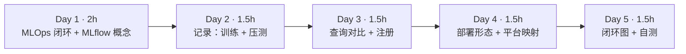

| 天 | 时间 | 先读 | 再读（外部资料） | 再做 |
|---|---|---|---|---|
| Day 1 | 2h | 2.1、2.2 | ⑥ Google MLOps 架构、⑦ ML 系统的技术债 | — |
| Day 2 | 1.5h | 2.3 | ② Tracking 文档、⑨ Trainer 回调 | 实验 1、实验 2 |
| Day 3 | 1.5h | 2.4 | ③ 模型注册表、④ REST API | 实验 3、实验 4 |
| Day 4 | 1.5h | 2.5 | ⑤ 后端存储 | 思考题 |
| Day 5 | 1.5h | — | ⑧ Made With ML（浏览） | 闭环图、自测 |

---

## 2. 核心概念讲解

### 2.1 MLOps 闭环

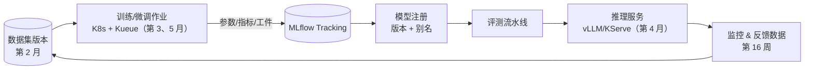

| 环节 | 回答的问题 | 典型系统 | 数据平台类比 |
|---|---|---|---|
| 数据版本 | 这个模型用哪份数据训练的？ | 数据湖表版本、DVC | Hive 分区 / Iceberg 快照 |
| 实验跟踪 | 哪组参数效果最好？结果能复现吗？ | MLflow、W&B | 调度平台的作业运行记录 |
| 模型注册 | 线上用的是哪个版本？谁批准的？ | MLflow Registry | 数据资产目录中的版本化资产 |
| 评测 | 新版本比旧版本好吗？ | 评测流水线 | 数据质量校验 |
| 部署与监控 | 上线后表现如何？ | vLLM/KServe + Prometheus | 数据服务 + 监控告警 |

⑦ 指出：在真实 ML 系统中，模型代码只占一小部分，周围的数据、配置、监控、服务基础设施才是大头——这正是数据平台架构师的主场。

### 2.2 MLflow 的对象模型

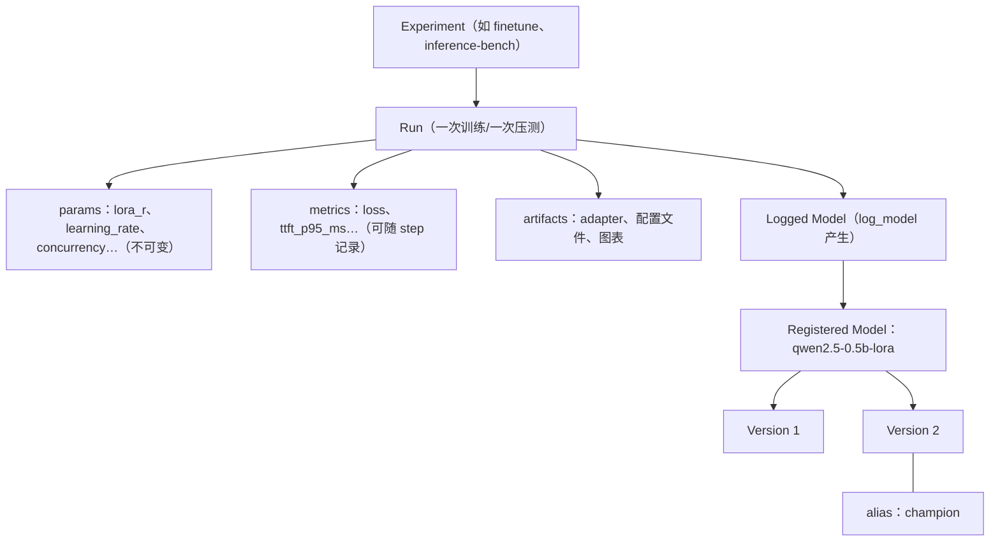

- **params 与 metrics 的区别**：params 是输入（记录一次、不可改），metrics 是输出（可以按 step 记录成曲线）。
- **别名（alias）**：如 `champion`、`challenger`，部署侧通过 `models:/名称@champion` 引用，换版本只需移动别名——类似数据平台里把视图指向新的表快照。较早版本的 MLflow 使用 Staging/Production “阶段”，新版本推荐使用别名（③）。

### 2.3 怎样记录才有用

1. **记录足以复现的信息**：代码版本（git commit）、数据版本、全部超参、环境（库版本、硬件）。
2. **统一命名**：参数名、指标名在不同 run 之间保持一致，才能横向对比（如统一用 `ttft_p95_ms`）。
3. **自动化优先**：HF Trainer 的 `report_to=["mlflow"]` 会自动记录训练参数与 loss 曲线（⑨），但**不会记录 PEFT 的 LoRA 秩等配置**（本站实测，见实验 3），需要手动补充或在 run 名中体现。
4. **工件放对象存储**：大文件（权重、adapter）不要放在跟踪数据库里。

### 2.4 查询与对比

MLflow 的 search 支持类 SQL 的过滤与排序：

```text
filter_string="attributes.run_name LIKE 'lora-r%' and metrics.train_loss < 3.5"
order_by=["metrics.train_loss ASC"]
```

UI 的对比视图、Python API（`MlflowClient.search_runs`）和 REST API（`/api/2.0/mlflow/runs/search`）背后是同一套查询。REST API 意味着你可以把 MLflow 接入已有的 BI、调度和告警系统。

### 2.5 部署形态

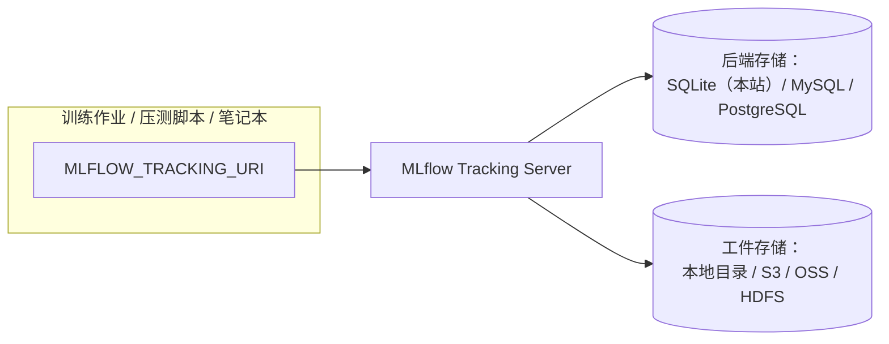

本站用 SQLite 单文件（`labs/mlflow.db`），适合个人；团队部署用 MySQL/PostgreSQL + 对象存储（⑤）。这和你部署 Hive Metastore（元数据进 MySQL、数据进 HDFS/S3）是同一种架构。

---

## 3. 动手实验 {{local}}

所有实验共用同一个跟踪库：

```bash
pip install mlflow
export MLFLOW_TRACKING_URI=sqlite:////绝对路径/labs/mlflow.db
```

### 实验 1：训练自动记录——两次 LoRA 微调（30 分钟）

第 19 周的 `ft.py` 增加了 `--lora-r` 与 `--save` 参数（见仓库 `labs/w19/ft.py`）。运行 r=4 和 r=16 两组：

```bash
cd labs/w19
for r in 4 16; do python ft.py --steps 30 --lora-r $r --run-name lora-r$r --save adapter-r$r; done
```

真实输出（节选）：

```text
trainable params: 270,336 || all params: 494,303,104 || trainable%: 0.0547
{'train_runtime': '22.46', 'train_samples_per_second': '2.671', 'train_steps_per_second': '1.336', 'train_loss': '3.296', 'epoch': '0.03'}
总耗时 24.1s，每步 0.80s，峰值显存 GB: n/a (CPU)
trainable params: 1,081,344 || all params: 495,114,112 || trainable%: 0.2184
{'train_runtime': '22.26', 'train_samples_per_second': '2.696', 'train_steps_per_second': '1.348', 'train_loss': '3.295', 'epoch': '0.03'}
总耗时 23.9s，每步 0.80s，峰值显存 GB: n/a (CPU)
```

r 从 4 增加到 16，可训练参数变为 4 倍，但每步耗时几乎相同——LoRA 的计算量相对整个模型的前向/反向可以忽略。

### 实验 2：手动记录——把压测结果放进 MLflow（20 分钟）

```python
# log_bench.py —— 把第 14 周 mini_server 的真实压测结果记录到 MLflow（GPU 上的 vLLM/SGLang 结果用同样方式追加）
import mlflow
mlflow.set_experiment("inference-bench")
# (引擎, 并发, 吞吐 tok/s, TTFT p50 ms, TTFT p95 ms, TPOT p50 ms) —— 数值来自第 14 周实验 2 的真实输出
rows = [("mini_server-cpu", 1, 25.8, 93, 118, 36.0),
        ("mini_server-cpu", 4, 26.6, 6396, 6510, 36.2),
        ("mini_server-cpu", 8, 25.7, 7941, 13456, 38.3)]
for engine, conc, tput, t50, t95, tpot in rows:
    with mlflow.start_run(run_name=f"{engine}-c{conc}"):
        mlflow.log_params({"engine": engine, "concurrency": conc, "model": "Qwen2.5-0.5B-Instruct", "hardware": "8-core CPU"})
        mlflow.log_metrics({"throughput_tok_s": tput, "ttft_p50_ms": t50, "ttft_p95_ms": t95, "tpot_p50_ms": tpot})
print("logged", len(rows), "runs")
```

```text
logged 3 runs
```

训练和推理的结果从此在同一个地方，用同样的方式查询。GPU 上的 vLLM/SGLang 压测结果（第 14、15 周）按同样格式追加即可。

### 实验 3：对比与模型注册（30 分钟）

```python
# compare_and_register.py —— 用 API 对比第 19 周的微调 run，把 loss 最低的 LoRA adapter 登记为模型版本并打上别名
import mlflow, mlflow.pyfunc
from mlflow import MlflowClient
cli = MlflowClient()
exp = cli.get_experiment_by_name("finetune")
runs = cli.search_runs([exp.experiment_id], filter_string="attributes.run_name LIKE 'lora-r%'",
                       order_by=["metrics.train_loss ASC"])
print(f"{'run_name':<10} {'lora_r':>6} {'train_loss':>10} {'runtime_s':>9}")
for r in runs:
    print(f"{r.info.run_name:<10} {r.info.run_name.split('-r')[-1]:>6} "
          f"{r.data.metrics['train_loss']:>10.4f} {r.data.metrics['train_runtime']:>9.2f}")
best = runs[0]; rr = best.info.run_name.split('-r')[-1]   # Trainer 不会记录 PEFT 的 r，这里从 run 名解析

class Adapter(mlflow.pyfunc.PythonModel):              # 最小包装：登记 adapter 目录，推理时由服务加载
    def predict(self, context, model_input): return [context.artifacts["adapter"]] * len(model_input)

with mlflow.start_run(run_id=best.info.run_id):
    info = mlflow.pyfunc.log_model(name="lora_adapter", python_model=Adapter(),
                                   artifacts={"adapter": f"../w19/adapter-r{rr}"})
mv = mlflow.register_model(info.model_uri, "qwen2.5-0.5b-lora")
cli.set_registered_model_alias("qwen2.5-0.5b-lora", "champion", mv.version)
m = cli.get_model_version_by_alias("qwen2.5-0.5b-lora", "champion")
print(f"已登记 qwen2.5-0.5b-lora 版本 {m.version}，别名 champion → 来源 run {m.run_id[:8]}（{best.info.run_name}）")
```

真实输出（这是第二次运行，所以创建的是版本 2；第一次运行时 lora_r 列显示为 `?`，因为 Trainer 没有记录 PEFT 的 r，之后改为从 run 名解析）：

```text
run_name   lora_r train_loss runtime_s
lora-r16       16     3.2949     22.26
lora-r4         4     3.2964     22.46
Registered model 'qwen2.5-0.5b-lora' already exists. Creating a new version of this model...
Created version '2' of model 'qwen2.5-0.5b-lora'.
已登记 qwen2.5-0.5b-lora 版本 2，别名 champion → 来源 run 47b36914（lora-r16）
```

重要提醒：两组 loss 只差 0.0015，30 步的训练 loss **完全不足以说明哪个更好**。这里按 loss 选“冠军”只是为了演示注册流程；真实流程中应该用独立评测集上的指标、多次运行的方差来决定，并由评测流水线（而不是训练 loss）把别名移到新版本。

### 实验 4：REST API——让其他系统读取 MLflow（20 分钟）

```bash
mlflow server --backend-store-uri $MLFLOW_TRACKING_URI --host 127.0.0.1 --port 5000 &
# 按 TTFT p95 倒序列出压测 run
EXP=$(curl -s "localhost:5000/api/2.0/mlflow/experiments/get-by-name?experiment_name=inference-bench" \
      | python3 -c "import json,sys;print(json.load(sys.stdin)['experiment']['experiment_id'])")
curl -s -X POST localhost:5000/api/2.0/mlflow/runs/search -H 'Content-Type: application/json' \
  -d '{"experiment_ids":["'$EXP'"],"order_by":["metrics.ttft_p95_ms DESC"]}'
# 部署侧：查询 champion 别名指向哪个版本
curl -s "localhost:5000/api/2.0/mlflow/registered-models/alias?name=qwen2.5-0.5b-lora&alias=champion"
```

真实输出（JSON 已用 python 提取关键字段）：

```text
mini_server-cpu-c8 ttft_p95_ms= 13456.0 throughput= 25.7
mini_server-cpu-c4 ttft_p95_ms= 6510.0 throughput= 26.6
mini_server-cpu-c1 ttft_p95_ms= 118.0 throughput= 25.8
champion -> qwen2.5-0.5b-lora v2 READY
```

部署系统只要查询别名，就能知道应该加载哪个版本、来源于哪次训练——这就是“可追溯”。打开浏览器访问 `http://127.0.0.1:5000` 可以在 UI 中看到同样的内容，并用对比视图并排比较 run。

### 常见错误与排查

| 现象 | 原因 | 解决 |
|---|---|---|
| 不同脚本的 run 分散在不同地方 | 没有统一 `MLFLOW_TRACKING_URI`，默认写到当前目录 | 所有脚本使用同一个 URI（绝对路径或服务器地址） |
| Trainer 记录里找不到 LoRA 的 r（本站实测） | Trainer 只记录 TrainingArguments 与模型 config | 手动 `mlflow.log_params`，或写在 run 名/标签中 |
| `Registered model ... already exists`（本站实测） | 重复注册同名模型 | 正常行为：会创建新版本；用别名指向需要的版本 |
| `Failed to resolve installed pip version` 警告（本站实测） | 用 uv 创建的虚拟环境中没有 pip | 不影响记录；需要完整环境描述时安装 pip |
| 大模型工件上传很慢、数据库膨胀 | 把大文件放进了跟踪存储 | 配置对象存储作为工件存储 |
| 多人共用 SQLite 时报锁错误 | SQLite 不适合并发写 | 团队使用 MySQL/PostgreSQL |

### 扩展练习

1. 修改 `ft.py`，在训练结束后用 `mlflow.log_params` 补记 `lora_r`、`target_modules`、数据文件路径和 git commit。
2. 写一个“评测 + 移动别名”的脚本：对 champion 和新版本在同一组 prompt 上计算某个指标（例如困惑度），新版本更好才把 `champion` 移过去。
3. 把第 16 周 Prometheus 中的 TTFT p95 定期写入 MLflow 的一个 run，作为线上表现的记录。
4. 阅读 ⑤，画出团队版 MLflow 的部署图（K8s Deployment + PostgreSQL + 对象存储 + 认证）。

---

## 4. 精读指南

- **① [MLflow 文档](https://mlflow.org/docs/latest/index.html)**（30 分钟）：整体结构。
- **② [Tracking](https://mlflow.org/docs/latest/ml/tracking/)**（30 分钟）。**读完回答**：run、experiment、logged model 的关系？
- **③ [Model Registry](https://mlflow.org/docs/latest/ml/model-registry/)**（30 分钟）。**读完回答**：别名与旧的“阶段”机制有何不同？
- **④ [REST API](https://mlflow.org/docs/latest/api_reference/rest-api.html)**（查阅式）。
- **⑤ [后端存储](https://mlflow.org/docs/latest/ml/tracking/backend-stores/)**（20 分钟）。
- **⑥ [Google：MLOps 持续交付与自动化流水线](https://cloud.google.com/architecture/mlops-continuous-delivery-and-automation-pipelines-in-machine-learning)**（40 分钟）：MLOps 成熟度 0/1/2 级。
- **⑦ [Hidden Technical Debt in ML Systems](https://papers.nips.cc/paper/5656-hidden-technical-debt-in-machine-learning-systems)**（40 分钟）：经典论文，图 1 值得记住。
- **⑧ [Made With ML](https://madewithml.com/)**（浏览）与 [ml-ops.org](https://ml-ops.org/)（浏览）。
- **⑨ [HF Trainer 回调](https://huggingface.co/docs/transformers/main_classes/callback)**（10 分钟）：MLflowCallback 记录了什么、相关环境变量。
- 源码：[mlflow/mlflow](https://github.com/mlflow/mlflow)。

---

## 5. 自测题

<details>
<summary>1. params 和 metrics 有何区别？各举两个例子。</summary>

params 是 run 的输入配置，记录一次、不可修改，如 learning_rate、lora_r、concurrency；metrics 是输出结果，可以按 step 多次记录形成曲线，如 train_loss、ttft_p95_ms。

</details>

<details>
<summary>2. 为什么部署侧应该通过别名而不是版本号引用模型？</summary>

别名把“部署用哪个模型”与具体版本解耦：上线、回滚只需移动别名，部署配置不变；同时别名指向的版本可以追溯到训练 run、参数和数据，便于审计。

</details>

<details>
<summary>3. 实验 3 中按训练 loss 选择冠军有什么问题？</summary>

两组 loss 只差 0.0015，30 步训练噪声远大于这个差距；训练 loss 也不代表泛化效果。应使用独立评测集指标、多次运行的统计，并由评测流水线决定是否晋升。

</details>

<details>
<summary>4. MLflow 团队部署的推荐架构是什么？与哪个大数据组件相似？</summary>

Tracking Server + 关系型数据库（MySQL/PostgreSQL）作为后端存储 + 对象存储（S3/OSS/HDFS）作为工件存储，前面加认证。与 Hive Metastore（元数据在关系库、数据在 HDFS/S3）的架构相似。

</details>

<details>
<summary>5. 列出 MLOps 闭环的环节，并为每个环节举一个本课程中用到的系统。</summary>

数据版本（第 2 月的 Ray Data/Spark 清洗产物）→ 训练（第 19 周 Trainer/FSDP，第 3 月 K8s + Kueue 调度）→ 实验跟踪（MLflow）→ 模型注册（MLflow Registry）→ 评测（评测流水线）→ 部署（第 4 月 vLLM/Ray Serve）→ 监控（第 16 周 Prometheus）→ 反馈数据回到数据环节。

</details>

### 思考题

1. 你所在公司的调度平台、元数据平台、数据质量平台，分别可以承担 MLOps 的哪些部分？哪些需要新建？
2. 如果要让“训练 → 评测 → 晋升 → 部署”全自动，你会在哪些环节设置人工审批？为什么？
3. 一个线上模型突然效果变差，你需要哪些记录才能在 30 分钟内定位原因（数据变化、模型版本、服务配置）？

---

## 6. 本周产出与掌握清单

### 本周产出

- [ ] 包含训练与压测实验的 MLflow 跟踪库，以及一次注册 + 别名操作
- [ ] 一张 MLOps 闭环图（标出每个环节在你公司对应的系统）
- [ ] 一页笔记：现有平台如何承担 MLOps（本月产出之一）

## 参考资料

- [MLflow 文档](https://mlflow.org/docs/latest/index.html)（文档·入门）：实验跟踪、模型注册
- [MLflow 仓库](https://github.com/mlflow/mlflow)（仓库·入门）：示例代码
- [Made With ML](https://madewithml.com/)（课程·入门）：端到端 ML 工程与 MLOps 文字教程（基于 Ray）

> 完整列表见 [参考资料库](/resources.html)。

## 检查清单
- [ ] MLflow UI 中能看到训练与压测实验
- [ ] 用 MLflow 的对比视图比较两次 run
- [ ] 画出自己理解的 MLOps 闭环图
- [ ] 写下：你所在公司的调度平台/元数据平台可以怎样承担 MLOps 的哪些部分
- [ ] 能用 API 查询 run 并管理模型版本与别名
