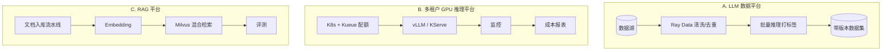
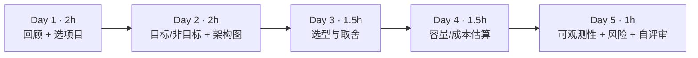
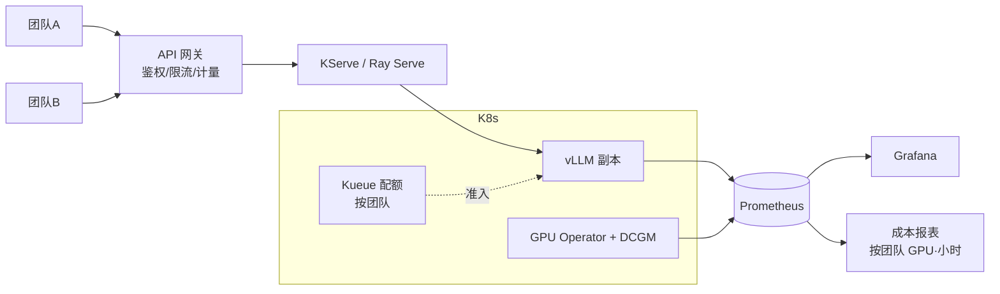
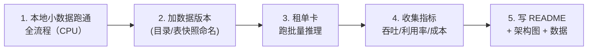
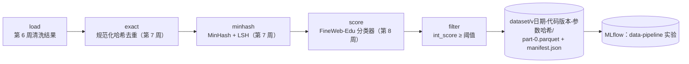
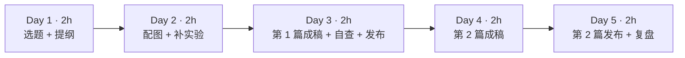
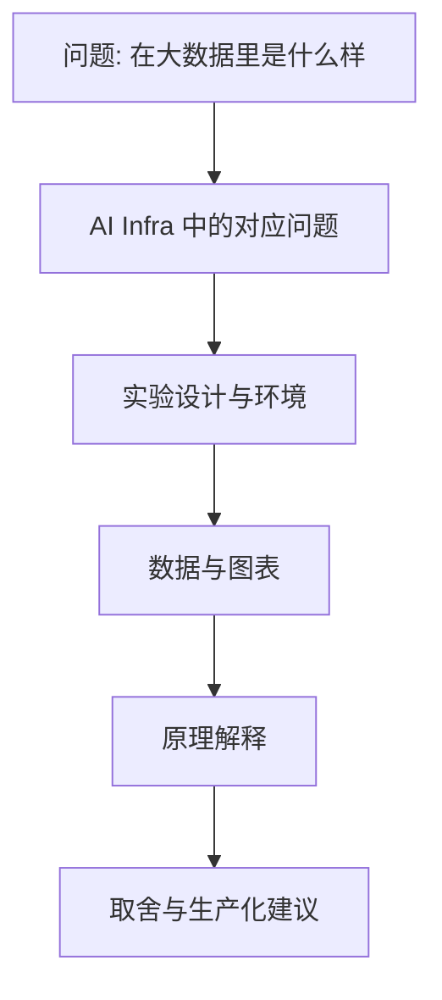
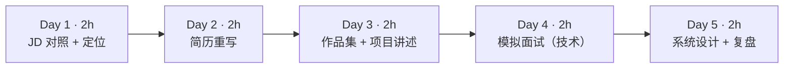
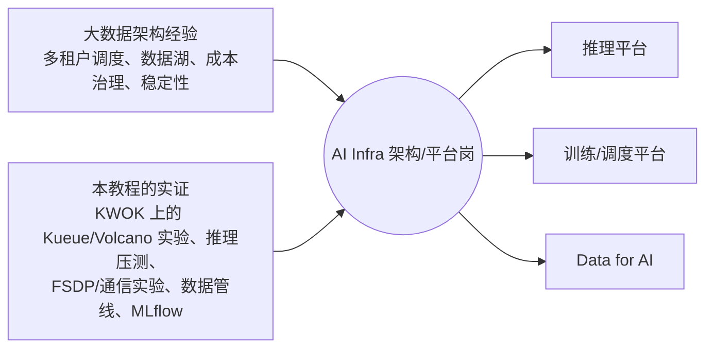
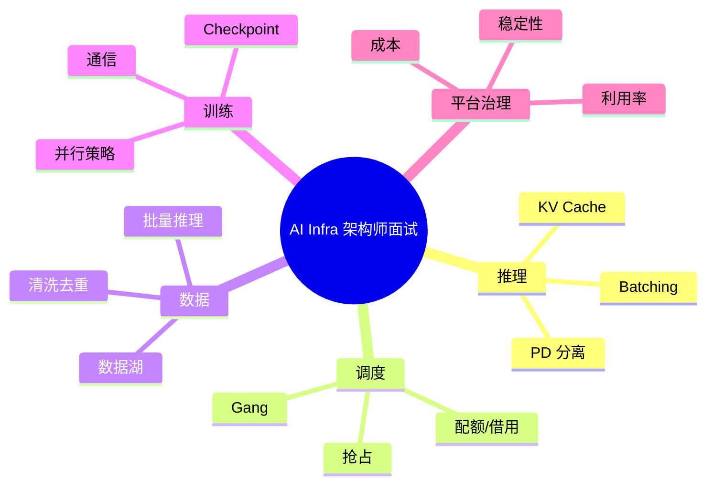

=== m6 | 第 6 月概览：毕业项目 + 求职 | 第 6 月 · 作品集 + 求职
# 第 6 月：整合作品集 + 求职

## 本月目标
- 三选一完成毕业项目，把前 5 个月的实验整合成一个完整系统。
- 写成技术博客（知乎或掘金），突出“大数据经验 → AI Infra 问题”的类比。比起代码量，架构师面试更看重这类表达。
- 准备简历与面试。

## 毕业项目三选一



| 项目 | 复用的月份 | 主要资源 | 与大数据背景的关联 |
|---|---|---|---|
| A. LLM 数据平台 | 第 2、3 月 | {{local}} + {{gpu1}} 批量推理阶段 | 数据湖、ETL、元数据治理 |
| B. 多租户 GPU 推理平台 | 第 3、4 月 | {{local}} 调度部分 + {{gpu1}} | YARN 多租户、成本治理 |
| C. RAG 平台 | 第 2、4 月 | {{local}}（小 Embedding 模型可在 CPU 跑）+ 可选 {{gpu1}} | 检索型存储 + 数据管道 |

## 周计划

| 周 | 主题 |
|---|---|
| [第 21 周](/m6w1.html) | 毕业项目设计 |
| [第 22 周](/m6w2.html) | 毕业项目实现 |
| [第 23 周](/m6w3.html) | 写技术博客 |
| [第 24 周](/m6w4.html) | 简历与面试准备 |

> 写代码不熟练的人可以这样起步：先跑通官方示例，然后每次只改一个参数，记下变化，写成笔记。不要一开始就读框架源码。

=== m6w1 | 第 21 周：毕业项目设计 | 第 6 月 · 作品集 + 求职
# 第 21 周：毕业项目设计——像做架构评审一样写设计文档

> **本周一句话**：毕业项目的价值不在代码量，而在于你能否像架构师一样**定义问题、做取舍、给出带假设的估算**。本周三选一确定毕业项目，写出一份可评审的设计文档：目标与非目标、架构图、选型理由、容量与成本估算、可观测性、风险与降级。容量估算用一个真实可运行的小脚本完成——把第 4 月的压测表变成“需要几张卡、每个团队配多少额度”。

**预计投入：约 8 小时**（回顾前 5 个月 ≈ 2h，设计文档 ≈ 4h，估算与评审 ≈ 2h）。{{none}}

**本周结束时你应该能：**

1. 选定毕业项目，并说清它要解决的问题、给谁用、不做什么。
2. 写出包含架构图、选型理由（每个“为什么不选另一个”）、容量与成本估算的设计文档。
3. 用 Little 定律把压测数据转换为所需卡数与配额，并明确列出全部假设。
4. 为项目设计可观测性指标与降级方案。

> **验证说明**：本周以设计为主。`capacity.py` 在本站真实运行，输出均为真实输出；但**它的所有输入参数都是假设值**（已在代码中注明），必须替换成你自己第 14–15 周的压测结果。实验文件在仓库 `labs/w21/`。

---

## 1. 本周学习路线



| 天 | 时间 | 先读 | 再读（外部资料） | 再做 |
|---|---|---|---|---|
| Day 1 | 2h | 2.1 | 月度概览中的三个项目、[招聘市场](/jobs.html) | 选定项目 |
| Day 2 | 2h | 2.2 | ① Google 设计文档 | 文档第 1–3 节 |
| Day 3 | 1.5h | 2.3 | ② ADR（架构决策记录） | 文档第 4 节 |
| Day 4 | 1.5h | 2.4 | ③ Little 定律 | 实验 1，文档第 5 节 |
| Day 5 | 1h | 2.5 | ④ SRE：SLO | 文档第 6–8 节，自评审 |

---

## 2. 核心概念讲解

### 2.1 三个项目怎么选


| 项目 | 复用 | 最能展示的能力 | 适合目标岗位 | 本地可完成比例 |
|---|---|---|---|---|
| A. LLM 数据平台 | 第 2 月（第 6–8 周）、第 20 周 | 数据管道、版本化、批量推理吞吐 | Data for AI、数据平台转 AI | 高（第 22 周有完整 CPU 版） |
| B. 多租户推理平台 | 第 3、4 月 | 多租户调度、SLO、成本治理 | AI Infra 平台 / 推理平台 | 中（调度部分用 KWOK，推理需 GPU） |
| C. RAG 平台 | 第 2、4 月 | 检索存储、数据管道、评测 | AI 应用平台 | 中高（小 Embedding 模型可在 CPU 跑） |

选择原则：**选与目标岗位 JD 最贴近、且你过去经验能讲出“类比和差异”的那个**。如果犹豫，选 A——它与大数据背景衔接最自然，第 22 周给出了可直接运行的骨架。

### 2.2 设计文档结构

```text
1. 背景与目标（解决什么问题，给谁用，成功标准是什么）
2. 非目标（明确不做什么，避免范围蔓延）
3. 架构图（mermaid 或手绘）
4. 关键组件选型与理由（为什么 Kueue 而不是 Volcano / 为什么 Ray Data 而不是 Spark…）
5. 容量与成本估算（标明“估算”，写清假设）
6. 可观测性：看哪些指标
7. 风险与降级方案
8. 和大数据平台的类比 / 可复用经验
```

① 强调：设计文档的核心是**记录取舍**，而不是描述实现细节。评审者最想看到的是“你考虑过哪些方案、为什么选这个、代价是什么”。

### 2.3 选型写法：每个决定都要有“为什么不”

借用 ADR（②）的格式，每个关键决定写成：

| 字段 | 示例（项目 B） |
|---|---|
| 决定 | 用 Kueue 做多团队配额 |
| 备选 | Volcano；原生 ResourceQuota |
| 理由 | 不替换 kube-scheduler；cohort 借用直接对应 YARN 队列弹性（第 10 周实测） |
| 代价 | 不提供 gang 放置（需要时结合原生 PodGroup，第 11 周） |
| 何时重新考虑 | 出现大量多机训练作业时 |

示例：项目 B 架构草图



### 2.4 容量估算：Little 定律

稳定系统中，平均在系统内的请求数 L、到达率 λ、平均停留时间 W 满足（③）：

$$L = \lambda W \quad\Rightarrow\quad \lambda_{单卡} = \frac{L_{SLO}}{W_{E2E}}$$

其中 L_SLO 取压测中**仍满足 TTFT/TPOT SLO 的最大并发**，W_E2E = TTFT + (N_out − 1) × TPOT（第 14 周）。所需卡数：

$$N_{GPU} = \Big\lceil \frac{\lambda_{峰值}}{\lambda_{单卡}} \times (1 + \text{冗余}) \Big\rceil$$

**大数据类比**：和你按“峰值 TPS ÷ 单节点 TPS × 冗余”规划 Kafka/HBase 集群是同一件事，只是单节点能力要用 SLO 约束下的压测值，而不是极限吞吐。

### 2.5 可观测性与降级

| 层 | 指标 | 告警示例 |
|---|---|---|
| 业务 | 各团队 QPS、错误率、token 用量 | 某团队错误率 > 1% |
| 服务 | TTFT/TPOT p95、排队请求数、KV 使用率（第 16 周） | TTFT p95 > SLO 持续 5 分钟 |
| 资源 | GPU 利用率、显存、温度（DCGM） | GPU 掉卡、温度过高 |
| 成本 | 各团队 GPU·小时、空闲 GPU 比例 | 空闲率 > 30% 持续一天 |

降级方案示例：过载时对低优先级团队限流；L4 不够时回退到 A100（Kueue flavor，第 10 周）；模型服务故障时返回缓存结果或切换到小模型。SLO 的定义方法见 ④。

---

## 3. 动手实验 {{none}}

### 实验 1：容量与配额估算（30 分钟）

```python
"""毕业项目 B（多租户推理平台）的容量与成本估算。所有输入都是“假设值”，必须用你自己的压测结果替换。
思路：单卡在满足 SLO 时的最大并发（来自压测表）→ 单卡可承载的请求率（Little 定律）→ 所需卡数 → 成本。"""
import argparse, math
p = argparse.ArgumentParser()
p.add_argument("--peak-qps", type=float, default=20)        # 业务峰值请求率（假设）
p.add_argument("--out-tokens", type=int, default=300)       # 平均输出长度（假设）
p.add_argument("--slo-conc", type=int, default=16)          # 压测中满足 TTFT/TPOT SLO 的最大并发（假设，取自第 14 周表格）
p.add_argument("--tpot-ms", type=float, default=40)         # 该并发下的 TPOT p50（假设）
p.add_argument("--ttft-ms", type=float, default=500)        # 该并发下的 TTFT p50（假设）
p.add_argument("--headroom", type=float, default=0.3)       # 冗余比例：故障、发布、突发
p.add_argument("--price", type=float, default=0.0)          # 每 GPU·小时单价（填写平台实际价格；0 表示不算金额）
p.add_argument("--teams", default="A:0.6,B:0.4")            # 各团队流量占比（用于 Kueue 配额）
a = p.parse_args()
e2e = a.ttft_ms / 1000 + (a.out_tokens - 1) * a.tpot_ms / 1000            # 单请求端到端时间
per_gpu_qps = a.slo_conc / e2e                                            # Little 定律：L = λW → λ = L / W
gpus = math.ceil(a.peak_qps / per_gpu_qps * (1 + a.headroom))
print(f"单请求 E2E = {a.ttft_ms/1000:.2f} + {a.out_tokens-1}×{a.tpot_ms/1000:.3f} = {e2e:.1f}s")
print(f"单卡在 SLO 内的并发 {a.slo_conc} → 可承载 {per_gpu_qps:.2f} 请求/s（{per_gpu_qps*a.out_tokens:.0f} 输出 token/s）")
print(f"峰值 {a.peak_qps} 请求/s，冗余 {a.headroom:.0%} → 需要 {gpus} 张卡")
quota = {t: math.ceil(gpus * float(s)) for t, s in (x.split(":") for x in a.teams.split(","))}
print("Kueue nominalQuota 建议（按流量占比向上取整，余量放进 cohort 共享）：", quota)
hours = gpus * 24 * 30
print(f"每月 GPU·小时 = {gpus}×24×30 = {hours:,}" + (f"，约 {hours*a.price:,.0f}（单价 {a.price}/GPU·小时）" if a.price else "（未填写单价）"))
```

```bash
python capacity.py                                                   # 默认假设
python capacity.py --peak-qps 20 --slo-conc 64 --tpot-ms 60 --ttft-ms 900
```

真实输出：

```text
单请求 E2E = 0.50 + 299×0.040 = 12.5s
单卡在 SLO 内的并发 16 → 可承载 1.28 请求/s（385 输出 token/s）
峰值 20 请求/s，冗余 30% → 需要 21 张卡
Kueue nominalQuota 建议（按流量占比向上取整，余量放进 cohort 共享）： {'A': 13, 'B': 9}
每月 GPU·小时 = 21×24×30 = 15,120（未填写单价）
===
单请求 E2E = 0.90 + 299×0.060 = 18.8s
单卡在 SLO 内的并发 64 → 可承载 3.40 请求/s（1019 输出 token/s）
峰值 20.0 请求/s，冗余 30% → 需要 8 张卡
Kueue nominalQuota 建议（按流量占比向上取整，余量放进 cohort 共享）： {'A': 5, 'B': 4}
每月 GPU·小时 = 8×24×30 = 5,760（未填写单价）
```

- 同样的业务峰值，**SLO 放宽一些（允许更高并发、更大的 TPOT/TTFT）卡数从 21 降到 8**。这就是为什么容量规划必须先和业务方对齐 SLO：SLO 每放宽一点都直接换算成钱。
- 两个团队的配额向上取整后合计 22（第一组），比 21 张卡多 1 张：Kueue 的 nominalQuota 之和可以与物理资源不完全相等，靠 cohort 借用与抢占调节——但要在文档中写明这种超配。
- 所有输入都是假设值。把第 14 周的真实压测表代进去，并在设计文档里**列出每个假设和它的来源**。

### 实验 2：写设计文档并自评审（3–4 小时）

按 2.2 的结构写，完成后用下面的清单自评审（每项写“是/否 + 证据”）：

| 检查项 | 是/否 | 证据（文档中的位置） |
|---|---|---|
| 目标可度量（有成功标准） | | |
| 非目标至少 3 条 | | |
| 每个关键选型都有备选与代价 | | |
| 估算标明“估算”，列出全部假设与来源 | | |
| 有 SLO 与对应的监控指标 | | |
| 有至少 2 个风险及降级方案 | | |
| 标出哪些步骤需要 GPU、预计时长与费用上限 | | |
| 写了与大数据平台的类比和差异 | | |

### 常见错误与排查

| 问题 | 表现 | 改进 |
|---|---|---|
| 范围太大 | 想把 A、B、C 都做 | 只选一个；其余写进“非目标”或“下一步” |
| 只有架构图没有取舍 | 评审者问“为什么不用 X”答不上来 | 每个组件写 ADR 式的一行理由 |
| 估算没有假设 | 数字看起来精确但无法复核 | 每个输入写来源；标“估算” |
| 用极限吞吐做容量规划 | 上线后 TTFT 超标 | 使用 SLO 约束下的压测值 |
| GPU 计划分散 | 多次开关机，费用翻倍 | 把所有 GPU 步骤集中到一次租用 |

### 扩展练习

1. 给 `capacity.py` 增加“峰谷比”参数，计算夜间缩容后每月可节省的 GPU·小时。
2. 为项目 A 写一个类似的估算：每天新增多少 TB 原始数据，清洗、去重、打分各需要多少 CPU/GPU 小时（用第 6–8 周的实测吞吐）。
3. 找一位同事（或让 AI 扮演）按自评审清单评审你的文档，记录被问倒的问题。

---

## 4. 精读指南

- **① [Design Docs at Google](https://www.industrialempathy.com/posts/design-docs-at-google/)**（20 分钟）。**读完回答**：设计文档什么时候不值得写？
- **② [Architecture Decision Record](https://github.com/joelparkerhenderson/architecture-decision-record)**（20 分钟）：选一个模板用于第 4 节。
- **③ [Little 定律](https://en.wikipedia.org/wiki/Little%27s_law)**（10 分钟）。
- **④ [Google SRE：服务等级目标](https://sre.google/sre-book/service-level-objectives/)**（30 分钟）：SLI、SLO、SLA 的区别。
- **⑤ [ai-system-design-guide](https://github.com/ombharatiya/ai-system-design-guide)**（40 分钟）：参考其中的系统设计模式。
- 背景：[长凡访谈](https://mp.weixin.qq.com/s/2tYO1z5pt-nU6duANzDlbg)、[丁远普：火山引擎 Data for AI 转型](https://www.infoq.cn/article/lmg6blihf5yslvwgmzz2)（本站 curl 访问超时，浏览器可打开）。

---

## 5. 自测题

<details>
<summary>1. 为什么设计文档一定要写“非目标”？</summary>

明确不做什么可以防止范围蔓延，让评审者把注意力放在关键问题上，也让你在有限时间内完成项目。毕业项目时间只有两周，非目标尤其重要。

</details>

<details>
<summary>2. 用 Little 定律解释：为什么单卡可承载的请求率与输出长度成反比？</summary>

λ = L / W。SLO 约束下的最大并发 L 固定时，输出越长，W（端到端时间 ≈ TTFT + 输出长度 × TPOT）越大，单卡每秒能完成的请求数就越少。

</details>

<details>
<summary>3. 实验 1 中两组参数的卡数为什么相差这么大？对业务沟通有什么启示？</summary>

第二组允许更高并发（64 vs 16）和更宽松的 TTFT/TPOT，单卡可承载的请求率从 1.28 升到 3.40，卡数从 21 降到 8。SLO 直接决定成本，容量规划前必须先与业务方对齐 SLO。

</details>

<details>
<summary>4. 为什么不能用压测中的极限吞吐做容量规划？</summary>

极限吞吐通常出现在很高的并发下，此时 TTFT/TPOT 已经远超 SLO；按它规划会导致上线后延迟不达标。应使用满足 SLO 的最大并发对应的吞吐，并加上冗余。

</details>

<details>
<summary>5. 一个好的选型理由应包含哪些要素？</summary>

决定内容、考虑过的备选、选择的理由（最好有实验证据）、代价或限制，以及在什么条件下应该重新考虑。

</details>

### 思考题

1. 你过去做过的一次大数据平台架构评审中，最常被问到的问题是什么？把它们改写成适用于毕业项目的问题。
2. 如果预算只够 4 张卡，而估算需要 8 张，你会在设计上做哪些调整（SLO、模型大小、量化、限流、错峰）？
3. 项目 A 的“数据版本”应该细化到什么粒度（每天、每次运行、每个参数组合）？为什么？

---

## 6. 本周产出与掌握清单

### 本周产出

- [ ] 毕业项目设计文档（含架构图、选型理由、估算与假设、可观测性、风险）
- [ ] 容量/成本估算脚本输出（替换为你自己的压测数据）
- [ ] 自评审清单

## 参考资料

- [ai-system-design-guide](https://github.com/ombharatiya/ai-system-design-guide)（仓库·入门）：AI 系统设计题与架构模式，面试准备
- [长凡访谈《走近 AI Infra 架构师》](https://mp.weixin.qq.com/s/2tYO1z5pt-nU6duANzDlbg)（博客·入门）：从大数据到 ML Infra 的架构师视角
- [丁远普：火山引擎 Data for AI 转型（InfoQ）](https://www.infoq.cn/article/lmg6blihf5yslvwgmzz2)（博客·入门）：大数据产品负责人转 AI 数据湖（建站时自动检查超时，浏览器可打开）
- [本站：招聘市场与 JD 分析](/jobs.html)（文档·入门）：JD 样本与本教程对应关系

> 完整列表见 [参考资料库](/resources.html)。

## 检查清单 {{none}}
- [ ] 选定毕业项目
- [ ] 完成设计文档初稿（含架构图与估算）
- [ ] 列出要复用的前几个月代码
- [ ] 规划需要租 GPU 的步骤与时长，尽量集中在一次完成
- [ ] 能用 Little 定律把压测结果换算成卡数

=== m6w2 | 第 22 周：毕业项目实现 | 第 6 月 · 作品集 + 求职
# 第 22 周：毕业项目实现——先端到端跑通，再逐段换成“大规模”版本

> **本周一句话**：实现的顺序决定成败：**先用最小数据在本地把全流程串起来，再逐段替换成分布式/GPU 版本**，每一步都留下可量化的记录。本周以项目 A 为例给出一个可直接运行的骨架 `pipeline.py`：清洗结果 → 精确去重 → MinHash 近重复 → 教育价值打分 → 过滤 → 带版本号的输出 + manifest + MLflow 记录。在本站 CPU 上处理 600 篇文档用时 73 秒，其中 97% 花在模型打分——这就是你下一步该往哪里投入资源的直接证据。

**预计投入：约 12 小时**（实现 ≈ 7h，GPU 环节 ≈ 2h，README 与整理 ≈ 3h）。{{local}} {{gpu1}}

**本周结束时你应该能：**

1. 交付一个能一条命令端到端运行的毕业项目，带版本化输出与运行记录。
2. 用各阶段的耗时与条数找出瓶颈，并说明扩展方案（Ray Data actor 池、GPU、Spark）。
3. 写出一个让面试官 5 分钟内看懂的 README：架构图、运行步骤、实验数据、已知问题。

> **验证说明**：项目 A 的骨架 `pipeline.py` 在本站 8 核 CPU 上真实运行（输入为第 6 周的清洗结果 `labs/w6/clean`，分类器为 HuggingFaceFW/fineweb-edu-classifier，datasketch 2.0.0，mlflow 3.17.1），输出均为真实输出。**GPU 环节、项目 B 与项目 C 的步骤未在本站实测**，给出的是基于前几周实验的组合指引。实验文件在仓库 `labs/w22/`。

---

## 1. 本周学习路线



| 天 | 时间 | 内容 | 产出 |
|---|---|---|---|
| Day 1 | 2.5h | 读 2.1–2.2，运行实验 1，理解骨架 | 本地端到端跑通 |
| Day 2 | 2.5h | 按你的设计文档改造骨架（换数据、加步骤） | 自己的 pipeline |
| Day 3 | 2h | 实验 2：扩展瓶颈阶段（Ray Data actor 池 / 分区） | 扩展前后对比 |
| Day 4 | 2h | 实验 3：GPU 环节（一次租用完成） | GPU 吞吐与成本数据 |
| Day 5 | 3h | 2.3 README；整理已知问题 | GitHub 仓库 |

---

## 2. 核心概念讲解

### 2.1 骨架优先（walking skeleton）

先让每个环节都有一个“最笨但能跑”的实现，把输入输出、版本、记录都打通；之后每次只替换一段，并用同样的度量比较前后差异。**大数据类比**：和上线新 ETL 链路一样——先用一个分区的数据跑通整条 DAG（含落盘和元数据登记），再放量。



### 2.2 数据版本与 manifest

输出目录名由三部分组成：日期、代码版本（git 短哈希）、参数哈希。同样的代码 + 同样的参数会得到同样的版本号，任何一项变化都会产生新目录——**不可变、可追溯**，相当于 Iceberg 的快照或 Hive 按运行 ID 分区。`manifest.json` 记录输入、参数、每阶段的输入输出条数与耗时、分数分布；MLflow 中同时登记一条 run，下游训练作业通过版本号引用数据集，模型就能追溯到数据。

### 2.3 README 结构

```text
# 项目名（一句话说明解决什么问题）
## 架构图（mermaid）
## 一条命令运行（含环境与数据准备）
## 实验数据（表格：规模、各阶段耗时/条数、吞吐、成本；注明硬件与版本，区分“实测/估算”）
## 设计取舍（链接设计文档；最重要的 3 个决定）
## 已知问题与下一步
## 与大数据平台的对应（你的独特视角）
```

---

## 3. 动手实验

### 实验 1：项目 A 骨架端到端运行（本地，1 小时）{{local}}

```python
"""毕业项目 A 的最小可运行版本：清洗结果 → 精确去重 → MinHash 近重复去重 → 教育价值打分 → 过滤 → 带版本输出 + manifest + MLflow。
CPU 单机版，用 pandas 串起来；每一步都对应第 6–8 周的 Ray/Spark 实现，规模变大时逐步替换。
用法：python pipeline.py --input ../w6/clean --n 600 --threshold 2"""
import argparse, datetime, hashlib, json, os, subprocess, time
import numpy as np, pandas as pd, pyarrow.dataset as pads
from datasketch import MinHash, MinHashLSH

p = argparse.ArgumentParser()
p.add_argument("--input", default="../w6/clean"); p.add_argument("--n", type=int, default=600)
p.add_argument("--threshold", type=int, default=2)           # 保留 int_score >= threshold（FineWeb-Edu 用 3）
p.add_argument("--jaccard", type=float, default=0.8); p.add_argument("--out", default="dataset")
a = p.parse_args()
stats, timing = {}, {}
def stage(name):
    def deco(f):
        def run(df):
            t = time.perf_counter(); out = f(df); timing[name] = round(time.perf_counter() - t, 2)
            n_in = 0 if df is None else len(df)
            stats[name] = {"in": n_in, "out": len(out)}; print(f"[{name:<10}] {n_in:>5} → {len(out):>5}  {timing[name]:6.2f}s", flush=True)
            return out
        return run
    return deco

@stage("load")
def load(_):
    return pads.dataset(a.input).to_table(columns=["id", "text"]).slice(0, a.n).to_pandas()

@stage("exact")
def exact(df):                                               # 第 7 周：规范化后哈希
    key = df.text.map(lambda s: hashlib.md5(" ".join(s.lower().split()).encode()).hexdigest())
    return df.loc[~key.duplicated()]

@stage("minhash")
def near(df):                                                # 第 7 周：MinHash + LSH（单机版）
    lsh = MinHashLSH(threshold=a.jaccard, num_perm=128); keep = []
    for i, t in zip(df.id, df.text):
        toks = t.lower().split(); sh = {" ".join(toks[j:j + 5]).encode() for j in range(max(1, len(toks) - 4))}
        m = MinHash(num_perm=128); m.update_batch(list(sh))
        if not lsh.query(m): lsh.insert(i, m); keep.append(i)
    return df[df.id.isin(keep)]

@stage("score")
def score(df):                                               # 第 8 周：FineWeb-Edu 分类器批量推理（CPU）
    import torch
    from transformers import AutoTokenizer, AutoModelForSequenceClassification
    torch.set_num_threads(8); name = "HuggingFaceFW/fineweb-edu-classifier"
    tok = AutoTokenizer.from_pretrained(name); m = AutoModelForSequenceClassification.from_pretrained(name).eval()
    scores = []
    for s in range(0, len(df), 16):
        enc = tok(list(df.text[s:s + 16]), return_tensors="pt", padding="longest", truncation=True, max_length=512)
        with torch.inference_mode(): scores += m(**enc).logits.squeeze(-1).tolist()
    df = df.assign(score=np.round(scores, 3)); return df.assign(int_score=np.clip(np.round(df.score), 0, 5).astype(int))

@stage("filter")
def filt(df): return df[df.int_score >= a.threshold]

t0 = time.perf_counter()
df = filt(score(near(exact(load(None)))))
try: rev = subprocess.run(["git", "rev-parse", "--short", "HEAD"], capture_output=True, text=True, check=True).stdout.strip()
except Exception: rev = "nogit"
params = {"input": a.input, "n": a.n, "threshold": a.threshold, "jaccard": a.jaccard, "code_rev": rev}
ver = f"v{datetime.date.today():%Y%m%d}-{rev}-" + hashlib.md5(json.dumps(params, sort_keys=True).encode()).hexdigest()[:6]
out = os.path.join(a.out, ver); os.makedirs(out, exist_ok=True)
df.to_parquet(os.path.join(out, "part-0.parquet"), index=False)
manifest = {"version": ver, "created": datetime.datetime.now().isoformat(timespec="seconds"), "params": params,
            "stages": stats, "seconds": timing, "rows": len(df), "int_score_hist": df.int_score.value_counts().sort_index().to_dict()}
json.dump(manifest, open(os.path.join(out, "manifest.json"), "w"), ensure_ascii=False, indent=1, default=int)
try:                                                          # 第 20 周：把这次运行记录到 MLflow
    import mlflow; mlflow.set_experiment("data-pipeline")
    with mlflow.start_run(run_name=ver):
        mlflow.log_params(params); mlflow.log_metrics({f"rows_{k}": v["out"] for k, v in stats.items()})
        mlflow.log_artifact(os.path.join(out, "manifest.json"))
except Exception as e: print("MLflow 未记录：", e)
print(f"输出 {out}/  共 {len(df)} 行，总耗时 {time.perf_counter()-t0:.1f}s")
```

```bash
export MLFLOW_TRACKING_URI=sqlite:///$PWD/../mlflow.db      # 与第 20 周共用
python pipeline.py --input ../w6/clean --n 600 --threshold 2
cat dataset/*/manifest.json
```

真实输出：

```text
[load      ]     0 →   600    0.15s
[exact     ]   600 →   599    0.04s
[minhash   ]   599 →   599    0.54s
[score     ]   599 →   599   71.09s
[filter    ]   599 →   168    0.01s
输出 dataset/v20261020-nogit-1d70bf/  共 168 行，总耗时 73.1s
```

manifest（节选）：

```json
{
 "version": "v20261020-nogit-1d70bf",
 "params": {"input": "../w6/clean", "n": 600, "threshold": 2, "jaccard": 0.8, "code_rev": "nogit"},
 "seconds": {"load": 0.15, "exact": 0.04, "minhash": 0.54, "score": 71.09, "filter": 0.01},
 "rows": 168,
 "int_score_hist": {"2": 135, "3": 31, "4": 2}
}
```

解读：

- **打分阶段占总耗时的 97%**（71.1s / 73.1s）。去重类阶段在这个规模下可以忽略——优化方向一目了然：扩展批量推理（第 8 周的 actor 池 / GPU），而不是去优化去重。
- 输入已经过第 6 周清洗（含精确去重），这里规范化空白与大小写后又发现 1 条重复；600 篇样本中没有 Jaccard ≥ 0.8 的近重复。在第 7 周人工注入近重复的数据上，这一步会删掉大量文档。
- 阈值 2 保留了 28%（168/599）；FineWeb-Edu 使用的阈值 3 只会保留 33 篇（31 + 2）。阈值是数据质量与数量的取舍，应该写进设计文档。
- `code_rev` 为 `nogit`：本站的教程目录不是 git 仓库。你的项目应先 `git init` 并提交，版本号才有意义。

### 实验 2：扩展瓶颈阶段（本地，2 小时）{{local}}

把 `score` 阶段替换为第 8 周的 Ray Data 版本（`labs/w8/edu_score.py` 的 `EduScorer` + `ActorPoolStrategy`），用同样的 600 篇比较耗时。第 8 周的经验：不先 `repartition`，只有 1 个 actor 在工作；分成 8 个 block 后耗时从 91.8s 降到 27.4s。把结果记录进 manifest 的 `seconds` 和 MLflow，形成“扩展前/后”对照。

| 版本 | score 阶段耗时 | 总耗时 | 备注 |
|---|---|---|---|
| pandas 单进程（实验 1） | 71.09s | 73.1s | 本站实测 |
| Ray Data actor 池 | | | 你的结果 |
| GPU（实验 3） | | | 你的结果 |

### 实验 3：GPU 环节（GPU，约 2 小时）{{gpu1}}

> 未在本站实测，需 GPU。

- 项目 A：把打分换成 GPU（模型 `.to("cuda")`，增大 batch），或换成用 vLLM 做 LLM 打标签（第 8 周），在**一次租用**中处理更大的样本（如 5 万篇），记录吞吐（篇/s、token/s）、GPU 利用率和费用。
- 项目 B：组合第 10、12、16 周的 YAML；用 Kueue 为两个 namespace 配置配额；成本报表先按“GPU 数 × 运行时长”计算 GPU·小时（单价填写平台实际价格）。调度部分可以在 KWOK 上本地完成（第 9–11 周的做法）。
- 项目 C：文档切分 → Embedding（小模型如 sentence-transformers 系列可在 CPU 运行，见 [Sentence Transformers](https://www.sbert.net/)）→ 写入 Milvus（参考 [Milvus 仓库](https://github.com/milvus-io/milvus) 的部署说明）→ 混合检索 → 用一组人工标注问题做评测。

### 常见错误与排查

| 现象 | 原因 | 解决 |
|---|---|---|
| `AttributeError: Can only use .str accessor with string values`（本站实测） | 新版 pandas 中 `.str.split()` 结果再链式 `.str.join` 的类型推断问题 | 用 `.map(lambda s: ...)` 直接处理字符串 |
| `TypeError: object of type 'NoneType' has no len()`（本站实测，骨架初版） | 计时装饰器对第一阶段的空输入取长度 | 对首阶段输入做空值判断 |
| 版本号里是 `nogit`（本站实测） | 目录不是 git 仓库 | `git init` 并提交后再运行 |
| 打分阶段极慢 | 单进程 CPU 推理 | 实验 2/3：actor 池或 GPU |
| 重复运行覆盖了旧结果 | 输出目录不含版本信息 | 使用“日期-代码-参数哈希”目录，不可变 |
| 下游不知道用哪个数据版本 | 没有登记 | 在 MLflow 或元数据系统中登记版本，并在训练 run 中记录 |

### 扩展练习

1. 给 `pipeline.py` 增加 `--resume`：若某阶段的中间结果已存在则跳过（类似 Spark checkpoint / Airflow 任务幂等）。
2. 把每阶段写成独立脚本，用一个 DAG 调度工具（你熟悉的 Airflow/DolphinScheduler 等）编排。
3. 增加数据质量检查：语言分数分布、长度分布、去重率，超出阈值时让流水线失败。
4. 在 MLflow 中让第 19 周的微调 run 记录它使用的数据集版本号，完成“模型 → 数据”的追溯链。

---

## 4. 精读指南

- **① [Ray Data 文档](https://docs.ray.io/en/latest/data/data.html)**（复习第 6–8 周用过的 API）。
- **② [datasketch MinHash LSH](https://ekzhu.com/datasketch/lsh.html)**（15 分钟）。
- **③ [FineWeb-Edu 分类器](https://huggingface.co/HuggingFaceFW/fineweb-edu-classifier)**（10 分钟）：阈值与标注方式。
- **④ [datatrove](https://github.com/huggingface/datatrove)**（30 分钟）：HF 用于 FineWeb 的数据处理库，对照你的流水线结构。
- **⑤ [Apache Iceberg](https://iceberg.apache.org/docs/latest/)**、[DVC](https://dvc.org/doc)（各 20 分钟）：数据版本化的两种思路（表格式快照 vs 文件版本）。
- 项目 B/C：[Kueue 概览](https://kueue.sigs.k8s.io/docs/overview/)、[Milvus](https://github.com/milvus-io/milvus)、[Sentence Transformers](https://www.sbert.net/)。

---

## 5. 自测题

<details>
<summary>1. 为什么要先用小数据端到端跑通，而不是先把某一段做到最好？</summary>

端到端跑通能尽早暴露接口、数据格式、版本与记录方面的问题，并用真实度量找出瓶颈。先优化某一段可能在不重要的环节上浪费时间（实验 1 中去重只占 1% 的时间）。

</details>

<details>
<summary>2. 实验 1 的数据说明下一步应该优化什么？为什么？</summary>

打分阶段占总耗时的 97%，应扩展批量推理（Ray Data actor 池、合理分区、GPU）。优化去重阶段对总耗时几乎没有影响。

</details>

<details>
<summary>3. 输出目录名为什么要包含代码版本和参数哈希？</summary>

保证数据集不可变且可追溯：同一代码和参数得到同一版本，任何变化都会产生新版本，不会覆盖旧结果；下游训练记录版本号后即可追溯到产生数据的代码与参数。

</details>

<details>
<summary>4. manifest 中应该记录哪些信息？</summary>

版本号、创建时间、输入路径与版本、全部参数、代码版本、每阶段的输入输出条数与耗时、关键分布（如分数直方图）、输出行数。

</details>

<details>
<summary>5. 过滤阈值从 2 改为 3 会怎样？如何决定？</summary>

本例中保留条数从 168 降到 33。阈值是数量与质量的取舍，应结合下游训练效果的实验（不同阈值的数据训练后在评测集上的表现）来决定，并写入设计文档。

</details>

### 思考题

1. 你的流水线如何处理“增量数据”（每天新增文档）？近重复去重需要和历史数据比较，怎样设计？
2. 如果打分模型升级了，已经产出的数据集版本怎么办？全量重算还是只对新数据使用新模型？
3. 你会如何把这条流水线接入公司现有的数据平台（调度、元数据、权限）？

---

## 6. 本周产出与掌握清单

### 本周产出

- [ ] 可一条命令运行的毕业项目代码（GitHub）
- [ ] 带版本的输出与 manifest，MLflow 中的运行记录
- [ ] 扩展前后的耗时对照表，GPU 环节的吞吐与成本数据
- [ ] README（架构图、运行步骤、实验数据、已知问题）

## 参考资料

- [Milvus](https://github.com/milvus-io/milvus)（仓库·入门）：RAG 毕业项目的向量库

> 完整列表见 [参考资料库](/resources.html)。

## 检查清单
- [ ] 本地端到端跑通
- [ ] GPU 环节完成并记录量化数据
- [ ] 代码推到 GitHub，README 含架构图、运行步骤、实验数据
- [ ] 记录所有已知问题与下一步
- [ ] 能用各阶段耗时说明瓶颈和扩展方案

=== m6w3 | 第 23 周：写技术博客 | 第 6 月 · 作品集 + 求职
# 第 23 周：写技术博客——把实验变成“能讲清楚原理与取舍”的文章

> **本周一句话**：架构师面试看的不是代码量，而是**能否讲清楚问题、证据和取舍**。博客就是最好的证明。本周把前 5 个月的实验写成 2–3 篇文章：用“大数据里是什么样 → AI Infra 中的对应问题 → 实验 → 数据 → 原理 → 取舍”的结构，配图从 MLflow 里的真实数据生成，发布前用一个自查脚本检查环境、版本、实测/估算是否交代清楚。

**预计投入：约 10 小时**（每篇约 4 小时：提纲 0.5h、实验补充 1h、写作 2h、配图与自查 0.5h）。{{none}}

**本周结束时你应该能：**

1. 用固定结构把一次实验写成技术文章，突出你的“大数据 → AI Infra”视角。
2. 从实验记录（MLflow）生成可复现的数据图，保证图、表与原始记录一致。
3. 在文章中清楚区分实测、估算与引用，写明环境、版本和局限。
4. 发布 2 篇文章，并把它们链接到简历和毕业项目 README。

> **验证说明**：`make_chart.py`（从 MLflow 读取第 14 周的真实压测数据画图）和 `blog_lint.py`（草稿自查）在本站真实运行，输出与生成的图均为真实结果。实验文件在仓库 `labs/w23/`。

---

## 1. 本周学习路线



| 天 | 时间 | 先读 | 再读（外部资料） | 再做 |
|---|---|---|---|---|
| Day 1 | 2h | 2.1、2.2 | ① Google 技术写作（Technical Writing One 前几节） | 两篇提纲 |
| Day 2 | 2h | 2.3 | 范文：② Inside vLLM、③ 字节 Ray Data 博客 | 实验 1 |
| Day 3 | 2h | 2.4 | ④ 中文文案排版指北 | 实验 2，发布第 1 篇 |
| Day 4 | 2h | — | ⑤ LMSYS SGLang 博客（看数据如何呈现） | 第 2 篇 |
| Day 5 | 2h | 2.5 | — | 发布，复盘 |

---

## 2. 核心概念讲解

### 2.1 推荐选题（都来自本教程的实验）

| 选题 | 素材 | 你的独特视角 |
|---|---|---|
| 《从 YARN 容量调度到 Kueue/Volcano：一个大数据架构师的 GPU 调度笔记》 | 第 9–11 周（KWOK 上真实的配额、借用、抢占、gang 事件） | 队列模型的逐项对照、半调度死锁 |
| 《同一条去重管线，Ray Data 与 Spark 的执行模型差异》 | 第 6–7 周 | 流式执行 vs BSP、groupby 的代价（第 7 周 driver 分桶 9.9s vs groupby 235.5s） |
| 《单卡 24GB 上 vLLM vs SGLang 压测：TTFT、TPOT 与吞吐的取舍》 | 第 13–15 周（+ GPU 实测） | 容量规划、SLO 与成本 |
| 《没有 batching 的推理服务会怎样？用 70 行代码看懂 continuous batching 的价值》 | 第 14 周实验 2–3（CPU 实测） | 排队论直觉，任何人都能复现 |

### 2.2 文章结构



- **开头三段定生死**：第一段说清读者能得到什么；第二段给出最重要的一个数字或结论；第三段说明你凭什么写（实验环境与方法）。
- **一节只讲一个观点**，用小标题直接写结论（如“TTFT 随并发线性增长”），而不是“实验结果”。
- **类比要讲差异**：只说“Kueue 就是 YARN 队列”会显得浅；讲清“像在哪里、不像在哪里（Kueue 只做准入，不做放置）”才体现理解。

### 2.3 数据与图

- 图的数据**从实验记录中读取**（MLflow、manifest），而不是手抄，避免图表与正文数字不一致。
- 一张图回答一个问题，标题直接写结论；坐标轴写单位；注明硬件、模型、版本。
- 表格用于精确数字，图用于趋势。

### 2.4 诚实原则

| 要求 | 写法示例 |
|---|---|
| 区分实测/估算/引用 | “（实测，8 核 CPU）”“（估算，假设激活预留 1.5GB）”“（引自 vLLM 文档）” |
| 写明环境与版本 | “KWOK v0.8.0 模拟集群，K8s v1.37.1，Kueue v0.20.2” |
| 写出局限 | “KWOK 不运行真实容器，抢占后恢复时间无法测量” |
| 不夸大 | 用“在本实验条件下”，避免“X 比 Y 快 3 倍”这种脱离条件的结论 |

这和本教程每页开头的“验证说明”是同一个原则——面试官往往会追问细节，诚实的边界反而是加分项。

### 2.5 发布与传播

知乎或掘金各选一个主阵地；标题包含具体技术词（Kueue、vLLM、Ray Data）便于检索；文末附 GitHub 仓库链接；把文章链接放进简历和毕业项目 README。

---

## 3. 动手实验 {{none}}

### 实验 1：从 MLflow 生成配图（30 分钟）

```python
"""博客配图：从第 14 周的真实压测数据画“并发 vs TTFT/吞吐”双轴图（数据从 MLflow 读取，保证图与记录一致）。"""
import matplotlib; matplotlib.use("Agg")
import matplotlib.pyplot as plt
from mlflow import MlflowClient
cli = MlflowClient(); exp = cli.get_experiment_by_name("inference-bench")
runs = sorted(cli.search_runs([exp.experiment_id]), key=lambda r: int(r.data.params["concurrency"]))
c = [int(r.data.params["concurrency"]) for r in runs]
ttft = [r.data.metrics["ttft_p95_ms"] / 1000 for r in runs]; tput = [r.data.metrics["throughput_tok_s"] for r in runs]
fig, ax = plt.subplots(figsize=(6, 3.5)); ax2 = ax.twinx()
ax.plot(c, ttft, "o-", color="tab:red", label="TTFT p95 (s)"); ax2.plot(c, tput, "s--", color="tab:blue", label="throughput (tok/s)")
ax.set_xlabel("concurrency"); ax.set_ylabel("TTFT p95 (s)", color="tab:red"); ax2.set_ylabel("throughput (tok/s)", color="tab:blue")
ax2.set_ylim(0, max(tput) * 1.5)
ax.set_title("No batching: throughput flat, TTFT grows (Qwen2.5-0.5B, 8-core CPU)")
fig.tight_layout(); fig.savefig("ttft_vs_concurrency.png", dpi=150)
for x, t, p in zip(c, ttft, tput): print(f"并发 {x}: TTFT p95 {t:.2f}s, 吞吐 {p} tok/s")
print("已保存 ttft_vs_concurrency.png")
```

```bash
export MLFLOW_TRACKING_URI=sqlite:///$PWD/../mlflow.db
python make_chart.py
```

真实输出：

```text
并发 1: TTFT p95 0.12s, 吞吐 25.8 tok/s
并发 4: TTFT p95 6.51s, 吞吐 26.6 tok/s
并发 8: TTFT p95 13.46s, 吞吐 25.7 tok/s
已保存 ttft_vs_concurrency.png
```

生成的图（本站真实生成）：


这张图一眼说清了第 14 周的结论：没有 batching 时吞吐是一条水平线，TTFT 随并发线性上升。标题直接写结论，并注明模型与硬件。图中文字用英文，是为了避免不同环境下的中文字体问题；正式发布时可以配置中文字体。

### 实验 2：发布前自查（20 分钟）

```python
"""博客发布前自查：检查草稿是否写明环境/版本、是否区分实测与估算、是否有图、是否有大数据类比、数字是否有单位。
用法：python blog_lint.py draft.md"""
import re, sys
t = open(sys.argv[1], encoding="utf-8").read()
checks = [
    ("写明硬件/环境", r"(GPU|CPU|显卡|A100|H100|L4|4090|核)"),
    ("写明软件版本", r"\b(v?\d+\.\d+(\.\d+)?)\b"),
    ("区分实测与估算", r"(实测|估算|假设)"),
    ("至少一张图", r"(!\[|```mermaid)"),
    ("有大数据类比", r"(Spark|YARN|Hive|Flink|Kafka|HDFS|MapReduce)"),
    ("有取舍/局限讨论", r"(取舍|局限|代价|不足|限制)"),
    ("给出复现方式", r"(```bash|仓库|github\.com)"),
]
ok = 0
for name, pat in checks:
    hit = re.search(pat, t, re.I); ok += bool(hit)
    print(f"[{'✓' if hit else '✗'}] {name}" + (f"（例：{hit.group(0)}）" if hit else ""))
bare = re.findall(r"(?<![\w.])\d{3,}(?![\w.%])(?!\s*(ms|s|GB|MB|tok|token|篇|条|行|个|张|卡|倍|字|次|元))", t)
print(f"疑似缺少单位的数字：{len(bare)} 处")
print(f"通过 {ok}/{len(checks)} 项")
```

对一篇示例草稿（`sample_draft.md`，《从 YARN 容量调度到 Kueue》的开头片段）运行：

```bash
python blog_lint.py sample_draft.md
```

真实输出：

```text
[✓] 写明硬件/环境（例：GPU）
[✓] 写明软件版本（例：v1.37.1）
[✓] 区分实测与估算（例：实测）
[✗] 至少一张图
[✓] 有大数据类比（例：YARN）
[✓] 有取舍/局限讨论（例：局限）
[✓] 给出复现方式（例：```bash）
疑似缺少单位的数字：0 处
通过 6/7 项
```

- 自查发现示例草稿缺少图：补一张 Kueue 借用/回收的时序图或 Workload 状态表。
- 注意“写明硬件/环境”这一项命中的是标题里的“GPU 调度”，而不是真正的环境说明——**这是一个基于关键词的粗略检查，只能提醒，不能代替人工通读**。把它当作发布前的检查清单，而不是质量评分。

### 实验 3：写作与发布（每篇 3–4 小时）

1. 按 2.2 结构写提纲，每节一句话结论。
2. 补实验：缺什么数据就回到对应周补跑，记录进 MLflow。
3. 成稿 → 用实验 2 自查 → 请一位同事读开头三段，问他“这篇文章讲了什么”。
4. 发布，并把链接写进毕业项目 README 和简历。

### 常见问题与改进

| 问题 | 表现 | 改进 |
|---|---|---|
| 写成实验日志 | 按时间顺序罗列命令 | 按观点组织，命令放附录或仓库 |
| 类比流于表面 | “X 就是 Y” | 补充“相同点/不同点”表格 |
| 数字没有条件 | “快 3 倍” | 写明硬件、规模、版本、实测/估算 |
| 图表与正文不一致 | 手抄数字出错 | 从记录生成图表（实验 1） |
| 篇幅过长 | 读者看不到结论 | 开头给结论，细节折叠或放附录 |
| 自查脚本误判（本站实测） | 关键词命中了无关位置 | 人工通读确认 |

### 扩展练习

1. 用 `make_chart.py` 的方式，从第 19 周的 MLflow 记录画 DDP vs FSDP 的状态大小与每步耗时对比图。
2. 给 `blog_lint.py` 增加一项：检查是否所有外部链接都能访问（参考本站用 curl 校验链接的做法）。
3. 把一篇文章改写成 5 分钟的口头讲述稿，录音回听——这正是面试中“介绍一个你做过的项目”的准备。

---

## 4. 精读指南

- **① [Google Technical Writing](https://developers.google.com/tech-writing)**（2 小时，可分几天）：短句、主动语态、先结论。
- **② [Inside vLLM](https://blog.vllm.ai/2025/09/05/anatomy-of-vllm.html)**（作为范文，看它如何用图解释复杂系统）与 [vLLM 博客](https://blog.vllm.ai/)。
- **③ [字节跳动：Ray Data 200TB 多模态离线推理](https://www.anyscale.com/blog/how-bytedance-scales-offline-inference-with-multi-modal-llms-to-200TB-data)**（范文：业务问题 → 架构 → 数据）。
- **④ [中文文案排版指北](https://github.com/sparanoid/chinese-copywriting-guidelines)**（15 分钟）：中英文之间加空格等规范。
- **⑤ [LMSYS：SGLang 发布博客](https://lmsys.org/blog/2024-01-17-sglang/)**（看性能数据的呈现方式）。
- 工具：[matplotlib](https://matplotlib.org/stable/index.html)；发布平台：[知乎](https://www.zhihu.com/)、[掘金](https://juejin.cn/)。

---

## 5. 自测题

<details>
<summary>1. 技术文章的开头三段应该分别写什么？</summary>

第一段：读者能得到什么；第二段：最重要的结论或数字；第三段：你凭什么写（实验环境与方法）。

</details>

<details>
<summary>2. 为什么配图的数据要从实验记录中读取？</summary>

避免手抄错误，保证图、表、正文数字与原始记录一致，并且可以随实验更新重新生成，读者也可以复现。

</details>

<details>
<summary>3. 怎样写“大数据类比”才能体现深度？</summary>

不仅说相同点，还要说清不同点和原因。例如 Kueue 像 YARN 队列（配额、借用、抢占），但它只负责准入，Pod 放置仍由 kube-scheduler 完成，所以不能保证 gang 放置。

</details>

<details>
<summary>4. 实验 2 的自查脚本有什么局限？</summary>

它只做关键词匹配，可能误判（例如“GPU”出现在标题而非环境说明中），也无法判断内容是否正确。只能作为提醒清单，必须人工通读。

</details>

<details>
<summary>5. 文章中哪些信息必须标注？</summary>

实测/估算/引用的区分，硬件与软件版本，数据规模，局限与适用条件。

</details>

### 思考题

1. 你的第一篇文章最想让哪类读者（招聘方、同行、转型者）看到？这会怎样影响选题和写法？
2. 哪些实验结论在你的环境下成立、换到 GPU 环境可能不成立？在文章中应该怎样表述？
3. 如果读者指出文章中的错误，你会如何处理（勘误、更新、致谢）？

---

## 6. 本周产出与掌握清单

### 本周产出

- [ ] 2 篇已发布的技术文章（链接）
- [ ] 每篇至少一张由实验记录生成的图
- [ ] 一份 5 分钟的项目口头讲述稿

## 参考资料

- [Inside vLLM: Anatomy of a High-Throughput LLM Inference System](https://blog.vllm.ai/2025/09/05/anatomy-of-vllm.html)（博客·进阶）：vLLM 官方博客长文，串起调度器、KV cache、prefix cache、PD 分离
- [字节跳动：Ray Data 200TB 多模态离线推理](https://www.anyscale.com/blog/how-bytedance-scales-offline-inference-with-multi-modal-llms-to-200TB-data)（博客·进阶）：Spark BSP 与 Ray 流水线的真实对比

> 完整列表见 [参考资料库](/resources.html)。

## 检查清单 {{none}}
- [ ] 第 1 篇发布
- [ ] 第 2 篇发布
- [ ] 每篇都注明环境、版本和“估算/实测”区分
- [ ] 每篇至少一张架构图或数据图
- [ ] 文章链接已加入简历与毕业项目 README

=== m6w4 | 第 24 周：简历与面试准备 | 第 6 月 · 作品集 + 求职
# 第 24 周：简历与面试准备——把 24 周的积累讲成一个可信的故事

> **本周一句话**：你的竞争力不是“也会一点 CUDA”，而是<strong>“大数据平台经验 + 亲手验证过的 AI Infra 知识”</strong>。本周把过去的项目用 AI Infra 的语言重写进简历（只写真实数字），把毕业项目和博客整理成作品集，再用一个离线题库做模拟面试：每道题都能对应到你在本教程里亲手跑过的实验和数字。

**预计投入：约 10 小时**（简历 ≈ 3h，作品集整理 ≈ 2h，模拟面试 ≈ 3h，JD 对照与复盘 ≈ 2h）。{{none}}

**本周结束时你应该能：**

1. 写出突出复合背景、以量化成果为主的简历，并附作品集链接。
2. 用“问题 → 方案 → 取舍 → 数据”的结构讲清楚毕业项目和一个过去的大数据项目。
3. 回答推理、调度、数据、训练、平台五类高频问题，每题都能引用自己的实验证据。
4. 对照真实 JD 找出剩余差距，制定转型后的学习计划。

> **验证说明**：本周以准备材料为主。`mock_interview.py` 与题库 `questions.json` 在本站真实运行，输出为真实输出。题目要点来自本教程各周内容，不代表任何公司的真实面试题。实验文件在仓库 `labs/w24/`。

---

## 1. 本周学习路线



| 天 | 时间 | 先读 | 再读（外部资料） | 再做 |
|---|---|---|---|---|
| Day 1 | 2h | 2.1 | [招聘市场](/jobs.html)、② 转型差距指南、JD 样本 | 差距表 |
| Day 2 | 2h | 2.2 | — | 简历初稿 |
| Day 3 | 2h | 2.3 | — | 作品集页、两个 5 分钟讲述稿 |
| Day 4 | 2h | 2.4 | 本周自测题 | 实验 1 |
| Day 5 | 2h | 2.5 | ① ai-system-design-guide | 实验 2，复盘 |

---

## 2. 核心概念讲解

### 2.1 定位：复合背景的优势



定位上讲“大数据 + AI Infra”的复合优势，不要和应届生拼 CUDA。面试官最担心转型者“只看过文章”——你的回答是：每个结论都有自己跑过的实验和数字（并清楚说明哪些是模拟环境、哪些需要 GPU 验证）。

### 2.2 简历：用 AI Infra 的语言重写过去的项目

| 原来的写法 | 重写后（只写真实数据） | 对应 AI Infra 问题 |
|---|---|---|
| 负责 YARN 集群运维 | 设计多租户队列与弹性配额，支持 N 个团队、集群利用率从 X% 提升到 Y% | GPU 配额、借用与抢占（Kueue） |
| 建设数据湖 | 治理 PB 级数据湖：分区、版本、血缘与生命周期，存储成本下降 X% | 训练数据版本化、数据血缘 |
| Spark 作业调优 | 定位 shuffle 倾斜与长尾 task，核心作业耗时从 X 降到 Y | 分布式训练 straggler、All-to-All 负载均衡 |
| 搭建监控告警 | 建立以 SLO 为核心的监控与容量规划体系 | 推理 SLO、按排队数扩缩容 |

再加一个“AI Infra 项目”栏：毕业项目（GitHub 链接 + 关键数字）、博客链接。**X、Y 必须是真实数字**；没有就写定性描述，不要编。

### 2.3 项目讲述：问题 → 方案 → 取舍 → 数据

5 分钟讲述稿结构：

1. **问题**（30 秒）：什么场景，为什么难。
2. **方案**（90 秒）：架构图上的关键组件。
3. **取舍**（90 秒）：考虑过什么、为什么没选、代价是什么。
4. **数据**（60 秒）：最重要的 2–3 个数字及其条件（实测还是估算、什么环境）。
5. **如果重来**（30 秒）：下一步或改进。

### 2.4 面试题与证据对照

| 主题 | 题目 | 你的证据 |
|---|---|---|
| 推理 | 解释 PagedAttention 和 continuous batching；TTFT 高可能是什么原因？ | 第 13 周模拟：利用率 41.6% → 99.6%；第 14 周：无 batching 时 TTFT p95 从 0.12s 涨到 13.5s |
| 推理 | 24GB 卡部署 7B 模型，怎样估算最大并发？ | 第 13 周 `kv_budget.py`：56KiB/token，约 20 个 4K 并发 |
| 调度 | Gang 调度解决什么问题？Kueue 与 Volcano 的区别？ | 第 9 周死锁复现；第 11 周原生 PodGroup / Volcano 的 Unschedulable 消息 |
| 调度 | 如何设计多团队 GPU 配额与借用、抢占策略？ | 第 10 周 Kueue：借用、回收、优先级抢占的真实事件 |
| 数据 | 设计一个 PB 级预训练数据清洗去重管线，Ray 还是 Spark？为什么？ | 第 7 周对比；第 22 周：打分占 97% 耗时 |
| 训练 | ZeRO-1/2/3 分别切了什么？TP 为什么放在机内？ | 第 17 周 FSDP 分片实测；第 18 周手写 Ring AllReduce |
| 平台 | 怎样衡量和提升 GPU 集群利用率？ | 第 9 周碎片化实验；第 16 周扩缩容 |



### 2.5 系统设计题的答题框架

1. **澄清需求**：用户、规模（QPS、模型大小、数据量）、SLO、预算。
2. **估算**：用第 13、21 周的方法当场算卡数（写出假设）。
3. **架构**：画出主路径，再补可观测性与控制面。
4. **深挖 1–2 个点**：调度（配额、gang）、推理（batching、扩缩容）或数据（版本、去重）。
5. **取舍与演进**：MVP 和规模化之后分别怎么做。

**大数据类比**：这和你做过的“设计一个实时数仓/日志平台”面试是同一套方法，只是资源单位从 CPU 核、磁盘变成了 GPU 卡、显存和网络带宽。

---

## 3. 动手实验 {{none}}

### 实验 1：离线模拟面试（2 小时）

```python
"""离线模拟面试：随机抽题，先自己作答（口述或写下），再对照要点自评。
用法：python mock_interview.py --n 3 --seed 1        （--show 直接显示要点，用于复习）"""
import argparse, json, random
p = argparse.ArgumentParser(); p.add_argument("--n", type=int, default=3); p.add_argument("--seed", type=int, default=None)
p.add_argument("--show", action="store_true"); p.add_argument("--topic", default=None); a = p.parse_args()
qs = json.load(open("questions.json", encoding="utf-8"))
if a.topic: qs = [q for q in qs if q["topic"] == a.topic]
random.seed(a.seed); pick = random.sample(qs, min(a.n, len(qs)))
for i, q in enumerate(pick, 1):
    print(f"\n第 {i} 题【{q['topic']}】{q['q']}")
    if not a.show: input("  （作答后按回车查看要点）")
    print("  要点：" + "；".join(q["points"]))
    print(f"  复习：{q['ref']}  自评：命中 __/{len(q['points'])} 个要点")
```

题库 `questions.json` 有 10 道题（推理 3、调度 2、数据 1、训练 2、平台 2），每题附要点与复习位置。复习模式运行：

```bash
python mock_interview.py --n 3 --seed 1 --show
```

真实输出：

```text
第 1 题【推理】解释 PagedAttention 和 continuous batching。
  要点：KV 分块 + 块表；按需分配，浪费 < 1 块；前缀共享/写时复制；迭代级调度，完成即离开、排队即补位；吞吐与延迟同时改善
  复习：第 13 周  自评：命中 __/5 个要点

第 2 题【推理】TTFT 高可能是什么原因？如何定位？
  要点：排队（并发超过 batch/KV 容量）；prompt 长导致 prefill 慢；长 prefill 干扰（chunked prefill）；看排队请求数与 KV 使用率指标；前缀缓存命中率
  复习：第 14、16 周  自评：命中 __/5 个要点

第 3 题【调度】如何设计多团队 GPU 配额、借用与抢占？
  要点：按团队 ClusterQueue + nominalQuota；cohort 借用闲置额度；reclaimWithinCohort 回收；优先级抢占；ResourceFlavor 区分卡型与回退；被抢占作业需要 checkpoint
  复习：第 10 周  自评：命中 __/6 个要点
```

练习方式：去掉 `--show`，每题先口头作答 2–3 分钟（录音），再看要点自评。命中率低于一半的题回到对应周复习。也可以把题目交给 AI 扮演面试官追问（“为什么？代价是什么？你怎么验证的？”）。往题库里补充你在 JD 中看到的新题。

### 实验 2：系统设计演练（1.5 小时）

题目：“为公司设计一个支持 3 个业务团队的 LLM 推理平台，峰值 50 QPS，模型 7B–70B。”按 2.5 的框架作答，用第 21 周的 `capacity.py` 当场估算（写明假设），画出架构图，并准备回答追问：

- 70B 模型需要几张卡做张量并行？放在一台机器内吗？（第 17 周）
- 团队 A 突发流量时如何不影响团队 B？（第 10 周 Kueue + 第 16 周扩缩容）
- 如何按团队计费？（第 21 周 GPU·小时）

### 实验 3：JD 差距表（1 小时）

从 [招聘市场](/jobs.html) 中选 3 份目标 JD，逐条填表：

| JD 要求 | 我的证据（本教程/过去项目） | 差距 | 补足计划 |
|---|---|---|---|
| | | | |

### 常见问题与改进

| 问题 | 表现 | 改进 |
|---|---|---|
| 简历堆技术名词 | 罗列 vLLM、Ray、K8s… | 每个技术都配一句“用它解决了什么、结果如何” |
| 数字无法自证 | 面试官追问时答不上条件 | 只写能讲清环境与方法的数字 |
| 回避模拟环境 | 被追问后显得不诚实 | 主动说明“调度在 KWOK 上实测，GPU 部分基于文档/云上短时实验” |
| 只讲新技术不讲旧经验 | 失去差异化 | 每个回答都带一句“这和大数据里的 X 类似/不同” |
| 系统设计直接画图 | 漏掉需求与估算 | 先澄清、再估算、后画图 |

### 扩展练习

1. 给题库增加 10 道你从 JD 和面经中收集的题目，并为每题写出“我的证据”。
2. 录一段 5 分钟的毕业项目讲述，按 2.3 的结构计时，回听后改进。
3. 写一份转型后 3 个月的学习计划（例如：深入一个推理引擎的源码，或参与一个开源调度项目）。

---

## 4. 精读指南

- **① [ai-system-design-guide](https://github.com/ombharatiya/ai-system-design-guide)**（1 小时）：系统设计题与架构模式。
- **② [TRANSITION_GUIDE](https://github.com/ombharatiya/ai-system-design-guide/blob/main/TRANSITION_GUIDE.md)**（30 分钟）：Data/Platform Engineer 转 AI Infra 的技能差距。
- **③ [Chip Huyen《AI Engineering》配套仓库](https://github.com/chiphuyen/aie-book)**（浏览）：理解上层应用对平台的需求。
- **JD 样本**：[阿里巴巴 AI Infra（计算方向）](https://campus-talent.alibaba.com/campus/position/199904060014)、[仪电智算推理平台](https://www.liepin.com/job/1983042681.shtml)、[Seekr Senior AI Infrastructure Engineer](https://www.seekr.com/careers/?gh_jid=4712814005)、[Inferact Cloud Orchestration](https://jobs.ashbyhq.com/inferact/1f7ff2b3-bcbf-46e3-abcc-ada332250a64)（招聘页面可能随时下线）。
- 本站：[招聘市场与 JD 分析](/jobs.html)、[给架构师的建议](/advice.html)。

---

## 5. 自测题

<details>
<summary>1. 用一句话介绍你的定位。</summary>

参考：有多年大数据平台（多租户调度、数据湖、成本治理）架构经验，过去半年系统学习并亲手验证了 AI Infra 的调度、推理、训练与数据环节，能把平台治理经验迁移到 GPU 集群和 LLM 服务上。（用你自己的真实经历改写）

</details>

<details>
<summary>2. 面试官问“你的调度实验是在模拟环境做的，可信吗？”怎么回答？</summary>

说明 KWOK 运行的是真实的 kube-apiserver、scheduler 和控制器，Kueue/Volcano 的准入、借用、抢占、gang 决策与事件都是真实的；模拟的只是 Pod 的运行和 GPU 设备本身。因此调度逻辑的结论可信，而真实设备相关的部分（device plugin 分配、训练恢复时间）需要在真实集群上验证，并说明你计划或已经如何验证。

</details>

<details>
<summary>3. 如何用一个数字说明 continuous batching 的价值？</summary>

例如第 14 周：无 batching 的服务并发从 1 到 8，吞吐保持约 26 tok/s 不变，TTFT p95 从 0.12s 涨到 13.5s；而静态 batch 16 时总吞吐提升到 8 倍。continuous batching 让吞吐随 batch 提升，同时避免排队导致的 TTFT 爆炸。（注明是 CPU 小模型实测）

</details>

<details>
<summary>4. 系统设计题的五个步骤是什么？</summary>

澄清需求（用户、规模、SLO、预算）→ 估算（卡数、存储、带宽，写明假设）→ 架构（主路径 + 可观测性 + 控制面）→ 深挖 1–2 个关键点 → 取舍与演进路径。

</details>

<details>
<summary>5. 简历中的量化成果应遵守什么原则？</summary>

只写真实且能讲清条件（环境、规模、方法）的数字；没有数字就写定性描述；每个技术名词都要配上解决的问题和结果。

</details>

### 思考题

1. 内部转岗和外部求职，各自的优势是什么？你更适合哪条路？（参考[给架构师的建议](/advice.html)）
2. 如果面试官的问题超出了你的实践范围（例如 CUDA kernel 优化），你会如何回答？
3. 回顾 24 周的学习，哪三个实验最能代表你的能力？为什么？

---

## 6. 本周产出与掌握清单

### 本周产出

- [ ] 更新后的简历（附毕业项目与博客链接）
- [ ] 两个 5 分钟讲述稿：毕业项目、一个过去的大数据项目
- [ ] 模拟面试记录与扩充后的题库
- [ ] JD 差距表与转型后的学习计划

## 参考资料

- [Chip Huyen《AI Engineering》配套仓库](https://github.com/chiphuyen/aie-book)（书·入门）：从工程视角看基础模型应用全貌，帮助理解上层需求
- [ai-system-design-guide](https://github.com/ombharatiya/ai-system-design-guide)（仓库·入门）：AI 系统设计题与架构模式，面试准备
- [ai-system-design-guide：TRANSITION_GUIDE](https://github.com/ombharatiya/ai-system-design-guide/blob/main/TRANSITION_GUIDE.md)（仓库·入门）：Data/Platform Engineer 转 AI Infra 的技能差距梳理
- [本站：招聘市场与 JD 分析](/jobs.html)（文档·入门）：JD 样本与本教程对应关系
- [阿里巴巴 AI Infra 工程师（计算方向）JD](https://campus-talent.alibaba.com/campus/position/199904060014)（文档·入门）：国内大厂训练/计算方向要求
- [仪电智算 AI Infra（推理平台）JD](https://www.liepin.com/job/1983042681.shtml)（文档·入门）：推理平台岗的典型要求
- [Seekr Senior AI Infrastructure Engineer JD](https://www.seekr.com/careers/?gh_jid=4712814005)（文档·入门）：海外 AI Infra 岗位要求
- [Inferact MTS, Cloud Orchestration JD](https://jobs.ashbyhq.com/inferact/1f7ff2b3-bcbf-46e3-abcc-ada332250a64)（文档·入门）：K8s + GPU 运维 + vLLM 部署方向

> 完整列表见 [参考资料库](/resources.html)。

## 检查清单
- [ ] 简历更新，突出复合背景与量化成果
- [ ] 用自测题做一次模拟面试（可以请 AI 扮演面试官）
- [ ] 浏览 [招聘市场](/jobs.html) 页面中的 JD，对照差距
- [ ] 考虑内部转岗机会（见 [给架构师的建议](/advice.html)）
- [ ] 每道高频题都能引用一个自己的实验数字
