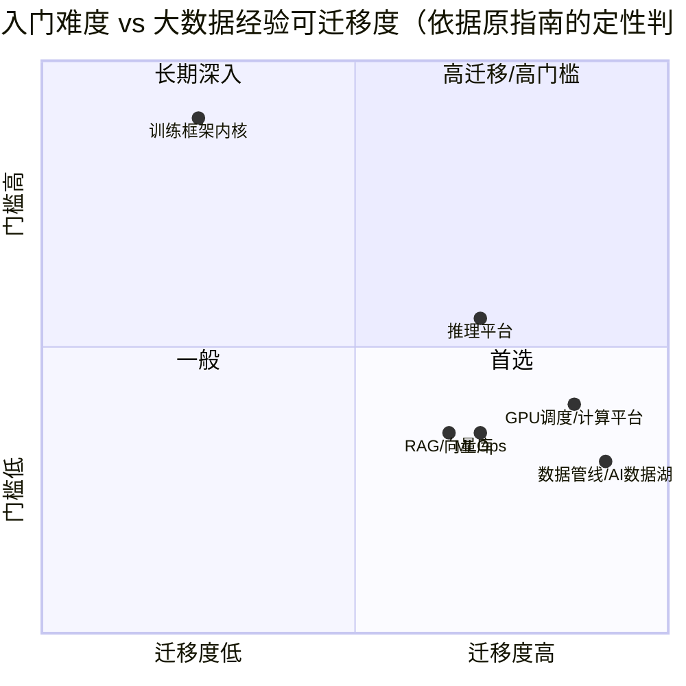
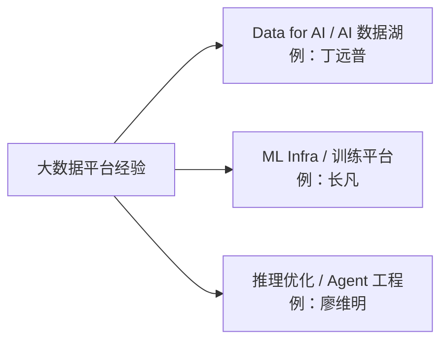

=== resources | 参考资料库 | 参考
# 参考资料库
> 按方向整理的转型参考资料，共 **255** 个不重复的外部链接（部分资源在多个方向重复出现）。链接均于 2026-10-16 至 2026-10-20 期间用 curl 检查过；标 ⚠️ 的会拦截自动化检查，浏览器可正常打开。每个周页面底部也有对应的“参考资料”块。

**类型**：书 / 文档 / 仓库 / 博客 / 论文 / 课程。**难度**：入门 → 进阶 → 高级。**对应周**：点击跳到使用它的那一周（W1–W24）。

> 实验需要什么机器、何时租卡，见 [实验资源与成本](/lab-cost.html)。

## 目录
- [1. LLM 基础](#1)
- [2. 分布式训练](#2)
- [3. 推理服务（vLLM / SGLang）](#3)
- [4. GPU 集群调度（K8s / Kueue / Volcano / Slurm）](#4)
- [5. Data for AI / Ray Data](#5)
- [6. MLOps 与监控](#6)
- [7. AI 系统全景](#7)
- [8. 中文资源](#8)
- [9. 转型案例](#9)
- [10. 招聘市场](#10)

<h2 id="1">1. LLM 基础</h2>

| 资源 | 类型 | 难度 | 对应周 | 为什么读 |
|---|---|---|---|---|
| [The Illustrated Transformer（Jay Alammar）](https://jalammar.github.io/illustrated-transformer/) | 博客 | 入门 | [W2](/m1w2.html) | 用图解讲清 self-attention 和 Transformer 结构，适合先建立直觉 |
| [Attention Is All You Need](https://arxiv.org/abs/1706.03762) | 论文 | 进阶 | [W2](/m1w2.html) | Transformer 原始论文，读完图解后回来对照公式 |
| [Datawhale happy-llm（中文）](https://github.com/datawhalechina/happy-llm) | 仓库 | 入门 | [W2](/m1w2.html) [W3](/m1w3.html) | 中文从零讲 LLM 原理到训练，第 1 月主读材料 |
| [Build a Large Language Model (From Scratch) 配套代码（Raschka）](https://github.com/rasbt/LLMs-from-scratch) | 仓库 | 入门 | [W2](/m1w2.html) [W3](/m1w3.html) [W4](/m1w4.html) | 一步步用 PyTorch 写出 GPT，每章 notebook 可在本地跑 |
| [nanoGPT](https://github.com/karpathy/nanoGPT) | 仓库 | 入门 | [W3](/m1w3.html) [W4](/m1w4.html) | 最小可读的 GPT 训练代码，第 3 周实验对象 |
| [build-nanogpt（Karpathy）](https://github.com/karpathy/build-nanogpt) | 仓库 | 入门 | [W3](/m1w3.html) | 按 commit 逐步复现 GPT-2，配合 nanoGPT 理解训练循环 |
| [Hugging Face LLM Course](https://huggingface.co/learn/llm-course) | 课程 | 入门 | [W2](/m1w2.html) [W19](/m5w3.html) | tokenizer、transformers、微调的官方教程，命令可直接照做 |
| [Chip Huyen《AI Engineering》配套仓库](https://github.com/chiphuyen/aie-book) | 书 | 入门 | [W1](/m1w1.html) [W24](/m6w4.html) | 从工程视角看基础模型应用全貌，帮助理解上层需求 |
| [Hugging Face LLM Course：Byte-Pair Encoding tokenization](https://huggingface.co/learn/llm-course/chapter6/5) | 课程 | 入门 | [W2](/m1w2.html) | BPE 训练与分词算法，含可运行代码 |
| [The Illustrated GPT-2（Jay Alammar）](https://jalammar.github.io/illustrated-gpt2/) | 博客 | 入门 | [W2](/m1w2.html) | decoder-only 与自回归生成图解 |
| [nanoGPT model.py](https://github.com/karpathy/nanoGPT/blob/master/model.py) | 仓库 | 入门 | [W2](/m1w2.html) | 约 300 行 GPT 实现，读 CausalSelfAttention/MLP/Block/GPT.forward |
| [transformers 文档：Caching（KV Cache）](https://huggingface.co/docs/transformers/en/cache_explanation) | 文档 | 入门 | [W2](/m1w2.html) | KV Cache 在 transformers 中的数据结构与用法 |
| [GQA 论文（Grouped-Query Attention）](https://arxiv.org/abs/2305.13245) | 论文 | 进阶 | [W2](/m1w2.html) [W4](/m1w4.html) | 多个 Q 头共享 K/V 头，KV Cache 缩小的来源 |
| [PyTorch：scaled_dot_product_attention](https://docs.pytorch.org/docs/stable/generated/torch.nn.functional.scaled_dot_product_attention.html) | 文档 | 进阶 | [W2](/m1w2.html) [W3](/m1w3.html) | 注意力的官方高效实现，第 2 周对数用 |
| [karpathy/minbpe](https://github.com/karpathy/minbpe) | 仓库 | 入门 | [W2](/m1w2.html) | 几百行实现 BPE 分词器 |
| [tiktoken](https://github.com/openai/tiktoken) | 仓库 | 入门 | [W2](/m1w2.html) | OpenAI 的 BPE 分词器库 |
| [Lilian Weng：Attention? Attention!](https://lilianweng.github.io/posts/2018-06-24-attention/) | 博客 | 进阶 | [W2](/m1w2.html) | 注意力机制发展综述 |
| [3Blue1Brown：Attention in transformers](https://www.3blue1brown.com/lessons/attention) | 博客 | 入门 | [W2](/m1w2.html) | 注意力的几何直觉（有文字版） |
| [PyTorch 教程：Automatic Differentiation with torch.autograd](https://docs.pytorch.org/tutorials/beginner/basics/autogradqs_tutorial.html) | 文档 | 入门 | [W3](/m1w3.html) | 计算图与反向传播 |
| [PyTorch 教程：Optimizing Model Parameters](https://docs.pytorch.org/tutorials/beginner/basics/optimization_tutorial.html) | 文档 | 入门 | [W3](/m1w3.html) | 标准训练循环 |
| [nanoGPT train.py](https://github.com/karpathy/nanoGPT/blob/master/train.py) | 仓库 | 入门 | [W3](/m1w3.html) | 约 330 行的完整训练循环 |
| [PyTorch 教程：Hooks for autograd saved tensors](https://docs.pytorch.org/tutorials/intermediate/autograd_saved_tensors_hooks_tutorial.html) | 文档 | 进阶 | [W3](/m1w3.html) | 测量激活内存的原理 |
| [torch.optim.AdamW](https://docs.pytorch.org/docs/stable/generated/torch.optim.AdamW.html) | 文档 | 进阶 | [W3](/m1w3.html) | AdamW 算法与两个优化器状态 |
| [AdamW 论文：Decoupled Weight Decay Regularization](https://arxiv.org/abs/1711.05101) | 论文 | 进阶 | [W3](/m1w3.html) | AdamW 的出处 |
| [PyTorch：Automatic Mixed Precision](https://docs.pytorch.org/docs/stable/amp.html) | 文档 | 进阶 | [W3](/m1w3.html) | autocast 与 GradScaler |
| [PyTorch：MPS backend](https://docs.pytorch.org/docs/stable/notes/mps.html) | 文档 | 入门 | [W3](/m1w3.html) | 在 Mac 上使用 Apple GPU |
| [Qwen2.5-0.5B 模型卡](https://huggingface.co/Qwen/Qwen2.5-0.5B) | 文档 | 入门 | [W4](/m1w4.html) | 参数量与结构参数的权威来源 |

<h2 id="2">2. 分布式训练</h2>

| 资源 | 类型 | 难度 | 对应周 | 为什么读 |
|---|---|---|---|---|
| [HuggingFace Ultra-Scale Playbook](https://huggingface.co/spaces/nanotron/ultrascale-playbook) | 书 | 进阶 | [W4](/m1w4.html) [W17](/m5w1.html) [W18](/m5w2.html) [W19](/m5w3.html) | 图解 DP/TP/PP/ZeRO 与通信开销，第 5 月主读 |
| [How to Scale Your Model（Google DeepMind）](https://jax-ml.github.io/scaling-book/) | 书 | 高级 | [W4](/m1w4.html) [W17](/m5w1.html) | 从 roofline 和显存/算力算账讲并行，适合进阶 |
| [Lilian Weng：How to Train Really Large Models on Many GPUs?](https://lilianweng.github.io/posts/2021-09-25-train-large/) | 博客 | 进阶 | [W17](/m5w1.html) | 一篇读懂各种并行与显存优化技术的综述 |
| [ZeRO 论文](https://arxiv.org/abs/1910.02054) | 论文 | 进阶 | [W4](/m1w4.html) [W19](/m5w3.html) | ZeRO-1/2/3 分片思想的出处，对照显存实测 |
| [PyTorch FSDP 论文](https://arxiv.org/abs/2304.11277) | 论文 | 进阶 | [W19](/m5w3.html) | FSDP 的设计与工程取舍，理解与 ZeRO-3 的关系 |
| [Megatron-LM 论文](https://arxiv.org/abs/1909.08053) | 论文 | 高级 | [W17](/m5w1.html) | 张量并行的原始论文，训练岗面试常问 |
| [DeepSpeed ZeRO 教程](https://www.deepspeed.ai/tutorials/zero/) | 文档 | 进阶 | [W19](/m5w3.html) | ZeRO 配置项的官方说明，第 19 周照着配 |
| [PyTorch FSDP 教程](https://docs.pytorch.org/tutorials/intermediate/FSDP_tutorial.html) | 文档 | 进阶 | [W19](/m5w3.html) | FSDP 官方上手教程 |
| [HF Accelerate + DeepSpeed 博客](https://huggingface.co/blog/accelerate-deepspeed) | 博客 | 进阶 | [W19](/m5w3.html) | 用 Accelerate 一套脚本切换 DeepSpeed 配置的实操 |
| [HuggingFace PEFT 文档](https://huggingface.co/docs/peft/index) | 文档 | 入门 | [W19](/m5w3.html) | LoRA 等参数高效微调，单卡/双卡实验都要用 |
| [NCCL](https://github.com/NVIDIA/nccl) | 仓库 | 高级 | [W18](/m5w2.html) | 集合通信库本体，了解 all-reduce 等原语的实现位置 |
| [nccl-tests](https://github.com/NVIDIA/nccl-tests) | 仓库 | 进阶 | [W18](/m5w2.html) | 第 18 周测多卡通信带宽用的标准工具 |
| [DeepSpeed](https://github.com/deepspeedai/DeepSpeed) | 仓库 | 进阶 | [W19](/m5w3.html) | ZeRO 实现与示例 |
| [Megatron-LM](https://github.com/NVIDIA/Megatron-LM) | 仓库 | 高级 | [W17](/m5w1.html) | 大规模训练事实标准框架，读 README 了解并行配置 |
| [nanotron](https://github.com/huggingface/nanotron) | 仓库 | 进阶 | [W17](/m5w1.html) | Playbook 配套的精简 3D 并行训练库，代码比 Megatron 好读 |
| [Stas Bekman：ml-engineering](https://github.com/stas00/ml-engineering) | 书 | 进阶 | [W12](/m3w4.html) [W18](/m5w2.html) [W19](/m5w3.html) | 大模型训练/推理的硬件、网络、排障实战手册 |
| [EleutherAI：Transformer Math 101](https://blog.eleuther.ai/transformer-math/) | 博客 | 进阶 | [W4](/m1w4.html) | 训练/推理计算量与显存的系统整理 |
| [Reducing Activation Recomputation in Large Transformer Models](https://arxiv.org/abs/2205.05198) | 论文 | 高级 | [W4](/m1w4.html) | 激活显存公式的出处 |
| [How to Scale Your Model：All the Transformer Math You Need to Know](https://jax-ml.github.io/scaling-book/transformers/) | 书 | 高级 | [W4](/m1w4.html) | Transformer 的 FLOPs 与字节账 |
| [transformers：单卡高效训练方法](https://huggingface.co/docs/transformers/main/en/perf_train_gpu_one) | 文档 | 入门 | [W4](/m1w4.html) | 各种省显存技巧一览 |
| [Accelerate：Model memory estimator](https://huggingface.co/docs/accelerate/main/en/usage_guides/model_size_estimator) | 文档 | 入门 | [W4](/m1w4.html) | 官方显存估算工具 |
| [LoRA 论文](https://arxiv.org/abs/2106.09685) | 论文 | 进阶 | [W4](/m1w4.html) [W19](/m5w3.html) | 低秩适配 |
| [Ray Core：Key Concepts](https://docs.ray.io/en/latest/ray-core/key-concepts.html) | 文档 | 入门 | [W5](/m2w1.html) | Task / Actor / Object 三个原语 |
| [Ray Core：Tasks](https://docs.ray.io/en/latest/ray-core/tasks.html) | 文档 | 入门 | [W5](/m2w1.html) | 远程函数、资源、多返回值 |
| [Ray Core：Actors](https://docs.ray.io/en/latest/ray-core/actors.html) | 文档 | 入门 | [W5](/m2w1.html) | 有状态 worker |
| [Ray：Resources](https://docs.ray.io/en/latest/ray-core/scheduling/resources.html) | 文档 | 进阶 | [W5](/m2w1.html) | 逻辑资源与调度 |
| [Ray Core：Objects](https://docs.ray.io/en/latest/ray-core/objects.html) | 文档 | 入门 | [W5](/m2w1.html) | 对象与引用 |
| [Ray：Serialization](https://docs.ray.io/en/latest/ray-core/objects/serialization.html) | 文档 | 进阶 | [W5](/m2w1.html) | Plasma 与零拷贝 |
| [Ray：Fault Tolerance](https://docs.ray.io/en/latest/ray-core/fault-tolerance.html) | 文档 | 进阶 | [W5](/m2w1.html) | 任务、Actor、对象的容错 |
| [Ray Anti-pattern：Calling ray.get in a loop](https://docs.ray.io/en/latest/ray-core/patterns/ray-get-loop.html) | 文档 | 入门 | [W5](/m2w1.html) | **选读与背景：** |
| [Ray Core 设计模式与反模式](https://docs.ray.io/en/latest/ray-core/patterns/index.html) | 文档 | 进阶 | [W5](/m2w1.html) | - [Ray：Token authentication](https://docs.ray.io/en/latest/ray-security/token-auth.html)（文档·入门）：实验 7 遇到的认证机制 |
| [Spark：Cluster Mode Overview](https://spark.apache.org/docs/latest/cluster-overview.html) | 文档 | 入门 | [W5](/m2w1.html) | 对照用 |
| [Ray Data：Key Concepts](https://docs.ray.io/en/latest/data/key-concepts.html) | 文档 | 入门 | [W6](/m2w2.html) | - [Ray Data：Loading Data](https://docs.ray.io/en/latest/data/loading-data.html)（文档·入门） |
| [Ray Data：Transforming Data](https://docs.ray.io/en/latest/data/transforming-data.html) | 文档 | 入门 | [W6](/m2w2.html) | map_batches 与有状态转换 |
| [Ray Data Internals](https://docs.ray.io/en/latest/data/data-internals.html) | 文档 | 进阶 | [W6](/m2w2.html) | block、融合、流式执行、内存模型 |
| [Ray Data：Performance Tips](https://docs.ray.io/en/latest/data/performance-tips.html) | 文档 | 进阶 | [W6](/m2w2.html) | - [datatrove GopherQualityFilter 源码](https://github.com/huggingface/datatrove/blob/main/src/datatrove/pipeline/filters/gopher_quality_filter.py)（仓库·进阶）：规则阈值来源 |
| [Spark ML 特征：Locality Sensitive Hashing](https://spark.apache.org/docs/latest/ml-features.html#locality-sensitive-hashing) | 文档 | 入门 | [W7](/m2w3.html) | - [PySpark MinHashLSH API](https://spark.apache.org/docs/latest/api/python/reference/api/pyspark.ml.feature.MinHashLSH.html)（文档·入门） |
| [PySpark 安装](https://spark.apache.org/docs/latest/api/python/getting_started/install.html) | 文档 | 入门 | [W7](/m2w3.html) | - [Eclipse Temurin JDK 下载](https://adoptium.net/temurin/releases/)（工具·入门） |
| [Ray：GroupedData.map_groups](https://docs.ray.io/en/latest/data/api/doc/ray.data.grouped_data.GroupedData.map_groups.html) | 文档 | 入门 | [W7](/m2w3.html) | - [datatrove minhash.py](https://github.com/huggingface/datatrove/blob/main/src/datatrove/pipeline/dedup/minhash.py)（仓库·进阶） |
| [ray.data.llm API](https://docs.ray.io/en/latest/data/api/llm.html) | 文档 | 进阶 | [W8](/m2w4.html) | - [fineweb-edu-classifier](https://huggingface.co/HuggingFaceFW/fineweb-edu-classifier)（模型·入门） |
| [GPipe 论文](https://arxiv.org/abs/1811.06965) | 论文 | 进阶 | [W17](/m5w1.html) | 第 17 周精读/实验参考 |
| [Megatron 3D 并行论文](https://arxiv.org/abs/2104.04473) | 论文 | 进阶 | [W17](/m5w1.html) | 第 17 周精读/实验参考 |
| [GShard 论文](https://arxiv.org/abs/2006.16668) | 论文 | 进阶 | [W17](/m5w1.html) | 第 17 周精读/实验参考 |
| [PyTorch fully_shard](https://docs.pytorch.org/docs/stable/distributed.fsdp.fully_shard.html) | 文档 | 进阶 | [W17](/m5w1.html) | 第 17 周精读/实验参考 |
| [张量并行 API](https://docs.pytorch.org/docs/stable/distributed.tensor.parallel.html) | 文档 | 进阶 | [W17](/m5w1.html) | 第 17 周精读/实验参考 |
| [PyTorch Distributed](https://docs.pytorch.org/docs/stable/distributed.html) | 文档 | 进阶 | [W18](/m5w2.html) | 第 18 周精读/实验参考 |
| [NCCL 集合通信说明](https://docs.nvidia.com/deeplearning/nccl/user-guide/docs/usage/collectives.html) | 文档 | 进阶 | [W18](/m5w2.html) | 第 18 周精读/实验参考 |
| [NCCL 用户指南](https://docs.nvidia.com/deeplearning/nccl/user-guide/docs/index.html) | 文档 | 进阶 | [W18](/m5w2.html) | 第 18 周精读/实验参考 |
| [PyTorch 分布式教程](https://docs.pytorch.org/tutorials/intermediate/dist_tuto.html) | 文档 | 进阶 | [W18](/m5w2.html) | 第 18 周精读/实验参考 |
| [nccl-tests PERFORMANCE.md](https://github.com/NVIDIA/nccl-tests/blob/master/doc/PERFORMANCE.md) | 仓库 | 进阶 | [W18](/m5w2.html) | 第 18 周精读/实验参考 |
| [NCCL 环境变量](https://docs.nvidia.com/deeplearning/nccl/user-guide/docs/env.html) | 文档 | 进阶 | [W18](/m5w2.html) | 第 18 周精读/实验参考 |
| [ml-engineering：网络章节](https://github.com/stas00/ml-engineering/tree/master/network) | 仓库 | 进阶 | [W18](/m5w2.html) | 第 18 周精读/实验参考 |
| [torchrun](https://docs.pytorch.org/docs/stable/elastic/run.html) | 文档 | 进阶 | [W18](/m5w2.html) | 第 18 周精读/实验参考 |
| [配置说明](https://www.deepspeed.ai/docs/config-json/) | 文档 | 进阶 | [W19](/m5w3.html) | 第 19 周精读/实验参考 |
| [HF FSDP 指南](https://huggingface.co/docs/transformers/fsdp) | 文档 | 进阶 | [W19](/m5w3.html) | 第 19 周精读/实验参考 |
| [HF DeepSpeed 集成](https://huggingface.co/docs/transformers/deepspeed) | 文档 | 进阶 | [W19](/m5w3.html) | 第 19 周精读/实验参考 |
| [PyTorch Distributed Checkpoint](https://docs.pytorch.org/docs/stable/distributed.checkpoint.html) | 文档 | 进阶 | [W19](/m5w3.html) | 第 19 周精读/实验参考 |
| [SmolLM2-135M](https://huggingface.co/HuggingFaceTB/SmolLM2-135M) | 文档 | 进阶 | [W19](/m5w3.html) | 第 19 周精读/实验参考 |
| [Tracking](https://mlflow.org/docs/latest/ml/tracking/) | 文档 | 进阶 | [W20](/m5w4.html) | 第 20 周精读/实验参考 |
| [Model Registry](https://mlflow.org/docs/latest/ml/model-registry/) | 文档 | 进阶 | [W20](/m5w4.html) | 第 20 周精读/实验参考 |
| [REST API](https://mlflow.org/docs/latest/api_reference/rest-api.html) | 文档 | 进阶 | [W20](/m5w4.html) | 第 20 周精读/实验参考 |
| [后端存储](https://mlflow.org/docs/latest/ml/tracking/backend-stores/) | 文档 | 进阶 | [W20](/m5w4.html) | 第 20 周精读/实验参考 |
| [Google：MLOps 持续交付与自动化流水线](https://cloud.google.com/architecture/mlops-continuous-delivery-and-automation-pipelines-in-machine-learning) | 文档 | 进阶 | [W20](/m5w4.html) | 第 20 周精读/实验参考 |
| [Hidden Technical Debt in ML Systems](https://papers.nips.cc/paper/5656-hidden-technical-debt-in-machine-learning-systems) | 文档 | 进阶 | [W20](/m5w4.html) | 第 20 周精读/实验参考 |
| [ml-ops.org](https://ml-ops.org/) | 文档 | 进阶 | [W20](/m5w4.html) | 第 20 周精读/实验参考 |
| [HF Trainer 回调](https://huggingface.co/docs/transformers/main_classes/callback) | 文档 | 进阶 | [W20](/m5w4.html) | 第 20 周精读/实验参考 |

<h2 id="3">3. 推理服务（vLLM / SGLang）</h2>

| 资源 | 类型 | 难度 | 对应周 | 为什么读 |
|---|---|---|---|---|
| [PagedAttention（vLLM）论文](https://arxiv.org/abs/2309.06180) | 论文 | 进阶 | [W13](/m4w1.html) | KV Cache 分页管理的出处，第 13 周精读 |
| [vLLM 文档：PagedAttention 设计](https://docs.vllm.ai/en/latest/design/paged_attention.html) | 文档 | 进阶 | [W13](/m4w1.html) | 论文思想在代码中如何落地 |
| [Inside vLLM: Anatomy of a High-Throughput LLM Inference System](https://blog.vllm.ai/2025/09/05/anatomy-of-vllm.html) | 博客 | 进阶 | [W13](/m4w1.html) [W14](/m4w2.html) [W23](/m6w3.html) | vLLM 官方博客长文，串起调度器、KV cache、prefix cache、PD 分离 |
| [SGLang 论文（RadixAttention）](https://arxiv.org/abs/2312.07104) | 论文 | 进阶 | [W15](/m4w3.html) | 理解 SGLang 的前缀缓存与 vLLM 的差异 |
| [DistServe 论文（PD 分离）](https://arxiv.org/abs/2401.09670) | 论文 | 高级 | [W13](/m4w1.html) | prefill/decode 分离的代表性论文 |
| [Lilian Weng：Large Transformer Model Inference Optimization](https://lilianweng.github.io/posts/2023-01-10-inference-optimization/) | 博客 | 进阶 | [W13](/m4w1.html) | 量化、剪枝、KV 优化等推理优化技术综述 |
| [vLLM 文档](https://docs.vllm.ai/en/latest/) | 文档 | 入门 | [W8](/m2w4.html) [W12](/m3w4.html) [W14](/m4w2.html) | 部署、参数、OpenAI 兼容服务的权威说明 |
| [vLLM benchmarks](https://github.com/vllm-project/vllm/tree/main/benchmarks) | 仓库 | 进阶 | [W14](/m4w2.html) [W15](/m4w3.html) | 官方压测脚本，对照自写压测结果 |
| [SGLang 文档](https://docs.sglang.ai/) | 文档 | 入门 | [W15](/m4w3.html) | SGLang 部署与参数 |
| [Ray Serve 文档](https://docs.ray.io/en/latest/serve/index.html) | 文档 | 入门 | [W16](/m4w4.html) | Python 原生的模型服务与自动扩缩容 |
| [KServe](https://kserve.github.io/website/) | 文档 | 进阶 | [W16](/m4w4.html) | K8s 上的标准模型服务 CRD |
| [llm-d](https://github.com/llm-d/llm-d) | 仓库 | 高级 | [W16](/m4w4.html) | K8s 原生分布式推理（PD 分离、KV 感知路由） |
| [NVIDIA Dynamo](https://github.com/ai-dynamo/dynamo) | 仓库 | 高级 | [W16](/m4w4.html) | 数据中心级分布式推理框架，了解业界方向 |
| [vLLM 博客](https://blog.vllm.ai/) | 博客 | 进阶 | [W13](/m4w1.html) [W14](/m4w2.html) | 持续跟进推理引擎新特性 |
| [LMSYS / SGLang 博客](https://lmsys.org/blog/) | 博客 | 进阶 | [W15](/m4w3.html) | SGLang 新特性与性能分析 |
| [vLLM：Conserving Memory](https://docs.vllm.ai/en/latest/configuration/conserving_memory.html) | 文档 | 进阶 | [W4](/m1w4.html) | 推理框架的省显存手段 |
| [vLLM：Kubernetes 部署](https://docs.vllm.ai/en/latest/deployment/k8s.html) | 文档 | 入门 | [W12](/m3w4.html) | 第 12 周精读/实验参考 |
| [vLLM OpenAI 兼容服务](https://docs.vllm.ai/en/latest/serving/openai_compatible_server.html) | 文档 | 入门 | [W12](/m3w4.html) | 第 12 周精读/实验参考 |
| [config.json](https://huggingface.co/Qwen/Qwen2.5-7B-Instruct/blob/main/config.json) | 文档 | 进阶 | [W13](/m4w1.html) | 第 13 周精读/实验参考 |
| [Orca（OSDI '22）](https://www.usenix.org/conference/osdi22/presentation/yu) | 论文 | 进阶 | [W13](/m4w1.html) | 第 13 周精读/实验参考 |
| [vLLM 自动前缀缓存设计](https://docs.vllm.ai/en/latest/design/prefix_caching.html) | 文档 | 进阶 | [W13](/m4w1.html) | 第 13 周精读/实验参考 |
| [vLLM 量化文档](https://docs.vllm.ai/en/latest/features/quantization/index.html) | 文档 | 进阶 | [W13](/m4w1.html) [W15](/m4w3.html) | 第 13、15 周精读/实验参考 |
| [vLLM 分离 prefill](https://docs.vllm.ai/en/latest/features/disagg_prefill.html) | 文档 | 进阶 | [W13](/m4w1.html) | 第 13 周精读/实验参考 |
| [优化与调参](https://docs.vllm.ai/en/latest/configuration/optimization.html) | 文档 | 进阶 | [W13](/m4w1.html) [W14](/m4w2.html) [W15](/m4w3.html) | 第 13、14、15 周精读/实验参考 |
| [vLLM 快速入门](https://docs.vllm.ai/en/latest/getting_started/quickstart.html) | 文档 | 进阶 | [W14](/m4w2.html) | 第 14 周精读/实验参考 |
| [vllm serve 参数](https://docs.vllm.ai/en/latest/cli/serve.html) | 文档 | 进阶 | [W14](/m4w2.html) | 第 14 周精读/实验参考 |
| [Engine Args](https://docs.vllm.ai/en/latest/configuration/engine_args.html) | 文档 | 进阶 | [W14](/m4w2.html) | 第 14 周精读/实验参考 |
| [vllm bench serve](https://docs.vllm.ai/en/latest/cli/bench/serve.html) | 文档 | 进阶 | [W14](/m4w2.html) | 第 14 周精读/实验参考 |
| [压测说明](https://docs.vllm.ai/en/latest/contributing/benchmarks.html) | 文档 | 进阶 | [W14](/m4w2.html) | 第 14 周精读/实验参考 |
| [LLM 推理指标（BentoML）](https://bentoml.com/llm/inference-optimization/llm-inference-metrics) | 文档 | 进阶 | [W14](/m4w2.html) | 第 14 周精读/实验参考 |
| [vLLM 指标](https://docs.vllm.ai/en/latest/usage/metrics.html) | 文档 | 进阶 | [W14](/m4w2.html) [W16](/m4w4.html) | 第 14、16 周精读/实验参考 |
| [CPU 安装说明](https://docs.vllm.ai/en/latest/getting_started/installation/cpu.html) | 文档 | 进阶 | [W14](/m4w2.html) | 第 14 周精读/实验参考 |
| [LMSYS 博客：SGLang 发布](https://lmsys.org/blog/2024-01-17-sglang/) | 文档 | 进阶 | [W15](/m4w3.html) | 第 15 周精读/实验参考 |
| [SGLang 安装](https://docs.sglang.ai/get_started/install.html) | 文档 | 进阶 | [W15](/m4w3.html) | 第 15 周精读/实验参考 |
| [SGLang 服务参数](https://docs.sglang.ai/advanced_features/server_arguments.html) | 文档 | 进阶 | [W15](/m4w3.html) | 第 15 周精读/实验参考 |
| [SGLang 源码](https://github.com/sgl-project/sglang) | 仓库 | 进阶 | [W15](/m4w3.html) | 第 15 周精读/实验参考 |
| [AWQ 论文](https://arxiv.org/abs/2306.00978) | 论文 | 进阶 | [W15](/m4w3.html) | 第 15 周精读/实验参考 |
| [GPTQ 论文](https://arxiv.org/abs/2210.17323) | 论文 | 进阶 | [W15](/m4w3.html) | 第 15 周精读/实验参考 |
| [vLLM AutoAWQ](https://docs.vllm.ai/en/latest/features/quantization/auto_awq.html) | 文档 | 进阶 | [W15](/m4w3.html) | 第 15 周精读/实验参考 |
| [Qwen2.5-7B-Instruct-AWQ](https://huggingface.co/Qwen/Qwen2.5-7B-Instruct-AWQ) | 文档 | 进阶 | [W15](/m4w3.html) | 第 15 周精读/实验参考 |
| [PyTorch 量化文档](https://docs.pytorch.org/docs/stable/quantization.html) | 文档 | 进阶 | [W15](/m4w3.html) | 第 15 周精读/实验参考 |
| [torchao](https://github.com/pytorch/ao) | 仓库 | 进阶 | [W15](/m4w3.html) | 第 15 周精读/实验参考 |
| [GitHub Releases](https://github.com/prometheus/prometheus/releases) | 仓库 | 进阶 | [W16](/m4w4.html) | 第 16 周精读/实验参考 |
| [Ray Serve autoscaling 指南](https://docs.ray.io/en/latest/serve/autoscaling-guide.html) | 文档 | 进阶 | [W16](/m4w4.html) | 第 16 周精读/实验参考 |
| [高级 autoscaling](https://docs.ray.io/en/latest/serve/advanced-guides/advanced-autoscaling.html) | 文档 | 进阶 | [W16](/m4w4.html) | 第 16 周精读/实验参考 |
| [Ray Serve LLM](https://docs.ray.io/en/latest/serve/llm/index.html) | 文档 | 进阶 | [W16](/m4w4.html) | 第 16 周精读/实验参考 |
| [Prometheus 入门](https://prometheus.io/docs/prometheus/latest/getting_started/) | 文档 | 进阶 | [W16](/m4w4.html) | 第 16 周精读/实验参考 |
| [PromQL 函数](https://prometheus.io/docs/prometheus/latest/querying/functions/) | 文档 | 进阶 | [W16](/m4w4.html) | 第 16 周精读/实验参考 |
| [直方图与 Summary 实践](https://prometheus.io/docs/practices/histograms/) | 文档 | 进阶 | [W16](/m4w4.html) | 第 16 周精读/实验参考 |
| [Grafana + Prometheus 入门](https://grafana.com/docs/grafana/latest/getting-started/get-started-grafana-prometheus/) | 文档 | 进阶 | [W16](/m4w4.html) | 第 16 周精读/实验参考 |
| [K8s HPA](https://kubernetes.io/docs/tasks/run-application/horizontal-pod-autoscale/) | 文档 | 进阶 | [W16](/m4w4.html) | 第 16 周精读/实验参考 |
| [KEDA Prometheus scaler](https://keda.sh/docs/latest/scalers/prometheus/) | 文档 | 进阶 | [W16](/m4w4.html) | 第 16 周精读/实验参考 |

<h2 id="4">4. GPU 集群调度（K8s / Kueue / Volcano / Slurm）</h2>

| 资源 | 类型 | 难度 | 对应周 | 为什么读 |
|---|---|---|---|---|
| [K8s：调度 GPU](https://kubernetes.io/docs/tasks/manage-gpus/scheduling-gpus/) | 文档 | 入门 | [W9](/m3w1.html) | device plugin 与 nvidia.com/gpu 资源模型 |
| [K8s：Dynamic Resource Allocation](https://kubernetes.io/docs/concepts/scheduling-eviction/dynamic-resource-allocation/) | 文档 | 进阶 | [W9](/m3w1.html) [W12](/m3w4.html) | 新一代设备分配 API（DRA），GPU 调度的演进方向 |
| [kind](https://kind.sigs.k8s.io/) | 文档 | 入门 | [W9](/m3w1.html) [W10](/m3w2.html) [W11](/m3w3.html) | 本地多节点 K8s 集群，第 3 月所有本地实验的基础 |
| [run-ai fake-gpu-operator](https://github.com/run-ai/fake-gpu-operator) | 仓库 | 入门 | [W9](/m3w1.html) [W10](/m3w2.html) [W11](/m3w3.html) | 在无 GPU 的集群上模拟 GPU 资源，练调度不花钱 |
| [Kueue 文档](https://kueue.sigs.k8s.io/docs/) | 文档 | 入门 | [W10](/m3w2.html) | 队列、配额、借用、抢占的官方说明 |
| [Kueue 概念](https://kueue.sigs.k8s.io/docs/concepts/) | 文档 | 入门 | [W10](/m3w2.html) | ClusterQueue/LocalQueue/ResourceFlavor 概念页，对照 YARN 队列 |
| [Volcano 文档](https://volcano.sh/en/docs/) | 文档 | 入门 | [W11](/m3w3.html) | 批调度器整体文档 |
| [Volcano PodGroup](https://volcano.sh/en/docs/podgroup/) | 文档 | 入门 | [W11](/m3w3.html) | Gang 调度 minMember 的核心对象 |
| [KubeRay（Ray on K8s）](https://docs.ray.io/en/latest/cluster/kubernetes/index.html) | 文档 | 入门 | [W11](/m3w3.html) | RayCluster/RayJob CRD |
| [NVIDIA GPU Operator 文档](https://docs.nvidia.com/datacenter/cloud-native/gpu-operator/latest/index.html) | 文档 | 进阶 | [W12](/m3w4.html) | 驱动、container toolkit、device plugin、DCGM 一键部署 |
| [Slurm 文档](https://slurm.schedmd.com/documentation.html) | 文档 | 入门 | [W12](/m3w4.html) | HPC/训练集群常用调度器 |
| [Slurm Quick Start](https://slurm.schedmd.com/quickstart.html) | 文档 | 入门 | [W12](/m3w4.html) | sbatch/srun/partition 基本概念，快速建立与 K8s 的对照 |
| [Kubeflow Trainer 文档](https://www.kubeflow.org/docs/components/trainer/) | 文档 | 进阶 | [W11](/m3w3.html) [W19](/m5w3.html) | K8s 上的分布式训练作业 CRD |
| [Kubeflow Trainer 仓库](https://github.com/kubeflow/trainer) | 仓库 | 进阶 | [W11](/m3w3.html) | Trainer 源码与示例 |
| [蚂蚁 DLRover](https://github.com/intelligent-machine-learning/dlrover) | 仓库 | 高级 | [W11](/m3w3.html) [W19](/m5w3.html) | 训练作业弹性与故障自愈，国内开源代表 |
| [KWOK](https://kwok.sigs.k8s.io/) | 文档 | 入门 | [W9](/m3w1.html) | 第 9 周精读/实验参考 |
| [Kubernetes 调度器](https://kubernetes.io/docs/concepts/scheduling-eviction/kube-scheduler/) | 文档 | 入门 | [W9](/m3w1.html) | 第 9 周精读/实验参考 |
| [为 Pod 和容器管理资源](https://kubernetes.io/docs/concepts/configuration/manage-resources-containers/) | 文档 | 入门 | [W9](/m3w1.html) | 第 9 周精读/实验参考 |
| [Device Plugins](https://kubernetes.io/docs/concepts/extend-kubernetes/compute-storage-net/device-plugins/) | 文档 | 进阶 | [W9](/m3w1.html) | 第 9 周精读/实验参考 |
| [kwokctl 二进制运行时](https://kwok.sigs.k8s.io/docs/user/kwokctl-platform-specific-binaries/) | 文档 | 入门 | [W9](/m3w1.html) | 第 9 周精读/实验参考 |
| [污点和容忍](https://kubernetes.io/docs/concepts/scheduling-eviction/taint-and-toleration/) | 文档 | 入门 | [W9](/m3w1.html) | 第 9 周精读/实验参考 |
| [Resource Quotas](https://kubernetes.io/docs/concepts/policy/resource-quotas/) | 文档 | 入门 | [W9](/m3w1.html) | 第 9 周精读/实验参考 |
| [NVIDIA k8s-device-plugin README](https://github.com/NVIDIA/k8s-device-plugin) | 代码 | 入门 | [W9](/m3w1.html) [W12](/m3w4.html) | 第 9、12 周精读/实验参考 |
| [Resource Bin Packing](https://kubernetes.io/docs/concepts/scheduling-eviction/resource-bin-packing/) | 文档 | 入门 | [W9](/m3w1.html) | 第 9 周精读/实验参考 |
| [Gang Scheduling](https://kubernetes.io/docs/concepts/scheduling-eviction/gang-scheduling/) | 文档 | 入门 | [W9](/m3w1.html) [W11](/m3w3.html) | 第 9、11 周精读/实验参考 |
| [GFD 文档](https://github.com/NVIDIA/k8s-device-plugin/blob/main/docs/gpu-feature-discovery/README.md) | 代码 | 入门 | [W9](/m3w1.html) | 第 9 周精读/实验参考 |
| [NVIDIA GPU Operator 概览](https://docs.nvidia.com/datacenter/cloud-native/gpu-operator/latest/overview.html) | 文档 | 入门 | [W9](/m3w1.html) | 第 9 周精读/实验参考 |
| [为节点通告扩展资源](https://kubernetes.io/docs/tasks/administer-cluster/extended-resource-node/) | 文档 | 入门 | [W9](/m3w1.html) | 第 9 周精读/实验参考 |
| [Kueue Overview](https://kueue.sigs.k8s.io/docs/overview/) | 文档 | 入门 | [W10](/m3w2.html) | 第 10 周精读/实验参考 |
| [Workload](https://kueue.sigs.k8s.io/docs/concepts/workload/) | 文档 | 入门 | [W10](/m3w2.html) | 第 10 周精读/实验参考 |
| [ResourceFlavor](https://kueue.sigs.k8s.io/docs/concepts/resource_flavor/) | 文档 | 入门 | [W10](/m3w2.html) | 第 10 周精读/实验参考 |
| [ClusterQueue](https://kueue.sigs.k8s.io/docs/concepts/cluster_queue/) | 文档 | 入门 | [W10](/m3w2.html) | 第 10 周精读/实验参考 |
| [LocalQueue](https://kueue.sigs.k8s.io/docs/concepts/local_queue/) | 文档 | 入门 | [W10](/m3w2.html) | 第 10 周精读/实验参考 |
| [Cohort](https://kueue.sigs.k8s.io/docs/concepts/cohort/) | 文档 | 入门 | [W10](/m3w2.html) | 第 10 周精读/实验参考 |
| [Run a Job](https://kueue.sigs.k8s.io/docs/tasks/run/jobs/) | 文档 | 入门 | [W10](/m3w2.html) | 第 10 周精读/实验参考 |
| [Preemption](https://kueue.sigs.k8s.io/docs/concepts/preemption/) | 文档 | 进阶 | [W10](/m3w2.html) | 第 10 周精读/实验参考 |
| [WorkloadPriorityClass](https://kueue.sigs.k8s.io/docs/concepts/workload_priority_class/) | 文档 | 入门 | [W10](/m3w2.html) | 第 10 周精读/实验参考 |
| [Fair Sharing](https://kueue.sigs.k8s.io/docs/concepts/fair_sharing/) | 文档 | 进阶 | [W10](/m3w2.html) | 第 10 周精读/实验参考 |
| [Topology Aware Scheduling](https://kueue.sigs.k8s.io/docs/concepts/topology_aware_scheduling/) | 文档 | 进阶 | [W10](/m3w2.html) | 第 10 周精读/实验参考 |
| [安装文档](https://kueue.sigs.k8s.io/docs/installation/) | 文档 | 入门 | [W10](/m3w2.html) | 第 10 周精读/实验参考 |
| [Kueue GitHub 仓库](https://github.com/kubernetes-sigs/kueue) | 代码 | 入门 | [W10](/m3w2.html) | 第 10 周精读/实验参考 |
| [Queue](https://volcano.sh/en/docs/queue/) | 文档 | 入门 | [W11](/m3w3.html) | 第 11 周精读/实验参考 |
| [Plugins](https://volcano.sh/en/docs/plugins/) | 文档 | 进阶 | [W11](/m3w3.html) | 第 11 周精读/实验参考 |
| [VolcanoJob](https://volcano.sh/en/docs/vcjob/) | 文档 | 入门 | [W11](/m3w3.html) | 第 11 周精读/实验参考 |
| [KubeRay + Volcano](https://docs.ray.io/en/latest/cluster/kubernetes/k8s-ecosystem/volcano.html) | 文档 | 入门 | [W11](/m3w3.html) | 第 11 周精读/实验参考 |
| [RayCluster 快速入门](https://docs.ray.io/en/latest/cluster/kubernetes/getting-started/raycluster-quick-start.html) | 文档 | 入门 | [W11](/m3w3.html) | 第 11 周精读/实验参考 |
| [KubeRay + Kueue](https://docs.ray.io/en/latest/cluster/kubernetes/k8s-ecosystem/kueue.html) | 文档 | 入门 | [W11](/m3w3.html) | 第 11 周精读/实验参考 |
| [volcano-sh/volcano](https://github.com/volcano-sh/volcano) | 代码 | 入门 | [W11](/m3w3.html) | 第 11 周精读/实验参考 |
| [ray-project/kuberay](https://github.com/ray-project/kuberay) | 代码 | 入门 | [W11](/m3w3.html) | 第 11 周精读/实验参考 |
| [Getting Started](https://docs.nvidia.com/datacenter/cloud-native/gpu-operator/latest/getting-started.html) | 文档 | 入门 | [W12](/m3w4.html) | 第 12 周精读/实验参考 |
| [平台支持](https://docs.nvidia.com/datacenter/cloud-native/gpu-operator/latest/platform-support.html) | 文档 | 入门 | [W12](/m3w4.html) | 第 12 周精读/实验参考 |
| [NVIDIA Container Toolkit](https://docs.nvidia.com/datacenter/cloud-native/container-toolkit/latest/index.html) | 文档 | 入门 | [W12](/m3w4.html) | 第 12 周精读/实验参考 |
| [GPU 共享（time-slicing）](https://docs.nvidia.com/datacenter/cloud-native/gpu-operator/latest/gpu-sharing.html) | 文档 | 进阶 | [W12](/m3w4.html) | 第 12 周精读/实验参考 |
| [NVIDIA/gpu-operator](https://github.com/NVIDIA/gpu-operator) | 代码 | 入门 | [W12](/m3w4.html) | 第 12 周精读/实验参考 |
| [NVIDIA/dcgm-exporter](https://github.com/NVIDIA/dcgm-exporter) | 代码 | 入门 | [W12](/m3w4.html) | 第 12 周精读/实验参考 |

<h2 id="5">5. Data for AI / Ray Data</h2>

| 资源 | 类型 | 难度 | 对应周 | 为什么读 |
|---|---|---|---|---|
| [Ray Core 入门（Walkthrough）](https://docs.ray.io/en/latest/ray-core/walkthrough.html) | 文档 | 入门 | [W5](/m2w1.html) | Task/Actor/Object 基本用法 |
| [Ray Data 文档](https://docs.ray.io/en/latest/data/data.html) | 文档 | 入门 | [W6](/m2w2.html) [W7](/m2w3.html) | 流式执行模型与 API，对照 Spark |
| [Ray Data 处理 LLM](https://docs.ray.io/en/latest/data/working-with-llms.html) | 文档 | 进阶 | [W8](/m2w4.html) | ray.data.llm 批量推理官方指南 |
| [datatrove](https://github.com/huggingface/datatrove) | 仓库 | 进阶 | [W6](/m2w2.html) [W7](/m2w3.html) | FineWeb 用的数据清洗/去重管线，参考生产级实现 |
| [NeMo Curator](https://github.com/NVIDIA/NeMo-Curator) | 仓库 | 进阶 | [W6](/m2w2.html) [W7](/m2w3.html) | NVIDIA 的 GPU 加速数据整理库 |
| [FineWeb 数据集](https://huggingface.co/datasets/HuggingFaceFW/fineweb) | 文档 | 入门 | [W6](/m2w2.html) | 实验用的真实预训练语料，可取小样本 |
| [字节跳动：Ray Data 200TB 多模态离线推理](https://www.anyscale.com/blog/how-bytedance-scales-offline-inference-with-multi-modal-llms-to-200TB-data) | 博客 | 进阶 | [W7](/m2w3.html) [W8](/m2w4.html) [W23](/m6w3.html) | Spark BSP 与 Ray 流水线的真实对比 |
| [Anyscale：Ray Data vs Spark vs SageMaker 批量推理](https://www.anyscale.com/blog/offline-batch-inference-comparing-ray-apache-spark-and-sagemaker) | 博客 | 进阶 | [W7](/m2w3.html) [W8](/m2w4.html) | 第 7 周对比实验的参照 |
| [Anyscale 博客](https://www.anyscale.com/blog) | 博客 | 进阶 | [W5](/m2w1.html) | Ray 生态新动向 |
| [DDIA《数据密集型应用系统设计》](https://dataintensive.net/) | 书 | 进阶 | [W5](/m2w1.html) | 大数据架构师的老朋友，重读分布式部分对照 Ray |
| [Ray 论文（OSDI'18）](https://arxiv.org/abs/1712.05889) | 论文 | 进阶 | [W5](/m2w1.html) | 设计动机与架构 |
| [Ray v2 架构白皮书](https://docs.google.com/document/d/1tBw9A4j62ruI5omIJbMxly-la5w4q_TjyJgJL_jN2fI/preview) | 文档 | 高级 | [W5](/m2w1.html) | 所有权、对象管理、调度细节 |
| [FineWeb 博客长文](https://huggingface.co/spaces/HuggingFaceFW/blogpost-fineweb-v1) | 博客 | 进阶 | [W6](/m2w2.html) | 公开的预训练数据清洗配方与消融方法 |
| [Gopher 论文](https://arxiv.org/abs/2112.11446) | 论文 | 进阶 | [W6](/m2w2.html) | 附录中的质量过滤规则 |
| [The FineWeb Datasets 论文](https://arxiv.org/abs/2406.17557) | 论文 | 进阶 | [W6](/m2w2.html) | - [Ray Data 论文：The Streaming Batch Model](https://arxiv.org/abs/2501.12407)（论文·高级） |
| [RefinedWeb 论文](https://arxiv.org/abs/2306.01116) | 论文 | 进阶 | [W6](/m2w2.html) | > 完整列表见 [参考资料库](/resources.html)。 |
| [Deduplicating Training Data Makes Language Models Better](https://arxiv.org/abs/2107.06499) | 论文 | 进阶 | [W7](/m2w3.html) | 去重为何重要 |
| [Large-scale Near-deduplication Behind BigCode](https://huggingface.co/blog/dedup) | 博客 | 进阶 | [W7](/m2w3.html) | 生产级 MinHash 去重的完整讲解 |
| [datasketch MinHash LSH](https://ekzhu.com/datasketch/lsh.html) | 文档 | 入门 | [W7](/m2w3.html) | - [datasketch MinHash](https://ekzhu.com/datasketch/minhash.html)（文档·入门） |
| [datatrove MinHash 去重示例](https://github.com/huggingface/datatrove/blob/main/examples/minhash_deduplication.py) | 仓库 | 进阶 | [W7](/m2w3.html) | > 完整列表见 [参考资料库](/resources.html)。 |
| [FineWeb-Edu 数据集](https://huggingface.co/datasets/HuggingFaceFW/fineweb-edu) | 数据集 | 入门 | [W8](/m2w4.html) | - [vLLM 文档](https://docs.vllm.ai/en/latest/)（文档·进阶） |

<h2 id="6">6. MLOps 与监控</h2>

| 资源 | 类型 | 难度 | 对应周 | 为什么读 |
|---|---|---|---|---|
| [MLflow 文档](https://mlflow.org/docs/latest/index.html) | 文档 | 入门 | [W20](/m5w4.html) | 实验跟踪、模型注册 |
| [MLflow 仓库](https://github.com/mlflow/mlflow) | 仓库 | 入门 | [W20](/m5w4.html) | 示例代码 |
| [Made With ML](https://madewithml.com/) | 课程 | 入门 | [W20](/m5w4.html) | 端到端 ML 工程与 MLOps 文字教程（基于 Ray） |
| [prometheus-community helm-charts](https://github.com/prometheus-community/helm-charts) | 仓库 | 入门 | [W16](/m4w4.html) | kube-prometheus-stack 监控推理服务 |
| [Milvus](https://github.com/milvus-io/milvus) | 仓库 | 入门 | [W22](/m6w2.html) | RAG 毕业项目的向量库 |
| [PyTorch：Understanding CUDA Memory Usage](https://docs.pytorch.org/docs/stable/torch_cuda_memory.html) | 文档 | 进阶 | [W4](/m1w4.html) | 显存快照与 OOM 排查 |
| [PyTorch：CUDA semantics](https://docs.pytorch.org/docs/stable/notes/cuda.html) | 文档 | 进阶 | [W4](/m1w4.html) | 缓存分配器与显存口径 |

<h2 id="7">7. AI 系统全景</h2>

| 资源 | 类型 | 难度 | 对应周 | 为什么读 |
|---|---|---|---|---|
| [微软 AI-System 课程](https://github.com/microsoft/AI-System) | 书 | 进阶 | [W1](/m1w1.html) [W17](/m5w1.html) | AI 系统全景课程讲义（中英文） |
| [ZOMI AISystem（中文）](https://github.com/chenzomi12/AISystem) | 书 | 进阶 | [W12](/m3w4.html) [W13](/m4w1.html) [W17](/m5w1.html) | AI 芯片、编译器、推理、训练系统的中文全景 |
| [ai-system-design-guide](https://github.com/ombharatiya/ai-system-design-guide) | 仓库 | 入门 | [W21](/m6w1.html) [W24](/m6w4.html) | AI 系统设计题与架构模式，面试准备 |

<h2 id="8">8. 中文资源</h2>

| 资源 | 类型 | 难度 | 对应周 | 为什么读 |
|---|---|---|---|---|
| [Datawhale happy-llm](https://github.com/datawhalechina/happy-llm) | 仓库 | 入门 | [W2](/m1w2.html) | 见上，中文首选入门 |
| [ZOMI AISystem](https://github.com/chenzomi12/AISystem) | 书 | 进阶 | [W17](/m5w1.html) | 见上，中文 AI 系统全景 |
| [InfoQ“下一代 Data for AI 技术架构”专题](https://www.infoq.cn/article/dx5t48sffpjazwbvspnt) | 博客 | 进阶 | [W6](/m2w2.html) [W21](/m6w1.html) | 字节、Zilliz、JuiceFS 等国内实践 |
| [理想汽车：Hadoop 迁云原生 + JuiceFS](https://www.infoq.cn/article/yOse9OblQT4zTMl1RaEw) | 博客 | 进阶 | [W9](/m3w1.html) [W21](/m6w1.html) | 大数据与 AI 平台共享存储的国内案例 |
| [美团：大数据及机器学习基础设施云原生改造](https://fxbaogao.com/detail/4646648) | 博客 | 进阶 | [W10](/m3w2.html) [W11](/m3w3.html) | YARN → K8s、Gang 调度、抢占的实践 |

<h2 id="9">9. 转型案例</h2>

| 资源 | 类型 | 难度 | 对应周 | 为什么读 |
|---|---|---|---|---|
| [廖维明《工程师的 AI 学习指南》](https://www.liaoweiming.org/blog/ai-learning-guide-for-engineers) | 博客 | 入门 | [W1](/m1w1.html) | 大数据工程师转 AI 的亲历学习路径 |
| [长凡访谈《走近 AI Infra 架构师》](https://mp.weixin.qq.com/s/2tYO1z5pt-nU6duANzDlbg) | 博客 | 入门 | [W21](/m6w1.html) | 从大数据到 ML Infra 的架构师视角 |
| [丁远普：火山引擎 Data for AI 转型（InfoQ）](https://www.infoq.cn/article/lmg6blihf5yslvwgmzz2) | 博客 | 入门 | [W21](/m6w1.html) | 大数据产品负责人转 AI 数据湖（建站时自动检查超时，浏览器可打开） |
| [ai-system-design-guide：TRANSITION_GUIDE](https://github.com/ombharatiya/ai-system-design-guide/blob/main/TRANSITION_GUIDE.md) | 仓库 | 入门 | [W1](/m1w1.html) [W24](/m6w4.html) | Data/Platform Engineer 转 AI Infra 的技能差距梳理 |
| [Pinterest：Spark 迁 Ray 做批量推理 ⚠️](https://medium.com/pinterest-engineering/ray-batch-inference-at-pinterest-part-3-4faeb652e385) | 博客 | 进阶 | [W8](/m2w4.html) | 成本下降的量化案例（自动检查 403，浏览器可打开） |

<h2 id="10">10. 招聘市场</h2>

| 资源 | 类型 | 难度 | 对应周 | 为什么读 |
|---|---|---|---|---|
| [本站：招聘市场与 JD 分析](/jobs.html) | 文档 | 入门 | [W21](/m6w1.html) [W24](/m6w4.html) | JD 样本与本教程对应关系 |
| [阿里巴巴 AI Infra 工程师（计算方向）JD](https://campus-talent.alibaba.com/campus/position/199904060014) | 文档 | 入门 | [W24](/m6w4.html) | 国内大厂训练/计算方向要求 |
| [仪电智算 AI Infra（推理平台）JD](https://www.liepin.com/job/1983042681.shtml) | 文档 | 入门 | [W24](/m6w4.html) | 推理平台岗的典型要求 |
| [Seekr Senior AI Infrastructure Engineer JD](https://www.seekr.com/careers/?gh_jid=4712814005) | 文档 | 入门 | [W24](/m6w4.html) | 海外 AI Infra 岗位要求 |
| [Inferact MTS, Cloud Orchestration JD](https://jobs.ashbyhq.com/inferact/1f7ff2b3-bcbf-46e3-abcc-ada332250a64) | 文档 | 入门 | [W24](/m6w4.html) | K8s + GPU 运维 + vLLM 部署方向 |
| [Design Docs at Google](https://www.industrialempathy.com/posts/design-docs-at-google/) | 文档 | 进阶 | [W21](/m6w1.html) | 第 21 周精读/实验参考 |
| [Architecture Decision Record](https://github.com/joelparkerhenderson/architecture-decision-record) | 仓库 | 进阶 | [W21](/m6w1.html) | 第 21 周精读/实验参考 |
| [Little 定律](https://en.wikipedia.org/wiki/Little%27s_law) | 文档 | 进阶 | [W21](/m6w1.html) | 第 21 周精读/实验参考 |
| [Google SRE：服务等级目标](https://sre.google/sre-book/service-level-objectives/) | 文档 | 进阶 | [W21](/m6w1.html) | 第 21 周精读/实验参考 |
| [Sentence Transformers](https://www.sbert.net/) | 文档 | 进阶 | [W22](/m6w2.html) | 第 22 周精读/实验参考 |
| [FineWeb-Edu 分类器](https://huggingface.co/HuggingFaceFW/fineweb-edu-classifier) | 文档 | 进阶 | [W22](/m6w2.html) | 第 22 周精读/实验参考 |
| [Apache Iceberg](https://iceberg.apache.org/docs/latest/) | 文档 | 进阶 | [W22](/m6w2.html) | 第 22 周精读/实验参考 |
| [DVC](https://dvc.org/doc) | 文档 | 进阶 | [W22](/m6w2.html) | 第 22 周精读/实验参考 |
| [Google Technical Writing](https://developers.google.com/tech-writing) | 文档 | 进阶 | [W23](/m6w3.html) | 第 23 周精读/实验参考 |
| [中文文案排版指北](https://github.com/sparanoid/chinese-copywriting-guidelines) | 仓库 | 进阶 | [W23](/m6w3.html) | 第 23 周精读/实验参考 |
| [matplotlib](https://matplotlib.org/stable/index.html) | 文档 | 进阶 | [W23](/m6w3.html) | 第 23 周精读/实验参考 |
| [知乎](https://www.zhihu.com/) | 文档 | 进阶 | [W23](/m6w3.html) | 第 23 周精读/实验参考 |

## 实验环境
- [kind](https://kind.sigs.k8s.io/) ｜ [OrbStack](https://orbstack.dev/) ｜ [AutoDL](https://www.autodl.com/) ｜ [RunPod](https://www.runpod.io/)（价格以平台页面为准）

=== jobs | 招聘市场与 JD 分析 | 参考
# 招聘市场与 JD 分析

> 以下 JD 均来自原指南（2026 年抓取），招聘链接随时可能下架。本页不补充任何未核实的薪资数据。

## AI Infra 岗位方向与匹配度

| 岗位方向 | 主要工作 | 关键技术 | 与大数据背景的匹配度 |
|---|---|---|---|
| **LLM 数据管线 / AI 数据湖** | 预训练和后训练数据的清洗、去重、过滤、分词，多模态数据管理，离线批量推理 | Ray Data、Spark、datatrove、NeMo Curator、Lance/Iceberg、对象存储、JuiceFS | ⭐⭐⭐⭐⭐ |
| **GPU 集群调度 / AI 计算平台** | 多租户 GPU 资源池、队列与配额、Gang 调度、抢占、故障自愈、利用率提升 | Kubernetes、GPU Operator、Volcano、Kueue、Slurm、KubeRay、RDMA | ⭐⭐⭐⭐⭐ |
| **推理 / 模型服务平台** | 部署大模型服务，压测，弹性扩缩，KV Cache 与路由 | vLLM、SGLang、KServe、Ray Serve、llm-d、NVIDIA Dynamo | ⭐⭐⭐⭐ |
| **MLOps / LLMOps 平台** | 实验管理、模型注册、评测流水线、发布、监控 | MLflow、Kubeflow、Airflow | ⭐⭐⭐⭐ |
| **向量数据库 / RAG 平台** | 文档入库、Embedding、向量与混合检索、权限 | Milvus、Elasticsearch/OpenSearch | ⭐⭐⭐⭐ |
| **训练基础设施** | DP/TP/PP/EP、显存与通信优化、checkpoint | PyTorch FSDP、Megatron-LM、DeepSpeed、NCCL、CUDA | ⭐⭐ |

## JD 样本

| 岗位 | 要点 | 链接 |
|---|---|---|
| 阿里巴巴 AI Infra 工程师（计算方向，校招/实习） | 十万卡级 GPU 集群、DP/TP/PP/EP、集合通信、统一调度；PyTorch、Megatron-LM、DeepSpeed、vLLM、SGLang、NVLink、CUDA | [链接](https://campus-talent.alibaba.com/campus/position/199904060014) |
| 西湖数智 Infra 加速（杭州） | 5 年以上基础设施经验；Megatron、DeepSpeed、FSDP；PagedAttention、Continuous Batching；K8s、IB/RoCE | [链接](https://westlakedi.com/careers/infra) |
| 仪电智算 AI Infra 工程师（推理平台，北京，猎聘） | 3–5 年分布式系统；K8s Operator/CRD；vLLM/SGLang 调优、Benchmark、可观测性 | [链接](https://www.liepin.com/job/1983042681.shtml) |
| Seekr Senior AI Infrastructure Engineer（美国） | 生产 K8s、GPU 基础设施、分布式推理；vLLM、Ray Serve、Triton、可观测性 | [链接](https://www.seekr.com/careers/?gh_jid=4712814005) |
| Inferact MTS, Cloud Orchestration | K8s Operator、GPU 集群运维、Ray、Slurm、vLLM 部署 | [链接](https://jobs.ashbyhq.com/inferact/1f7ff2b3-bcbf-46e3-abcc-ada332250a64) |

## JD 共性 → 本教程对应位置

| JD 共性 | 本教程中的准备 |
|---|---|
| K8s 和 GPU 调度几乎必选 | [第 3 月](/m3.html) |
| 推理方向必须懂 vLLM/SGLang、KV Cache、batching | [第 4 月](/m4.html) |
| 训练方向要求 Megatron/DeepSpeed + NCCL/RDMA | [第 5 月](/m5.html)（懂原理） |
| 资深岗位看重大规模分布式系统 + 稳定性/成本治理落地 | 你的大数据经历 + [第 6 月](/m6.html) 的表达 |
| 证据：GPU 相关作品 + 讲清原理的博客 | 项目 4、5、6（第 8、12、14–15 周）+ 第 23 周博客 |

## 检查清单
- [ ] 读完 5 个 JD，标出自己已具备/缺失的技能
- [ ] 每月回来更新一次差距列表

=== cases | 转型案例 | 参考
# 转型案例

> 说明：没有找到既公开又可验证、以“Hadoop 架构师 → AI Infra 架构师”为题的完整个人长文。以下是原指南中能核实的最接近的案例，没有编造任何人物。

## 个人案例

| 人物 | 背景与转型 | 来源 |
|---|---|---|
| **廖维明** | 自述“从大数据工程师逐步转型到 AI Agent 工程和推理优化方向”，给出“数学 → 模型 → 训练 → 推理 → 工程”的学习路径，并说明哪些大数据能力可以迁移 | [博客](https://www.liaoweiming.org/blog/ai-learning-guide-for-engineers) |
| **丁远普**（火山引擎 AI 数据湖研发负责人） | 据 InfoQ 介绍，有 10 年以上大数据 B 端产品研发经验，负责 EMR 和 LAS，从 2023 年开始做 Data for AI 转型探索 | [InfoQ](https://www.infoq.cn/article/lmg6blihf5yslvwgmzz2)（建站时自动检查超时，原指南检查时可打开） |
| **长凡**（蚂蚁 DLRover 开源负责人） | 访谈《走近 AI Infra 架构师》：从大数据和机器学习入门，后来进入 ML Infra，谈到架构师如何从训练需求中抽象出 Infra 问题 | [微信文章](https://mp.weixin.qq.com/s/2tYO1z5pt-nU6duANzDlbg) |

## 团队 / 公司层面的转型

- **美团**：ArchSummit 2023 分享《大数据及机器学习基础设施云原生改造实践》，讲到用 K8s 替代 YARN，并为 GPU 亲和、Gang 调度、抢占和故障恢复补齐能力。https://fxbaogao.com/detail/4646648
- **理想汽车**：大数据平台从 Hadoop 迁到云原生，用 JuiceFS 让大数据平台和 AI 平台共享数据（InfoQ）。https://www.infoq.cn/article/yOse9OblQT4zTMl1RaEw
- **字节跳动**：用 Ray Data 处理 200TB 级多模态离线推理，对比 Spark BSP 与 Ray 流水线执行。https://www.anyscale.com/blog/how-bytedance-scales-offline-inference-with-multi-modal-llms-to-200TB-data
- **Anyscale**：对比 Ray Data、Spark 和 SageMaker 做离线批量推理。https://www.anyscale.com/blog/offline-batch-inference-comparing-ray-apache-spark-and-sagemaker
- **Pinterest**：把推理任务从 Spark 迁到 Ray，其中一个任务的年成本降到原来的约 1/30 ⚠️：https://medium.com/pinterest-engineering/ray-batch-inference-at-pinterest-part-3-4faeb652e385

## 转型路线参考
- ai-system-design-guide 的 TRANSITION_GUIDE（英文），梳理 Data Engineer 和 Platform Engineer 转型 AI Infra 时的技能差距：https://github.com/ombharatiya/ai-system-design-guide/blob/main/TRANSITION_GUIDE.md
- InfoQ“下一代 Data for AI 技术架构”专题（字节、Zilliz、JuiceFS、PayPal、OPPO 等公司的分享）：https://www.infoq.cn/article/dx5t48sffpjazwbvspnt

## 阅读任务
- [ ] 读完廖维明的学习指南，对比本教程路线
- [ ] 读美团或理想汽车的案例，记下“YARN → K8s”迁移中遇到的问题
- [ ] 读字节跳动 Ray Data 案例，和第 7 周的对比结论相互印证

=== advice | 给架构师的建议 | 参考
# 给架构师的几条建议

1. **定位上讲“大数据 + AI Infra”的复合优势**，不要和应届生拼 CUDA。首选数据平台和 AI 平台融合的团队，比如 AI 数据湖、AI 计算平台、推理平台。
2. **内部转岗通常比跳槽更容易**：如果所在公司已有 GPU 集群，可以主动承接“Spark/Flink 与 GPU 混部”“样本数据湖”“离线批量推理”这类交叉项目。
3. **每个项目都记录量化数据**（GPU 利用率、吞吐、成本），架构师面试主要看你对瓶颈的分析和取舍。
4. **持续跟进**：这个领域按月更新，每周花 1 小时读 vLLM、LMSYS、Anyscale 的博客，以及 InfoQ 的 AI Infra 专题。

## 需要补的能力（按优先级）
1. Python 编程手感 → [第 1 月](/m1.html)
2. 大模型基本原理（Transformer、token、KV Cache、显存估算）→ [第 1 月](/m1.html)
3. GPU 与硬件常识（显存、HBM、NVLink、IB/RoCE、NCCL、MIG）→ [第 3、5 月](/m5w2.html)
4. 云原生（Operator/CRD、调度器、device plugin、GPU Operator）→ [第 3 月](/m3.html)
5. Ray（Core、Data、Serve、Train）→ [第 2、4 月](/m2.html)
6. 推理引擎（PagedAttention、continuous batching、prefix cache、PD 分离、量化）→ [第 4 月](/m4.html)
7. 分布式训练概念（DP/TP/PP/EP、ZeRO/FSDP、checkpoint）→ [第 5 月](/m5.html)

## 每周固定习惯
- [ ] 每周 1 小时读博客（vLLM / LMSYS / Anyscale / InfoQ）
- [ ] 每个实验写一条实验记录（模板见 [实验环境](/lab-env.html)）
- [ ] 每月末更新一次“JD 差距列表”
