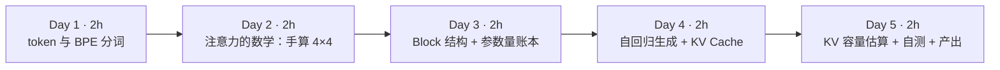
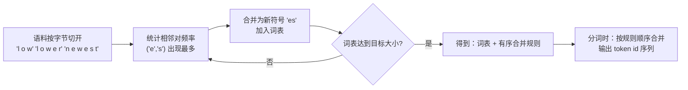
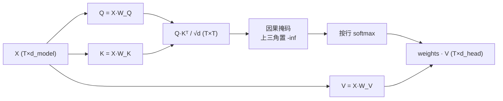
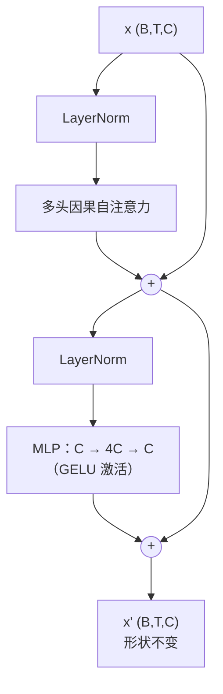
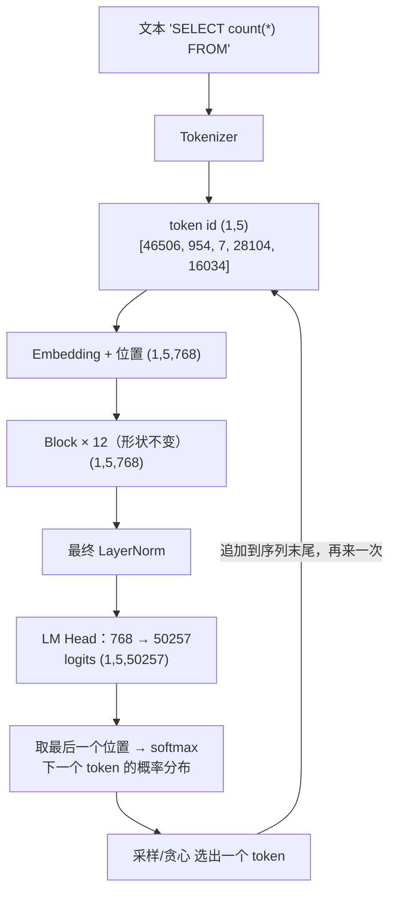
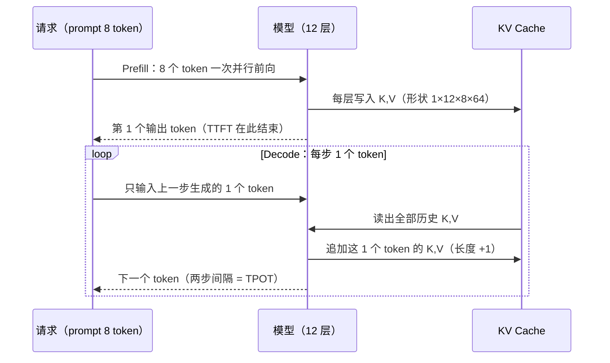
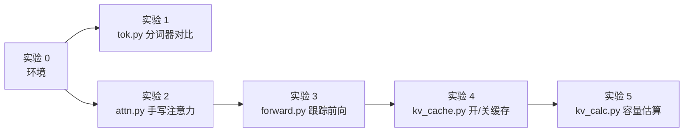

=== m1w2 | 第 2 周：Transformer、token 与 KV Cache | 第 1 月 · Python + LLM 原理
# 第 2 周：Transformer、token 与 KV Cache

> **本周一句话**：把 LLM 当成一个“查询引擎”来拆解——输入是 token 序列，执行计划是几十层一模一样的 Transformer Block，每生成一个 token 就是一次“查询”；而 **KV Cache** 就是这个引擎为了避免重复计算而维护的“物化中间结果”。弄懂它，后面 vLLM、PagedAttention、PD 分离、显存估算全都是在它之上做文章。

**预计投入：约 10 小时**（阅读 ≈ 4h，动手 ≈ 4h，自测与产出 ≈ 2h），可分 5 天完成。{{local}}

**本周结束时你应该能：**

1. 说清楚 token 是什么、BPE 分词器怎么把文本切成 token，以及为什么同一句中文在不同模型上的 token 数（也就是成本和上下文占用）能差 2～3 倍。
2. 不看资料画出 decoder-only Transformer 的一次前向：token id → embedding → N 个 Block（注意力 + MLP + 残差 + 归一化）→ logits → 采样，并标出每一步的张量形状。
3. 手算一个 4×4 的因果自注意力（Q·Kᵀ、缩放、掩码、softmax、加权求和），并用代码与 PyTorch 官方实现对数。
4. 解释推理的 Prefill / Decode 两阶段、KV Cache 为什么能把每步计算从“重算整个序列”变成“只算一个 token”，以及它为什么让显存随上下文长度和并发数线性增长。
5. 只看一个模型的 `config.json`，算出每个 token 的 KV Cache 字节数，并估算一张卡能同时服务多少个长上下文请求。

> **验证说明**：本页所有命令和输出都在一台 Linux x86_64 机器（8 核 CPU、无 GPU、Python 3.12.15、torch 2.14.1+cpu、transformers 5.20.2、tiktoken 0.14.0、numpy 2.5.4）上实际运行过，输出是真实结果，只删掉了下载进度条和警告行。你在 Mac 上的**耗时数字会不同**，但 token 数、张量形状、字节数和“开缓存 vs 关缓存结果一致”这些结论应当完全相同。实验代码也放在本站仓库的 `labs/w2/` 目录。

---

## 1. 本周学习路线



| 天 | 时间 | 先读（概念） | 再读（外部资料，按顺序） | 再做（实验） |
|---|---|---|---|---|
| Day 1 | ~2h | 本页 2.1、2.2 | ① [Hugging Face LLM Course 第 6 章：Byte-Pair Encoding tokenization](https://huggingface.co/learn/llm-course/chapter6/5) 全文（30 分钟，手跟一遍合并过程）；② [happy-llm 第五章](https://github.com/datawhalechina/happy-llm/tree/main/docs/chapter5) 的 *5.2 训练 Tokenizer* 中 *5.2.1～5.2.3* 三小节（20 分钟） | 实验 0：环境；实验 1：分词器对比 |
| Day 2 | ~2h | 本页 2.3、2.4 | ③ [The Illustrated Transformer](https://jalammar.github.io/illustrated-transformer/) 从开头读到 *The Residuals* 之前（40 分钟，重点是 *Self-Attention in Detail* 和 *Matrix Calculation of Self-Attention*）；④ [happy-llm 第二章](https://github.com/datawhalechina/happy-llm/tree/main/docs/chapter2) *2.1.1～2.1.6*（注意力、自注意力、掩码自注意力、多头注意力）（30 分钟） | 实验 2：手写注意力并对数 |
| Day 3 | ~2h | 本页 2.5、2.6 | ⑤ [The Illustrated GPT-2](https://jalammar.github.io/illustrated-gpt2/) 的 *Part 1* 和 *Part 2* 前半（40 分钟）；⑥ [nanoGPT model.py](https://github.com/karpathy/nanoGPT/blob/master/model.py) 读 `CausalSelfAttention`、`MLP`、`Block`、`GPT.forward` 四段（约 150 行，30 分钟） | 实验 3：跟踪 GPT-2 一次前向 |
| Day 4 | ~2h | 本页 2.7 | ⑦ [transformers 文档：Caching](https://huggingface.co/docs/transformers/en/cache_explanation)（20 分钟）；⑧ [Attention Is All You Need](https://arxiv.org/abs/1706.03762) 只看图 1、第 3.2 节（*Attention*）和公式 (1)（20 分钟） | 实验 4：开/关 KV Cache |
| Day 5 | ~2h | 本页 2.8 | ⑨ [GQA 论文](https://arxiv.org/abs/2305.13245) 只读摘要和图 2（15 分钟）；⑩ 打开 [Qwen2.5-7B-Instruct 的 config.json](https://huggingface.co/Qwen/Qwen2.5-7B-Instruct/blob/main/config.json) 对照本页公式（10 分钟） | 实验 5：KV 容量计算器；自测题；本周产出 |

> **读书版本提醒**：《The Illustrated Transformer》讲的是原论文的 **Encoder-Decoder** 结构（用于翻译）；今天的 GPT、Llama、Qwen 都是 **Decoder-only**——只保留 Decoder 那一半，并且去掉了“编码器-解码器注意力”。读到 Encoder 部分时，把注意力放在“自注意力怎么算”上，结构图以本页 2.6 节为准。

**每日打卡：**

- [ ] Day 1：读完 ①②，完成实验 0、1，能解释“为什么 GPT-2 切中文比 Qwen 多出近 3 倍 token”
- [ ] Day 2：读完 ③④，完成实验 2，能在纸上手算一行注意力权重
- [ ] Day 3：读完 ⑤⑥，完成实验 3，手算出 GPT-2 的参数量 ≈ 124M
- [ ] Day 4：读完 ⑦⑧，完成实验 4，能解释开缓存为什么快 3 倍以上且结果不变
- [ ] Day 5：完成实验 5、自测题、本周产出（KV Cache 笔记初稿）

---

## 2. 核心概念讲解

### 2.1 为什么架构师要关心 token

在大数据平台上，你习惯的计量单位是**行、字节、分区**：存储按 TB 计费，作业按 vCore·小时计费，SLA 按“T+1 几点前产出”约定。到了 LLM 平台，几乎所有指标的计量单位都换成了 **token**：

| 你熟悉的（大数据） | LLM 平台对应的 | 为什么重要 |
|---|---|---|
| 扫描数据量（字节） | 输入 token 数（prompt tokens） | API 按百万 token 计费；Prefill 计算量正比于输入 token 数 |
| 输出行数 | 输出 token 数（completion tokens） | 输出 token 通常比输入贵；Decode 一步只出一个 token，决定生成时长 |
| 单条 SQL 的最大扫描量 / 单行最大长度 | 上下文窗口（context length，例如 32K、128K） | 超过就报错或被截断；KV Cache 显存正比于它 |
| 吞吐（行/秒） | tokens/s（吞吐）、TTFT（首 token 延迟）、TPOT（每个输出 token 的间隔） | 推理服务 SLA 用这三个指标定义（第 4 月细讲） |
| 压缩比（ORC/Parquet） | “字符/token”比 | 同样的文本，分词器越适配语言，token 越少，越便宜，能塞进上下文的内容越多 |

所以 token 不是一个“NLP 细节”，而是**容量规划和成本核算的基本单位**。本周实验 1 会看到：同一句 32 个字符的中文，GPT-2 分词器切出 38 个 token，Qwen2.5 只切 13 个——在其他条件相同时，这意味着用前者处理中文要多算近 3 倍、多占近 3 倍 KV Cache。

### 2.2 分词：BPE 是一种“基于频率的字典编码”

**机制**：计算机里的文本是字节序列（UTF-8 中一个汉字通常占 3 字节）。模型不能直接吃字节或汉字，它需要一个**固定大小的词表**（vocabulary），把文本映射成整数 id 序列。

- 如果词表 = 所有单词：词表会无限大，遇到新词（“OrbStack”）就不认识。
- 如果词表 = 256 个字节：永远不会有不认识的词，但序列会很长（一个汉字 3 个 token），计算量和上下文占用都很大。

**BPE（Byte-Pair Encoding）** 是折中：从 256 个字节出发，在一个大语料上反复统计“哪两个相邻符号一起出现最频繁”，就把它们**合并成一个新符号**加入词表，直到词表达到目标大小（GPT-2 是 50257，Qwen2.5 是约 15 万）。分词时按学到的合并规则依次合并。



**类比**：这和你熟悉的 **Parquet/ORC 字典编码** 是同一个思想——高频出现的值用一个短编码表示。区别在于字典编码是对**整列值**建字典，BPE 是对**子串**建字典，且字典在训练模型之前就定死了，之后不能改（改了 id 就和模型权重对不上）。

**几个直接后果**（实验 1 会全部看到）：

1. **语料决定效率**。GPT-2 的分词器主要在英文网页上训练，中文常用词几乎没有被合并，一个汉字经常被拆成 2～3 个字节级 token（实验 1 里“大”是 1 个 token，“数”被拆成 2 个，“据”被拆成 3 个）。Qwen 的词表包含大量中文词（“大数据”“架构”“转型”都是单个 token）。
2. **数字的切法影响算术能力和计数**。Qwen2.5 把数字逐位切开（“2026”是 4 个 token），GPT-2 会把几位数字合成一个 token。这是分词器设计者的有意选择，不是 bug。
3. **空格是 token 的一部分**。`" count"`（带前导空格）和 `"count"` 是两个不同的 token。这就是为什么 prompt 末尾多一个空格有时会改变输出。
4. **分词器与模型是绑定的**。不同模型的 token id 互不通用；平台上做“按 token 计费/限流”时，必须用**目标模型自己的分词器**计数，不能拿 tiktoken 估 Qwen 的成本。

### 2.3 从 token id 到向量：Embedding 与张量形状

**机制**：token id 只是整数，模型首先要查一张表——**Embedding 矩阵**，形状 `(vocab_size, d_model)`。GPT-2 small 是 `(50257, 768)`：每个 token id 对应一行 768 维的浮点向量。再加上**位置向量**（GPT-2 用另一张可学习的 `(1024, 768)` 表，最多 1024 个位置；Llama/Qwen 改用 RoPE 旋转位置编码，不再是一张表），得到形状为 `(batch, seq_len, d_model)` 的张量，送入后面的 Block。

**类比**：Embedding 就是一次 **维表 Join**——事实表里只有 `token_id`，Join 上一张 50257 行 × 768 列的维表，把 id 换成一组“属性”。只不过这张维表的属性值不是人填的，而是训练时通过反向传播学出来的。

从这里开始，**形状**是读懂一切 LLM 代码的钥匙。记住三个字母：`B`（batch，一次处理几条序列）、`T`（序列长度，token 数）、`C` 或 `d_model`（隐藏维度）。整个 Transformer 主干里张量形状一直是 `(B, T, C)`，只有最后一步投影到词表时变成 `(B, T, vocab)`。实验 3 会把它们逐个打印出来。

### 2.4 自注意力：一次“软”的自连接查询

这是本周最重要的一节，请拿出纸笔。

**直觉**：读到“他把**它**放进了冰箱”时，要理解“它”，你会回头看前文找“它”指什么。自注意力就是让每个 token **回头看**它之前的所有 token，按“相关程度”加权汇总它们的信息。

**机制（单头）**：输入 `X` 形状 `(T, d_model)`。用三个可学习矩阵 `W_Q, W_K, W_V`（各 `d_model × d_head`）得到：

- `Q = X·W_Q`（Query，“我在找什么”）
- `K = X·W_K`（Key，“我能被怎样找到”）
- `V = X·W_V`（Value，“被找到后我提供什么内容”）

然后：

```text
scores  = Q · Kᵀ / sqrt(d_head)        # (T, T)，第 i 行 j 列 = token i 对 token j 的相关度
scores[j > i] = -inf                    # 因果掩码：不许看未来
weights = softmax(scores, 按行)         # 每行变成和为 1 的权重
output  = weights · V                   # (T, d_head)，每个 token 得到一个加权汇总
```

这就是论文公式 (1)：`Attention(Q,K,V) = softmax(QKᵀ/√d_k)·V`。



**数据库类比（建议记住）**：把它想成一次**自连接（self-join）+ 加权聚合**：

```sql
-- 伪 SQL：每个 token i 作为“查询”，去和 j <= i 的所有 token 做“模糊连接”
SELECT q.pos,
       SUM(softmax_weight(dot(q.query, k.key)) * k.value)  -- 加权求和，而不是精确匹配
FROM tokens q JOIN tokens k ON k.pos <= q.pos               -- 因果掩码 = 连接条件
GROUP BY q.pos;
```

普通 Join 是“键相等才匹配（权重 0 或 1）”，注意力是“每对都匹配，按相似度给 0～1 的权重”。`ON k.pos <= q.pos` 就是因果掩码。这个 Join 是 **T × T** 的——这正是注意力计算量随序列长度**平方**增长的原因，也是长上下文贵的根源。

**手算示例（实验 2 的真实数字）**：T=4，第 2 个 token（下标 1）的掩码后分数只有前两个有效。设它们 softmax 后为 `[0.705, 0.295, 0, 0]`，含义是：token 1 的输出 = 0.705 × V₀ + 0.295 × V₁。第 0 个 token 只能看自己，权重恒为 `[1, 0, 0, 0]`。

**为什么除以 √d_head**：Q、K 的每个分量大致是方差为 1 的随机数时，点积的方差约为 `d_head`。不缩放的话，`d_head=128` 时分数动辄几十，softmax 会退化成接近 one-hot，梯度几乎为 0、训练不动。除以 √d 让分数方差回到 1 左右。

**多头（Multi-Head）**：实际模型把 `d_model` 切成 `n_head` 份并行做上面的计算（GPT-2 small：12 头 × 64 维 = 768），每个头可以关注不同类型的关系（语法、指代、位置……），最后拼接起来再乘一个输出矩阵 `W_O`。计算上，这只是在张量里多了一个“头”维度：`(B, n_head, T, d_head)`——实验 4 打印的 KV Cache 形状就是这个。

**GQA（分组查询注意力）**：Llama 2 70B、Llama 3、Qwen2.5 等模型让**多个 Query 头共享一组 K/V 头**。例如 Qwen2.5-7B 有 28 个 Query 头，但只有 4 个 KV 头（7 个 Q 头共享一组 K/V）。效果几乎不降，KV Cache 却缩小到 1/7。记住：**算 KV Cache 时用的是 `num_key_value_heads`，不是 `num_attention_heads`**——这是显存估算里最常见的错误。

### 2.5 Transformer Block：注意力 + MLP + 残差 + 归一化

一个 decoder-only 模型就是**同一种 Block 堆叠 N 次**（GPT-2 small 12 层，Qwen2.5-7B 28 层，Llama 3 70B 80 层）。GPT-2 风格（Pre-LN）的一个 Block：



- **注意力**负责“token 之间交换信息”（跨行计算）。
- **MLP**（前馈网络）对每个 token **独立**做非线性变换（逐行计算），通常认为模型的大量“知识”存储在这里。
- **残差连接**（`x + f(x)`）：让信号和梯度可以绕过每一层直通，几十上百层才训练得动。
- **LayerNorm / RMSNorm**：把每个 token 的向量归一化到稳定的尺度。Llama/Qwen 用更省计算的 RMSNorm，MLP 用 SwiGLU（3 个矩阵而不是 2 个），位置编码用 RoPE——这些是“同一骨架上的零件升级”，happy-llm 第五章 *5.1* 用代码逐个实现了它们。

**类比**：一个 Block 像 ETL 管线里的一个 stage：注意力是一次“窗口函数”（每行看同一序列里之前的行），MLP 是一次“逐行 UDF”，残差是“保留原列，新结果作为增量加上去”。N 个 Block 就是 N 个 stage 串联，**每个 stage 的输入输出 schema 完全一样**（`(B,T,C)`），所以可以无限堆叠——这也是第 5 月“流水线并行”能按层切分模型的前提。

**参数量账本（以 GPT-2 small 为例，请手算一遍）**：设 `C = 768`、`V = 50257`、层数 `L = 12`。

| 部分 | 计算 | 参数量 |
|---|---|---|
| 词嵌入 wte | V × C = 50257 × 768 | 38,597,376 |
| 位置嵌入 wpe | 1024 × 768 | 786,432 |
| 每层注意力 | Q/K/V 三个 C×C + 输出 C×C = 4C² | 2,359,296 |
| 每层 MLP | C×4C + 4C×C = 8C² | 4,718,592 |
| 每层合计（忽略偏置和 LN） | 12C² | 7,077,888 |
| 12 层 | 12 × 12C² | 84,934,656 |
| 输出层 lm_head | 与 wte **共享权重**（weight tying） | 0 |
| **合计** | 38.6M + 0.8M + 84.9M + 偏置/LN ≈ | **≈ 124.4M** |

实验 4 会打印 `参数量=124.4M`，和手算吻合。这个 `每层 ≈ 12·C²` 的经验式非常好用：给你一个 `hidden_size=4096、32 层` 的模型，`12 × 4096² × 32 ≈ 6.4B`，再加上嵌入，就是 “7B” 量级——不过要注意 GQA 会让注意力部分小于 4C²，SwiGLU 会让 MLP 部分不等于 8C²，精确值请以模型卡为准。

### 2.6 一次前向：从文本到“下一个 token”



注意 logits 的形状是 `(1, 5, 50257)`——**每个位置**都预测了“它后面的 token”。训练时 5 个位置的预测都用来算 loss（一次前向得到 T 个训练样本，这是 Transformer 训练高效的原因之一，下周细讲）；推理时只用最后一个位置。

### 2.7 自回归生成：Prefill、Decode 与 KV Cache

**问题**：生成是一个 token 一个 token 进行的。生成第 101 个 token 时，模型需要第 1～100 个 token 在每一层的 K 和 V。如果每一步都把整个序列重新前向一遍，第 t 步的计算量正比于 t，生成 n 个 token 的总计算量正比于 n²——而且 t-1 个旧 token 的 K、V **每一步算出来都一模一样**（因果掩码保证了旧 token 看不到新 token，所以它们的 K/V 不会变）。

**解法**：把每层算过的 K、V 存起来，这就是 **KV Cache**。生成新 token 时，只需对这**一个**新 token 算 Q、K、V，把新的 K、V 追加进缓存，然后用新 Q 和缓存里**全部**的 K、V 做注意力。实验 2 的最后一行用 NumPy 证明了这一点：只用最后一行 Q + 完整 K/V，算出的结果和全量计算误差只有 1e-8。



**两阶段的性格截然不同**：

| | Prefill（处理 prompt） | Decode（逐个生成） |
|---|---|---|
| 每步处理 token 数 | 整个 prompt（几百到几万） | 1（每条请求） |
| 主要计算 | 大矩阵 × 大矩阵（GEMM） | 向量 × 大矩阵（GEMV） |
| 瓶颈 | **算力**（compute-bound） | **显存带宽**（memory-bound）：每步都要把全部权重 + 全部 KV Cache 从显存读一遍 |
| 决定的指标 | TTFT（首 token 延迟） | TPOT（每个输出 token 的间隔） |
| 大数据类比 | 一次大批量扫描 + 聚合（批处理） | 高频点查询（OLTP 风格），每次查询都要“扫一遍索引” |

**Decode 为什么受带宽限制（一个估算）**：一个 7B 参数的 BF16 模型权重约 14 GB。Decode 每步（batch=1）都要把这 14 GB 从显存读进计算单元，却只做约 2 × 7×10⁹ = 1.4×10¹⁰ 次浮点运算（每个参数一次乘加 ≈ 2 FLOPs）。即使显存带宽有 3 TB/s，光读权重就要约 14 GB ÷ 3 TB/s ≈ 4.7 ms，此时算力绝大部分在空等数据。所以推理优化的核心思路是**一次读权重、服务很多请求**——把多个请求拼成一个 batch（第 4 月的 continuous batching），而这又要求显存里放得下这么多请求的 KV Cache。KV Cache 于是成为推理服务的**头号显存消费者和并发上限**。

**KV Cache 大小公式**（请背下来）：

```text
每个 token 的 KV 字节 = 2（K 和 V）× 层数 L × KV 头数 H_kv × 每头维度 d_head × 每元素字节数
一批请求的 KV 字节   = 每 token 字节 × 序列长度 T × 并发请求数 B
```

**算例 1（实验 4 实测验证）**：GPT-2 small，L=12，H_kv=12，d_head=64，fp32（4 字节），prompt 8 个 token：`2 × 12 × 12 × 64 × 8 × 4 = 589,824 字节`，与 PyTorch 里缓存张量的实际字节数**完全一致**。

**算例 2（真实生产模型）**：Qwen2.5-7B-Instruct 的 `config.json`：`num_hidden_layers=28`、`num_attention_heads=28`、`num_key_value_heads=4`、`hidden_size=3584`，所以 `d_head = 3584 / 28 = 128`。BF16 下：

- 每 token：2 × 28 × 4 × 128 × 2 = **57,344 字节 = 56 KiB**
- 一条 32K 上下文的请求：56 KiB × 32768 = **1.75 GiB**
- 权重约 7.6B × 2 字节 ≈ 15 GB；在一张 24 GB 卡上，扣掉权重和运行时开销后大约只剩几 GB 给 KV Cache——也就是说**满 32K 上下文的请求只能同时放下寥寥几条**。
- 如果没有 GQA（KV 头数 = 28），每 token 就是 392 KiB，同样的显存只能放 1/7 的请求。

**类比**：KV Cache 就像 OLAP 引擎为每个**活跃会话**维护的中间结果缓存——会话越多、每个会话越长，缓存越大；缓存满了就只能拒绝新会话、或者把旧会话换出（vLLM 里叫 preemption）。第 13 周的 PagedAttention 解决的正是“这块缓存怎么像操作系统分页一样管理、避免碎片”的问题。

### 2.8 用 config.json 做容量规划（架构师的日常）

把 2.5 和 2.7 合起来，你已经可以只凭一个 `config.json` 回答架构评审中的典型问题：

1. **权重多大？** 参数量 × 每参数字节（BF16=2，INT8=1，INT4≈0.5）。
2. **每 token 的 KV 多大？** 用 2.7 的公式，注意用 `num_key_value_heads`。
3. **一张卡能扛多少并发？** `(显存 − 权重 − 运行时预留) ÷ (每 token KV × 平均上下文长度)`。
4. **上下文翻倍会怎样？** KV 翻倍、可支持并发减半；Prefill 中注意力部分的计算量变为约 4 倍（T²）。

实验 5 把这几步写成一个小脚本。第 4 周会在此基础上加上训练显存估算，第 4 月部署 vLLM 时你会在启动日志里看到它打印的 “KV cache 可容纳多少 token”，届时可以和你的估算对照。

---

## 3. 动手实验 {{local}}

所有实验在 `~/ai-infra-lab/w2/` 下完成。不需要 GPU；GPT-2 small 在 CPU 上推理很快。实验 1、3、4 第一次运行时会从 Hugging Face 下载分词器和 GPT-2 权重（约 550 MB），国内网络如访问不畅，可设置环境变量 `HF_ENDPOINT=https://hf-mirror.com`（镜像站，非官方）。



### 实验 0：建环境（15 分钟）

沿用第 1 周的 `~/ai-infra-lab/.venv`（Python 3.12），追加安装：

```bash
cd ~/ai-infra-lab && source .venv/bin/activate && mkdir -p w2 && cd w2
# Mac 上直接装 PyPI 的 torch 即可（自带 MPS 支持）；Linux 无 GPU 机器可加 --index-url https://download.pytorch.org/whl/cpu 装纯 CPU 版
uv pip install torch "transformers==5.20.2" "tiktoken==0.14.0"
python -c "import sys,torch,transformers,tiktoken,numpy;print(sys.version.split()[0],torch.__version__,transformers.__version__,tiktoken.__version__,numpy.__version__)"
```

**本站输出**：

```text
3.12.15 2.14.1+cpu 5.20.2 0.14.0 2.5.4
```

Mac 上 torch 版本号不带 `+cpu` 后缀，属正常。

### 实验 1：三种分词器对比（30 分钟）

`tok.py`：

```python
"""对比三种分词器：GPT-2（2019）、o200k_base（GPT-4o 系列）、Qwen2.5（中文友好）。"""
import tiktoken
from transformers import AutoTokenizer

TEXTS = {
    "英文": "The quick brown fox jumps over the lazy dog.",
    "中文": "大数据架构师转型 AI Infra，需要理解 KV Cache。",
    "SQL": "SELECT city, count(DISTINCT user_id) FROM events GROUP BY city;",
    "数字": "2026-10-20 12345678.90",
}

gpt2 = tiktoken.get_encoding("gpt2")
o200k = tiktoken.get_encoding("o200k_base")
qwen = AutoTokenizer.from_pretrained("Qwen/Qwen2.5-0.5B")  # 只下载分词器文件（几 MB）

print(f"词表大小: gpt2={gpt2.n_vocab} o200k={o200k.n_vocab} qwen2.5={len(qwen)}")
print(f"{'类型':<4} {'字符':>4} {'UTF8字节':>8} {'gpt2':>5} {'o200k':>6} {'qwen':>5}")
for name, s in TEXTS.items():
    n_g, n_o, n_q = len(gpt2.encode(s)), len(o200k.encode(s)), len(qwen.encode(s))
    print(f"{name:<4} {len(s):>5} {len(s.encode()):>9} {n_g:>5} {n_o:>6} {n_q:>5}")

s = TEXTS["中文"]
print("\nGPT-2 前 8 个 token 的字节:", [gpt2.decode_single_token_bytes(t) for t in gpt2.encode(s)[:8]])
print("Qwen 的切分:", [qwen.decode([i]) for i in qwen.encode(s)])
print("Qwen 切数字:", [qwen.decode([i]) for i in qwen.encode(TEXTS["数字"])][:12])
```

```bash
python tok.py
```

**本站输出**：

```text
词表大小: gpt2=50257 o200k=200019 qwen2.5=151665
类型     字符   UTF8字节  gpt2  o200k  qwen
英文      44        44    10     10    10
中文      32        60    38     14    13
SQL     63        63    19     16    16
数字      22        22    11     12    22

GPT-2 前 8 个 token 的字节: [b'\xe5\xa4\xa7', b'\xe6\x95', b'\xb0', b'\xe6', b'\x8d', b'\xae', b'\xe6', b'\x9e']
Qwen 的切分: ['大数据', '架构', '师', '转型', ' AI', ' Inf', 'ra', '，', '需要', '理解', ' KV', ' Cache', '。']
Qwen 切数字: ['2', '0', '2', '6', '-', '1', '0', '-', '2', '0', ' ', '1']
```

**逐步解释**：

- **英文三家都是 10 个 token**：常见英文单词在每个词表里都是单个 token（带前导空格）。
- **中文差距巨大**：32 个字符（60 字节 UTF-8），GPT-2 切成 38 个 token——比字符数还多；o200k（GPT-4o 时代的新词表，20 万词）和 Qwen 都只要 13～14 个。看“GPT-2 前 8 个 token 的字节”：`b'\xe5\xa4\xa7'` 是完整的“大”（3 字节），而“数”被拆成 `b'\xe6\x95'` + `b'\xb0'` 两个 token，“据”被拆成 3 个单字节 token。这些单个 token 解码出来不是合法汉字，只有拼起来才是。
- **SQL**：GPT-2 把 `DISTINCT` 切成 `D / IST / IN / CT` 4 段（大写关键字在网页语料里不常见）；新词表处理代码更好。
- **数字反过来了**：Qwen 逐位切数字（22 个字符 → 22 个 token），这是为了让模型做算术时每一位对齐。所以“哪个分词器更省”取决于你的数据——日志、ID、金额多的数据，要用真实样本测。
- `len(qwen)`（151665）是包含特殊 token 的总数；配置文件里的 `vocab_size` 可能更大（为了对齐矩阵尺寸预留了空位），以模型卡为准。

### 实验 2：用 NumPy 手写因果自注意力（40 分钟）

`attn.py`：

```python
"""用 NumPy 手写因果自注意力（单头），再与 PyTorch 官方实现对数。"""
import numpy as np
import torch
import torch.nn.functional as F

rng = np.random.default_rng(0)
T, d_model, d_head = 4, 8, 4            # 4 个 token，隐藏维 8，单头维度 4
x = rng.standard_normal((T, d_model)).astype(np.float32)   # 已经过 embedding 的输入
Wq, Wk, Wv = (rng.standard_normal((d_model, d_head)).astype(np.float32) * 0.5 for _ in range(3))

Q, K, V = x @ Wq, x @ Wk, x @ Wv        # 每个 (T, d_head)
scores = Q @ K.T / np.sqrt(d_head)      # (T, T)：第 i 行 = token i 对所有 token 的“相关度”
mask = np.triu(np.ones((T, T), dtype=bool), k=1)   # 上三角 = 未来位置
scores[mask] = -np.inf                  # 因果掩码：不许看未来
w = np.exp(scores - scores.max(axis=1, keepdims=True))
w = w / w.sum(axis=1, keepdims=True)    # softmax，每行和为 1
out = w @ V                             # (T, d_head)：按权重对 V 加权求和

np.set_printoptions(precision=3, suppress=True)
print("注意力权重（行=查询 token，列=被看的 token）:\n", w)
ref = F.scaled_dot_product_attention(torch.from_numpy(Q)[None], torch.from_numpy(K)[None],
                                     torch.from_numpy(V)[None], is_causal=True)[0].numpy()
print("与 PyTorch SDPA 最大误差:", float(np.abs(out - ref).max()))

# KV Cache 的本质：第 T 个 token 的输出只依赖 q_T 和 全部 K、V
q_last = Q[-1:]                          # 只算最后一个 token 的 Q
s_last = q_last @ K.T / np.sqrt(d_head)
w_last = np.exp(s_last - s_last.max()); w_last /= w_last.sum()
print("只用最后一行 Q + 缓存的 K/V 重算最后一个输出，误差:", float(np.abs(w_last @ V - out[-1]).max()))
```

**本站输出**：

```text
注意力权重（行=查询 token，列=被看的 token）:
 [[1.    0.    0.    0.   ]
 [0.705 0.295 0.    0.   ]
 [0.601 0.067 0.332 0.   ]
 [0.14  0.283 0.216 0.361]]
与 PyTorch SDPA 最大误差: 8.798115302965925e-08
只用最后一行 Q + 缓存的 K/V 重算最后一个输出，误差: 1.4740495934972841e-08
```

**逐步解释**：

- 权重矩阵是**下三角**的：右上角全是 0，这就是因果掩码的效果；每一行之和为 1（softmax）。第 0 行恒为 `[1,0,0,0]`——第一个 token 只能看自己。
- `scores - scores.max(...)`：softmax 的标准数值稳定写法，先减去每行最大值再取 exp，避免溢出，结果不变。`exp(-inf) = 0`，所以被掩码的位置权重严格为 0。
- 与 `F.scaled_dot_product_attention(..., is_causal=True)` 的误差在 1e-7 量级，说明手写版本正确。这个 PyTorch 函数在 GPU 上会自动选 FlashAttention 等高效内核——**算的是同一个公式，只是不把 T×T 矩阵完整写进显存**（第 4 月会再见到）。
- 最后一行是本周的关键证明：**最后一个 token 的输出，只需要它自己的 Q 和所有 token 的 K、V**。前面 token 的 Q 不再需要——所以缓存只存 K 和 V，叫 “KV” Cache 而不是 “QKV” Cache。

**动手改一改**：把 `mask` 那一行注释掉再运行，观察第 0 行不再是 `[1,0,0,0]`，与 SDPA 的误差变大——你刚刚实现了一个“会偷看答案”的 BERT 式双向注意力。

### 实验 3：跟踪 GPT-2 的一次前向（30 分钟）

`forward.py`：

```python
"""跟踪 GPT-2 一次前向：每一步的张量形状，以及下一个 token 的概率。"""
import torch
from transformers import AutoModelForCausalLM, AutoTokenizer

tok = AutoTokenizer.from_pretrained("openai-community/gpt2")
m = AutoModelForCausalLM.from_pretrained("openai-community/gpt2").eval()
ids = tok("SELECT count(*) FROM", return_tensors="pt").input_ids
print("① token id:", ids.tolist(), "->", [tok.decode([i]) for i in ids[0]])
with torch.no_grad():
    pos = torch.arange(ids.shape[1])
    h = m.transformer.wte(ids) + m.transformer.wpe(pos)          # 词向量 + 位置向量
    print("② embedding 后:", tuple(h.shape))
    for i, blk in enumerate(m.transformer.h):
        out = blk(h)
        h = out[0] if isinstance(out, tuple) else out   # 不同 transformers 版本返回 tuple 或 Tensor
        if i in (0, 11):
            print(f"③ 第 {i:>2} 个 Block 后:", tuple(h.shape))
    h = m.transformer.ln_f(h)
    logits = m.lm_head(h)                                        # 投影回词表
    print("④ logits:", tuple(logits.shape))
    p = logits[0, -1].softmax(-1)
    top = p.topk(5)
    print("⑤ 下一个 token 候选:", [(tok.decode([int(i)]), round(float(v), 3)) for v, i in zip(top.values, top.indices)])
    ref = m(ids).logits
    print("与 model(ids) 直接调用的最大误差:", float((ref - logits).abs().max()))
```

**本站输出**：

```text
① token id: [[46506, 954, 7, 28104, 16034]] -> ['SELECT', ' count', '(', '*)', ' FROM']
② embedding 后: (1, 5, 768)
③ 第  0 个 Block 后: (1, 5, 768)
③ 第 11 个 Block 后: (1, 5, 768)
④ logits: (1, 5, 50257)
⑤ 下一个 token 候选: [(' (', 0.033), (' t', 0.025), (" '", 0.016), (' r', 0.012), (' g', 0.012)]
与 model(ids) 直接调用的最大误差: 0.0
```

**逐步解释**：

- ① `*)` 被合成了一个 token——BPE 只看频率，不懂 SQL 语法。
- ②③ 进入 Block 之后形状一直是 `(1, 5, 768)`，12 个 Block 首尾形状相同（2.5 节“schema 不变的 stage”）。
- ④ logits 每个位置都有 50257 个分数；我们只取最后一个位置。
- ⑤ 最高的候选概率只有 3.3%：GPT-2 small 很小、训练数据里 SQL 不多，所以“FROM 后面接表名”这件事它把握不大。这是**基座模型**原始的概率分布，没有任何“对话”能力。
- 最后一行误差为 0：说明我们手动拆开的步骤和 `model(ids)` 内部做的完全一样。以后读任何模型源码，都可以用这个“拆开再对数”的方法验证理解。

### 实验 4：KV Cache 开与关（40 分钟）

`kv_cache.py`：

```python
"""用真实的 GPT-2（124M）观察 KV Cache：形状、字节数、开/关缓存的速度差。"""
import time

import torch
from transformers import AutoModelForCausalLM, AutoTokenizer

torch.manual_seed(0)
torch.set_num_threads(4)
tok = AutoTokenizer.from_pretrained("openai-community/gpt2")
model = AutoModelForCausalLM.from_pretrained("openai-community/gpt2").eval()
cfg = model.config
print(f"层数={cfg.n_layer} 头数={cfg.n_head} 隐藏维={cfg.n_embd} 每头维度={cfg.n_embd // cfg.n_head}")
print(f"参数量={sum(p.numel() for p in model.parameters()) / 1e6:.1f}M")

ids = tok("The data warehouse architect opened the notebook and", return_tensors="pt").input_ids
print("prompt token 数:", ids.shape[1])

# ① 一次前向（prefill），拿到缓存
with torch.no_grad():
    out = model(ids, use_cache=True)
kv = out.past_key_values
k0 = kv.layers[0].keys if hasattr(kv, "layers") else kv[0][0]
print("第 0 层 K 的形状 (batch, 头数, 序列长度, 每头维度):", tuple(k0.shape), k0.dtype)


def cache_bytes(cache) -> int:
    layers = cache.layers if hasattr(cache, "layers") else cache
    return sum(l.keys.numel() * l.keys.element_size() + l.values.numel() * l.values.element_size()
               if hasattr(l, "keys") else l[0].nbytes + l[1].nbytes for l in layers)


T = ids.shape[1]
formula = 2 * cfg.n_layer * cfg.n_head * (cfg.n_embd // cfg.n_head) * T * 1 * 4
print(f"实测缓存字节={cache_bytes(kv)}  公式 2×L×H×d×T×B×4字节={formula}")

# ② 生成 200 个新 token：开缓存 vs 关缓存（贪心解码，结果应完全相同）
for use_cache in (True, False):
    t = time.perf_counter()
    with torch.no_grad():
        g = model.generate(ids, max_new_tokens=200, min_new_tokens=200, do_sample=False,
                           use_cache=use_cache, pad_token_id=tok.eos_token_id)
    dt = time.perf_counter() - t
    print(f"use_cache={use_cache!s:<5} 生成 200 token 用时 {dt:6.2f}s  ≈{200 / dt:5.1f} token/s  末尾 id={g[0, -5:].tolist()}")
```

**本站输出**：

```text
层数=12 头数=12 隐藏维=768 每头维度=64
参数量=124.4M
prompt token 数: 8
第 0 层 K 的形状 (batch, 头数, 序列长度, 每头维度): (1, 12, 8, 64) torch.float32
实测缓存字节=589824  公式 2×L×H×d×T×B×4字节=589824
use_cache=True  生成 200 token 用时   2.61s  ≈ 76.7 token/s  末尾 id=[262, 749, 6942, 780, 340]
use_cache=False 生成 200 token 用时   8.91s  ≈ 22.4 token/s  末尾 id=[262, 749, 6942, 780, 340]
```

**逐步解释**：

- 缓存张量形状 `(1, 12, 8, 64)` = (batch, 头数, 序列长度, 每头维度)，正是 2.4 节说的多头布局；12 层每层一对 K、V。
- 实测字节数和公式**一字不差**：589,824 字节。这就是你以后估 KV 显存时所用公式的“单元测试”。
- 开缓存比关缓存快约 3.4 倍，且**生成结果完全相同**（末尾 token id 一致）：KV Cache 是纯粹的性能优化，不改变数学结果。序列越长差距越大——关缓存时第 t 步要重算 t 个 token。
- `cache_bytes` 里的 `hasattr` 判断是为了兼容不同版本 transformers 的缓存对象（新版是带 `.layers` 的 `DynamicCache`，旧版是 tuple 的 tuple）。

**动手改一改**：把 `max_new_tokens` 改成 50 和 400，记录两种模式的 token/s。画出“生成长度 vs 速度”的折线，你会看到关缓存模式随长度明显变慢，开缓存模式基本平稳。

### 实验 5：KV Cache 容量计算器（30 分钟）

`kv_calc.py`：读取任意模型的 `config.json`，算权重和 KV 容量。

```python
"""从 config.json 估算：权重大小、每 token KV、给定显存能放多少并发。"""
import argparse
import json
import urllib.request

ap = argparse.ArgumentParser()
ap.add_argument("--model", default="Qwen/Qwen2.5-7B-Instruct")
ap.add_argument("--params-b", type=float, required=True, help="参数量（十亿），以模型卡为准")
ap.add_argument("--gpu-gb", type=float, default=24)
ap.add_argument("--ctx", type=int, default=32768)
ap.add_argument("--reserve-gb", type=float, default=2, help="运行时/激活预留（经验值）")
a = ap.parse_args()

url = f"https://huggingface.co/{a.model}/raw/main/config.json"
c = json.load(urllib.request.urlopen(url))
L, H, Hkv, C = c["num_hidden_layers"], c["num_attention_heads"], c.get("num_key_value_heads", c["num_attention_heads"]), c["hidden_size"]
d = c.get("head_dim") or C // H
kv_tok = 2 * L * Hkv * d * 2                       # BF16 = 2 字节
w_gb = a.params_b * 1e9 * 2 / 2**30
free_gb = a.gpu_gb - w_gb - a.reserve_gb
print(f"{a.model}: L={L} H={H} H_kv={Hkv} d_head={d}")
print(f"权重(BF16) ≈ {w_gb:.1f} GiB；每 token KV = {kv_tok} B = {kv_tok/1024:.0f} KiB")
print(f"单条 {a.ctx} token 请求 KV = {kv_tok*a.ctx/2**30:.2f} GiB")
print(f"{a.gpu_gb:.0f} GB 卡剩余给 KV ≈ {free_gb:.1f} GiB → 约 {int(free_gb*2**30/kv_tok):,} 个 token，"
      f"≈ {free_gb*2**30/(kv_tok*a.ctx):.1f} 条满上下文请求")
if Hkv != H:
    print(f"若没有 GQA（H_kv={H}），每 token KV 将是 {2*L*H*d*2//1024} KiB，是现在的 {H//Hkv} 倍")
```

```bash
python kv_calc.py --params-b 7.61 --gpu-gb 24
python kv_calc.py --model Qwen/Qwen2.5-0.5B --params-b 0.49 --gpu-gb 24
```

（参数量 7.61B、0.49B 取自对应模型卡页面。）

**本站输出**：

```text
Qwen/Qwen2.5-7B-Instruct: L=28 H=28 H_kv=4 d_head=128
权重(BF16) ≈ 14.2 GiB；每 token KV = 57344 B = 56 KiB
单条 32768 token 请求 KV = 1.75 GiB
24 GB 卡剩余给 KV ≈ 7.8 GiB → 约 146,524 个 token，≈ 4.5 条满上下文请求
若没有 GQA（H_kv=28），每 token KV 将是 392 KiB，是现在的 7 倍
Qwen/Qwen2.5-0.5B: L=24 H=14 H_kv=2 d_head=64
权重(BF16) ≈ 0.9 GiB；每 token KV = 12288 B = 12 KiB
单条 32768 token 请求 KV = 0.38 GiB
24 GB 卡剩余给 KV ≈ 21.1 GiB → 约 1,842,636 个 token，≈ 56.2 条满上下文请求
若没有 GQA（H_kv=14），每 token KV 将是 84 KiB，是现在的 7 倍
```

**逐步解释**：

- 脚本只下载几 KB 的 `config.json`，不下载权重。`head_dim` 字段有的模型显式给出（应优先使用），没有时才用 `hidden_size / num_attention_heads` 推算。
- 结论很“架构师”：同一张 24 GB 卡，7B 模型只能放约 4.5 条满 32K 上下文的请求；0.5B 模型能放 56 条。这就是为什么推理平台要按“模型 × 上下文长度 × 并发”做容量规划，而不能只看“模型能不能装下”。
- 这是**粗估**：显卡标称 24 GB 被当作 24 GiB 处理；`--reserve-gb 2` 是假设值；真实框架（vLLM）还会预留 CUDA graph、激活等显存，并按 `gpu_memory_utilization` 比例使用。第 14 周你会拿 vLLM 启动日志里的真实数字回来校准。

### 常见错误与排查

| 现象（真实报错或现象） | 原因 | 解决 |
|---|---|---|
| `OSError: We couldn't connect to 'https://huggingface.co' ...` | 网络访问不到 Hugging Face | 设置 `export HF_ENDPOINT=https://hf-mirror.com`（第三方镜像）后重试；或在能联网时先下载，之后加 `HF_HUB_OFFLINE=1` 离线使用 |
| `ModuleNotFoundError: No module named 'torch'` | 没激活 `.venv` 或装在了别的环境 | `which python`；`source ~/ai-infra-lab/.venv/bin/activate` |
| `AttributeError: 'tuple' object has no attribute 'layers'`（或反过来） | transformers 版本不同，缓存对象类型不同 | 用本页 `hasattr` 写法兼容，或固定 `transformers==5.20.2` |
| 加载模型时打印大量 `Loading weights` 进度条 / 警告 | 正常日志 | 可忽略；`export TRANSFORMERS_VERBOSITY=error` 可静音 |
| Mac 上 `use_cache=False` 慢到难以等待 | CPU 线程数或机器负载不同 | 把 `max_new_tokens` 降到 100；去掉 `torch.set_num_threads(4)` 让 PyTorch 自动选择 |
| 想用 `device="mps"` 时报某个算子不支持 | MPS 后端算子覆盖不全 | 本周实验用 CPU 足够；或设 `PYTORCH_ENABLE_MPS_FALLBACK=1` 让不支持的算子回落到 CPU |
| kv_calc.py 对某些模型 `KeyError: 'num_hidden_layers'` | 该模型的 config 字段名不同（例如多模态模型把文本部分放在 `text_config` 里） | 打开 config.json 找到对应字段，手动填入 |

### 扩展练习（选做，每题 20–40 分钟）

1. **自己训练一个 BPE**：按 HF LLM Course 第 6 章 *Byte-Pair Encoding tokenization* 的代码，在你自己的一批 SQL 文本（几百条即可）上训练一个 500 词的 BPE，看看 `SELECT`、`GROUP BY` 会不会成为单个 token。思考：如果公司要训练一个专门写 SQL 的模型，词表应该怎么定？
2. **测你的业务数据**：拿 100 条真实（脱敏）日志或工单文本，用实验 1 的三种分词器统计“平均 token/字符”。按某个公开 API 的价格表，估算每月处理 1 亿条的成本差异。
3. **多头版注意力**：把实验 2 改成 2 个头（`d_model=8`，每头 4 维），手动切分、分别计算、拼接，再与 `torch.nn.MultiheadAttention` 或 SDPA 的多头输入对数。
4. **手写 KV Cache 生成循环**：不用 `generate`，自己写循环：第一步 `model(ids, use_cache=True)`，之后每步只喂入一个新 token 并传入 `past_key_values`，打印每一步缓存的序列长度。与实验 4 的结果对比 token id 是否一致。
5. **对比 GQA 模型**：用 `kv_calc.py` 计算 `Qwen/Qwen2.5-0.5B`、`Qwen/Qwen2.5-7B-Instruct` 以及 2～3 个你感兴趣的开源模型（看它们 config 里的 `num_key_value_heads`），做一张“每 token KV 字节”表。

---

## 4. 精读指南

### ①② 分词（50 分钟）

- [HF LLM Course：Byte-Pair Encoding tokenization](https://huggingface.co/learn/llm-course/chapter6/5)：**读哪里**：全文，包括 *Training algorithm*、*Tokenization algorithm*、*Implementing BPE*。**重点**：训练阶段和分词阶段是两个不同的过程；“byte-level” BPE 为什么永远不会出现未知 token。**读完回答**：① 合并规则为什么必须**有序**保存？② GPT-2 为什么从 256 个字节而不是从 Unicode 字符起步？
- [happy-llm 第五章](https://github.com/datawhalechina/happy-llm/tree/main/docs/chapter5) *5.2.1～5.2.3*：中文讲解 Word / Character / Subword 三类分词的取舍，包括 BPE、WordPiece、Unigram。**读完回答**：WordPiece 与 BPE 选择合并对的标准有什么不同？

### ③④ 注意力（70 分钟）

- [The Illustrated Transformer](https://jalammar.github.io/illustrated-transformer/)：**读哪里**：开头到 *The Residuals* 之前。**重点**：*Self-Attention in Detail* 的 6 步图、*Matrix Calculation of Self-Attention* 的矩阵形式、*The Beast With Many Heads*。**读完回答**：① 文中 Q、K、V 向量为什么是 64 维而嵌入是 512 维？② 多头注意力最后为什么还要乘一个 `W^O`？
- [happy-llm 第二章](https://github.com/datawhalechina/happy-llm/tree/main/docs/chapter2) *2.1.1～2.1.6*：中文 + PyTorch 代码实现注意力、掩码与多头。**读完回答**：文中掩码用 `torch.triu` 生成上三角矩阵，和本页实验 2 的 `np.triu(..., k=1)` 是不是同一件事？`k=1` 的含义是什么？

### ⑤⑥ GPT 结构与代码（70 分钟）

- [The Illustrated GPT-2](https://jalammar.github.io/illustrated-gpt2/)：**读哪里**：*Part 1: GPT2 And Language Modeling* 和 *Part 2: The Illustrated Self-Attention* 的前半。**重点**：decoder-only 结构、自回归生成、masked self-attention 图解。**读完回答**：作者如何解释“模型每次只输出一个 token”？
- [nanoGPT model.py](https://github.com/karpathy/nanoGPT/blob/master/model.py)：**读哪里**：`CausalSelfAttention.forward`、`MLP`、`Block`、`GPT.forward`。**重点**：`c_attn` 一次性算出 Q/K/V（一个 `C → 3C` 的线性层）；`view(...).transpose(1, 2)` 把形状从 `(B,T,C)` 变成 `(B,nh,T,hs)`；`self.transformer.wte.weight = self.lm_head.weight` 就是 weight tying。**读完回答**：把 `GPT.forward` 里每个张量的形状注释在代码旁边（这是本周产出之一）。

### ⑦⑧ KV Cache 与原论文（40 分钟）

- [transformers 文档：Caching](https://huggingface.co/docs/transformers/en/cache_explanation)：**重点**：缓存如何按层存放 K/V、`DynamicCache` 的含义、为什么“只需计算新 token 的 K/V”。**读完回答**：文中描述的缓存数据结构，与实验 4 打印的形状如何对应？
- [Attention Is All You Need](https://arxiv.org/abs/1706.03762)：只看图 1（左半 Encoder、右半 Decoder）、第 3.2.1 节公式 (1)、第 3.2.2 节多头。**读完回答**：论文里 `d_model=512, h=8`，每头维度是多少？和本页 GPT-2 的 `768/12` 是同一个关系吗？

### ⑨⑩ GQA 与真实 config（25 分钟）

- [GQA 论文](https://arxiv.org/abs/2305.13245)：只读摘要和图 2（MHA / GQA / MQA 三种结构对比）。**读完回答**：MQA 是 GQA 的哪种特例？为什么 GQA 主要节省的是推理而不是训练成本？
- [Qwen2.5-7B-Instruct config.json](https://huggingface.co/Qwen/Qwen2.5-7B-Instruct/blob/main/config.json)：逐个找到 `num_hidden_layers`、`num_attention_heads`、`num_key_value_heads`、`hidden_size`、`max_position_embeddings`、`vocab_size`，写出每 token KV 的计算过程。

### 背景阅读（不计入本周时间）

- [Build a Large Language Model (From Scratch) 配套代码](https://github.com/rasbt/LLMs-from-scratch)：第 2 章（处理文本数据）、第 3 章（实现注意力）、第 4 章（从零实现 GPT）的 notebook 都能在 Mac CPU 上跑，适合想“再从零写一遍”的你。
- [Lilian Weng：Attention? Attention!](https://lilianweng.github.io/posts/2018-06-24-attention/)：注意力机制的发展史综述，偏理论。
- [karpathy/minbpe](https://github.com/karpathy/minbpe)：几百行代码实现 BPE 分词器，配合扩展练习 1。
- [3Blue1Brown：Attention in transformers（图文版）](https://www.3blue1brown.com/lessons/attention)：以可视化方式讲注意力的几何直觉（页面含视频，也有完整文字版）。

---

## 5. 自测题

先自己作答，再展开核对。

<details>
<summary>1. 同一段 1000 字的中文客服对话，用 GPT-2 分词器和 Qwen2.5 分词器，token 数大概差多少？这对成本和上下文意味着什么？</summary>

按实验 1 的比例（32 字符：38 vs 13 token），GPT-2 约为 Qwen 的 2.9 倍，即约 1200 vs 400 token 量级（实际比例取决于文本内容，需要实测）。意味着：按 token 计费时成本近 3 倍；同样的上下文窗口能装下的对话只有 1/3；Prefill 计算量和 KV Cache 占用也近 3 倍。所以选模型时，“对目标语言的分词效率”是隐含成本项。

</details>

<details>
<summary>2. 为什么注意力分数要除以 √d_head？不除会怎样？</summary>

当 Q、K 各分量方差约为 1 时，点积的方差约为 d_head，标准差约 √d_head。不缩放时分数绝对值很大，softmax 输出接近 one-hot（几乎所有权重压到一个位置），梯度在其他位置接近 0，训练困难。除以 √d_head 让分数方差回到约 1。

</details>

<details>
<summary>3. KV Cache 为什么只缓存 K 和 V，不缓存 Q？</summary>

生成新 token 时，它的输出 = softmax(q_new · Kᵀ) · V，只需要**新 token 自己的 q** 和**所有 token 的 K、V**。旧 token 的 Q 只在计算旧 token 自己的输出时用过，之后再也不需要（实验 2 最后一行验证了这一点）。而由于因果掩码，旧 token 的 K、V 不会因为新 token 到来而改变，所以可以安全复用。

</details>

<details>
<summary>4. 一个模型 config：num_hidden_layers=32、num_attention_heads=32、num_key_value_heads=8、hidden_size=4096，BF16。算每 token KV 字节，以及 batch=16、每条 8K 上下文时 KV Cache 总大小。</summary>

d_head = 4096/32 = 128。每 token = 2 × 32 × 8 × 128 × 2 = 131,072 字节 = 128 KiB。总量 = 128 KiB × 8192 × 16 = 16 GiB。如果误用 num_attention_heads=32，会算成 64 GiB，高估 4 倍。

</details>

<details>
<summary>5. Prefill 和 Decode 分别受什么资源限制？为什么？</summary>

Prefill 一次处理 prompt 的全部 token，是矩阵乘矩阵，每读一次权重可以做很多次运算，主要受**算力**限制，决定 TTFT。Decode 每步每条请求只处理 1 个 token，是向量乘矩阵，每步都要把全部权重和 KV Cache 从显存读一遍却只做很少运算，主要受**显存带宽**限制，决定 TPOT。提高 Decode 效率的主要办法是把多条请求拼 batch，让一次权重读取服务多个请求。

</details>

<details>
<summary>6. 实验 4 中开缓存快了约 3.4 倍。如果生成 2000 个 token，差距会变大还是变小？为什么？</summary>

变大。关缓存时第 t 步要对整个长度为 t 的序列重新前向，总计算量约正比于 n²；开缓存时每步只算 1 个新 token 的投影和 MLP，注意力部分对缓存做一次线性扫描，总计算量增长慢得多。序列越长，节省越多（代价是缓存占用的内存随长度线性增长）。

</details>

<details>
<summary>7. GPT-2 small 每层参数约 12·C²，C=768。估算一个 C=5120、40 层的模型参数量（忽略嵌入）。</summary>

12 × 5120² × 40 = 12 × 26,214,400 × 40 ≈ 1.26×10¹⁰，约 12.6B。这是标准 MHA + 4 倍 MLP 的估算；如果模型用 GQA 或 SwiGLU，实际值会有出入，以模型卡为准。

</details>

<details>
<summary>8. 为什么说 Transformer 的注意力计算量随序列长度“平方”增长？KV Cache 的显存随长度怎样增长？</summary>

注意力要计算每对 token 的相关度，分数矩阵是 T×T，计算量 ∝ T²（Prefill 阶段尤为明显）。KV Cache 每个 token 存一份 K/V，显存 ∝ T（线性）。两者都是长上下文贵的原因，但分别作用在计算和显存上。

</details>

<details>
<summary>9. 平台要对用户“按 token 限流”，用 tiktoken 统一计数可以吗？</summary>

不可以。不同模型的分词器不同，同一段文本的 token 数可能差数倍（实验 1）。限流、计费、上下文长度检查都必须使用**目标模型自己的分词器**。推理框架（如 vLLM）返回的 usage 字段就是按模型自身分词器计算的，最可靠。

</details>

<details>
<summary>10. logits 形状是 (1, 5, 50257)。为什么训练时用全部 5 个位置，推理时只用最后一个？</summary>

每个位置的输出都在预测“下一个 token”。训练时 5 个位置分别有已知的正确答案（右移一位的序列），一次前向就得到 5 个训练样本，全部用来算 loss。推理时前面位置的“下一个 token”已知（就在输入里），只有最后一个位置的预测是新的，所以只取最后一个。

</details>

### 思考题（架构师视角，没有标准答案，写成 200–300 字的短文）

1. **token 作为计量单位**：你要为公司设计一个内部 LLM 网关，统一对接 3 个不同厂商/开源模型。计费、限流、配额、审计日志应该以什么为单位？如何保证不同模型之间的“token”可比？
2. **长上下文 vs 检索**：业务方要求“把整本 300 页的产品手册塞进 prompt”。用本周的 KV 公式和 Prefill 计算量分析它对一个 7B 模型服务的显存、TTFT 和并发的影响，并与“先检索相关段落再放进 prompt”的方案对比。
3. **KV Cache 与大数据缓存的异同**：对比 KV Cache 和你熟悉的某种缓存（例如 Spark 的 `cache()`、Alluxio、Kylin Cube）：生命周期、淘汰策略、共享粒度、失效条件分别有什么不同？哪些大数据缓存的设计思路可能迁移到推理服务上（提示：第 13 周的 prefix caching）？
4. **容量规划**：一个客服场景平均每个会话上下文 6K token、峰值 300 个并发会话，用 Qwen2.5-7B。用 `kv_calc.py` 的思路估算至少需要多少张 24 GB 卡（只考虑 KV 与权重），并列出你还需要哪些实测数据才能定稿。

---

## 6. 本周产出与掌握清单

### 本周产出（Deliverables）

放进 `~/ai-infra-lab/w2/` 并提交到 git：

1. **代码**：`tok.py`、`attn.py`、`forward.py`、`kv_cache.py`、`kv_calc.py`，全部能一键运行。
2. **`README.md`（实验报告，500–1000 字）**，至少包含：版本输出；分词对比表（加上你自己的业务样本）；KV Cache 开/关的速度对比（至少 3 个生成长度）；GPT-2 参数量手算过程。
3. **`model_shapes.md`**：把 nanoGPT `GPT.forward` 和 `CausalSelfAttention.forward` 中每一个张量的形状写在对应代码行旁边。
4. **KV Cache 笔记初稿（本月产出之一）**：用自己的话、不超过 800 字，向一位大数据同事解释“KV Cache 是什么、为什么需要、它占多少显存、为什么它决定了推理并发”，至少包含一张图和一个算例。

### 掌握清单

- [ ] 能解释 BPE 训练和分词的过程，并说出它和 Parquet 字典编码的相同与不同
- [ ] 能说明为什么同一句中文在不同分词器下 token 数相差数倍，以及这对成本/上下文的影响
- [ ] 能在纸上手算一行因果自注意力（分数、掩码、softmax、加权求和）
- [ ] 实验 2 与 PyTorch SDPA 对数通过，并能解释为什么只缓存 K 和 V
- [ ] 能画出 decoder-only Transformer 前向流程，并标出每一步张量形状
- [ ] 能手算 GPT-2 small 的参数量 ≈ 124M，并用 12·C²·L 粗估其他模型
- [ ] 能解释 Prefill 与 Decode 的区别、各自瓶颈、分别决定哪个延迟指标
- [ ] 能背出 KV Cache 公式，并知道必须用 num_key_value_heads
- [ ] 实验 4 实测字节数与公式一致，开/关缓存结果一致
- [ ] 能用 kv_calc.py 回答“一张 24 GB 卡能放多少条 32K 请求”
- [ ] 读完 nanoGPT model.py 的四个核心类并完成形状注释
- [ ] 写完 KV Cache 笔记初稿

---

## 参考资料

**本周主读（按学习路线顺序）：**

- [Hugging Face LLM Course：Byte-Pair Encoding tokenization](https://huggingface.co/learn/llm-course/chapter6/5)（课程·入门）：BPE 训练与分词算法，含可运行代码
- [Datawhale happy-llm（中文）](https://github.com/datawhalechina/happy-llm)（仓库·入门）：本周读第二章 2.1、第五章 5.2
- [The Illustrated Transformer（Jay Alammar）](https://jalammar.github.io/illustrated-transformer/)（博客·入门）：自注意力与多头的图解
- [The Illustrated GPT-2（Jay Alammar）](https://jalammar.github.io/illustrated-gpt2/)（博客·入门）：decoder-only 与自回归生成图解
- [nanoGPT model.py](https://github.com/karpathy/nanoGPT/blob/master/model.py)（仓库·入门）：约 300 行的 GPT 实现，读四个核心类
- [transformers 文档：Caching](https://huggingface.co/docs/transformers/en/cache_explanation)（文档·入门）：KV Cache 在 transformers 中的实现
- [Attention Is All You Need](https://arxiv.org/abs/1706.03762)（论文·进阶）：图 1 与第 3.2 节
- [GQA 论文](https://arxiv.org/abs/2305.13245)（论文·进阶）：分组查询注意力，KV Cache 缩小的来源
- [PyTorch：scaled_dot_product_attention](https://docs.pytorch.org/docs/stable/generated/torch.nn.functional.scaled_dot_product_attention.html)（文档·进阶）：实验 2 对数用的官方实现

**选读与背景：**

- [Build a Large Language Model (From Scratch) 配套代码（Raschka）](https://github.com/rasbt/LLMs-from-scratch)（仓库·入门）：第 2～4 章从零实现
- [karpathy/minbpe](https://github.com/karpathy/minbpe)（仓库·入门）：最小 BPE 实现
- [tiktoken](https://github.com/openai/tiktoken)（仓库·入门）：OpenAI 的 BPE 分词器库
- [Lilian Weng：Attention? Attention!](https://lilianweng.github.io/posts/2018-06-24-attention/)（博客·进阶）：注意力机制综述
- [3Blue1Brown：Attention in transformers](https://www.3blue1brown.com/lessons/attention)（博客·入门）：注意力的可视化直觉

> 完整列表见 [参考资料库](/resources.html)。
