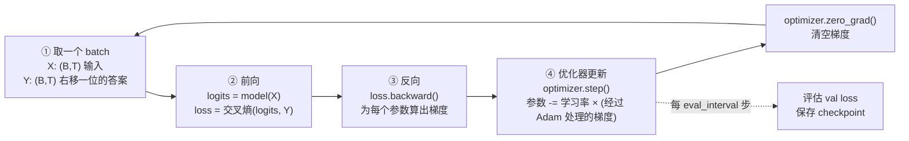
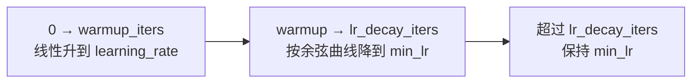
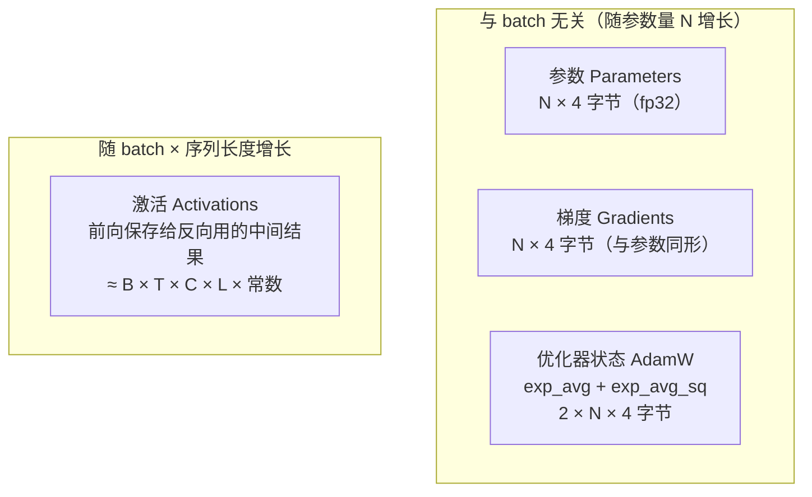
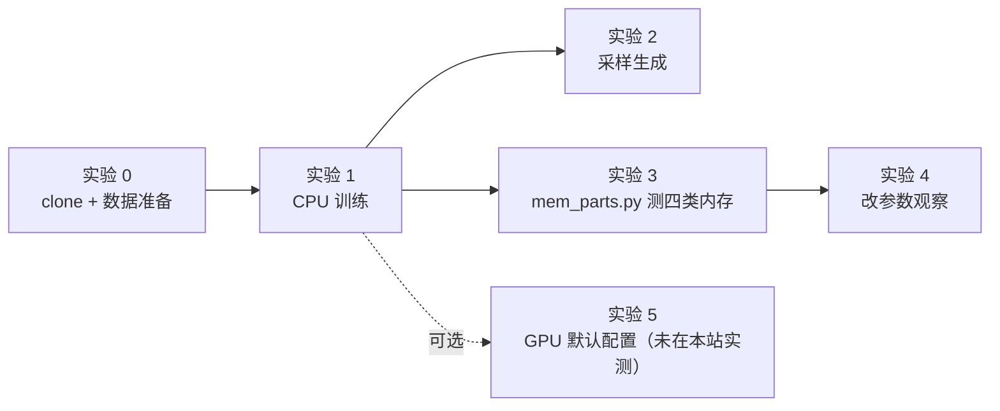

=== m1w3 | 第 3 周：跑通 nanoGPT | 第 1 月 · Python + LLM 原理
# 第 3 周：跑通 nanoGPT（原指南项目 1）

> **本周一句话**：亲手训练一个小 GPT，把“训练”从一个黑盒名词变成一个你能逐行解释的循环——取数据 → 前向算 loss → 反向算梯度 → 优化器更新——并且**测量**这个循环在内存里到底放了哪四类东西、各占多少。下周的显存估算、第 5 月的 ZeRO/FSDP，全都是在“切分这四类东西”。

**预计投入：约 10 小时**（阅读 ≈ 3.5h，动手 ≈ 4.5h，自测与产出 ≈ 2h），可分 5 天完成。{{local}} {{gpu1}}

**本周结束时你应该能：**

1. 在 Mac/CPU 上从零跑通 nanoGPT 的 Shakespeare 字符级训练，生成文本，并读懂训练日志里每一个数字（loss、time、mfu、tokens per iteration）。
2. 解释一次训练迭代的四个步骤，以及交叉熵 loss 的含义——包括为什么第 0 步的 loss 恰好约等于 4.17。
3. 说清楚训练时内存里同时存在的四类数据：**参数、梯度、优化器状态、激活值**，并用实验测出它们各自的大小，以及哪一类随 batch/序列长度增长。
4. 读懂 nanoGPT `train.py` 的主循环：学习率预热与余弦衰减、梯度累积、梯度裁剪、混合精度、checkpoint 保存。
5. （可选，需要租卡）在单张 GPU 上跑默认配置，对比 CPU 与 GPU 的速度差异。

> **验证说明**：本页 💻 标记的实验都在一台 Linux x86_64 机器（8 核 CPU、无 GPU、Python 3.12.15、torch 2.14.1+cpu、nanoGPT 提交 `3adf61e`）上实际运行过，输出为真实结果（删去了无关行）。Mac 上的耗时和内存会不同，但 loss 走势、参数量、各类内存的**比例关系**应一致。**实验 5（GPU）未在本站实测，需 GPU**，其中的数字均注明来自 nanoGPT 官方 README。

---

## 1. 本周学习路线


| 天 | 时间 | 先读（概念） | 再读（外部资料，按顺序） | 再做（实验） |
|---|---|---|---|---|
| Day 1 | ~2h | 本页 2.1、2.2、2.3 | ① [PyTorch 教程：Automatic Differentiation with torch.autograd](https://docs.pytorch.org/tutorials/beginner/basics/autogradqs_tutorial.html) 的 *Tensors, Functions and Computational graph*、*Computing Gradients*、*Disabling Gradient Tracking*（30 分钟）；② [PyTorch 教程：Optimizing Model Parameters](https://docs.pytorch.org/tutorials/beginner/basics/optimization_tutorial.html) 的 *Hyperparameters*、*Optimization Loop*（20 分钟） | 实验 0：环境与数据 |
| Day 2 | ~2h | 本页 2.4 | ③ [nanoGPT README](https://github.com/karpathy/nanoGPT) 的 *quick start* 一节（含 CPU 小配置那一段）（15 分钟） | 实验 1：CPU 训练；实验 2：采样 |
| Day 3 | ~2h | 本页 2.5、2.6 | ④ [nanoGPT train.py](https://github.com/karpathy/nanoGPT/blob/master/train.py) 全文（约 330 行，60 分钟，重点 `get_batch`、`get_lr`、`while True` 主循环）；⑤ [happy-llm 第四章](https://github.com/datawhalechina/happy-llm) *4.2 如何训练一个 LLM* 的 *4.2.1 Pretrain*（20 分钟） | 对照代码给主循环写注释 |
| Day 4 | ~2h | 本页 2.7 | ⑥ [PyTorch 教程：Hooks for autograd saved tensors](https://docs.pytorch.org/tutorials/intermediate/autograd_saved_tensors_hooks_tutorial.html) 前两节（20 分钟，理解实验 3 的测量原理）；⑦ [torch.optim.AdamW 文档](https://docs.pytorch.org/docs/stable/generated/torch.optim.AdamW.html) 的算法伪代码（15 分钟） | 实验 3：拆开测四类内存 |
| Day 5 | ~2h | 本页 2.8 | ⑧ [Raschka LLMs-from-scratch 第 5 章](https://github.com/rasbt/LLMs-from-scratch/tree/main/ch05) 浏览 `ch05.ipynb` 的训练循环部分（选读，30 分钟） | 实验 4：改参数观察；（可选）实验 5：GPU；自测题；本周产出 |

**每日打卡：**

- [ ] Day 1：读完 ①②，完成实验 0，能说出 `loss.backward()` 和 `optimizer.step()` 分别做了什么
- [ ] Day 2：完成实验 1、2，最终 val loss 在 1.9 左右，生成了“像莎士比亚格式”的文本
- [ ] Day 3：读完 ④⑤，能解释 `get_lr` 的三段和 `gradient_accumulation_steps` 的作用
- [ ] Day 4：读完 ⑥⑦，完成实验 3，四类内存测量值与手算一致
- [ ] Day 5：完成实验 4 记录表、自测题、本周产出

---

## 2. 核心概念讲解

### 2.1 训练在做什么：一个“拟合下一个字符”的优化问题

上周你看到：模型对每个位置输出一个“下一个 token 的概率分布”。**训练**就是不断调整模型的参数（GPT-2 small 有 1.24 亿个浮点数），让它在训练数据上给“真实的下一个 token”分配尽可能高的概率。

用数据仓库的话说：训练数据是一张巨大的事实表，每一行是 `(前文, 下一个 token)`；模型是一个有上亿个可调参数的“打分函数”；训练就是用这张表反复“回归拟合”这个函数。和你熟悉的 ETL 最大的区别是：**ETL 是一次扫描得到确定结果；训练是对同一份数据反复迭代几千到几十万次，每次只微调一点点参数**，而且每一步都依赖上一步的结果（天然串行，这是分布式训练难的根源）。

### 2.2 一次训练迭代的四个步骤



1. **取 batch**：从训练语料里随机切出 B 段长度为 T 的片段作为输入 X，把同样的片段**右移一位**作为答案 Y。一个 `(B, T)` 的 batch 实际包含 `B × T` 个“预测下一个 token”的样本（上周 2.6 节）。
2. **前向（forward）**：算出 logits `(B, T, vocab)`，再与 Y 计算交叉熵 loss（一个标量）。前向时 PyTorch 会记录计算图，并**保存反向需要的中间结果**——这就是“激活值”。
3. **反向（backward）**：`loss.backward()` 沿计算图反向应用链式法则，为**每一个参数**算出 `∂loss/∂参数`（梯度），存在 `param.grad` 里。梯度和参数**形状完全相同**。
4. **更新（step）**：优化器根据梯度修改参数。最简单的 SGD 是 `参数 -= lr × 梯度`；LLM 普遍用 **AdamW**，它为每个参数额外维护两个“动量”：梯度的滑动平均（一阶矩）和梯度平方的滑动平均（二阶矩），用它们来自适应地调整每个参数的步长。

**类比**：把第 ② 步想成执行一条 SQL 并记录完整的执行轨迹（lineage）；第 ③ 步是沿着 lineage 反向追溯“每个输入列对最终误差贡献了多少”；第 ④ 步是根据贡献度调整每个“参数列”的值。之所以要保存激活值，就像为了能做反向追溯，必须把每个 stage 的中间结果暂存下来——这正是训练比推理费内存的根本原因。

### 2.3 交叉熵 loss：为什么第 0 步是 4.17

**交叉熵**：模型给正确答案的概率记为 `p`，这一个样本的 loss 就是 `-ln(p)`；一个 batch 的 loss 是所有 `B × T` 个样本的平均。

- 模型完全猜对（p = 1）：loss = 0。
- 模型完全随机、在 V 个字符上平均分配概率（p = 1/V）：loss = ln(V)。

Shakespeare 字符级数据集的词表有 65 个字符，`ln(65) ≈ 4.174`。实验 1 的日志第一行是 `step 0: train loss 4.1676, val loss 4.1649`——**和理论值几乎完全一样**，说明刚初始化的模型确实在“均匀乱猜”。这是检查训练脚本是否正确的第一个“单元测试”：如果初始 loss 远大于 ln(V)，往往是初始化或数据有问题。

训练到最后 val loss ≈ 1.89，对应“正确字符的平均概率” ≈ `e^(-1.89) ≈ 0.15`，也就是说模型从 1/65 ≈ 1.5% 的瞎猜，提高到平均给正确答案约 15% 的概率（准确地说是几何平均）。nanoGPT README 中在 A100 上用默认大配置训练能到 val loss 1.4697（对应约 23%）。

**train loss vs val loss**：train loss 是在训练数据上测的，val loss 是在模型没见过的 10% 数据上测的。val loss 是判断模型好坏的依据；如果 train loss 持续下降而 val loss 开始上升，就是**过拟合**——模型在“背答案”。这和你在数据仓库里做 A/B 回测时“样本内 vs 样本外”的区别是一回事。

### 2.4 数据管线：memmap 随机切片

nanoGPT 的数据准备极其朴素：`prepare.py` 把整本莎士比亚（约 111 万字符）按字符映射成整数，以 `uint16` 写成一个扁平的二进制文件 `train.bin`（约 100 万 token × 2 字节 ≈ 2 MB）。训练时 `get_batch` 用 `np.memmap` 把这个文件**内存映射**，随机选 B 个起点，各切出 T+1 个 token：

```python
data = np.memmap('train.bin', dtype=np.uint16, mode='r')
ix = torch.randint(len(data) - block_size, (batch_size,))          # B 个随机起点
x = torch.stack([data[i:i+block_size] for i in ix])               # 输入
y = torch.stack([data[i+1:i+1+block_size] for i in ix])           # 右移一位 = 答案
```

| 你熟悉的（大数据） | nanoGPT 数据管线 | 说明 |
|---|---|---|
| 把文本表 tokenize 后落成列存文件 | `prepare.py` → `train.bin`（uint16 扁平数组） | 训练前一次性预处理，训练时只读 |
| 随机抽样（`TABLESAMPLE`） | `torch.randint` 随机起点 | 每步独立随机抽样，**不保证每条数据都被看到相同次数** |
| mmap / 页缓存 | `np.memmap` | 文件不整体读进内存，访问哪页才加载哪页；大语料（几百 GB）也能这样读 |
| 列存的定长编码 | `uint16` | 词表 < 65536 时 2 字节足够；GPT-2 的 50257 也恰好放得下 |

这种“扁平 token 文件 + 随机切片”的格式在大规模预训练中很常见（Megatron-LM 的 indexed dataset 也是预先分词后的二进制文件加索引）。第 2 月你会用 Ray Data 生产这样的文件。

### 2.5 学习率调度、梯度累积与梯度裁剪

读 `train.py` 时你会遇到几个训练工程里的“标准件”：

**学习率预热 + 余弦衰减**（`get_lr`）：



刚初始化时梯度方向很不可靠，先用小学习率“热身”；后期用小学习率精细收敛。Shakespeare 配置里 `learning_rate=1e-3、min_lr=1e-4、warmup_iters=100`。

**梯度累积**（`gradient_accumulation_steps`）：想要 batch=480 但显存只放得下 12？那就连续做 40 次前向+反向，每次 loss 除以 40，梯度在 `param.grad` 里**累加**，最后只做一次 `optimizer.step()`。数学上等价于一个大 batch，代价是时间变长。**类比**：MapReduce 里 combiner 先在本地累加部分结果，最后再一次性提交。nanoGPT 默认（训练 GPT-2 的配置）`gradient_accumulation_steps = 5 * 8`，单机 8 卡 DDP 时每卡分到 5 步。

**梯度裁剪**（`grad_clip = 1.0`）：如果所有梯度拼成的向量的范数超过 1.0，就整体缩放到 1.0。防止偶发的异常 batch 产生巨大梯度把模型“炸飞”（loss 突然变成 NaN）。这类似于数据管线里对异常值做截断，保护下游。

**混合精度**（`dtype`、`autocast`、`GradScaler`）：GPU 上用 bf16/fp16 做大部分矩阵运算，速度快、激活省一半内存；在 CPU 上 nanoGPT 不启用（`ctx = nullcontext()`）。fp16 动态范围小，需要 `GradScaler` 放大 loss 防止梯度下溢；bf16 不需要。第 4 周算显存时会用到“混合精度下每参数 16 字节”的口径。

### 2.6 读懂训练日志

实验 1 的日志有两类行：

```text
step 1000: train loss 1.9714, val loss 2.0528      ← 每 eval_interval 步做一次评估
iter 1000: loss 2.0455, time 194.07ms, mfu 0.08%  ← 每 log_interval 步一行
```

- `tokens per iteration will be: 768`：`gradient_accumulation_steps × B × T = 1 × 12 × 64`。**吞吐 = tokens per iter ÷ 每步时间**，这是比较不同硬件/配置时最该看的数字（实验 1 中约 768 ÷ 0.013s ≈ 5.9 万 token/s）。
- `time`：本步耗时。注意第 0 步很慢（283ms，包含各种初始化），评估步（如 iter 500、1000）也会偏慢（160～190ms），因为时间里包含了刚做完的评估；比较速度时要取稳态的普通步。
- `mfu`（Model FLOPs Utilization）：实际达到的 FLOPs ÷ 硬件峰值 FLOPs。nanoGPT 代码里把峰值**写死为 A100 的 bf16 峰值 312 TFLOPS**（`model.py` 的 `estimate_mfu`），所以在 CPU 或其他 GPU 上这个数字没有意义——在 CPU 上显示 0.08% 不代表你的 CPU 只用了 0.08%。到了 GPU 上它很重要：大模型训练的 MFU 通常是衡量集群效率的核心 KPI（第 5 月）。

**估算 FLOPs 的经验式**：训练每个 token 约需 `6 × N` 次浮点运算（N = 参数量；前向 2N，反向约 4N）。0.8M 参数的模型每 token 约 4.8 MFLOPs；上周说的推理每 token 约 2N。这个 “6N” 你会在 scaling law、训练成本估算里反复见到。

### 2.7 训练时内存里住着谁：四类数据

这是本周最重要的一节，也是下周显存估算的地基。



**固定部分**（纯 fp32 训练）：参数 4N + 梯度 4N + Adam 8N = **16N 字节**。0.8M 参数 → 约 12 MiB。实验 3 实测：参数 3.07 MiB、梯度 3.07 MiB、AdamW 状态 6.13 MiB，比例严格是 1 : 1 : 2。

**旁证**：实验 1 保存的 `ckpt.pt` 是 9.7 MB——正好约等于 参数 + Adam 两个状态（3 × 3.2 MB），因为 checkpoint 里存了 `model` 和 `optimizer` 的 state_dict（梯度不需要保存）。这也是为什么大模型的“训练 checkpoint”比“发布的权重文件”大好几倍。

**激活部分**：前向时每一层的输入、注意力的中间结果、MLP 的中间结果……只要反向需要，就得一直保留到反向用完。它与 `B × T`（一个 batch 的 token 数）成正比，与层数成正比，与隐藏维度成正比。实验 3 实测：

- B=12、T=64：激活 25 MiB，**已经是固定部分（12 MiB）的 2 倍**；
- B 翻倍或 T 翻倍：激活都变成 50 MiB（线性增长）；
- 换成 README 的 GPU 默认配置（B=64、T=256、6 层、C=384）：激活 2360 MiB，固定部分只有约 164 MiB——**激活占了 93%**。

**注意力的 T² 去哪了？** 朴素注意力要保存 `(B, heads, T, T)` 的分数矩阵，激活应该随 T 平方增长。实验 3 的对照显示：用朴素注意力时，T 从 64→128→256，激活从 28→62→148 MiB（超线性增长）；而用 PyTorch 的 `scaled_dot_product_attention`（SDPA）时 T=256 只有 100 MiB。这是因为 SDPA 的高效实现不把完整的 T×T 矩阵保存下来，反向时重新计算——这正是 FlashAttention 的思想，第 4 月会再讲。

**为什么这对架构师重要**：

1. 小模型 + 大 batch：瓶颈在激活 → 用梯度累积（减小每步 B）、激活检查点（activation checkpointing，用重算换内存）。
2. 大模型（7B+）：固定部分 16N 就已经是 112 GB 以上 → 单卡放不下 → 必须把参数/梯度/优化器状态切到多卡上（ZeRO-1/2/3、FSDP，第 19 周），或者只训练很少的参数（LoRA）。
3. 激活和固定部分的此消彼长，决定了你给训练任务申请资源时“卡数 × 单卡显存”的组合。

### 2.8 CPU、MPS 与 GPU：同一份代码，不同的速度

nanoGPT 用 `--device` 切换硬件：`cpu`、`mps`（Apple Silicon 的 GPU）、`cuda`（NVIDIA）。代码几乎不用改，这正是 PyTorch 的抽象价值。但性能差距巨大：README 中默认配置（10M 参数）在一张 A100 上约 3 分钟训练完 5000 步，val loss 1.4697；我们在 8 核 CPU 上只能跑缩小了约 13 倍参数量的小配置，2000 步约 33 秒，val loss 1.89。

- **Apple Silicon 的 MPS**：用 Mac 的统一内存，能跑比 CPU 快的训练，但 PyTorch 的 MPS 后端算子覆盖、`torch.compile` 支持不如 CUDA 完整（见 [PyTorch MPS 说明](https://docs.pytorch.org/docs/stable/notes/mps.html)）。本站没有 Mac 环境，MPS 速度**未在本站实测**，请你自己跑并填进记录表。
- **为什么要租卡跑一次**：不是为了 loss 更低，而是为了第一次亲眼看到 `nvidia-smi` 里显存占用、GPU 利用率、功耗，建立“GPU 训练长什么样”的体感，下周用它校准显存估算。

---

## 3. 动手实验



### 实验 0：获取代码与数据（15 分钟）{{local}}

```bash
cd ~/ai-infra-lab && source .venv/bin/activate && mkdir -p w3
git clone https://github.com/karpathy/nanoGPT.git && cd nanoGPT
git log -1 --format='%h %ci'          # 记录你用的提交
uv pip install torch numpy requests   # torch 已在第 2 周装过；requests 用于下载数据
python data/shakespeare_char/prepare.py
ls -la data/shakespeare_char/
```

**本站输出**：

```text
3adf61e 2025-11-12 11:52:34 -0800
length of dataset in characters: 1,115,394
all the unique characters: 
 !$&',-.3:;?ABCDEFGHIJKLMNOPQRSTUVWXYZabcdefghijklmnopqrstuvwxyz
vocab size: 65
train has 1,003,854 tokens
val has 111,540 tokens
-rw-r--r-- 1 box box 1115394 Oct 20 10:12 input.txt
-rw-r--r-- 1 box box     703 Oct 20 10:12 meta.pkl
-rw-r--r-- 1 box box     2344 Oct 20 10:12 prepare.py
-rw-r--r-- 1 box box 2007708 Oct 20 10:12 train.bin
-rw-r--r-- 1 box box  223080 Oct 20 10:12 val.bin
```

**逐步解释**：

- `prepare.py` 下载 tiny shakespeare 文本（约 1.1 MB），统计出 65 个不同字符作为词表，前 90% 作训练集、后 10% 作验证集。
- `train.bin` 是 2,007,708 字节 = 1,003,854 个 token × 2 字节（uint16），和 2.4 节的计算一致。`meta.pkl` 保存字符↔id 的映射，采样时用它解码。
- 这里的“分词器”就是最朴素的字符级映射，词表只有 65；上周的 BPE 词表是 5 万～15 万。词表越小，序列越长、每步学到的“信息”越少，这也是字符级模型效果有限的原因。

### 实验 1：CPU 训练小配置（30 分钟）{{local}}

先在 `~/ai-infra-lab/w3/` 创建一个辅助脚本 `peak.py`，用来记录任意命令的耗时和峰值内存（macOS 自带的 `/usr/bin/time` 参数和 Linux 不同，用 Python 写一个两边通用的）：

```python
"""运行任意命令，结束后打印墙钟时间和子进程峰值内存（替代 /usr/bin/time -v）。
用法：python peak.py python train.py ...
"""
import resource
import subprocess
import sys
import time

t = time.perf_counter()
rc = subprocess.call(sys.argv[1:])
dt = time.perf_counter() - t
peak = resource.getrusage(resource.RUSAGE_CHILDREN).ru_maxrss
unit = 2**20 if sys.platform == "darwin" else 2**10   # macOS 单位是字节，Linux 是 KiB
print(f"[peak] 退出码={rc} 用时={dt:.1f}s 峰值内存={peak / unit:.0f} MiB", file=sys.stderr)
sys.exit(rc)
```

然后在 nanoGPT 目录运行 README 给出的 CPU 小配置：

```bash
python ../w3/peak.py python train.py config/train_shakespeare_char.py \
  --device=cpu --compile=False --eval_iters=20 --log_interval=1 \
  --block_size=64 --batch_size=12 --n_layer=4 --n_head=4 --n_embd=128 \
  --max_iters=2000 --lr_decay_iters=2000 --dropout=0.0 2>&1 | tee train_cpu.log
```

**本站输出**（节选；完整日志每步一行）：

```text
tokens per iteration will be: 768
number of parameters: 0.80M
step 0: train loss 4.1676, val loss 4.1649
iter 0: loss 4.1828, time 283.93ms, mfu -100.00%
iter 1: loss 4.1373, time 16.41ms, mfu -100.00%
iter 10: loss 3.7366, time 11.11ms, mfu 0.10%
iter 100: loss 2.6635, time 13.51ms, mfu 0.09%
step 250: train loss 2.4293, val loss 2.4447
step 500: train loss 2.2732, val loss 2.3141
iter 500: loss 2.3827, time 162.21ms, mfu 0.09%
step 750: train loss 2.1338, val loss 2.1905
step 1000: train loss 1.9714, val loss 2.0528
iter 1000: loss 2.0455, time 194.07ms, mfu 0.08%
step 1250: train loss 1.8756, val loss 2.0089
step 1500: train loss 1.8557, val loss 1.9225
step 1750: train loss 1.7790, val loss 1.8921
step 2000: train loss 1.7648, val loss 1.8857
iter 1999: loss 1.9002, time 12.21ms, mfu 0.09%
[peak] 退出码=0 用时=33.1s 峰值内存=366 MiB
```

**逐步解释**：

- **参数量 0.80M**：nanoGPT 打印的是“非嵌入参数量”（`get_num_params` 默认减去位置嵌入），所以和实验 3 的 804,096 略有出入。
- **loss 曲线**：4.17（随机猜）→ 2.43（学会了常见字母和空格）→ 1.89（学会了单词和“人名 + 冒号 + 换行”的剧本格式）。README 说 CPU 小配置能到约 1.88，与本站 1.8857 吻合。
- **val loss 略高于 train loss**，差距不大：没有明显过拟合（模型太小，背不下来）。
- **每步 11～17ms**（稳态），评估步明显更慢（见 2.6 节）。
- **峰值内存 366 MiB**：其中绝大部分是 Python + PyTorch 运行时本身（实验 4 中把 batch 翻倍只增加约 38 MiB），模型相关的数据只有几十 MiB（实验 3 会精确拆分）。
- README 说这个配置“约 3 分钟”，本站只用了 33 秒；速度取决于 CPU 型号与线程数，你的 Mac 上请记录自己的数字。

### 实验 2：采样生成（10 分钟）{{local}}

```bash
python sample.py --out_dir=out-shakespeare-char --device=cpu --num_samples=2 --max_new_tokens=300
ls -la out-shakespeare-char
```

**本站输出**（节选；采样有随机性，每次结果不同）：

```text
PUTUS:
Hese sirven in it Merember that me the wild not.

MERCUSUS:
O, say, noo siersting: in the his relower to my
the will him bout thing thy a moy a to therropp
And of his beod it my not sord not:
Now ild good grace to I clann with we was you,
---------------
-rw-r--r-- 1 box box 9678732 Oct 20 10:13 ckpt.pt
```

**逐步解释**：

- 模型学会了剧本**格式**（大写人名 + 冒号 + 换行 + 台词）、常见短词（and、the、my、good grace），但大多数长词是拼凑的“伪英文”。这对一个 80 万参数、只看了约 150 万个字符（2000 步 × 768 token）的模型已经很不错了。
- `ckpt.pt` 9,678,732 字节 ≈ 参数 + AdamW 两个状态（见 2.7 节“旁证”）。
- `sample.py` 默认 `temperature=0.8`、`top_k=200`。试试 `--temperature=0.1`（更保守、更重复）和 `--temperature=1.5`（更“放飞”），体会温度对采样的影响。

### 实验 3：拆开测量四类内存（40 分钟）{{local}}

把下面的 `mem_parts.py` 放进 **nanoGPT 目录**（它要 `import model`）：

```python
"""把一次训练迭代拆开，逐项测量：参数、梯度、AdamW 状态、激活（反向需要保存的张量）。
在 nanoGPT 目录下运行：python mem_parts.py --batch_size 12 --block_size 64
"""
import argparse

import torch
from model import GPT, GPTConfig  # nanoGPT 自带的 model.py

ap = argparse.ArgumentParser()
ap.add_argument("--batch_size", type=int, default=12)
ap.add_argument("--block_size", type=int, default=64)
ap.add_argument("--n_layer", type=int, default=4)
ap.add_argument("--n_head", type=int, default=4)
ap.add_argument("--n_embd", type=int, default=128)
ap.add_argument("--no-flash", action="store_true", help="改用朴素注意力（显式构造 T×T 矩阵）")
a = ap.parse_args()
MiB = 2**20

torch.manual_seed(0)
cfg = GPTConfig(block_size=a.block_size, vocab_size=65, n_layer=a.n_layer, n_head=a.n_head,
                n_embd=a.n_embd, dropout=0.0, bias=False)
model = GPT(cfg)
if a.no_flash:
    for blk in model.transformer.h:
        blk.attn.flash = False  # nanoGPT 只在非 flash 模式下才注册掩码 buffer，这里手动补上
        blk.attn.register_buffer("bias", torch.tril(torch.ones(a.block_size, a.block_size))
                                 .view(1, 1, a.block_size, a.block_size))
opt = model.configure_optimizers(weight_decay=0.1, learning_rate=1e-3, betas=(0.9, 0.99), device_type="cpu")

def nbytes(ts):
    return sum(t.numel() * t.element_size() for t in ts)

x = torch.randint(0, 65, (a.batch_size, a.block_size))
y = torch.randint(0, 65, (a.batch_size, a.block_size))

# ① 前向：用 saved_tensors_hooks 统计 autograd 为反向“存下来”的张量 = 激活
param_ptrs = {p.data_ptr() for p in model.parameters()}
saved = {}  # 按底层存储地址去重：同一块内存被多处保存只算一次；权重本身不算激活
def pack(t):
    ptr = t.untyped_storage().data_ptr()
    if ptr not in param_ptrs:
        saved[ptr] = t.untyped_storage().nbytes()
    return t
with torch.autograd.graph.saved_tensors_hooks(pack, lambda t: t):
    logits, loss = model(x, y)
act = sum(saved.values())

# ② 反向：产生梯度；③ 优化器 step：第一次 step 时才分配 exp_avg / exp_avg_sq
loss.backward()
grads = nbytes(p.grad for p in model.parameters() if p.grad is not None)
opt.step()
states = nbytes(v for s in opt.state.values() for v in s.values() if torch.is_tensor(v))
params = nbytes(model.parameters())

print(f"配置 B={a.batch_size} T={a.block_size} L={a.n_layer} C={a.n_embd} {'朴素注意力' if a.no_flash else 'SDPA'}  参数量={sum(p.numel() for p in model.parameters()):,}")
print(f"参数      {params / MiB:8.2f} MiB  (fp32 = 4 字节/参数)")
print(f"梯度      {grads / MiB:8.2f} MiB  (与参数同形状)")
print(f"AdamW状态 {states / MiB:8.2f} MiB  (exp_avg + exp_avg_sq = 2 × 参数)")
print(f"激活      {act / MiB:8.2f} MiB  (随 B×T 增长；去重后 {len(saved)} 块存储)")
print(f"合计      {(params + grads + states + act) / MiB:8.2f} MiB")
```

```bash
python mem_parts.py
python mem_parts.py --batch_size 24
python mem_parts.py --block_size 128
python mem_parts.py --batch_size 64 --block_size 256 --n_layer 6 --n_head 6 --n_embd 384   # GPU 默认配置的规模
```

**本站输出**（已删去 nanoGPT 打印的 `num decayed parameter tensors` 等行）：

```text
配置 B=12 T=64 L=4 C=128 SDPA  参数量=804,096
参数          3.07 MiB  (fp32 = 4 字节/参数)
梯度          3.07 MiB  (与参数同形状)
AdamW状态     6.13 MiB  (exp_avg + exp_avg_sq = 2 × 参数)
激活         25.05 MiB  (随 B×T 增长；去重后 61 块存储)
合计         37.32 MiB

配置 B=24 T=64 L=4 C=128 SDPA  参数量=804,096
...
激活         50.10 MiB  (随 B×T 增长；去重后 61 块存储)
合计         62.37 MiB

配置 B=12 T=128 L=4 C=128 SDPA  参数量=812,288
...
激活         50.10 MiB  (随 B×T 增长；去重后 61 块存储)
合计         62.50 MiB

配置 B=64 T=256 L=6 C=384 SDPA  参数量=10,745,088
参数         40.99 MiB  (fp32 = 4 字节/参数)
梯度         40.99 MiB  (与参数同形状)
AdamW状态    81.98 MiB  (exp_avg + exp_avg_sq = 2 × 参数)
激活       2360.19 MiB  (随 B×T 增长；去重后 87 块存储)
合计       2524.15 MiB
```

再对比朴素注意力与 SDPA：

```bash
for T in 64 128 256; do python mem_parts.py --no-flash --block_size $T | grep -E "配置|激活"; done
python mem_parts.py --block_size 256 | grep -E "配置|激活"
```

```text
配置 B=12 T=64 L=4 C=128 朴素注意力  参数量=804,096
激活         28.02 MiB  (随 B×T 增长；去重后 73 块存储)
配置 B=12 T=128 L=4 C=128 朴素注意力  参数量=812,288
激活         62.07 MiB  (随 B×T 增长；去重后 73 块存储)
配置 B=12 T=256 L=4 C=128 朴素注意力  参数量=828,672
激活        148.27 MiB  (随 B×T 增长；去重后 73 块存储)
配置 B=12 T=256 L=4 C=128 SDPA  参数量=828,672
激活        100.21 MiB  (随 B×T 增长；去重后 61 块存储)
```

**逐步解释**：

- **测量原理**：`saved_tensors_hooks` 会在 autograd 每次“为反向保存一个张量”时调用 `pack`。我们按底层存储地址去重（同一块内存可能被多个算子引用），并排除参数本身（Linear 层反向也会引用权重，但那不是新增内存）。这是一种**近似**测量：它统计的是反向需要的张量，不包括前向中途临时分配又立即释放的缓冲区，所以它是激活的下限而不是进程峰值。
- **参数 : 梯度 : AdamW = 1 : 1 : 2**，与 2.7 节公式一致。注意 `opt.step()` 之前 `opt.state` 是空的——AdamW 的两个状态在**第一次 step 时**才分配，这就是为什么很多训练任务“第一步没事、第二步 OOM”。
- **B 翻倍和 T 翻倍激活都恰好翻倍**（25.05 → 50.10）：用 SDPA 时激活对 token 总数 B×T 线性。参数量随 T 有微小变化，是因为位置嵌入表 `wpe` 的大小等于 `block_size × C`。
- **朴素注意力的激活随 T 超线性增长**（28 → 62 → 148），多出来的是每层保存的 `(B, heads, T, T)` 注意力矩阵；T=256 时比 SDPA 多出约 48 MiB。序列越长，这一项越可怕。
- **GPU 默认配置的规模**：激活 2.3 GiB，占总量的 93%。所以 README 里的默认配置在 CPU 上会很慢、在小显存卡上可能放不下，而参数本身只有 41 MiB。

### 实验 4：改参数观察速度与内存（30 分钟）{{local}}

各跑 300 步（不评估、不比较 loss，只看速度和内存）：

```bash
for extra in "--batch_size=12 --block_size=64" "--batch_size=24 --block_size=64" "--batch_size=12 --block_size=128"; do
  echo "== $extra"
  python ../w3/peak.py python train.py config/train_shakespeare_char.py --device=cpu --compile=False \
    --eval_iters=20 --log_interval=50 --n_layer=4 --n_head=4 --n_embd=128 \
    --max_iters=300 --lr_decay_iters=300 --dropout=0.0 --eval_interval=1000 --out_dir=/tmp/o $extra \
    2>&1 | grep -E "^iter (100|150|200|250):|peak"
done
```

**本站输出**：

```text
== --batch_size=12 --block_size=64
iter 100: loss 2.6635, time 15.29ms, mfu 0.08%
iter 150: loss 2.5341, time 13.45ms, mfu 0.08%
iter 200: loss 2.4769, time 17.07ms, mfu 0.08%
iter 250: loss 2.4711, time 11.40ms, mfu 0.09%
[peak] 退出码=0 用时=6.7s 峰值内存=365 MiB
== --batch_size=24 --block_size=64
iter 100: loss 2.5811, time 22.50ms, mfu 0.09%
iter 150: loss 2.3737, time 24.83ms, mfu 0.09%
iter 200: loss 2.3829, time 16.80ms, mfu 0.09%
iter 250: loss 2.3704, time 18.77ms, mfu 0.10%
[peak] 退出码=0 用时=9.1s 峰值内存=403 MiB
== --batch_size=12 --block_size=128
iter 100: loss 2.5639, time 18.36ms, mfu 0.16%
iter 150: loss 2.5243, time 20.45ms, mfu 0.16%
iter 200: loss 2.4352, time 17.41ms, mfu 0.16%
iter 250: loss 2.4421, time 19.58ms, mfu 0.15%
[peak] 退出码=0 用时=8.9s 峰值内存=404 MiB
```

**逐步解释**：

- token 数翻倍，每步时间只增加约 30～50%，而不是翻倍：小矩阵在 CPU 上没有“喂饱”计算单元，batch 越大并行效率越高。这就是 GPU 训练要尽量把 batch 做大的原因（直到显存或收敛性成为限制）。
- 峰值内存只增加约 38 MiB，和实验 3 中激活从 25→50 MiB 的增量同一量级（进程峰值还包含临时缓冲区）。
- 在 CPU 上 `mfu` 列请忽略（2.6 节）。但注意 T=128 的 mfu 估算比 B=24 高：nanoGPT 的 FLOPs 公式包含注意力的 T 相关项，T 越大每 token 的估算 FLOPs 越多。
- 每次运行的 loss 不同，是因为 batch 大小改变了随机抽样序列，不要拿 300 步的 loss 比较好坏。

**记录表（填你自己的 Mac 数字）**：

| 环境 | 配置 | 稳态每步耗时 (ms) | 峰值内存 / 显存 | 最终 val loss |
|---|---|---|---|---|
| 本站 Linux CPU（8 核） | 小配置 2000 步 | 11～17 | 366 MiB | 1.8857 |
| 你的 Mac CPU | 小配置 2000 步 | | | |
| 你的 Mac MPS（`--device=mps`） | 小配置 2000 步 | | | |
| GPU 24GB（实验 5，可选） | 默认配置 5000 步 | | | |

### 实验 5：租单卡跑默认配置（可选，60 分钟）{{gpu1}}

> ⚠️ **未在本站实测，需 GPU**。以下命令来自 [nanoGPT README](https://github.com/karpathy/nanoGPT) 的 *quick start* 一节；README 原文称默认配置“在一张 A100 上约 3 分钟，最佳 val loss 1.4697”。本站没有运行，**下面不提供输出**，请你把实测结果填进记录表。

```bash
# 在租来的 GPU 机器上（AutoDL / RunPod 等，选带 PyTorch 的镜像）
git clone https://github.com/karpathy/nanoGPT.git && cd nanoGPT
pip install torch numpy transformers datasets tiktoken wandb tqdm   # README 的依赖列表
python data/shakespeare_char/prepare.py
python train.py config/train_shakespeare_char.py      # 默认配置：6 层、6 头、384 维、B=64、T=256
# 另开一个终端观察 GPU
watch -n 1 nvidia-smi
# 训练结束后
python sample.py --out_dir=out-shakespeare-char
```

**观察要点**：

- `nvidia-smi` 里的显存占用会**明显大于**实验 3 估算的 2.5 GiB 左右：GPU 上默认启用 bf16 混合精度（激活减半），但 PyTorch 的 CUDA 缓存分配器会预留显存、CUDA 上下文本身也要几百 MB，`torch.compile` 还会额外占用。把差距和原因记进记录表——这正是下周要建立的“估算 vs 实测”误差分析。
- 用 `tokens per iteration`（README 默认配置是 64 × 256 = 16,384）除以每步时间得到吞吐，与 CPU 小配置对比。
- 如果遇到 `torch.compile` 报错，可加 `--compile=False` 重试（README 在 *troubleshooting* 一节有说明）。

### 常见错误与排查

| 现象（真实报错或现象） | 原因 | 解决 |
|---|---|---|
| `ModuleNotFoundError: No module named 'requests'`（运行 prepare.py 时） | 下载数据需要 requests | `uv pip install requests` |
| `ModuleNotFoundError: No module named 'model'`（运行 mem_parts.py 时） | 脚本不在 nanoGPT 目录 | 把 mem_parts.py 复制到 nanoGPT 目录再运行 |
| `AttributeError: 'CausalSelfAttention' object has no attribute 'bias'`（未在本站复现，按代码推断） | 只把 `flash` 设为 False，没注册掩码 buffer | 按本页写法补 `register_buffer("bias", ...)` |
| CPU 上报 `torch.compile` 相关错误 | CPU/Mac 上编译支持有限 | 加 `--compile=False`（README 的 CPU 命令已包含） |
| 训练很慢，`time` 每步上百毫秒 | 用了默认大配置，或机器上有其他负载 | 确认带上了全部小配置参数；关闭其他程序 |
| `--device=mps` 报某个算子未实现（未在本站复现） | MPS 后端算子覆盖不全 | 设 `PYTORCH_ENABLE_MPS_FALLBACK=1`，或改回 `cpu` |
| loss 变成 `nan` | 学习率过大或数值不稳定 | 降低 `--learning_rate`；确认 `grad_clip` 未被关掉 |
| 采样输出全是乱码 / 都是同一个字符 | 训练步数太少或 `out_dir` 指错（加载了别的 checkpoint） | 检查 `--out_dir`；确认训练日志里 val loss 已降到 2 以下 |

### 扩展练习（选做，每题 20–40 分钟）

1. **过拟合实验**：把 `--n_layer=6 --n_head=6 --n_embd=256 --max_iters=5000` 在 CPU 上跑（会慢很多，可以放着过夜），观察 train loss 与 val loss 的差距何时开始拉大。把 `--dropout=0.2` 加回去再跑一次对比。
2. **验证梯度累积的等价性**：用 `mem_parts.py` 的思路，分别做“B=24 一次反向”和“B=12 两次反向、loss 各除以 2、梯度累加”，比较两种方式得到的梯度（`p.grad`）最大差异。
3. **学习率调度可视化**：把 `train.py` 的 `get_lr` 复制出来，用 matplotlib 画出 Shakespeare 配置下 0～2000 步的学习率曲线。
4. **换数据**：把 `input.txt` 换成你自己的文本（例如一批 SQL 脚本，或中文小说——注意中文字符级词表会有几千个字符），重跑 prepare + train，观察初始 loss 是否等于 ln(词表大小)。
5. **算 6N**：用实验 1 的吞吐（token/s）× 6 × 参数量，估算你的 CPU 实际达到的 FLOPs，再和你 CPU 的理论峰值比较。

---

## 4. 精读指南

### ①② PyTorch 基础教程（50 分钟）

- [Automatic Differentiation with torch.autograd](https://docs.pytorch.org/tutorials/beginner/basics/autogradqs_tutorial.html)：**读哪里**：*Tensors, Functions and Computational graph*、*Computing Gradients*、*Disabling Gradient Tracking*。**重点**：计算图在前向时动态建立；`requires_grad`；`torch.no_grad()` 为什么能省内存。**读完回答**：① 为什么评估（`estimate_loss`）和采样时要包在 `torch.no_grad()` 里？② 对同一个图调用两次 `backward()` 会怎样？
- [Optimizing Model Parameters](https://docs.pytorch.org/tutorials/beginner/basics/optimization_tutorial.html)：**读哪里**：*Hyperparameters*、*Optimization Loop*。**读完回答**：教程里为什么每次迭代都要 `optimizer.zero_grad()`？如果忘了会发生什么？（提示：和梯度累积是同一个机制）

### ③④ nanoGPT 代码（75 分钟）

- [nanoGPT README](https://github.com/karpathy/nanoGPT)：*quick start* 一节全文。**读完回答**：CPU 小配置相比默认配置缩小了哪几个参数？每个参数对速度/内存/效果分别有什么影响？
- [nanoGPT train.py](https://github.com/karpathy/nanoGPT/blob/master/train.py)：**读哪里**：全文，重点 `get_batch`、`estimate_loss`、`get_lr`、主循环 `while True`。**重点**：`loss = loss / gradient_accumulation_steps`；`scaler.unscale_` 后再 `clip_grad_norm_`；`optimizer.zero_grad(set_to_none=True)`；DDP 相关的 `require_backward_grad_sync`（第 5 月会回来看）。**读完回答**：① 主循环里 `X, Y = get_batch('train')` 为什么放在 `backward()` 之前？（提示：GPU 上的异步执行）② checkpoint 什么条件下才保存？

### ⑤ happy-llm 4.2.1 Pretrain（20 分钟）

- [happy-llm](https://github.com/datawhalechina/happy-llm) 第四章 *4.2 如何训练一个 LLM* 的 *4.2.1 Pretrain*。**重点**：真实 LLM 预训练的数据规模、算力规模，以及与本周玩具实验的量级差距。**读完回答**：把本周实验的“参数量、训练 token 数”与文中提到的真实模型做一张对比表，各差几个数量级？

### ⑥⑦ 测量原理与 AdamW（35 分钟）

- [Hooks for autograd saved tensors](https://docs.pytorch.org/tutorials/intermediate/autograd_saved_tensors_hooks_tutorial.html)：前两节。**读完回答**：教程中用 hook 把保存的张量放到 CPU 或磁盘上，这和“激活卸载（activation offloading）”有什么关系？
- [torch.optim.AdamW](https://docs.pytorch.org/docs/stable/generated/torch.optim.AdamW.html)：只读算法伪代码。**读完回答**：伪代码里 `m_t`、`v_t` 分别对应实验 3 中的哪个状态？weight decay 在 AdamW 中是怎样作用的（与 Adam 的区别，见 [AdamW 论文](https://arxiv.org/abs/1711.05101) 摘要）？

### 背景阅读（不计入本周时间）

- [build-nanogpt](https://github.com/karpathy/build-nanogpt)：按 commit 逐步从空文件写到复现 GPT-2 124M，每个 commit 都很小，适合想深入的周末。
- [Raschka LLMs-from-scratch 第 5 章](https://github.com/rasbt/LLMs-from-scratch/tree/main/ch05)：另一种风格的预训练循环实现，带详细 notebook。
- [PyTorch：Automatic Mixed Precision](https://docs.pytorch.org/docs/stable/amp.html)：`autocast` 与 `GradScaler` 的官方说明。

---

## 5. 自测题

<details>
<summary>1. 字符级 Shakespeare 词表大小 65，为什么第 0 步 loss ≈ 4.17？如果换成词表 50257 的 GPT-2 BPE，初始 loss 应该约是多少？</summary>

随机初始化的模型对每个 token 近似均匀分配概率 1/V，交叉熵 = -ln(1/V) = ln(V)。ln(65) ≈ 4.174；ln(50257) ≈ 10.82。初始 loss 明显偏离 ln(V) 时，要怀疑初始化或数据有问题。

</details>

<details>
<summary>2. 训练时内存里有哪四类数据？哪些与 batch size 无关？纯 fp32 + AdamW 时固定部分每参数多少字节？</summary>

参数、梯度、优化器状态（AdamW 的 exp_avg、exp_avg_sq）、激活。前三类只与参数量有关、与 batch 无关；激活随 B×T 增长。纯 fp32：4 + 4 + 8 = 16 字节/参数（实验 3 实测比例 1:1:2）。混合精度时口径会变化，下周细讲。

</details>

<details>
<summary>3. 为什么很多训练任务“第一步正常、第二步才 OOM”或者“step 之后内存突然变大”？</summary>

AdamW 的状态在第一次 `optimizer.step()` 时才分配（实验 3：step 之前 `opt.state` 为空），一下子多出 2 倍参数大小的内存；同时梯度在第一次 backward 后才分配。PyTorch 缓存分配器的碎片也可能让后续步骤峰值更高。

</details>

<details>
<summary>4. 梯度累积 8 步、每步 micro-batch=4，与一次 batch=32 在数学上等价吗？各自的内存和时间有何差异？</summary>

在 loss 按累积步数缩放（除以 8）且没有 BatchNorm 这类依赖 batch 统计量的层时，梯度在数学上等价（浮点求和顺序不同会有极小误差）。内存：累积方式的激活只需 micro-batch=4 的量，显著更少；时间：8 次小前向/反向通常比 1 次大前向/反向慢，因为小矩阵利用率低。

</details>

<details>
<summary>5. 实验 3 中把 B 翻倍和把 T 翻倍，激活都恰好翻倍。为什么朴素注意力下 T 翻倍会超过 2 倍？</summary>

大部分激活（每层的输入、QKV、MLP 中间结果）形状是 (B, T, C) 或 (B, T, 4C)，对 B×T 线性。朴素注意力还要保存 (B, heads, T, T) 的注意力权重矩阵，对 T 是平方关系。SDPA 的高效实现不保存完整 T×T 矩阵（反向时重算），所以对 T 也是线性。

</details>

<details>
<summary>6. nanoGPT 在 CPU 上显示 mfu 0.08%，说明 CPU 利用率极低吗？</summary>

不能这么理解。`estimate_mfu` 里把分母写死为 A100 bf16 峰值 312 TFLOPS，所以在 CPU 上算出来的是“相对 A100 峰值的比例”，与 CPU 自己的利用率无关。要评估 CPU 效率，应该用 6N × token/s 估算实际 FLOPs，再除以该 CPU 的理论峰值。

</details>

<details>
<summary>7. ckpt.pt 有 9.7 MB，而参数只有约 3.2 MB。多出来的是什么？发布推理权重时需要它们吗？</summary>

checkpoint 保存了模型参数和优化器 state_dict（AdamW 的两个状态，各与参数同大小），合计约 3 × 3.2 MB。恢复训练需要优化器状态；推理不需要，只发布模型权重（而且常转成 bf16，再小一半）。这就是大模型训练 checkpoint 比发布权重大好几倍的原因，也是 checkpoint 存储/写入带宽成为训练平台问题的原因。

</details>

<details>
<summary>8. 为什么 train.py 里评估时 train loss 也要单独算一遍，而不是直接用训练日志里的 loss？</summary>

训练日志里的 loss 是单个 batch 的值，噪声很大，而且是在参数更新过程中的某一刻测的。`estimate_loss` 在固定参数下对训练集和验证集各取 `eval_iters` 个 batch 求平均，在相同条件下比较两者，才能判断是否过拟合。

</details>

<details>
<summary>9. 训练一个 token 约 6N FLOPs、推理（前向）一个 token 约 2N FLOPs，额外的 4N 来自哪里？</summary>

反向传播：对每个线性层，既要计算对输入的梯度（传给上一层），又要计算对权重的梯度，各约等于一次前向的计算量，合计约 4N。这个经验式忽略了注意力中与序列长度相关的项，在序列不太长时足够准确。

</details>

### 思考题（架构师视角，没有标准答案，写成 200–300 字的短文）

1. **训练 vs ETL 的调度差异**：Spark 作业可以随时被抢占、任务级重试；一个训练作业每步都依赖上一步、跨多卡同步。从本周对训练循环的理解出发，说明为什么训练作业更需要“定期 checkpoint + 整体重启”，以及 checkpoint 间隔应该如何权衡（写入开销 vs 故障损失）。
2. **四类内存与资源申请**：一个算法同学说“我的模型只有 1B 参数，给我一张 24 GB 卡就够了”。用本周的四类内存分析这句话在哪些情况下成立、哪些不成立，你会问他哪几个问题？
3. **数据管线的随机性**：nanoGPT 每步独立随机抽样，不保证每条数据被看到相同次数。大规模训练中，数据顺序、去重、可复现性为什么重要？如果训练中途挂了，从 checkpoint 恢复时数据读取位置该怎么处理？对比你熟悉的流处理 offset / 批处理分区重跑。
4. **CPU 能不能做训练**：本周你在 CPU 上训练了一个 0.8M 参数的模型。从内存、算力、带宽三个角度，说明为什么 CPU 集群不适合训练大模型，但又在 AI 平台里的哪些环节不可或缺。

---

## 6. 本周产出与掌握清单

### 本周产出（Deliverables）

放进 `~/ai-infra-lab/w3/` 并提交到 git（nanoGPT 本身不要提交进去，记录你用的提交号即可）：

1. **代码**：`peak.py`、`mem_parts.py`，以及你的训练命令脚本 `run_cpu.sh`。
2. **nanoGPT 跑通记录（本月产出之一）`README.md`**，至少包含：环境与版本；完整训练命令；loss 曲线（可从日志提取后用 matplotlib 画）；记录表（至少填 CPU，有 Mac 的填 MPS，租卡的填 GPU）；两段生成样本；实验 3 的四类内存表与手算对照。
3. **`train_loop_annotated.md`**：把 `train.py` 主循环（约 60 行）复制出来，逐行写中文注释，标出四个步骤和四类内存分别在哪一行产生/释放。
4. **一段“架构师笔记”**：从思考题中任选 1 题写成短文。

### 掌握清单

- [ ] 能画出训练迭代的四个步骤，并说出每一步对应的 PyTorch 调用
- [ ] 能解释交叉熵 loss，并预测任意词表大小下的初始 loss
- [ ] 在 CPU（或 Mac）上跑通小配置，val loss 降到 1.9 左右并生成文本
- [ ] 能读懂训练日志中的 tokens per iteration、time、mfu，并知道 mfu 在 CPU 上为何无意义
- [ ] 能解释 get_lr 的三段、梯度累积、梯度裁剪各自解决什么问题
- [ ] 能说出训练内存的四类数据，以及哪些随 batch 增长
- [ ] 跑通 mem_parts.py，参数 : 梯度 : AdamW = 1 : 1 : 2 与手算一致
- [ ] 能解释为什么 checkpoint 比参数大约 3 倍
- [ ] 能解释朴素注意力与 SDPA 激活增长方式的差异
- [ ] 能用 6N 估算训练 FLOPs
- [ ] 填完记录表（至少 CPU 一行）
- [ ] 完成 train_loop_annotated.md 与本周 README

---

## 参考资料

**本周主读（按学习路线顺序）：**

- [PyTorch 教程：Automatic Differentiation with torch.autograd](https://docs.pytorch.org/tutorials/beginner/basics/autogradqs_tutorial.html)（文档·入门）：计算图与反向传播
- [PyTorch 教程：Optimizing Model Parameters](https://docs.pytorch.org/tutorials/beginner/basics/optimization_tutorial.html)（文档·入门）：标准训练循环
- [nanoGPT](https://github.com/karpathy/nanoGPT)（仓库·入门）：本周实验对象，README 的 quick start 一节
- [nanoGPT train.py](https://github.com/karpathy/nanoGPT/blob/master/train.py)（仓库·入门）：约 330 行的完整训练循环
- [Datawhale happy-llm（中文）](https://github.com/datawhalechina/happy-llm)（仓库·入门）：第四章 4.2 如何训练一个 LLM
- [PyTorch 教程：Hooks for autograd saved tensors](https://docs.pytorch.org/tutorials/intermediate/autograd_saved_tensors_hooks_tutorial.html)（文档·进阶）：实验 3 测量激活的原理
- [torch.optim.AdamW](https://docs.pytorch.org/docs/stable/generated/torch.optim.AdamW.html)（文档·进阶）：AdamW 算法与两个状态

**选读与背景：**

- [build-nanogpt（Karpathy）](https://github.com/karpathy/build-nanogpt)（仓库·入门）：按 commit 逐步复现 GPT-2
- [Build a Large Language Model (From Scratch) 配套代码（Raschka）](https://github.com/rasbt/LLMs-from-scratch)（仓库·入门）：第 5 章预训练
- [AdamW 论文：Decoupled Weight Decay Regularization](https://arxiv.org/abs/1711.05101)（论文·进阶）：AdamW 的出处
- [PyTorch：Automatic Mixed Precision](https://docs.pytorch.org/docs/stable/amp.html)（文档·进阶）：autocast 与 GradScaler
- [PyTorch：MPS backend](https://docs.pytorch.org/docs/stable/notes/mps.html)（文档·入门）：在 Mac 上使用 Apple GPU

> 完整列表见 [参考资料库](/resources.html)。
