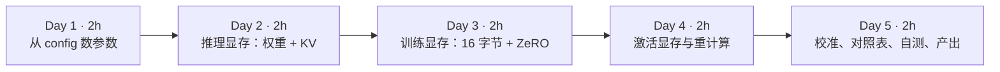
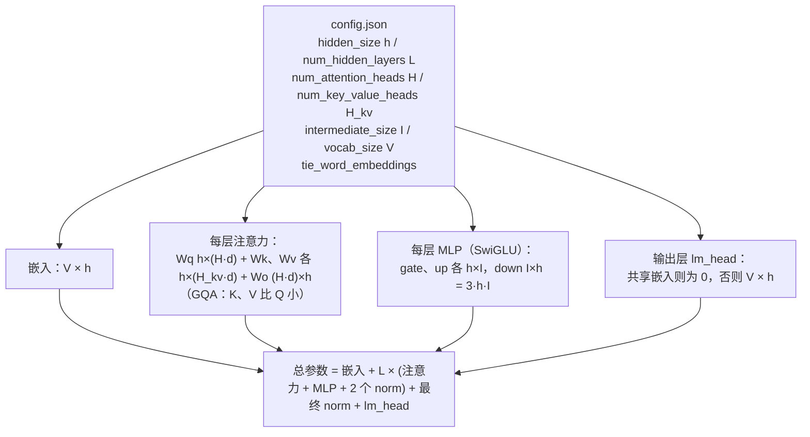
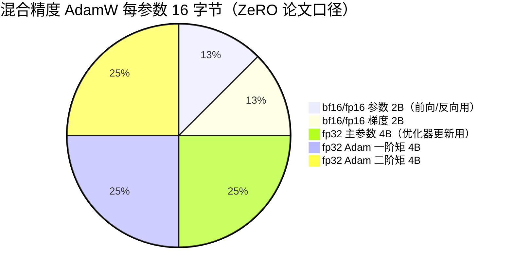
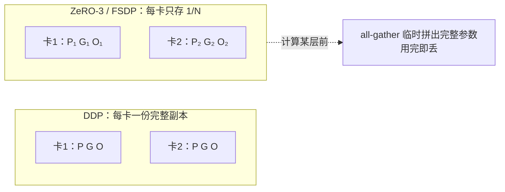
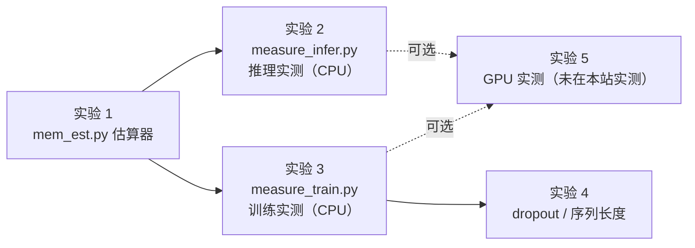

=== m1w4 | 第 4 周：显存估算脚本 | 第 1 月 · Python + LLM 原理
# 第 4 周：显存估算脚本（原指南项目 2）

> **本周一句话**：把前三周的知识合成一个架构师每天都要用的工具——**只看 `config.json` 就能估算一个模型推理要多少显存、训练要多少显存、要几张卡**，并且用实测数据校准它，知道估算误差从哪里来。这相当于你在大数据平台上做“集群容量规划”的那套能力，换成了 GPU 显存这种更稀缺、更贵的资源。

**预计投入：约 10 小时**（阅读 ≈ 3.5h，动手 ≈ 4.5h，自测与产出 ≈ 2h），可分 5 天完成。{{local}} {{gpu1}}

**本周结束时你应该能：**

1. 从 `config.json` 手算一个 Llama/Qwen 类模型的参数量，误差在 1% 以内（对照模型卡）。
2. 估算推理显存 = 权重 + KV Cache + 运行时开销，并回答“24 GB 卡能不能跑 7B、能扛多少并发”。
3. 说清楚混合精度训练“每参数 16 字节”的来源，以及 ZeRO-1/2/3（FSDP）分别把哪部分切到多卡上、每卡还剩多少。
4. 用公式估算激活显存，并知道 batch、序列长度、dropout、注意力实现、重计算分别怎样改变它。
5. 用实测（本站 CPU 实测 + 你租卡的 GPU 实测）校准估算脚本，写出一份“估算 vs 实测”对照表和误差分析——这是本月的第二个产出。

> **验证说明**：本页 💻 标记的实验都在一台 Linux x86_64 机器（8 核 CPU、无 GPU、Python 3.12.15、torch 2.14.1+cpu、transformers 5.20.2）上实际运行过，输出为真实结果（删去了下载进度条和警告行）。CPU 上测的是“进程内存”，和 GPU 显存的组成不同，但**权重字节、KV 字节、梯度/优化器字节**这些与硬件无关的数字是完全一致的。**实验 5（GPU 实测）未在本站实测，需 GPU**，不提供输出，只给出官方文档出处。

---

## 1. 本周学习路线



| 天 | 时间 | 先读（概念） | 再读（外部资料，按顺序） | 再做（实验） |
|---|---|---|---|---|
| Day 1 | ~2h | 本页 2.1、2.2 | ① [EleutherAI：Transformer Math 101](https://blog.eleuther.ai/transformer-math/) 的开头到 *Engineering Takeaways for Compute Costs*（25 分钟，了解 C ≈ 6PD）；② 打开 [Qwen2.5-0.5B 模型卡](https://huggingface.co/Qwen/Qwen2.5-0.5B) 和它的 config.json，对照本页 2.2 手算（20 分钟） | 实验 1：mem_est.py 数参数 |
| Day 2 | ~2h | 本页 2.3 | ③ Transformer Math 101 的 *Inference* 一节（*Model Weights*、*Total Inference Memory*）（15 分钟）；④ [vLLM 文档：Conserving Memory](https://docs.vllm.ai/en/latest/configuration/conserving_memory.html)（15 分钟，看推理框架给了哪些省显存的旋钮） | 实验 2：CPU 上加载 Qwen2.5-0.5B 实测 |
| Day 3 | ~2h | 本页 2.4、2.5 | ⑤ Transformer Math 101 的 *Training* 一节（*Model Parameters*、*Optimizer States*、*Gradients*）和 *Distributed Training → Sharded Optimizers*（30 分钟）；⑥ [ZeRO 论文](https://arxiv.org/abs/1910.02054) 只读摘要、图 1 和第 3.1 节（30 分钟） | 实验 3：训练四类内存实测 vs 估算 |
| Day 4 | ~2h | 本页 2.6 | ⑦ Transformer Math 101 的 *Activations and Batch Size*（20 分钟）；⑧ [Korthikanti 等：Reducing Activation Recomputation in Large Transformer Models](https://arxiv.org/abs/2205.05198) 只读第 4.1 节（激活内存推导）和表 2（30 分钟） | 实验 4：dropout 与序列长度对激活的影响 |
| Day 5 | ~2h | 本页 2.7 | ⑨ [PyTorch：Understanding CUDA Memory Usage](https://docs.pytorch.org/docs/stable/torch_cuda_memory.html)（15 分钟）；⑩ [PyTorch CUDA semantics](https://docs.pytorch.org/docs/stable/notes/cuda.html) 的 *Memory management* 一节（15 分钟） | （可选）实验 5：GPU 实测；自测题；本周产出 |

**每日打卡：**

- [ ] Day 1：读完 ①②，手算 Qwen2.5-0.5B 参数量，与 mem_est.py 和模型卡（0.49B）一致
- [ ] Day 2：读完 ③④，完成实验 2，能解释“bf16 加载后进程内存几乎没涨”的原因
- [ ] Day 3：读完 ⑤⑥，完成实验 3，能背出 16 字节的五个组成部分和 ZeRO 三个阶段
- [ ] Day 4：读完 ⑦⑧，完成实验 4，能说出激活公式里每一项的来源
- [ ] Day 5：完成对照表、自测题、本周产出

---

## 2. 核心概念讲解

### 2.1 为什么显存估算是架构师的基本功

在 Hadoop/Spark 平台上，你做过类似的事：根据数据量估算 executor 内存、根据并发估算 YARN 队列容量、根据增长估算明年的机器采购。GPU 平台的不同在于：

| | 大数据集群 | GPU 集群 |
|---|---|---|
| 稀缺资源 | CPU 核、内存，单价相对便宜 | GPU 显存，单卡 24～80 GB（新卡更大），单价极高 |
| 超用的后果 | 溢写磁盘、变慢 | **直接 OOM 崩溃**，没有“慢一点也能跑”的退路（除非显式做卸载） |
| 估算依据 | 数据量 × 膨胀系数 | 参数量、精度、序列长度、batch、并行策略 |
| 规划粒度 | 节点 | 卡 → 机（8 卡）→ 机柜/集群，跨机通信代价陡增 |

“这个模型要几张卡？”是业务方、财务和算法团队最常问架构师的问题。本周的目标是你能在白板上 5 分钟给出一个**有依据的数量级答案**，再用实测校准。

### 2.2 从 config.json 数参数

上周你用 GPT-2 学了“每层 ≈ 12·C²”。现代模型（Llama、Qwen、Mistral）有三处不同，需要逐项数：



**算例：Qwen2.5-7B-Instruct**（config：h=3584，L=28，H=28，H_kv=4，d=128，I=18944，V=152064，不共享嵌入）：

- 嵌入：152064 × 3584 ≈ 545M；lm_head 同样 545M
- 每层注意力：3584×3584 + 2×3584×512 + 3584×3584 ≈ 29.4M（加上 q/k/v 偏置）
- 每层 MLP：3 × 3584 × 18944 ≈ 203.7M（**MLP 占每层的 87%**）
- 每层合计 ≈ 233.1M，× 28 层 ≈ 6.53B
- 总计 ≈ 0.545 + 6.53 + 0.545 ≈ **7.616B**，模型卡写的是 7.61B ✅

**两个经验**：

1. 小模型里**嵌入占比很高**：Qwen2.5-0.5B 的 494M 参数中，嵌入就有 136M（28%），因为词表 15 万很大而 h 只有 896。这也是小模型常共享嵌入和输出层的原因。
2. 大模型里 **MLP 是大头**，注意力因为 GQA 变得更小。分析“剪枝/量化收益在哪”时这很有用。

### 2.3 推理显存：权重 + KV Cache + 开销

```text
推理显存 ≈ 权重（参数量 × 每参数字节） + KV Cache（第 2 周公式） + 运行时开销
```

**权重**：

| 精度 | 每参数字节 | 7.6B 模型权重 | 说明 |
|---|---|---|---|
| FP32 | 4 | 28.4 GiB | 推理几乎不用 |
| BF16 / FP16 | 2 | 14.2 GiB | 发布权重的默认格式 |
| INT8 / FP8 | 1 | 7.1 GiB | 需要量化，硬件/框架支持决定能否加速 |
| INT4 | ≈0.5 | ≈3.6 GiB | 外加缩放因子等少量开销，实际略大于 0.5 字节/参数 |

**运行时开销**：前向时的临时激活（推理不需要保存激活给反向，所以只是临时的）、CUDA 上下文（几百 MB）、框架预留。[EleutherAI Transformer Math 101](https://blog.eleuther.ai/transformer-math/) 的经验是“除权重外的前向开销 ≤ 20%”，给出 `总推理显存 ≈ 1.2 × 权重` 作为**能否装下**的粗判；但这条经验**没有算 KV Cache**——对于长上下文、高并发的推理服务，KV Cache 往往才是真正的大头（第 2 周算过：Qwen2.5-7B 一条 32K 请求的 KV 就是 1.75 GiB）。

**vLLM 的思路**（第 14 周细讲）：启动时先按 `gpu_memory_utilization`（默认 0.9）圈定总显存，减去权重和一次“试跑”测出的激活峰值，**剩下的全部预分配给 KV Cache**，并在日志里打印能容纳多少 token。所以对推理服务来说，正确的问题不是“装不装得下”，而是“剩多少给 KV、能扛多少并发”。

**一个反直觉的现象（实验 2 会看到）**：用 transformers 在 CPU 上以 bf16 加载 Qwen2.5-0.5B 后，进程内存几乎没有增长（本站一次运行只多了 34 MiB），直到开始生成才涨到 1.4 GiB。原因是 safetensors 格式支持**内存映射**：加载时只建立映射，真正读取某个权重时操作系统才把那一页从磁盘读进内存——和第 1 周 Parquet 的 mmap、第 3 周 nanoGPT 的 `np.memmap` 是同一个机制。而用 fp32 加载时需要把 bf16 文件转换成 fp32，必须真正分配内存，所以加载后立即涨了 1.9 GiB。**教训：测内存要在“真正跑过一次”之后测，否则会严重低估。**

### 2.4 训练显存：每参数 16 字节从哪来

第 3 周你测过纯 fp32 训练：参数 4 + 梯度 4 + AdamW 8 = 16 字节/参数。真实的大模型训练用**混合精度**（bf16 计算 + fp32 主权重），口径来自 [ZeRO 论文](https://arxiv.org/abs/1910.02054) 第 3.1 节：



论文里把后三项合称为“优化器状态”，共 K=12 字节/参数。为什么要保留 fp32 主参数？因为每步的更新量 `lr × 梯度` 往往比参数本身小几个数量级，bf16 只有 8 位有效精度，直接在 bf16 上加会被“舍入掉”，训练就停滞了。

**混合精度并不省“固定部分”的显存**——16 字节和纯 fp32 一样，省的是**激活**（bf16 激活是 fp32 的一半）和**计算时间**（Tensor Core 的 bf16 吞吐远高于 fp32）。

**算一下**：7.6B 模型 × 16 字节 = 113.5 GiB，还没算激活。一张 80 GB 的卡装不下，这就是为什么“全参训练 7B”至少要多卡切分。

### 2.5 ZeRO / FSDP：把 16 字节切到多卡上

普通数据并行（DDP）中，每张卡都存一份**完整**的参数、梯度、优化器状态，N 张卡只是把数据分成 N 份。显存冗余 N 倍。ZeRO 的思路是：既然每张卡只处理 1/N 的数据，那 1/N 的优化器状态也只需要它负责更新的那部分。

| 阶段 | 每卡存什么 | 每卡固定显存（N_d 张卡） | 7.6B、8 卡时每卡 |
|---|---|---|---|
| DDP（无 ZeRO） | 全部 | 2Ψ + 2Ψ + 12Ψ = 16Ψ | 113.5 GiB |
| ZeRO-1 | 优化器状态切分 | 2Ψ + 2Ψ + 12Ψ/N_d | 39.0 GiB |
| ZeRO-2 | 再切梯度 | 2Ψ + 14Ψ/N_d | 26.6 GiB |
| ZeRO-3 / FSDP | 参数也切分 | 16Ψ/N_d | 14.2 GiB |

（Ψ = 参数量，数字由实验 1 的 `mem_est.py --gpus 8` 输出。）



**代价是通信**：ZeRO-3 每一层前向和反向前都要从其他卡 all-gather 参数、反向后 reduce-scatter 梯度，通信量约为 DDP 的 1.5 倍（论文第 7 节）。**类比**：这和分布式数据库里“把一张大表按分片存放，查询时按需拉取”是同一个取舍——存储省了，网络贵了。第 5 月你会实测这个取舍。

**LoRA 的账**：冻结底座（bf16，2Ψ，不需要梯度和优化器状态），只训练很少的低秩适配器参数（通常 <1%）。7.6B 模型底座约 14.2 GiB，加激活，一张 24 GB 卡就有可能做微调——这就是 LoRA 流行的工程原因（第 19 周）。

### 2.6 激活显存：最难估、最容易被忽略

第 3 周你测到：小模型 + 大 batch 时，激活占训练内存的 90% 以上。激活的公式来自 [Korthikanti 等 2022](https://arxiv.org/abs/2205.05198)（NVIDIA Megatron 团队），[Transformer Math 101](https://blog.eleuther.ai/transformer-math/) 做了整理。在不用张量并行（t=1）、激活为 16 位时：

```text
每层激活（字节） = s · b · h · (34 + 5 · a · s / h)
                   ───────┬───────   ──────┬──────
                    与 s 线性的部分      注意力分数 + softmax + dropout mask，与 s² 成正比
总激活 = L × 每层激活
```

其中 s = 序列长度，b = micro-batch，h = 隐藏维度，a = 注意力头数，L = 层数。三种策略对应三个公式：

| 策略 | 每层激活 | 说明 |
|---|---|---|
| 不重计算 | sbh(34 + 5as/h) | 全部保存 |
| 选择性重计算 | sbh · 34 | 不保存注意力那块 s² 的中间结果，反向时重算（FlashAttention 的做法在效果上类似） |
| 全量重计算 | 2 · sbh | 每层只保存输入，反向时整层重算一遍前向，计算量增加最多约一次前向 |

**算例**：Qwen2.5-7B（h=3584，L=28，a=28），micro_batch=1、s=2048：不重计算约 21.8 GiB，选择性重计算约 6.5 GiB，全量重计算约 0.38 GiB（实验 1 输出）。这说明为什么**长序列训练几乎一定要开重计算**。

**公式没覆盖的“大头”：logits**。输出层产生 `b × s × V` 的 logits，V 是 15 万时，b=1、s=2048 的 fp32 logits 就是 1.16 GiB，还要再存 softmax 结果。实验 3 中 GPT-2（V=50257）b=4、s=256 的 logits 一项就是 196 MiB。很多“按公式估算显存够了但还是 OOM”的情况都出在这里。

**实测会和公式有差距**（实验 3、4 会看到约 28% 的偏差，dropout 打开时更大），原因包括：具体实现保存了哪些中间张量、是否用了融合内核、dropout 是否强制走了非融合的注意力路径、框架的临时缓冲区等。**公式用于定数量级和判断趋势，最终以实测为准**——这和你用“数据量 × 经验系数”估 Spark 内存、再看 Spark UI 校准，是完全一样的工作方式。

### 2.7 实测显存：要看哪几个数

在 GPU 上，PyTorch 提供几种不同口径的显存数字（见 [CUDA semantics: Memory management](https://docs.pytorch.org/docs/stable/notes/cuda.html)）：

| 口径 | 含义 | 和估算对照时 |
|---|---|---|
| `torch.cuda.memory_allocated()` | 当前被张量实际占用的显存 | 对照“权重 / KV / 参数+梯度+优化器” |
| `torch.cuda.max_memory_allocated()` | 自上次重置以来张量占用的峰值 | 对照“固定部分 + 激活峰值” |
| `torch.cuda.memory_reserved()` | 缓存分配器向驱动申请的总量（含空闲缓存块） | 通常大于 allocated，碎片多时差距大 |
| `nvidia-smi` 显示的进程显存 | reserved + CUDA 上下文 + 其他库（cuBLAS 工作区、NCCL 缓冲区等） | 最接近“这张卡还剩多少”，也是 OOM 的真实判据 |

**误差链条**：估算值 < allocated 峰值 < reserved < nvidia-smi。把这条链条上每一段差多少记下来，就是一份合格的误差分析。CPU 上的对应物是：张量字节（与 GPU 一致）< 进程 RSS（含运行时、分配器缓存、mmap 页）。

---

## 3. 动手实验



所有代码放在 `~/ai-infra-lab/w4/`，环境沿用前几周的 `.venv`，不需要新装包。

### 实验 1：写显存估算器 mem_est.py（60 分钟）{{local}}

```python
"""显存估算器：读 HF config.json，估算参数量、推理显存、训练显存。
适用于 Llama / Qwen2 / Mistral 这类“GQA 注意力 + SwiGLU MLP”的 decoder-only 模型。
所有结果都是估算（不含 CUDA 上下文、分配器碎片、通信缓冲区等）。
"""
import argparse
import json
import pathlib
import urllib.request

BYTES = {"fp32": 4, "bf16": 2, "fp16": 2, "int8": 1, "int4": 0.5}
GiB = 2**30


def load_config(model: str) -> dict:
    p = pathlib.Path(model)
    if p.exists():
        return json.loads(p.read_text())
    return json.load(urllib.request.urlopen(f"https://huggingface.co/{model}/raw/main/config.json"))


def count_params(c: dict) -> dict:
    h, L, V, I = c["hidden_size"], c["num_hidden_layers"], c["vocab_size"], c["intermediate_size"]
    H = c["num_attention_heads"]
    Hkv = c.get("num_key_value_heads", H)
    d = c.get("head_dim") or h // H
    qkv_bias = c.get("model_type") == "qwen2"            # Qwen2 的 q/k/v 投影带偏置
    attn = h * H * d + 2 * h * Hkv * d + H * d * h        # Wq + Wk + Wv + Wo
    if qkv_bias:
        attn += H * d + 2 * Hkv * d
    mlp = 3 * h * I                                        # SwiGLU：gate、up、down 三个矩阵
    norms = 2 * h                                          # 每层两个 RMSNorm
    embed = V * h
    head = 0 if c.get("tie_word_embeddings", False) else V * h
    total = embed + L * (attn + mlp + norms) + h + head
    return {"embed": embed, "per_layer": attn + mlp + norms, "attn": attn, "mlp": mlp,
            "head": head, "total": total, "L": L, "Hkv": Hkv, "d": d, "h": h, "H": H}


def main() -> None:
    ap = argparse.ArgumentParser()
    ap.add_argument("--model", default="Qwen/Qwen2.5-7B-Instruct", help="HF 模型名或本地 config.json 路径")
    ap.add_argument("--dtype", default="bf16", choices=BYTES)
    ap.add_argument("--kv-dtype", default="bf16", choices=BYTES)
    ap.add_argument("--seq", type=int, default=4096)
    ap.add_argument("--batch", type=int, default=8)
    ap.add_argument("--gpus", type=int, default=1, help="训练时的数据并行卡数（用于 ZeRO 切分）")
    ap.add_argument("--micro-batch", type=int, default=1)
    ap.add_argument("--train-seq", type=int, default=2048)
    a = ap.parse_args()

    c = load_config(a.model)
    p = count_params(c)
    N = p["total"]
    print(f"== {a.model}")
    print(f"参数量估算: {N / 1e9:.3f}B（嵌入 {p['embed'] / 1e6:.0f}M，每层 {p['per_layer'] / 1e6:.1f}M × {p['L']} 层，"
          f"lm_head {'共享' if p['head'] == 0 else f'{p['head'] / 1e6:.0f}M'}）")

    # ---- 推理 ----
    w = N * BYTES[a.dtype]
    kv_tok = 2 * p["L"] * p["Hkv"] * p["d"] * BYTES[a.kv_dtype]
    kv = kv_tok * a.seq * a.batch
    print(f"[推理] 权重 {a.dtype}: {w / GiB:.1f} GiB；KV 每 token {kv_tok / 1024:.0f} KiB；"
          f"batch={a.batch} × seq={a.seq} 的 KV: {kv / GiB:.1f} GiB；合计 ≈ {(w + kv) / GiB:.1f} GiB")

    # ---- 训练（混合精度 + AdamW）----
    # 口径来自 ZeRO 论文：bf16 参数 2 + bf16 梯度 2 + fp32 主参数 4 + Adam m 4 + Adam v 4 = 16 字节/参数
    n = a.gpus
    zero = {
        "无 ZeRO（DDP）": 2 * N + 2 * N + 12 * N,
        "ZeRO-1（切优化器状态）": 2 * N + 2 * N + 12 * N / n,
        "ZeRO-2（再切梯度）": 2 * N + (2 * N + 12 * N) / n,
        "ZeRO-3 / FSDP（全切）": 16 * N / n,
    }
    # 激活：Korthikanti et al. 2022（arXiv:2205.05198）每层 s·b·h·(34 + 5·a·s/h) 字节，
    # 假设 16 位激活、无张量并行、无重计算、含 dropout mask；用 FlashAttention 时 5as/h 项基本消失。
    s, b, h, H = a.train_seq, a.micro_batch, p["h"], p["H"]
    act_naive = p["L"] * s * b * h * (34 + 5 * H * s / h)
    act_flash = p["L"] * s * b * h * 34
    print(f"[训练] 混合精度 AdamW，固定部分 16 字节/参数，数据并行 {n} 卡时每卡：")
    for k, v in zero.items():
        print(f"    {k:<22} {v / GiB:8.1f} GiB")
    print(f"    + 激活（micro_batch={b}, seq={s}）：朴素注意力 ≈ {act_naive / GiB:.1f} GiB，"
          f"FlashAttention ≈ {act_flash / GiB:.1f} GiB（全量重计算可降到每层只存输入 ≈ {p['L'] * s * b * h * 2 / GiB:.2f} GiB）")
    lora = 2 * N  # 冻结的 bf16 底座；LoRA 适配器本身通常 < 1% 参数，这里忽略
    print(f"[LoRA] 底座 bf16 冻结 ≈ {lora / GiB:.1f} GiB + 适配器与其优化器状态（通常 < 1 GiB）+ 激活")


if __name__ == "__main__":
    main()
```

```bash
python mem_est.py                                        # 默认 Qwen2.5-7B-Instruct，单卡
python mem_est.py --model Qwen/Qwen2.5-0.5B
python mem_est.py --gpus 8 --seq 32768 --batch 4         # 7B，8 卡训练，推理 4 条 32K 请求
```

**本站输出**：

```text
== Qwen/Qwen2.5-7B-Instruct
参数量估算: 7.616B（嵌入 545M，每层 233.1M × 28 层，lm_head 545M）
[推理] 权重 bf16: 14.2 GiB；KV 每 token 56 KiB；batch=8 × seq=4096 的 KV: 1.8 GiB；合计 ≈ 15.9 GiB
[训练] 混合精度 AdamW，固定部分 16 字节/参数，数据并行 1 卡时每卡：
    无 ZeRO（DDP）               113.5 GiB
    ZeRO-1（切优化器状态）            113.5 GiB
    ZeRO-2（再切梯度）              113.5 GiB
    ZeRO-3 / FSDP（全切）         113.5 GiB
    + 激活（micro_batch=1, seq=2048）：朴素注意力 ≈ 21.8 GiB，FlashAttention ≈ 6.5 GiB（全量重计算可降到每层只存输入 ≈ 0.38 GiB）
[LoRA] 底座 bf16 冻结 ≈ 14.2 GiB + 适配器与其优化器状态（通常 < 1 GiB）+ 激活
== Qwen/Qwen2.5-0.5B
参数量估算: 0.494B（嵌入 136M，每层 14.9M × 24 层，lm_head 共享）
[推理] 权重 bf16: 0.9 GiB；KV 每 token 12 KiB；batch=8 × seq=4096 的 KV: 0.4 GiB；合计 ≈ 1.3 GiB
[训练] 混合精度 AdamW，固定部分 16 字节/参数，数据并行 1 卡时每卡：
    无 ZeRO（DDP）                 7.4 GiB
    ...
    + 激活（micro_batch=1, seq=2048）：朴素注意力 ≈ 8.0 GiB，FlashAttention ≈ 1.4 GiB（全量重计算可降到每层只存输入 ≈ 0.08 GiB）
[LoRA] 底座 bf16 冻结 ≈ 0.9 GiB + 适配器与其优化器状态（通常 < 1 GiB）+ 激活
（第三条命令，只看训练部分）
[训练] 混合精度 AdamW，固定部分 16 字节/参数，数据并行 8 卡时每卡：
    无 ZeRO（DDP）               113.5 GiB
    ZeRO-1（切优化器状态）             39.0 GiB
    ZeRO-2（再切梯度）               26.6 GiB
    ZeRO-3 / FSDP（全切）          14.2 GiB
```

**逐步解释**：

- **参数量与模型卡吻合**：7.616B vs 模型卡 7.61B；0.494B vs 0.49B。这说明 2.2 节的逐项计数是对的。如果你换一个模型对不上，最常见的原因是：MoE 模型（有多个专家 MLP）、`head_dim` 不等于 `h/H`、多模态模型的配置嵌套在 `text_config` 里——脚本只覆盖了最常见的稠密结构。
- **单卡时 ZeRO 各阶段相同**：只有一张卡，没有东西可以切。
- **0.5B 模型的激活比固定部分还大**（朴素注意力 8.0 GiB > 7.4 GiB）：因为 a·s/h = 14×2048/896 = 32，`5as/h = 160` 远大于 34。头数多、h 小的小模型，s² 那一项尤其显著。
- **7B 单卡**：推理 bf16 约 16 GiB（24 GB 卡可以），全参训练 113.5 GiB + 激活（不可能单卡），LoRA 约 14 GiB + 激活（24 GB 卡有希望）——这就是第 1 月概览里那个结论的完整推导。

### 实验 2：CPU 上加载 Qwen2.5-0.5B，实测推理内存（30 分钟）{{local}}

`measure_infer.py`（首次运行会下载约 1 GB 的权重）：

```python
"""在 CPU 上加载 Qwen2.5-0.5B，对比：估算的权重字节 vs 张量实际字节 vs 进程内存增量。"""
import argparse
import gc
import resource
import sys

import torch
from transformers import AutoModelForCausalLM, AutoTokenizer

ap = argparse.ArgumentParser()
ap.add_argument("--model", default="Qwen/Qwen2.5-0.5B")
ap.add_argument("--dtype", default="bfloat16", choices=["bfloat16", "float32"])
ap.add_argument("--gen", type=int, default=256, help="生成多少个 token 来观察 KV Cache")
a = ap.parse_args()
MiB = 2**20


def rss_mib() -> float:
    with open("/proc/self/status") as f:          # Linux；Mac 上见下方说明
        for line in f:
            if line.startswith("VmRSS"):
                return int(line.split()[1]) / 1024
    return float("nan")


base = rss_mib()
dtype = getattr(torch, a.dtype)
model = AutoModelForCausalLM.from_pretrained(a.model, dtype=dtype).eval()
gc.collect()
loaded = rss_mib()
n = sum(p.numel() for p in model.parameters())
tensor_bytes = sum(p.numel() * p.element_size() for p in model.parameters())
print(f"{a.model} dtype={a.dtype} 参数量={n / 1e9:.3f}B")
print(f"估算权重 = 参数量 × {torch.tensor([], dtype=dtype).element_size()} 字节 = {tensor_bytes / MiB:.0f} MiB（张量实际字节）")
print(f"进程 RSS：加载前 {base:.0f} MiB → 加载后 {loaded:.0f} MiB，增量 {loaded - base:.0f} MiB")

tok = AutoTokenizer.from_pretrained(a.model)
ids = tok("Data platform engineers moving into AI infrastructure should", return_tensors="pt").input_ids
with torch.no_grad():
    out = model.generate(ids, max_new_tokens=a.gen, min_new_tokens=a.gen, do_sample=False,
                         return_dict_in_generate=True, pad_token_id=tok.eos_token_id)
cache = out.past_key_values
kv = sum(l.keys.numel() * l.keys.element_size() + l.values.numel() * l.values.element_size() for l in cache.layers)
T = out.sequences.shape[1]
c = model.config
formula = 2 * c.num_hidden_layers * c.num_key_value_heads * (c.hidden_size // c.num_attention_heads) * T * torch.tensor([], dtype=dtype).element_size()
print(f"生成后序列长度 T={T}：KV Cache 实测 {kv / MiB:.2f} MiB，公式 {formula / MiB:.2f} MiB")
print(f"生成结束后进程 RSS {rss_mib():.0f} MiB（权重页已被真正读入内存）")
peak = resource.getrusage(resource.RUSAGE_SELF).ru_maxrss / (2**20 if sys.platform == "darwin" else 1024)
print(f"进程峰值 RSS {peak:.0f} MiB")
```

```bash
python measure_infer.py --dtype bfloat16
python measure_infer.py --dtype float32
```

**本站输出**：

```text
Qwen/Qwen2.5-0.5B dtype=bfloat16 参数量=0.494B
估算权重 = 参数量 × 2 字节 = 942 MiB（张量实际字节）
进程 RSS：加载前 321 MiB → 加载后 355 MiB，增量 34 MiB
生成后序列长度 T=264：KV Cache 实测 3.08 MiB，公式 3.09 MiB
生成结束后进程 RSS 1408 MiB（权重页已被真正读入内存）
进程峰值 RSS 1407 MiB

Qwen/Qwen2.5-0.5B dtype=float32 参数量=0.494B
估算权重 = 参数量 × 4 字节 = 1885 MiB（张量实际字节）
进程 RSS：加载前 321 MiB → 加载后 2230 MiB，增量 1909 MiB
生成后序列长度 T=264：KV Cache 实测 6.16 MiB，公式 6.19 MiB
生成结束后进程 RSS 2341 MiB（权重页已被真正读入内存）
进程峰值 RSS 3170 MiB
```

**逐步解释**：

- **张量字节 = 估算值**：942 MiB = 0.494B × 2 字节，与 `mem_est.py` 一致。这一项在 CPU 和 GPU 上完全相同。
- **bf16 加载后 RSS 只涨了 34 MiB**：safetensors 被内存映射，权重页还没被读入（2.3 节）。本站另一次运行时这个增量是 285 MiB——取决于操作系统页缓存里已有多少，**加载后立即测的 RSS 不可信**。生成一次后 RSS 达到 1408 MiB ≈ 321（运行时）+ 942（权重）+ 约 145（临时激活、分配器缓存等）。
- **fp32 加载立即占满**：bf16 文件要转换成 fp32，必须分配新内存（增量 1909 MiB ≈ 1885 MiB 权重）；峰值 3170 MiB 说明转换过程中有临时副本同时存在。**加载阶段的瞬时峰值**也是 OOM 的常见来源。
- **KV Cache 实测比公式略小**：公式按序列长度 264 算，但缓存里只有 263 个 token——最后一个生成的 token 还没被喂回模型，它的 K/V 尚未计算。3.08/3.09 ≈ 263/264。
- Mac 没有 `/proc/self/status`，`rss_mib()` 会返回 `nan`。可以 `uv pip install psutil` 后改用 `psutil.Process().memory_info().rss / 2**20`；峰值用 `ru_maxrss`（Mac 上单位是字节，脚本已处理）。

### 实验 3：训练四类内存，实测 vs 估算（30 分钟）{{local}}

`measure_train.py`：用 GPT-2 small 的结构**随机初始化**（不下载权重），跑一次训练迭代。

```python
"""GPT-2 small（124M，随机初始化，不需下载权重）一次训练迭代的内存账：实测 vs 估算。"""
import argparse

import torch
from transformers import GPT2Config, GPT2LMHeadModel

ap = argparse.ArgumentParser()
ap.add_argument("--batch", type=int, default=4)
ap.add_argument("--seq", type=int, default=256)
ap.add_argument("--dropout", type=float, default=0.1, help="GPT-2 默认 0.1；设 0 关闭全部 dropout")
a = ap.parse_args()
MiB = 2**20
torch.manual_seed(0)

cfg = GPT2Config(n_positions=1024, attn_implementation="sdpa",
                 resid_pdrop=a.dropout, embd_pdrop=a.dropout, attn_pdrop=a.dropout)
model = GPT2LMHeadModel(cfg).train()
opt = torch.optim.AdamW(model.parameters(), lr=1e-4)
N = sum(p.numel() for p in model.parameters())

x = torch.randint(0, cfg.vocab_size, (a.batch, a.seq))
param_ptrs = {p.data_ptr() for p in model.parameters()}
saved = {}
def pack(t):
    ptr = t.untyped_storage().data_ptr()
    if ptr not in param_ptrs:
        saved[ptr] = t.untyped_storage().nbytes()
    return t
with torch.autograd.graph.saved_tensors_hooks(pack, lambda t: t):
    loss = model(input_ids=x, labels=x).loss
act = sum(saved.values())
loss.backward()
opt.step()

P = sum(p.numel() * p.element_size() for p in model.parameters())
G = sum(p.grad.numel() * p.grad.element_size() for p in model.parameters())
S = sum(v.numel() * v.element_size() for st in opt.state.values() for v in st.values() if torch.is_tensor(v) and v.dim() > 0)
L, h, H, s, b = cfg.n_layer, cfg.n_embd, cfg.n_head, a.seq, a.batch
logits = b * s * cfg.vocab_size * 4
print(f"GPT-2 small 参数量 N={N:,}  batch={b} seq={s} dropout={a.dropout}  fp32 训练")
print(f"{'项目':<10}{'实测 MiB':>10}{'估算 MiB':>10}  估算口径")
print(f"{'参数':<10}{P / MiB:>10.1f}{4 * N / MiB:>10.1f}  4N")
print(f"{'梯度':<10}{G / MiB:>10.1f}{4 * N / MiB:>10.1f}  4N")
print(f"{'AdamW':<10}{S / MiB:>10.1f}{8 * N / MiB:>10.1f}  8N")
print(f"{'激活':<10}{act / MiB:>10.1f}{(L * s * b * h * 34 * 2 + logits * 2) / MiB:>10.1f}  Korthikanti 34sbh×L（16 位口径×2 换成 fp32）+ logits 及其 softmax")
print(f"logits 一项 = b×s×V×4 字节 = {logits / MiB:.1f} MiB（词表 {cfg.vocab_size}，常被忽略的大头）")
```

```bash
python measure_train.py --dropout 0
```

**本站输出**（`--dropout 0`）：

```text
GPT-2 small 参数量 N=124,439,808  batch=4 seq=256 dropout=0.0  fp32 训练
项目            实测 MiB    估算 MiB  估算口径
参数             474.7     474.7  4N
梯度             474.7     474.7  4N
AdamW          949.4     949.4  8N
激活            1283.1    1004.6  Korthikanti 34sbh×L（16 位口径×2 换成 fp32）+ logits 及其 softmax
logits 一项 = b×s×V×4 字节 = 196.3 MiB（词表 50257，常被忽略的大头）
```

**逐步解释**：

- **固定部分精确吻合**：参数、梯度、AdamW 状态的实测值与 4N / 4N / 8N 完全一致。这三项是“确定性”的，估算可以很准。
- **激活实测比估算高约 28%**（1283 vs 1005 MiB）：估算口径是把论文的 16 位激活乘 2 换算成 fp32，并单独加上 logits；但论文的“34”是针对 Megatron 实现推导的，transformers 的 GPT-2 实现保存的中间张量不完全相同（例如 GELU 的输入输出、LayerNorm 的统计量、loss 计算中的类型转换）。**激活估算的合理期望是“数量级正确、误差几十个百分点”**。
- **logits 一项 196 MiB**：占激活的 15%，而 Korthikanti 公式本身不含它。词表越大、序列越长，越要单独算。
- 本实验用 SDPA 注意力（`attn_implementation="sdpa"`），在 dropout=0 时不保存 T×T 矩阵，所以估算用的是“34”那一档。

### 实验 4：dropout 与序列长度如何改变激活（20 分钟）{{local}}

```bash
for d in 0.1 0; do for T in 256 512; do
  python measure_train.py --dropout $d --seq $T | sed -n '1p;6p'
done; done
```

**本站输出**：

```text
GPT-2 small 参数量 N=124,439,808  batch=4 seq=256 dropout=0.1  fp32 训练
激活            1717.5    1004.6  Korthikanti 34sbh×L（16 位口径×2 换成 fp32）+ logits 及其 softmax
GPT-2 small 参数量 N=124,439,808  batch=4 seq=512 dropout=0.1  fp32 训练
激活            4299.1    2009.3  Korthikanti 34sbh×L（16 位口径×2 换成 fp32）+ logits 及其 softmax
GPT-2 small 参数量 N=124,439,808  batch=4 seq=256 dropout=0.0  fp32 训练
激活            1283.1    1004.6  Korthikanti 34sbh×L（16 位口径×2 换成 fp32）+ logits 及其 softmax
GPT-2 small 参数量 N=124,439,808  batch=4 seq=512 dropout=0.0  fp32 训练
激活            2566.2    2009.3  Korthikanti 34sbh×L（16 位口径×2 换成 fp32）+ logits 及其 softmax
```

**逐步解释**：

- **dropout=0 时，序列翻倍、激活恰好翻倍**（1283 → 2566）：线性，与“34sbh”一档一致。
- **dropout=0.1 时，序列翻倍、激活变成 2.5 倍**（1717 → 4299）：超线性。在本站这个 CPU 环境下，注意力 dropout 打开后，注意力计算保存了与 s² 成正比的中间结果（注意力权重和 dropout mask），对应公式里的 `5as/h` 项。具体走哪条内核路径与 PyTorch 版本和硬件有关，GPU 上的行为请以实测为准。
- **启示**：同一个模型，仅仅一个 dropout 开关、一个注意力实现选项，就能让激活差出一倍多。现代 LLM 预训练通常把 dropout 设为 0（Qwen2.5 的 config 里 `attention_dropout` 为 0.0），一部分原因就是它和高效注意力内核不友好。
- 估算列在两种 dropout 下相同，因为脚本只用了“34”一档。作为扩展练习，你可以把 `5as/h` 项加进去，看能否更接近 dropout=0.1 的实测值。

### 实验 5：GPU 实测与对照表（可选，60 分钟）{{gpu1}}

> ⚠️ **未在本站实测，需 GPU**。本站没有 GPU，下面的代码依据 PyTorch 官方文档 [CUDA semantics: Memory management](https://docs.pytorch.org/docs/stable/notes/cuda.html) 与 [Understanding CUDA Memory Usage](https://docs.pytorch.org/docs/stable/torch_cuda_memory.html) 编写，**不提供输出**。建议与第 3 周实验 5 合并在同一次租卡中完成（24 GB 单卡足够）。

```python
"""gpu_measure.py：在 GPU 上测 Qwen2.5-1.5B 推理显存的各个口径。"""
import torch
from transformers import AutoModelForCausalLM, AutoTokenizer

name = "Qwen/Qwen2.5-1.5B"
torch.cuda.reset_peak_memory_stats()
model = AutoModelForCausalLM.from_pretrained(name, dtype=torch.bfloat16).cuda().eval()
GiB = 2**30
print("加载后 allocated:", torch.cuda.memory_allocated() / GiB, "GiB")
print("加载后 reserved :", torch.cuda.memory_reserved() / GiB, "GiB")

tok = AutoTokenizer.from_pretrained(name)
ids = tok(["hello"] * 8, return_tensors="pt").input_ids.cuda()   # batch=8
with torch.no_grad():
    model.generate(ids, max_new_tokens=1024, min_new_tokens=1024, do_sample=False)
print("生成峰值 allocated:", torch.cuda.max_memory_allocated() / GiB, "GiB")
print("生成后 reserved   :", torch.cuda.memory_reserved() / GiB, "GiB")
# 同时在另一个终端运行 nvidia-smi，记录该进程的显存
```

然后用 `python mem_est.py --model Qwen/Qwen2.5-1.5B --seq 1025 --batch 8` 得到估算值，填写下表：

| 模型 | 精度 | 估算权重 | 估算 KV | 实测 allocated（加载后） | 实测 max allocated（生成） | reserved | nvidia-smi | 误差主因 |
|---|---|---|---|---|---|---|---|---|
| Qwen2.5-0.5B（本站 CPU 实测） | bf16 | 942 MiB | 3.09 MiB（T=264） | 张量 942 MiB | — | — | 进程 RSS 1408 MiB | 运行时约 321 MiB + 临时缓冲 |
| GPT-2 small 训练（本站 CPU 实测） | fp32 | 参数+梯度+Adam 1899 MiB | — | 1899 MiB | 激活 1283 MiB（估算 1005） | — | — | 激活公式与实现差异、logits |
| Qwen2.5-1.5B（你的 GPU） | bf16 | | | | | | | |

**观察要点**：`memory_allocated` 应与估算权重非常接近；`max_memory_allocated - 加载后 allocated` 是 KV Cache + 临时激活；`nvidia-smi` 与 `reserved` 的差就是 CUDA 上下文和各种库的工作区。

### 常见错误与排查

| 现象（真实报错或现象） | 原因 | 解决 |
|---|---|---|
| `KeyError: 'intermediate_size'` 等（mem_est.py） | 模型不是 Llama/Qwen 式结构，或配置嵌套在 `text_config` 中 | 打开 config.json 手动确认字段；必要时传本地修改过的 config 路径 |
| 参数量与模型卡差很多 | MoE 模型（`num_experts` 等字段）、`head_dim` 特殊、嵌入共享判断错误 | 检查 `tie_word_embeddings`、`head_dim`；MoE 需要按专家数单独计 MLP |
| `urllib.error.HTTPError: HTTP Error 401`（读 config 时） | 门控模型（如部分 Llama）需要登录授权 | 在网页上申请访问后下载 config.json 到本地，用 `--model ./config.json` |
| 加载后 RSS 几乎不变，以为模型很小 | safetensors 内存映射，页面尚未读入 | 跑一次前向/生成后再测（实验 2） |
| fp32 加载时进程被杀 / 卡死 | 转换时临时双份内存（实验 2 峰值 3170 MiB） | 用 bf16 加载；或换更小的模型 |
| Mac 上 `rss_mib()` 输出 `nan` | macOS 没有 `/proc` | 安装 psutil，改用 `psutil.Process().memory_info().rss` |
| 实测激活与公式差很多 | dropout、注意力实现、重计算、logits 未计入 | 按实验 4 逐个开关排查；单独计算 logits |
| GPU 上 `nvidia-smi` 远大于 allocated（未在本站复现） | 缓存分配器预留 + CUDA 上下文 + 库工作区 | 正常现象；对照 2.7 节的误差链条记录每一段 |

### 扩展练习（选做，每题 20–40 分钟）

1. **支持 MoE**：找一个 MoE 模型的 config（例如 Qwen 系列的 MoE 版本，字段名以实际 config 为准），扩展 `count_params`，分别算“总参数”和“每 token 激活参数”。思考：推理显存按哪个算？计算量按哪个算？
2. **把 5as/h 加进实验 3 的估算**：修改 `measure_train.py` 的估算列，dropout>0 时加入 `5as/h` 项，看能否更接近 1717 / 4299 MiB。
3. **激活重计算实测**：在 `measure_train.py` 中加 `model.gradient_checkpointing_enable()`，重新测量激活，并与“全量重计算 2sbhL”的公式对照（注意 hook 统计的是保存的张量）。
4. **KV Cache 量化**：用 `mem_est.py --kv-dtype int8`、`fp16` 对比 7B 模型在 32K × 8 并发时的 KV 显存，查阅 vLLM 文档中 KV cache 量化的支持情况（不要求运行）。
5. **一张采购表**：假设业务要同时上线 Qwen2.5-7B 推理（峰值 200 并发、平均 4K 上下文）和每周一次的 7B LoRA 微调。用你的脚本估算推理需要几张 24 GB / 80 GB 卡，微调需要什么配置，写出关键假设。

---

## 4. 精读指南

### ①③⑤⑦ EleutherAI：Transformer Math 101（90 分钟，本周主读）

[链接](https://blog.eleuther.ai/transformer-math/)

- **读哪里**：全文按本周路线分 4 次读：开头 + *Compute Requirements*（C ≈ 6PD）→ *Inference* → *Training*（*Model Parameters*、*Optimizer States*、*Gradients*）→ *Activations and Batch Size* 和 *Distributed Training*。
- **重点**：每一类显存的“字节/参数”口径；为什么作者说推理“≈1.2 × 权重”；激活的三种重计算公式。
- **读完回答**：
  1. 文中给出的 AdamW、8-bit 优化器、SGD 各自需要多少字节/参数的优化器状态？
  2. C ≈ 6PD 中的 6 与第 3 周的“训练 6N FLOPs/token”是同一件事吗？
  3. 用文中的公式，估算 7B 模型在 1T token 上训练所需的总 FLOPs，以及在 1000 张标称 300 TFLOPS、MFU 40% 的卡上需要多少天。

### ⑥ ZeRO 论文（30 分钟）

[链接](https://arxiv.org/abs/1910.02054)

- **读哪里**：摘要、图 1（三阶段显存对比图）、第 3.1 节（*Model States: Optimizer States, Gradients and Parameters*）。
- **重点**：16 字节/参数的推导；K=12 的含义；图 1 中 7.5B 模型在 64 卡上各阶段每卡显存。
- **读完回答**：用图 1 的数字验证本页 2.5 节表格的公式；为什么 ZeRO-1、ZeRO-2 的通信量与 DDP 相同，而 ZeRO-3 增加了 50%？

### ⑧ Korthikanti 等：Reducing Activation Recomputation（30 分钟）

[链接](https://arxiv.org/abs/2205.05198)

- **读哪里**：第 4.1 节（*Activations Memory Per Transformer Layer*）逐项推导，以及表 2。
- **重点**：34 由哪些项相加得到（注意力块 11sbh + 5as²b，MLP 块 19sbh，两个 LayerNorm 4sbh）；dropout mask 每元素 1 字节。
- **读完回答**：在推导中找出“dropout mask”贡献了哪几项？如果模型完全不用 dropout，34 应该变成多少？这能否解释实验 3 中 dropout=0 时的实测与估算偏差方向？

### ②④⑨⑩ 模型卡、vLLM 与 PyTorch 显存文档（60 分钟）

- [Qwen2.5-0.5B 模型卡](https://huggingface.co/Qwen/Qwen2.5-0.5B)：找到参数量、层数、注意力头数（Q/KV）、上下文长度，与 config.json 逐项对照。
- [vLLM：Conserving Memory](https://docs.vllm.ai/en/latest/configuration/conserving_memory.html)：**读完回答**：文中提到了哪些减少显存的手段（张量并行、量化、`max_model_len`、`max_num_seqs`、`enforce_eager` 等）？各自牺牲了什么？
- [PyTorch：Understanding CUDA Memory Usage](https://docs.pytorch.org/docs/stable/torch_cuda_memory.html)：了解显存快照（memory snapshot）工具，第 5 月排查训练 OOM 时会用。
- [PyTorch CUDA semantics](https://docs.pytorch.org/docs/stable/notes/cuda.html) 的 *Memory management*：**读完回答**：为什么 `nvidia-smi` 显示的占用通常大于 `memory_allocated()`？`PYTORCH_CUDA_ALLOC_CONF` 能调什么？

### 背景阅读（不计入本周时间）

- [How to Scale Your Model（Google DeepMind）](https://jax-ml.github.io/scaling-book/) 的 [*All the Transformer Math You Need to Know*](https://jax-ml.github.io/scaling-book/transformers/) 一章：从 FLOPs 与字节角度系统地算 Transformer，进阶必读。
- [HuggingFace Ultra-Scale Playbook](https://huggingface.co/spaces/nanotron/ultrascale-playbook)：第 5 月主读，可以先看显存构成和激活重计算部分的交互图。
- [transformers：单卡高效训练方法](https://huggingface.co/docs/transformers/main/en/perf_train_gpu_one)：梯度累积、梯度检查点、混合精度、优化器选择对显存的影响一览。
- [Accelerate：Model memory estimator](https://huggingface.co/docs/accelerate/main/en/usage_guides/model_size_estimator)：官方的显存估算命令行工具，可以拿来和你的脚本对照。

---

## 5. 自测题

<details>
<summary>1. 一个模型 config：hidden_size=4096、num_hidden_layers=32、num_attention_heads=32、num_key_value_heads=8、intermediate_size=14336、vocab_size=128256、不共享嵌入。估算参数量。</summary>

d=128。每层注意力：4096×4096 + 2×4096×1024 + 4096×4096 = 16.78M + 8.39M + 16.78M ≈ 41.9M；MLP：3×4096×14336 ≈ 176.2M；每层 ≈ 218.1M（忽略 norm），×32 ≈ 6.98B。嵌入和 lm_head 各 128256×4096 ≈ 525M，共 1.05B。总计 ≈ 8.03B（这是一个“8B”量级模型）。

</details>

<details>
<summary>2. 24 GB 显存的卡，能否 bf16 推理一个 8B 模型？能否全参微调？LoRA 呢？</summary>

推理：权重约 8×2 = 16 GB（≈14.9 GiB），剩余几 GB 给 KV Cache 和开销，可以跑但并发和上下文有限。全参微调：混合精度 AdamW 固定部分约 16×8 = 128 GB，单卡不可能，需要多卡 ZeRO-3/FSDP 或 CPU 卸载。LoRA：冻结 bf16 底座约 16 GB + 很少的适配器参数和优化器状态 + 激活，在开启梯度检查点、较短序列时有可能放进 24 GB；量化底座（QLoRA）更宽裕。

</details>

<details>
<summary>3. 混合精度训练每参数 16 字节由哪五部分组成？为什么还要保留 fp32 主参数？</summary>

bf16/fp16 参数 2 + bf16/fp16 梯度 2 + fp32 主参数 4 + Adam 一阶矩 4 + 二阶矩 4。保留 fp32 主参数是因为每步更新量相对参数很小，在 bf16 的有限精度下直接累加会被舍入掉，导致训练停滞。

</details>

<details>
<summary>4. 7.6B 模型、8 卡数据并行，ZeRO-1/2/3 每卡固定显存各约多少？</summary>

Ψ=7.6B。ZeRO-1：4Ψ + 12Ψ/8 = 30.4 + 11.4 ≈ 41.8 GB（≈39.0 GiB）；ZeRO-2：2Ψ + 14Ψ/8 ≈ 15.2 + 13.3 ≈ 28.5 GB（≈26.6 GiB）；ZeRO-3：16Ψ/8 ≈ 15.2 GB（≈14.2 GiB）。都还要加上激活。

</details>

<details>
<summary>5. 为什么实验 2 中 bf16 加载后进程内存几乎没涨？这对测量方法有什么启示？</summary>

safetensors 通过内存映射加载，只建立映射，真正访问某个张量时操作系统才把对应页读入物理内存。所以加载后立即测 RSS 会严重低估。启示：测内存必须在完整执行过一次典型负载之后测，并且关注峰值（ru_maxrss / max_memory_allocated），而不是某一时刻的值。

</details>

<details>
<summary>6. 激活公式 sbh(34 + 5as/h) 中，哪部分与序列长度平方成正比？什么技术能消除它？</summary>

5as/h 项乘以 sbh 得到 5as²b，来自注意力分数矩阵、softmax 输出和注意力 dropout mask，与 s² 成正比。选择性重计算（不保存这些、反向时重算）或 FlashAttention 类内核（不物化完整 s×s 矩阵）可以消除它；同时把注意力 dropout 设为 0 也有助于走高效内核。

</details>

<details>
<summary>7. 估算显存时最常被遗漏的三项是什么？</summary>

① KV Cache（推理时用“1.2 × 权重”容易忽略并发和长上下文）；② logits（b×s×V，词表大时很可观，且常以 fp32 存储）；③ 运行时开销：CUDA 上下文、缓存分配器预留与碎片、通信缓冲区、加载/转换时的临时副本。其他还有 AdamW 状态在第一次 step 才分配导致的“延迟 OOM”。

</details>

<details>
<summary>8. 为什么说“混合精度训练不省固定显存，但省激活和时间”？</summary>

固定部分：bf16 参数 2 + bf16 梯度 2 + fp32 主参数和 Adam 状态 12 = 16 字节，与纯 fp32 的 4+4+8=16 相同。激活以 bf16 存储，比 fp32 小一半；矩阵乘用 Tensor Core 的 bf16 路径，吞吐远高于 fp32，所以训练更快。

</details>

<details>
<summary>9. KV Cache 实测 3.08 MiB 而公式 3.09 MiB，差在哪里？</summary>

公式按最终序列长度 264 计算，但最后一个生成的 token 还没有被喂回模型，它的 K/V 尚未计算，缓存里实际只有 263 个 token：3.09 × 263/264 ≈ 3.08。

</details>

### 思考题（架构师视角，没有标准答案，写成 200–300 字的短文）

1. **估算工具的平台化**：如果你要在公司 AI 平台的作业提交页面加一个“显存预估 + 推荐卡型/卡数”功能，输入应该有哪些？哪些靠公式、哪些必须靠历史实测数据回归？如何处理估算错误（低估导致 OOM、高估导致浪费）？
2. **推理 vs 训练的资源池**：推理需要大量 KV Cache、对延迟敏感；训练需要大显存放 16 字节/参数、对吞吐敏感。从本周的显存构成出发，讨论推理和训练应该共用一个 GPU 资源池还是分开，以及共用时的调度策略。
3. **误差预算**：本周实测中，确定性部分（权重、梯度、优化器）误差为 0，激活误差约 28%，进程总内存还有数百 MB 的运行时开销。如果你要给一个 70B 模型的训练申请资源，应该如何设置安全余量？对比你在 YARN/Spark 上设置 `memoryOverhead` 的经验。
4. **量化的真实收益**：INT4 让权重变成 1/4，但 KV Cache、激活、运行时开销不一定同比例下降。以“7B 模型、32K 上下文、8 并发”为例，计算 INT4 权重量化前后总显存的变化比例，并讨论什么场景下量化 KV Cache 比量化权重更重要。

---

## 6. 本周产出与掌握清单

### 本周产出（Deliverables）

放进 `~/ai-infra-lab/w4/` 并提交到 git：

1. **代码**：`mem_est.py`（本月产出之一）、`measure_infer.py`、`measure_train.py`；如果租了卡，还有 `gpu_measure.py`。
2. **`README.md`：估算 vs 实测对照表（本月产出之一）**，至少包含：
   - 3 个模型的参数量估算 vs 模型卡；
   - 实验 2、3 的对照数据（可直接用本站数字，再加上你 Mac 上的数字）；
   - 实验 4 的 dropout / 序列长度表；
   - 每一项误差的原因分析（参考 2.7 节的误差链条）；
   - （可选）GPU 实测一行。
3. **KV Cache 笔记定稿（本月产出之一）**：在第 2 周初稿基础上，补充本周的推理显存估算和“剩余显存 → 并发数”的推导。
4. **一段“架构师笔记”**：从思考题中任选 1 题写成短文。

### 掌握清单

- [ ] 能从 config.json 逐项计算 Llama/Qwen 类模型的参数量，误差 <1%
- [ ] 能说出小模型嵌入占比高、大模型 MLP 占比高的原因
- [ ] 能估算推理显存 = 权重 + KV + 开销，并说明“1.2 × 权重”经验的适用范围
- [ ] 能解释 safetensors 内存映射导致的“加载后内存没涨”现象
- [ ] 能背出混合精度 AdamW 16 字节/参数的五个组成部分
- [ ] 能写出 ZeRO-1/2/3 每卡固定显存公式，并说出代价（通信）
- [ ] 能写出激活公式的三种形式（不重计算 / 选择性 / 全量），并解释 5as/h 项
- [ ] 能说出 logits 这一项为什么常被遗漏、如何计算
- [ ] 跑通 mem_est.py、measure_infer.py、measure_train.py，确定性部分实测与估算一致
- [ ] 能解释 dropout 打开后激活随序列长度超线性增长的原因
- [ ] 能区分 memory_allocated、max_memory_allocated、memory_reserved、nvidia-smi 四种口径
- [ ] 能回答：“24GB 卡能不能全参微调 7B？为什么？LoRA 呢？”
- [ ] 完成估算 vs 实测对照表与 KV Cache 笔记定稿（本月产出）

---

## 参考资料

**本周主读（按学习路线顺序）：**

- [EleutherAI：Transformer Math 101](https://blog.eleuther.ai/transformer-math/)（博客·进阶）：训练/推理计算量与显存的系统整理，本周主读
- [Qwen2.5-0.5B 模型卡](https://huggingface.co/Qwen/Qwen2.5-0.5B)（文档·入门）：参数量与结构参数的权威来源
- [vLLM：Conserving Memory](https://docs.vllm.ai/en/latest/configuration/conserving_memory.html)（文档·进阶）：推理框架的省显存手段
- [ZeRO 论文](https://arxiv.org/abs/1910.02054)（论文·进阶）：16 字节/参数口径与三阶段切分
- [Reducing Activation Recomputation in Large Transformer Models](https://arxiv.org/abs/2205.05198)（论文·高级）：激活显存公式的出处
- [PyTorch：Understanding CUDA Memory Usage](https://docs.pytorch.org/docs/stable/torch_cuda_memory.html)（文档·进阶）：显存快照与排查
- [PyTorch：CUDA semantics](https://docs.pytorch.org/docs/stable/notes/cuda.html)（文档·进阶）：缓存分配器与显存口径

**选读与背景：**

- [How to Scale Your Model：All the Transformer Math You Need to Know](https://jax-ml.github.io/scaling-book/transformers/)（书·高级）：Transformer 的 FLOPs 与字节账
- [HuggingFace Ultra-Scale Playbook](https://huggingface.co/spaces/nanotron/ultrascale-playbook)（书·进阶）：第 5 月主读
- [transformers：单卡高效训练方法](https://huggingface.co/docs/transformers/main/en/perf_train_gpu_one)（文档·入门）：各种省显存技巧一览
- [Accelerate：Model memory estimator](https://huggingface.co/docs/accelerate/main/en/usage_guides/model_size_estimator)（文档·入门）：官方估算工具，可对照
- [LoRA 论文](https://arxiv.org/abs/2106.09685)（论文·进阶）：低秩适配，第 19 周会用
- [nanoGPT](https://github.com/karpathy/nanoGPT)（仓库·入门）：第 3 周实验对象

> 完整列表见 [参考资料库](/resources.html)。
