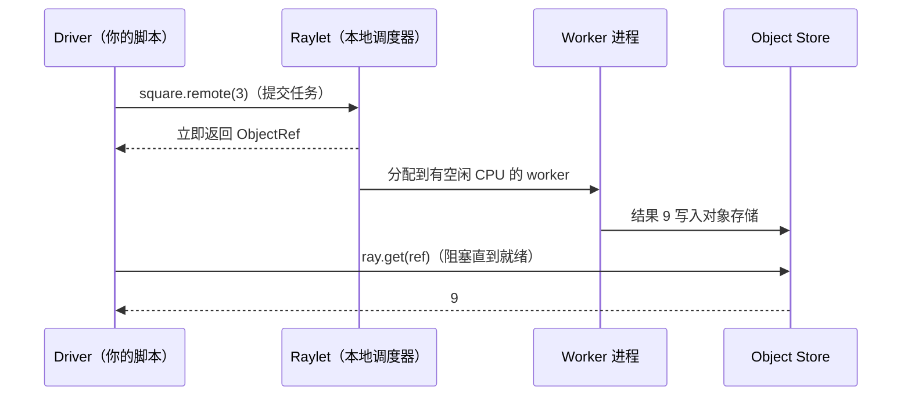
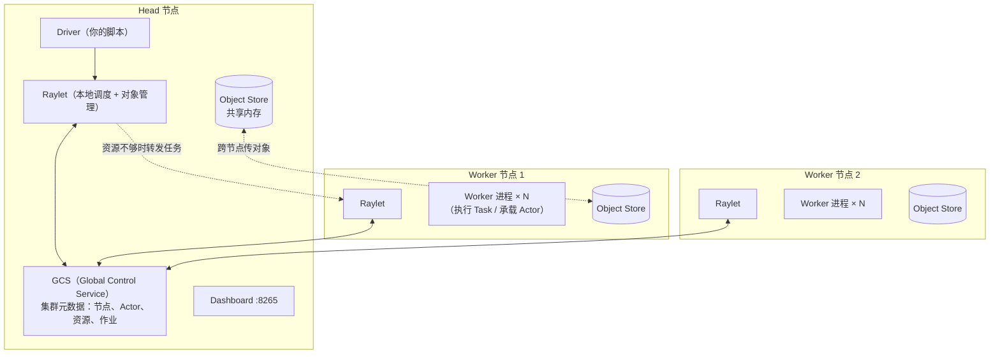
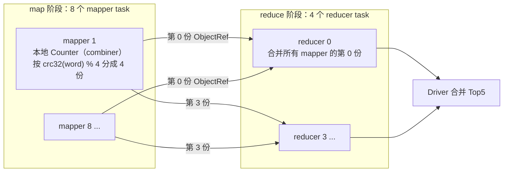
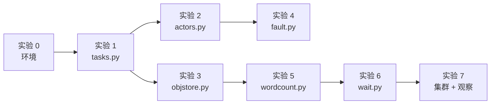

=== m2w1 | 第 5 周：Ray Core 与 Spark 概念对照 | 第 2 月 · Ray + 数据管线
# 第 5 周：Ray Core 与 Spark 概念对照

> **本周一句话**：Ray 是 AI 时代的“分布式执行底座”——Ray Data、Ray Train、Ray Serve、vLLM 的多机部署、很多 RL 框架都跑在它上面。对你来说，它最容易的切入方式是：**拿 Spark 的执行模型做参照系**，逐个找出 Ray 的 Task / Actor / Object Store / GCS 分别对应什么、又在哪里刻意不同。弄清这些“不同”，你就理解了为什么 AI 负载选择了 Ray 而不是 Spark。

**预计投入：约 10 小时**（阅读 ≈ 3.5h，动手 ≈ 4.5h，自测与产出 ≈ 2h），可分 5 天完成。{{local}}

**本周结束时你应该能：**

1. 用 `@ray.remote` 写出 Task 和 Actor，解释 `ObjectRef`、`ray.get`、`ray.put`、`ray.wait` 各自的语义，并说出它们在 Spark 里最接近的概念。
2. 画出 Ray 集群架构（Head 节点、GCS、Raylet、Worker、Object Store），并与 Spark 的 Driver / Cluster Manager / Executor / BlockManager 对照。
3. 解释 Ray 的**资源声明式调度**（`num_cpus`、`num_gpus`、自定义资源）如何决定并发度，以及它和 YARN container 的区别。
4. 说清楚 Ray 的容错模型：Task 自动重试、应用异常不重试、Actor 重启后状态丢失、对象靠 lineage 重建——并与 Spark 的 RDD lineage 对比。
5. 用 Task 手写一个 MapReduce（map → 按 key 分区 → reduce），借此理解 Ray Data 底层在做什么；用 `ray status` / `ray summary tasks` 观察集群。

> **验证说明**：本页所有命令和输出都在一台 Linux x86_64 机器（8 核、16 GB 内存、Python 3.12.15、ray 2.59.0、numpy 2.5.4）上实际运行过，输出为真实结果（删去了 Ray 的 INFO 日志行，过长的 raylet 日志行做了截断）。脚本里用 `ray.init(num_cpus=4)` 把可用 CPU 固定为 4，所以你在 Mac 上应当得到相近的**耗时比例**；绝对耗时、进程号、ObjectRef 的 ID 每次都不同。

---

## 1. 本周学习路线


| 天 | 时间 | 先读（概念） | 再读（外部资料，按顺序） | 再做（实验） |
|---|---|---|---|---|
| Day 1 | ~2h | 本页 2.1、2.2 | ① [Ray Core：Key Concepts](https://docs.ray.io/en/latest/ray-core/key-concepts.html)（15 分钟）；② [Ray Core：Getting Started / Walkthrough](https://docs.ray.io/en/latest/ray-core/walkthrough.html)（20 分钟）；③ [Ray Core：Tasks](https://docs.ray.io/en/latest/ray-core/tasks.html) 读到 *Passing object refs to Ray tasks* 为止（20 分钟） | 实验 0：环境；实验 1：Task |
| Day 2 | ~2h | 本页 2.3、2.4 | ④ [Ray Core：Actors](https://docs.ray.io/en/latest/ray-core/actors.html) 读到 *Terminating Actors* 之前（25 分钟）；⑤ [Resources](https://docs.ray.io/en/latest/ray-core/scheduling/resources.html) 全文（20 分钟） | 实验 2：Actor 与“加载一次模型” |
| Day 3 | ~2h | 本页 2.5 | ⑥ [Ray Core：Objects](https://docs.ray.io/en/latest/ray-core/objects.html)（15 分钟）；⑦ [Serialization](https://docs.ray.io/en/latest/ray-core/objects/serialization.html) 的 *Overview* 和 *Plasma Object Store* 两节（15 分钟）；⑧ [Anti-pattern：Passing the same large argument by value repeatedly](https://docs.ray.io/en/latest/ray-core/patterns/pass-large-arg-by-value.html)（10 分钟） | 实验 3：Object Store |
| Day 4 | ~2h | 本页 2.6、2.7 | ⑨ [Fault Tolerance](https://docs.ray.io/en/latest/ray-core/fault-tolerance.html) 总览 + [Task Fault Tolerance](https://docs.ray.io/en/latest/ray-core/fault_tolerance/tasks.html) + [Actor Fault Tolerance](https://docs.ray.io/en/latest/ray-core/fault_tolerance/actors.html) 的 *Actor process failure* 一节（35 分钟） | 实验 4：容错；实验 5：手写 MapReduce |
| Day 5 | ~2h | 本页 2.8 | ⑩ [Ray 论文（OSDI'18）](https://arxiv.org/abs/1712.05889) 只读第 1、3、4 节（40 分钟，读设计动机和架构，不必看实验）；⑪ [Anti-pattern：Calling ray.get in a loop](https://docs.ray.io/en/latest/ray-core/patterns/ray-get-loop.html)（10 分钟） | 实验 6：ray.wait；实验 7：集群观察；自测题；本周产出 |

**每日打卡：**

- [ ] Day 1：读完 ①②③，完成实验 0、1，能解释“提交 16 个任务只用了 0.17 秒”意味着什么
- [ ] Day 2：读完 ④⑤，完成实验 2，能说出推理服务为什么用 Actor 而不用 Task
- [ ] Day 3：读完 ⑥⑦⑧，完成实验 3，能解释“按值传 8 次”比“put 一次”慢的原因
- [ ] Day 4：读完 ⑨，完成实验 4、5，能区分“进程崩溃”和“应用异常”的重试行为
- [ ] Day 5：读完 ⑩⑪，完成实验 6、7、自测题、本周产出

---

## 2. 核心概念讲解

### 2.1 为什么 AI 负载需要 Ray，而不是直接用 Spark

Spark 的核心抽象是 **RDD/DataFrame 上的批量转换**：你描述“对整个数据集做什么”，Spark 生成 DAG、切 stage、按分区调度 task。它对 ETL 极其高效，但 AI 负载有几类需求它不擅长：

| AI 负载的需求 | Spark 的处境 | Ray 的设计 |
|---|---|---|
| **有状态的常驻进程**：一个 GPU 上加载一次 7B 模型，反复处理请求 | executor 里没有“用户可寻址的长期状态”；mapPartitions 里加载模型，分区结束就丢 | **Actor**：一个带状态的进程，有句柄、可以反复调用 |
| **异构资源**：一部分步骤要 GPU，一部分只要 CPU，比例要能调 | 一个 Spark 应用的 executor 规格通常统一；GPU 调度能力有限 | 每个 Task/Actor 单独声明 `num_cpus`/`num_gpus`/自定义资源 |
| **细粒度、动态的任务图**：强化学习、超参搜索、在线推理，下一步做什么取决于上一步的结果 | DAG 在 action 触发时整体生成，task 粒度粗（秒级以上） | 任务在运行时动态提交，毫秒级调度，任务可以再提交任务 |
| **低延迟服务**：在线推理 | 不是为服务设计的 | Ray Serve 构建在 Actor 之上 |
| **Python 原生**：PyTorch、vLLM 都是 Python | PySpark 是 JVM + Python 双进程，数据要跨进程序列化（第 1 周提到的 Arrow 只能缓解） | 纯 Python API，worker 就是 Python 进程 |

所以一种常见的分工是：**Spark 继续做结构化 ETL 和数仓，Ray 做“需要 GPU、需要模型常驻、需要 Python 生态”的那部分**——例如 LLM 数据清洗中的模型打分、批量推理、分布式训练。第 2 月的四周就是沿着这条线展开的。

### 2.2 Task：远程执行的函数，返回的是“期票”

**机制**：给函数加上 `@ray.remote`，它就变成了可以在集群任意 worker 上执行的 **Task**。调用时写 `f.remote(x)`，**立刻**返回一个 `ObjectRef`（对象引用，像一张“期票”），真正的计算在后台异步进行。需要结果时调用 `ray.get(ref)`，这一步会阻塞直到结果就绪。



**和 Spark 的对照**：

| Spark | Ray | 关键差异 |
|---|---|---|
| transformation（惰性）+ action（触发） | `.remote()` 立即开始执行，`ray.get()` 只是取结果 | Ray **不是惰性的**：提交即调度，没有全局优化器 |
| task（由 DAGScheduler 根据分区自动切出） | Task（由你显式提交，一次调用 = 一个 task） | 粒度和数量完全由你控制 |
| stage 之间的依赖由 shuffle 决定 | 把一个 `ObjectRef` 作为参数传给另一个 task，就形成依赖 | 任务图是**运行时动态构建**的 |
| `collect()` | `ray.get()` | 都会把数据拉回 Driver，大结果都危险 |

实验 1 的 `add.remote(square.remote(3), square.remote(4))` 就是一个三节点的 DAG：Ray 会等两个 `square` 完成，再自动把结果（而不是 ObjectRef）传给 `add`。

**常见反模式**：在循环里每提交一个任务就 `ray.get` 一次——这会让任务完全串行。正确做法是先把所有任务提交出去拿到一组 ObjectRef，再一次性 `ray.get(list)`（官方文档 *Anti-pattern: Calling ray.get in a loop*）。

### 2.3 Actor：有状态的常驻进程

**机制**：给**类**加上 `@ray.remote`，`Cls.remote()` 会在集群中启动一个**专属的 worker 进程**，在里面执行 `__init__`，返回一个 **Actor 句柄**。之后 `handle.method.remote()` 都发给这个进程执行，状态（成员变量）在调用之间保留。同一个 Actor 上的方法调用默认**按提交顺序串行执行**（实验 2：`[1, 2, 3, 4, 5]`）。

**为什么推理用 Actor**：加载模型很慢（7B 模型从磁盘读到 GPU 要几十秒），推理一个 batch 很快。用 Task 的话每个 task 都得重新加载；用 Actor 的话**加载一次，反复使用**。实验 2 用 `sleep(2)` 模拟加载：8 个 batch 用 Task 需要 4.4 秒（每个 task 都“加载”一次，4 个 CPU 并行两轮），用 2 个 Actor 只需 2.5 秒（各加载一次）。真实场景里加载时间远大于推理时间，差距是数量级的。Ray Data 的 `map_batches(..., concurrency=N)` 传入一个类时，底层就是起 N 个这样的 Actor（下周会用到）。

**类比**：Actor 像一个**常驻的微服务实例**，或者 Spark Streaming 里每个 executor 上长期持有的连接池/缓存——只不过 Ray 让它变成了一等公民：有句柄、可以被传递给别的 task、可以命名（`options(name=...)`）后被其他程序找到。

### 2.4 资源声明式调度：并发度 = 资源 ÷ 每任务需求

Ray 的调度器不关心你的任务“实际”用了多少 CPU，只看**声明**：

- 每个节点启动时声明自己有多少资源（`ray.init(num_cpus=4)` 或自动探测，GPU 同理）；
- 每个 Task 默认声明 `num_cpus=1`；Actor 默认**调度时**需要 1 个 CPU、**运行时**占 0 个 CPU（官方文档 *Resources* 一节有说明，这意味着默认 Actor 不限制并发数，是常见的“超卖”来源）；
- 调度器把任务放到“剩余资源 ≥ 需求”的节点上，资源不够就排队。

实验 1 里：4 个 CPU、每任务 1 CPU → 同时跑 4 个，16 个 0.5 秒任务约 4 轮 = 2 秒（实测 2.4 秒，含 worker 进程启动）；改成 `num_cpus=2` → 同时只能跑 2 个，8 轮 = 4 秒（实测 4.0 秒）。

| YARN / Spark | Ray | 说明 |
|---|---|---|
| NodeManager 上报 vcores / memory | Raylet 上报 CPU / GPU / memory / 自定义资源 | 都是“逻辑资源” |
| `spark.executor.cores`、container 大小 | 每个 Task/Actor 的 `num_cpus`、`num_gpus` | Ray 的粒度更细：每个函数可以不同 |
| 节点标签（node label） | 自定义资源（如 `resources={"A100": 1}`）、节点标签 | 用来把任务约束到特定机型 |
| 资源是**硬隔离**（cgroup） | 默认**不隔离**：声明 1 CPU 的任务照样可以用满 8 核 | 需要自己保证“声明 ≈ 实际” |

**GPU 场景的关键**：`@ray.remote(num_gpus=1)` 会让 Ray 为该进程设置 `CUDA_VISIBLE_DEVICES`，保证不同任务拿到不同的卡；也支持 `num_gpus=0.5` 让两个小模型共享一张卡（Ray 只做记账，显存不会被隔离）。第 3 月学 K8s 调度时你会再次遇到“声明 vs 实际”的问题。

### 2.5 Object Store：共享内存里的不可变对象

Task 的返回值和 `ray.put()` 的对象都放进每个节点上的 **Object Store**（基于共享内存的 Plasma 存储）。要点：

1. **不可变**：对象一旦写入就不能修改（实验 3：worker 试图修改得到 `assignment destination is read-only`）。
2. **同节点零拷贝**：NumPy 数组（以及 Arrow 数据）在同一节点的多个 worker 之间是共享内存映射，读取不需要复制和反序列化。官方 *Serialization* 文档称之为 zero-copy deserialization。
3. **跨节点按需拉取**：worker 需要另一节点上的对象时，由 Object Store 之间传输。
4. **引用计数 + 溢写**：没有 ObjectRef 指向的对象会被回收；内存不够时溢写到磁盘（object spilling）。
5. **小对象不进共享内存**：很小的返回值直接存在调用方进程内存里（官方称为 in-process store），避免共享内存开销。

**一个对 Mac 用户很重要的细节**：官方文档 *Memory Management* 一节说明，Ray 默认用 30% 的可用内存做 Object Store，Linux 上放在 `/dev/shm`（共享内存），**macOS 上放在 `/tmp`（磁盘）**，性能会比 Linux 差。所以你在 Mac 上做实验 3 时，两种传参方式的差距可能和本站不同。

**实验 3 的启示**：把一个 191 MB 的数组**按值**传给 8 个任务，Ray 会为每次调用各做一次序列化和写入（0.53 秒）；先 `ray.put` 一次再传 ObjectRef，只存一份（0.07 秒）。这就是 Spark 的**广播变量**——`ray.put` + 传引用就是 Ray 版的 `sc.broadcast`。

**所有权（ownership）**：每个对象有一个“所有者”——创建它的那个 worker（调用 `.remote()` 或 `ray.put()` 的进程）。所有者负责记录这个对象的元数据和引用计数。如果所有者进程挂了，它拥有的对象也会变得不可用。这和 Spark 中“Driver 挂了整个应用就没了”类似，但粒度更细。读 Ray 论文和架构白皮书时会反复遇到这个概念。

### 2.6 Ray 集群架构：与 Spark 一一对照



| Spark on YARN | Ray | 说明 |
|---|---|---|
| Driver（SparkContext） | Driver（调用 `ray.init()` 的脚本） | 都是用户程序入口 |
| ResourceManager | GCS + 各节点 Raylet | Ray 的调度是**分布式两级**的：先由本地 Raylet 尝试，资源不够再转发 |
| NodeManager + Executor JVM | Raylet + 一组 Worker 进程 | Ray 的 worker 是 Python 进程，按需启动、可复用 |
| BlockManager（缓存 RDD 分区） | Object Store（Plasma） | 都存中间结果，Ray 的是共享内存不可变对象 |
| DAGScheduler / TaskScheduler | 无全局 DAG 调度器，任务提交即由 Raylet 调度 | 这是 Ray 能做到毫秒级调度的原因，也是它“没有查询优化器”的原因 |
| Spark UI :4040 | Ray Dashboard :8265、`ray status`、State API（`ray list` / `ray summary`） | 实验 7 |
| `spark-submit` | `ray job submit` 或直接 `python script.py` 连接集群 | |

### 2.7 容错：重试、重启与 lineage

| 故障类型 | Ray 的默认行为 | 实验 4 实测 | Spark 的对应 |
|---|---|---|---|
| Task 执行中 worker 进程崩溃（OOM、段错误、机器宕机） | **自动重试**，默认最多 3 次（`max_retries`） | 偶数号任务第一次崩溃，被重试后成功，6 个结果齐全 | task 失败重试（`spark.task.maxFailures` 默认 4） |
| Task 抛出应用异常（如 ValueError） | **不重试**，异常包装成 `RayTaskError` 抛回 Driver；可用 `retry_exceptions=True` 开启 | `RayTaskError(ValueError) ... 脏数据` | 应用异常同样会计入失败重试 |
| Actor 进程崩溃 | 默认**不重启**（`max_restarts=0`）；设置后会重新执行 `__init__`，**内存状态丢失** | 重启后计数从 1 重新开始，pid 变了；重启期间的调用报 `ActorUnavailableError` | 无直接对应（Spark 没有用户 Actor） |
| 对象丢失（存它的节点挂了） | 通过 **lineage 重建**：重新执行生成它的 task | 未在本站实验 | RDD lineage 重算丢失的分区 |
| Head 节点 / GCS 挂了 | 默认整个集群不可用；生产上可以把 GCS 状态放外部 Redis 做高可用 | 未在本站实验 | Driver / RM 高可用 |

**架构师要记住的两点**：

1. **Actor 状态不会自动持久化**。如果 Actor 里有重要状态（例如累计的统计、处理到的 offset），要自己定期写 checkpoint——这和流处理里 Flink 的状态后端是同一个问题，但 Ray 不替你做。
2. **重试要求幂等**。被重试的 task 可能已经执行了一半（比如写了一半文件），写外部系统的 task 必须设计成可重入。这和你在 Spark 里处理“task 重试导致重复写”的经验完全一致。

### 2.8 从 Task 到 Ray Data：手写一次 MapReduce

下周的 Ray Data 会帮你自动完成分块、调度、流式执行、shuffle。但在用它之前，值得用 Task 手写一次 MapReduce，看看底下发生了什么（实验 5）：



- `@ray.remote(num_returns=R)` 让一个 mapper 返回 R 个独立的 ObjectRef——每个对应一个 shuffle 分区，这就是 **shuffle write**。
- reducer 接收所有 mapper 的第 r 份——这就是 **shuffle read**。数据通过 Object Store 传递，不落 HDFS。
- **分区函数必须稳定**：Python 内置的 `hash(str)` 在每个进程里带随机盐（`PYTHONHASHSEED`），不同 mapper 进程对同一个单词可能算出不同的分区，导致同一个 key 被分到多个 reducer。实验 5 用 `zlib.crc32` 并检查“各 reducer 的 key 互不重叠: True”。这个坑在任何“多 Python 进程按 key 分区”的系统里都存在，PySpark 也需要处理同样的问题。

这就是“Ray 是比 Spark 更底层的积木”的含义：Spark 把 shuffle 作为内建能力，Ray Core 只给你 Task + Object Store，shuffle 由上层库（Ray Data）用这些积木实现。

---

## 3. 动手实验 {{local}}

所有脚本放在 `~/ai-infra-lab/w5/`。每个脚本都自己 `ray.init()` 启动一个临时的本地 Ray（脚本结束即销毁），只有实验 7 演示“先起集群、再连接”。



### 实验 0：安装 Ray（10 分钟）

```bash
cd ~/ai-infra-lab && source .venv/bin/activate && mkdir -p w5 && cd w5
uv pip install "ray[data,default]==2.59.0"
python -c "import sys,ray,numpy;print(sys.version.split()[0],ray.__version__,numpy.__version__)"
```

**本站输出**：

```text
3.12.15 2.59.0 2.5.4
```

`ray[default]` 包含 Dashboard 和集群命令行工具，`ray[data]` 是下周要用的 Ray Data。

### 实验 1：Task 并行与资源声明（25 分钟）

`tasks.py`：

```python
@@CODE:w5/tasks.py@@
```

```bash
python tasks.py
```

**本站输出**：

```text
集群资源: {'node:__internal_head__': 1.0, 'node:172.30.0.2': 1.0, 'CPU': 4.0, 'memory': 4605907354.0, 'object_store_memory': 1973960294.0}
提交 16 个任务用时 0.166s，拿到的是: ObjectRef(c8ef45ccd0112571ffffffffffffffffffffffff0100000001000000)
结果: [0, 1, 4, 9, 16, 25, 36, 49, 64, 81, 100, 121, 144, 169, 196, 225] 总用时 2.4s
num_cpus=2 时 16 个任务总用时 4.0s
DAG 结果 3²+4² = 25
```

**逐步解释**：

- **集群资源**：`CPU: 4.0` 来自 `num_cpus=4`；`memory` 和 `object_store_memory` 是 Ray 根据本机可用内存自动计算的逻辑资源（单位字节，约 4.3 GiB 和 1.8 GiB）。
- **提交 16 个任务只用了 0.17 秒**：`.remote()` 是非阻塞的，提交完立刻返回 ObjectRef，这时任务还在排队或执行。
- **总用时 2.4 秒**：理论值 16 ÷ 4 × 0.5 = 2.0 秒，多出来的主要是第一次启动 worker 进程的开销。
- **`num_cpus=2` 用时 4.0 秒**：每个任务声明要 2 个 CPU，4 个 CPU 只能同时跑 2 个。注意任务**实际**只是在 sleep，几乎不用 CPU——Ray 按声明调度，不按实际用量。
- **DAG**：把 ObjectRef 传给 `add`，Ray 会先等两个 `square` 完成，再把**值**（9 和 16）传进去。

### 实验 2：Actor——有状态的常驻进程（25 分钟）

`actors.py`：

```python
@@CODE:w5/actors.py@@
```

**本站输出**：

```text
Actor 内方法按提交顺序串行执行: [1, 2, 3, 4, 5]
Actor 进程 pid: 987712  Driver pid: 987480
用 Task（每次加载模型）处理 8 个 batch: 4.4s
用 2 个 Actor（各加载一次）处理 8 个 batch: 2.5s，首个结果 [0, 3, 6, 9]
```

**逐步解释**：

- 5 次 `add` 按顺序返回 1～5：同一个 Actor 的方法串行执行，所以不需要加锁。
- Actor 运行在**另一个进程**里（pid 不同于 Driver）。
- **Task 版 4.4 秒**：8 个 task、4 个 CPU，两轮，每轮都“加载模型” 2 秒。
- **Actor 版 2.5 秒**：2 个 Actor 构造时各“加载” 2 秒（并行），之后 8 次 `predict` 几乎不耗时。如果 batch 数增加到 800，Task 版会线性增长到约 400 秒，Actor 版基本不变——这就是推理场景必须用 Actor 的原因。
- `pool[i % 2]` 是最朴素的轮询负载均衡。Ray 提供了 `ray.util.ActorPool`，Ray Data 的 `map_batches` 会自动做这件事。

### 实验 3：Object Store 与“广播变量”（25 分钟）

`objstore.py`：

```python
@@CODE:w5/objstore.py@@
```

**本站输出**：

```text
数组大小 191 MB
按值传 8 次: 0.53s
put 一次 + 传引用: 0.07s
只读: assignment destination is read-only
```

**逐步解释**：

- 2500 万个 float64 = 200,000,000 字节 ≈ 191 MiB（脚本里 `2**20` 为 1 MiB）。
- **按值传**：每次 `.remote(arr, i)` 时，Ray 都要把这个大数组序列化并写入 Object Store（官方文档称这是反模式：*Passing the same large argument by value repeatedly*）。
- **put 一次 + 传引用**：只写入一次，8 个 worker 通过共享内存读取同一份数据，零拷贝。差距约 7 倍，而且对象越大、任务越多、跨节点时差距越大。
- **只读**：worker 拿到的 NumPy 数组直接映射在共享内存上，不可修改。需要修改时先 `a = a.copy()`。
- 在 Mac 上 Object Store 位于 `/tmp`（见 2.5 节），两者的绝对耗时会不同。

### 实验 4：容错——重试、异常与 Actor 重启（30 分钟）

`fault.py`：

```python
@@CODE:w5/fault.py@@
```

**本站输出**（raylet 日志行已截断）：

```text
(raylet) A worker died or was killed while executing a task by an unexpected system error. To troubleshoot the problem, check the logs for the dead wor...
(raylet) Task flaky failed. There are 3 retries remaining, so the task will be retried. Error: 
进程崩溃会被自动重试: [(0, 991729), (1, 991628), (2, 991729), (3, 991729), (4, 991729), (5, 991729)]
应用异常传回 Driver: RayTaskError(ValueError) | ValueError: 脏数据
重启前: (1, 991814) (2, 991814)
调用失败: ActorUnavailableError
重启后（状态丢失、pid 变化）: (1, 991815)
```

**逐步解释**：

- **进程崩溃自动重试**：0、2、4 号任务第一次执行时调用 `os._exit(1)` 杀死自己所在的 worker 进程（用标记文件保证只崩一次），Ray 检测到 worker 异常退出，按 `max_retries=3` 重新调度，最终 6 个结果全部返回。raylet 打印的日志说明了原因和剩余重试次数。
- **应用异常不重试**：`ValueError` 被包装成 `RayTaskError(ValueError)` 在 `ray.get` 时抛出，Driver 可以 `try/except` 处理。真实数据管线里，一条脏数据引发的异常**不应该**无脑重试——重试一万次还是脏数据。
- **Actor 重启**：`max_restarts=1` 允许重启一次。`die()` 杀死进程后，Ray 重新启动一个进程并执行 `__init__`，所以 `calls` 从 1 重新开始、pid 从 991814 变为 991815。重启过程中的调用报 `ActorUnavailableError`，脚本里用循环重试。
- 重要：如果把 `fault.py` 里的 `max_restarts=1` 去掉，`die()` 之后的调用会得到 `ActorDiedError`，Actor 永久不可用。

### 实验 5：用 Task 手写 MapReduce（30 分钟）

`wordcount.py`：

```python
@@CODE:w5/wordcount.py@@
```

**本站输出**：

```text
各 reducer 的 key 是否互不重叠: True
Top5: [('the', 100000), ('dog', 50000), ('and', 50000), ('fox', 50000), ('brown', 25000)] 用时 0.34s
```

**逐步解释**：

- 4 句话 × 25,000 = 10 万行；`the` 在每组 4 句中出现 4 次，共 100,000 次，结果正确。（计数并列的词之间顺序不固定，你的 Top5 第 5 名可能是 `lazy`、`quick` 等其他计数为 25,000 的词。）
- `num_returns=R` + `m[r]`：mapper 输出 R 个分区，reducer r 只读每个 mapper 的第 r 个分区——标准的 hash shuffle。
- **combiner**：mapper 内部先用 `Counter` 本地聚合，再输出，大幅减少 shuffle 数据量（第 1 周讲过的“可加指标先局部合并”）。
- **稳定哈希**：试着把 `zlib.crc32(w.encode())` 改回 `hash(w)` 再运行，观察“各 reducer 的 key 是否互不重叠”是否变成 `False`（取决于各 worker 进程的随机哈希种子；最终 Top5 仍然正确，因为 Driver 把所有 reducer 的结果又合并了一遍——但在真实的分布式 reduce 里这就是错误结果）。

### 实验 6：ray.wait——先完成先处理（15 分钟）

`wait.py`：

```python
@@CODE:w5/wait.py@@
```

**本站输出**：

```text
0.6s 完成 (2, 0.34)
0.7s 完成 (1, 0.43)
0.8s 完成 (3, 0.48)
0.8s 完成 (4, 0.26)
1.0s 完成 (7, 0.18)
1.1s 完成 (5, 0.42)
1.2s 完成 (6, 0.43)
3.3s 完成 (0, 3.0)
```

**逐步解释**：

- `ray.wait(pending, num_returns=1)` 返回“已完成的 1 个”和“剩余的”，结果按**完成顺序**而不是提交顺序处理。如果用 `ray.get(pending)`，前 7 个结果要陪 0 号长尾任务一起等到 3.3 秒。
- 4 号、7 号任务虽然很短，但要等前面的任务让出 CPU 才能开始，所以完成时间晚于自身耗时。
- 这是处理**长尾（straggler）**的基本手段，也是“控制在途任务数”（官方 *Pattern: Using ray.wait to limit the number of pending tasks*）的基础：当你要提交 100 万个任务时，不要一次全提交，而是保持最多 N 个在途，完成一个再补一个——这正是 Ray Data 的流式执行在做的事。

### 实验 7：起一个本地集群并观察（25 分钟）

前面的脚本都是“脚本内临时集群”。生产中是先启动集群，再由多个作业连接。`cluster_job.py`：

```python
@@CODE:w5/cluster_job.py@@
```

```bash
export RAY_AUTH_MODE=token        # 见下方说明
ray start --head --num-cpus=4 --dashboard-host=127.0.0.1
python cluster_job.py
ray status
ray summary tasks
ray list actors
# 浏览器打开 http://127.0.0.1:8265 查看 Dashboard
ray stop
```

**本站输出**（节选）：

```text
ok
======== Autoscaler status: 2026-10-20 10:32:55.750649 ========
Node status
---------------------------------------------------------------
Active:
 1 node_ba64499a7dc04e0ea93ab904a149edec991cd4539db71c183cae7555
...
Resources
---------------------------------------------------------------
Total Usage:
 4.0/4.0 CPU
 0B/4.11GiB memory
 0B/1.76GiB object_store_memory
...
Pending Demands:
 {'CPU': 1.0}: 24+ pending tasks/actors

Table (group by func_name):
------------------------------------
    FUNC_OR_CLASS_NAME      STATE_COUNTS    TYPE
0   work                    FINISHED: 40    NORMAL_TASK
1   Keeper.ping             FINISHED: 1     ACTOR_TASK
2   keeper:Keeper.__init__  FINISHED: 1     ACTOR_CREATION_TASK

Table:
------------------------------
    ACTOR_ID                          CLASS_NAME    STATE      JOB_ID  NAME    NODE_ID   PID  RAY_NAMESPACE
 0  b0380525a360918a9c51b6fc01000000  Keeper        ALIVE    01000000  keeper  ba64...   993997  256e9c5a-...
```

**逐步解释**：

- **关于 `RAY_AUTH_MODE=token`**：本站使用的 Ray 2.59.0 在 `ray start` 时默认启用了**令牌认证**（启动日志：`Token authentication is enabled for this Ray cluster. Set RAY_AUTH_MODE=disabled to opt out.`），并把令牌写到 `~/.ray/auth_token`。不设置这个环境变量时，本站的 `ray status` 报错 `AuthenticationError: ... Authentication token is missing or incorrect. Note: RAY_AUTH_MODE is currently 'disabled'`。设置后 CLI 会读取令牌文件。详见 [Ray 文档：Token authentication](https://docs.ray.io/en/latest/ray-security/token-auth.html)。不同 Ray 版本的默认行为可能不同，以你本机的启动日志为准。
- **`ray status` 是 autoscaler 的周期性快照**：这次输出显示 4/4 CPU 在用、24+ 个任务等待——那是作业运行过程中采集的状态，作业已经结束但快照还没刷新。看实时状态请用 Dashboard 或 State API。
- **`ray summary tasks`**：按函数名统计任务状态，40 个 `work` 全部 FINISHED。这是 Ray 版的“Spark UI 的 stage 页面”。
- **`ray list actors`**：`keeper` 是 `lifetime="detached"` 的具名 Actor，Driver 脚本退出后它仍然 ALIVE，其他作业可以通过 `ray.get_actor("keeper", namespace=...)` 找到它。这是在 Ray 上实现“常驻服务”的方式（Ray Serve 就建立在类似机制上）。启动时 Ray 提示它在匿名 namespace 中，生产中应显式指定 `ray.init(namespace=...)`。
- Dashboard（8265 端口）里可以看到每个任务的时间线、每个 Actor 的日志、Object Store 用量，对应 Spark UI 的 Jobs / Executors / Storage 页面。

### 常见错误与排查

| 现象（真实报错或现象） | 原因 | 解决 |
|---|---|---|
| `ray.exceptions.AuthenticationError: RPC error: InvalidAuthToken ...`（`ray status` 等 CLI） | `ray start` 启用了令牌认证，但 CLI 没有读取令牌 | `export RAY_AUTH_MODE=token`；或启动集群前设置 `RAY_AUTH_MODE=disabled`（仅限本机实验） |
| `ray.exceptions.WorkerCrashedError: The worker died unexpectedly while executing this task` | task 所在进程崩溃且重试次数用完（本站一次随机崩溃版本的 fault.py 就遇到了） | 查看 `/tmp/ray/session_latest/logs/` 下对应 worker 日志；检查是否 OOM；提高 `max_retries` 只能缓解 |
| `RayTaskError(ValueError)` 等 | task 里抛了应用异常 | 修代码/数据；确需重试的用 `retry_exceptions=[具体异常]` |
| `ActorUnavailableError` / `ActorDiedError` | Actor 正在重启 / 已永久死亡 | 设置 `max_restarts`；调用方做重试；重要状态自己 checkpoint |
| `ValueError: assignment destination is read-only` | 修改了来自 Object Store 的 NumPy 数组 | 先 `.copy()` 再改 |
| 任务全部串行、速度没有提升 | 在循环里逐个 `ray.get` | 先收集所有 ObjectRef，再一次 `ray.get(list)` 或用 `ray.wait` |
| 声明 `num_cpus=1` 但一个任务吃满所有核 | Ray 不做 CPU 隔离；NumPy/PyTorch 内部多线程 | 设置 `OMP_NUM_THREADS` 等环境变量，或让声明与实际一致 |
| Mac 上大对象读写明显比本页慢 | macOS 上 Object Store 在 `/tmp`（磁盘）而不是 `/dev/shm` | 正常现象；减小对象或在 Linux 上做性能实验 |
| `ConnectionError: Could not find any running Ray instance`（`ray.init(address="auto")` 时，未在本站复现） | 没有先 `ray start --head` | 先启动集群，或去掉 `address` 参数改为脚本内临时集群 |

### 扩展练习（选做，每题 20–40 分钟）

1. **ActorPool**：把实验 2 的手工轮询换成 `ray.util.ActorPool` 的 `map`，比较代码量和行为（结果顺序是否保持）。
2. **嵌套任务与死锁**：写一个 task，内部再提交 4 个子 task 并 `ray.get` 它们；在 `num_cpus=2` 的集群上同时提交 4 个这样的父 task，观察会发生什么。阅读官方 *Nested Remote Functions* 文档中关于阻塞时释放 CPU 的说明，解释结果。
3. **控制在途任务数**：提交 10,000 个小任务，分别用“一次全提交”和“最多 100 个在途（`ray.wait` 补位）”两种方式，比较 Driver 进程内存和总耗时。
4. **lineage 重建（需要两个节点）**：在同一台机器上 `ray start --head` 后再 `ray start --address=... --num-cpus=2` 加入第二个“节点”，让一个 task 的结果落在第二个节点上，然后 `ray stop` 掉它，观察 `ray.get` 是否触发重算（阅读 *Object Fault Tolerance* 文档）。
5. **Spark 版本对照**：用 PySpark（下下周会装）写同样的 wordcount，对比两者的代码结构：哪些步骤 Spark 替你做了，Ray Core 需要你自己写？

---

## 4. 精读指南

### ①②③ Ray Core 入门（55 分钟）

- [Key Concepts](https://docs.ray.io/en/latest/ray-core/key-concepts.html)：**读完回答**：Ray Core 的三个核心原语是什么？官方文档如何描述 Actor 与 Task 的区别？
- [Walkthrough](https://docs.ray.io/en/latest/ray-core/walkthrough.html)：跟着跑一遍，和本页实验 1、2 对照。
- [Tasks](https://docs.ray.io/en/latest/ray-core/tasks.html)：读到 *Passing object refs to Ray tasks*。**重点**：指定资源、`num_returns`、把 ObjectRef 作为参数时 Ray 如何等待依赖。**读完回答**：把 ObjectRef 作为顶层参数和放在列表里作为参数，task 收到的东西有什么不同？

### ④⑤ Actor 与资源（45 分钟）

- [Actors](https://docs.ray.io/en/latest/ray-core/actors.html)：读到 *Terminating Actors* 之前。**读完回答**：Actor 方法默认串行执行；文档中提到的异步 Actor / 线程化 Actor 分别适合什么场景（第 4 月推理服务会用到）？
- [Resources](https://docs.ray.io/en/latest/ray-core/scheduling/resources.html)：**重点**：逻辑资源 vs 物理资源；Actor 默认的 CPU 声明；分数 GPU。**读完回答**：文档如何解释“Ray 不提供 CPU 隔离”？为什么默认 Actor 运行时占 0 个 CPU？

### ⑥⑦⑧ Object Store（40 分钟）

- [Objects](https://docs.ray.io/en/latest/ray-core/objects.html)：**读完回答**：对象为什么是不可变的？`ray.put` 返回的 ObjectRef 和 task 返回的 ObjectRef 有区别吗？
- [Serialization](https://docs.ray.io/en/latest/ray-core/objects/serialization.html) 的 *Overview*、*Plasma Object Store*：**读完回答**：哪些类型可以零拷贝读取？Plasma 与 Apache Arrow 有什么渊源？
- [Anti-pattern：Passing the same large argument by value repeatedly](https://docs.ray.io/en/latest/ray-core/patterns/pass-large-arg-by-value.html)：对照实验 3。

### ⑨ 容错（35 分钟）

- [Fault Tolerance](https://docs.ray.io/en/latest/ray-core/fault-tolerance.html)、[Task Fault Tolerance](https://docs.ray.io/en/latest/ray-core/fault_tolerance/tasks.html)、[Actor Fault Tolerance](https://docs.ray.io/en/latest/ray-core/fault_tolerance/actors.html)：**读完回答**：① 默认重试次数是多少？如何全局修改？② `max_task_retries` 与 `max_restarts` 的区别？③ 文档对“重试要求幂等”给出了什么建议？

### ⑩⑪ Ray 论文与反模式（50 分钟）

- [Ray: A Distributed Framework for Emerging AI Applications（OSDI'18）](https://arxiv.org/abs/1712.05889)：只读第 1 节（动机）、第 3 节（编程模型与计算模型）、第 4 节（架构：GCS、自底向上的分布式调度器、内存对象存储）。**读完回答**：论文为什么把控制状态集中到 GCS、而让调度“自底向上”？这与 Spark 的集中式 DAGScheduler 有何取舍？（注意：论文描述的是 2018 年的设计，部分细节已演进，如今的实现以官方文档为准。）
- [Anti-pattern：Calling ray.get in a loop](https://docs.ray.io/en/latest/ray-core/patterns/ray-get-loop.html)：对照实验 1、6。

### 背景阅读（不计入本周时间）

- [Ray 架构白皮书（Ray v2 Architecture，Google Docs）](https://docs.google.com/document/d/1tBw9A4j62ruI5omIJbMxly-la5w4q_TjyJgJL_jN2fI/preview)：官方的详细架构文档，包括所有权模型、对象管理、调度细节，适合想深入的周末阅读。
- [Ray Core：Design Patterns & Anti-patterns 目录](https://docs.ray.io/en/latest/ray-core/patterns/index.html)：一组短小的模式/反模式文档，每篇 5 分钟。
- [Spark：Cluster Mode Overview](https://spark.apache.org/docs/latest/cluster-overview.html)：用来和本页 2.6 节对照的 Spark 官方架构说明。
- [Ray Observability：Getting Started](https://docs.ray.io/en/latest/ray-observability/getting-started.html)：Dashboard 各页面说明。

---

## 5. 自测题

<details>
<summary>1. <code>f.remote(x)</code> 返回什么？为什么提交 16 个任务只用了 0.17 秒？</summary>

返回一个 `ObjectRef`（对结果对象的引用），调用是非阻塞的：任务被提交给调度器后立刻返回，计算在后台进行。0.17 秒只是提交的开销，真正的计算在 `ray.get` 等待期间完成。这与 Spark 的惰性求值不同——Ray 提交即开始调度执行。

</details>

<details>
<summary>2. 推理场景为什么用 Actor 而不是 Task？Ray Data 中对应的用法是什么？</summary>

模型加载代价远大于单次推理，Actor 在 `__init__` 中加载一次、在多次方法调用间保留状态，避免反复加载。Task 无状态，每次都要重新加载。Ray Data 中给 `map_batches` 传入一个类（而不是函数）并设置 `concurrency`，底层就会启动对应数量的 Actor 池。

</details>

<details>
<summary>3. 4 个 CPU 的集群，提交 16 个声明 <code>num_cpus=2</code> 的 0.5 秒任务，大约多久？如果任务实际只用了 0.1 个 CPU 呢？</summary>

同时只能运行 4/2 = 2 个，共 8 轮 × 0.5 秒 ≈ 4 秒（实验 1 实测 4.0 秒）。实际 CPU 用量不影响调度，仍然约 4 秒——Ray 按声明的逻辑资源调度，不按实际用量。声明过大会浪费资源，过小会导致超卖。

</details>

<details>
<summary>4. Ray 的 <code>ray.put</code> 对应 Spark 的什么？为什么按值传大对象给多个任务很慢？</summary>

对应广播变量（`sc.broadcast`）。按值传参时，每次调用都会把大对象序列化写入 Object Store，N 次调用就有 N 份；`ray.put` 一次后传 ObjectRef，只存一份，同节点 worker 通过共享内存零拷贝读取（实验 3：0.53 秒 vs 0.07 秒）。

</details>

<details>
<summary>5. Task 中 worker 进程崩溃和抛出 ValueError，Ray 的默认处理有何不同？为什么这样设计？</summary>

进程崩溃（系统故障）默认自动重试，最多 3 次；应用异常默认不重试，包装成 `RayTaskError` 抛回调用方。系统故障往往是暂时的（节点宕机、被抢占），重试可能成功；应用异常往往是确定性的（代码 bug、脏数据），重试大概率仍失败，还浪费资源。需要时可以用 `retry_exceptions` 显式开启。

</details>

<details>
<summary>6. Actor 设置 <code>max_restarts=1</code> 后进程崩溃，重启后它的成员变量还在吗？</summary>

不在。重启会启动新进程并重新执行 `__init__`，内存中的状态全部丢失（实验 4：计数从 1 重新开始）。需要保留的状态必须由应用自己定期持久化，并在 `__init__` 中恢复。

</details>

<details>
<summary>7. 手写 MapReduce 时为什么不能用 Python 内置 <code>hash()</code> 做分区？</summary>

Python 对 str/bytes 的哈希带有进程级随机盐（`PYTHONHASHSEED`），不同 worker 进程对同一个 key 可能算出不同的哈希值，导致同一个 key 被分到不同 reducer，reduce 结果错误。应使用稳定的哈希函数（如 `zlib.crc32`、`hashlib`）。

</details>

<details>
<summary>8. 把 Ray 的组件与 Spark on YARN 一一对应：GCS、Raylet、Worker 进程、Object Store、Dashboard。</summary>

GCS ≈ ResourceManager 中的集群元数据部分（节点、资源、应用/Actor 注册）；Raylet ≈ NodeManager + 本地任务调度器；Worker 进程 ≈ Executor（但每个是独立 Python 进程，按需起停）；Object Store ≈ BlockManager（存中间结果）；Dashboard ≈ Spark UI。主要差异：Ray 没有集中式 DAG 调度器，调度由各节点 Raylet 自底向上完成。

</details>

<details>
<summary>9. <code>ray.wait</code> 解决什么问题？举一个数据管线中的用例。</summary>

按完成顺序获取结果，避免被最慢的任务阻塞，并可以用来限制在途任务数。用例：处理 100 万个文件时保持最多 200 个在途任务，每完成一个就把结果写出并补提交一个新任务，既控制 Driver 内存和 Object Store 用量，又避免长尾任务拖住整个批次。

</details>

<details>
<summary>10. Ray 在 macOS 和 Linux 上的 Object Store 位置有何不同？会有什么影响？</summary>

官方文档说明：Linux 默认放在 `/dev/shm`（共享内存），macOS 放在 `/tmp`（磁盘）。macOS 上大对象读写性能会差一些，所以在 Mac 上做的性能测试结论不一定能直接推广到 Linux 生产集群。

</details>

### 思考题（架构师视角，没有标准答案，写成 200–300 字的短文）

1. **Spark 与 Ray 的边界**：你的团队现有一套成熟的 Spark 数仓。现在要做 LLM 预训练数据清洗（需要调用 GPU 上的质量打分模型）。哪些步骤留在 Spark、哪些迁到 Ray？两者之间用什么格式、什么存储交接？
2. **没有优化器的代价**：Spark SQL 有 Catalyst 优化器，会做谓词下推、Join 重排；Ray Core 完全没有，Ray Data 也只有很有限的优化。这对写管线的工程师提出了什么要求？平台层可以做什么来弥补？
3. **Actor 状态与容错**：设计一个用 Ray Actor 实现的“在线特征计数器”（例如统计每个用户最近 1 小时的点击数），说明你会如何做状态持久化和故障恢复，并对比 Flink 的做法。
4. **资源声明治理**：Ray 不做 CPU 隔离，按声明调度。在一个多团队共享的 Ray 集群上，如何防止“声明 1 个 CPU、实际吃满 32 核”的作业影响他人？（提示：第 3 月的 K8s + KubeRay 会给出一部分答案。）

---

## 6. 本周产出与掌握清单

### 本周产出（Deliverables）

放进 `~/ai-infra-lab/w5/` 并提交到 git：

1. **代码**：`tasks.py`、`actors.py`、`objstore.py`、`fault.py`、`wordcount.py`、`wait.py`、`cluster_job.py`。
2. **`README.md`（实验报告，500–1000 字）**：版本信息；每个实验在你 Mac 上的输出与本页的差异（特别是实验 3 的耗时比例）；Dashboard 截图 2 张（任务时间线、Actor 列表）。
3. **`spark_vs_ray.md`（对照表）**：至少 15 行“Spark 概念 ↔ Ray 概念 ↔ 关键差异”，覆盖执行模型、调度、存储、容错、观测五个方面，至少 3 行来自你工作中真实遇到过的 Spark 问题。
4. **一段“架构师笔记”**：从思考题中任选 1 题写成短文。

### 掌握清单

- [ ] 能写出 Task 和 Actor，解释 ObjectRef、ray.get、ray.put、ray.wait 的语义
- [ ] 能解释 Ray 的“提交即执行”与 Spark 惰性求值的区别
- [ ] 能说出推理场景用 Actor 的原因，并用实验 2 的数字佐证
- [ ] 能根据资源声明计算并发度，并说明 Ray 不做资源隔离
- [ ] 能解释 Object Store 的不可变、零拷贝、引用计数、溢写，以及 ray.put 与广播变量的对应
- [ ] 知道 macOS 上 Object Store 位于 /tmp 的影响
- [ ] 能画出 Ray 集群架构，并与 Spark on YARN 一一对照
- [ ] 能区分进程崩溃、应用异常、Actor 崩溃、对象丢失四种故障的默认处理
- [ ] 跑通手写 MapReduce，能解释 num_returns、combiner 和稳定哈希
- [ ] 能用 ray.wait 处理长尾、控制在途任务数
- [ ] 能起一个本地集群，用 ray status / ray summary / ray list / Dashboard 观察
- [ ] 完成 spark_vs_ray.md 对照表

---

## 参考资料

**本周主读（按学习路线顺序）：**

- [Ray Core：Key Concepts](https://docs.ray.io/en/latest/ray-core/key-concepts.html)（文档·入门）：Task / Actor / Object 三个原语
- [Ray Core 入门（Walkthrough）](https://docs.ray.io/en/latest/ray-core/walkthrough.html)（文档·入门）：Task/Actor/Object 基本用法
- [Ray Core：Tasks](https://docs.ray.io/en/latest/ray-core/tasks.html)（文档·入门）：远程函数、资源、多返回值
- [Ray Core：Actors](https://docs.ray.io/en/latest/ray-core/actors.html)（文档·入门）：有状态 worker
- [Ray：Resources](https://docs.ray.io/en/latest/ray-core/scheduling/resources.html)（文档·进阶）：逻辑资源与调度
- [Ray Core：Objects](https://docs.ray.io/en/latest/ray-core/objects.html)（文档·入门）：对象与引用
- [Ray：Serialization](https://docs.ray.io/en/latest/ray-core/objects/serialization.html)（文档·进阶）：Plasma 与零拷贝
- [Ray：Fault Tolerance](https://docs.ray.io/en/latest/ray-core/fault-tolerance.html)（文档·进阶）：任务、Actor、对象的容错
- [Ray 论文（OSDI'18）](https://arxiv.org/abs/1712.05889)（论文·进阶）：设计动机与架构
- [Ray Anti-pattern：Calling ray.get in a loop](https://docs.ray.io/en/latest/ray-core/patterns/ray-get-loop.html)（文档·入门）

**选读与背景：**

- [Ray v2 架构白皮书](https://docs.google.com/document/d/1tBw9A4j62ruI5omIJbMxly-la5w4q_TjyJgJL_jN2fI/preview)（文档·高级）：所有权、对象管理、调度细节
- [Ray Core 设计模式与反模式](https://docs.ray.io/en/latest/ray-core/patterns/index.html)（文档·进阶）
- [Ray：Token authentication](https://docs.ray.io/en/latest/ray-security/token-auth.html)（文档·入门）：实验 7 遇到的认证机制
- [Spark：Cluster Mode Overview](https://spark.apache.org/docs/latest/cluster-overview.html)（文档·入门）：对照用
- [DDIA《数据密集型应用系统设计》](https://dataintensive.net/)（书·进阶）：重读分布式部分对照 Ray
- [Anyscale 博客](https://www.anyscale.com/blog)（博客·进阶）：Ray 生态新动向

> 完整列表见 [参考资料库](/resources.html)。
