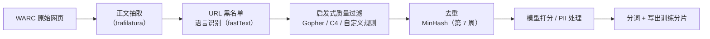
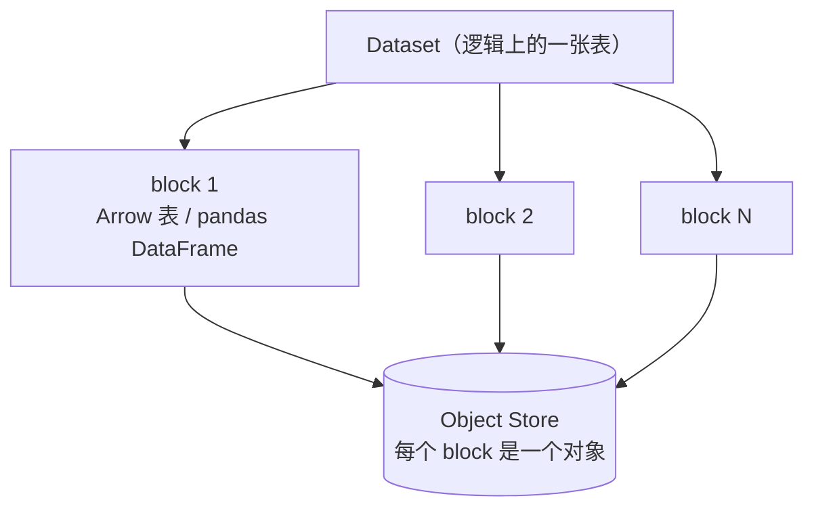
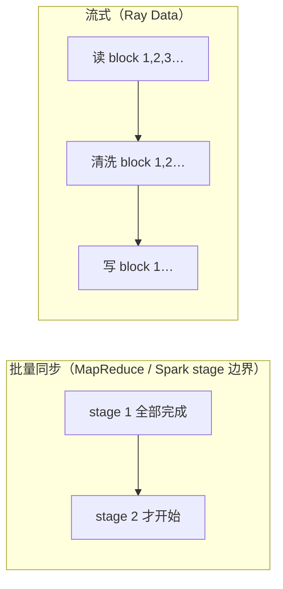
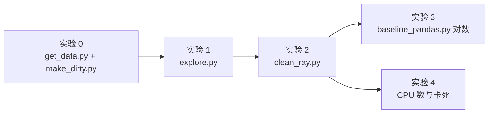

=== m2w2 | 第 6 周：Ray Data 清洗管线 | 第 2 月 · Ray + 数据管线
# 第 6 周：Ray Data 清洗管线（原指南项目 3 上半部分）

> **本周一句话**：用 Ray Data 写一条真正的 LLM 预训练数据清洗管线——读多文件 Parquet → 规范化 → 启发式质量过滤 → 有状态 UDF 统计 token → 写回 Parquet，并且**看懂它的执行计划**：block、算子融合、流式执行、背压。这是你作为大数据架构师最能发挥优势的一周：概念和 Spark 高度相似，差别恰恰是面试和设计评审里最值得讲的地方。

**预计投入：约 10 小时**（阅读 ≈ 3.5h，动手 ≈ 4.5h，自测与产出 ≈ 2h），可分 5 天完成。{{local}}

**本周结束时你应该能：**

1. 说清楚 LLM 预训练数据清洗的标准步骤（抽取 → 语言识别 → 启发式过滤 → 去重 → 模型打分 → PII），以及 FineWeb、datatrove 等公开方案把每一步放在哪里。
2. 用 Ray Data 的 `read_parquet` / `map_batches` / `filter` / `groupby` / `write_parquet` 写出一条可运行的清洗管线，并用单进程 pandas 版本**对数**。
3. 解释 Ray Data 的执行模型：Dataset 与 block（默认 1–128 MiB）、惰性计划、算子融合、流式执行、背压、物化（materialize），并和 Spark 的 partition / stage / pipeline 对照。
4. 用函数 UDF（Task）和类 UDF（Actor 池）分别实现转换，知道什么时候必须用类、资源怎么声明。
5. 读懂 `Dataset.stats()` 的执行统计，并解释“为什么 1 个 CPU 时这条管线会卡住”。

> **验证说明**：本页所有命令和输出都在一台 Linux x86_64 机器（8 核、16 GB 内存、Python 3.12.15、ray 2.59.0、pandas 3.0.6、pyarrow 26.0.0、datasets 5.1.0、tiktoken 0.14.0）上实际运行过，输出为真实结果（删去了 Ray 的 INFO 日志与进度条）。数据来自 FineWeb `sample-10BT` 的前 5 万条（流式读取，顺序固定），所以**行数与各规则命中数**你应当能复现；耗时会因机器不同而不同。实验代码在本站仓库 `labs/w6/`。

---

## 1. 本周学习路线


| 天 | 时间 | 先读（概念） | 再读（外部资料，按顺序） | 再做（实验） |
|---|---|---|---|---|
| Day 1 | ~2h | 本页 2.1、2.2 | ① [FineWeb 博客长文](https://huggingface.co/spaces/HuggingFaceFW/blogpost-fineweb-v1) 读 *What is good data?*、*Starting point: text extraction*、*Base filtering*、*Deduplicating the data* 三小节（40 分钟） | 实验 0：取数据 + 加脏 |
| Day 2 | ~2h | 本页 2.3 | ② [Ray Data：Key Concepts](https://docs.ray.io/en/latest/data/key-concepts.html)（20 分钟）；③ [Ray Data：Loading Data](https://docs.ray.io/en/latest/data/loading-data.html) 的 *Reading files* 一节（15 分钟）；④ [Inspecting Data](https://docs.ray.io/en/latest/data/inspecting-data.html)（10 分钟） | 实验 1：explore.py |
| Day 3 | ~2h | 本页 2.4 | ⑤ [Ray Data：Transforming Data](https://docs.ray.io/en/latest/data/transforming-data.html) 读 *Transforming rows*、*Transforming batches*、*Stateful transforms*（35 分钟）；⑥ [datatrove GopherQualityFilter 源码](https://github.com/huggingface/datatrove/blob/main/src/datatrove/pipeline/filters/gopher_quality_filter.py)（15 分钟） | 实验 2：clean_ray.py；实验 3：pandas 对数 |
| Day 4 | ~2h | 本页 2.5、2.6 | ⑦ [Ray Data Internals](https://docs.ray.io/en/latest/data/data-internals.html) 读 *Datasets and blocks*、*Plan optimization*、*Streaming execution*、*Memory model*（40 分钟） | 读懂实验 2 的执行统计 |
| Day 5 | ~2h | 本页 2.7 | ⑧ [Ray Data：Performance Tips](https://docs.ray.io/en/latest/data/performance-tips.html) 浏览目录并精读与本周相关的两三节（20 分钟） | 实验 4：CPU 数与卡死实验；自测题；本周产出 |

**每日打卡：**

- [ ] Day 1：读完 ①，完成实验 0，`dirty/` 下有 8 个文件共 52,500 行
- [ ] Day 2：读完 ②③④，完成实验 1，能解释 `Dataset isn't materialized` 的含义
- [ ] Day 3：读完 ⑤⑥，完成实验 2、3，Ray 版与 pandas 版各规则命中数完全一致
- [ ] Day 4：读完 ⑦，能指着执行统计说出哪些算子被融合了
- [ ] Day 5：完成实验 4、自测题、本周产出

---

## 2. 核心概念讲解

### 2.1 LLM 预训练数据清洗：一条“漏斗”

预训练语料的源头通常是 Common Crawl 这样的网页抓取：几十到上百 TB 的 WARC 文件，绝大部分是导航栏、广告、模板页、乱码和重复内容。清洗的目标是从中筛出“像人写的、有信息量的、不重复的”文本。FineWeb 的公开配方大致是：



| 你熟悉的（数仓 ETL） | LLM 数据清洗 | 本质 |
|---|---|---|
| ODS 层接入原始日志 | WARC → 正文抽取 | 从半结构化原始数据里抽出有用字段 |
| 数据质量规则（空值率、取值范围、格式校验） | 启发式质量过滤（词数、平均词长、符号比例、停用词） | 用便宜的规则过滤明显的坏数据 |
| 主键去重 / 拉链表 | 精确去重 + 近似去重（MinHash） | 重复数据会让模型“背书”，浪费算力 |
| 数据血缘、质量报表 | 每条规则的命中统计、保留率漏斗 | 规则改动必须可解释、可回溯 |
| 维表打标签（UDF 调外部服务） | 质量分类模型打分（需要 GPU） | 昂贵的步骤放在漏斗后段，只处理少量数据 |

**设计原则和数仓一样**：便宜的规则放前面，昂贵的（模型打分、近似去重）放后面；每一步都要能统计“过滤了多少、为什么”。

### 2.2 启发式质量过滤：Gopher 规则

DeepMind 训练 Gopher 时公开了一组规则（[Gopher 论文](https://arxiv.org/abs/2112.11446) 附录），后来被 datatrove 等实现为标准过滤器。本周实现其中一个子集（阈值取自 datatrove `GopherQualityFilter` 的默认值）：

| 规则 | 阈值 | 拦截什么 | 实验 2 命中 |
|---|---|---|---|
| 词数 | 50 ≤ 词数 ≤ 100,000 | 过短的垃圾页、超长的数据堆 | too_short 2,804 |
| 平均词长 | 3 ≤ 平均词长 ≤ 10 | 符号堆砌（词太短）、base64/URL 堆（词太长） | avg_word_len 1,025 |
| 含字母词比例 | ≥ 80% | 数字表格、符号、模板页 | non_alpha 1,167 |
| 英文停用词 | 至少出现 8 个停用词中的 2 个 | 非自然语言、非英文 | few_stop_words 53 |
| 重复行比例（简化版） | 重复行 ≤ 30% | 模板页、页脚复读 | 0 |

**规则顺序会影响“归因”**：我们按顺序判定，命中第一条就记下原因。实验 0 注入了 2% 的中文页面，你可能以为它们会被“停用词”规则拦截——实际上中文没有空格，按空格切词只得到 1 个“词”，在第一条 `too_short` 就被拦下了。注入的“40 行重复页脚”同样先被 `non_alpha`（`|` 和 `2024` 不含字母）拦截，所以 `dup_lines` 计数为 0。**这也提醒你：按空格分词的规则只适用于英文**，处理中文必须先做语言识别，再用中文分词和中文专用规则——这正是很多中文语料项目要自己重写过滤器的原因。

### 2.3 Ray Data 的数据模型：Dataset 与 block



- **Dataset** 是一个分布式数据集的**执行计划**，创建时不读数据（实验 1：`Dataset isn't materialized`）。
- **block** 是 Ray Data 的基本处理单元，通常是一个 Arrow 表，存放在 Object Store 里。官方 *Ray Data Internals* 说明：Ray Data 尝试把 block 大小控制在 **1 MiB 到 128 MiB** 之间，可通过 `target_min_block_size` / `target_max_block_size` 调整。
- **schema**：读 Parquet 时直接来自文件元数据；字符串列显示为 `large_string`（第 1 周讲过：64 位偏移量的 Arrow 字符串）。

| Spark | Ray Data | 差异 |
|---|---|---|
| DataFrame / RDD | Dataset | 都是惰性的分布式数据集 |
| partition | block | Ray 的 block 存在 Object Store，可被任意 worker 零拷贝读取 |
| `spark.sql.files.maxPartitionBytes` | `target_max_block_size` | 控制分块粒度 |
| `cache()` / `persist()` | `materialize()` | 物化到 Object Store（内存不够会溢写磁盘） |
| `explain()` | `print(ds)`、`ds.stats()` | Ray 的计划简单得多，没有代价优化器 |

### 2.4 转换：函数 UDF 与类 UDF

`map_batches(fn, batch_format="pandas")` 会把每个 block（或其中一批行）转成 pandas DataFrame 交给你的函数，函数返回新的 DataFrame。两种形态：

| | 函数 UDF | 类 UDF |
|---|---|---|
| 写法 | `def normalize(df): ...` | `class TokenCounter: __init__ 加载; __call__(df)` |
| 底层执行 | 无状态 Ray **Task** | Ray **Actor 池**（上周的 Actor） |
| 适用 | 纯计算、规则过滤 | 需要加载模型/分词器/词典等昂贵资源 |
| 并发控制 | 由调度器根据资源自动决定 | `compute=ray.data.ActorPoolStrategy(size=2)` 固定池大小（或给出最小/最大值自动伸缩） |
| GPU | 可以，但每个 task 都要加载模型 | 推理的标准写法：`num_gpus=1` + 类 UDF |

本站 Ray 2.59.0 中，旧写法 `concurrency=2` 会提示 `The argument concurrency is deprecated in Ray 2.51. Please specify argument compute instead.`。网上很多教程仍用旧写法，以你安装版本的文档为准。

**过滤**：`filter(expr=col("reason") == "")` 用表达式过滤，Ray 会用 Arrow 原生实现；如果传 Python lambda（`filter(lambda row: ...)`），本站版本会警告 `Use 'expr' instead of 'fn' when possible for performant filters.`——逐行调用 Python 函数正是第 1 周讲的“慢”的根源。

### 2.5 执行模型：算子融合、流式执行、背压

实验 2 的执行统计（节选）：

```text
Operator 2 ReadFilesParquetV2->MapBatches(normalize)->MapBatches(quality): 8 tasks executed, 8 blocks produced in 6.0s
Operator 3 Filter(col('reason') == '')->Project->MapBatches(TokenCounter): 8 tasks executed, 8 blocks produced in 2.35s
Operator 4 Write: 8 tasks executed, 8 blocks produced in 1.57s
```

**算子融合**：`读文件 → normalize → quality` 被合并成**一个**物理算子（名字里用 `->` 连接）。官方文档称为 `OperatorFusionRule`：把一串 map 类算子合并，避免中间结果在算子之间序列化。这与 Spark 把窄依赖合并成一个 stage、Hive/Tez 把多个 map 合并成一个 vertex 是同一个思想。

**为什么 Filter 和 TokenCounter 没有和前面融合？** 两个原因：中间有 `materialize()` 和 `groupby`（实验里我们先物化，用于统计和过滤复用）；而且 TokenCounter 是 Actor 池，不能和 Task 型算子融合（计算资源形态不同）。

**流式执行**：官方文档原话是“与批量同步执行不同，Ray Data 的流式执行不等一个算子完成才开始下一个”。每个算子消费上游的 block 流、产出下游的 block 流，所以数据集可以比集群内存大。对比：



Spark 在**同一个 stage 内**其实也是流水线式的（迭代器逐行传递），区别主要在 stage 边界和**异构资源**：Ray Data 可以让 CPU 算子和 GPU 算子同时运行、各自按资源扩缩，GPU 不用等 CPU 阶段全部结束——这正是第 8 周批量推理的核心收益。

**背压（backpressure）**：如果下游慢（例如 GPU 推理），上游不能无限生产 block 塞满 Object Store。执行器的调度循环在给一个算子派发新输入前会检查三个条件：有输入、有足够资源、**没有被背压**（官方 *Streaming execution* 一节）。实验 4 的日志里你会看到 `backpressured:tasks(ResourceBudget)`。

**内存模型**：官方文档说明 Ray 把每个节点的内存分成三块：默认 30% 给 Object Store，10% 给系统开销，其余作为“逻辑内存”供任务申请。

### 2.6 物化与 groupby：什么时候会打断流式

- `materialize()`、`groupby().count()`、`sort()`、`random_shuffle()` 这类操作需要**看到全部数据**，会打断流式、产生全量的中间结果（相当于 Spark 的 shuffle）。
- 实验 2 中我们为了“按原因统计”和“过滤保留”复用同一份结果，选择先 `materialize()`。代价是 Object Store 里要放下全部 52,500 行（物化后 154 MiB）。数据量是内存的 10 倍时，正确做法是**把 reason 写进输出**，统计另跑一个轻量作业，或者在 UDF 里累计计数——这和你在 Spark 里避免对大表 `cache()` 的判断完全相同。
- groupby 使用 hash shuffle，需要启动一组聚合器（aggregator）占用 CPU。实验 4 会看到：只有 1 个 CPU 时，它和读取任务争抢资源，管线卡住。

### 2.7 扩展性：CPU 数、并行度与“资源死锁”

实验 4 把同一条管线分别放在 4、2、1 个 CPU 上：

| CPU | 总用时 | 读+清洗算子 | Token 统计算子 |
|---|---|---|---|
| 4 | 11.5s | 6.04s | 2.24s |
| 2 | 16.8s | 9.91s | 2.11s |
| 1 | **卡住**（90 秒超时后被终止） | — | — |

- 4 → 2 CPU，读+清洗从 6.0s 变成 9.9s：8 个 block 需要更多轮次。并不是严格的 2 倍，因为还有调度开销、文件读取和长尾 block。
- Token 统计在两种配置下都约 2.1～2.2s：它固定用 2 个 Actor（`ActorPoolStrategy(size=2)`），与集群 CPU 数无关。
- **1 CPU 卡住**：日志显示 `Limited available CPU resources for hash shuffle operation. Required: 0.25 CPUs, available: 0 CPUs`，以及 `Active & requested resources: 8.25/1 CPU`——groupby 的聚合器申请的资源总和远超集群容量，与读取任务互相等待。即使闯过这一关，后面的 `ActorPoolStrategy(size=2)` 也需要 2 个 CPU 才能启动两个 Actor。
- **架构师的教训**：Ray 上的“作业卡住不报错”往往是**资源申请无法被满足**，而不是代码 bug。排查顺序：看 Ray Data 进度日志里的 requested resources → `ray status` 的 Pending Demands → 检查 Actor 池大小、`num_cpus`/`num_gpus` 声明是否超过集群容量。

---

## 3. 动手实验 {{local}}



所有文件放在 `~/ai-infra-lab/w6/`。

### 实验 0：取 5 万条 FineWeb 并“加脏”（30 分钟）

```bash
cd ~/ai-infra-lab && source .venv/bin/activate && mkdir -p w6 && cd w6
uv pip install "datasets==5.1.0" "tiktoken==0.14.0"   # ray[data] 已在第 5 周安装
mkdir -p raw dirty
```

`get_data.py`：

```python
@@CODE:w6/get_data.py@@
```

**本站输出**：

```text
写出 50000 条到 5 个文件，共 96.1 MiB，用时 13s
字段: ['id', 'url', 'text', 'language_score']
示例: http://daytimeroyaltyonline.com/single/?p=8906650&t=8780053 | |Viewing Single Post From: Spoilers for the Week of February 11th| |Lil||Feb 1 2
```

FineWeb 本身**已经清洗过**，直接拿来过滤几乎什么都不会被拦下。为了看到每条规则的效果，`make_dirty.py` 按固定随机种子注入 6 类常见问题：

```python
@@CODE:w6/make_dirty.py@@
```

**本站输出**：

```text
脏数据总行数: 52500
```

**逐步解释**：

- `streaming=True`：不下载整个数据集（sample-10BT 有几十 GB），而是按需读取前 5 万条。访问 Hugging Face 不畅时可设 `HF_ENDPOINT`（见第 2 周）。
- 5 万条 + 5% 重复（2,500 条）= 52,500。①～⑤ 是**原地替换**文本，不改变行数。
- `sample(frac=1)` 打乱顺序，模拟真实数据里脏数据分散在各处；再切成 8 个文件。
- 注入的重复文档（⑥）本周的规则**不会**拦截——它们是正常文本，留给第 7 周的去重。

### 实验 1：读入并观察 Dataset（20 分钟）

`explore.py`：

```python
@@CODE:w6/explore.py@@
```

**本站输出**：

```text
shape: (?, 4)
╭──────────────┬──────────────┬──────────────┬────────────────╮
│ id           ┆ url          ┆ text         ┆ language_score │
│ ---          ┆ ---          ┆ ---          ┆ ---            │
│ large_string ┆ large_string ┆ large_string ┆ double         │
╰──────────────┴──────────────┴──────────────┴────────────────╯
(Dataset isn't materialized)
schema: Column          Type
------          ----
id              large_string
url             large_string
text            large_string
language_score  double
行数: 52500  用时 0.85s（count 可直接用 Parquet 元数据）
物化后 block 数: 8  总字节 154.3 MiB
一行样例: {'id': '<urn:uuid:2337dea4-8c2e-41ac-a49a-7954a3ef65da>', 'url': 'https://ideas.repec.org/a/ucp/jlawec/v44y2001i1p199-232.html', 'text': 'Reversion Taxes, Contingent Benefits, and the Decline in Pen…', 'language_score': 0.8255221247673035}
```

**逐步解释**：

- `shape: (?, 4)`：行数未知，因为还没执行。这就是惰性计划。
- `count()` 很快：Parquet footer 里就有行数（第 1 周实验 5）。
- 物化后 **8 个 block**，对应 8 个输入文件；**154 MiB**，而磁盘上 Parquet 只有 94 MiB——解压后的 Arrow 内存表示更大（第 1 周讲过的“文件大小 ≠ 内存大小”）。
- `take(1)` 把一行拉回 Driver，类似 Spark 的 `take`。

### 实验 2：Ray Data 清洗管线（50 分钟）

把清洗规则单独放在 `clean_funcs.py`，Ray 版和 pandas 版共用（保证“对数”比较的是同一套逻辑）：

```python
@@CODE:w6/clean_funcs.py@@
```

`clean_ray.py`：

```python
@@CODE:w6/clean_ray.py@@
```

```bash
rm -rf clean && python clean_ray.py
```

**本站输出**：

```text
按原因统计:
  (通过)              47451
  too_short          2804
  non_alpha          1167
  avg_word_len       1025
  few_stop_words       53
清洗用时 11.8s
---- 执行统计（节选）----
Operator 0 ReadFiles:
Operator 1 ListFiles: 1 tasks executed, 8 blocks produced in 0.06s
* Remote wall time: 110.2us min, 55.88ms max, 7.1ms mean, 56.78ms total
Operator 2 ReadFilesParquetV2->MapBatches(normalize)->MapBatches(quality): 8 tasks executed, 8 blocks produced in 6.0s
* Remote wall time: 2.11s min, 2.42s max, 2.24s mean, 17.95s total
Operator 3 Filter(col('reason') == '')->Project->MapBatches(TokenCounter): 8 tasks executed, 8 blocks produced in 2.35s
* Remote wall time: 461.11ms min, 754.6ms max, 550.18ms mean, 4.4s total
Operator 4 Write: 8 tasks executed, 8 blocks produced in 1.57s
* Remote wall time: 68.5ms min, 92.98ms max, 83.58ms mean, 668.63ms total
保留行数: 47451  总 token 数(GPT-2 分词): 33414974
```

运行时你还会看到一行 `core_worker.cc ... has constructor arguments in the object store and max_restarts > 0 ...` 的日志：这是 Ray 内部对 Actor 池重启行为的提示（链接到 Ray 的一个 GitHub issue），不影响结果。

**逐步解释**：

- **漏斗**：52,500 → 47,451，过滤掉 5,049 行（9.6%）。注入的 HTML 残留（3%）会被 normalize 清掉而通过；其余四类“应被拦截”的注入（过短 3%、符号 2%、中文 2%、模板 2%）共约 4,500 行，加上 ⑥ 重复时被复制的约 5% 脏行，合计约 4,700 行；差额来自少量原本干净的 FineWeb 文档也触发了规则（例如少于 50 词的页面），以及注入时同一行被多次覆盖。想精确核对，可以在 `make_dirty.py` 里给注入行打上标签列，再做交叉表（扩展练习 1）。
- **中文页面去哪了**：被 `too_short` 拦截（2.2 节）。
- **Remote wall time 17.95s total vs 6.0s 墙钟**：8 个任务的执行时间总和约 18 秒，但 4 个 CPU 并行，墙钟只用了 6 秒。
- **总 token 数 3341 万**：这就是这份数据能提供的训练 token 量（用 GPT-2 分词器计）。做预训练数据规划时，最终交付的指标就是“多少 B token”。
- 输出目录 `clean/` 下有 8 个 Parquet 文件，文件名带随机前缀，这是 Ray Data 的默认命名。

### 实验 3：单进程 pandas 对数（20 分钟）

`baseline_pandas.py`：

```python
@@CODE:w6/baseline_pandas.py@@
```

**本站输出**：

```text
reason
(通过)              47451
too_short          2804
non_alpha          1167
avg_word_len       1025
few_stop_words       53
单进程 pandas 用时 17.5s
```

**逐步解释**：

- **各规则命中数与 Ray 版完全一致**——分布式版本没有改变逻辑。第 1 周你用 DuckDB 给 pandas 对数，这周反过来用 pandas 给 Ray 对数：**每次把逻辑迁到新引擎，先在小数据上对数**，这是你从数仓迁移项目里带来的最有价值的习惯。
- pandas 单进程 17.5s 只做了规范化 + 质量判断；Ray 4 CPU 用 11.8s 完成了规范化、判断、统计、token 计数、写出全部步骤。数据量放大 100 倍时，pandas 版本会因为内存放不下而无法运行，Ray 版可以流式处理或加机器。

### 实验 4：CPU 数与“卡死”（30 分钟）

```bash
for c in 4 2; do rm -rf clean; echo "== cpus=$c"; python clean_ray.py --cpus $c | grep -E "清洗用时|Operator 2|Operator 3"; done
rm -rf clean; timeout 90 python clean_ray.py --cpus 1; echo "exit $?"
```

**本站输出**（4 和 2 CPU）：

```text
== cpus=4
清洗用时 11.5s
Operator 2 ReadFilesParquetV2->MapBatches(normalize)->MapBatches(quality): 8 tasks executed, 8 blocks produced in 6.04s
Operator 3 Filter(col('reason') == '')->Project->MapBatches(TokenCounter): 8 tasks executed, 8 blocks produced in 2.24s
== cpus=2
清洗用时 16.8s
Operator 2 ReadFilesParquetV2->MapBatches(normalize)->MapBatches(quality): 8 tasks executed, 8 blocks produced in 9.91s
Operator 3 Filter(col('reason') == '')->Project->MapBatches(TokenCounter): 8 tasks executed, 8 blocks produced in 2.11s
```

**1 CPU 时**（90 秒后被 `timeout` 终止，退出码 124；日志节选）：

```text
WARNING hash_shuffle.py -- Limited available CPU resources for hash shuffle operation. Required: 0.25 CPUs, available: 0 CPUs. ...
INFO logging_progress.py:227 -- Active & requested resources: 8.25/1 CPU, 1.0GiB/3.9GiB memory, 457.8KiB/856.6MiB object store
INFO logging_progress.py:233 --   Tasks: 8 [backpressured:tasks(ResourceBudget)]; Actors: 0; Queued blocks: 0 (0.0B); Resources: 8.2 CPU, 1.0GiB memory, 0.0B object store
exit 124
```

**逐步解释**：见 2.7 节。请你在 Mac 上也跑一遍，并试着修改：去掉 `groupby` 统计（改成在 pandas 里对输出做统计）、把 `ActorPoolStrategy(size=2)` 改为 `size=1`，看 1 CPU 时能否跑完。

### 常见错误与排查

| 现象（真实报错或现象） | 原因 | 解决 |
|---|---|---|
| 作业不报错但一直不结束，日志里 `requested resources` 超过集群容量 | 资源申请无法满足（实验 4） | 减小 Actor 池、减少 shuffle 类操作、加 CPU；看 `ray status` 的 Pending Demands |
| `The argument concurrency is deprecated in Ray 2.51. Please specify argument compute instead.` | 新版 API 变化 | 改用 `compute=ray.data.ActorPoolStrategy(size=N)` |
| `UserWarning: Use 'expr' instead of 'fn' when possible for performant filters.` | 用 Python lambda 逐行过滤 | 改用 `filter(expr=col(...) == ...)` |
| 写 make_dirty.py 时 `np.array_split(df, 8)` 切出来的不是 DataFrame（本站实测 numpy 2.5 + pandas 3.0 下返回 `numpy.ndarray`），后续写 Parquet 报错 | 新版 numpy 不再对 DataFrame 保留类型 | 对行号切分：`np.array_split(np.arange(len(df)), 8)` 再 `df.iloc[idx]` |
| `UnicodeDecodeError` / 乱码（未在本站复现） | 原始网页编码混乱 | 正文抽取阶段统一转 UTF-8；过滤器里对异常文本打标签而不是抛异常 |
| UDF 里某一行抛异常导致整个作业失败（未在本站复现） | 一条脏数据让 task 抛应用异常，Ray 默认不重试 | UDF 内部 try/except，把异常行标记为 `reason="error"` |
| 输出文件数量太多 / 太少 | 输出文件数跟随 block 数 | 写出前 `repartition(n)`，或调整 block 大小 |
| `materialize()` 后内存/磁盘暴涨 | 物化需要放下全量数据 | 避免物化大数据集；把统计列写进输出另行汇总 |

### 扩展练习（选做，每题 20–40 分钟）

1. **注入标签交叉表**：在 `make_dirty.py` 中给每行加一列 `inject`（none/html/short/symbol/zh/template/dup），清洗后统计 `inject × reason` 的交叉表，计算每条规则的召回率与误杀率。
2. **补上 Gopher 重复规则**：阅读 [datatrove GopherRepetitionFilter](https://github.com/huggingface/datatrove/blob/main/src/datatrove/pipeline/filters/gopher_repetition_filter.py)，实现“重复行字符占比”和“top n-gram 字符占比”中的一条，观察新增拦截。
3. **中文过滤器**：设计 3 条适用于中文的启发式规则（例如中文字符占比、标点比例、平均句长），用实验 0 注入的中文页验证。
4. **去掉物化**：重构 clean_ray.py，不调用 `materialize()`，让 reason 写进输出文件，再用第二个小作业统计。比较内存峰值（Dashboard 或 `ray status`）。
5. **block 大小**：用 `ray.data.DataContext.get_current().target_max_block_size` 把 block 上限调小（如 8 MiB），观察 block 数、任务数和总耗时的变化。

---

## 4. 精读指南

### ① FineWeb 博客长文（40 分钟）

[链接](https://huggingface.co/spaces/HuggingFaceFW/blogpost-fineweb-v1)（配套论文：[The FineWeb Datasets](https://arxiv.org/abs/2406.17557)）

- **读哪里**：*What is good data?*；*Starting point: text extraction*、*Base filtering*、*Deduplicating the data*。
- **重点**：他们如何用“小模型训练 + 基准评测”来判断一条过滤规则是否有用（ablation）；为什么从 WET 换成自己抽取正文。
- **读完回答**：① 文中 base filtering 包含哪几步？② 他们怎样评估“数据质量提升”？这和你在数仓里评估“数据质量规则有效”有何异同？

### ②③④ Ray Data 基础（45 分钟）

- [Key Concepts](https://docs.ray.io/en/latest/data/key-concepts.html)：**读完回答**：Dataset、block、operator 的关系；为什么说 Ray Data 是“流式”的？
- [Loading Data](https://docs.ray.io/en/latest/data/loading-data.html) 的 *Reading files*：**读完回答**：读 Parquet 时如何只读部分列、如何做过滤下推？（对照第 1 周）
- [Inspecting Data](https://docs.ray.io/en/latest/data/inspecting-data.html)：`schema`、`take`、`show`、`stats` 的用法。

### ⑤⑥ 转换与 Gopher 规则（50 分钟）

- [Transforming Data](https://docs.ray.io/en/latest/data/transforming-data.html)：读 *Transforming rows*、*Transforming batches*、*Stateful transforms*。**读完回答**：`map` 与 `map_batches` 的性能差异来自哪里？类 UDF 的 Actor 池如何设置最小/最大大小？
- [datatrove GopherQualityFilter](https://github.com/huggingface/datatrove/blob/main/src/datatrove/pipeline/filters/gopher_quality_filter.py)：**读完回答**：datatrove 统计词数时去掉了哪些“词”？本页的简化实现与它有哪些差别？

### ⑦ Ray Data Internals（40 分钟）

[链接](https://docs.ray.io/en/latest/data/data-internals.html)

- **读哪里**：*Datasets and blocks*（含 *Block size limiting*）、*Plan optimization*、*Streaming execution*（含 *The scheduling loop*）、*Memory model*。
- **读完回答**：① block 大小的默认上下限是多少？② 调度循环选择算子的三个条件是什么？多个算子可选时选哪个？③ 三个内存池各占多少？

### ⑧ Performance Tips（20 分钟）

[链接](https://docs.ray.io/en/latest/data/performance-tips.html)：浏览目录，挑与读取并行度、批大小、Actor 池相关的小节精读。**读完回答**：列出两条你可以立刻用到 clean_ray.py 上的优化。

### 背景阅读（不计入本周时间）

- [Ray Data 论文：The Streaming Batch Model for Efficient and Fault-Tolerant Heterogeneous Execution](https://arxiv.org/abs/2501.12407)：Ray Data 流式批处理模型的设计论文，第 8 周批量推理时会回来看。
- [datatrove](https://github.com/huggingface/datatrove)：FineWeb 用的生产级清洗/去重库，看它的 `examples/` 目录。
- [NeMo Curator](https://github.com/NVIDIA/NeMo-Curator)：NVIDIA 的 GPU 加速数据整理库。
- [RefinedWeb 论文](https://arxiv.org/abs/2306.01116)：Falcon 团队“只用网页数据”的清洗方案，可与 FineWeb 对照。

---

## 5. 自测题

<details>
<summary>1. 为什么启发式过滤放在去重和模型打分之前？</summary>

成本递增原则：启发式规则每条文档只需简单计数，极便宜；MinHash 去重需要计算签名并做跨文档比较；模型打分需要 GPU。先用便宜规则砍掉大部分明显垃圾，后面昂贵步骤处理的数据量就小得多。和数仓里“先过滤再 Join”是同一个道理。

</details>

<details>
<summary>2. 实验中注入的中文页面被哪条规则拦截？这暴露了什么问题？</summary>

被 `too_short` 拦截：中文没有空格，按空格切词只得到 1 个“词”。这说明基于空格分词的规则只适用于英文等空格分隔语言；处理多语言语料要先做语言识别，再对每种语言使用对应的分词和规则。

</details>

<details>
<summary>3. Ray Data 的 block 是什么？默认大小范围？和 Spark partition 的关键差别？</summary>

block 是 Ray Data 的基本处理单元，通常是一个 Arrow 表，作为对象存放在 Object Store 中。官方文档说明 Ray Data 尽量把 block 控制在 1 MiB～128 MiB。与 Spark partition 相比，block 存在共享内存对象存储里，可被同节点任意 worker 零拷贝读取，也可作为 ObjectRef 在任务间传递。

</details>

<details>
<summary>4. 什么时候必须用类 UDF？类 UDF 在底层对应什么？</summary>

需要昂贵的一次性初始化（加载模型、分词器、大词典、数据库连接池）时。类 UDF 在底层由 Ray Actor 池执行，每个 Actor 只执行一次 `__init__`，之后处理多个 batch。通过 `compute=ray.data.ActorPoolStrategy(...)` 控制池大小，GPU 推理时再声明 `num_gpus`。

</details>

<details>
<summary>5. 执行统计中 <code>ReadFilesParquetV2->MapBatches(normalize)->MapBatches(quality)</code> 说明了什么？</summary>

三个 map 类算子被算子融合（OperatorFusionRule）合并成一个物理算子，在同一个任务里依次执行，中间结果不需要序列化写入 Object Store。类似 Spark 把窄依赖合并进一个 stage。

</details>

<details>
<summary>6. 为什么 Ray 版和 pandas 版要“对数”？对数时要比较什么？</summary>

确认分布式改写没有改变业务逻辑（分块边界、类型转换、并发顺序都可能引入差异）。本周比较每条规则的命中数和保留行数；更严格时还可以比较输出内容的哈希或抽样逐行比对。

</details>

<details>
<summary>7. 为什么 1 个 CPU 时管线会卡住？如何排查？</summary>

groupby 的 hash shuffle 需要启动聚合器申请 CPU，加上读取任务、后续 Actor 池（需要 2 个 CPU），资源申请总量超过集群容量，任务互相等待（日志：`Required: 0.25 CPUs, available: 0 CPUs`、`requested resources: 8.25/1 CPU`）。排查：看 Ray Data 进度日志中的 requested resources、`ray status` 的 Pending Demands，检查 Actor 池大小与资源声明。

</details>

<details>
<summary>8. 物化后数据 154 MiB，而磁盘上 Parquet 只有 94 MiB，为什么？</summary>

Parquet 在磁盘上经过编码和压缩；读入内存后解压为 Arrow 列式表示（字符串带 64 位偏移量），体积变大。这与第 1 周的“文件大小 → 内存大小膨胀”是同一现象，做容量规划时必须按内存大小估算 Object Store。

</details>

<details>
<summary>9. `materialize()` 在什么情况下是合理的？什么情况下是危险的？</summary>

结果较小、需要被多次复用（如本周同时用于统计和过滤）时合理。数据量接近或超过集群 Object Store 容量时危险：会触发大量溢写甚至失败，并打断流式执行。大数据量时应把需要的信息写进输出，或拆成多个流式作业。

</details>

### 思考题（架构师视角，没有标准答案，写成 200–300 字的短文）

1. **规则治理**：公司有 30 条数据清洗规则，由不同算法同学维护。你会如何设计规则的版本管理、命中率监控、A/B 评估和回滚？对照你在数仓里管理数据质量规则的经验。
2. **Spark 还是 Ray Data**：本周的管线如果用 Spark 写会怎样？哪些部分 Spark 更强（例如 SQL、优化器、成熟的 shuffle），哪些部分 Ray Data 更合适？给出你的选型标准。
3. **可复现性**：预训练数据要求“任何时候都能复现某个版本的训练集”。从输入快照、代码版本、随机种子、规则顺序、输出命名几个方面，设计一个数据版本方案。
4. **中文语料**：如果要为中文大模型做清洗，你会如何改造本周的管线？哪些开源组件可以复用，哪些必须自研？

---

## 6. 本周产出与掌握清单

### 本周产出（Deliverables）

放进 `~/ai-infra-lab/w6/` 并提交到 git（`raw/`、`dirty/`、`clean/` 数据目录加入 `.gitignore`）：

1. **代码**：`get_data.py`、`make_dirty.py`、`explore.py`、`clean_funcs.py`、`clean_ray.py`、`baseline_pandas.py`。
2. **`README.md`（运行记录，本月产出之一的前半部分）**：环境版本；漏斗图（输入 → 各规则拦截 → 保留，附数字）；Ray 与 pandas 对数结果；不同 CPU 数的耗时表；执行统计截取与解读。
3. **`rules.md`**：本周每条规则的定义、阈值来源、命中数、你认为可能的误杀场景。
4. **一段“架构师笔记”**：从思考题中任选 1 题写成短文。

### 掌握清单

- [ ] 能画出 LLM 预训练数据清洗的完整漏斗，并说出每一步的成本特征
- [ ] 能说出 Gopher 规则的主要阈值，并解释“规则顺序影响归因”
- [ ] 知道按空格分词的规则不适用于中文
- [ ] 能解释 Dataset、block（1–128 MiB）、惰性计划、materialize
- [ ] 能写函数 UDF 与类 UDF，并说出类 UDF 底层是 Actor 池
- [ ] 会用表达式 filter，知道为什么比 lambda 快
- [ ] 跑通 clean_ray.py，各规则命中数与 pandas 版本完全一致
- [ ] 能从执行统计中识别算子融合，并解释哪些算子不能融合
- [ ] 能解释流式执行、背压和 Ray 的三个内存池
- [ ] 能解释 1 CPU 时作业卡住的原因并给出排查步骤
- [ ] 完成 README.md 与 rules.md

---

## 参考资料

**本周主读（按学习路线顺序）：**

- [FineWeb 博客长文](https://huggingface.co/spaces/HuggingFaceFW/blogpost-fineweb-v1)（博客·进阶）：公开的预训练数据清洗配方与消融方法
- [FineWeb 数据集](https://huggingface.co/datasets/HuggingFaceFW/fineweb)（文档·入门）：本周实验数据来源
- [Ray Data 文档](https://docs.ray.io/en/latest/data/data.html)（文档·入门）：总入口
- [Ray Data：Key Concepts](https://docs.ray.io/en/latest/data/key-concepts.html)（文档·入门）
- [Ray Data：Loading Data](https://docs.ray.io/en/latest/data/loading-data.html)（文档·入门）
- [Ray Data：Transforming Data](https://docs.ray.io/en/latest/data/transforming-data.html)（文档·入门）：map_batches 与有状态转换
- [Ray Data Internals](https://docs.ray.io/en/latest/data/data-internals.html)（文档·进阶）：block、融合、流式执行、内存模型
- [Ray Data：Performance Tips](https://docs.ray.io/en/latest/data/performance-tips.html)（文档·进阶）
- [datatrove GopherQualityFilter 源码](https://github.com/huggingface/datatrove/blob/main/src/datatrove/pipeline/filters/gopher_quality_filter.py)（仓库·进阶）：规则阈值来源
- [Gopher 论文](https://arxiv.org/abs/2112.11446)（论文·进阶）：附录中的质量过滤规则

**选读与背景：**

- [The FineWeb Datasets 论文](https://arxiv.org/abs/2406.17557)（论文·进阶）
- [Ray Data 论文：The Streaming Batch Model](https://arxiv.org/abs/2501.12407)（论文·高级）
- [datatrove](https://github.com/huggingface/datatrove)（仓库·进阶）：FineWeb 用的生产级管线
- [NeMo Curator](https://github.com/NVIDIA/NeMo-Curator)（仓库·进阶）：NVIDIA 的 GPU 加速数据整理库
- [RefinedWeb 论文](https://arxiv.org/abs/2306.01116)（论文·进阶）

> 完整列表见 [参考资料库](/resources.html)。
