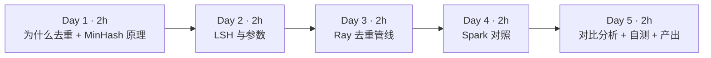
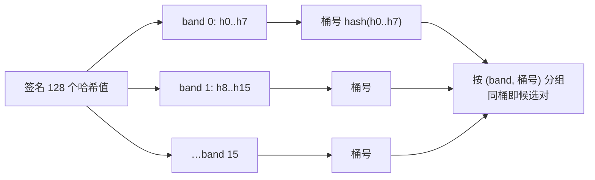
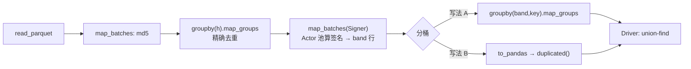
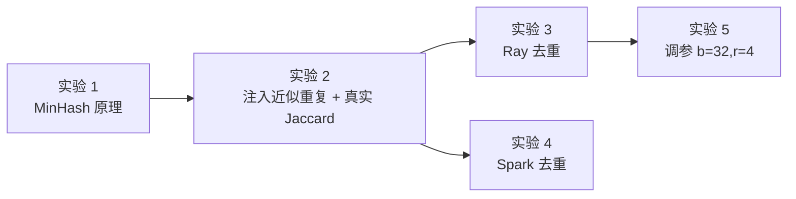

=== m2w3 | 第 7 周：MinHash 去重 + 与 Spark 对比 | 第 2 月 · Ray + 数据管线
# 第 7 周：MinHash 近似去重，以及 Ray Data 与 Spark 的正面对比（原指南项目 3 下半部分）

> **本周一句话**：把第 6 周清洗后的数据去重——先做精确去重，再用 **MinHash + LSH** 做近似去重；然后用你最熟悉的 **Spark** 把同一件事再做一遍，用真实数字比较两个引擎在“shuffle 密集型”任务上的差异。本周的核心收获不是 API，而是一条能讲给面试官听的结论：**Ray Data 强在异构、流式的 map 类计算；大规模 groupby/join 仍是 Spark 的主场**。

**预计投入：约 10 小时**（阅读 ≈ 3h，动手 ≈ 5h，自测与产出 ≈ 2h）。{{local}}

**本周结束时你应该能：**

1. 解释为什么预训练语料必须去重，以及精确去重、近似去重各解决什么问题。
2. 从第一性原理推导 MinHash：为什么“两个集合最小哈希相等的概率 = Jaccard 相似度”。
3. 用 LSH 的 band/row 公式 `P = 1-(1-s^r)^b` 计算候选概率与阈值，并**用它预测实验结果**（本周实验中预测 ≈ 35%，实测 37%）。
4. 用 Ray Data 和 Spark 各实现一遍去重管线，解释两者在 groupby 上 5～20 倍的耗时差异从何而来。
5. 说出 datatrove、BigCode 等生产方案的去重参数，并为自己的场景选择参数。

> **验证说明**：本页所有实验都在 Linux x86_64（8 核、Python 3.12.15）上实际运行：ray 2.59.0、datasketch 2.0.0、pandas 3.0.6、pyspark 4.2.0 + Eclipse Temurin JDK 17.0.20（解压版，无需 root）。输出为真实结果（删去了 INFO 日志和进度条）。输入是第 6 周 `clean/` 的 47,451 行，再注入 2,000 条近似重复；行数、命中数可复现，耗时因机器而异。实验代码在仓库 `labs/w7/`。

---

## 1. 本周学习路线



| 天 | 时间 | 先读（概念） | 再读（外部资料） | 再做（实验） |
|---|---|---|---|---|
| Day 1 | ~2h | 本页 2.1、2.2 | ① [Deduplicating Training Data Makes Language Models Better](https://arxiv.org/abs/2107.06499) 读摘要、第 1 节引言和第 2 节对重复现象的分析（40 分钟） | 实验 1：minhash_demo.py |
| Day 2 | ~2h | 本页 2.3、2.4 | ② [BigCode：Large-scale Near-deduplication](https://huggingface.co/blog/dedup) 读 *MinHash Walkthrough* 下的 Shingles、Fingerprint Computation、Locality Sensitive Hashing（40 分钟）；③ [datasketch MinHash LSH 文档](https://ekzhu.com/datasketch/lsh.html)（15 分钟） | 实验 2：近似重复的真实 Jaccard |
| Day 3 | ~2h | 本页 2.5 | ④ [Ray：GroupedData.map_groups API](https://docs.ray.io/en/latest/data/api/doc/ray.data.grouped_data.GroupedData.map_groups.html)（10 分钟） | 实验 3：dedup_ray.py 两种分桶写法 |
| Day 4 | ~2h | 本页 2.6 | ⑤ [Spark ML：Locality Sensitive Hashing](https://spark.apache.org/docs/latest/ml-features.html#locality-sensitive-hashing) 一节，含 *MinHash for Jaccard Distance* 与 *Approximate Similarity Join*（25 分钟） | 实验 4：dedup_spark.py |
| Day 5 | ~2h | 本页 2.7 | ⑥ [datatrove minhash.py](https://github.com/huggingface/datatrove/blob/main/src/datatrove/pipeline/dedup/minhash.py) 浏览配置类与四个阶段（30 分钟） | 实验 5：调参 b=32,r=4；自测题；产出 |

**每日打卡：**

- [ ] Day 1：读完 ①，跑通实验 1，能说出 MinHash 的核心性质
- [ ] Day 2：读完 ②③，跑通实验 2，能用公式算出 b=16,r=8 时 s=0.635 的候选概率
- [ ] Day 3：跑通实验 3，两种分桶写法结果一致，耗时差 20 倍以上
- [ ] Day 4：装好 JDK 17 + PySpark，跑通实验 4
- [ ] Day 5：完成实验 5、自测题、本周产出

---

## 2. 核心概念讲解

### 2.1 为什么要去重

Lee 等人在 ① 中发现，常用语料（C4 等）里存在大量重复：同一段模板文本出现成千上万次，训练集与验证集之间也有重叠。论文结论包括：去重后模型**逐字复述训练数据**的比例显著下降、以更少的训练步数达到相同或更好的效果，同时评测结果因减少训练/测试泄漏而更可信。

| 重复类型 | 例子 | 方法 | 成本 |
|---|---|---|---|
| 完全重复 | 同一页面被抓取多次、镜像站 | 文本哈希（md5/sha1）+ groupby | 低：一次 shuffle |
| 近似重复 | 转载时改了几个词、加了页脚、日期不同 | **MinHash + LSH** | 中：签名计算 + 分桶 shuffle |
| 子串重复 | 不同页面共享的长段落（版权声明） | 后缀数组精确子串去重（①的 ExactSubstr） | 高 |
| 语义重复 | 意思相同、措辞完全不同 | 向量嵌入 + 聚类（如 SemDeDup） | 很高：需要 GPU |

数仓视角：精确去重就是 `SELECT ... GROUP BY md5(text)`；近似去重相当于在没有主键的情况下做“模糊实体解析（entity resolution）”——你可能在客户主数据（MDM）项目里遇到过同一问题。

### 2.2 MinHash：用一个数估计 Jaccard

**第一步：shingling。** 把文档变成集合：按词切分，取所有连续 5 个词（5-gram，称为 shingle）。两篇文档的相似度定义为 Jaccard：

$$J(A,B)=\frac{|A\cap B|}{|A\cup B|}$$

直接两两计算 Jaccard 是 O(N²)：5 万篇就有 12.5 亿对，Common Crawl 级别（数十亿篇）根本不可能。

**第二步：MinHash。** 取一个随机哈希函数 h，对集合中所有元素求哈希，取最小值 `min_h(A)`。关键性质：

$$P[\min_h(A)=\min_h(B)] = J(A,B)$$

**直觉证明**：把 A∪B 中所有元素按 h 值排序，排第一的元素是 A∪B 中均匀随机的一个。它同时属于 A 和 B（即两个最小值相等）的概率，恰好是 |A∩B|/|A∪B|。

**第三步：签名。** 用 k 个独立哈希函数，得到长度为 k 的签名向量。两个签名对应位置相等的比例就是 J 的无偏估计，标准误约为 $\sqrt{J(1-J)/k}$。k=128、J=0.5 时约 0.044。实验 1 中真实 J=0.523，k=16 估出 0.312，k=128 估出 0.547，k=256 估出 0.500——**k 越大越准**，但签名越长，存储和计算越多。

| 你熟悉的 | MinHash | 共同点 |
|---|---|---|
| HyperLogLog（估 distinct count） | MinHash（估 Jaccard） | 都是“概率草图（sketch）”：用固定大小的摘要代替整个集合 |
| Bloom Filter | LSH 分桶 | 都允许少量误差换取巨大的空间与时间节省 |

### 2.3 LSH：用分桶避免两两比较

有了签名仍然要两两比较。LSH（局部敏感哈希）的办法是：把 k=b×r 个哈希值切成 **b 个 band，每个 band r 行**；对每个 band 的 r 个值求一次哈希作为“桶号”。**任意一个 band 落入同一个桶**，这两篇就成为候选对。



相似度为 s 的一对文档：一个 band 完全相同的概率是 $s^r$；b 个 band 至少一个相同：

$$P(\text{候选}) = 1-(1-s^r)^b$$

这是一条 S 形曲线，阈值（陡升点）约为 $(1/b)^{1/r}$。实验 1 的真实计算（k=128）：

| s | b=32,r=4 | b=16,r=8 | b=8,r=16 |
|---|---|---|---|
| 0.5 | 0.873 | 0.061 | 0.000 |
| 0.7 | 1.000 | 0.613 | 0.026 |
| 0.8 | 1.000 | 0.947 | 0.204 |
| 0.9 | 1.000 | 1.000 | 0.806 |
| 阈值近似 | 0.420 | 0.707 | 0.878 |

- **r 大（AND 放大）**：每个 band 更难相同 → 更少误报，但漏报增多。
- **b 大（OR 放大）**：机会更多 → 召回更高，但候选对更多。
- 在 shuffle 视角下：每篇文档产生 b 行 `(band, 桶号, doc_id)`，按 `(band, 桶号)` 分组。这就是一次标准的 **groupBy shuffle**，数据量是文档数 × b。

### 2.4 从候选对到删除：验证与连通分量

1. **（可选）验证**：对每个候选对计算真实 Jaccard（或签名估计），低于阈值则丢弃。BigCode 博客讨论过这一步的取舍：验证可以去掉误报，但代价不小。Spark 的 `approxSimilarityJoin` 内置了这一步（按距离阈值过滤）。
2. **连通分量**：A~B、B~C 时，A、B、C 应归为一簇，只保留一篇。小规模可在 Driver 用 union-find；大规模需要分布式连通分量（如 GraphFrames 或 datatrove 的专门阶段）。
3. **选择保留哪篇**：本周保留 id 最小的。生产中常保留质量分最高或抓取最早的。

### 2.5 Ray Data 实现：哪一步该交给谁



实验 3 的真实数字揭示了本周最重要的工程结论：

| 步骤 | Ray Data | 说明 |
|---|---|---|
| 精确去重（~47k 组的 groupby.map_groups） | 23.4s | 每组调用一次 Python 函数 |
| 签名 + 分桶，写法 A（~75 万行 groupby.map_groups） | **235.5s** | 75 万个小组，逐组调用 Python |
| 签名 + 分桶，写法 B（签名在 Ray 上，分桶在 Driver 用 pandas 向量化） | **9.9s** | 结果完全相同 |

单进程测量：2,000 篇文档做 shingle 用 0.50s、`MinHash.bulk` 用 0.60s，推算 4.7 万篇的签名总计算量约 26 CPU·秒，4 个 Actor 并行约 7 秒。也就是说写法 A 的两百多秒**几乎全花在了 groupby + 逐组 Python 调用上**。`map_groups` 的 API 文档也指出它要先按 key 做 shuffle 再对每组调用你的函数——组越多越小，开销越高。

写法 B 能用，是因为 band 表很窄（3 列、约 75 万行）可以放进单机内存；数据量放大 1000 倍时它就不成立了。那时有两条路：用聚合算子（如对 `(band,key)` 做 `count()`，再 join 回去）代替逐组 Python，或者把这一步交给 Spark。

### 2.6 Spark 实现：MinHashLSH 与 approxSimilarityJoin

Spark ML 自带 `MinHashLSH`：`RegexTokenizer → NGram(5) → HashingTF(binary) → MinHashLSH`，再用 `approxSimilarityJoin(A, B, 阈值)` 直接得到“Jaccard 距离 ≤ 阈值”的对。需要注意的两点（来自 Spark 官方文档）：

- **只有 OR 放大**：`numHashTables` 是 band 数，每个 band 当前固定 1 行（r=1）。文档原话说未来版本会实现 AND 放大。所以 Spark 的候选对很多，靠内置的距离验证过滤，代价是更多 shuffle 和计算。
- **空集合不能做 MinHash**：输入向量至少要有一个非零元素。本周代码过滤掉了不足 6 个词的文档，否则会报错。

| 维度 | Ray Data（实验 3 写法 B） | Spark（实验 4） |
|---|---|---|
| 精确去重 | 23.4s（map_groups） | **4.3s**（原生 groupBy + min，JVM 内执行，有 Catalyst 优化） |
| 近似去重 | **9.9s**（b=16,r=8，无验证） | 103.2s（8 张表 r=1 + 距离验证） |
| 召回（注入 2,000 条） | 741 条 | 1,843 条（阈值 J≥0.6） |
| 误删（非注入行） | 1 条 | 0 条（有验证） |

**这两列不是“谁更快”的比赛**：两边参数不同（阈值约 0.71 vs 0.6，有无验证），召回也不同。可以得出的结论是：

1. **原生 shuffle/聚合**：Spark 远比“Ray Data + 逐组 Python”高效。
2. **灵活的 Python 计算**（任意库、Actor 状态、GPU）：Ray 更自然。签名计算用 datasketch 很直接；在 Spark 里要么用内置的 r=1 方案，要么写 pandas UDF。
3. 生产中常见的组合是：**Spark 负责大规模 join/groupby/去重，Ray 负责模型推理、打分、tokenize 等异构计算**，中间用 Parquet 交接。这正是你作为大数据架构师的价值所在。

### 2.7 生产参数参考

| 方案 | shingle | 签名 | bands × rows | 备注 |
|---|---|---|---|---|
| 本周实验 | 5 词 | 128 | 16×8（及 32×4） | 阈值约 0.71 / 0.42 |
| datatrove `MinhashConfig`（看源码默认值） | 见源码 `n_grams` | 见源码 | 见源码 `num_buckets`、`hashes_per_bucket` | 分 4 个阶段：签名、分桶、聚类、过滤 |
| FineWeb 博客 | 5-gram | 112 | 14×8 | 博客中给出，目标约 75% 相似度 |

> datatrove 默认值可能随版本变化，以你阅读时的源码为准，所以本表不抄具体数字（FineWeb 一行来自其博客 *Deduplicating the data* 一节）。

---

## 3. 动手实验 {{local}}



### 环境准备（20 分钟）

```bash
cd ~/ai-infra-lab && source .venv/bin/activate && mkdir -p w7 && cd w7
uv pip install "datasketch==2.0.0" "pyspark==4.2.0"
# Spark 需要 Java 17+。Mac：
brew install openjdk@17
export JAVA_HOME="$(brew --prefix openjdk@17)/libexec/openjdk.jdk/Contents/Home"
# Linux 无 root 时（本站做法）：从 Adoptium 下载 JDK 17 压缩包解压，再设置 JAVA_HOME
java -version
```

本实验依赖第 6 周的输出 `../w6/clean/`（47,451 行）。如果你删除了它，先回到 w6 重跑 `clean_ray.py`。**注意**：w6 实验 4 中 1 CPU 那次会先 `rm -rf clean`，卡死被终止后 `clean/` 就不存在了——本站写本周实验时就踩了这个坑（报错 `ValueError: No objects to concatenate`）。

### 实验 1：MinHash 与 LSH 原理（20 分钟）

```python
@@CODE:w7/minhash_demo.py@@
```

**本站输出：**

```text
shingle 数: a=33 b=34 c=18
a-b 真实 Jaccard=0.523  MinHash 估计 k=16:0.312  k=64:0.641  k=128:0.547  k=256:0.500
a-c 真实 Jaccard=0.000  MinHash 估计 k=16:0.000  k=64:0.000  k=128:0.000  k=256:0.000

LSH 候选概率 P = 1-(1-s^r)^b  （num_perm = b*r = 128）
   s   b=32,r= 4  b=16,r= 8  b= 8,r=16
  0.3       0.229       0.001       0.000
  0.5       0.873       0.061       0.000
  0.7       1.000       0.613       0.026
  0.8       1.000       0.947       0.204
  0.9       1.000       1.000       0.806
b=32,r=4 阈值近似 (1/b)^(1/r) = 0.420
b=16,r=8 阈值近似 (1/b)^(1/r) = 0.707
b=8,r=16 阈值近似 (1/b)^(1/r) = 0.878
```

**逐步解释**：b 只改了两处措辞，Jaccard 就只剩 0.52——每改一个词会破坏包含它的最多 5 个 shingle。所以 **5-gram Jaccard 对改动非常敏感**，阈值不能定得太高。k=16 的估计误差很大（0.312 vs 0.523），k=64 也偏高，k≥128 才比较稳定。

### 实验 2：注入近似重复，测真实 Jaccard（20 分钟）

FineWeb 本身已去重，第 6 周注入的重复全是“完全重复”。为了测试近似去重，`make_neardup.py` 随机挑 2,000 篇，替换约 5% 的词并加一行页脚：

```python
@@CODE:w7/make_neardup.py@@
```

```text
输入行数 49451 = 清洗后 47451 + 近似重复 2000
其中 id 带 -dup（第 6 周注入的完全重复）: 2255
```

（第 6 周注入了 2,500 条完全重复，其中 245 条是“脏行的复制品”，已被质量过滤拦掉。）

再算这 2,000 对的真实 Jaccard：

```python
@@CODE:w7/near_jaccard.py@@
```

```text
近似重复对 2000 个，Jaccard 中位数 0.635，均值 0.635
  [0.0, 0.5)     0
  [0.5, 0.6)   143
  [0.6, 0.7)  1824
  [0.7, 0.8)    33
  [0.8, 1.0)     0
```

**先做预测**（这是本周最重要的练习）：改 5% 的词，一个 shingle 的 5 个词都没被改的概率约 0.95⁵ ≈ 0.77，所以 J ≈ 0.77/(2−0.77) ≈ 0.63，和实测 0.635 吻合。b=16,r=8 时：P = 1−(1−0.635⁸)¹⁶ ≈ 1−(1−0.0265)¹⁶ ≈ **0.35**。即预期大约只能抓到 700 条。下面验证。

### 实验 3：Ray Data 去重管线（50 分钟）

```python
@@CODE:w7/dedup_ray.py@@
```

```bash
python dedup_ray.py                 # 写法 B（默认）：分桶在 Driver
python dedup_ray.py --bucket ray    # 写法 A：分桶用 Ray groupby.map_groups
```

**本站输出（写法 B）：**

```text
输入 49451 行 → 精确去重后 47194 行（去掉 2257），23.4s
MinHash(b=16,r=8,num_perm=128) 碰撞行 1924，重复簇 740，删除 742 → 最终 46452 行，9.9s（签名+分桶，分桶方式=driver）
删除的行中 -near 结尾 741 条（共注入 2000）；其他 1 条
总用时 33.5s
```

**本站输出（写法 A，修改前的版本，计数相同）：**

```text
输入 49451 行 → 精确去重后 47194 行（去掉 2257），23.5s
MinHash(b=16,r=8,num_perm=128) 碰撞行 1924，重复簇 740，删除 742 → 最终 46452 行，235.5s（签名+分桶）
删除的行中 -near 结尾 741 条（共注入 2000）；其他 1 条
总用时 259.1s
```

**逐步解释：**

- **精确去重删掉 2,257 行**：2,255 条注入的 `-dup`，外加 2 条 FineWeb 原本就存在的完全重复。
- **近似去重抓到 741/2000 = 37%**，与预测的 35% 吻合。这就是 LSH 公式的威力：**上线之前就能算出召回率**。
- **两种写法结果完全相同，耗时 9.9s vs 235.5s**：见 2.5 节。
- `Signer` 用类 UDF（Actor 池），`MinHash.bulk(..., seed=1)` 保证所有 Actor 使用同一组哈希函数——**如果不同 worker 的 seed 不同，签名之间就无法比较**，这是分布式 MinHash 最容易犯的错误。

### 实验 4：Spark 对照（40 分钟）

```python
@@CODE:w7/dedup_spark.py@@
```

**本站输出：**

```text
输入 49451 行 → 精确去重后 47194 行（去掉 2257），4.3s
MinHashLSH(numHashTables=8) 相似对 1843，删除 1843 → 最终 45351 行，103.2s
删除的行中 -near 结尾 1843 条（共注入 2000）；其他 0 条
总用时 107.5s
```

运行时还会出现：`FutureWarning: PySpark does not yet fully support pandas >= 3.0.0.`——PySpark 4.2.0 尚未完全适配 pandas 3，本实验只在 `toPandas()` 处用到，结果不受影响。

**逐步解释：**

- **精确去重 4.3s vs Ray 23.4s**：Spark 的 groupBy + `min` 在 JVM 内部用哈希聚合完成，没有逐组 Python 调用。
- **近似去重**：阈值是 Jaccard 距离 ≤ 0.4（相似度 ≥ 0.6），2,000 对中真实 J≥0.6 的有 1,857 对，Spark 找到 1,843 对，召回 99%，且**零误删**（内置距离验证）。代价是 103 秒：r=1 时候选对非常多，join 的计算和 shuffle 都很重。
- **简化之处**：直接删除每对中 id 较大的一方，没有做连通分量。对这批数据（每簇只有两篇）没有影响；簇更大时会误删或漏删，扩展练习 3 要你补上。
- 第一版代码在两处 action 都会重算 join（`toPandas` 和 `count` 各一次），总用时 121.7s；给 `pairs` 加 `.cache()` 后降到 107.5s。和你调 Spark 作业时一样：**多个 action 共享的中间结果要 cache**。

### 实验 5：调参，用 b=32,r=4 提高召回（20 分钟）

```bash
python dedup_ray.py --bands 32 --rows 4 --bucket ray
```

**本站输出（写法 A）：**

```text
输入 49451 行 → 精确去重后 47194 行（去掉 2257），24.0s
MinHash(b=32,r=4,num_perm=128) 碰撞行 21795，重复簇 2024，删除 2075 → 最终 45119 行，438.5s（签名+分桶）
删除的行中 -near 结尾 1992 条（共注入 2000）；其他 83 条
总用时 463.1s
```

**逐步解释：** 阈值降到约 0.42，召回升到 1992/2000 = 99.6%；但碰撞行从 1,924 涨到 21,795，还额外删除了 83 条非注入行。这些可能是 FineWeb 里本就存在的近似重复（例如同一站点模板很相似的页面），也可能是误报——**没有验证步骤就无法区分**。扩展练习 2 要你对这 83 条计算真实 Jaccard 并抽样人工检查。（用写法 B 跑这组参数，结果相同、用时短得多，请你自己测。）

### 常见错误与排查

| 现象（真实报错） | 原因 | 解决 |
|---|---|---|
| `ValueError: scheme must be specified explicitly when initializing from existing hash values or permutations ...`（本站实测） | datasketch 2.0 改变了从已有 permutations 构造 MinHash 的 API；网上旧教程多为 1.x 写法 | 用 `MinHash.bulk(..., seed=1)` 批量生成，或按提示显式传 `scheme` |
| `ValueError: No objects to concatenate`（本站实测） | 输入目录为空（w6 的 `clean/` 被删除） | 重跑 w6 `clean_ray.py` |
| 去重结果每次都不一样 / 几乎没有碰撞 | 不同 worker 的哈希 seed 不同 | 固定 seed，所有 worker 共用同一组哈希函数 |
| Spark 报错要求向量至少一个非零元素（官方文档注明空集合不能做 MinHash） | 文本太短，没有 5-gram | 先过滤短文本（本周代码 `size(split) >= 6`） |
| `FutureWarning: PySpark does not yet fully support pandas >= 3.0.0`（本站实测） | 版本适配滞后 | 本实验可忽略；生产中 Spark 环境用 pandas 2.x |
| Spark 日志 `Retried waiting for GCLocker too often allocating ...`（本站实测） | JVM 堆紧张 | 加大 `spark.driver.memory`，或减小 `numFeatures` |
| Ray 作业耗时远超预期 | groupby + map_groups 在大量小组上逐组调用 Python | 改用聚合算子、向量化处理，或交给 Spark |

### 扩展练习

1. **验证步骤**：在 Ray 版中为候选对计算签名估计的 Jaccard，丢弃 < 0.6 的，比较 b=32,r=4 时“其他 83 条”还剩多少。
2. **误报分析**：把那 83 条和它们的“同簇伙伴”打印出来，人工判断是真重复还是误报，写进报告。
3. **连通分量**：Spark 版加上连通分量（可用 GraphFrames，或迭代式标签传播），并构造一个三篇一簇的测试用例。
4. **向量化分桶**：不把 band 表拉回 Driver，而是用 Ray Data 的 `groupby(["band","key"]).count()` 加 join 实现写法 C，测耗时。
5. **参数选择**：如果业务要求“相似度 ≥ 0.8 的召回 ≥ 95%、≤ 0.5 的候选概率 ≤ 5%”，用公式搜索满足条件的 (b, r)，再实测验证。

---

## 4. 精读指南

### ① Deduplicating Training Data Makes Language Models Better（40 分钟）

[arXiv 2107.06499](https://arxiv.org/abs/2107.06499)

- **读哪里**：摘要、引言、对重复现象的统计；方法部分只需理解 ExactSubstr（后缀数组）和 NearDup（MinHash）各自的定位。
- **读完回答**：① 论文发现的“训练集—验证集重叠”会造成什么问题？② 去重对模型复述训练文本有什么影响？

### ② BigCode 近似去重博客（40 分钟）

[Large-scale Near-deduplication Behind BigCode](https://huggingface.co/blog/dedup)

- **读哪里**：*MinHash Walkthrough* 下的 *Shingles*、*Fingerprint Computation*、*Locality Sensitive Hashing*，以及参数表。
- **读完回答**：① 他们用什么方法把候选对聚成簇？② 文中如何讨论“是否需要验证候选对”？

### ③ datasketch MinHash LSH 文档（15 分钟）

[链接](https://ekzhu.com/datasketch/lsh.html)。**读完回答**：datasketch 的 `MinHashLSH(threshold=...)` 如何根据阈值自动选择 b 和 r？它为什么允许给误报和漏报设置权重？

### ⑤ Spark ML LSH（25 分钟）

[Locality Sensitive Hashing 一节](https://spark.apache.org/docs/latest/ml-features.html#locality-sensitive-hashing)，以及 [MinHashLSH API](https://spark.apache.org/docs/latest/api/python/reference/api/pyspark.ml.feature.MinHashLSH.html)。**读完回答**：`numHashTables` 对应 LSH 的 b 还是 r？文档对 AND 放大的说明是什么？

### ⑥ datatrove minhash.py（30 分钟）

[链接](https://github.com/huggingface/datatrove/blob/main/src/datatrove/pipeline/dedup/minhash.py)，配套 [examples/minhash_deduplication.py](https://github.com/huggingface/datatrove/blob/main/examples/minhash_deduplication.py)。**读完回答**：四个阶段（签名、分桶、聚类、过滤）分别输出什么？它为什么不依赖 Spark/Ray 的 shuffle，而是用文件做中间交换？这与 MapReduce 有何相似？

---

## 5. 自测题

<details>
<summary>1. 为什么“最小哈希相等的概率等于 Jaccard 相似度”？</summary>

在 A∪B 上，随机哈希函数使每个元素等概率成为最小值。最小值元素属于 A∩B 时两个集合的 min 相等，否则不等。所以概率 = |A∩B|/|A∪B| = J。

</details>

<details>
<summary>2. b=16, r=8 时，相似度 0.635 的一对被选为候选的概率是多少？实验验证了吗？</summary>

0.635⁸ ≈ 0.0265；1−(1−0.0265)¹⁶ ≈ 0.35。实验 3 抓到 741/2000 = 37%，与预测吻合。

</details>

<details>
<summary>3. 增大 r、增大 b 分别有什么效果？</summary>

增大 r（AND 放大）让曲线右移、更陡：误报少，漏报多。增大 b（OR 放大）让曲线左移：召回高，候选对多。k=b×r 固定时，两者此消彼长。

</details>

<details>
<summary>4. 为什么所有 worker 必须用同一组哈希函数？</summary>

MinHash 的比较是逐位置进行的：两个签名的第 i 位必须来自同一个哈希函数 hᵢ，否则相等的概率与 Jaccard 无关。分布式实现中通常固定 seed 或广播置换参数。

</details>

<details>
<summary>5. 实验 3 写法 A 和 B 耗时相差 20 多倍，原因是什么？B 的局限是什么？</summary>

A 对约 75 万个 (band, key) 小组做 groupby shuffle，并逐组调用 Python 函数，开销主要在逐组调度和调用上。B 把签名计算（重计算）放在 Ray 上并行，把窄的 band 表拉回 Driver 用 pandas 向量化 `duplicated()`。B 的局限是 band 表必须放得进单机内存。

</details>

<details>
<summary>6. Spark 的 MinHashLSH 与本周 Ray 实现在 LSH 结构上有什么不同？带来什么后果？</summary>

Spark 当前只支持 OR 放大：numHashTables 个 band，每个 band 1 行（r=1），所以候选对很多，需要 approxSimilarityJoin 内置的距离验证来过滤，计算和 shuffle 都更重（实验 4 用了 103s）。本周 Ray 实现 r=8，候选少，但没有验证。

</details>

<details>
<summary>7. 精确去重时 Spark 4.3s、Ray 23.4s，说明了什么？</summary>

Spark 的 groupBy + 聚合函数在 JVM 内用哈希聚合执行，有 Catalyst/Tungsten 优化；Ray 的 `map_groups` 要为每组调用 Python 函数。shuffle 密集、逻辑可用内置聚合表达的任务，Spark 更有优势。

</details>

<details>
<summary>8. 为什么近似去重的结果需要“连通分量”这一步？</summary>

候选关系有传递性：A~B、B~C 时，A 和 C 可能不在同一个桶里，但应归为同一簇。不做连通分量，可能保留重复，或删掉一簇中的全部文档。

</details>

### 思考题

1. **选型**：你要为公司搭建 10 TB 中文网页语料的去重管线。现有一个 Spark on YARN 集群和一个小型 Ray on K8s 集群（带 GPU）。你会怎样分配工作？中间数据如何交接？
2. **参数与业务**：去重过度会删掉合法的相似内容（如不同版本的法律条文），去重不足会让模型“背书”。你如何与算法团队一起确定阈值，又如何用小模型实验验证？
3. **增量去重**：每月新增 1 TB 数据，需要与历史语料去重。你会如何存储历史签名/桶，避免每次全量重算？（提示：类比数仓的增量合并和 HBase 索引。）

---

## 6. 本周产出与掌握清单

### 本周产出

1. **代码**：`minhash_demo.py`、`make_neardup.py`、`near_jaccard.py`、`dedup_ray.py`、`dedup_spark.py`。
2. **`README.md`（月度项目报告的下半部分）**：管线图；精确/近似去重的删除数；LSH 召回“预测 vs 实测”；Ray 与 Spark 对比表（耗时、召回、误删），以及你的结论。
3. **`engine-choice.md`**：一页纸写清“什么任务放 Spark，什么任务放 Ray”，给出至少 3 条判断标准，每条附本周或第 6 周的数据作为证据。

### 掌握清单

- [ ] 能说出精确、近似、子串、语义四类去重及其方法
- [ ] 能推导 MinHash 的核心性质
- [ ] 能用 `1-(1-s^r)^b` 计算候选概率和阈值
- [ ] 能用公式预测召回率，并用实验验证
- [ ] 知道分布式 MinHash 必须固定 seed
- [ ] 跑通 Ray 版两种分桶写法，并解释 20 多倍的耗时差异
- [ ] 跑通 Spark MinHashLSH，知道它只有 OR 放大
- [ ] 能解释连通分量的必要性
- [ ] 能给出 Spark 与 Ray Data 的选型标准，并附数据证据
- [ ] 完成 README.md 与 engine-choice.md

---

## 参考资料

- [Deduplicating Training Data Makes Language Models Better](https://arxiv.org/abs/2107.06499)（论文·进阶）：去重为何重要
- [Large-scale Near-deduplication Behind BigCode](https://huggingface.co/blog/dedup)（博客·进阶）：生产级 MinHash 去重的完整讲解
- [datasketch MinHash LSH](https://ekzhu.com/datasketch/lsh.html)（文档·入门）
- [datasketch MinHash](https://ekzhu.com/datasketch/minhash.html)（文档·入门）
- [Spark ML 特征：Locality Sensitive Hashing](https://spark.apache.org/docs/latest/ml-features.html#locality-sensitive-hashing)（文档·入门）
- [PySpark MinHashLSH API](https://spark.apache.org/docs/latest/api/python/reference/api/pyspark.ml.feature.MinHashLSH.html)（文档·入门）
- [PySpark 安装](https://spark.apache.org/docs/latest/api/python/getting_started/install.html)（文档·入门）
- [Eclipse Temurin JDK 下载](https://adoptium.net/temurin/releases/)（工具·入门）
- [Ray：GroupedData.map_groups](https://docs.ray.io/en/latest/data/api/doc/ray.data.grouped_data.GroupedData.map_groups.html)（文档·入门）
- [datatrove minhash.py](https://github.com/huggingface/datatrove/blob/main/src/datatrove/pipeline/dedup/minhash.py)（仓库·进阶）
- [datatrove MinHash 去重示例](https://github.com/huggingface/datatrove/blob/main/examples/minhash_deduplication.py)（仓库·进阶）

> 完整列表见 [参考资料库](/resources.html)。
