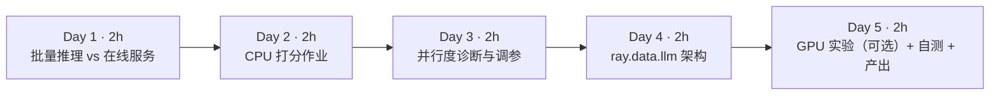
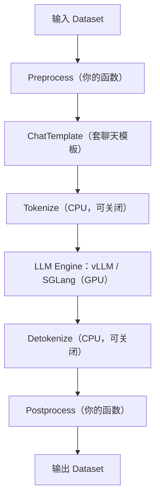

=== m2w4 | 第 8 周：ray.data.llm 离线批量推理 | 第 2 月 · Ray + 数据管线
# 第 8 周：用 Ray Data 做 LLM 批量推理（ray.data.llm + vLLM）

> **本周一句话**：把第 6、7 周的“清洗 → 去重”管线接上**模型打分**这一步——用 Ray Data 的 Actor 池在 CPU 上给文档打“教育价值”分（本站实测），再学习官方 `ray.data.llm` + vLLM 在 GPU 上做同样的事（未在本站实测，需 GPU）。核心收获：**批量推理的吞吐由“数据切分 × 副本数 × 每副本并行度 × 批大小”共同决定**，而最常见的坑是数据切分——本周实验里，开 4 个 Actor 却只有 1 个在干活。

**预计投入：约 10 小时**（阅读 ≈ 3h，CPU 动手 ≈ 4h，GPU 动手（可选）≈ 1.5h，自测与产出 ≈ 1.5h）。{{gpu1}}

**本周结束时你应该能：**

1. 说清离线批量推理（offline batch inference）与在线服务（online serving）在目标、指标和架构上的差异。
2. 用 `map_batches` + 类 UDF + `ActorPoolStrategy` 写一个 CPU 批量推理作业，并解释每个参数对吞吐的影响。
3. 诊断“Actor 开了却没活干”：block 数 < Actor 数时的并行度上限。
4. 读懂 `ray.data.llm` 的处理器流水线（Preprocess → ChatTemplate → Tokenize → vLLM Engine → Detokenize → Postprocess），知道每个阶段是一个独立的 Actor 池。
5. 为一个 GPU 批量推理作业做容量估算，并列出 OOM 时的调参顺序。

> **验证说明**：第 3 节实验 1–3 在 Linux x86_64（8 核、无 GPU）上实际运行：Python 3.12.15、ray 2.59.0、torch 2.14.1+cpu、transformers 5.20.2，模型为 [HuggingFaceFW/fineweb-edu-classifier](https://huggingface.co/HuggingFaceFW/fineweb-edu-classifier)（约 0.1B 参数）。输出为真实结果，耗时含模型加载、因机器而异。**实验 4（vLLM）未在本站实测，需 GPU**：代码取自 Ray 官方文档，没有贴任何输出。代码在仓库 `labs/w8/`。

---

## 1. 本周学习路线



| 天 | 时间 | 先读 | 再读（外部资料） | 再做 |
|---|---|---|---|---|
| Day 1 | ~2h | 本页 2.1、2.2 | ① [Ray Data：End-to-end: Offline Batch Inference](https://docs.ray.io/en/latest/data/batch_inference.html)（30 分钟）；② [fineweb-edu-classifier 模型卡](https://huggingface.co/HuggingFaceFW/fineweb-edu-classifier)（15 分钟） | 环境准备，下载模型 |
| Day 2 | ~2h | 本页 2.3 | ③ [Transforming Data](https://docs.ray.io/en/latest/data/transforming-data.html) 回顾 *Stateful transforms*（15 分钟） | 实验 1：edu_score.py |
| Day 3 | ~2h | 本页 2.4 | — | 实验 2：并行度网格；实验 3：block 诊断 |
| Day 4 | ~2h | 本页 2.5、2.6 | ④ [Ray Data：Working with LLMs](https://docs.ray.io/en/latest/data/working-with-llms.html) 读 *Quickstart*、*Processor architecture*、*Scaling to multiple GPUs*、*Classification*、*Troubleshooting*（50 分钟）；⑤ [ray.data.llm API](https://docs.ray.io/en/latest/data/api/llm.html)（10 分钟） | — |
| Day 5 | ~2h | 本页 2.7 | ⑥ [vLLM 文档](https://docs.vllm.ai/en/latest/) 首页与快速开始（20 分钟） | 实验 4（有 GPU 时）；自测；产出 |

**每日打卡：**

- [ ] Day 1：读完 ①②，能说出离线推理与在线服务的三点区别
- [ ] Day 2：跑通实验 1，得到 int_score 分布
- [ ] Day 3：跑通实验 2、3，能解释“4 个 Actor 反而最慢”
- [ ] Day 4：读完 ④⑤，能画出 ray.data.llm 处理器流水线
- [ ] Day 5：完成自测题与产出（GPU 实验可选）

---

## 2. 核心概念讲解

### 2.1 离线批量推理 vs 在线服务

| 维度 | 离线批量推理（本周） | 在线服务（第 4 月） |
|---|---|---|
| 目标 | **吞吐**：单位成本处理尽可能多的数据 | **延迟**：TTFT、每 token 延迟、P99 |
| 输入 | 一个数据集（Parquet/对象存储） | 一个个用户请求 |
| 批处理 | 大批量、可以重排、可以等待 | 连续批处理（continuous batching），不能让用户等 |
| 失败处理 | 重试 block、断点续跑 | 请求级重试、降级 |
| 典型场景 | 质量打分、合成数据、嵌入、离线评测、标注 | 聊天、API |
| 大数据类比 | Spark 批作业 | 在线查询服务（HBase/Druid） |

LLM 数据管线中，模型打分放在漏斗最后：FineWeb-Edu 就是用分类器给 FineWeb 打分，保留高分文档。模型卡写明：分类器用 Llama3-70B-Instruct 生成的 45 万条标注训练，在 Snowflake-arctic-embed 上加回归头；建议用 `int_score >= 3` 作为筛选阈值。

### 2.2 为什么批量推理要用 Ray 而不是 Spark

1. **异构资源**：读、解码、分词用 CPU，模型用 GPU。Ray Data 的流式执行让 CPU 阶段和 GPU 阶段同时运行，各自扩缩（第 6 周 2.5 节）。Spark 的 stage 模型很难让 GPU 一直忙。
2. **有状态 Actor**：模型加载一次、处理很多批。Spark 的 pandas UDF 每个 executor 也能缓存模型，但对 GPU 的调度与隔离支持较弱。
3. **背压**：GPU 慢时上游自动降速，不会撑爆内存。

### 2.3 吞吐的四个旋钮


$$\text{有效并行度} = \min(\text{block 数},\ \text{Actor 数}) \times \text{每 Actor 并行度}$$

- **block 数**：Ray Data 把**一个 block**作为一个任务发给 Actor。block 少于 Actor 时，多出的 Actor 只是占着资源加载模型。
- **Actor 数 × 每 Actor 线程数**：CPU 上总量受核数限制；本周对比了 1×4、2×2、4×1。GPU 上一般每个 Actor 一张卡（`num_gpus=1`），或用张量并行让一个 Actor 占多张卡。
- **batch_size**：GPU 上批越大越能吃满算力，直到显存不够；CPU 上批的收益很小，padding 到“批内最长”反而浪费（实验 2：batch=64 比 16 慢）。
- 模型加载时间：每个 Actor 都要加载一次。Actor 多、作业短时，加载占比很高。

### 2.4 padding 的代价

一个批内的序列要 padding 到同一长度（`padding="longest"`）。批越大，“最长那条”越长，短文本浪费的计算越多。实验中平均输入 218 token（截断到 256）。缓解办法：按长度分桶后再成批；vLLM 这类推理引擎用 PagedAttention + 连续批处理，从机制上避免了 padding（第 4 月详讲）。

### 2.5 ray.data.llm 处理器架构（摘自官方文档）



官方文档说明：**每个阶段都是一个独立的 Ray Actor 池**，CPU 和 GPU 阶段默认都是自动伸缩的池（ServeDeployment 阶段除外）。默认把分词/反分词拆成独立的 CPU 阶段（tokenization disaggregation），让 GPU 只做推理。

关键配置（`vLLMEngineProcessorConfig`）：

| 参数 | 含义 | 文档要点 |
|---|---|---|
| `model_source` | HF 模型 ID 或路径（也可以是 S3 路径） | gated 模型通过 `runtime_env` 传 HF_TOKEN |
| `concurrency` | vLLM 引擎副本数 | 整数 n 表示 1→n 自动伸缩；`(n, n)` 表示固定 n 个 |
| `batch_size` | 每批行数 | OOM 时先调小 |
| `engine_kwargs` | 直接传给 vLLM | `max_model_len`、`max_num_batched_tokens`、`gpu_memory_utilization`、`tensor_parallel_size` 等 |
| `task_type` | `generate` / `embed` / `classify` / `score` | 分类模型的 logits 放在 `embeddings` 字段 |
| `max_concurrent_batches` | 单个引擎 Actor 内同时执行的批数，默认 8 | 用来掩盖长尾 |
| `max_tasks_in_flight_per_actor` | 每个 Actor 排队的任务数，默认 16 | 小于前者会让 Actor 吃不饱 |
| `should_continue_on_error` | 行级容错 | 单行失败不让整个作业失败 |

**注意**：这里的 `concurrency` 是 `ray.data.llm` 配置类自己的参数，和第 6 周提到的 `map_batches(concurrency=...)` 弃用不是一回事。

**版本兼容**：文档 *Troubleshooting* 一节有“Ray 版本 ↔ 经过测试的 vLLM 版本”对照表（例如 Ray 2.58.0 ↔ vLLM 0.26.0）。本站写作时表中还没有 2.59 这一行，安装前请以最新表格为准。

### 2.6 容错与断点续跑

文档列出三层：**行级**（`should_continue_on_error=True`）、**Actor 级**（Actor 死亡后自动重启并重新加入池，默认开启）、**检查点恢复**（`DataContext.checkpoint_config = CheckpointConfig(id_column=..., checkpoint_path=...)`，要求管线以 read 开头、以 write 结尾，并且在后处理中保留 ID 列）。这和 Spark 作业失败后按分区重算、或者按日期分区补数的思路一致：**输出必须带可追溯的 ID，写出必须幂等**。

### 2.7 GPU 容量估算（为实验 4 做准备）

以 8B 模型、BF16 为例（方法见第 4 周）：权重约 8×10⁹×2 B ≈ 16 GB；剩余显存给 KV Cache，vLLM 默认 `gpu_memory_utilization=0.9`。24 GB 卡上 KV Cache 空间很紧，所以官方示例都设了 `max_model_len=4096`。文档给出的 OOM 调参顺序：减小 `batch_size` → 降低 `max_num_batched_tokens` → 减小 `max_model_len` → 把 `gpu_memory_utilization` 设为 0.75–0.85。

---

## 3. 动手实验

### 环境准备（CPU 部分，{{local}}）

```bash
cd ~/ai-infra-lab && source .venv/bin/activate && mkdir -p w8 && cd w8
uv pip install "torch==2.14.1" "transformers==5.20.2"    # Mac 用默认索引即可；Linux 无 GPU 可加 --index-url https://download.pytorch.org/whl/cpu
```

依赖第 6 周输出 `../w6/clean/`。

### 实验 1：CPU 批量打分（40 分钟）

```python
@@CODE:w8/edu_score.py@@
```

```bash
python edu_score.py          # 默认 2000 篇、2 个 Actor × 2 线程、batch 16、maxlen 512
```

**本站输出**（这是加 `--blocks` 和 pid 统计之前的版本，计数相同）：

```text
actors=2 threads=2 batch=16: 2000 篇，644.6s，3.1 篇/s，1097 token/s（含模型加载）
int_score 分布: {0: 225, 1: 1224, 2: 434, 3: 105, 4: 12}
int_score>=3（FineWeb-Edu 的保留阈值）占比 5.9%；平均输入 token 354
```

**逐步解释：**

- 只有 **5.9%** 的文档达到 `int_score >= 3`。按这个比例，FineWeb-Edu 相对 FineWeb 只保留一小部分——这正是“质量换数量”的取舍。
- 吞吐只有 1,097 token/s：10 分钟才处理 2,000 篇。实验 3 会揭示其中一半的 CPU 其实闲着。
- 推算：用这个速度处理第 6 周的 47,451 篇需要约 4 小时。**这就是为什么模型打分必须放在漏斗最后、并且要上 GPU。**

### 实验 2：并行度网格（40 分钟）

```bash
for cfg in "1 4 16" "2 2 16" "4 1 16" "2 2 1" "2 2 64"; do set -- $cfg
  python edu_score.py --n 300 --maxlen 256 --actors $1 --threads $2 --batch $3 | grep -E "^actors|占比"
done
```

**本站输出**（加 pid 统计之前的版本）：

```text
actors=1 threads=4 batch=16: 300 篇，28.8s，10.4 篇/s，2276 token/s（含模型加载）
actors=2 threads=2 batch=16: 300 篇，47.1s，6.4 篇/s，1390 token/s（含模型加载）
actors=4 threads=1 batch=16: 300 篇，89.6s，3.3 篇/s，730 token/s（含模型加载）
actors=2 threads=2 batch=1: 300 篇，45.8s，6.6 篇/s，1430 token/s（含模型加载）
actors=2 threads=2 batch=64: 300 篇，53.8s，5.6 篇/s，1215 token/s（含模型加载）
```

（五次的 int_score 分布完全相同：`{0: 34, 1: 192, 2: 56, 3: 16, 4: 2}`，占比 6.0%，平均输入 218 token。）

**先停下来猜一猜**：总线程数都是 4，为什么 Actor 越多越慢，而且慢的比例几乎正好是 1 : 1.6 : 3.1？

### 实验 3：诊断——到底有几个 Actor 在干活（30 分钟）

加上 `pid` 列统计实际参与计算的 Actor 数，并用 `--blocks 8` 先 repartition：

```bash
python edu_score.py --n 300 --maxlen 256 --actors 4 --threads 1 --batch 16
python edu_score.py --n 300 --maxlen 256 --actors 4 --threads 1 --batch 16 --blocks 8
python edu_score.py --n 300 --maxlen 256 --actors 2 --threads 2 --batch 16 --blocks 8
```

**本站输出：**

```text
actors=4 threads=1 batch=16 blocks=默认: 300 篇，91.8s，3.3 篇/s，713 token/s（含模型加载）
实际参与计算的 Actor 数: 1
actors=4 threads=1 batch=16 blocks=8: 300 篇，27.4s，11.0 篇/s，2390 token/s（含模型加载）
实际参与计算的 Actor 数: 4
actors=2 threads=2 batch=16 blocks=8: 300 篇，26.8s，11.2 篇/s，2439 token/s（含模型加载）
实际参与计算的 Actor 数: 2
```

**逐步解释：**

- `limit(300)` 后数据只来自第一个文件的一个 block，**整个作业只有 1 个任务**，所以只有 1 个 Actor 干活，而它只有 `threads` 个线程。实验 2 的耗时比例 1 : 1.6 : 3.1 实际上反映的是“这一个 Actor 有 4、2、1 个线程”。
- repartition 成 8 个 block 后，4×1 从 91.8s 降到 27.4s（**3.4 倍**），与 1×4、2×2 基本持平——总算力相同，吞吐就相同。
- 实验 1 的 2,000 篇很可能有同样的问题（只有一个 Actor 工作），作为练习请你加 `--blocks 8` 重跑对比。
- **架构师的教训**：这和 Spark 里“输入只有 1 个分区，开 100 个 executor 也没用”一模一样。在 Ray Dashboard 或输出里确认**实际并行度**，是批量推理调优的第一步。GPU 上更贵：空闲的 Actor 会一直占着整张卡。

### 实验 4：vLLM 批量推理（未在本站实测，需 GPU）{{gpu1}}

> ⚠️ **未在本站实测，需 GPU**。以下代码摘自 Ray 官方文档 [Working with LLMs](https://docs.ray.io/en/latest/data/working-with-llms.html) 的 *Quickstart* 与 *Classification* 两节，**没有贴任何输出**。需要一张 NVIDIA GPU（官方示例用 8B 模型并设 `max_model_len=4096` 以适配测试卡）。没有 GPU 可以租按小时计费的云 GPU，或只阅读不运行。

安装（文档写法）：

```bash
pip install -U "ray[data, llm]>=2.53.0"
```

**4a. 文本生成（文档 Quickstart）：**

```python
import ray
from ray.data.llm import vLLMEngineProcessorConfig, build_processor

ds = ray.data.from_items([
    {"prompt": "What is machine learning?"},
    {"prompt": "Explain neural networks in one sentence."},
])
config = vLLMEngineProcessorConfig(
    model_source="unsloth/Llama-3.1-8B-Instruct",
    concurrency=1,            # 1 个 vLLM 引擎副本
    batch_size=32,
    engine_kwargs={"max_model_len": 4096},
)
processor = build_processor(
    config,
    preprocess=lambda row: {
        "messages": [{"role": "user", "content": row["prompt"]}],
        "sampling_params": {"temperature": 0.7, "max_tokens": 100},
    },
    postprocess=lambda row: {"prompt": row["prompt"], "response": row["generated_text"]},
)
for r in processor(ds).iter_rows():
    print(r["prompt"], "->", r["response"])
```

**4b. 把本周的打分迁到 GPU（文档 Classification 一节的写法）**：文档示例使用 `nvidia/nemocurator-fineweb-nemotron-4-edu-classifier`，`task_type="classify"`，关闭 chat template 和 detokenize 阶段，分数从 `row["embeddings"][0]` 取出：

```python
classification_config = vLLMEngineProcessorConfig(
    model_source="nvidia/nemocurator-fineweb-nemotron-4-edu-classifier",
    task_type="classify",
    engine_kwargs=dict(max_model_len=512, enforce_eager=True),
    batch_size=8,
    concurrency=1,
    chat_template_stage=False,
    detokenize_stage=False,
)
processor = build_processor(
    classification_config,
    preprocess=lambda row: dict(prompt=row["text"]),
    postprocess=lambda row: {"text": row["prompt"],
                             "edu_score": float(row["embeddings"][0])},
)
ds = ray.data.read_parquet("../w6/clean")
processor(ds).write_parquet("scored/")
```

**跑通后请自己记录**（不要抄别人的数字）：每秒处理文档数、GPU 利用率（`nvidia-smi`）、与实验 1 CPU 版的倍数；把 `concurrency` 与 `batch_size` 各改一次，观察变化。

### 常见错误与排查

| 现象 | 原因 | 解决 |
|---|---|---|
| 开了 N 个 Actor，吞吐没有提升（本站实测：只有 1 个在干活） | block 数 < Actor 数 | 先 `repartition(n)`，或调小 block 大小；输出中记录 pid/节点确认 |
| CPU 上 batch 越大越慢（本站实测 64 比 16 慢） | padding 到批内最长 | CPU 用中小批；按长度分桶 |
| 每个 Actor 启动都很慢 | 每个 Actor 都要加载模型（首次还要下载） | 预先下载到共享存储；作业足够长才多开 Actor |
| CUDA OOM（文档 Troubleshooting） | 批太大、上下文太长 | 依次调小 `batch_size`、`max_num_batched_tokens`、`max_model_len`、`gpu_memory_utilization` |
| `ImportError: libcudart.so.12: cannot open shared object file`（文档列出的已知问题） | NIXL EP 包与 CUDA/vLLM 不兼容 | 卸载或换成兼容的 `nixl_ep` |
| 大集群下载模型被限流（文档 Troubleshooting） | 每个副本都从 HF 下载 | 文档建议先上传到 S3/GCS，`model_source` 指向对象存储 |
| Ray 与 vLLM 版本冲突（未在本站复现） | 不在兼容表中的组合 | 按文档兼容表选择版本 |

### 扩展练习

1. 给实验 1 加 `--blocks 8` 重跑 2,000 篇，算出加速比。
2. 按 token 长度把文档分成 3 个桶，分别成批，测量对 CPU 吞吐的影响。
3. 把打分作业接在第 7 周的去重输出后面，写出 `score`、`int_score` 列，统计“去重 + 打分”的最终保留率。
4. 阅读文档 *Resiliency* 一节，为打分作业加上检查点配置，人为中断一次再续跑（CPU 版可用 `map_batches` 管线练习检查点）。
5. （GPU）完成实验 4b，并和 CPU 版对比每千篇成本。

---

## 4. 精读指南

- **① [Offline Batch Inference](https://docs.ray.io/en/latest/data/batch_inference.html)**（30 分钟）。**读完回答**：文档推荐的批量推理结构有哪几步？GPU 推理时 `num_gpus` 和 Actor 池大小如何配合？
- **② [fineweb-edu-classifier 模型卡](https://huggingface.co/HuggingFaceFW/fineweb-edu-classifier)**（15 分钟）。**读完回答**：分类器是怎么训练的？为什么建议阈值是 3？模型卡列出了哪些局限？
- **④ [Working with LLMs](https://docs.ray.io/en/latest/data/working-with-llms.html)**（50 分钟）。**读完回答**：① 处理器有哪几个阶段，哪些在 GPU 上？② `concurrency=4` 与 `concurrency=(4, 4)` 的区别？③ `max_concurrent_batches` 与 `max_tasks_in_flight_per_actor` 如何配合？④ 三层容错分别是什么？
- **⑤ [ray.data.llm API](https://docs.ray.io/en/latest/data/api/llm.html)**（10 分钟）：浏览有哪些配置类（vLLM、SGLang、HTTP、Serve 部署）。
- **⑥ [vLLM 文档](https://docs.vllm.ai/en/latest/)**（20 分钟）：只看首页对 PagedAttention、连续批处理的介绍，第 4 月会深入。
- **背景**：[FineWeb-Edu 数据集](https://huggingface.co/datasets/HuggingFaceFW/fineweb-edu)；[Ray Data 论文](https://arxiv.org/abs/2501.12407) 中关于异构 CPU/GPU 流水线的部分。

---

## 5. 自测题

<details>
<summary>1. 离线批量推理与在线服务的核心指标分别是什么？</summary>

离线批量推理追求吞吐、单位成本（每千篇/每百万 token 的成本）；在线服务追求延迟（TTFT、每 token 延迟、P99）和可用性。

</details>

<details>
<summary>2. 实验 2 中为什么 4 个 Actor 反而最慢？</summary>

`limit(300)` 后只有 1 个 block，Ray Data 按 block 派发任务，所以只有 1 个 Actor 在工作；它只有 1 个线程。repartition 成 8 个 block 后 4 个 Actor 都参与，耗时从 91.8s 降到 27.4s。

</details>

<details>
<summary>3. 有效并行度由什么决定？</summary>

min(block 数, Actor 数) × 每个 Actor 的并行度（CPU 线程或 GPU），并受集群总资源限制；batch_size 决定每次前向的效率。

</details>

<details>
<summary>4. CPU 上 batch=64 为什么比 batch=16 慢？GPU 上会怎样？</summary>

批内 padding 到最长序列，批越大浪费越多，而 CPU 从大批中获得的并行收益很小。GPU 上大批能更好地利用算力，通常吞吐随批增大而提升，直到显存不足或长度差异过大。

</details>

<details>
<summary>5. ray.data.llm 为什么把 tokenize/detokenize 拆成独立的 CPU 阶段？</summary>

让 GPU 阶段只做推理，避免分词占用 GPU Actor 的时间；CPU 阶段可以独立扩缩。文档提示：当 GPU 引擎已经饱和、分词不是瓶颈时，额外阶段未必有帮助。

</details>

<details>
<summary>6. GPU 推理遇到 CUDA OOM，按文档建议应如何调整？</summary>

依次：减小 batch_size（从 8–16 开始）、降低 max_num_batched_tokens、减小 max_model_len、把 gpu_memory_utilization 调到 0.75–0.85。

</details>

<details>
<summary>7. 检查点恢复对管线有什么要求？</summary>

管线以 read 开头、以 write 结尾；配置 CheckpointConfig 的 id_column；预处理和后处理都要保留 ID 列；只有已经写到 sink 的 block 才能被跳过。

</details>

### 思考题

1. **成本模型**：用实验 3 的 CPU 吞吐和一张云 GPU 的小时价（自己查），估算给 1 亿篇文档打分的成本和时间。哪一种更便宜？
2. **管线编排**：清洗（CPU）→ 去重（shuffle 密集）→ 打分（GPU）三步，你会做成一个 Ray 作业，还是 Spark + Ray 两个作业用 Parquet 交接？考虑容错、资源利用率和团队技能。
3. **打分模型的风险**：模型卡提到分类器可能偏向“看起来学术”的内容。如果你是数据负责人，怎样监控和纠正这种偏差？

---

## 6. 本周产出与掌握清单

### 本周产出

1. `labs/w8/edu_score.py` 以及运行记录 `README.md`：实验 1–3 的数字、“只有 1 个 Actor 在干活”的诊断过程。
2. **第 2 月项目报告**（汇总第 6–8 周）：清洗 → 去重 → 打分的漏斗图（每一步的行数）、各引擎耗时、你的 Spark/Ray 选型结论。
3. （有 GPU 时）实验 4 的运行记录，与 CPU 版对比。

### 掌握清单

- [ ] 能对比离线批量推理与在线服务
- [ ] 会用 map_batches + 类 UDF + ActorPoolStrategy 写批量推理
- [ ] 能用 pid 统计或 Dashboard 确认实际并行度
- [ ] 知道 block 数会限制 Actor 并行度，会用 repartition 修复
- [ ] 能解释 padding 与 batch_size 的关系
- [ ] 能画出 ray.data.llm 处理器流水线，知道每个阶段是一个 Actor 池
- [ ] 能说出 vLLMEngineProcessorConfig 的主要参数
- [ ] 能给出 GPU OOM 的调参顺序
- [ ] 知道三层容错与检查点恢复的要求
- [ ] 完成第 2 月项目报告

---

## 参考资料

- [Ray Data：Working with LLMs](https://docs.ray.io/en/latest/data/working-with-llms.html)（文档·进阶）
- [Ray Data：Offline Batch Inference](https://docs.ray.io/en/latest/data/batch_inference.html)（文档·入门）
- [ray.data.llm API](https://docs.ray.io/en/latest/data/api/llm.html)（文档·进阶）
- [fineweb-edu-classifier](https://huggingface.co/HuggingFaceFW/fineweb-edu-classifier)（模型·入门）
- [FineWeb-Edu 数据集](https://huggingface.co/datasets/HuggingFaceFW/fineweb-edu)（数据集·入门）
- [vLLM 文档](https://docs.vllm.ai/en/latest/)（文档·进阶）

> 完整列表见 [参考资料库](/resources.html)。
