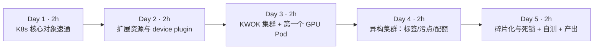
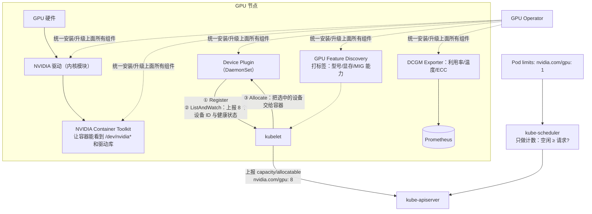
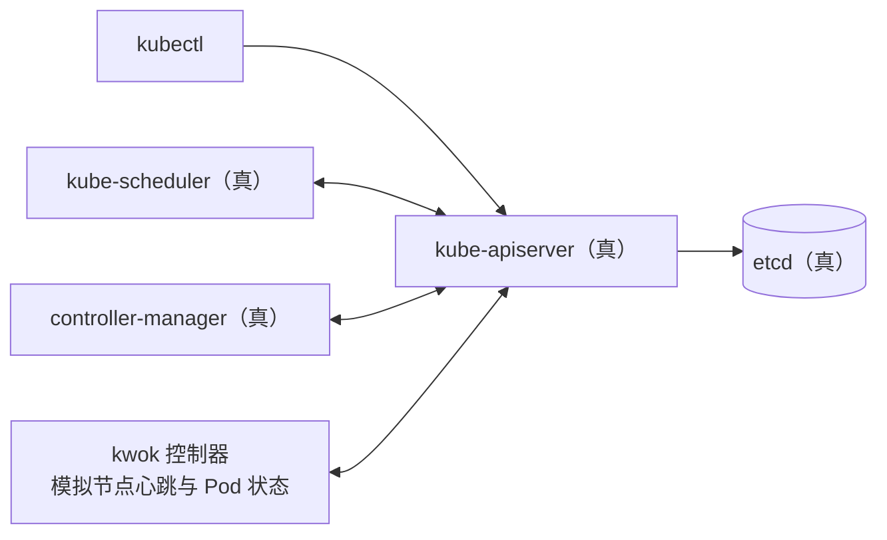
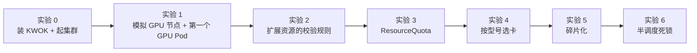

=== m3w1 | 第 9 周：K8s 与 GPU 设备模型 | 第 3 月 · K8s + GPU 调度
# 第 9 周：K8s 与 GPU 设备模型

> **本周一句话**：搞清楚一张 GPU 是怎样从“插在服务器上的硬件”变成 K8s 里一个可调度的整数资源 `nvidia.com/gpu` 的，并亲手体验默认调度器在 GPU 场景下的三大痛点：**整卡分配、碎片化、分布式作业的“半调度死锁”**。这三个痛点就是后面三周 Kueue、Volcano、GPU Operator 存在的理由。

**预计投入：约 10 小时**（阅读 ≈ 4h，动手 ≈ 4h，自测与产出 ≈ 2h）。{{local}}

**本周结束时你应该能：**

1. 画出 GPU 节点的软件栈：驱动 → 容器工具包 → device plugin → kubelet → 调度器，并说出每一层的职责。
2. 解释 device plugin 的注册 / ListAndWatch / Allocate 流程，以及扩展资源的约束（整数、只写 limits、不能超卖）。
3. 用标签、污点/容忍、nodeSelector 和 ResourceQuota 管理异构 GPU 集群。
4. 复现并解释“GPU 碎片化”和“分布式作业部分调度导致的死锁”。
5. 说出 MIG、时间片、DRA 这几种“分卡/新分配方式”的定位。

> **验证说明（重要）**：本站环境没有 Docker、没有 GPU，kind/minikube 都无法运行。本周实验改用 **[KWOK](https://kwok.sigs.k8s.io/)（Kubernetes WithOut Kubelet）**：`kwokctl --runtime binary` 直接以普通进程启动**真实的** etcd、kube-apiserver、kube-scheduler、kube-controller-manager（本站为 K8s v1.36.1），节点和 Pod 的“运行”由 KWOK 模拟。因此 **API 校验、配额、调度决策、事件信息都是真的**（本页报错和事件均为真实输出），但容器不会真的运行，也不存在真实 GPU。凡是需要真实 GPU 驱动/容器的部分（device plugin 实际分配设备、`nvidia-smi`）都标注为“未在本站实测”。工具版本：kwokctl v0.8.0，kubectl v1.37.1。实验文件在仓库 `labs/w9/`。
>
> 你在 Mac 上可以照抄 KWOK 的做法（最轻量，推荐），也可以按 [实验环境](/lab-env.html) 用 kind；两者的命令只在“创建集群/节点”这一步不同。

---

## 1. 本周学习路线



| 天 | 时间 | 先读 | 再读（外部资料） | 再做 |
|---|---|---|---|---|
| Day 1 | ~2h | 本页 2.1 | ① [Kubernetes 调度器](https://kubernetes.io/docs/concepts/scheduling-eviction/kube-scheduler/)（20 分钟）；② [为 Pod 和容器管理资源](https://kubernetes.io/docs/concepts/configuration/manage-resources-containers/) 读 requests/limits 与 *Extended resources* 两部分（30 分钟） | — |
| Day 2 | ~2h | 本页 2.2、2.3 | ③ [Device Plugins](https://kubernetes.io/docs/concepts/extend-kubernetes/compute-storage-net/device-plugins/)（40 分钟）；④ [Schedule GPUs](https://kubernetes.io/docs/tasks/manage-gpus/scheduling-gpus/)（15 分钟） | — |
| Day 3 | ~2h | 本页 2.4 | ⑤ [KWOK 文档首页](https://kwok.sigs.k8s.io/) 与 [kwokctl 二进制运行时](https://kwok.sigs.k8s.io/docs/user/kwokctl-platform-specific-binaries/)（15 分钟） | 实验 0、1、2 |
| Day 4 | ~2h | 本页 2.5 | ⑥ [污点和容忍](https://kubernetes.io/docs/concepts/scheduling-eviction/taint-and-toleration/)（20 分钟）；⑦ [Resource Quotas](https://kubernetes.io/docs/concepts/policy/resource-quotas/) 读扩展资源配额部分（15 分钟） | 实验 3、4 |
| Day 5 | ~2h | 本页 2.6、2.7 | ⑧ [NVIDIA k8s-device-plugin README](https://github.com/NVIDIA/k8s-device-plugin) 浏览时间片与 MIG 部分（20 分钟）；⑨ [Resource Bin Packing](https://kubernetes.io/docs/concepts/scheduling-eviction/resource-bin-packing/)（15 分钟） | 实验 5、6；自测；产出 |

**每日打卡：**

- [ ] Day 1：读完 ①②，能说出 requests 与 limits 在调度和运行时各自的作用
- [ ] Day 2：读完 ③④，能画出 device plugin 的注册与分配流程
- [ ] Day 3：KWOK 集群起来，第一个 GPU Pod 处于 Running
- [ ] Day 4：完成实验 3、4，见到配额拒绝与选择器不匹配的真实报错
- [ ] Day 5：复现“半调度死锁”，完成自测与产出

---

## 2. 核心概念讲解

### 2.1 K8s 核心对象：给 YARN 老兵的对照表

| YARN / Hadoop | Kubernetes | 说明 |
|---|---|---|
| ResourceManager | kube-apiserver + kube-scheduler + controller-manager | K8s 把“状态存储/API”、“调度”、“控制循环”拆成独立组件，状态都在 etcd |
| NodeManager | kubelet | 节点代理，负责拉起容器、上报资源 |
| Container | Pod（一个或多个容器） | Pod 是调度的最小单位 |
| ApplicationMaster | Operator / 控制器（如 Job、PyTorchJob、RayCluster 控制器） | 按“期望状态”不断调和（reconcile） |
| Queue（Capacity Scheduler） | Namespace + ResourceQuota；队列语义要靠 **Kueue**（第 10 周） | 原生 K8s 没有“队列”和“排队”概念 |
| Gang 调度（YARN 不原生支持） | **Volcano**，或 K8s 原生 [Gang Scheduling](https://kubernetes.io/docs/concepts/scheduling-eviction/gang-scheduling/)（v1.37 起 Beta，默认关闭）（第 11 周） | 默认配置下调度器逐个 Pod 调度 |
| yarn.io/gpu 资源类型 | 扩展资源 `nvidia.com/gpu` | 都是整数计数型资源 |

最关键的思维差异：**YARN 是“作业调度器”，K8s 默认调度器是“Pod 放置器”**。它一次只看一个 Pod，回答“这个 Pod 放在哪台机器上”，不关心这个 Pod 属于哪个作业、作业的其他 Pod 能否一起启动、是否应该排队。这一点在实验 6 中会直接变成死锁。

### 2.2 GPU 节点软件栈



- **调度器只做计数**：它只知道节点上 `nvidia.com/gpu` 还剩几个，不知道是哪几张卡、卡之间的拓扑（NVLink/PCIe）、显存用了多少。
- **具体分配哪张卡由 kubelet + device plugin 决定**，发生在 Pod 已经被调度到节点之后。
- **GPU Operator**（第 12 周）把驱动、工具包、device plugin、GFD、DCGM 用一个 Operator 统一管理，类似 Cloudera Manager / Ambari 管理 Hadoop 组件。

### 2.3 Device Plugin 机制（读 ③ 时对照）

官方文档描述的流程：

1. device plugin 通过 kubelet 的 Unix socket 调用 `Register`，声明资源名（如 `nvidia.com/gpu`）。
2. kubelet 调用插件的 `ListAndWatch`，插件以流的方式持续上报设备列表与健康状态；kubelet 把健康设备数作为节点的 capacity/allocatable 上报给 API Server。
3. Pod 被调度到节点后，kubelet 调用 `Allocate`，插件返回让容器使用这些设备所需的信息（设备节点、环境变量、挂载等）。

**扩展资源的规则**（文档 *Extended resources* 一节；实验 2 用真实报错验证）：

- 只能是**整数**，不能写 `500m` 这样的小数。
- 可以只写 `limits`（此时 requests 自动等于 limits）；如果同时写，**requests 必须等于 limits**——扩展资源不能超卖。
- 不能在多个容器之间共享同一个设备（除非插件实现了时间片等共享机制）。

| 你熟悉的 | GPU 设备模型 |
|---|---|
| YARN 的 vcore 可以超卖（`yarn.nodemanager.resource.cpu-vcores` 设得比物理核多） | GPU 不能超卖：requests 必须等于 limits |
| YARN 的 GPU 隔离靠 cgroups devices + 节点上的 GPU 发现脚本 | K8s 靠 device plugin + 容器工具包 |
| 节点标签（node label）+ 队列映射 | 节点标签 + nodeSelector/亲和性 |

### 2.4 KWOK：用“假 kubelet”学调度

KWOK 的思路：控制面是真的，只有 kubelet 是假的。你创建带注解 `kwok.x-k8s.io/node: fake` 的 Node 对象，KWOK 控制器就替它维持心跳；Pod 被调度到这些节点后，KWOK 按预设的“阶段（stage）”把 Pod 状态改成 Running。



**适合**：学习调度、配额、优先级/抢占、队列系统、控制器行为；在笔记本上模拟上千节点的集群。**不适合**：任何需要容器真正运行的东西（镜像、网络、存储、GPU 驱动、device plugin 本身）。注意一个细节：KWOK 默认会让 **Job 管理的 Pod 很快进入 Succeeded**（本站实测：带 Job 的分布式作业瞬间“跑完”），所以实验 6 直接创建 worker Pod 来模拟训练作业。

### 2.5 异构 GPU 集群的三件套：标签、污点、配额

1. **标签 + nodeSelector/亲和性**：GPU Feature Discovery 会给节点打 `nvidia.com/gpu.product`、`nvidia.com/gpu.memory` 等标签，作业据此选择 A100 或 L4。
2. **污点 + 容忍**：给 GPU 节点打 `NoSchedule` 污点，没有容忍的普通 Pod 不会被放上来，避免 CPU 作业占住 GPU 机器的 CPU/内存导致 GPU 闲置。
3. **ResourceQuota**：按 Namespace 限制 GPU 总量。扩展资源的配额只能用 `requests.` 前缀（`requests.nvidia.com/gpu`）。

但 ResourceQuota 只是**硬上限 + 立即拒绝**：超额的 Pod 直接创建失败（实验 3），既不排队，也不能借用其他团队闲置的配额。这正是第 10 周 Kueue 要解决的问题。

### 2.6 默认调度器的两个 GPU 痛点

**痛点一：碎片化。** 集群总共空闲 6 张卡，但分散在不同节点上，一个需要 8 卡的作业依然无法调度（实验 5）。调度器的打分插件 `NodeResourcesFit` 默认用 `LeastAllocated` 策略，倾向于把 Pod 分散；文档 ⑨ 介绍了 `MostAllocated` 与 `RequestedToCapacityRatio` 两种“装箱（bin packing）”策略，可以给 `nvidia.com/gpu` 设置权重，让小任务尽量挤在同一台机器上，为大任务留出整机。

**痛点二：分布式作业的部分调度（死锁）。** 默认调度器逐个 Pod 调度。两个各需要 3×4 卡的训练作业同时到达，集群有 12 张卡：理想情况是一个先跑、一个排队。实际结果（实验 6）：两个作业**各拿到一部分 worker**，12 张卡全部被占用，但没有一个作业能凑齐 worker 开始训练——资源被白白锁住。解决办法是 **gang 调度**（All-or-nothing）：要么一个作业的所有 Pod 一起调度，要么一个都不调度。K8s 自身也在补这块：官方文档的 Gang Scheduling 页面写明该特性自 v1.37 起为 Beta、默认关闭，需要开启 `GenericWorkload` 特性门控并使用 PodGroup API（第 11 周实测）。

$$\text{GPU 有效利用率} = \frac{\text{在真正训练的作业占用的 GPU}}{\text{已分配的 GPU}}$$

实验 6 中已分配 12/12，有效利用率是 **0**。这比 YARN 上“容器申请到了但 AM 没起来”的情况更糟，因为分布式训练的 worker 会一直等待对方，不会超时释放。

### 2.7 分卡与新一代分配机制（概念了解）

| 机制 | 原理 | 隔离性 | 典型用途 |
|---|---|---|---|
| 整卡（默认） | 一个容器独占 N 张卡 | 强 | 训练、大模型推理 |
| 时间片（time-slicing） | device plugin 把一张卡“复制”成多个资源，容器轮流使用 | 弱：显存不隔离、互相影响 | 开发、小模型推理 |
| MIG（Multi-Instance GPU） | A100/H100 等在硬件上切成多个实例，各有独立显存与算力 | 强 | 多租户推理 |
| MPS | CUDA 层面多进程共享 | 中 | 小批推理吞吐 |
| DRA（Dynamic Resource Allocation） | K8s 新一代设备分配 API，按“设备类 + 声明（claim）”分配，可表达属性和共享 | 取决于驱动 | GPU 调度的演进方向 |

时间片和 MIG 的具体配置见 ⑧ README；DRA 见 [K8s DRA 文档](https://kubernetes.io/docs/concepts/scheduling-eviction/dynamic-resource-allocation/)。这些都需要真实 GPU，本站未实测。

---

## 3. 动手实验 {{local}}



### 实验 0：安装 KWOK 并创建集群（20 分钟）

```bash
# Mac
brew install kwok kubectl
# Linux（本站做法，无需 root）
mkdir -p ~/.local/bin && export PATH=~/.local/bin:$PATH
curl -sLo ~/.local/bin/kwokctl https://github.com/kubernetes-sigs/kwok/releases/download/v0.8.0/kwokctl-linux-amd64
curl -sLo ~/.local/bin/kwok    https://github.com/kubernetes-sigs/kwok/releases/download/v0.8.0/kwok-linux-amd64
curl -sLo ~/.local/bin/kubectl https://dl.k8s.io/release/v1.37.1/bin/linux/amd64/kubectl
chmod +x ~/.local/bin/*

kwokctl create cluster --name lab --runtime binary    # 不需要 Docker：直接下载并启动 etcd/apiserver/scheduler 等二进制
kubectl config current-context
kubectl get ns
```

**本站输出**（创建过程日志较长，节选关键行）：

```text
..."msg":"Download",..."uri":"https://github.com/etcd-io/etcd/releases/download/v3.6.10/etcd-v3.6.10-linux-amd64.tar.gz"
..."msg":"Download",..."uri":"https://dl.k8s.io/release/v1.36.1/bin/linux/amd64/kube-apiserver"
..."msg":"Cluster is created","cluster":"lab","elapsed":{..."human":"11.653619573s"}
..."msg":"Cluster is started","cluster":"lab",...
kwok-lab
NAME              STATUS   AGE
default           Active   13s
kube-node-lease   Active   13s
kube-public       Active   13s
kube-system       Active   13s
```

> Mac 上 `--runtime binary` 需要 kwokctl 能下载到对应平台的二进制，参见 ⑤ 的“平台相关二进制”页面；如果遇到问题，可改用默认的 Docker 运行时（需要 Docker Desktop）。

### 实验 1：模拟 GPU 节点，跑第一个 GPU Pod（30 分钟）

`nodes.yaml`：两台 GPU 机器（8×A100、4×L4，都打了污点）和一台 CPU 机器：

```yaml
@@CODE:w9/nodes.yaml@@
```

`gpu-pod.yaml`：

```yaml
@@CODE:w9/gpu-pod.yaml@@
```

```bash
kubectl apply -f nodes.yaml
kubectl get nodes -o custom-columns=NAME:.metadata.name,GPU:.status.allocatable.nvidia\\.com/gpu,PRODUCT:.metadata.labels.nvidia\\.com/gpu\\.product
kubectl apply -f gpu-pod.yaml && kubectl get pod -o wide
kubectl describe node gpu-node-0
```

**本站输出：**

```text
NAME         GPU      PRODUCT
cpu-node-0   <none>   <none>
gpu-node-0   8        NVIDIA-A100-SXM4-80GB
gpu-node-1   4        NVIDIA-L4
pod/train-1gpu created
NAME         READY   STATUS    RESTARTS   AGE   IP         NODE         NOMINATED NODE   READINESS GATES
train-1gpu   1/1     Running   0          3s    10.0.0.1   gpu-node-0   <none>           <none>
```

`describe node` 的关键部分（gpu-node-0 被占满 8 卡时）：

```text
Capacity:
  cpu:             96
  memory:          1Ti
  nvidia.com/gpu:  8
  pods:            110
Allocatable:
  cpu:             96
  memory:          1Ti
  nvidia.com/gpu:  8
  pods:            110
Allocated resources:
  (Total limits may be over 100 percent, i.e., overcommitted.)
  Resource           Requests  Limits
  --------           --------  ------
  cpu                0 (0%)    0 (0%)
  memory             0 (0%)    0 (0%)
  ephemeral-storage  0 (0%)    0 (0%)
  nvidia.com/gpu     8         8
```

**逐步解释：**

- 真实集群中 `capacity` 里的 `nvidia.com/gpu: 8` 由 device plugin 经 kubelet 上报；这里我们直接写在 Node 的 status 里，调度器看到的效果完全一样。
- `Allocated resources` 中 GPU 的 requests 与 limits 总是相等，也没有百分比——它是纯计数。
- 在真实集群中，容器启动后执行 `nvidia-smi` 只会看到分配给它的那张卡（**未在本站实测**，需要真实 GPU 节点与 device plugin）。

### 实验 2：扩展资源的校验规则（20 分钟）

`bad-requests.yaml`（requests 1、limits 2）、`bad-frac.yaml`（500m）、`notol.yaml`（没有容忍污点）：

```yaml
@@CODE:w9/bad-requests.yaml@@
```

```yaml
@@CODE:w9/bad-frac.yaml@@
```

```yaml
@@CODE:w9/notol.yaml@@
```

**本站输出：**

```text
== 1
The Pod "bad-req" is invalid: spec.containers[0].resources.requests: Invalid value: "1": must be equal to nvidia.com/gpu limit of 2
== 2
The Pod "bad-frac" is invalid: 
* spec.containers[0].resources.limits[nvidia.com/gpu]: Invalid value: "500m": must be an integer
* spec.containers[0].resources.requests[nvidia.com/gpu]: Invalid value: "500m": must be an integer
== 3
pod/no-toleration created
NAME            READY   STATUS    RESTARTS   AGE
no-toleration   0/1     Pending   0          3s
REASON             MSG
FailedScheduling   0/3 nodes are available: 1 Insufficient nvidia.com/gpu, 2 node(s) had untolerated taint(s). no new claims to deallocate, preemption: 0/3 nodes are available: 3 Preemption is not helpful for scheduling.
```

**逐步解释：**

- 前两个是 **API Server 的校验错误**，对象根本没有被创建——规则写死在 API 里，而不是调度器的策略。
- 第三个对象创建成功但 Pending。读懂 `FailedScheduling` 消息是 K8s 排障的基本功：3 个节点中，1 个（CPU 节点）`Insufficient nvidia.com/gpu`，2 个（GPU 节点）`had untolerated taint(s)`。`preemption: ... not helpful` 表示即使抢占低优先级 Pod 也无济于事。
- `no new claims to deallocate` 与 DRA（动态资源分配）的资源声明有关，本集群没有使用 DRA，可以忽略。

### 实验 3：用 ResourceQuota 限制团队 GPU（20 分钟）

辅助脚本 `mkpod.sh`（按名字、卡数、可选型号、命名空间创建 GPU Pod）与 `alloc.sh`（统计每个节点已分配的 GPU）：

```bash
@@CODE:w9/mkpod.sh@@
```

```bash
@@CODE:w9/alloc.sh@@
```

`quota.yaml`：

```yaml
@@CODE:w9/quota.yaml@@
```

```bash
kubectl apply -f quota.yaml
./mkpod.sh a1 2 "" team-a; ./mkpod.sh a2 2 "" team-a; ./mkpod.sh a3 1 "" team-a
kubectl describe quota gpu-quota -n team-a
```

**本站输出：**

```text
namespace/team-a created
resourcequota/gpu-quota created
pod/a1 created
pod/a2 created
Error from server (Forbidden): error when creating "STDIN": pods "a3" is forbidden: exceeded quota: gpu-quota, requested: requests.nvidia.com/gpu=1, used: requests.nvidia.com/gpu=4, limited: requests.nvidia.com/gpu=4
Resource                 Used  Hard
--------                 ----  ----
requests.nvidia.com/gpu  4     4
```

**逐步解释**：配额在**准入（admission）阶段**检查，超额直接返回 403 Forbidden。对于批处理作业，这意味着提交方必须自己重试——相当于 YARN 队列满时直接拒绝提交，而不是让作业排队。对比第 10 周 Kueue：作业会进入队列等待，还能借用其他队列的闲置额度。

### 实验 4：按 GPU 型号调度（15 分钟）

```bash
./mkpod.sh want-l4 2 NVIDIA-L4
./mkpod.sh want-h100 1 NVIDIA-H100-80GB-HBM3
kubectl get pod want-l4 want-h100 -o custom-columns=NAME:.metadata.name,NODE:.spec.nodeName,STATUS:.status.phase
```

**本站输出：**

```text
NAME        NODE         STATUS
want-l4     gpu-node-1   Running
want-h100   <none>       Pending
0/3 nodes are available: 3 node(s) didn't match Pod's node affinity/selector. no new claims to deallocate, preemption: 0/3 nodes are available: 3 Preemption is not helpful for scheduling.
```

**逐步解释**：集群里没有 H100，Pod 会一直 Pending，**不会报错退出**。生产中要配合监控（Pending 时长告警）或在准入阶段校验型号。真实集群中这些型号标签由 GPU Feature Discovery 自动生成（见 [GFD 文档](https://github.com/NVIDIA/k8s-device-plugin/blob/main/docs/gpu-feature-discovery/README.md)），名字以实际节点为准。

### 实验 5：碎片化（15 分钟）

```bash
kubectl delete pod --all
for i in 1 2 3 4 5 6; do ./mkpod.sh small-$i 1 >/dev/null; done
kubectl get pod -o custom-columns=NAME:.metadata.name,NODE:.spec.nodeName,STATUS:.status.phase --no-headers | sort; ./alloc.sh
./mkpod.sh big-8 8; kubectl get pod big-8
```

**本站输出：**

```text
small-1   gpu-node-0   Running
small-2   gpu-node-0   Running
small-3   gpu-node-0   Running
small-4   gpu-node-0   Running
small-5   gpu-node-0   Running
small-6   gpu-node-0   Running
gpu-node-0  已分配 6 / 总量 8
gpu-node-1  已分配 0 / 总量 4
big-8   0/1   Pending   0     3s
0/3 nodes are available: 3 Insufficient nvidia.com/gpu. no new claims to deallocate, preemption: 0/3 nodes are available: 1 No preemption victims found for incoming pod, 2 Preemption is not helpful for scheduling.
```

**逐步解释：**

- 集群空闲 2+4 = 6 张卡，但 8 卡作业放不下：唯一的 8 卡机器上已经有 6 个 1 卡任务。如果这 6 个小任务当初放到别处（或者 L4 机器先放满），A100 整机就能留给大作业。
- 为什么 6 个小任务都落在 gpu-node-0？这些 Pod 没有 CPU/内存请求，默认打分（只按 CPU 和内存计算的 `LeastAllocated`）对两台机器打出同样的分，选择结果不受 GPU 用量影响。**默认调度器不会为“未来的大作业”预留整机**。
- `1 No preemption victims found`：6 个小任务和大作业优先级相同，不能被抢占。第 10 周会用 PriorityClass + Kueue 讨论抢占。

### 实验 6：分布式作业的“半调度死锁”（20 分钟）

```bash
@@CODE:w9/ddp-job.sh@@
```

```bash
kubectl delete pod --all
./ddp-job.sh
kubectl get pod -o custom-columns=POD:.metadata.name,NODE:.spec.nodeName,STATUS:.status.phase --no-headers | sort; ./alloc.sh
```

**本站输出：**

```text
job-a-worker-0   gpu-node-0   Running
job-a-worker-1   gpu-node-1   Running
job-a-worker-2   <none>       Pending
job-b-worker-0   gpu-node-0   Running
job-b-worker-1   <none>       Pending
job-b-worker-2   <none>       Pending
gpu-node-0  已分配 8 / 总量 8
gpu-node-1  已分配 4 / 总量 4
```

**逐步解释：**

- 12 张卡全部被分配，但作业 A 只到齐 2/3 个 worker，作业 B 只有 1/3。分布式训练（如 PyTorch DDP 的 rendezvous）要等所有 worker 到齐才开始，于是**两个作业都卡住，GPU 有效利用率为 0**。
- 如果按作业整体调度：A 的 3 个 worker 正好可以放下（node-0 放 2 个、node-1 放 1 个），B 排队等待，A 完成后 B 再运行。
- 这就是 gang 调度要解决的问题（第 11 周用 Volcano 的 PodGroup 实现），而 Kueue（第 10 周）从“作业准入”的角度解决：资源不够整个作业就不放行，作业里的 Pod 根本不会被创建。

### 清理

```bash
kubectl delete pod --all
kwokctl delete cluster --name lab      # 本月后几周还要用，可以先保留
```

### 常见错误与排查

| 现象（真实报错） | 原因 | 解决 |
|---|---|---|
| `must be equal to nvidia.com/gpu limit of 2`（本站实测） | 扩展资源 requests ≠ limits | 只写 limits |
| `"500m": must be an integer`（本站实测） | 扩展资源不能是小数 | 用时间片/MIG 等机制分卡 |
| `had untolerated taint(s)`（本站实测） | GPU 节点有污点，Pod 没有容忍 | 加 tolerations（GPU Operator 或准入策略可以自动注入） |
| `didn't match Pod's node affinity/selector`（本站实测） | 标签不存在或写错 | `kubectl get nodes --show-labels` 核对 |
| `exceeded quota: gpu-quota ...`（本站实测） | 命名空间 GPU 配额用尽 | 等待释放、申请扩配额；或使用 Kueue 排队 |
| `Insufficient nvidia.com/gpu` 但总空闲足够（本站实测） | 碎片化：没有单个节点能放下 | bin packing 打分策略、整机预留、gang/队列 |
| 带 Job 的 Pod 在 KWOK 里立刻 Succeeded（本站实测） | KWOK 默认阶段会“完成” Job 的 Pod | 直接创建 Pod，或自定义 KWOK Stage |
| 真实集群节点上没有 `nvidia.com/gpu`（未在本站复现） | device plugin 没运行或驱动/工具包未就绪 | 检查 device plugin DaemonSet 日志；用 GPU Operator 统一安装 |

### 扩展练习

1. **装箱策略**：读 ⑨，写一个 `KubeSchedulerConfiguration`，`NodeResourcesFit` 使用 `MostAllocated` 并给 `nvidia.com/gpu` 设权重；通过 kwokctl 的调度器配置参数（`kwokctl create cluster --help` 查看）启动新集群，设计一组小任务 + 大任务的提交序列，对比碎片化程度。
2. **PriorityClass 与抢占**：创建高优先级 PriorityClass，重做实验 5 的大作业，观察小任务是否被抢占、事件如何变化。
3. **千节点模拟**：用脚本生成 1,000 个 KWOK GPU 节点，提交 5,000 个 Pod，测量调度吞吐（Pod/秒）。这是 KWOK 的典型用途。
4. **MIG 资源名**：阅读 ⑧ 中 MIG 策略（single / mixed）的说明，写出 mixed 策略下申请一个 `1g.10gb` 实例的 Pod YAML，并在 KWOK 节点上模拟对应的扩展资源。

---

## 4. 精读指南

- **① [Kubernetes 调度器](https://kubernetes.io/docs/concepts/scheduling-eviction/kube-scheduler/)**（20 分钟）。**读完回答**：调度分哪两个阶段（过滤 / 打分）？“可调度节点”是怎么得出的？
- **② [Manage Resources for Containers](https://kubernetes.io/docs/concepts/configuration/manage-resources-containers/)**（30 分钟）：读 requests/limits 与 *Extended resources*。**读完回答**：节点级扩展资源与集群级扩展资源有何区别？为什么扩展资源不能超卖？
- **③ [Device Plugins](https://kubernetes.io/docs/concepts/extend-kubernetes/compute-storage-net/device-plugins/)**（40 分钟）。**读完回答**：device plugin 的 gRPC 接口有哪些方法？kubelet 重启后插件需要做什么？插件如何报告设备不健康？
- **④ [Schedule GPUs](https://kubernetes.io/docs/tasks/manage-gpus/scheduling-gpus/)**（15 分钟）。**读完回答**：文档列出了使用 GPU 的哪些限制？如何用节点标签区分不同类型的 GPU？
- **⑥ [Taints and Tolerations](https://kubernetes.io/docs/concepts/scheduling-eviction/taint-and-toleration/)**（20 分钟）：`NoSchedule`、`PreferNoSchedule`、`NoExecute` 的区别。
- **⑦ [Resource Quotas](https://kubernetes.io/docs/concepts/policy/resource-quotas/)**（15 分钟）：扩展资源的配额写法。
- **⑧ [NVIDIA k8s-device-plugin](https://github.com/NVIDIA/k8s-device-plugin)**（20 分钟）：浏览安装方式、时间片（time-slicing）和 MIG 配置。**读完回答**：时间片模式下显存是否隔离？
- **⑨ [Resource Bin Packing](https://kubernetes.io/docs/concepts/scheduling-eviction/resource-bin-packing/)**（15 分钟）：`MostAllocated` 与 `RequestedToCapacityRatio` 的配置示例。
- **背景**：[NVIDIA GPU Operator 概览](https://docs.nvidia.com/datacenter/cloud-native/gpu-operator/latest/overview.html)（第 12 周精读）；[为节点通告扩展资源](https://kubernetes.io/docs/tasks/administer-cluster/extended-resource-node/)（kind 集群中手工模拟 GPU 的官方做法）。

---

## 5. 自测题

<details>
<summary>1. 调度器知道一个 GPU 节点的哪些信息？具体分配哪张卡由谁决定？</summary>

调度器只知道节点上 `nvidia.com/gpu` 的 capacity/allocatable 计数、已分配数以及节点标签和污点；不知道具体设备 ID、拓扑和显存使用。具体分配哪张卡由 kubelet 与 device plugin 在 Pod 调度到节点后通过 Allocate 完成。

</details>

<details>
<summary>2. 扩展资源有哪些硬性规则？分别会产生什么报错？</summary>

只能是整数（`must be an integer`）；requests 必须等于 limits，可以只写 limits（`must be equal to ... limit`）；不能超卖。这些规则由 API Server 校验，违反时对象不会被创建。

</details>

<details>
<summary>3. 为什么 GPU 节点通常要打污点？</summary>

防止不需要 GPU 的 Pod 被调度上来，占用该节点的 CPU、内存、Pod 数等资源，导致 GPU 作业无法放下、昂贵的 GPU 闲置。只有带对应容忍的 GPU 作业才能调度到这些节点。

</details>

<details>
<summary>4. ResourceQuota 用于 GPU 管理有什么不足？</summary>

它只是命名空间级别的硬上限，超额时在准入阶段直接拒绝，不支持排队、借用闲置配额、按作业整体准入或公平分享。这些由 Kueue 等队列系统提供。

</details>

<details>
<summary>5. 解释实验 6 的死锁，以及两类解决思路。</summary>

默认调度器逐个调度 Pod，两个作业的 worker 交替到达，各自获得部分 GPU，都无法凑齐所有 worker 开始训练，同时又占着资源不放。思路一：gang 调度（Volcano PodGroup 等），一个作业的 Pod 要么全部调度、要么都不调度；思路二：作业级准入（Kueue），资源不足以容纳整个作业时，作业保持挂起，不创建 Pod。

</details>

<details>
<summary>6. 什么是碎片化？有哪些缓解手段？</summary>

总空闲资源足够，但分散在多个节点上，没有单个节点能满足某个大请求。缓解：bin packing 打分策略（MostAllocated，并给 GPU 设权重）、为大作业预留整机节点池、按卡数划分节点池、队列系统中的拓扑感知调度、抢占/重排。

</details>

<details>
<summary>7. KWOK 的实验结果哪些可信、哪些不可信？</summary>

可信：API 校验、准入（配额）、调度器的过滤与打分决策、事件消息、控制器行为。不可信或不存在：容器运行、镜像拉取、网络、存储、device plugin 实际分配设备、GPU 性能。

</details>

<details>
<summary>8. 时间片和 MIG 有什么区别？</summary>

时间片由 device plugin 把一张卡暴露为多个资源，多个容器轮流使用，显存与故障不隔离；MIG 在硬件层面把支持的 GPU 切成多个实例，各自有独立的显存和计算单元，隔离强，但只在特定型号上可用，实例规格固定。

</details>

### 思考题

1. **YARN 迁移**：你的公司要把 Hadoop 集群上的 GPU 作业迁到 K8s。YARN 的哪些能力（队列、抢占、标签调度、ACL）在原生 K8s 中缺失？你会用哪些组件补齐？
2. **节点池设计**：有 32 台 8×A100 和 64 台 4×L4，用户包括大模型训练团队、推理服务团队和若干算法工程师的开发任务。你会如何划分节点池、设置标签/污点和配额？
3. **监控指标**：为 GPU 集群设计一组运营指标，至少包括“已分配率”和“有效利用率”，说明如何采集（提示：DCGM Exporter + kube-state-metrics）。

---

## 6. 本周产出与掌握清单

### 本周产出

1. `labs/w9/` 全部 YAML 与脚本，以及 `README.md`：每个实验的命令、真实输出和你的解释。
2. **一张 GPU 节点软件栈图**（自己画，标出每层的职责与故障时的现象）。
3. **`k8s-vs-yarn.md`**：一页对照表 + 一段“迁移时最需要补的三个能力”的分析，作为第 3 月项目报告的开篇。

### 掌握清单

- [ ] 能画出 GPU 节点从驱动到调度器的软件栈
- [ ] 能讲清 device plugin 的 Register / ListAndWatch / Allocate
- [ ] 能说出扩展资源的三条规则，并认得对应报错
- [ ] 会用 KWOK 起集群、模拟 GPU 节点
- [ ] 会用标签 + nodeSelector 选卡型，用污点 + 容忍保护 GPU 节点
- [ ] 会用 ResourceQuota 限制团队 GPU，知道它的局限
- [ ] 能读懂 `FailedScheduling` 事件的每一部分
- [ ] 能复现并解释碎片化
- [ ] 能复现并解释半调度死锁，说出 gang 调度与作业级准入两种解法
- [ ] 能说出时间片、MIG、DRA 的定位

---

## 参考资料

- [Kubernetes 调度器](https://kubernetes.io/docs/concepts/scheduling-eviction/kube-scheduler/)（文档·入门）
- [Manage Resources for Containers](https://kubernetes.io/docs/concepts/configuration/manage-resources-containers/)（文档·入门）
- [Device Plugins](https://kubernetes.io/docs/concepts/extend-kubernetes/compute-storage-net/device-plugins/)（文档·进阶）
- [Schedule GPUs](https://kubernetes.io/docs/tasks/manage-gpus/scheduling-gpus/)（文档·入门）
- [Taints and Tolerations](https://kubernetes.io/docs/concepts/scheduling-eviction/taint-and-toleration/)（文档·入门）
- [Resource Quotas](https://kubernetes.io/docs/concepts/policy/resource-quotas/)（文档·入门）
- [Resource Bin Packing](https://kubernetes.io/docs/concepts/scheduling-eviction/resource-bin-packing/)（文档·进阶）
- [Advertise Extended Resources for a Node](https://kubernetes.io/docs/tasks/administer-cluster/extended-resource-node/)（文档·入门）
- [KWOK](https://kwok.sigs.k8s.io/)（工具·入门）：无 Docker 的轻量 K8s 模拟集群
- [kwokctl 平台二进制运行时](https://kwok.sigs.k8s.io/docs/user/kwokctl-platform-specific-binaries/)（文档·入门）
- [NVIDIA k8s-device-plugin](https://github.com/NVIDIA/k8s-device-plugin)（仓库·进阶）
- [GPU Feature Discovery](https://github.com/NVIDIA/k8s-device-plugin/blob/main/docs/gpu-feature-discovery/README.md)（文档·进阶）
- [NVIDIA GPU Operator 概览](https://docs.nvidia.com/datacenter/cloud-native/gpu-operator/latest/overview.html)（文档·入门）

> 完整列表见 [参考资料库](/resources.html)。
