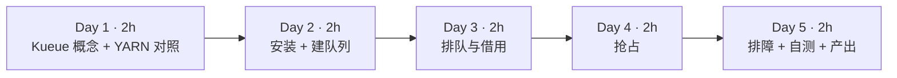
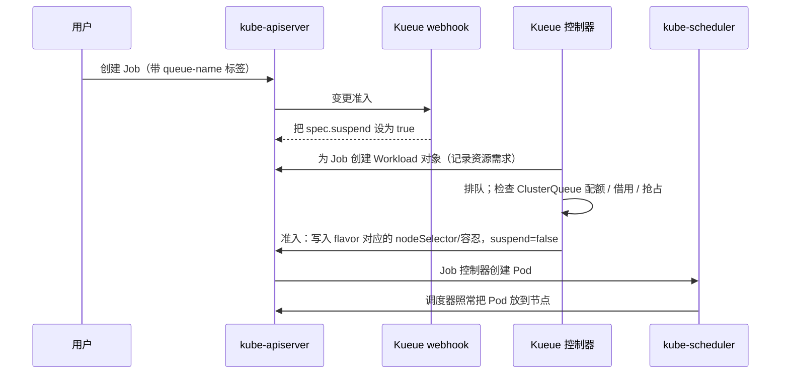
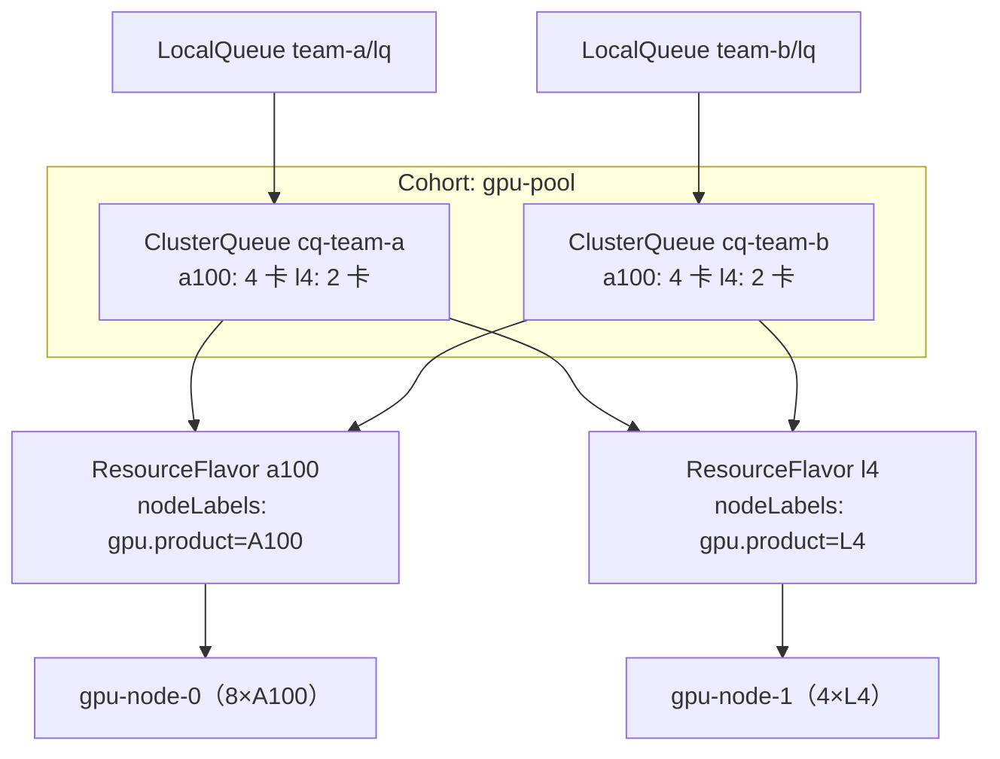
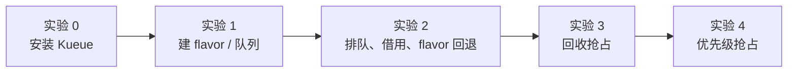

=== m3w2 | 第 10 周：Kueue 队列、配额与抢占 | 第 3 月 · K8s + GPU 调度
# 第 10 周：Kueue —— 给 K8s 装上“YARN 式”的队列

> **本周一句话**：上周我们看到原生 K8s 只有“硬配额 + 立即拒绝”，分布式作业还会半调度死锁。本周用 **Kueue** 补上作业级的排队、配额借用、按 GPU 型号分配（ResourceFlavor）和抢占。你会发现它几乎就是 YARN Capacity Scheduler 的 K8s 版——这是你最能发挥经验优势的一周。

**预计投入：约 10 小时**（阅读 ≈ 3.5h，动手 ≈ 4.5h，自测与产出 ≈ 2h）。{{local}}

**本周结束时你应该能：**

1. 说清 Kueue 的对象模型：ResourceFlavor、ClusterQueue、LocalQueue、Cohort、Workload、WorkloadPriorityClass，并与 YARN 队列一一对照。
2. 解释 Kueue 的工作方式：**通过 Job 的 `suspend` 字段做作业级准入**，而不是替换 kube-scheduler。
3. 用 nominalQuota + cohort 实现团队间的配额借用，用 flavor 顺序实现“A100 不够就用 L4”。
4. 配置并观察两种抢占：cohort 内回收借出的额度（reclaimWithinCohort）、队列内按优先级抢占（withinClusterQueue）。
5. 读懂 Workload 的 pending 原因与抢占事件，用来排查“为什么我的作业不跑”。

> **验证说明**：本站没有 Docker。实验在 KWOK 模拟集群上完成（K8s v1.37.1，见第 9 周），Kueue v0.20.2 **从源码编译后以集群外普通进程运行**（详见实验 0 的说明）。Kueue 的准入、借用、抢占决策和事件都是真实的；Pod 的“运行”由 KWOK 模拟。本页所有输出均为真实输出。你在 Mac 上应使用 kind + 官方安装方式（实验 0 给出），结果应与本页一致。实验文件在仓库 `labs/w10/`。

---

## 1. 本周学习路线



| 天 | 时间 | 先读 | 再读（外部资料） | 再做 |
|---|---|---|---|---|
| Day 1 | ~2h | 本页 2.1、2.2 | ① [Kueue Overview](https://kueue.sigs.k8s.io/docs/overview/)（20 分钟）；② [Concepts 总览](https://kueue.sigs.k8s.io/docs/concepts/)（15 分钟）；③ [Workload](https://kueue.sigs.k8s.io/docs/concepts/workload/)（15 分钟） | — |
| Day 2 | ~2h | 本页 2.3 | ④ [ResourceFlavor](https://kueue.sigs.k8s.io/docs/concepts/resource_flavor/)（15 分钟）；⑤ [ClusterQueue](https://kueue.sigs.k8s.io/docs/concepts/cluster_queue/) 读 Resources、Flavors、Cohort、FlavorFungibility（40 分钟）；⑥ [LocalQueue](https://kueue.sigs.k8s.io/docs/concepts/local_queue/)（5 分钟） | 实验 0、1 |
| Day 3 | ~2h | 本页 2.4 | ⑦ [Cohort](https://kueue.sigs.k8s.io/docs/concepts/cohort/)（15 分钟）；⑧ [Run a Job](https://kueue.sigs.k8s.io/docs/tasks/run/jobs/)（10 分钟） | 实验 2 |
| Day 4 | ~2h | 本页 2.5 | ⑨ [Preemption](https://kueue.sigs.k8s.io/docs/concepts/preemption/)（30 分钟）；⑩ [WorkloadPriorityClass](https://kueue.sigs.k8s.io/docs/concepts/workload_priority_class/)（10 分钟） | 实验 3、4 |
| Day 5 | ~2h | 本页 2.6 | ⑪ [Fair Sharing](https://kueue.sigs.k8s.io/docs/concepts/fair_sharing/)、⑫ [Topology Aware Scheduling](https://kueue.sigs.k8s.io/docs/concepts/topology_aware_scheduling/) 浏览（20 分钟） | 排障练习；自测；产出 |

**每日打卡：**

- [ ] Day 1：读完 ①②③，能写出 Kueue 对象与 YARN 队列的对照表
- [ ] Day 2：Kueue 运行起来，两个 ClusterQueue 就绪
- [ ] Day 3：复现“借用 A100 → 回退到 L4 → 第 4 个作业排队且不创建 Pod”
- [ ] Day 4：复现两种抢占，并读懂抢占事件
- [ ] Day 5：完成自测与产出

---

## 2. 核心概念讲解

### 2.1 Kueue 不是调度器，而是“准入控制器”



关键点：

- Kueue 管的是“**作业能否开始**”（准入，admission），Pod 放到哪个节点仍由 kube-scheduler 决定。两者分工明确，所以 Kueue 能和默认调度器、Volcano、甚至集群自动扩缩容一起用。
- 作业在被准入前**一个 Pod 都不创建**——这就从根本上避免了第 9 周的“半调度死锁”（实验 2 中第 4 个作业 `suspend=true`，没有任何 Pod）。
- Kueue 按 **Workload 的总需求**做准入：一个 2 worker × 2 卡的作业是“4 张卡”一起准入。注意这是**配额层面**的全有或全无；如果物理节点放不下（碎片化），Pod 仍可能 Pending，这时需要等待超时重排（`waitForPodsReady`）或拓扑感知调度（⑫）。

### 2.2 对象模型：和 YARN Capacity Scheduler 对照

| YARN Capacity Scheduler | Kueue | 说明 |
|---|---|---|
| 节点标签分区（node label partition） | **ResourceFlavor** | 一种“资源风味”，通过节点标签/污点对应到一组节点，如 A100、L4、Spot |
| 叶子队列 + capacity | **ClusterQueue** + `nominalQuota` | 每种 flavor、每种资源的名义配额 |
| 父队列（共享 capacity 的兄弟队列） | **Cohort** | 同一 cohort 的 ClusterQueue 之间可以互相借用闲置额度 |
| maximum-capacity | `borrowingLimit` / `lendingLimit` | 限制最多借多少、最多借出多少 |
| 用户提交到队列（`mapreduce.job.queuename`） | **LocalQueue**（命名空间内）→ ClusterQueue | 用户只看到自己命名空间里的 LocalQueue |
| Application | **Workload** | Kueue 为每个 Job 创建的“资源需求单” |
| 队列内应用优先级 | **WorkloadPriorityClass** | 只影响排队与抢占，不影响 Pod 调度优先级 |
| 抢占（preemption monitor） | `preemption.reclaimWithinCohort` / `withinClusterQueue` | 回收借出额度 / 队列内优先级抢占 |
| Fair Scheduler 的公平份额 | Fair Sharing（⑪） | 按份额公平地分配借用 |



### 2.3 flavor 分配规则

ClusterQueue 的 `resourceGroups[].flavors` 是**有序列表**。Kueue 为一个 Workload 依次尝试每个 flavor：

- 当前 flavor 的**未用名义配额**足够 → 直接分配。
- 需要**借用**才够 → 由 `flavorFungibility.whenCanBorrow` 决定：默认 `MayStopSearch`（就借用当前 flavor，不再看后面的）。
- 需要**抢占**才够 → `whenCanPreempt` 默认 `TryNextFlavor`（先看下一个 flavor 能不能不抢占就放下）。

（以上默认值来自 ⑤ 的 FlavorFungibility 一节。）实验 2 中 a2 选择借用 A100，而不是去用 L4，正是 `MayStopSearch` 的结果。

准入后，Kueue 把 flavor 的 `nodeLabels`、`tolerations` 注入到 Pod 模板中，保证 Pod 落在对应的节点上（实验中可以看到准入后 Pod 带上了 `nvidia.com/gpu.product` 的 nodeSelector）。

### 2.4 借用与回收

$$\text{可用额度}_{CQ} = \text{nominalQuota}_{CQ} + \min\big(\text{borrowingLimit},\ \sum_{\text{cohort 其他 CQ}} \text{闲置额度}\big)$$

- 团队 B 空闲时，团队 A 可以借走 B 的额度（实验 2：A 的 A100 用到 8 张，其中借用 4 张）。
- B 有作业提交时，如果配置了 `reclaimWithinCohort`，Kueue 会**抢占** A 正在借用额度上运行的作业，把额度还给 B（实验 3）。
- 这与 YARN Capacity Scheduler 的“弹性队列 + 跨队列抢占”完全同构。区别在于 GPU 训练作业被抢占的代价很高（丢失未保存的训练进度），所以要配合**检查点**和合理的 `borrowingLimit`。

### 2.5 抢占的两种场景

| 场景 | 配置 | 实验 | 事件中的原因 |
|---|---|---|---|
| 回收借出的额度 | `reclaimWithinCohort: Any`（或 `LowerPriority`） | 实验 3 | `due to reclamation within the cohort` |
| 队列内高优先级挤掉低优先级 | `withinClusterQueue: LowerPriority` | 实验 4 | `due to prioritization in the ClusterQueue` |
| 借用时抢占其他队列的低优先级作业 | `borrowWithinCohort` | 扩展练习 | — |

被抢占的 Workload 会被**驱逐（Evicted）**：Kueue 把 Job 重新挂起（Pod 被删除），Workload 回到队列等待重新准入。

### 2.6 Kueue 的定位与生态

- 支持的作业类型很多：batch/Job、JobSet、Kubeflow 各类训练作业、RayJob/RayCluster、普通 Pod 等（见安装配置中的 `integrations.frameworks`）。第 11 周你会把 RayJob 交给 Kueue 管理。
- 公平共享（⑪）、拓扑感知调度（⑫，让一个作业的 Pod 尽量放在同一机架/同一 NVLink 域）、多集群（MultiKueue）都是进阶能力。
- 和 Volcano 的区别：Volcano 是一个完整的**批调度器**（替换或并行于 kube-scheduler，提供 gang 调度、队列等）；Kueue 只做**准入**，与默认调度器配合。第 11 周对比。

---

## 3. 动手实验 {{local}}



### 实验 0：安装 Kueue（30 分钟）

**推荐做法（Mac，kind，未在本站实测）**：按官方[安装文档](https://kueue.sigs.k8s.io/docs/installation/)，用 release 清单安装：

```bash
kind create cluster --name lab          # 或沿用实验环境页的 3 节点 kind 集群
kubectl apply --server-side -f https://github.com/kubernetes-sigs/kueue/releases/download/v0.20.2/manifests.yaml
kubectl -n kueue-system get pods        # 等 kueue-controller-manager Running
```

kind 中模拟 GPU 节点的方法见第 9 周背景阅读中的“为节点通告扩展资源”，再给节点打上 `nvidia.com/gpu.product` 标签。

**本站做法（KWOK + 集群外运行 Kueue）**：KWOK 中的 Pod 不会真正运行，所以 Kueue 控制器不能作为 Pod 部署。本站把 Kueue v0.20.2 用 Go 编译成二进制，在集群外运行，并让 webhook 地址指向 `https://127.0.0.1:19443`。为此做了三处改动：① 源码中写死的 metrics 证书目录 `/etc/kueue/metrics/certs` 改为可用环境变量 `KUEUE_METRICS_CERT_DIR` 覆盖（一行代码）；② 关闭 `VisibilityOnDemand` 特性门控（它同样依赖写死的 `/visibility` 证书目录）；③ 自签证书，webhook 配置中的 `service` 改为 `url`。启动脚本在仓库 `labs/w10/start-kueue-outofcluster.sh`，配置为：

```yaml
@@CODE:w10/kueue-config.yaml@@
```

> 这只是在没有容器的环境里做实验的变通办法，**不要用于生产**。另外，为了让作业“运行”一段时间而不是瞬间完成，KWOK 集群加载了官方的 general 阶段配置（`kustomize/stage/pod/general`），作业通过注解 `pod-complete.stage.kwok.x-k8s.io/delay` 和 `.../jitter-delay` 控制运行时长（本站实测：只设 delay 不设 jitter-delay 时，Pod 仍会在几秒内完成）。

### 实验 1：创建 flavor、队列与优先级（20 分钟）

节点沿用第 9 周的 `nodes.yaml`（1 台 8×A100、1 台 4×L4）。`queues.yaml`：

```yaml
@@CODE:w10/queues.yaml@@
```

```bash
kubectl apply -f queues.yaml
kubectl get clusterqueue
```

```text
NAME        COHORT     PENDING WORKLOADS
cq-team-a   gpu-pool   0
cq-team-b   gpu-pool   0
```

提交作业的脚本 `job.sh`（每个作业 N 个 worker，每个 worker 若干卡、8 核 CPU、64Gi 内存）：

```bash
@@CODE:w10/job.sh@@
```

观察状态的脚本 `status.sh`：

```bash
@@CODE:w10/status.sh@@
```

> **坑**：K8s v1.37 开启 `GenericWorkload` 后，原生也有一个叫 `workloads` 的资源（`scheduling.k8s.io`）。此时 `kubectl get workloads` 查的是原生对象，会显示 `No resources found`——本站因此误以为 Kueue 没工作，排查了半天。务必写全名 `workloads.kueue.x-k8s.io`。

### 实验 2：排队、借用与 flavor 回退（40 分钟）

团队 A 连续提交 4 个作业，每个 2 worker × 2 卡 = 4 卡：

```bash
for i in 1 2 3 4; do ./job.sh team-a a$i 2 2 600 low; sleep 2; done
./status.sh
```

**本站输出：**

```text
--- workloads
NS       NAME   PRIO   ADMITTED   FLAVOR   EVICTED
team-a   a1     100    True       a100     <none>
team-a   a2     100    True       a100     <none>
team-a   a3     100    True       l4       <none>
team-a   a4     100    False      <none>   <none>
--- clusterqueues
NAME        PENDING   ADMITTED
cq-team-a   1         3
cq-team-b   0         0
cq-team-a GPU 用量: a100=8(借用 4) l4=4(借用 2) 
cq-team-b GPU 用量: a100=0(借用 0) l4=0(借用 0) 
--- pods
team-a   a1-0-x6zlx   gpu-node-0   Running
team-a   a1-1-2r6xl   gpu-node-0   Running
team-a   a2-0-5nqcw   gpu-node-0   Running
team-a   a2-1-k8s9d   gpu-node-0   Running
team-a   a3-0-r859s   gpu-node-1   Running
team-a   a3-1-4wrgt   gpu-node-1   Running
```

查看 a4 为什么排队：

```bash
kubectl get job -n team-a a4 -o jsonpath='a4 suspend={.spec.suspend}{"\n"}'
kubectl get workloads.kueue.x-k8s.io -n team-a -o jsonpath='{range .items[?(@.metadata.ownerReferences[0].name=="a4")]}{.status.conditions[?(@.type=="QuotaReserved")].message}{"\n"}{end}'
```

```text
a4 suspend=true
couldn't assign flavors to pod set main: insufficient unused quota for memory in flavor l4, 64Gi more needed, insufficient unused quota for nvidia.com/gpu in flavor a100, 4 more needed, insufficient unused quota for nvidia.com/gpu in flavor l4, 4 more needed
```

**逐步解释：**

- **a1**：用 A100 的名义配额（4 卡）。
- **a2**：A 的 A100 名义配额用完，但同 cohort 的 B 闲置，于是**借用** B 的 4 张 A100（`whenCanBorrow: MayStopSearch`）。
- **a3**：A100 全部用完（8/8），回退到下一个 flavor L4：A 自己的 2 张 + 借 B 的 2 张。
- **a4**：所有 flavor 都没有余量，Workload 排队；Job 保持 `suspend=true`，**没有创建任何 Pod**。对比第 9 周实验 6：这里不会出现“占着卡却凑不齐 worker”的情况。
- pending 消息逐个 flavor 列出缺口。它也揭示了一个细节：L4 flavor 的内存配额（96Gi）也不够——两个 worker 各 64Gi 已经超过。**配额要按 CPU、内存、GPU 一起设计**，否则 GPU 有余但内存配额先耗尽。

### 实验 3：团队 B 来了——回收借出的额度（20 分钟）

```bash
./job.sh team-b b1 2 2 600 low
./status.sh
kubectl get events -n team-a --field-selector reason=Preempted -o custom-columns=OBJ:.involvedObject.name,MSG:.message --no-headers
```

**本站输出：**

```text
--- workloads
NS       NAME   PRIO   ADMITTED   FLAVOR   EVICTED
team-a   a1     100    True       a100     <none>
team-a   a2     100    False      <none>   Preempted
team-a   a3     100    True       l4       <none>
team-a   a4     100    False      <none>   <none>
team-b   b1     100    True       a100     <none>
--- clusterqueues
NAME        PENDING   ADMITTED
cq-team-a   2         2
cq-team-b   0         1
cq-team-a GPU 用量: a100=4(借用 0) l4=4(借用 2) 
cq-team-b GPU 用量: a100=4(借用 0) l4=0(借用 0) 
--- pods
team-a   a1-0-x6zlx   gpu-node-0   Running
team-a   a1-1-2r6xl   gpu-node-0   Running
team-a   a3-0-r859s   gpu-node-1   Running
team-a   a3-1-4wrgt   gpu-node-1   Running
team-b   b1-0-mcxvk   gpu-node-0   Pending
team-b   b1-1-htzxg   gpu-node-0   Pending
job-a2-5bc65   Preempted to accommodate a workload (UID: 291d2bd9-...) due to reclamation within the cohort; preemptor path: /gpu-pool/cq-team-b; preemptee path: /gpu-pool/cq-team-a; preemptor effective priority: 100 (base: 100, boost: 0); preemptee effective priority: 100 (base: 100, boost: 0)
```

（UID 已截断。）约 5 秒后 b1 的两个 Pod 变为 Running：

```text
b1-0-mcxvk   1/1   Running   0     20s
b1-1-htzxg   1/1   Running   0     20s
```

**逐步解释：**

- 优先级相同，但 a2 是在**借用的额度**上运行，B 要回自己的名义配额，于是 a2 被抢占（`reclamation within the cohort`）。
- 刚准入时 b1 的 Pod 短暂 Pending：a2 的 Pod 还在终止中，物理 GPU 尚未释放。**配额层面已经腾出，物理层面稍后才腾出**，这个时间差在真实集群中可能是几十秒（取决于容器的优雅退出时间）。
- 注意 a3 仍在借用 L4（`借用 2`）：B 目前没有 L4 需求，所以不回收。
- a2 回到队列，额度空出来时会重新准入，从头开始运行——**作业需要自己做检查点**。

### 实验 4：高优先级作业——队列内抢占（20 分钟）

```bash
./job.sh team-a urgent 2 2 600 high
./status.sh
```

**本站输出：**

```text
--- workloads
NS       NAME     PRIO   ADMITTED   FLAVOR   EVICTED
team-a   a1       100    False      <none>   Preempted
team-a   a2       100    False      <none>   Preempted
team-a   a3       100    True       l4       <none>
team-a   a4       100    False      <none>   <none>
team-b   b1       100    True       a100     <none>
team-a   urgent   1000   True       a100     <none>
--- clusterqueues
NAME        PENDING   ADMITTED
cq-team-a   3         2
cq-team-b   0         1
cq-team-a GPU 用量: a100=4(借用 0) l4=4(借用 2) 
cq-team-b GPU 用量: a100=4(借用 0) l4=0(借用 0) 
--- pods
team-a   a1-1-2r6xl       gpu-node-0   Running
team-a   a3-0-r859s       gpu-node-1   Running
team-a   a3-1-4wrgt       gpu-node-1   Running
team-a   urgent-0-hbd85   gpu-node-0   Running
team-a   urgent-1-56jn9   <none>       Pending
team-b   b1-0-mcxvk       gpu-node-0   Running
team-b   b1-1-htzxg       gpu-node-0   Running
```

抢占事件：

```text
job-a1-559bc   Preempted to accommodate a workload (UID: 2fa1d8ed-...) due to prioritization in the ClusterQueue; preemptor path: /gpu-pool/cq-team-a; preemptee path: /gpu-pool/cq-team-a; preemptor effective priority: 1000 (base: 1000, boost: 0); preemptee effective priority: 100 (base: 100, boost: 0)
```

**逐步解释：**

- urgent（优先级 1000）在 A 的队列里没有余量，按 `withinClusterQueue: LowerPriority` 抢占了同队列的低优先级作业 a1（`prioritization in the ClusterQueue`）。
- 为什么抢 a1（A100）而不是 a3（L4）？urgent 的 flavor 列表里 A100 排在前面，抢占 a1 正好在 A100 上腾出 4 卡。
- 输出中能看到“交接期”：a1 的一个 Pod 仍在终止，urgent 的第二个 Pod 暂时 Pending，几秒后变为 ContainerCreating/Running。
- 如果 a4 一直排不上，你可能会想到“饥饿”问题——这正是公平共享（⑪）要处理的。

### 清理

```bash
kubectl delete job -A --all
```

### 常见错误与排查

| 现象 | 原因 | 解决 |
|---|---|---|
| `kubectl get workloads` 显示 No resources（本站实测，K8s 1.37 开启 GenericWorkload 时） | 与原生 `scheduling.k8s.io` Workload 重名 | 用 `workloads.kueue.x-k8s.io` |
| Job 创建后立即运行，没有被 Kueue 管理 | 没有 `kueue.x-k8s.io/queue-name` 标签，或命名空间不在管理范围 | 加标签；检查 `manageJobsWithoutQueueName`、`managedJobsNamespaceSelector` |
| Workload 一直 pending，消息 `insufficient unused quota ...`（本站实测） | 某种资源（常常是内存或 CPU）的配额先耗尽 | 按消息逐项核对 nominalQuota；GPU、CPU、内存一起设计 |
| 已准入但 Pod Pending（本站实测：抢占交接期） | 配额腾出但物理资源未释放；或碎片化 | 短暂的属于正常；长期 Pending 时配置 `waitForPodsReady` 让作业超时后重新排队 |
| `failed calling webhook ... connection refused`（本站实测） | Kueue 控制器未就绪或 webhook 地址错误 | 检查 `kueue-system` 中控制器 Pod 与 webhook Service |
| `no matches for kind "Workload" in version "kueue.x-k8s.io/v1beta2"`（本站实测，控制器启动早于 CRD 生效） | CRD 尚未 Established | 先 `kubectl wait --for condition=established crd --all` |
| 被抢占的训练从头开始 | 驱逐会删除 Pod | 训练代码做定期检查点；对长作业限制 `borrowingLimit` 或提高优先级 |

### 扩展练习

1. **borrowingLimit**：给 cq-team-a 的 A100 设置 `borrowingLimit: 2`，重做实验 2，看 a2 如何分配。
2. **whenCanBorrow: TryNextFlavor**：改为优先使用 L4 的未用额度而不是借 A100，比较结果。
3. **borrowWithinCohort**：阅读 ⑨，配置“借用时可以抢占其他队列的低优先级作业”，设计实验验证。
4. **waitForPodsReady**：阅读 Kueue 文档中的 “All-or-nothing with ready Pods” 相关配置，构造一个配额够、但物理节点放不下的场景（例如把 nominalQuota 设得比节点实际 GPU 多），观察作业是否超时后重新排队。
5. **RayJob 集成**：为第 11 周准备：阅读 Kueue 文档中运行 RayJob 的任务页，写出 RayJob 需要加的标签。

---

## 4. 精读指南

- **① [Overview](https://kueue.sigs.k8s.io/docs/overview/)**（20 分钟）。**读完回答**：Kueue 的设计原则中，为什么强调不重新实现已有的 K8s 功能（如调度、自动扩缩容）？
- **③ [Workload](https://kueue.sigs.k8s.io/docs/concepts/workload/)**（15 分钟）。**读完回答**：Workload 的 podSets 记录了什么？Workload 有哪些状态条件（QuotaReserved、Admitted、Evicted、Finished）？
- **④ [ResourceFlavor](https://kueue.sigs.k8s.io/docs/concepts/resource_flavor/)**（15 分钟）。**读完回答**：flavor 的 nodeLabels 与 tolerations 是如何作用到 Pod 上的？空 flavor（不带标签）适用于什么场景？
- **⑤ [ClusterQueue](https://kueue.sigs.k8s.io/docs/concepts/cluster_queue/)**（40 分钟）：重点读 resourceGroups、cohort、borrowingLimit/lendingLimit、FlavorFungibility、queueingStrategy（StrictFIFO vs BestEffortFIFO）。**读完回答**：StrictFIFO 下队头作业放不下时，后面的小作业会怎样？
- **⑦ [Cohort](https://kueue.sigs.k8s.io/docs/concepts/cohort/)**（15 分钟）：层级 cohort 如何表达“部门 → 团队”的配额树？
- **⑨ [Preemption](https://kueue.sigs.k8s.io/docs/concepts/preemption/)**（30 分钟）。**读完回答**：Kueue 选择被抢占对象的顺序是什么？`reclaimWithinCohort` 的三个取值有何区别？
- **⑪ [Fair Sharing](https://kueue.sigs.k8s.io/docs/concepts/fair_sharing/)、⑫ [Topology Aware Scheduling](https://kueue.sigs.k8s.io/docs/concepts/topology_aware_scheduling/)**（浏览）：了解它们解决的问题即可。
- **背景**：[Kueue GitHub 仓库](https://github.com/kubernetes-sigs/kueue)。

---

## 5. 自测题

<details>
<summary>1. Kueue 与 kube-scheduler 各负责什么？</summary>

Kueue 负责作业级准入：决定 Workload 能否开始（配额、借用、抢占、排队），通过 Job 的 suspend 字段控制，并注入 flavor 对应的节点选择与容忍。kube-scheduler 负责把已创建的 Pod 放到具体节点上。

</details>

<details>
<summary>2. 为什么 Kueue 能避免第 9 周的半调度死锁？它不能解决什么？</summary>

作业在准入前保持挂起、不创建 Pod，准入按整个 Workload 的总需求判断，所以不会出现多个作业各占一部分资源的情况。但这是配额层面的保证；如果配额与物理资源不一致或存在碎片化，已准入作业的 Pod 仍可能 Pending，需要 waitForPodsReady、拓扑感知调度或 gang 调度来补充。

</details>

<details>
<summary>3. 写出 Kueue 对象与 YARN Capacity Scheduler 的对应关系（至少 5 组）。</summary>

ResourceFlavor ↔ 节点标签分区；ClusterQueue + nominalQuota ↔ 叶子队列 capacity；Cohort ↔ 父队列/共享容量的兄弟队列；borrowingLimit ↔ maximum-capacity；LocalQueue ↔ 用户提交的队列名；Workload ↔ Application；WorkloadPriorityClass ↔ 应用优先级；reclaimWithinCohort ↔ 跨队列抢占。

</details>

<details>
<summary>4. 实验 2 中 a2 为什么借 A100 而不是用 L4？a3 为什么用 L4？</summary>

flavorFungibility.whenCanBorrow 默认 MayStopSearch：在 A100 上借用就能满足时停止搜索，所以 a2 借用 B 的 A100。到 a3 时，整个 cohort 的 A100 都已用完，连借用都不够，只能尝试下一个 flavor L4（自有 2 张 + 借用 2 张）。

</details>

<details>
<summary>5. 实验 3 中 a2 被抢占的原因是什么？优先级相同为什么还会被抢？</summary>

reclaimWithinCohort：a2 运行在借用的额度上，B 需要使用自己的名义配额时，Kueue 回收借出的额度，抢占在借用额度上运行的作业。回收与优先级无关（取值 Any 时）。

</details>

<details>
<summary>6. 被抢占的 Workload 会发生什么？对训练作业意味着什么？</summary>

Workload 被标记 Evicted，Job 重新挂起，Pod 被删除，Workload 回到队列等待重新准入。训练作业会丢失未保存的进度，因此需要定期检查点，并合理设置借用上限和优先级。

</details>

<details>
<summary>7. 一个作业的 Workload 显示 `insufficient unused quota for memory in flavor l4`，但 L4 的 GPU 还有余量，怎么办？</summary>

说明内存配额先于 GPU 耗尽。检查 ClusterQueue 中该 flavor 的内存 nominalQuota 是否与节点规格匹配，或者降低作业的内存请求。配额应按节点实际的 CPU/内存/GPU 比例一起设计。

</details>

### 思考题

1. **配额设计**：公司有 3 个部门、10 个团队，GPU 由平台部统一采购。请用层级 Cohort + ClusterQueue 设计一套配额树，说明 nominalQuota、borrowingLimit、lendingLimit 如何体现“部门保底 + 闲时共享 + 忙时回收”。
2. **抢占的代价**：训练作业被抢占可能损失数小时算力。你会制定怎样的抢占策略和作业规范（检查点间隔、可抢占标记、优先级审批）来平衡利用率与公平性？
3. **从 YARN 迁移**：把一套 YARN Capacity Scheduler 的队列配置（`capacity-scheduler.xml`）自动转换成 Kueue 对象，你会如何设计这个转换工具？哪些概念无法一一对应？

---

## 6. 本周产出与掌握清单

### 本周产出

1. `labs/w10/`：`queues.yaml`、`job.sh`、`status.sh` 与 `README.md`（实验 2–4 的输出与解释）。
2. **`kueue-vs-yarn.md`**：对象对照表 + 一份为你所在公司（或假想公司）设计的配额树。
3. 第 3 月项目报告的第二节：“作业级准入如何解决半调度死锁”，附实验 2 的输出作为证据。

### 掌握清单

- [ ] 能说出 Kueue 的 6 个核心对象及其与 YARN 的对应
- [ ] 能画出 Job → Workload → 准入 → Pod 的流程，并说明 suspend 的作用
- [ ] 会写 ResourceFlavor、ClusterQueue、LocalQueue
- [ ] 能解释 flavor 顺序与 FlavorFungibility 的默认行为
- [ ] 能复现并解释 cohort 内借用
- [ ] 能复现并解释回收抢占与优先级抢占
- [ ] 能读懂 Workload 的 pending 消息与 Preempted 事件
- [ ] 知道 `workloads` 资源重名的坑
- [ ] 知道 Kueue 不能解决的问题（物理碎片化），以及对应的补充手段
- [ ] 完成配额树设计

---

## 参考资料

- [Kueue Overview](https://kueue.sigs.k8s.io/docs/overview/)（文档·入门）
- [Kueue Concepts](https://kueue.sigs.k8s.io/docs/concepts/)（文档·入门）
- [Kueue：ClusterQueue](https://kueue.sigs.k8s.io/docs/concepts/cluster_queue/)（文档·进阶）
- [Kueue：LocalQueue](https://kueue.sigs.k8s.io/docs/concepts/local_queue/)（文档·入门）
- [Kueue：ResourceFlavor](https://kueue.sigs.k8s.io/docs/concepts/resource_flavor/)（文档·入门）
- [Kueue：Workload](https://kueue.sigs.k8s.io/docs/concepts/workload/)（文档·入门）
- [Kueue：Cohort](https://kueue.sigs.k8s.io/docs/concepts/cohort/)（文档·进阶）
- [Kueue：Preemption](https://kueue.sigs.k8s.io/docs/concepts/preemption/)（文档·进阶）
- [Kueue：WorkloadPriorityClass](https://kueue.sigs.k8s.io/docs/concepts/workload_priority_class/)（文档·入门）
- [Kueue：Fair Sharing](https://kueue.sigs.k8s.io/docs/concepts/fair_sharing/)（文档·高级）
- [Kueue：Topology Aware Scheduling](https://kueue.sigs.k8s.io/docs/concepts/topology_aware_scheduling/)（文档·高级）
- [Kueue 安装](https://kueue.sigs.k8s.io/docs/installation/)（文档·入门）
- [Kueue：Run a Job](https://kueue.sigs.k8s.io/docs/tasks/run/jobs/)（文档·入门）
- [Kueue GitHub](https://github.com/kubernetes-sigs/kueue)（仓库·进阶）

> 完整列表见 [参考资料库](/resources.html)。
