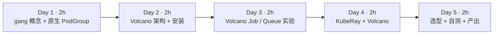
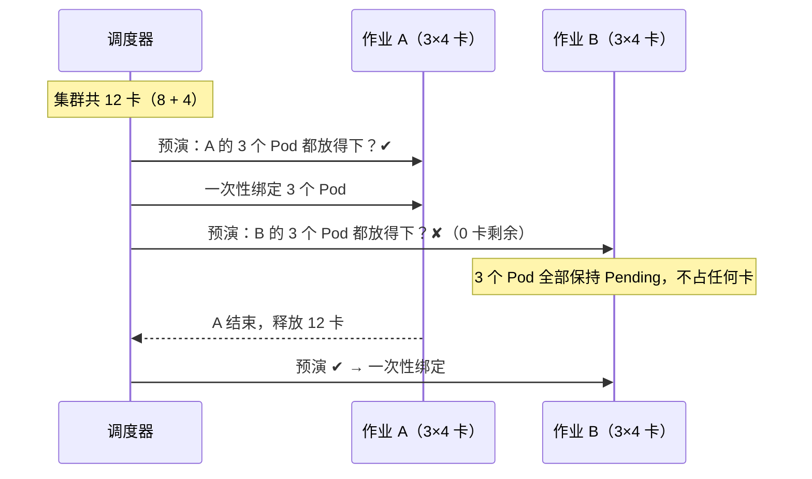
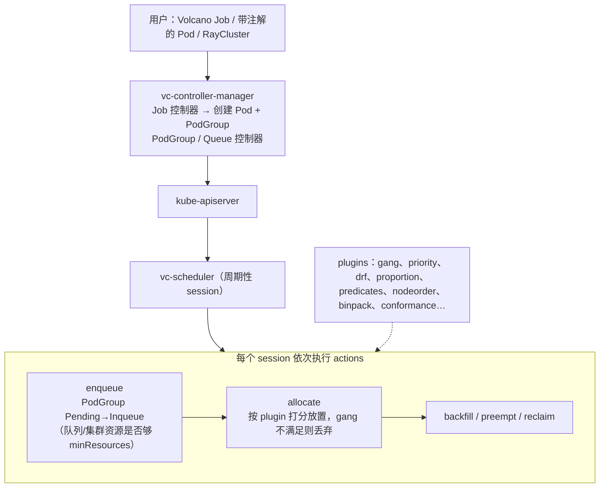
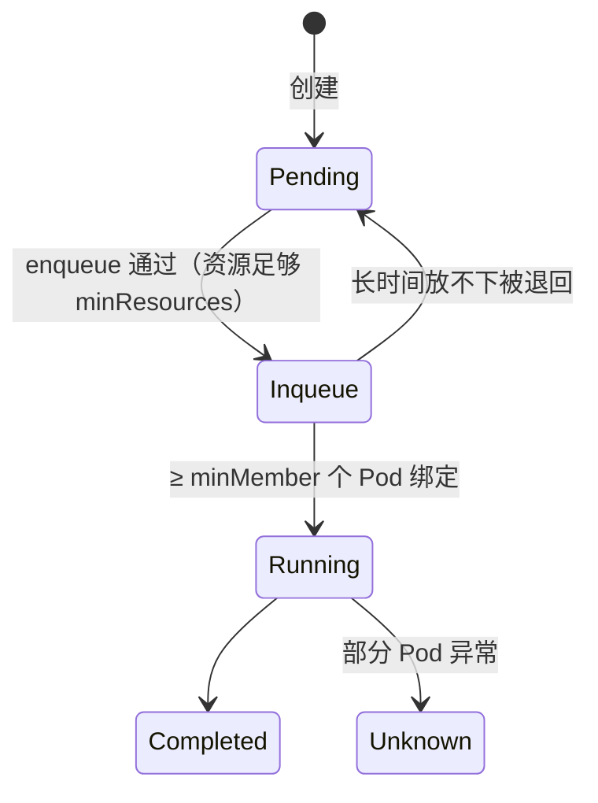

=== m3w3 | 第 11 周：Volcano Gang 调度 + KubeRay | 第 3 月 · K8s + GPU 调度
# 第 11 周：Gang 调度（原生 PodGroup / Volcano）+ KubeRay

> **本周一句话**：第 9 周我们用两个“3 worker × 4 卡”的作业把默认调度器卡成了**半调度死锁**；上周 Kueue 在“准入”层面避免了它。本周从**调度器**层面解决同一个问题——gang 调度（全有或全无）。你会在同一个场景里依次试三种方案：K8s v1.37 原生 PodGroup、Volcano Job，以及用 KubeRay 把一个 Ray 集群作为整体交给 Volcano 调度。

**预计投入：约 10 小时**（阅读 ≈ 3.5h，动手 ≈ 4.5h，自测与产出 ≈ 2h）。{{local}}

**本周结束时你应该能：**

1. 解释 gang 调度的定义、它为什么能避免部分调度死锁，以及它和 Kueue 准入的分工。
2. 使用 K8s v1.37 原生 `PodGroup`（`scheduling.k8s.io/v1beta1`，Beta、默认关闭）给一组 Pod 声明 `minCount`。
3. 说出 Volcano 的对象模型（Job / PodGroup / Queue）和调度器的 action + plugin 架构，读懂 PodGroup 的 `Pending → Inqueue → Running` 状态。
4. 用 KubeRay 部署 RayCluster，并通过 `ray.io/scheduler-name: volcano` 让整个集群（head + 全部 worker）成为一个 gang。
5. 根据团队现状在“Kueue / Volcano / 原生 gang”之间做选型。

> **验证说明**：本站没有 Docker 和 GPU。实验仍在 KWOK 模拟集群 `lab2` 上进行（K8s v1.37.1，binary runtime，开启 `GenericWorkload` 特性门控与 `scheduling.k8s.io/v1beta1` API）。**Volcano v1.16.0** 的 vc-scheduler、vc-controller-manager 和 **KubeRay v1.7.1** 的 operator 均**从源码编译，以集群外普通进程运行**（没有安装 webhook）。调度决策、PodGroup 状态和事件都是真实的；Pod 的“运行”由 KWOK 模拟，没有真实容器，也没有真实 Ray 进程。本页所有输出均为真实输出。实验文件在仓库 `labs/w11/`。

---

## 1. 本周学习路线



| 天 | 时间 | 先读 | 再读（外部资料） | 再做 |
|---|---|---|---|---|
| Day 1 | 2h | 2.1、2.2 | ① 原生 Gang Scheduling | 实验 1 |
| Day 2 | 2h | 2.3、2.4 | ② Volcano 文档、③ PodGroup、⑤ plugins | 实验 0 |
| Day 3 | 2h | 2.5 | ④ Queue、⑥ VolcanoJob | 实验 2、实验 3 |
| Day 4 | 2h | 2.6 | ⑦ KubeRay + Volcano、⑧ RayCluster 快速入门 | 实验 4 |
| Day 5 | 2h | 2.7 | ⑨ KubeRay + Kueue | 自测、本周产出 |

---

## 2. 核心概念讲解

### 2.1 gang 调度：全有或全无

分布式训练（DDP、Ray Train、MPI）的 N 个 worker 必须**同时**存在才能开始：任何一个缺席，其余的都只会在 `init_process_group` 里干等。默认 kube-scheduler 逐个 Pod 调度，于是两个作业可能各拿到一部分卡，谁都凑不齐——第 9 周实验 6 的死锁。

gang 调度的规则只有一句：**一组 Pod 中至少 `minMember` 个能同时放下时才一起绑定，否则一个都不绑定**。



形式化地说，设作业 j 的 Pod 集合为 P_j，最小成员数为 m_j，调度器在一轮中给出的“暂定放置”为 X_j ⊆ P_j。gang 约束是：

$$|X_j| \ge m_j \;\Rightarrow\; \text{提交 } X_j, \qquad |X_j| < m_j \;\Rightarrow\; \text{全部回滚}$$

**大数据类比**：这就是 Spark 的 *barrier execution mode*（`rdd.barrier()`，所有 task 必须同时启动）在资源层面的版本；YARN 没有原生 gang，Spark barrier 模式需要集群“碰巧”有足够空槽，否则会等待并最终超时。

### 2.2 gang 与 Kueue 准入的分工

| 层面 | 解决的问题 | 本站对应 |
|---|---|---|
| 准入（Kueue） | “这个作业**现在应该开始吗**”：配额、借用、优先级、排队 | 第 10 周 |
| gang 调度（原生 PodGroup / Volcano） | “这个作业的 Pod **能不能同时放到节点上**”：物理放置的原子性 | 本周 |

Kueue 按配额判断，配额与物理资源不一致（碎片化、节点故障、配额超卖）时，已准入作业仍可能部分调度；gang 调度按真实节点空闲判断。两者可以叠加：Kueue 管排队和公平，调度器管原子放置。Volcano 则把两者做在一个系统里（Queue + gang）。

### 2.3 K8s v1.37 原生 Gang Scheduling

v1.37 起 Gang Scheduling 进入 Beta，但**默认关闭**（①）。在本站的 v1.37.1 上需要：

- 开启特性门控 `GenericWorkload=true`；
- 开启 API `scheduling.k8s.io/v1beta1=true`；
- 创建 `PodGroup`，`spec.schedulingPolicy.gang.minCount` 设置最小成员数；
- Pod 通过 `spec.schedulingGroup.podGroupName` 加入。

注意：**`GangScheduling` 不是特性门控名**（本站实测：写成门控会导致 apiserver 启动失败），正确做法是只开 `GenericWorkload`。这是一个仍在快速演进的 API，字段名以你所用版本的官方文档为准。

### 2.4 Volcano 架构

Volcano 是 CNCF 的批量调度系统，替换（或并存于）kube-scheduler。Pod 通过 `schedulerName: volcano` 选择它。



三个核心对象：

| Volcano 对象 | 作用 | 大数据类比 |
|---|---|---|
| `Job`（batch.volcano.sh） | 多 task 的批作业，`minAvailable` 即 gang 大小，含重启/失败策略 | YARN Application + AM 的容错逻辑 |
| `PodGroup`（scheduling.volcano.sh） | gang 单元：`minMember`、`minResources`、`queue` | Spark barrier stage |
| `Queue` | `weight`（按比例分空闲资源）、`capability`（硬上限）、`reclaimable` | Capacity Scheduler 队列（capacity / maximum-capacity） |

PodGroup 的状态机是排障关键：



### 2.5 Volcano Queue：weight 与 capability

proportion 插件按 weight 计算每个队列的应得份额 deserved：

$$\text{deserved}_q = \min\Big(\text{request}_q,\; \text{capability}_q,\; \text{total} \cdot \frac{w_q}{\sum_{k \in \text{active}} w_k}\Big)$$

（多轮迭代，未用完的部分再按权重分给仍有需求的队列。）超过 deserved 的部分可被 `reclaim` 收回（若 `reclaimable: true`）。这与 YARN Capacity Scheduler 的 capacity/弹性/抢占几乎一一对应，也和 Kueue 的 nominalQuota + cohort 借用解决同一类问题。

### 2.6 KubeRay

KubeRay 是 Ray 官方的 K8s operator，提供三个 CRD：

| CRD | 含义 | 类比 |
|---|---|---|
| `RayCluster` | 一个长期运行的 Ray 集群（1 head + 若干 worker group，可自动扩缩） | 一个常驻的 Spark standalone 集群 |
| `RayJob` | 创建集群 → 提交作业 → 结束后可删除集群 | `spark-submit --deploy-mode cluster` |
| `RayService` | Ray Serve 在线服务，零停机升级 | 常驻服务 |

与调度器的集成（⑦）：operator 启动时带 `--batch-scheduler=volcano`（旧版本为 `--enable-batch-scheduler`），RayCluster 打上 `ray.io/scheduler-name: volcano` 标签后，operator 会为它创建一个 PodGroup，`minMember` = 1 + 各 worker group 的 `minReplicas` 之和，`minResources` = 这些 Pod 的资源总和，并把所有 Pod 的 `schedulerName` 设为 volcano。`volcano.sh/queue-name` 标签指定队列。

### 2.7 选型

| 场景 | 建议 |
|---|---|
| 已有 Job / JobSet / RayJob，主要诉求是多团队配额、借用、排队 | Kueue（不换调度器） |
| 需要 gang + 队列 + 批调度插件（binpack、拓扑、DRF）一体化，或 MPI/PyTorch 多角色作业 | Volcano |
| 只需要 gang，集群已在 v1.37+ 且愿意用 Beta 特性 | 原生 PodGroup（关注后续版本的 API 变化） |
| Kueue + 物理原子放置 | Kueue 负责准入，配合 waitForPodsReady 或调度器 gang |

---

## 3. 动手实验 {{local}}

本周所有实验使用同一个“死锁场景”：集群有 gpu-node-0（8 卡 A100，带污点）与 gpu-node-1（4 卡 L4），共 12 卡；两个作业各需 3 worker × 4 卡 = 12 卡。节点定义沿用第 9 周的 `labs/w9/nodes.yaml`。

### 实验 0：环境（30–60 分钟）

**Mac 上的推荐做法**：kind 集群 + 官方 Helm 安装：

```bash
helm repo add volcano-sh https://volcano-sh.github.io/helm-charts
helm install volcano volcano-sh/volcano -n volcano-system --create-namespace
helm repo add kuberay https://ray-project.github.io/kuberay-helm/
helm install kuberay-operator kuberay/kuberay-operator --set batchScheduler.name=volcano
```

（以上 Helm 命令来自官方文档，本站没有 Docker，**未在本站实测**；Helm values 名称请以你安装的 chart 版本的 values.yaml 为准。）

**本站做法**（无 Docker）：KWOK `lab2` 集群需要 v1.37 并开启原生 gang：

```bash
KWOK_KUBE_VERSION=v1.37.1 kwokctl create cluster --name lab2 --runtime binary \
  --enable-crds=Stage \
  --kube-feature-gates "GenericWorkload=true" \
  --kube-runtime-config "scheduling.k8s.io/v1beta1=true"
kubectl apply -f labs/w9/nodes.yaml
# 应用 KWOK 仓库 kustomize/stage/pod/general 中的 Pod 生命周期 stage
```

Volcano（v1.16.0）与 KubeRay（v1.7.1）从源码编译后在集群外运行：

```bash
# Volcano：安装 CRD，再启动调度器与控制器（kubeconfig 指向 lab2）
kubectl create -f installer/helm/chart/volcano/crd/bases/
./vc-scheduler --kubeconfig ~/.kube/config --scheduler-conf volcano-scheduler.conf
./vc-controller-manager --kubeconfig ~/.kube/config --leader-elect=false \
  --controllers='*,-jobflow-controller,-jobtemplate-controller,-sharding-controller,-colocation-config-controller,-hyperNode-controller'

# KubeRay：ray-operator 目录下 go build，安装 CRD 后启动
kubectl create -f config/crd/bases/
./kuberay-operator --batch-scheduler=volcano --metrics-addr=:28080 \
  --health-probe-bind-address=:28081 --leader-election-namespace=default
```

关掉那几个控制器，是因为它们依赖的 CRD（如 JobFlow）没有安装，启动时会一直等待（本站实测卡住）。KubeRay operator 启动日志（真实输出，节选）：

```text
{"level":"info","logger":"setup","msg":"Feature flag batch-scheduler is enabled","scheduler name":"volcano"}
{"level":"info","logger":"setup","msg":"Flag watchNamespace is not set. Watch custom resources in all namespaces."}
{"level":"info","logger":"setup","msg":"Setup manager"}
```

### 实验 1：原生 PodGroup 解开死锁（30 分钟）

与第 9 周实验 6 完全相同的提交顺序（a0、b0、a1、b1、a2、b2 交替），只是每个作业先建一个 gang PodGroup：

```bash
@@CODE:w11/gang-native.sh@@
```

```bash
./gang-native.sh; sleep 12
kubectl get pods -o wide | awk '{print $1,$3,$7}'
kubectl get podgroups.scheduling.k8s.io
kubectl get podgroups.scheduling.k8s.io job-b -o jsonpath='{range .status.conditions[*]}{.type}={.status} {.reason}: {.message}{"\n"}{end}'
```

真实输出：

```text
NAME STATUS NODE
job-a-worker-0 Running gpu-node-0
job-a-worker-1 Running gpu-node-0
job-a-worker-2 Running gpu-node-1
job-b-worker-0 Pending <none>
job-b-worker-1 Pending <none>
job-b-worker-2 Pending <none>
NAME    POLICY   WORKLOAD   STATUS          AGE
job-a   Gang     <none>     Scheduled       12s
job-b   Gang     <none>     Unschedulable   12s
PodGroupInitiallyScheduled=False Unschedulable: minCount (3) cannot be satisfied: 0 scheduled, 2 remaining, pod group preemption: No preemption victims found for incoming preemptor
```

对比第 9 周：那时 a、b 各占一部分卡，两边都卡住；现在 job-a 完整调度，job-b **一张卡都没占**。模拟 job-a 结束（删除它的 Pod）：

```bash
kubectl delete pod -l job=job-a --force --grace-period=0; sleep 12
kubectl get pods -o wide | awk '{print $1,$3,$7}'; kubectl get podgroups.scheduling.k8s.io
```

```text
NAME STATUS NODE
job-b-worker-0 Running gpu-node-0
job-b-worker-1 ContainerCreating gpu-node-1
job-b-worker-2 Running gpu-node-0
NAME    POLICY   WORKLOAD   STATUS      AGE
job-a   Gang     <none>     Scheduled   25s
job-b   Gang     <none>     Scheduled   25s
```

job-b 整体获得调度（`ContainerCreating` 是 KWOK 模拟的启动过渡态）。

### 实验 2：Volcano Job（40 分钟）

```bash
@@CODE:w11/vcjob.sh@@
```

```bash
./vcjob.sh vc-a 3 4; ./vcjob.sh vc-b 3 4; sleep 15
kubectl get vcjob
kubectl get podgroups.scheduling.volcano.sh
```

真实结果：vc-a `Running 3/3`；vc-b `Pending`，其 PodGroup 停在 `Inqueue`，状态消息与 Pod 事件为：

```text
NotEnoughResources: 3/3 tasks in gang unschedulable: pod group is not ready, 3 Pending, 3 minAvailable; Pending: 3 Unschedulable
```

删除 vc-a（并强制删除残留在 Terminating 的 Pod，KWOK 下偶发）后，vc-b 整体调度：

```text
NAME   STATUS    MINAVAILABLE   RUNNINGS   AGE
vc-b   Running   3              3          3m
NAME STATUS NODE
vc-b-worker-0 Running gpu-node-0
vc-b-worker-1 Running gpu-node-0
vc-b-worker-2 Running gpu-node-1
```

注意：vc-a 删除后 vc-b 并没有立即运行——中间有一段时间我们同时提交了另一个 12 卡作业（实验 3 的 big-research），两个 gang 在每轮 session 中都只能“暂定”放下一部分（事件 `Pod ... can possibly be assigned to gpu-node-0, once minAvailable is satisfied`），谁都凑不齐。删除 big-research 后 vc-b 才在下一轮完整放下。这说明 **gang 保证不会“部分绑定”，但两个都需要整个集群的作业之间仍可能互相拖慢**；生产中要靠队列优先级、`enqueue` 资源判断和合理的作业规模避免。

### 实验 3：Volcano Queue（30 分钟）

```yaml
@@CODE:w11/queue.yaml@@
```

```bash
kubectl apply -f queue.yaml
./vcjob.sh big-research 3 4 research     # 需要 12 卡，超过 research 的 capability 4
sleep 10
kubectl get vcjob big-research
kubectl get podgroups.scheduling.volcano.sh -o jsonpath='{range .items[?(@.spec.queue=="research")]}{.status.phase}{" | "}{.status.conditions[-1].message}{"\n"}{end}'
kubectl get queues.scheduling.volcano.sh research -o jsonpath='{.status}{"\n"}'
```

真实输出：

```text
NAME           STATUS    MINAVAILABLE   RUNNINGS   AGE
big-research   Pending   3                         10s
Inqueue | 2/3 tasks in gang unschedulable: pod group is not ready, 3 Pending, 3 minAvailable; Pending: 1 Schedulable, 2 Unschedulable
{"allocated":{"cpu":"0","memory":"0"},"reservation":{},"state":"Open"}
```

作业没有运行（gang 不满足），但它的 PodGroup 进入了 `Inqueue`——在本站的调度器配置下，`capability` 没有在 enqueue 阶段把它挡住。是否在 enqueue 阶段按 capability 拒绝，取决于调度器配置中启用的插件（proportion / capacity）及其参数，本站**没有进一步深究**，请以 ④ 和你的 `volcano-scheduler.conf` 为准。练习时可以把作业改成 1×4 卡，观察它在 capability 内能否运行。

### 实验 4：KubeRay RayCluster 作为一个 gang（40 分钟）

```yaml
@@CODE:w11/raycluster.yaml@@
```

```bash
kubectl apply -f raycluster.yaml; sleep 20
kubectl get raycluster
kubectl get podgroups.scheduling.volcano.sh -o custom-columns=NAME:.metadata.name,MIN:.spec.minMember,RES:.spec.minResources,PHASE:.status.phase
```

刚提交时（vc-b 的 Pod 还在 Terminating）真实输出：

```text
NAME      DESIRED WORKERS   AVAILABLE WORKERS   CPUS   MEMORY   GPUS   STATUS   AGE
rc-gang   3                                     1      2Gi      12              20s
NAME             MIN   RES                                       PHASE
ray-rc-gang-pg   4     map[cpu:1 memory:2Gi nvidia.com/gpu:12]   Pending
```

operator 自动创建了 PodGroup `ray-rc-gang-pg`：`minMember=4`（1 head + 3 worker），`minResources` 是四个 Pod 资源之和。资源释放后：

```text
NAME      DESIRED WORKERS   AVAILABLE WORKERS   CPUS   MEMORY   GPUS   STATUS   AGE
rc-gang   3                 3                   1      2Gi      12     ready    55s
NAME             MIN   PHASE
ray-rc-gang-pg   4     Running
NAME STATUS NODE
rc-gang-gpu-worker-48rwf Running gpu-node-0
rc-gang-gpu-worker-jt8pg Running gpu-node-0
rc-gang-gpu-worker-qd5qk Running gpu-node-1
rc-gang-head-n6hzl Running gpu-node-0
```

再提交一个相同的 rc-gang2：

```text
NAME       DESIRED WORKERS   AVAILABLE WORKERS   CPUS   MEMORY   GPUS   STATUS   AGE
rc-gang    3                 3                   1      2Gi      12     ready    80s
rc-gang2   3                                     1      2Gi      12              20s
NAME              MIN   PHASE
ray-rc-gang-pg    4     Running
ray-rc-gang2-pg   4     Pending
rc-gang2-gpu-worker-7k84g Pending
rc-gang2-gpu-worker-9svrs Pending
rc-gang2-gpu-worker-hh2s6 Pending
rc-gang2-head-rmwd6 Pending
```

rc-gang2 的 PodGroup 停在 `Pending`（连 Inqueue 都没进，enqueue 阶段就判断集群放不下 minResources），head 也没有被单独调度——不会出现“head 起来了、worker 永远等不到”的半个 Ray 集群。

> 本站只验证了**调度层面**：KWOK 中没有真实 Ray 进程，`ready` 状态来自 KWOK 模拟的 Pod Ready。在真实集群上请按 ⑧ 用 `kubectl exec` 进 head 运行 `ray status` 确认 worker 已注册。

### 清理

```bash
kubectl delete raycluster --all; kubectl delete vcjob --all
kubectl delete podgroups.scheduling.k8s.io --all; kubectl delete pod --all --force --grace-period=0
kubectl delete queue.scheduling.volcano.sh research
```

### 常见错误与排查

| 现象 | 原因 | 解决 |
|---|---|---|
| apiserver 启动失败，提示未知特性门控（本站实测） | 把 `GangScheduling` 当成门控 | 只开 `GenericWorkload=true` + `scheduling.k8s.io/v1beta1` API |
| `podgroups` 指向了错误的资源 | 原生与 Volcano 都有 PodGroup | 用全名 `podgroups.scheduling.k8s.io` / `podgroups.scheduling.volcano.sh` |
| vc-controller-manager 启动后一直不工作（本站实测） | 等待未安装的 JobFlow 等 CRD | 安装完整 CRD，或用 `--controllers` 关掉对应控制器 |
| Pod 一直 Pending 且没有 Volcano 事件 | Pod 的 `schedulerName` 不是 volcano / Volcano 调度器没启动 | 检查 `spec.schedulerName` 与 vc-scheduler 日志 |
| 删除作业后新作业仍 Pending（本站实测） | 旧 Pod 卡在 Terminating（KWOK 下），或另一个大 gang 在竞争 | 强制删除残留 Pod；检查同时等待的其他作业 |
| PodGroup 停在 Pending | enqueue 判断资源不足以满足 minResources | 减小作业、等待资源，或调整队列 |
| KubeRay operator 启动报 `address already in use`（本站实测） | 默认端口与其他控制器冲突 | 改 `--metrics-addr` 与 `--health-probe-bind-address` |
| RayCluster 没有 PodGroup | operator 未开 batch-scheduler，或 RayCluster 缺 `ray.io/scheduler-name` 标签 | 两者都要配置 |

### 扩展练习

1. 把 rc-gang 的 worker `minReplicas` 改为 2、`replicas` 为 3，观察 PodGroup 的 `minMember` 如何变化，以及集群只剩 8 卡时能否启动。
2. 创建两个 weight 为 1:3 的队列，各提交多个 1×4 卡作业，记录稳态下各队列运行的作业数，与 2.5 的公式对照。
3. 阅读 ⑤ 中的 binpack 插件，设计实验比较开启前后小作业的放置位置（与第 9 周的碎片化问题关联）。
4. 阅读 ⑨，写出用 Kueue 管理 RayJob 所需的标签，并思考它与本周 Volcano 方案的差异。

---

## 4. 精读指南

- **① [K8s Gang Scheduling](https://kubernetes.io/docs/concepts/scheduling-eviction/gang-scheduling/)**（20 分钟）。**读完回答**：PodGroup 的 minCount 在什么时间点被检查？调度失败时整组 Pod 会怎样？
- **② [Volcano 文档首页](https://volcano.sh/en/docs/)**（20 分钟）：了解 Volcano 的定位与组件。
- **③ [PodGroup](https://volcano.sh/en/docs/podgroup/)**（15 分钟）。**读完回答**：PodGroup 有哪些 phase？minResources 的作用是什么？
- **④ [Queue](https://volcano.sh/en/docs/queue/)**（20 分钟）。**读完回答**：weight、capability、reclaimable 各控制什么？
- **⑤ [Plugins](https://volcano.sh/en/docs/plugins/)**（30 分钟）：重点读 gang、proportion、drf、binpack。
- **⑥ [VolcanoJob](https://volcano.sh/en/docs/vcjob/)**（20 分钟）：minAvailable、policies（如 PodEvicted → RestartJob）。
- **⑦ [KubeRay + Volcano](https://docs.ray.io/en/latest/cluster/kubernetes/k8s-ecosystem/volcano.html)**（20 分钟）。**读完回答**：RayCluster 需要哪些标签？PodGroup 的 minMember 如何计算？
- **⑧ [RayCluster 快速入门](https://docs.ray.io/en/latest/cluster/kubernetes/getting-started/raycluster-quick-start.html)** 与 [Ray on Kubernetes 总览](https://docs.ray.io/en/latest/cluster/kubernetes/index.html)（30 分钟）。
- **⑨ [KubeRay + Kueue](https://docs.ray.io/en/latest/cluster/kubernetes/k8s-ecosystem/kueue.html)**（20 分钟）。
- **源码**：[volcano-sh/volcano](https://github.com/volcano-sh/volcano)、[ray-project/kuberay](https://github.com/ray-project/kuberay)。

---

## 5. 自测题

<details>
<summary>1. 什么是 gang 调度？它如何避免第 9 周的死锁？</summary>

一组 Pod 只有在至少 minMember 个能同时放下时才一起绑定，否则全部不绑定。死锁的根源是两个作业各自占了部分资源并互相等待；gang 让放不下的作业一个资源都不占，资源全部留给能完整运行的作业。

</details>

<details>
<summary>2. 有了 Kueue 为什么还需要 gang 调度？</summary>

Kueue 按配额准入，不看实时的节点放置。配额与物理资源不一致、碎片化或节点故障时，已准入作业仍可能部分调度。gang 调度按真实节点空闲做原子放置。两者分别负责“该不该开始”和“能不能一起放下”。

</details>

<details>
<summary>3. 在 K8s v1.37 上启用原生 gang 需要哪些配置？</summary>

开启 GenericWorkload 特性门控和 scheduling.k8s.io/v1beta1 API；创建 PodGroup 并设置 spec.schedulingPolicy.gang.minCount；Pod 用 spec.schedulingGroup.podGroupName 加入。该功能在 v1.37 中为 Beta，默认关闭。

</details>

<details>
<summary>4. Volcano PodGroup 的 Pending 与 Inqueue 有何区别？</summary>

Pending 表示还没通过 enqueue（调度器认为资源不足以满足 minResources，或队列不允许）；Inqueue 表示已获准进入分配阶段，但可能仍因 gang 不满足而无法绑定。实验 4 的 rc-gang2 停在 Pending，实验 2 的 vc-b 停在 Inqueue。

</details>

<details>
<summary>5. KubeRay 如何让 RayCluster 成为一个 gang？</summary>

operator 开启 batch-scheduler=volcano，RayCluster 加 ray.io/scheduler-name: volcano 标签后，operator 创建 PodGroup，minMember = 1（head）+ 各 worker group 的 minReplicas，minResources 为这些 Pod 的资源和，并把 Pod 的 schedulerName 设为 volcano。实验中得到 ray-rc-gang-pg，minMember=4，GPU 12。

</details>

<details>
<summary>6. 用 YARN 概念解释 Volcano Queue 的 weight 与 capability。</summary>

weight 类似 Capacity Scheduler 的 capacity 比例（决定应得份额 deserved），capability 类似 maximum-capacity（硬上限），reclaimable 决定超出应得份额的资源能否被其他队列收回（类似跨队列抢占）。

</details>

<details>
<summary>7. 实验 2 中为什么 vc-a 删除后 vc-b 没有马上运行？</summary>

当时还有一个同样需要 12 卡的 big-research 在等待。每轮 session 两个 gang 都只能暂定放下一部分，gang 插件把不满足的分配全部丢弃，于是谁都没有绑定。删除 big-research 后 vc-b 才完整放下。gang 防止部分绑定，但不能自动解决大作业之间的竞争，需要优先级和队列策略。

</details>

### 思考题

1. 你们原来的 Spark 集群如果迁移到 K8s，哪些作业需要 gang（提示：barrier 模式、MPI 类作业）？哪些不需要？
2. gang 调度会让大作业长时间等待资源（饥饿），而小作业不断回填。你会如何结合优先级、预留（reservation）或 Kueue 来平衡？
3. 原生 PodGroup 成熟后，Volcano 的价值还剩哪些？请从队列、插件、作业生命周期三个方面讨论。

---

## 6. 本周产出与掌握清单

### 本周产出

- [ ] `labs/w11/` 中四个实验的 YAML/脚本与你自己的输出记录
- [ ] 一张图：同一个死锁场景在“默认调度器 / 原生 PodGroup / Volcano / KubeRay+Volcano”下的结果对比
- [ ] 一页选型笔记：Kueue vs Volcano vs 原生 gang（补充到本月产出“YARN 容量调度 vs Kueue/Volcano”）

### 掌握清单

- [ ] 能用一句话定义 gang 调度，并解释它与 Kueue 准入的分工
- [ ] 能在 v1.37 上配置原生 PodGroup 并读懂 Unschedulable 消息
- [ ] 能画出 Volcano 的 action/plugin 架构与 PodGroup 状态机
- [ ] 能写 Volcano Job 与 Queue，并解释 weight/capability
- [ ] 能让 RayCluster 通过 Volcano 作为整体调度，并说出 minMember 的计算方式
- [ ] 能根据场景给出调度方案选型

## 参考资料

- [K8s Gang Scheduling](https://kubernetes.io/docs/concepts/scheduling-eviction/gang-scheduling/)
- [Volcano 文档](https://volcano.sh/en/docs/) · [PodGroup](https://volcano.sh/en/docs/podgroup/) · [Queue](https://volcano.sh/en/docs/queue/) · [VolcanoJob](https://volcano.sh/en/docs/vcjob/) · [Plugins](https://volcano.sh/en/docs/plugins/)
- [KubeRay + Volcano](https://docs.ray.io/en/latest/cluster/kubernetes/k8s-ecosystem/volcano.html) · [KubeRay + Kueue](https://docs.ray.io/en/latest/cluster/kubernetes/k8s-ecosystem/kueue.html) · [RayCluster 快速入门](https://docs.ray.io/en/latest/cluster/kubernetes/getting-started/raycluster-quick-start.html)
- [volcano-sh/volcano](https://github.com/volcano-sh/volcano) · [ray-project/kuberay](https://github.com/ray-project/kuberay)
