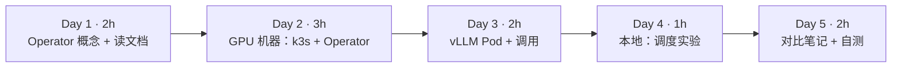
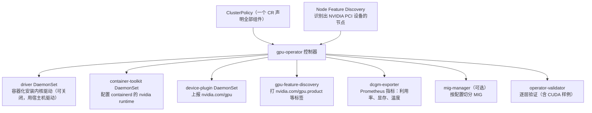
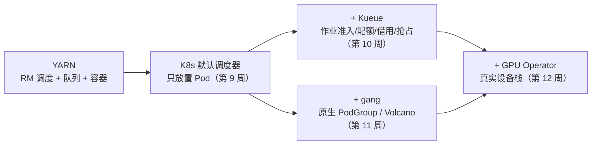

=== m3w4 | 第 12 周：GPU Operator + vLLM Pod | 第 3 月 · K8s + GPU 调度
# 第 12 周：真实 GPU 上的 GPU Operator + vLLM Pod

> **本周一句话**：前三周的 GPU 都是 KWOK“画”出来的。本周把它落到真实硬件上：用 **NVIDIA GPU Operator** 一次性装好驱动、容器工具包、device plugin、监控，再把 **vLLM** 作为 Deployment + Service 跑起来，在 K8s 里亲眼看到 `nvidia.com/gpu` 被分配，并完成第 3 月的核心产出——“YARN 容量调度 vs Kueue/Volcano”对比笔记。

**预计投入：约 10 小时**（阅读 ≈ 3h，GPU 机器上动手 ≈ 4h，笔记与自测 ≈ 3h；GPU 机器按 3–4 小时计费）。{{gpu1}}

**本周结束时你应该能：**

1. 说出 GPU Operator 管理的组件及各自职责，以及它们与第 9 周“GPU 节点软件栈”的对应。
2. 在单节点 K8s 上安装 GPU Operator，并用节点 allocatable 与验证 Pod 确认 GPU 可用。
3. 写出生产可用的 vLLM Deployment：GPU limits、型号选择、就绪探针、共享内存、Service。
4. 用 OpenAI 兼容接口调用 vLLM，并解释 Pod 启动慢的原因（拉镜像、下载权重、加载与 CUDA graph 捕获）。
5. 完成 YARN / Kueue / Volcano 的对比笔记。

> **验证说明（重要）**：本站没有 GPU。GPU Operator 安装、vLLM 推理均**未在本站实测，需 GPU**，命令与参数来自官方文档，页面中**没有任何虚构输出**。唯一实测的是“vLLM Deployment 在 KWOK 模拟集群上的调度行为”（实验 3），用来验证清单本身和 GPU 资源不足时的报错。实验文件在仓库 `labs/w12/`。

## 资源说明 {{gpu1}}

> 注意：GPU Operator 需要能管理宿主机驱动/容器运行时的环境。很多按小时计费的 GPU 平台给你的是**容器实例**（无法再在里面起完整 K8s 并安装驱动组件）。做本实验请选择提供**完整虚拟机/裸金属**且可 root 的 GPU 云主机；若只能拿到容器实例，可以退而求其次：直接用 `vllm serve` 体验，并把 K8s 部分留在本地模拟环境完成。

---

## 1. 本周学习路线



| 天 | 时间 | 先读 | 再读（外部资料） | 再做 |
|---|---|---|---|---|
| Day 1 | 2h | 2.1、2.2 | ① GPU Operator 概览、② Getting Started、③ 平台支持 | 准备 GPU 云主机（确认是 VM/裸金属） |
| Day 2 | 3h | 2.3 | ④ Container Toolkit、⑤ device plugin | 实验 1 |
| Day 3 | 2h | 2.4 | ⑦ vLLM on K8s、⑧ OpenAI 兼容服务 | 实验 2，释放机器 |
| Day 4 | 1h | — | ⑨ K8s 调度 GPU | 实验 3（本地 KWOK/kind） |
| Day 5 | 2h | 2.5 | ⑥ GPU 共享 | 对比笔记、自测 |

---

## 2. 核心概念讲解

### 2.1 为什么需要 GPU Operator

第 9 周我们画过 GPU 节点的软件栈：驱动 → container toolkit → device plugin → kubelet。手工在每台机器上装这些，版本要彼此匹配，升级时还要逐台操作。GPU Operator 用 K8s Operator 模式把它们都变成 DaemonSet，由一个 `ClusterPolicy` CR 统一声明。

**大数据类比**：像用 Ambari / Cloudera Manager 统一下发 HDFS、YARN NodeManager 的安装与配置，而不是逐台 ssh。



各组件的启动有依赖顺序：驱动就绪 → toolkit → device plugin 等；validator 会逐层验证。排障时按这个顺序看哪个 Pod 卡住。第 9–11 周 KWOK 节点上的 `nvidia.com/gpu.product` 标签，就是在模仿 gpu-feature-discovery 的输出。

### 2.2 驱动由谁装

| 方式 | 配置 | 适用 |
|---|---|---|
| Operator 容器化安装驱动 | 默认 | 干净的 VM，OS 在 ③ 平台支持列表中 |
| 使用宿主机已装驱动 | `driver.enabled=false` | 云厂商 GPU 镜像已预装驱动（常见） |

云主机镜像常已预装驱动，此时若仍让 Operator 装驱动会冲突，driver Pod 反复失败。先在宿主机运行 `nvidia-smi` 判断。

### 2.3 Pod 怎样拿到 GPU

1. Pod 写 `resources.limits: {nvidia.com/gpu: 1}`（扩展资源只能整数、写 limits，见第 9 周）。
2. 调度器按节点 allocatable 选点（实验 3 实测）。
3. kubelet 调用 device plugin 的 Allocate，拿到设备 ID。
4. 容器运行时通过 nvidia runtime 把对应的 `/dev/nvidia*` 和驱动库注入容器，容器内 `nvidia-smi` 只看到分到的卡。

### 2.4 vLLM Pod 的几个要点

- **启动时间**：拉镜像（vllm-openai 镜像体积很大）+ 下载权重 + 加载到显存 + 预分配 KV Cache / CUDA graph 捕获，可能需要数分钟。务必配置 readinessProbe（`/health`），否则 Service 会把请求发给尚未就绪的 Pod。
- **权重缓存**：每次重建 Pod 都重新下载很浪费，生产中用 PVC 或节点本地缓存挂到 HuggingFace 缓存目录；需要授权的模型通过 Secret 注入 `HF_TOKEN`。
- **共享内存**：多卡张量并行时进程间通信需要较大 `/dev/shm`，用 `emptyDir: {medium: Memory}` 挂载（⑦ 中有说明）。
- **显存预算**：`--max-model-len` 与 `--gpu-memory-utilization` 决定 KV Cache 大小；显存不够时会在启动阶段报错（第 4 月详细讲）。

### 2.5 第 3 月回顾：从 YARN 到 K8s 批调度



---

## 3. 动手实验

### 实验 1：单节点 K8s + GPU Operator（GPU 机器，约 1.5 小时）

> 未在本站实测，需 GPU。以下命令来自 k3s 与 GPU Operator 官方文档，具体参数以 ② 当前版本为准。

```bash
# 0. 确认宿主机情况
nvidia-smi                     # 能输出说明已预装驱动 → 下面加 --set driver.enabled=false
# 1. 单节点 K8s（以 k3s 为例；也可用 kubeadm）
curl -sfL https://get.k3s.io | sh -
export KUBECONFIG=/etc/rancher/k3s/k3s.yaml
# 2. 安装 GPU Operator
helm repo add nvidia https://helm.ngc.nvidia.com/nvidia && helm repo update
helm install --wait gpu-operator -n gpu-operator --create-namespace nvidia/gpu-operator
kubectl -n gpu-operator get pods
kubectl get node -o jsonpath='{.items[0].status.allocatable}'   # 应看到 nvidia.com/gpu
kubectl get node --show-labels | tr ',' '\n' | grep nvidia.com   # gpu-feature-discovery 打的标签
```

> k3s 使用 containerd 且配置路径与默认不同，GPU Operator 文档中有针对 k3s 的 toolkit 配置说明，遇到 toolkit 报错时查阅 ②。

验证 Pod（在容器中运行 `nvidia-smi`）：

```yaml
apiVersion: v1
kind: Pod
metadata: {name: gpu-smoke}
spec:
  restartPolicy: Never
  containers:
  - name: cuda
    image: nvcr.io/nvidia/cuda:12.4.1-base-ubuntu22.04   # 选与驱动兼容的 CUDA 版本
    command: ["nvidia-smi"]
    resources: {limits: {nvidia.com/gpu: 1}}
```

`kubectl logs gpu-smoke` 应显示一张 GPU。记录：Operator 各 Pod 的状态、allocatable 中的 GPU 数、GPU 型号标签。

### 实验 2：vLLM Deployment + 调用（GPU 机器，约 1 小时）

> 未在本站实测，需 GPU。

```yaml
@@CODE:w12/vllm.yaml@@
```

在单节点 GPU 机器上，请删除 `nodeSelector`（或改成你的 GPU 型号标签）和 tolerations。

```bash
kubectl apply -f vllm.yaml && kubectl logs -f deploy/vllm
kubectl port-forward svc/vllm 8000:8000 &
curl localhost:8000/v1/models
curl localhost:8000/v1/chat/completions -H 'Content-Type: application/json' \
  -d '{"model":"Qwen/Qwen2.5-1.5B-Instruct","messages":[{"role":"user","content":"用一句话解释 KV Cache"}]}'
kubectl describe node | grep -A6 "Allocated resources"   # nvidia.com/gpu 已分配 1
```

记录：从 apply 到 Ready 的时间及各阶段耗时（看日志）、首个请求延迟、`nvidia-smi` 中显存占用。**完成后立即释放机器。**

### 实验 3：在模拟集群上验证清单与 GPU 不足（本地，20 分钟）{{local}}

在第 11 周的 KWOK `lab2` 集群（gpu-node-1 为 4 卡 L4）上应用同一份清单，检查清单是否被接受、`nodeSelector` 是否选中 L4 节点，并把副本扩到 5 观察资源不足。

```bash
kubectl apply -f labs/w12/vllm.yaml; sleep 10
kubectl get pods -o wide | awk '{print $1,$3,$7}'
kubectl scale deploy vllm --replicas=5; sleep 10
kubectl get pods -o wide | awk '{print $1,$3,$7}'
```

真实输出：

```text
deployment.apps/vllm created
service/vllm created
NAME STATUS NODE
vllm-c9f88d464-fxqkj Running gpu-node-1
---
deployment.apps/vllm scaled
NAME STATUS NODE
vllm-c9f88d464-2gn5g Pending <none>
vllm-c9f88d464-fxqkj Running gpu-node-1
vllm-c9f88d464-nmjl9 Running gpu-node-1
vllm-c9f88d464-qxjhf Running gpu-node-1
vllm-c9f88d464-sl6hs Running gpu-node-1
```

第 5 个副本的事件（真实输出）：

```text
0/3 nodes are available: 1 Insufficient nvidia.com/gpu, 2 node(s) didn't match Pod's node affinity/selector. preemption: 0/3 nodes are available: 1 No preemption victims found for incoming pod, 2 Preemption is not helpful for scheduling.
```

读法：L4 节点 4 卡已满（Insufficient），A100 节点和 CPU 节点被 nodeSelector 排除——即使 A100 上 8 张卡全空，这个副本也不会去。这正是“按型号选卡”的代价；若希望 L4 不够时退到 A100，应使用 Kueue 的 flavor 回退（第 10 周）或 nodeAffinity 的 preferred 规则。（KWOK 中 Pod 显示 Running 但没有容器真正运行。）

### 清理

```bash
kubectl delete -f labs/w12/vllm.yaml
# GPU 机器：helm uninstall gpu-operator -n gpu-operator；然后在云平台释放实例
```

### 常见错误与排查

以下来自官方文档的排障说明与通用经验，未在本站复现。

| 现象 | 可能原因 | 解决 |
|---|---|---|
| driver Pod 反复 CrashLoop | 宿主机已有驱动，或 OS/内核不在支持列表 | `driver.enabled=false`；对照 ③ |
| toolkit Pod 报错，GPU Pod 中看不到设备 | k3s 等发行版的 containerd 配置路径不同 | 按 ② 中对应发行版设置 toolkit 环境变量 |
| 节点 allocatable 中没有 nvidia.com/gpu | device plugin 未就绪（等待前序组件） | 按依赖顺序检查 operator 命名空间中的 Pod |
| vLLM Pod 长时间不 Ready | 拉镜像/下载权重慢 | 看日志判断阶段；预拉镜像、挂载权重缓存 |
| vLLM 启动时报显存不足 | max-model-len 太大或模型太大 | 降低 `--max-model-len`、调整 `--gpu-memory-utilization`、换小模型 |
| 需授权的模型下载 401/403 | 缺少 HF token | 用 Secret 注入 `HF_TOKEN` |
| `Insufficient nvidia.com/gpu`（本站实测） | 目标节点 GPU 已满或 selector 太严格 | 扩容、放宽 selector、或用 Kueue flavor |

### 扩展练习

1. 阅读 ⑥，在 GPU 机器上配置时间片共享（time-slicing），让节点上报多于物理卡数的 `nvidia.com/gpu`，同时运行两个 vLLM 小模型 Pod，观察性能与隔离性。
2. 部署 dcgm-exporter（Operator 默认包含）的指标到 Prometheus，找出 GPU 利用率与显存的指标名。
3. 用 Kueue 管理 vLLM 之外的批量推理 Job（第 8 周的离线推理改成 K8s Job），体会在线服务与离线批作业共享 GPU 的问题。

---

## 4. 精读指南

- **① [GPU Operator 概览](https://docs.nvidia.com/datacenter/cloud-native/gpu-operator/latest/index.html)**（20 分钟）。**读完回答**：Operator 管理哪些组件？
- **② [Getting Started](https://docs.nvidia.com/datacenter/cloud-native/gpu-operator/latest/getting-started.html)**（40 分钟）：重点是预装驱动、各发行版 containerd 配置、验证步骤。
- **③ [平台支持](https://docs.nvidia.com/datacenter/cloud-native/gpu-operator/latest/platform-support.html)**（10 分钟）：确认你租的机器 OS 与 GPU 在支持范围。
- **④ [NVIDIA Container Toolkit](https://docs.nvidia.com/datacenter/cloud-native/container-toolkit/latest/index.html)**（15 分钟）：容器如何看到 GPU。
- **⑤ [k8s-device-plugin](https://github.com/NVIDIA/k8s-device-plugin)**（20 分钟）：README 中的资源上报与共享配置。
- **⑥ [GPU 共享（time-slicing）](https://docs.nvidia.com/datacenter/cloud-native/gpu-operator/latest/gpu-sharing.html)**（20 分钟）。**读完回答**：时间片共享提供显存隔离吗？
- **⑦ [vLLM：Kubernetes 部署](https://docs.vllm.ai/en/latest/deployment/k8s.html)**（30 分钟）：PVC 缓存、Secret、shm、探针。
- **⑧ [vLLM OpenAI 兼容服务](https://docs.vllm.ai/en/latest/serving/openai_compatible_server.html)**（20 分钟）。
- **⑨ [K8s：调度 GPU](https://kubernetes.io/docs/tasks/manage-gpus/scheduling-gpus/)**（15 分钟）：官方对扩展资源与节点标签的说明。
- **源码**：[NVIDIA/gpu-operator](https://github.com/NVIDIA/gpu-operator)、[NVIDIA/dcgm-exporter](https://github.com/NVIDIA/dcgm-exporter)。

---

## 5. 自测题

<details>
<summary>1. GPU Operator 管理哪些组件？各自做什么？</summary>

驱动（容器化安装内核驱动，可关闭）、container toolkit（配置容器运行时以注入 GPU）、device plugin（上报 nvidia.com/gpu 并分配设备）、gpu-feature-discovery（打型号等节点标签）、dcgm-exporter（监控指标）、mig-manager（MIG 切分，可选）、validator（逐层验证）。依赖 NFD 识别 GPU 节点，统一由 ClusterPolicy 声明。

</details>

<details>
<summary>2. 云主机已预装驱动时应如何安装 Operator？为什么？</summary>

设置 driver.enabled=false，使用宿主机驱动；否则 Operator 的驱动容器会与已加载的内核模块冲突，driver Pod 失败，后续组件也无法就绪。

</details>

<details>
<summary>3. 为什么按小时计费的“容器实例”通常做不了本周实验？</summary>

GPU Operator 需要在宿主机层面安装驱动、修改容器运行时配置并运行特权 DaemonSet；容器实例里你本身就在一个容器中，无法控制宿主机，也通常无法运行完整的 K8s。

</details>

<details>
<summary>4. vLLM Deployment 为什么一定要有 readinessProbe？</summary>

vLLM 启动要拉镜像、下载并加载权重、预分配 KV Cache，可能需要数分钟。没有就绪探针时，容器一启动 Service 就会把流量转给它，请求会失败。

</details>

<details>
<summary>5. 实验 3 中第 5 个副本为什么不去空着的 A100 节点？如何让它“L4 不够用 A100”？</summary>

nodeSelector 要求 nvidia.com/gpu.product=NVIDIA-L4，A100 节点不匹配。可以用 nodeAffinity 的 preferredDuringScheduling 表达偏好，或用 Kueue 的 ResourceFlavor 顺序做回退。

</details>

<details>
<summary>6. 时间片共享与 MIG 的区别？</summary>

时间片共享让多个容器轮流使用同一张卡，没有显存和故障隔离；MIG 在硬件层面把支持的 GPU（如 A100/H100）切成多个实例，各有独立显存和计算单元，隔离性好但切分规格固定。

</details>

### 思考题

1. 在线推理服务（vLLM）与离线训练/批推理共享一个 GPU 集群时，你会用哪些机制（优先级、Kueue 队列、专用节点池、抢占）来保证在线服务的 SLA？
2. 对比 YARN 时代“NodeManager 统一部署”的经验，GPU 驱动升级在 K8s 集群中应该怎样滚动进行？

---

## 6. 本周产出与掌握清单

### 笔记模板：YARN 容量调度 vs Kueue/Volcano

| 维度 | YARN CapacityScheduler | Kueue | Volcano |
|---|---|---|---|
| 队列模型 | | | |
| 配额与借用 | | | |
| Gang 调度 | | | |
| 抢占 | | | |
| 异构资源（GPU 型号） | | | |
| 与生态集成（Spark/Ray/PyTorchJob） | | | |
| 适用场景 | | | |

提示：可以直接引用第 10、11 周你自己的实验输出作为每一格的证据。

## 参考资料

- [Stas Bekman：ml-engineering](https://github.com/stas00/ml-engineering)（书·进阶）：大模型训练/推理的硬件、网络、排障实战手册
- [vLLM 文档](https://docs.vllm.ai/en/latest/)（文档·入门）：部署、参数、OpenAI 兼容服务的权威说明
- [K8s：Dynamic Resource Allocation](https://kubernetes.io/docs/concepts/scheduling-eviction/dynamic-resource-allocation/)（文档·进阶）：新一代设备分配 API（DRA），GPU 调度的演进方向
- [NVIDIA GPU Operator 文档](https://docs.nvidia.com/datacenter/cloud-native/gpu-operator/latest/index.html)（文档·进阶）：驱动、container toolkit、device plugin、DCGM 一键部署
- [Slurm 文档](https://slurm.schedmd.com/documentation.html)（文档·入门）：HPC/训练集群常用调度器
- [Slurm Quick Start](https://slurm.schedmd.com/quickstart.html)（文档·入门）：sbatch/srun/partition 基本概念，快速建立与 K8s 的对照
- [ZOMI AISystem（中文）](https://github.com/chenzomi12/AISystem)（书·进阶）：AI 芯片、编译器、推理、训练系统的中文全景

> 完整列表见 [参考资料库](/resources.html)。

## 检查清单
- [ ] GPU Operator 组件全部 Running，节点出现 `nvidia.com/gpu`
- [ ] vLLM Pod 启动并能返回对话结果
- [ ] 完成对比笔记（第 3 月核心产出）
- [ ] 释放 GPU 机器
- [ ] 能画出 GPU Operator 组件图并说明依赖顺序
- [ ] 能解释实验 3 中调度失败消息的每一部分
