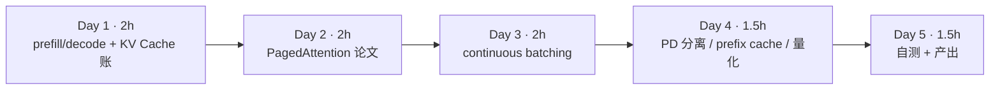
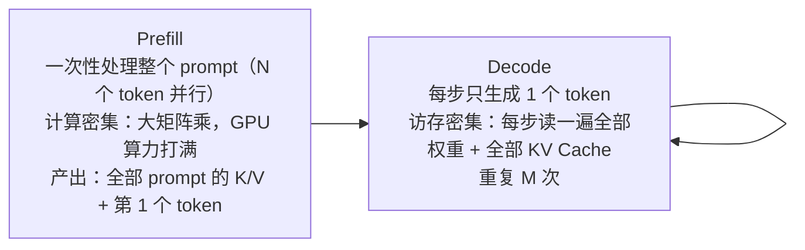
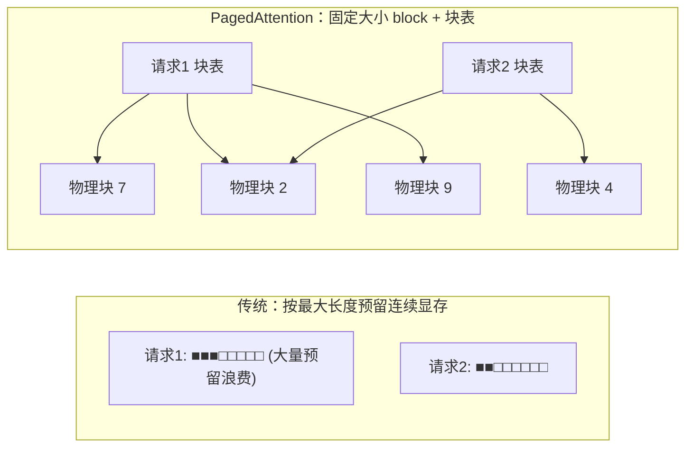
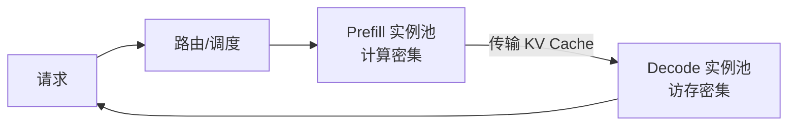

=== m4w1 | 第 13 周：PagedAttention、continuous batching 与 PD 分离 | 第 4 月 · 推理服务平台
# 第 13 周：推理引擎核心机制——KV Cache、PagedAttention、continuous batching、PD 分离

> **本周一句话**：大模型推理的瓶颈不是算力，而是**显存里的 KV Cache** 和**怎样把很多请求塞进同一个 batch**。本周用一份真实的 `config.json` 算清 KV Cache 账，再用三个小程序亲手验证 PagedAttention 的显存收益、continuous batching 的吞吐收益，以及 KV Cache 本身带来的加速。下周你会在 vLLM 启动日志里看到同样的数字。

**预计投入：约 9 小时**（阅读 ≈ 4h，动手 ≈ 3h，自测与产出 ≈ 2h）。{{none}}

**本周结束时你应该能：**

1. 从 `config.json` 算出权重显存、每 token KV Cache 大小、给定显卡的并发上限，并解释 GQA 的作用。
2. 讲清 PagedAttention 的块表机制，以及它如何把显存利用率从“按最大长度预留”提升到接近 100%。
3. 讲清 continuous batching（迭代级调度）为什么同时改善吞吐和延迟。
4. 解释 prefill 与 decode 的资源特征差异，以及 PD 分离、prefix cache、量化各解决什么问题。

> **验证说明**：本周不需要 GPU。`kv_budget.py`、`paged_sim.py`、`batching_sim.py` 是纯计算/模拟程序，`kv_cache_cpu.py` 在本站 8 核 CPU 上用真实的 Qwen2.5-0.5B-Instruct（transformers 5.20.2、torch 2.14.1+cpu）运行。本页所有输出均为真实输出；其中两个模拟程序的**参数是假设值**（已在代码中注明），结论看趋势，不看绝对数值。实验文件在仓库 `labs/w13/`。

---

## 1. 本周学习路线



| 天 | 时间 | 先读 | 再读（外部资料） | 再做 |
|---|---|---|---|---|
| Day 1 | 2h | 2.1、2.2 | ⑤ Lilian Weng 推理优化综述（前半） | 实验 1、实验 4 |
| Day 2 | 2h | 2.3 | ① PagedAttention 论文、② vLLM 设计文档 | 实验 2 |
| Day 3 | 2h | 2.4 | ③ Orca 论文页、④ Inside vLLM | 实验 3 |
| Day 4 | 1.5h | 2.5、2.6 | ⑥ DistServe、⑦ prefix caching 设计、⑧ 量化文档 | — |
| Day 5 | 1.5h | — | — | 自测、本周产出 |

---

## 2. 核心概念讲解

### 2.1 一次推理的两个阶段



- **TTFT**（首 token 延迟）主要由排队 + prefill 决定；**TPOT**（每个输出 token 的间隔）由 decode 决定（下周压测的两个核心指标）。
- decode 时 batch 中有 1 个请求还是 32 个请求，读权重的开销几乎一样，所以**把更多请求塞进一个 batch 几乎是“免费”的吞吐**——前提是显存里放得下它们的 KV Cache。这就是本周所有技术的出发点。

**大数据类比**：prefill 像 Spark 的一次大 shuffle（吞吐型），decode 像逐条处理的流式算子（延迟型、受 I/O 限制）；把很多条记录攒成一批处理以摊薄固定开销，是你熟悉的老办法。

### 2.2 KV Cache 的账

注意力计算需要所有历史 token 的 Key 和 Value。缓存下来就不用每步重算——代价是显存：

$$\text{KV 字节/token} = 2 \times L \times n_{kv} \times d_{head} \times b$$

其中 2 表示 K 和 V，L 为层数，n_kv 为 KV 头数，d_head 为每头维度，b 为每个元素字节数（BF16 = 2）。

**GQA（Grouped-Query Attention，⑨）**：多个 Query 头共享一组 K/V 头。Qwen2.5-7B 有 28 个 Q 头、只有 4 个 KV 头，KV Cache 缩小为 1/7。

显卡上可用于 KV Cache 的显存：

$$M_{KV} = M_{GPU} \times u - M_{weights} - M_{act}$$

u 对应 vLLM 的 `--gpu-memory-utilization`。可并发的满长度请求数 ≈ M_KV ÷（KV 字节/token × 上下文长度）。

### 2.3 PagedAttention：给 KV Cache 做“分页”

早期系统给每个请求按**最大长度**预留一段连续显存。请求实际长度事先未知，预留的大部分都浪费了，还有外部碎片。PagedAttention（①）借鉴操作系统虚拟内存：



- KV Cache 被切成固定大小的 block（vLLM 默认 16 个 token），每个请求有一张**块表**，逻辑块 → 物理块。
- 按需分配：只有最后一个 block 可能没写满，浪费 < 1 个 block。
- 多个请求的相同前缀可以指向同一物理块（上图的物理块 2），引用计数 + 写时复制。这是 prefix cache 和并行采样（n>1、beam search）省显存的基础。

| 操作系统 | PagedAttention | 大数据类比 |
|---|---|---|
| 虚拟页 / 物理页框 | 逻辑块 / 物理块 | HDFS 文件的 block 与 DataNode 上的物理块 |
| 页表 | 块表 | NameNode 的 block map |
| 共享页 + 写时复制 | 共享前缀块 + 引用计数 | HDFS 快照共享未修改的 block |

### 2.4 continuous batching（迭代级调度）

静态 batch：凑齐一批一起跑，**整批最长的请求结束**后才放下一批进来。短请求结束后它的槽位就空着。Orca（③）提出按**迭代（每个 decode 步）**调度：每一步结束都检查，完成的请求立即离开，排队的请求立即补位。

```mermaid
gantt
  dateFormat X
  axisFormat %s
  section 静态 batch
  请求A(长) :0, 8
  请求B(短) :0, 3
  B 完成后空等 :3, 8
  请求C 等到整批结束 :8, 12
  section Continuous batching
  请求A(长) :0, 8
  请求B(短) :0, 3
  请求C 立即补位 :3, 7
```



大数据类比：静态 batch 像 MapReduce 一个 stage 等最慢的 task（长尾）；continuous batching 像 Spark 的动态 task 分配——executor 一空闲就领下一个 task。vLLM 的调度器在每一步决定：哪些请求继续 decode、哪些新请求做 prefill、KV 块不够时抢占谁（重算或换出到 CPU）。新版本还会把长 prompt 的 prefill 切块，与 decode 混在同一步（chunked prefill，见 ④），避免一个长 prompt 卡住所有人的 TPOT。

### 2.5 PD 分离



prefill 和 decode 混在同一组 GPU 上会互相干扰：长 prompt 的 prefill 拖慢正在 decode 的请求（TPOT 抖动），而为了 TPOT 限制 batch 又浪费 prefill 的算力。DistServe（⑥）把两者放到不同实例，分别按 TTFT 和 TPOT 目标选择并行度与实例数，代价是要在实例间传输 KV Cache（需要高速网络）。llm-d、NVIDIA Dynamo 等项目都在做这一层的调度与 KV 传输；vLLM 也提供了实验性的分离 prefill 功能（⑩）。

### 2.6 prefix cache 与量化

- **prefix cache**（⑦）：把已经算过的 block 按“前缀内容的哈希”留在显存，新请求前缀相同（同一个 system prompt、多轮对话的历史、few-shot 示例）就直接复用，跳过这部分 prefill，TTFT 下降。第 15 周会和 SGLang 的 RadixAttention 对比。
- **量化**（⑧）：把权重（有时也包括 KV Cache）从 16 位降到 8 位或 4 位。权重变小 → 显存省出来给 KV Cache，且 decode 每步读的字节更少 → 更快；代价是可能损失精度。常见格式有 AWQ、GPTQ、FP8，支持情况以引擎文档为准。实验 1 的第三组参数就是“KV Cache 用 8 位”的效果。

---

## 3. 动手实验 {{none}}

### 实验 1：用真实 config.json 算 KV Cache 账（30 分钟）

下载 Qwen2.5-7B-Instruct 的 [config.json](https://huggingface.co/Qwen/Qwen2.5-7B-Instruct/blob/main/config.json)：

```bash
curl -sL https://huggingface.co/Qwen/Qwen2.5-7B-Instruct/resolve/main/config.json -o qwen2.5-7b-config.json
```

```python
@@CODE:w13/kv_budget.py@@
```

```bash
python kv_budget.py qwen2.5-7b-config.json                 # 24GB 卡（如 L4/4090）
python kv_budget.py qwen2.5-7b-config.json --gpu-gb 80     # 80GB 卡（A100/H100）
python kv_budget.py qwen2.5-7b-config.json --kvbytes 1     # KV Cache 用 8 位
```

真实输出：

```text
参数量 ≈ 7.62 B，权重 15.23 GB（2 字节/参数）
注意力：28 个 Q 头、4 个 KV 头（GQA 7:1），head_dim=128
每 token KV Cache = 2×28×4×128×2 = 56 KiB
若不用 GQA（KV 头 = 28）：392 KiB/token
KV 预算 = 24×0.9 - 15.23 - 1.5 = 4.87 GB
可容纳 84,904 个 token = 5,306 个 block（block=16）
上下文 4096 满长度时最多并发 20 个请求
===
KV 预算 = 80.0×0.9 - 15.23 - 1.5 = 55.27 GB
可容纳 963,810 个 token = 60,238 个 block（block=16）
上下文 4096 满长度时最多并发 235 个请求
===
每 token KV Cache = 2×28×4×128×1 = 28 KiB
可容纳 169,809 个 token = 10,613 个 block（block=16）
上下文 4096 满长度时最多并发 41 个请求
```

（第二、三组省略了与第一组相同的行。）解读：

- 算出的 7.62B 与官方公布的约 7.6B 一致，说明公式没漏项。
- 24GB 卡放下 7B BF16 权重后**只剩约 4.9GB 给 KV Cache**，满 4K 上下文只能并发约 20 个请求；80GB 卡的权重开销不变，KV 容量是 11 倍多。这就是“大显存卡吞吐高得不成比例”的原因。
- 没有 GQA 的话每 token 要 392KiB，24GB 卡上只能并发 2–3 个满长度请求。
- `--act-gb 1.5` 是经验预留的**假设值**；下周看 vLLM 启动日志里打印的 KV Cache 容量来校准。

### 实验 2：PagedAttention 的显存利用率（20 分钟）

```python
@@CODE:w13/paged_sim.py@@
```

```text
64 个在途请求，实际 token 数 108,957（平均 1702）
contiguous(按 max_len 预留)     分配   262,144 token 槽位，逻辑token/物理槽位  41.6%，同样显存可多容纳  1.0× 请求
paged(block=16)              分配   109,440 token 槽位，逻辑token/物理槽位  99.6%，同样显存可多容纳  2.4× 请求
paged + 共享 512 token 前缀      分配    77,184 token 槽位，逻辑token/物理槽位 141.2%，同样显存可多容纳  3.4× 请求
```

- 按 max_len 预留时只有 41.6% 的槽位被真正使用；分页后浪费只剩每个请求最后一个 block 的零头（99.6%）。
- 共享 system prompt 后，**逻辑 token 数超过了物理槽位数**（141.2%）——同一份物理块被 64 个请求同时引用。
- 论文报告的现有系统 KV 显存利用率只有 20%–38%（①），比这里更低，因为真实系统还有外部碎片和更保守的预留。

### 实验 3：静态 batch vs continuous batching（30 分钟）

```python
@@CODE:w13/batching_sim.py@@
```

```bash
python batching_sim.py               # batch 上限 32
python batching_sim.py --batch 128
```

真实输出：

```text
256 个请求同时到达，输出长度 p50=66.0 均值=114 最大=2000，batch 上限 32
静态 batch             总耗时  144.7s 吞吐   201.4 tok/s 平均完成时间   61.7s p99  139.4s 槽位利用率 13.4%
continuous batching  总耗时   60.4s 吞吐   482.6 tok/s 平均完成时间   12.9s p99   34.3s 槽位利用率 35.3%
===
256 个请求同时到达，输出长度 p50=66.0 均值=114 最大=2000，batch 上限 128
静态 batch             总耗时   81.9s 吞吐   355.8 tok/s 平均完成时间   23.5s p99   55.8s 槽位利用率  6.2%
continuous batching  总耗时   50.5s 吞吐   577.2 tok/s 平均完成时间    7.4s p99   24.5s 槽位利用率 10.9%
```

- 同样的 batch 上限，continuous batching 的吞吐是静态的 2.4 倍，平均完成时间降到约 1/5——**吞吐和延迟同时变好**，因为短请求不再被同批的长请求拖住。
- 槽位利用率都不高：最后阶段只剩那条 2000 token 的长请求在跑（长尾），队列已空，没有请求可补位。真实服务中请求持续到达，利用率会高得多。
- batch 上限从 32 提到 128，两种方式都变快——前提是显存放得下（回到实验 1 的 KV 账）。
- 单步耗时模型 `20ms + 0.3ms × batch` 是**假设值**，用来体现 decode 访存受限的特点，不代表任何具体 GPU。

### 实验 4：KV Cache 到底省了多少？（CPU 真实模型，20 分钟）

```python
@@CODE:w13/kv_cache_cpu.py@@
```

```bash
pip install torch transformers   # 第 2 月已安装
python kv_cache_cpu.py           # 首次运行会下载约 1GB 模型
```

真实输出（8 核 CPU）：

```text
模型 Qwen/Qwen2.5-0.5B-Instruct，prompt 104 token，生成 128 token（贪心，固定长度）
use_cache=True  耗时   5.33s    24.0 token/s
use_cache=False 耗时  24.77s     5.2 token/s
```

关掉 KV Cache 慢了 4.6 倍：每生成一个 token 都要把 104 + 已生成的全部 token 重新过一遍模型。生成越长差距越大（总计算量从 O(n) 变为 O(n²)）。这就是为什么推理引擎宁可花大量显存存 KV Cache——以及为什么显存管理成了核心问题。

### 常见错误与排查

| 现象 | 原因 | 解决 |
|---|---|---|
| 估算的参数量和官方差很多 | 漏了 embedding / lm_head，或误以为它们共享（看 `tie_word_embeddings`） | 逐项核对；7B 级模型 embedding+lm_head 约 1B |
| KV 每 token 算大了 7 倍 | 用 `num_attention_heads` 代替了 `num_key_value_heads` | GQA 模型用 KV 头数 |
| 估算并发比 vLLM 日志多 | 激活、CUDA graph、碎片的预留估少了 | 以日志中的 KV 块数为准，反推 `--act-gb` |
| `kv_cache_cpu.py` 下载失败 | 无法访问 HuggingFace | 设置 `HF_ENDPOINT` 镜像，或提前下载到本地目录后传路径 |
| 两次运行速度差很多 | CPU 线程数、首次加载的预热 | 固定 `torch.set_num_threads`，多跑几次取中位数 |

### 扩展练习

1. 对 Llama 或 DeepSeek 系列的某个模型下载 config.json，用 `kv_budget.py` 比较它们每 token 的 KV 大小（注意：MLA 架构的 DeepSeek 不能直接套这个公式，思考为什么）。
2. 修改 `paged_sim.py` 的 `--block` 为 1、16、256，观察利用率变化，并思考为什么 vLLM 不用 block=1（提示：块表开销与 kernel 访存效率）。
3. 修改 `batching_sim.py`，让请求按泊松过程持续到达，统计稳态下的 TTFT 分布。
4. 在 `kv_cache_cpu.py` 中把 `--new` 改为 32、128、256，画出两种方式耗时随生成长度的曲线。

---

## 4. 精读指南

- **① [PagedAttention 论文](https://arxiv.org/abs/2309.06180)**（90 分钟）：重点读第 2–4 节（问题、方法、调度与抢占）。**读完回答**：内部碎片、外部碎片、预留浪费分别指什么？KV 块不够时 vLLM 有哪两种抢占恢复方式？
- **② [vLLM PagedAttention 设计文档](https://docs.vllm.ai/en/latest/design/paged_attention.html)**（30 分钟，可略读 kernel 细节）。
- **③ [Orca（OSDI '22）](https://www.usenix.org/conference/osdi22/presentation/yu)**（30 分钟，读摘要与第 3 节）。**读完回答**：什么是 iteration-level scheduling 和 selective batching？
- **④ [Inside vLLM](https://blog.vllm.ai/2025/09/05/anatomy-of-vllm.html)**（60 分钟）：把调度器、KV 管理、chunked prefill、prefix cache、PD 分离串起来的官方长文。
- **⑤ [Lilian Weng：推理优化综述](https://lilianweng.github.io/posts/2023-01-10-inference-optimization/)**（45 分钟）。
- **⑥ [DistServe 论文](https://arxiv.org/abs/2401.09670)**（45 分钟，读第 1–3 节）。**读完回答**：为什么 prefill 和 decode 的最优并行策略不同？
- **⑦ [vLLM 自动前缀缓存设计](https://docs.vllm.ai/en/latest/design/prefix_caching.html)**（20 分钟）：block 哈希如何计算？淘汰策略是什么？
- **⑧ [vLLM 量化文档](https://docs.vllm.ai/en/latest/features/quantization/index.html)**（浏览）。
- **⑨ [GQA 论文](https://arxiv.org/abs/2305.13245)**（20 分钟，读摘要与图 2）。
- **⑩ [vLLM 分离 prefill](https://docs.vllm.ai/en/latest/features/disagg_prefill.html)**、[优化与调参](https://docs.vllm.ai/en/latest/configuration/optimization.html)（浏览，下周会用到）。

---

## 5. 自测题

<details>
<summary>1. prefill 和 decode 分别是计算密集还是访存密集？为什么？</summary>

prefill 一次处理整个 prompt 的多个 token，矩阵乘规模大，算力是瓶颈；decode 每步只处理 1 个新 token，却要读取全部权重和全部 KV Cache，访存带宽是瓶颈。因此 decode 阶段增大 batch 几乎不增加单步耗时。

</details>

<details>
<summary>2. 写出每 token KV Cache 的公式，并算出 Qwen2.5-7B（BF16）的值。</summary>

2 × 层数 × KV 头数 × head_dim × 字节数 = 2 × 28 × 4 × 128 × 2 = 57,344 字节 = 56 KiB。

</details>

<details>
<summary>3. 为什么 24GB 卡上 7B 模型的并发远低于 80GB 卡的 1/3？</summary>

权重显存（约 15GB）是固定开销，与卡大小无关。24GB 卡扣除权重和预留后只剩约 4.9GB 给 KV，80GB 卡剩约 55GB，KV 容量相差 11 倍以上，并发也相差约 11 倍。

</details>

<details>
<summary>4. PagedAttention 解决了哪几种浪费？共享前缀为什么能让“逻辑 token 数 > 物理槽位”？</summary>

解决了按最大长度预留造成的浪费、外部碎片，内部碎片被限制在最后一个 block 内。共享前缀时多个请求的块表指向同一批物理块（引用计数），同一份物理 KV 被多个请求逻辑使用，所以逻辑 token 数可以超过物理槽位数。

</details>

<details>
<summary>5. continuous batching 为什么同时提升吞吐和降低平均延迟？</summary>

静态 batch 中短请求结束后槽位空等，排队请求要等整批最长的请求结束；迭代级调度每步都让完成的请求离开、新请求补位，GPU 槽位一直被有用的工作占满（吞吐升高），短请求也不再被长请求拖住（延迟降低）。

</details>

<details>
<summary>6. PD 分离的收益和代价是什么？</summary>

收益：prefill 不再干扰 decode 的 TPOT，两类实例可以按各自的 SLO 独立选择并行策略与扩缩容。代价：需要在实例间传输 KV Cache（依赖高速网络），系统更复杂，小规模部署时可能得不偿失。

</details>

<details>
<summary>7. 实验 4 中关掉 KV Cache 为什么慢这么多？生成更长时差距会怎样？</summary>

没有缓存时每生成一个 token 都要重新计算整个前缀的注意力和全部层，总计算量随生成长度平方增长；有缓存时每步只计算一个新 token。生成越长差距越大。

</details>

### 思考题

1. 用你熟悉的 YARN 内存管理来类比：为什么“按最大值预留”在大数据里也很常见？它和 KV Cache 的预留浪费有什么相同和不同？
2. 如果你要给推理服务设计 SLO，TTFT 和 TPOT 分别应该定多少？对聊天、代码补全、离线批处理三种场景分别讨论。
3. prefix cache 命中率在什么业务里会很高？在什么业务里几乎没用？

---

## 6. 本周产出与掌握清单

### 本周产出

- [ ] 一张图：PagedAttention 块表 + 共享前缀示意（自己画）
- [ ] 你目标模型/目标显卡的 KV Cache 估算表（kv_budget.py 输出），留待下周用 vLLM 日志验证
- [ ] 一页笔记：五项技术（PagedAttention、continuous batching、prefix cache、PD 分离、量化）各自解决的问题

## 参考资料

- [PagedAttention（vLLM）论文](https://arxiv.org/abs/2309.06180)（论文·进阶）：KV Cache 分页管理的出处，第 13 周精读
- [vLLM 文档：PagedAttention 设计](https://docs.vllm.ai/en/latest/design/paged_attention.html)（文档·进阶）：论文思想在代码中如何落地
- [Inside vLLM: Anatomy of a High-Throughput LLM Inference System](https://blog.vllm.ai/2025/09/05/anatomy-of-vllm.html)（博客·进阶）：vLLM 官方博客长文，串起调度器、KV cache、prefix cache、PD 分离
- [DistServe 论文（PD 分离）](https://arxiv.org/abs/2401.09670)（论文·高级）：prefill/decode 分离的代表性论文
- [Lilian Weng：Large Transformer Model Inference Optimization](https://lilianweng.github.io/posts/2023-01-10-inference-optimization/)（博客·进阶）：量化、剪枝、KV 优化等推理优化技术综述
- [vLLM 博客](https://blog.vllm.ai/)（博客·进阶）：持续跟进推理引擎新特性
- [ZOMI AISystem（中文）](https://github.com/chenzomi12/AISystem)（书·进阶）：AI 芯片、编译器、推理、训练系统的中文全景

> 完整列表见 [参考资料库](/resources.html)。

## 检查清单
- [ ] 能画出 PagedAttention 块表示意图
- [ ] 能解释 continuous batching 为何提升吞吐
- [ ] 能说出 PD 分离的动机
- [ ] 完成 KV Cache 并发估算，留待下周验证
- [ ] 能从 config.json 手算每 token KV 大小，并解释 GQA
- [ ] 能解释 prefill/decode 的资源特征与 TTFT/TPOT 的关系
