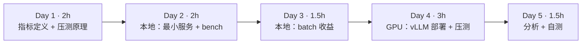
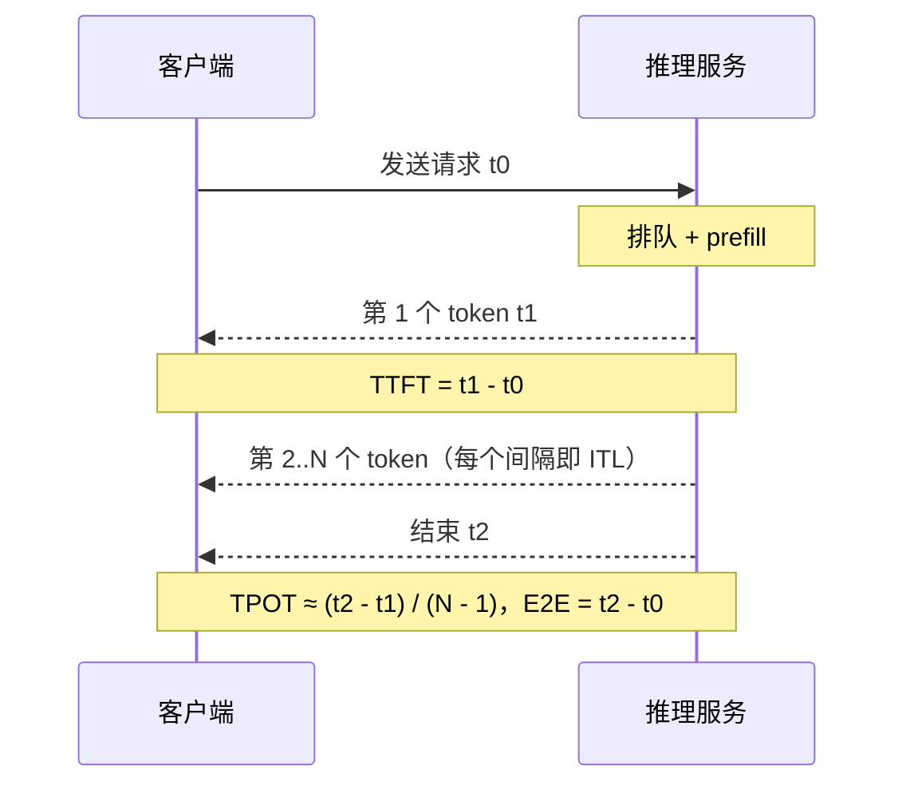
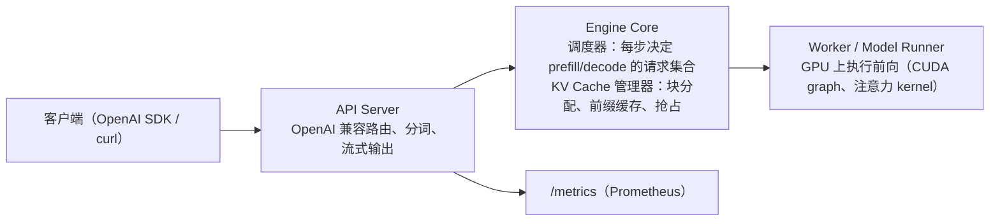

=== m4w2 | 第 14 周：vLLM 部署与压测 | 第 4 月 · 推理服务平台
# 第 14 周：vLLM 部署与压测——先学会“量”推理服务

> **本周一句话**：推理服务好不好，要用数字说话：**吞吐、TTFT、TPOT** 以及它们随并发的变化。本周先在本地 CPU 上搭一个**故意不做 batching** 的最小 OpenAI 兼容服务，用同一个压测脚本量出“排队导致 TTFT 爆炸”的现象，再量出 batch 带来的吞吐收益；然后上 GPU 用 vLLM 部署 7B 模型，对照上周的 KV Cache 估算，填完压测表。

**预计投入：约 10 小时**（阅读 ≈ 2.5h，本地动手 ≈ 3h，GPU 动手 ≈ 3h，自测与产出 ≈ 1.5h；GPU 机器约 3 小时）。{{local}} {{gpu1}}

**本周结束时你应该能：**

1. 准确定义吞吐、TTFT、TPOT（ITL）、端到端延迟和 goodput，并说出各自受哪个阶段影响。
2. 写出一个可复用的异步流式压测脚本，理解它的测量误差来源。
3. 用 vLLM 部署 OpenAI 兼容服务，从启动日志读出 KV Cache 容量并与估算对比。
4. 解释并发升高时吞吐、TTFT、TPOT 各自的变化规律，以及“无 batching”和“continuous batching”的本质差别。

> **验证说明**：本地部分（实验 1–3）在本站 8 核 CPU 上真实运行：Qwen2.5-0.5B-Instruct，transformers 5.20.2，torch 2.14.1+cpu，FastAPI 0.150.0，openai 3.35.1，输出均为真实输出。**vLLM 部分（实验 4–5）未在本站实测，需 GPU**，命令来自 vLLM 官方文档，页面中只有待你填写的空表，没有虚构数字。实验文件在仓库 `labs/w14/`。

---

## 1. 本周学习路线



| 天 | 时间 | 先读 | 再读（外部资料） | 再做 |
|---|---|---|---|---|
| Day 1 | 2h | 2.1、2.2 | ⑥ LLM 推理指标、② OpenAI 兼容服务 | — |
| Day 2 | 2h | 2.3 | — | 实验 1、实验 2 |
| Day 3 | 1.5h | 2.4 | ④ Inside vLLM（调度器一节，复习） | 实验 3 |
| Day 4 | 3h | 2.5 | ① 快速入门、③ serve 参数、⑤ vllm bench serve | 实验 4、实验 5 |
| Day 5 | 1.5h | — | ⑦ 指标文档 | 填表、自测、产出 |

---

## 2. 核心概念讲解

### 2.1 指标定义



| 指标 | 定义 | 主要受什么影响 | 用户感受 |
|---|---|---|---|
| TTFT | 首 token 延迟 | **排队时间** + prefill（prompt 越长越大） | “多久开始回答” |
| TPOT / ITL | 输出 token 之间的平均间隔 | decode 单步耗时（batch 大小、模型大小、显存带宽） | “打字速度” |
| E2E 延迟 | TTFT + (N−1)×TPOT | 两者 + 输出长度 | 整段回答的等待 |
| 吞吐 | 单位时间输出 token 总数 | batch 大小、调度效率 | 成本（每卡每秒多少 token） |
| goodput | 满足 SLO（如 TTFT<1s 且 TPOT<50ms）的请求吞吐 | 吞吐与延迟的平衡 | 真正“有用”的吞吐 |

E2E 公式：

$$T_{E2E} = T_{TTFT} + (N_{out} - 1) \times T_{TPOT}$$

人类阅读速度大约每秒几个到十几个词，所以聊天场景 TPOT 只要明显快于阅读速度即可，TTFT 才是体验关键；离线批处理则只看吞吐。

**大数据类比**：吞吐 ≈ Spark 作业的 records/s，TTFT ≈ 作业排队 + 启动时间，TPOT ≈ 流处理的单条处理延迟，goodput ≈ 满足 SLA 的作业比例。

### 2.2 怎样写一个靠谱的压测脚本

- **流式**：只有流式响应才能测到 TTFT 和 TPOT。
- **控制并发而不是 QPS**：用信号量限制“同时在途”的请求数（闭环压测），简单且结果稳定；官方 `vllm bench serve` 还支持按泊松过程以固定请求率发送（开环压测），更接近真实流量（⑤）。
- **测量误差**：脚本按流式 chunk 计数，一个 chunk 可能包含多个 token（本站 mini_server 每请求约 57 个 chunk 对应 64 个 token）；客户端事件循环也会引入少量延迟。比较不同引擎时用**同一个脚本、同样的 prompt 和 max_tokens**。
- **预热**：首批请求包含模型/图编译等一次性开销，正式统计前先打一轮。
- **分位数**：看 p50 与 p95/p99，平均值会掩盖长尾（和你做 Spark 作业 SLA 时一样）。

### 2.3 没有 batching 时会怎样（排队论直觉）

如果服务一次只处理一个请求，每个请求的服务时间为 S，在并发 c 的闭环压测下，第 k 个到达的请求要先等前面 k−1 个：

$$T_{TTFT}^{(k)} \approx (k-1)\,S + T_{prefill}$$

吞吐恒为 1/S 个请求每秒，与并发无关；TPOT 不变；**TTFT 随并发线性增长**。实验 2 会直接量出这个现象。

### 2.4 batch 为什么能提高吞吐

上周讲过：decode 每步都要读一遍全部权重，batch 越大，这次读取被越多请求分摊。代价是单请求的每步耗时略增（TPOT 变大）。continuous batching 让这种分摊在请求随时到达、随时结束的情况下也能持续发生。实验 3 用静态 batch 在 CPU 上量出这条曲线。

### 2.5 vLLM 服务的组成



启动时 vLLM 会先加载权重，再做一次“试跑”测出峰值激活显存，剩下的按 `--gpu-memory-utilization` 全部切成 KV 块，并在日志中打印 KV Cache 容量与最大并发估计（字样以你的版本为准）——这正是上周 `kv_budget.py` 要校准的数。

常用参数（③、⑧）：

| 参数 | 作用 | 与上周的关系 |
|---|---|---|
| `--max-model-len` | 单请求最大上下文 | 太大可能导致 KV 不够放下一个满长度请求而启动失败 |
| `--gpu-memory-utilization` | vLLM 可使用的显存比例 | 公式中的 u |
| `--max-num-seqs` | 一个 batch 中最多的序列数 | batch 上限 |
| `--max-num-batched-tokens` | 每步最多处理的 token 数 | 控制 chunked prefill 的块大小 |
| `--enable-prefix-caching` | 前缀缓存（新版本中默认开启，以文档为准） | 上周 2.6 |
| `--tensor-parallel-size` | 张量并行卡数 | 第 5 月 |

---

## 3. 动手实验

### 实验 1：本地最小 OpenAI 兼容服务（40 分钟）{{local}}

```python
@@CODE:w14/mini_server.py@@
```

```bash
pip install torch transformers fastapi uvicorn prometheus_client openai
python mini_server.py &          # 首次运行下载约 1GB 模型
curl -s localhost:8000/v1/chat/completions -H 'Content-Type: application/json' \
  -d '{"model":"Qwen/Qwen2.5-0.5B-Instruct","max_tokens":60,"messages":[{"role":"user","content":"用一句话解释 KV Cache"}]}'
```

真实输出：

```json
{"id":"chatcmpl-b9af9c07","object":"chat.completion","model":"Qwen/Qwen2.5-0.5B-Instruct","choices":[{"index":0,"message":{"role":"assistant","content":"KV Cache，即键值对缓存，是一种在计算机系统中用于存储和检索数据的机制。它通过使用键（key）来标识数据，并使用对应的值（value）来提供快速访问的数据。这种缓存方式可以显著提高应用程序的性能，尤其是在需要频繁"},"finish_reason":"stop"}]}
```

服务能用了——但注意答案是**错的**：0.5B 模型把 Transformer 的 KV Cache 理解成了通用的键值缓存。这提醒我们：压测只衡量性能，质量要单独评估（第 15 周量化实验也要看回答质量）。

### 实验 2：压测——没有 batching 的服务（40 分钟）{{local}}

```python
@@CODE:w14/bench.py@@
```

```bash
for c in 1 4 8; do
  python bench.py --model Qwen/Qwen2.5-0.5B-Instruct --n 8 --max-tokens 64 --concurrency $c
done
```

真实输出：

```text
并发=1 请求=8 耗时=17.8s 吞吐=25.8 tok/s
TTFT p50=93ms p95=118ms
TPOT p50=36.0ms p95=43.3ms
并发=4 请求=8 耗时=17.3s 吞吐=26.6 tok/s
TTFT p50=6396ms p95=6510ms
TPOT p50=36.2ms p95=38.3ms
并发=8 请求=8 耗时=17.9s 吞吐=25.7 tok/s
TTFT p50=7941ms p95=13456ms
TPOT p50=38.3ms p95=39.9ms
```

完全符合 2.3 的预测：

- **吞吐不随并发变化**（约 26 tok/s）：服务一次只处理一个请求。
- **TPOT 不变**（约 36–38ms）：每个请求被处理时都独占模型。
- **TTFT 从 93ms 涨到 p95 13.5s**：并发 8 时最后一个请求要等前面 7 个全部结束（每个约 2.2s，7 × 2.2 ≈ 15s 的量级）。

服务暴露的 Prometheus 指标（真实输出，三轮共 25 个请求，含实验 1 的 1 个）：

```text
mini_time_to_first_token_seconds_count 25.0
mini_time_to_first_token_seconds_sum 102.93051125397324
mini_time_per_output_token_seconds_count 25.0
mini_time_per_output_token_seconds_sum 0.9393628345867003
mini_num_requests_running 0.0
mini_num_requests_waiting 0.0
mini_generation_tokens_total 1431.0
```

平均 TTFT = 102.9 / 25 ≈ 4.1s——服务端看到的排队代价。第 16 周会用 Prometheus 抓取这类指标做监控和扩缩容。

### 实验 3：batch 的收益（30 分钟）{{local}}

```python
@@CODE:w14/batch_gain.py@@
```

真实输出：

```text
batch=1   耗时  2.43s 总吞吐   26.3 tok/s 单请求速度  26.3 tok/s
batch=4   耗时  3.34s 总吞吐   76.7 tok/s 单请求速度  19.2 tok/s
batch=8   耗时  4.03s 总吞吐  127.0 tok/s 单请求速度  15.9 tok/s
batch=16  耗时  4.78s 总吞吐  214.3 tok/s 单请求速度  13.4 tok/s
```

- batch 从 1 到 16，**总吞吐提升 8.1 倍**，耗时只增加约一倍。
- 代价是单请求速度从 26.3 降到 13.4 tok/s（TPOT 变大）——这就是吞吐与延迟的取舍，也是 `--max-num-seqs` 要调的东西。
- 把实验 2 的服务换成 vLLM，你会同时得到这条吞吐曲线和不爆炸的 TTFT。
- 在 GPU 上 batch 的收益通常更显著（decode 更明显地受访存限制）；CPU 上的具体倍数只代表本站环境。

### 实验 4：用 vLLM 部署 7B 模型（GPU，约 1 小时）{{gpu1}}

> 未在本站实测，需 GPU。命令来自 ① 与 ③，参数以你安装的版本文档为准。

```bash
pip install vllm
vllm serve Qwen/Qwen2.5-7B-Instruct --max-model-len 8192 --port 8000 2>&1 | tee vllm.log
# 另开终端
curl -s localhost:8000/v1/models
grep -iE "kv cache|concurrency" vllm.log    # 找到 KV Cache 容量与最大并发估计
```

用上周的脚本对同一张卡做估算，填表：

| 项目 | 上周估算（kv_budget.py） | vLLM 日志 |
|---|---|---|
| 显卡 / 显存 | | |
| 权重显存 | | |
| KV Cache 容量（token） | | |
| 8K 上下文最大并发 | | |

如果两者差别较大，调整 `--act-gb` 使估算与日志一致，记下你这张卡的经验值。

### 实验 5：压测 vLLM（GPU，约 1 小时）{{gpu1}}

> 未在本站实测，需 GPU。

```bash
pip install openai
python bench.py --n 20 --concurrency 4 --max-tokens 64       # 预热
for c in 1 4 16 64; do python bench.py --concurrency $c; done
# 对照官方压测工具（参数见 ⑤）
vllm bench serve --help
```

| 并发 | 吞吐 tok/s | TTFT p50/p95 | TPOT p50/p95 |
|---|---|---|---|
| 1 | | | |
| 4 | | | |
| 16 | | | |
| 64 | | | |

预期规律（请用你的数据验证或推翻）：吞吐随并发上升并在 batch/显存上限附近饱和；TPOT 缓慢增大；TTFT 在达到 KV 容量或 `--max-num-seqs` 之前基本平稳，超过后因排队快速上升。把这张表和实验 2 的表放在一起，就是本周最重要的产出。**压测完成后，若下周继续用 GPU 就保留环境，否则释放机器。**

### 清理

```bash
pkill -f mini_server.py
```

### 常见错误与排查

| 现象 | 原因 | 解决 |
|---|---|---|
| bench.py 报 `TypeError: unsupported operand ... NoneType`（first 为 None） | 服务没返回任何内容 chunk（模型名错、max_tokens=0、报错） | 先用 curl 单独请求确认 |
| `openai.APITimeoutError`（本站压测时将 timeout 设为 600s） | 无 batching 服务在高并发下排队很久 | 调大客户端 timeout，或降低并发 |
| TTFT 在并发 1 时也很大 | 首个请求包含预热开销 | 先预热再统计 |
| vLLM 启动报 KV Cache 不足以容纳 max_model_len | 显存不够放一个满长度请求 | 降低 `--max-model-len` 或提高 `--gpu-memory-utilization` |
| vLLM 启动 OOM | 其他进程占显存，或 utilization 设太高 | `nvidia-smi` 检查，调低 utilization |
| 两次压测结果差很多 | 缓存命中（同样的 prompt 命中 prefix cache）、预热、请求顺序 | 固定 prompt 集合，多次取中位数，注意 prefix cache 的影响 |

### 扩展练习

1. 给 `bench.py` 增加 `--rate` 参数，按泊松过程以固定请求率发送（开环压测），比较与闭环压测结果的差异。
2. 给 `bench.py` 增加 goodput 统计：TTFT<1s 且 TPOT<50ms 的请求比例与吞吐。
3. 修改 `mini_server.py`，把锁换成“每 200ms 收集一批请求做一次静态 batch”的简易批处理，重测实验 2，看 TTFT 与吞吐如何变化。
4. 在 vLLM 上用 `--max-num-seqs 8` 重测并发 64，观察 TTFT 如何因排队而上升。

---

## 4. 精读指南

- **① [vLLM 快速入门](https://docs.vllm.ai/en/latest/getting_started/quickstart.html)**（20 分钟）。
- **② [OpenAI 兼容服务](https://docs.vllm.ai/en/latest/serving/openai_compatible_server.html)**（30 分钟）：支持哪些接口和额外参数？
- **③ [vllm serve 参数](https://docs.vllm.ai/en/latest/cli/serve.html)** 与 **[Engine Args](https://docs.vllm.ai/en/latest/configuration/engine_args.html)**（30 分钟，查阅式）：重点看 2.5 表中的参数。
- **④ [Inside vLLM](https://blog.vllm.ai/2025/09/05/anatomy-of-vllm.html)**（复习调度器一节）。
- **⑤ [vllm bench serve](https://docs.vllm.ai/en/latest/cli/bench/serve.html)**、[压测说明](https://docs.vllm.ai/en/latest/contributing/benchmarks.html)、[benchmarks 目录](https://github.com/vllm-project/vllm/tree/main/benchmarks)（30 分钟）。**读完回答**：request-rate 与 max-concurrency 有何区别？
- **⑥ [LLM 推理指标（BentoML）](https://bentoml.com/llm/inference-optimization/llm-inference-metrics)**（20 分钟）：TTFT、ITL、goodput 的定义与取舍。
- **⑦ [vLLM 指标](https://docs.vllm.ai/en/latest/usage/metrics.html)**（20 分钟）：为第 16 周做准备。
- **⑧ [优化与调参](https://docs.vllm.ai/en/latest/configuration/optimization.html)**（20 分钟）：抢占、chunked prefill 的参数。
- 想在没有 GPU 的电脑上体验 vLLM，可参考 [CPU 安装说明](https://docs.vllm.ai/en/latest/getting_started/installation/cpu.html)（需要从源码构建，本站未尝试）。

---

## 5. 自测题

<details>
<summary>1. TTFT 主要受哪两部分影响？TPOT 呢？</summary>

TTFT = 排队时间 + prefill 时间（prompt 越长 prefill 越久）。TPOT 由 decode 单步耗时决定，受 batch 大小、模型大小和显存带宽影响。

</details>

<details>
<summary>2. 实验 2 中为什么吞吐与并发无关、TTFT 却线性增长？</summary>

服务用全局锁逐个处理请求，单位时间完成的工作量固定，吞吐就固定；每个请求处理时独占模型，TPOT 不变；新请求必须等前面所有请求结束，排队时间随并发线性增加，表现为 TTFT 增长。

</details>

<details>
<summary>3. 实验 3 中 batch=16 时为什么单请求速度下降了？这意味着什么取舍？</summary>

更大的 batch 每步计算更多，单步耗时增加，每个请求的 token 间隔（TPOT）变大；但同一步产出 16 个 token，总吞吐大幅提高。这是吞吐与单请求延迟的取舍，可用 max-num-seqs 等参数控制。

</details>

<details>
<summary>4. 闭环压测与开环压测的区别？</summary>

闭环：固定在途请求数，一个请求结束才发下一个，系统变慢时发送速率自动下降，结果稳定但可能低估排队。开环：按固定请求率（如泊松过程）发送，不管服务是否跟得上，更接近真实流量，能暴露过载时的排队爆炸。

</details>

<details>
<summary>5. 为什么 vLLM 能从日志里直接告诉你 KV Cache 容量？</summary>

启动时它加载权重后做一次试跑测出峰值激活显存，把 gpu-memory-utilization 允许的剩余显存全部预分配为 KV 块，所以块数（以及 token 容量、最大并发估计）在启动时就确定了。

</details>

<details>
<summary>6. 什么是 goodput？为什么它比吞吐更适合做容量规划？</summary>

goodput 是满足延迟 SLO 的请求所贡献的吞吐。只看吞吐时，可以把 batch 开得极大换来很高的吞吐，但大量请求的 TTFT/TPOT 不达标，对用户无意义。goodput 同时考虑了吞吐和延迟。

</details>

### 思考题

1. 你在大数据平台上做过哪些压测（如 HBase、Kafka）？它们的方法（预热、分位数、开环/闭环）哪些可以直接迁移过来？
2. 如果业务要求 TTFT p95 < 1s，你会如何根据压测表确定一台机器能承担的最大并发，并据此计算需要多少张卡？
3. 为什么压测时要特别留意 prefix cache？给出一个会让压测结果“虚高”的例子。

---

## 6. 本周产出与掌握清单

### 本周产出

- [ ] 可复用的 `bench.py`（压测脚本，本月产出之一）
- [ ] 本地无 batching 服务的压测表（实验 2）与 batch 收益表（实验 3）
- [ ] vLLM 压测表（实验 5）与 KV 估算 vs 日志对照表（实验 4）

## 参考资料

- [Inside vLLM: Anatomy of a High-Throughput LLM Inference System](https://blog.vllm.ai/2025/09/05/anatomy-of-vllm.html)（博客·进阶）：vLLM 官方博客长文，串起调度器、KV cache、prefix cache、PD 分离
- [vLLM 文档](https://docs.vllm.ai/en/latest/)（文档·入门）：部署、参数、OpenAI 兼容服务的权威说明
- [vLLM benchmarks](https://github.com/vllm-project/vllm/tree/main/benchmarks)（仓库·进阶）：官方压测脚本，对照自写压测结果
- [vLLM 博客](https://blog.vllm.ai/)（博客·进阶）：持续跟进推理引擎新特性

> 完整列表见 [参考资料库](/resources.html)。

## 检查清单
- [ ] vLLM 服务启动并记录 KV Cache 容量，与估算对比
- [ ] bench.py 跑通，填完上表
- [ ] 能解释：并发升高时吞吐与 TPOT 各自怎么变、为什么
- [ ] 能用实验 2 的数据解释无 batching 时 TTFT 为何线性增长
- [ ] 能说出 TTFT、TPOT、吞吐、goodput 的定义与影响因素
