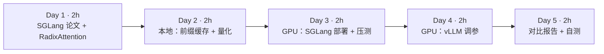
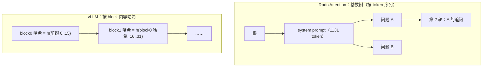
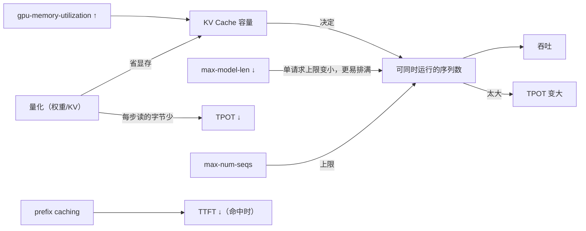
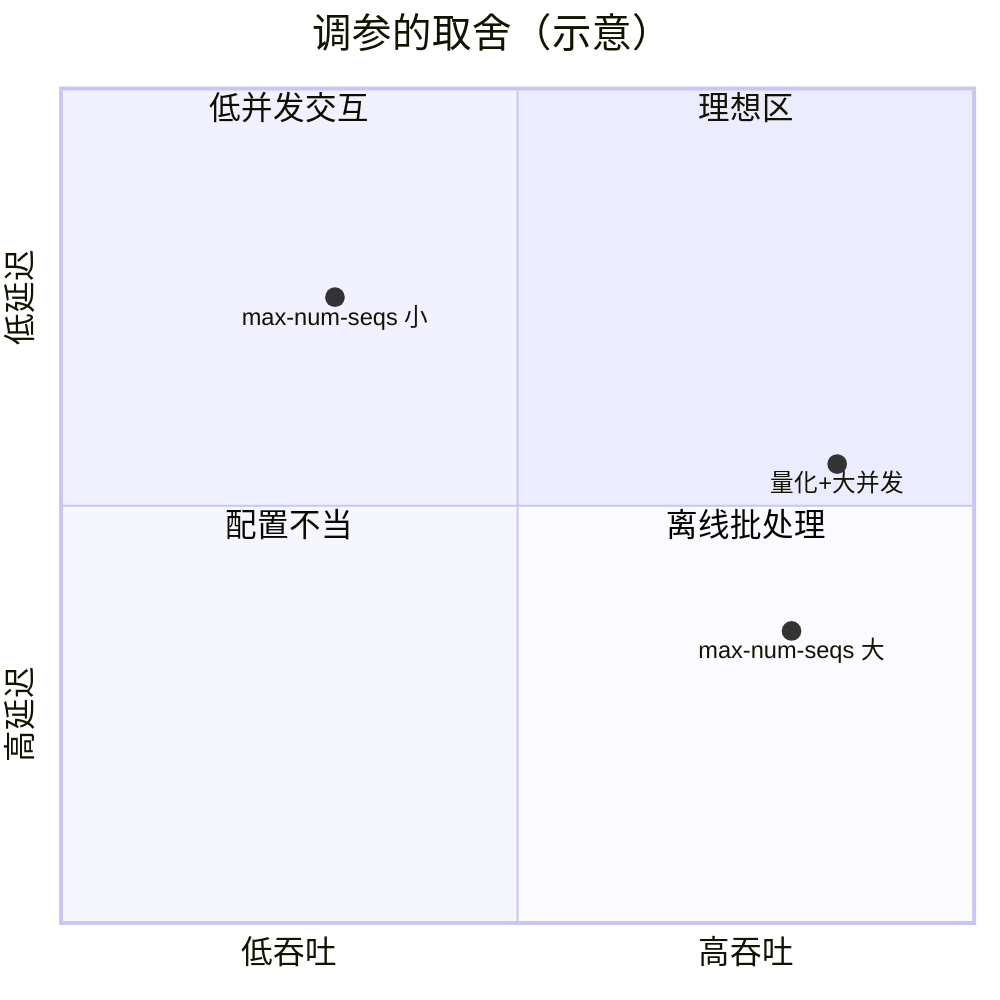

=== m4w3 | 第 15 周：SGLang 对比与参数调优 | 第 4 月 · 推理服务平台
# 第 15 周：SGLang 对比与参数调优

> **本周一句话**：同一个模型，换引擎、换参数，吞吐和延迟可以差出几倍。本周先在本地 CPU 上用真实模型量出两个最有代表性的“调参杠杆”——**前缀缓存**（TTFT 降到原来的约 5%）和**权重量化**（权重缩小近一半、速度提升，但输出变了）；再上 GPU 用 SGLang 部署同一模型，用上周的 `bench.py` 做公平对比，并完成至少 3 组 vLLM 调参实验。

**预计投入：约 10 小时**（阅读 ≈ 3h，本地动手 ≈ 2h，GPU 动手 ≈ 3.5h，报告 ≈ 1.5h；GPU 机器约 3–4 小时）。{{local}} {{gpu1}}

**本周结束时你应该能：**

1. 解释 SGLang 的 RadixAttention 与 vLLM 基于 block 哈希的前缀缓存有何异同，以及前缀缓存适用的业务。
2. 说出主要调参项（max-num-seqs、gpu-memory-utilization、max-model-len、prefix caching、量化）分别作用于哪个瓶颈。
3. 设计公平的引擎对比实验：同模型、同精度、同显卡、同压测脚本、同 prompt 集合。
4. 写出一份带版本信息、可复现的对比报告。

> **验证说明**：实验 1、2 在本站 8 核 CPU 上真实运行（Qwen2.5-0.5B-Instruct，transformers 5.20.2，torch 2.14.1+cpu），输出均为真实输出。**SGLang 部署与 GPU 调参（实验 3、4）未在本站实测，需 GPU**，命令来自官方文档，表格留空待你填写。实验文件在仓库 `labs/w15/`。

---

## 1. 本周学习路线



| 天 | 时间 | 先读 | 再读（外部资料） | 再做 |
|---|---|---|---|---|
| Day 1 | 2h | 2.1、2.2 | ① SGLang 论文、② LMSYS 博客 | — |
| Day 2 | 2h | 2.3、2.4 | ⑥ AWQ、⑦ GPTQ（摘要） | 实验 1、实验 2 |
| Day 3 | 2h | 2.5 | ③ SGLang 安装、④ 服务参数 | 实验 3 |
| Day 4 | 2h | 2.4 | ⑧ vLLM 优化与调参、⑨ vLLM AWQ | 实验 4 |
| Day 5 | 2h | — | — | 报告、自测 |

---

## 2. 核心概念讲解

### 2.1 SGLang 是什么

SGLang（①）由两部分组成：前端是一种用于编写多次调用 LLM 的程序（多轮、分支、结构化输出）的 Python DSL；后端运行时（今天大家说的“SGLang 推理服务”主要指它）与 vLLM 同属高性能推理引擎，同样有 paged KV、continuous batching、OpenAI 兼容接口。它的标志性设计是 **RadixAttention**：用一棵**基数树（radix tree）**管理所有请求的 KV Cache，自动发现并复用任意公共前缀。

### 2.2 RadixAttention vs block 哈希前缀缓存



| 维度 | SGLang RadixAttention | vLLM 自动前缀缓存 |
|---|---|---|
| 数据结构 | 基数树，边上是 token 序列 | 每个完整 block 的链式哈希 → 物理块 |
| 复用粒度 | 任意长度前缀 | 整 block（默认 16 token），不足一块的尾巴不复用 |
| 淘汰 | 树的叶子按 LRU 淘汰 | 引用计数为 0 的块按 LRU 淘汰 |
| 调度配合 | cache-aware 调度：优先调度前缀命中多的请求（论文中的最长前缀优先） | 主要按到达顺序 |

两者思路一致：**把算过的 KV 当成缓存而不是用完即丢**。差别在组织方式和调度配合上。

**大数据类比**：像 Spark 的 `cache()`/`persist()`——中间结果被多个下游作业复用时才值得缓存；RadixAttention 的 cache-aware 调度，类似把需要同一份缓存数据的 task 优先排在一起执行（数据本地性）。

前缀缓存高收益的场景：同一个长 system prompt、多轮对话（每轮都带完整历史）、few-shot 示例、RAG 中的公共文档、Agent 多次调用共享的工具说明。几乎没收益的场景：每个请求的 prompt 完全不同（例如批量翻译不同文档）。

### 2.3 调参杠杆与它们作用的瓶颈



| 参数（vLLM 名称） | 作用于 | 典型取舍 |
|---|---|---|
| `--max-num-seqs` | batch 上限 | 大：吞吐高、TPOT 大；小：TPOT 小、排队多 |
| `--gpu-memory-utilization` | KV 容量 | 大：更多 KV 块；太大：OOM，与其他进程冲突 |
| `--max-model-len` | 单请求上下文上限 | 大：支持长文本；启动时需至少放得下一个满长度请求 |
| `--enable-prefix-caching` | TTFT | 命中率高时显著降低 TTFT；命中率低时几乎无开销 |
| `--max-num-batched-tokens` | 每步 token 预算 | 大：prefill 快、TPOT 抖动；小：decode 平稳 |
| 量化模型（AWQ/GPTQ/FP8） | 显存、TPOT | 更省、更快；需要评估质量 |

SGLang 对应参数名不同（如 `--mem-fraction-static` 对应显存占比，`--max-running-requests` 对应并发上限，以 ④ 为准）。

### 2.4 量化的基本原理

把一组权重 w 映射到 k 位整数：

$$q = \mathrm{round}\Big(\frac{w}{s}\Big) + z,\qquad \hat{w} = s\,(q - z)$$

s 为缩放因子，z 为零点。粒度越细（per-channel、per-group，例如每 128 个权重一组），误差越小。AWQ（⑥）根据激活大小保护少数“重要”权重通道；GPTQ（⑦）用二阶信息逐层补偿量化误差。两者都是**仅权重量化**（W4A16），推理时把权重反量化为 16 位计算，收益主要来自显存和带宽。FP8 则在新一代 GPU 上可以连同计算一起降精度。

### 2.5 公平对比的清单

1. 同一模型、同一精度（不要拿 SGLang 的 FP8 比 vLLM 的 BF16）。
2. 同一张卡、同一驱动，**同一时间只跑一个引擎**。
3. 同一压测脚本、同一 prompt 集合、同样 max_tokens，先预热。
4. 前缀缓存的开关状态一致，或分别报告。
5. 记录版本：引擎版本、CUDA、驱动、模型 revision。
6. 每组跑至少 3 次取中位数。

---

## 3. 动手实验

### 实验 1：前缀缓存的收益（本地 CPU，30 分钟）{{local}}

```python
@@CODE:w15/prefix_reuse.py@@
```

真实输出：

```text
system prompt 1131 token，问题平均 6 token，共 4 个请求
不复用：每请求 prefill  1493.6 ms
复用：  前缀一次性  1538.7 ms，之后每请求    67.8 ms（含复制 cache 的开销）
命中前缀后 TTFT 计算部分降为 4.5%
```

- 每个请求真正“新”的只有约 6 个 token，但不复用时要为 1137 个 token 做 prefill。
- 前缀算一次之后，后续请求的 prefill 从 1.49s 降到 68ms。这 68ms 还包括了 `deepcopy` 缓存的开销；推理引擎里多个请求直接引用同一批物理块（上周的引用计数），连这一步也省了。
- 首个请求没有收益（前缀一次性 1.54s）——**前缀缓存只对“第二次及以后”有效**，压测时要注意这一点（上周思考题 3）。

### 实验 2：权重量化的取舍（本地 CPU，20 分钟）{{local}}

```python
@@CODE:w15/quant_cpu.py@@
```

真实输出（省略了 PyTorch 的弃用警告，见排障表）：

```text
[FP32] 权重   1976 MB   29.3 tok/s
  输出：Hadoop Distributed File System（简称：HDFS）是一个分布式文件系统，它由多个节点组成，每个节点都负责处理一个或多个数据块。以下是HDFS的三个主要组
[INT8 动态量化] 权重   1039 MB   48.8 tok/s
  输出：在HDFS（Hadoop Distributed File System）中，三个主要的组件是：  1. NameNode：负责管理整个集群的资源和数据存储。 2. DataNod
```

- 速度提升 1.7 倍：decode 每步读的权重字节减少了。
- 权重只缩小到 53% 而不是 25%：只有 `nn.Linear` 被量化，词嵌入（Qwen2.5-0.5B 词表约 15 万、与 lm_head 共享）仍是 FP32。真实量化方案同样要决定哪些层量化、哪些保留。
- **输出变了**：贪心解码下哪怕一点数值误差也会改变某一步的选择，之后整段文字都不同。本例里量化版甚至更快进入了正题——但这只是一个样本，**质量必须在评测集上量化评估**，不能凭一两个例子下结论。
- PyTorch 已提示 `torch.ao.quantization` 这套接口将被弃用（迁移到 torchao，见 ⑩）；GPU 推理中用的是 AWQ/GPTQ/FP8 等完全不同的实现，本实验只用于体会取舍。

### 实验 3：SGLang 部署与对比（GPU，约 1.5 小时）{{gpu1}}

> 未在本站实测，需 GPU。安装方式与参数以 ③、④ 为准。

```bash
pip install "sglang[all]"     # 安装方式以 SGLang 文档为准
python -m sglang.launch_server --model-path Qwen/Qwen2.5-7B-Instruct --port 30000
# 另开终端：预热后压测（bench.py 来自第 14 周）
python bench.py --url http://localhost:30000/v1 --n 20 --concurrency 4 --max-tokens 64
for c in 1 4 16 64; do python bench.py --url http://localhost:30000/v1 --concurrency $c; done
```

同一时间只跑一个引擎，避免抢显存。压完 SGLang 后关闭它，再用相同命令压 vLLM（端口 8000）。

### 实验 4：vLLM 调参（GPU，约 2 小时）{{gpu1}}

> 未在本站实测，需 GPU。每组只改一个参数，其他保持默认；用并发 16 与 64 两组压测。

| 实验 | vLLM 参数 | 观察 |
|---|---|---|
| 最大并发序列 | `--max-num-seqs 16 / 64 / 256` | 吞吐与 TPOT 的取舍 |
| 显存占比 | `--gpu-memory-utilization 0.8 / 0.9` | 日志中 KV Cache 容量变化 |
| 上下文长度 | `--max-model-len 4096 / 16384` | 可并发数 |
| 前缀缓存 | 开/关 prefix caching（参数名见当前文档） | 相同 system prompt 下 TTFT 变化（可把实验 1 的长 system prompt 加进 bench.py） |
| 量化 | 换成 AWQ 量化模型，如 `Qwen/Qwen2.5-7B-Instruct-AWQ` | 显存、吞吐、回答质量 |



（上图位置仅为示意，请用你的实测数据替换结论。）

### 对比报告模板

| 指标（并发 16） | vLLM | SGLang |
|---|---|---|
| 吞吐 tok/s | | |
| TTFT p50 / p95 | | |
| TPOT p50 / p95 | | |
| 启动时间 | | |
| 显存占用 | | |

报告开头写清：显卡型号与显存、驱动/CUDA 版本、两个引擎的版本、模型与精度、压测参数（n、max_tokens、prompt 集合）、前缀缓存状态。

### 常见错误与排查

| 现象 | 原因 | 解决 |
|---|---|---|
| `torch.ao.quantization ... deprecated` 警告（本站实测） | PyTorch 正在把量化迁移到 torchao | 不影响本实验；新项目用 torchao |
| 量化后权重没有缩小到 1/4（本站实测） | 只量化了 Linear，嵌入层仍为 FP32 | 正常；说明量化范围是设计选择 |
| 前缀缓存“没效果” | 前缀不完全相同（时间戳、用户名放在 system prompt 开头）；vLLM 不足一个 block 的部分不复用 | 把可变内容放到 prompt 末尾 |
| 两个引擎同时启动后一个 OOM | 都按比例预占显存 | 一次只跑一个 |
| SGLang 与 vLLM 结果差异大 | 精度、前缀缓存、默认参数不同 | 按 2.5 清单逐项对齐 |
| AWQ 模型启动失败 | 版本不支持该量化格式或该显卡 | 查 ⑨ 的支持矩阵 |

### 扩展练习

1. 修改 `prefix_reuse.py`，让 system prompt 长度取 128、512、2048 token，画出“复用后 TTFT / 不复用 TTFT”的曲线。
2. 在 `bench.py` 中加入 `--system-file` 参数，所有请求带上同一段长 system prompt，在 GPU 上比较 vLLM 前缀缓存开/关、SGLang 的 TTFT。
3. 构造多轮对话压测（每轮带完整历史），比较两个引擎的 TTFT 随轮数的变化。
4. 用一个小评测集（例如 50 道选择题）比较 BF16 与 AWQ 模型的准确率。

---

## 4. 精读指南

- **① [SGLang 论文](https://arxiv.org/abs/2312.07104)**（90 分钟）：重点读 RadixAttention 一节与 cache-aware 调度。**读完回答**：为什么最长前缀优先的调度能提高命中率？它可能带来什么公平性问题？
- **② [LMSYS 博客：SGLang 发布](https://lmsys.org/blog/2024-01-17-sglang/)**（20 分钟）与 [LMSYS 博客列表](https://lmsys.org/blog/)（浏览后续性能文章）。
- **③ [SGLang 安装](https://docs.sglang.ai/get_started/install.html)**、[SGLang 文档首页](https://docs.sglang.ai/)（20 分钟）。
- **④ [SGLang 服务参数](https://docs.sglang.ai/advanced_features/server_arguments.html)**（30 分钟，查阅式）：找到与 vLLM 2.3 表对应的参数。
- **⑤ [SGLang 源码](https://github.com/sgl-project/sglang)**（选读）：找到 radix cache 的实现文件。
- **⑥ [AWQ 论文](https://arxiv.org/abs/2306.00978)**、**⑦ [GPTQ 论文](https://arxiv.org/abs/2210.17323)**（各 20 分钟，读摘要与方法图）。
- **⑧ [vLLM 优化与调参](https://docs.vllm.ai/en/latest/configuration/optimization.html)**（30 分钟）。
- **⑨ [vLLM AutoAWQ](https://docs.vllm.ai/en/latest/features/quantization/auto_awq.html)** 与 [量化总览](https://docs.vllm.ai/en/latest/features/quantization/index.html)（20 分钟）；模型示例：[Qwen2.5-7B-Instruct-AWQ](https://huggingface.co/Qwen/Qwen2.5-7B-Instruct-AWQ)。
- **⑩ [PyTorch 量化文档](https://docs.pytorch.org/docs/stable/quantization.html)** 与 [torchao](https://github.com/pytorch/ao)（浏览）。

---

## 5. 自测题

<details>
<summary>1. RadixAttention 与 vLLM 前缀缓存的主要区别？</summary>

RadixAttention 用基数树按 token 序列组织 KV，可复用任意长度的公共前缀，并配合 cache-aware 调度优先运行命中多的请求；vLLM 按完整 block 的链式哈希查找物理块，复用粒度为整块。两者都把 KV 当缓存，按 LRU 淘汰不再被引用的部分。

</details>

<details>
<summary>2. 实验 1 中为什么首个请求没有收益？对压测有什么启示？</summary>

前缀的 KV 必须先被算出一次才能复用，首个请求承担全部 prefill。压测时如果所有请求共享前缀，结果会比真实业务（前缀多样）更好；要么关闭前缀缓存测基线，要么按真实命中率构造 prompt。

</details>

<details>
<summary>3. 实验 2 中量化为什么变快了？为什么输出不同？</summary>

decode 受访存限制，INT8 权重字节数约为 FP32 的 1/4（Linear 部分），每步读取更少，速度提升。量化带来数值误差，贪心解码在某一步选择了不同的 token，后续生成随之完全不同；质量需要在评测集上评估。

</details>

<details>
<summary>4. 调大 max-num-seqs 一定会提高吞吐吗？</summary>

不一定。吞吐受 KV Cache 容量限制：KV 块不够时实际运行的序列数达不到上限，甚至频繁抢占（重算或换出）反而降低吞吐；同时 TPOT 会变大。应结合 KV 容量和延迟 SLO 一起调。

</details>

<details>
<summary>5. 列出公平对比两个推理引擎时必须对齐的至少 4 项。</summary>

同一模型与精度；同一显卡与驱动，单独运行；同一压测脚本、prompt 集合与 max_tokens，并预热；前缀缓存等特性开关一致；记录版本；多次运行取中位数。

</details>

<details>
<summary>6. AWQ/GPTQ 这类 W4A16 量化的收益主要来自哪里？</summary>

权重以 4 位存储，显存占用大幅降低（可以放更多 KV Cache 或在更小的卡上运行），decode 时读取的权重字节更少；计算时仍反量化为 16 位，所以收益主要来自显存与带宽，而不是更快的矩阵乘。

</details>

### 思考题

1. 一个 RAG 服务，每个请求带 3 篇检索文档（文档来自 1 万篇的库）。前缀缓存能帮多少？如何调整 prompt 结构提高命中率？
2. 你会如何向业务方解释“量化后答案变了但不一定变差”？你会设计怎样的验收标准？
3. 引擎更新很快，半年后你的对比报告就过时了。如何把对比流程做成可重复执行的流水线（联系你做大数据 CI 的经验）？

---

## 6. 本周产出与掌握清单

### 本周产出

- [ ] 本地前缀缓存与量化实验记录（实验 1、2）
- [ ] vLLM vs SGLang 对比报告（含版本信息与参数调优结果，本月产出之一）

## 参考资料

- [SGLang 论文（RadixAttention）](https://arxiv.org/abs/2312.07104)（论文·进阶）：理解 SGLang 的前缀缓存与 vLLM 的差异
- [vLLM benchmarks](https://github.com/vllm-project/vllm/tree/main/benchmarks)（仓库·进阶）：官方压测脚本，对照自写压测结果
- [SGLang 文档](https://docs.sglang.ai/)（文档·入门）：SGLang 部署与参数
- [LMSYS / SGLang 博客](https://lmsys.org/blog/)（博客·进阶）：SGLang 新特性与性能分析

> 完整列表见 [参考资料库](/resources.html)。

## 检查清单
- [ ] SGLang 部署并压测
- [ ] 至少完成 3 组调参实验
- [ ] 写出对比报告（注明软件版本、模型、卡型号）
- [ ] 释放 GPU
- [ ] 能解释 RadixAttention 与 block 哈希前缀缓存的区别
- [ ] 能用实验 2 说明量化的收益与风险
