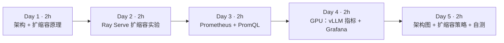
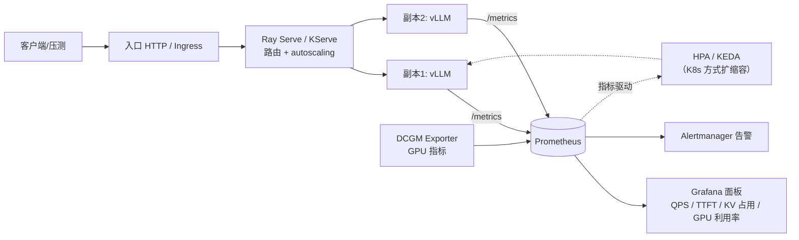

=== m4w4 | 第 16 周：自动扩缩容与监控 | 第 4 月 · 推理服务平台
# 第 16 周：自动扩缩容与监控——把推理服务变成“平台”

> **本周一句话**：单个 vLLM 实例只是一个进程；平台要能**看见**（指标、面板、告警）并**自动应对负载**（扩缩容）。本周在本地用 Ray Serve 亲眼看到副本数 1 → 6 → 1 的扩缩过程，用 Prometheus 抓取第 14 周 mini_server 的 TTFT/TPOT 直方图并写出 PromQL，最后讨论“按什么指标扩缩容”——这是你大数据平台经验最能派上用场的一周。

**预计投入：约 10 小时**（阅读 ≈ 3h，本地动手 ≈ 4h，GPU 动手 ≈ 1.5h，产出 ≈ 1.5h）。{{local}} {{gpu1}}

**本周结束时你应该能：**

1. 配置 Ray Serve 的 autoscaling，解释 target_ongoing_requests、max_ongoing_requests、扩/缩容延迟的含义和计算方式。
2. 用 Prometheus 抓取推理服务指标，用 `histogram_quantile`、`rate` 写出 TTFT p95、吞吐、排队数的查询，并理解直方图分位数的误差。
3. 说出 vLLM 的关键指标，并为推理服务设计面板与告警。
4. 比较 Ray Serve、KServe、K8s HPA/KEDA 三种扩缩容方式，论证“按什么指标扩缩容”。

> **验证说明**：实验 1、2 在本站 8 核 CPU 上真实运行：Ray 2.59.0（Ray Serve），Prometheus 3.15.0（官方二进制，无需 Docker），被监控对象是第 14 周的 mini_server（Qwen2.5-0.5B）。输出均为真实输出。**实验 3（真实 vLLM + Grafana）未在本站实测，需 GPU**。实验文件在仓库 `labs/w16/`。

---

## 1. 本周学习路线



| 天 | 时间 | 先读 | 再读（外部资料） | 再做 |
|---|---|---|---|---|
| Day 1 | 2h | 2.1、2.2 | ① Ray Serve 概览、② autoscaling 指南 | — |
| Day 2 | 2h | 2.3 | ③ 高级 autoscaling | 实验 1 |
| Day 3 | 2h | 2.4 | ⑤ Prometheus 入门、⑥ 直方图实践 | 实验 2 |
| Day 4 | 2h | 2.5 | ⑦ vLLM 指标、⑧ Grafana + Prometheus | 实验 3 |
| Day 5 | 2h | 2.6 | ⑨ HPA、⑩ KEDA Prometheus scaler、⑪ llm-d / Dynamo README | 本周产出 |

---

## 2. 核心概念讲解

### 2.1 推理平台架构



**大数据类比**：这套架构你很熟——Prometheus/Grafana 监控 YARN 队列和 HBase RegionServer，按队列积压扩容 Flink TaskManager。差别在于：推理服务的“单元”是一张或几张 GPU，**冷启动很慢**（拉镜像 + 加载权重要几分钟），而且**最贵**，扩缩容策略要更谨慎。

### 2.2 Ray Serve 的扩缩容算法

Ray Serve 按**在途请求数**（ongoing requests：正在处理 + 排队）扩缩容（②）：

$$\text{desired} = \Big\lceil \frac{\text{过去 look\_back 窗口内的平均总在途请求数}}{\text{target\_ongoing\_requests}} \Big\rceil$$

再被限制在 [min_replicas, max_replicas] 内；需要持续超过 `upscale_delay_s` 才扩，持续低于 `downscale_delay_s` 才缩（防抖）。`max_ongoing_requests` 是单副本的硬上限：超过后请求在路由层排队，不再发给该副本。

| 参数 | 含义 | 类比 |
|---|---|---|
| target_ongoing_requests | 期望每副本的平均在途请求 | Flink 反压阈值 / Kafka consumer lag 目标 |
| max_ongoing_requests | 单副本并发上限 | 引擎的 max-num-seqs |
| upscale/downscale_delay_s | 扩/缩容前需持续的时间 | YARN 节点退役的等待期 |
| min/max_replicas | 副本数范围 | 集群弹性上下限 |

### 2.3 按什么指标扩缩容

| 指标 | 优点 | 缺点 |
|---|---|---|
| CPU/GPU 利用率 | 通用、HPA 原生支持 | GPU 利用率在 decode 阶段常常“看起来很高”但还能塞更多请求；不反映排队 |
| QPS | 简单直观 | 请求长度差异巨大，同样 QPS 负载可差 10 倍 |
| 在途/排队请求数 | 直接反映“处理不过来” | 需要服务暴露该指标 |
| KV Cache 使用率 | 直接反映显存容量瓶颈 | 接近 100% 时已经开始抢占，偏晚 |
| TTFT/TPOT p95 | 直接对应 SLO | 滞后、噪声大，适合告警而不是作为唯一扩容信号 |

实践中常用：**排队请求数（或在途请求数）作为主信号，KV 使用率和 TTFT p95 作为辅助/告警**。由于冷启动很慢，可以设置较高的 min_replicas，或按业务时段做预测性扩容。

### 2.4 Prometheus 指标与 PromQL 基础

- **Counter**（只增不减，如生成 token 总数）：用 `rate(x[2m])` 求每秒速率。
- **Gauge**（可增可减，如排队数）：直接看，或 `max_over_time`。
- **Histogram**（分桶计数，如 TTFT）：`_bucket{le="..."}` 累积计数，用 `histogram_quantile(0.95, sum by (le) (rate(x_bucket[2m])))` 估计分位数。

直方图分位数是**在桶内线性插值**的估计值，桶的边界决定精度（⑥）。实验 2 会看到它与客户端精确统计的差异。

### 2.5 vLLM 的关键指标

vLLM 在 `/metrics` 暴露 `vllm:` 前缀的指标（⑦，名称随版本变化，以你的实际输出为准），常用的有：运行中/排队中的请求数、KV Cache 使用率、TTFT 与 ITL 直方图、端到端延迟直方图、prompt/生成 token 计数器、抢占次数。配合 DCGM Exporter 的 GPU 利用率、显存、温度，就是一张完整的推理面板。

### 2.6 三种扩缩容方式

| 方式 | 扩缩对象 | 信号 | 适合 |
|---|---|---|---|
| Ray Serve autoscaling | Ray actor 副本 | 在途请求数（内建） | 已在用 Ray、Python 原生，支持多模型组合（Ray Serve LLM，④） |
| KServe | InferenceService 的 Pod（底层可用 Knative 或 HPA/KEDA） | 并发数/QPS 或自定义指标 | K8s 标准化模型服务 |
| K8s HPA / KEDA | Deployment 的 Pod | CPU/内存、自定义指标、Prometheus 查询（KEDA） | 已有 K8s + Prometheus 体系 |

更进一步的 llm-d、NVIDIA Dynamo 还在做 KV 感知路由（把请求发给已缓存其前缀的副本）、PD 分离的独立扩缩容——这是上周前缀缓存和第 13 周 PD 分离在平台层的延伸。

---

## 3. 动手实验

### 实验 1：Ray Serve 自动扩缩容（本地，40 分钟）{{local}}

```python
@@CODE:w16/serve_demo.py@@
```

```python
@@CODE:w16/load_and_watch.py@@
```

```bash
pip install "ray[serve]" httpx
python load_and_watch.py
```

真实输出：

```text
[低负载] t=   3s 并发=2  运行副本=1 状态={'RUNNING': 1} 近期延迟p50=  510ms
[低负载] t=   6s 并发=2  运行副本=1 状态={'RUNNING': 1} 近期延迟p50=  509ms
[低负载] t=   9s 并发=2  运行副本=1 状态={'RUNNING': 1} 近期延迟p50=  508ms
[低负载] t=  12s 并发=2  运行副本=1 状态={'RUNNING': 1} 近期延迟p50=  509ms
[高负载] t=   3s 并发=16 运行副本=1 状态={'RUNNING': 1} 近期延迟p50= 1721ms
[高负载] t=   6s 并发=16 运行副本=6 状态={'RUNNING': 6} 近期延迟p50= 1123ms
[高负载] t=   9s 并发=16 运行副本=6 状态={'RUNNING': 6} 近期延迟p50=  507ms
...（t=12s 到 t=30s 均为 6 个副本，p50 约 507–509ms）
[空闲] t=   3s 并发=0  运行副本=6 状态={'RUNNING': 6} 近期延迟p50=    0ms
[空闲] t=   6s 并发=0  运行副本=6 状态={'RUNNING': 6} 近期延迟p50=    0ms
[空闲] t=   9s 并发=0  运行副本=6 状态={'RUNNING': 6} 近期延迟p50=    0ms
[空闲] t=  12s 并发=0  运行副本=1 状态={'STOPPING': 5, 'RUNNING': 1} 近期延迟p50=    0ms
[空闲] t=  15s 并发=0  运行副本=1 状态={'RUNNING': 1} 近期延迟p50=    0ms
```

逐段解读：

- **低负载**：并发 2 = target 2 × 1 副本，保持 1 个副本，延迟就是 0.5s 的“推理时间”。
- **高负载开始**：16 个并发打到 1 个副本，副本最多同时处理 4 个（max_ongoing_requests），其余在路由层排队，p50 涨到 1.7s。
- **扩容**：按公式 desired = ⌈16 / 2⌉ = 8，被 max_replicas 限制为 6。3 秒的 upscale_delay 之后直接扩到 6 个。6 副本 × 4 = 24 ≥ 16，排队消失，延迟回到 0.5s。
- **缩容**：负载归零后等了约 10 秒（downscale_delay_s）才缩回 1 个副本，中间可见 5 个副本处于 STOPPING。
- 假模型的“冷启动”只要几百毫秒；**真实 vLLM 副本的冷启动是分钟级**，扩容期间排队会持续得多。这正是生产中要设置较高 min_replicas 和更保守 downscale_delay 的原因。

### 实验 2：Prometheus 抓取推理指标（本地，40 分钟）{{local}}

Prometheus 是单个 Go 二进制文件，从 [GitHub Releases](https://github.com/prometheus/prometheus/releases) 下载解压即可运行，不需要 Docker。

```yaml
@@CODE:w16/prometheus.yml@@
```

```bash
@@CODE:w16/queries.sh@@
```

```bash
python ../w14/mini_server.py &                                  # 第 14 周的服务
./prometheus --config.file=prometheus.yml --web.listen-address=127.0.0.1:9090 &
python ../w14/bench.py --model x --n 12 --max-tokens 48 --concurrency 6
sleep 8; ./queries.sh
```

真实输出：

```text
并发=6 请求=12 耗时=20.3s 吞吐=25.5 tok/s
TTFT p50=8340ms p95=8593ms
TPOT p50=37.8ms p95=40.1ms
## up
llm 1
## histogram_quantile(0.95, sum by (le) (rate(mini_time_to_first_token_seconds_bucket[2m])))
 15.42857142857143
## histogram_quantile(0.50, sum by (le) (rate(mini_time_per_output_token_seconds_bucket[2m])))
 0.032125472621798074
## rate(mini_generation_tokens_total[2m])
llm 4.45253
## max_over_time(mini_num_requests_waiting[2m])
llm 5
```

三个值得细看的地方：

1. **服务端 TTFT p95 = 15.4s，客户端 p95 = 8.6s**，差这么多？TTFT 直方图的桶边界是 …8、16、32…，大部分请求落在 (8, 16] 桶里，`histogram_quantile` 在桶内线性插值，算出 15.4s。这不是服务出错，而是**桶设计太粗**。按你的 SLO 设计桶边界（例如 SLO 是 1s，就在 0.5–2s 之间多放几个桶）。
2. **服务端 TPOT p50 = 32ms，客户端 38ms**：同样受桶影响（落在 (0.02, 0.04] 桶），另外客户端按 chunk 计数（第 14 周说明过的误差）。
3. **吞吐 4.45 tok/s 远小于压测的 25.5 tok/s**：`rate(...[2m])` 是 2 分钟窗口的平均值，压测只有 20 秒，其余时间服务空闲。做面板时窗口要和你关心的时间尺度匹配。

`max_over_time(mini_num_requests_waiting[2m]) = 5`：并发 6、服务一次处理 1 个，最多 5 个在排队——这就是 2.3 推荐的扩容信号。

### 实验 3：真实 vLLM + Grafana（GPU，约 1.5 小时）{{gpu1}}

> 未在本站实测，需 GPU。

```bash
# vLLM 自带 Prometheus 指标（指标名以实际输出为准）
curl -s localhost:8000/metrics | grep -E "^vllm:" | cut -d'{' -f1 | sort -u | head -40
# Prometheus：用实验 2 的二进制和 prometheus.yml（targets 指向 vLLM）
# Grafana：同样可下载官方二进制运行，或在有 Docker 的机器上：
docker run -d --network host grafana/grafana
```

在 Grafana 中添加 Prometheus 数据源（⑧），画出：请求数（运行/排队）、TTFT p50/p95、ITL p50/p95、KV Cache 使用率、生成吞吐、GPU 利用率（若部署了 DCGM Exporter）。用第 14 周的 `bench.py` 逐级加压，截图保存面板——这是本月产出之一。

K8s 方向：可参考 [prometheus-community/helm-charts](https://github.com/prometheus-community/helm-charts) 的 kube-prometheus-stack，结合 KServe 或 KEDA（⑩，用 Prometheus 查询结果作为扩缩容信号）部署。

### 清理

```bash
pkill -f mini_server.py; pkill -f prometheus; rm -rf data/   # Prometheus 默认数据目录
```

### 常见错误与排查

| 现象 | 原因 | 解决 |
|---|---|---|
| `ModuleNotFoundError: No module named 'httpx'`（本站实测） | 压测脚本依赖未安装 | `pip install httpx` |
| 副本数始终不变 | 用了同步 `time.sleep` 阻塞事件循环，或负载没超过 target | 在 async 方法中用 `await asyncio.sleep`；检查并发是否足够 |
| 扩容到 max 仍然排队 | max_replicas × max_ongoing_requests < 并发 | 提高上限或扩大集群资源 |
| 缩容太快导致来回抖动 | downscale_delay_s 太短 | 调大；真实 GPU 服务建议分钟级 |
| Prometheus `up` = 0 | 目标地址错、服务未启动、/metrics 路径不对 | 浏览器打开 `http://127.0.0.1:9090/targets` 查看错误 |
| 直方图分位数和客户端差很多（本站实测） | 桶边界太粗 | 按 SLO 设计桶 |
| `rate()` 结果偏小（本站实测） | 窗口内有空闲时间 | 匹配窗口与观察尺度 |

### 扩展练习

1. 修改 `serve_demo.py` 的 `target_ongoing_requests` 为 1 和 4，重做实验 1，记录稳态副本数与延迟。
2. 给 `mini_server.py` 的 TTFT 直方图改用更细的桶（如 0.5、1、2、4、6、8、10、12），重做实验 2，对比 `histogram_quantile` 与客户端 p95。
3. 写一条告警规则：TTFT p95 连续 5 分钟大于 2s 时触发（Prometheus alerting rule 语法）。
4. 阅读 ⑩，写出一个 KEDA ScaledObject：当 vLLM 排队请求数 > 5 时扩容。

---

## 4. 精读指南

- **① [Ray Serve 概览](https://docs.ray.io/en/latest/serve/index.html)**（30 分钟）。
- **② [Ray Serve autoscaling 指南](https://docs.ray.io/en/latest/serve/autoscaling-guide.html)**（30 分钟）。**读完回答**：target_ongoing_requests 与 max_ongoing_requests 的关系？
- **③ [高级 autoscaling](https://docs.ray.io/en/latest/serve/advanced-guides/advanced-autoscaling.html)**（30 分钟）：各参数的完整含义与调参建议。
- **④ [Ray Serve LLM](https://docs.ray.io/en/latest/serve/llm/index.html)**（20 分钟）：Ray Serve 如何集成 vLLM。
- **⑤ [Prometheus 入门](https://prometheus.io/docs/prometheus/latest/getting_started/)** 与 [PromQL 函数](https://prometheus.io/docs/prometheus/latest/querying/functions/)（40 分钟）。
- **⑥ [直方图与 Summary 实践](https://prometheus.io/docs/practices/histograms/)**（20 分钟）。**读完回答**：为什么分位数估计的误差取决于桶的宽度？
- **⑦ [vLLM 指标](https://docs.vllm.ai/en/latest/usage/metrics.html)**（20 分钟）。
- **⑧ [Grafana + Prometheus 入门](https://grafana.com/docs/grafana/latest/getting-started/get-started-grafana-prometheus/)**（20 分钟）。
- **⑨ [K8s HPA](https://kubernetes.io/docs/tasks/run-application/horizontal-pod-autoscale/)**、**⑩ [KEDA Prometheus scaler](https://keda.sh/docs/latest/scalers/prometheus/)**（各 20 分钟）。
- **⑪ [KServe](https://kserve.github.io/website/)、[llm-d](https://github.com/llm-d/llm-d)、[NVIDIA Dynamo](https://github.com/ai-dynamo/dynamo)**（浏览 README，了解业界方向）。

---

## 5. 自测题

<details>
<summary>1. 实验 1 中并发 16 时为什么扩到 6 而不是 8？</summary>

Ray Serve 按平均在途请求数 / target_ongoing_requests 计算期望副本数：16 / 2 = 8，再被 max_replicas=6 限制为 6。

</details>

<details>
<summary>2. 为什么缩容比扩容慢？真实 GPU 服务应如何设置？</summary>

downscale_delay_s（10s）大于 upscale_delay_s（3s），用来防止负载短暂下降时反复缩容又扩容。真实 vLLM 冷启动是分钟级，缩容后再扩容的代价很大，因此缩容延迟应更长（分钟级），并保留足够的 min_replicas。

</details>

<details>
<summary>3. 为什么 GPU 利用率不适合作为推理服务唯一的扩容信号？</summary>

decode 阶段受访存限制，GPU 利用率可能显示很高，但仍有 KV 容量可以接纳更多请求；它也不反映请求排队。排队/在途请求数更直接地反映“处理不过来”。

</details>

<details>
<summary>4. 实验 2 中服务端 TTFT p95 为何是 15.4s 而客户端是 8.6s？</summary>

histogram_quantile 在桶内线性插值，大多数观测值落在 (8,16] 这个很宽的桶里，估计值被插值到接近 16。这是桶边界设计太粗导致的估计误差，应按 SLO 设计更细的桶。

</details>

<details>
<summary>5. Counter、Gauge、Histogram 各适合什么指标？分别怎样查询？</summary>

Counter 适合累计量（请求数、token 数），用 rate 求速率；Gauge 适合瞬时量（排队数、KV 使用率），直接看或用 max_over_time/avg_over_time；Histogram 适合分布（TTFT、ITL），用 histogram_quantile 配合 rate 求分位数。

</details>

<details>
<summary>6. 比较 Ray Serve autoscaling 与 KEDA 的扩缩容。</summary>

Ray Serve 在 Ray 集群内按内建的在途请求数扩缩 actor 副本，配置简单，适合 Python/Ray 体系；KEDA 在 K8s 上按外部指标（如 Prometheus 查询）扩缩 Deployment 的 Pod，可与任何暴露指标的服务配合，适合已有 K8s + Prometheus 的平台。

</details>

### 思考题

1. 你的推理服务白天高峰是夜间的 10 倍，冷启动 5 分钟。你会如何组合 min_replicas、预测性扩容与基于排队数的扩容？
2. 多个模型共享一个 GPU 池时，扩缩容与第 3 月的 Kueue/Volcano 队列应如何配合？
3. 把你在大数据平台上做过的一个监控面板（如 YARN 队列、Kafka lag）“翻译”成推理平台上的对应面板，列出每个图表的 PromQL。

---

## 6. 本周产出与掌握清单

### 本周产出

- [ ] 实验 1 的扩缩容记录（副本数与延迟随时间变化）
- [ ] 实验 2 的 PromQL 清单，以及（有 GPU 时）vLLM 的 Grafana 面板截图
- [ ] 自己的推理平台架构图与一页扩缩容策略说明（本月产出之一）

## 参考资料

- [Ray Serve 文档](https://docs.ray.io/en/latest/serve/index.html)（文档·入门）：Python 原生的模型服务与自动扩缩容
- [KServe](https://kserve.github.io/website/)（文档·进阶）：K8s 上的标准模型服务 CRD
- [llm-d](https://github.com/llm-d/llm-d)（仓库·高级）：K8s 原生分布式推理（PD 分离、KV 感知路由）
- [NVIDIA Dynamo](https://github.com/ai-dynamo/dynamo)（仓库·高级）：数据中心级分布式推理框架，了解业界方向
- [prometheus-community helm-charts](https://github.com/prometheus-community/helm-charts)（仓库·入门）：kube-prometheus-stack 监控推理服务

> 完整列表见 [参考资料库](/resources.html)。

## 检查清单
- [ ] 本地观察到 Serve 副本随负载扩缩
- [ ] 抓到 vLLM `/metrics` 并在 Grafana 出图
- [ ] 画出自己的推理平台架构图
- [ ] 写下：按什么指标扩缩容更合理（QPS？排队请求数？KV Cache 占用？）
- [ ] 能写出 TTFT p95、吞吐、排队数的 PromQL，并解释直方图分位数误差
