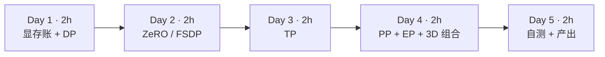
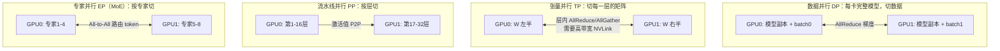
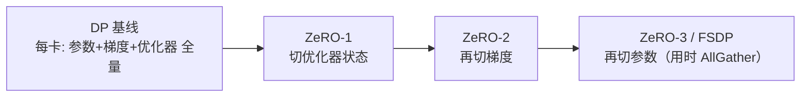
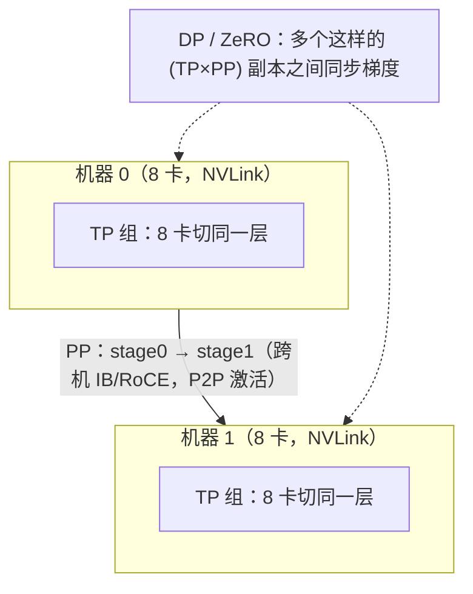

=== m5w1 | 第 17 周：并行策略全景 | 第 5 月 · 分布式训练 + MLOps
# 第 17 周：并行策略全景（DP / ZeRO / TP / PP / EP）

> **本周一句话**：大模型训练放不进一张卡，就要“切”——切数据（DP）、切状态（ZeRO/FSDP）、切矩阵（TP）、切层（PP）、切专家（EP）。每种切法都对应一种通信模式，而通信模式决定了**网络拓扑、故障域和 checkpoint 形态**，这正是架构师要参与评估的平台问题。本周用算账 + 在 CPU 上真实运行的张量并行和 FSDP 小程序把它们弄清楚。

**预计投入：约 10 小时**（阅读 ≈ 5h，动手 ≈ 3h，自测与产出 ≈ 2h）。{{none}}

**本周结束时你应该能：**

1. 画出五种并行“切的是什么”、通信原语是什么、发生在什么时候。
2. 用“每参数 16 字节”的口径算出 DP、ZeRO-1/2/3 的每卡显存，并解释为何 ZeRO-3 需要额外通信。
3. 解释 Megatron 式张量并行为何“列切 + 行切”只需一次 AllReduce，以及为什么 TP 一般限于机内。
4. 计算流水线气泡比例，说出 micro-batch 数如何影响它。
5. 说出 3D 并行的组合原则（TP 机内、PP 跨机、DP 最外层）。

> **验证说明**：本周不需要 GPU。`zero_mem.py`、`pp_bubble.py` 是纯计算；`tp_demo.py` 和 `fsdp_shard.py` 用 `torchrun` 在本站 CPU 上以 gloo 后端启动 2/4 个进程**真实运行**（torch 2.14.1+cpu，FSDP2 `fully_shard` API）。本页所有输出均为真实输出。实验文件在仓库 `labs/w17/`。

---

## 1. 本周学习路线



| 天 | 时间 | 先读 | 再读（外部资料） | 再做 |
|---|---|---|---|---|
| Day 1 | 2h | 2.1、2.2 | ① Playbook：单卡训练与 DP 章节 | 实验 1 |
| Day 2 | 2h | 2.3 | ① Playbook：ZeRO 章节、⑥ ZeRO 论文（摘要+图 1） | 实验 2 |
| Day 3 | 2h | 2.4 | ① Playbook：TP 章节、④ Megatron 论文第 3 节 | 实验 3 |
| Day 4 | 2h | 2.5、2.6、2.7 | ① Playbook：PP、EP 章节、⑦ GPipe 摘要、⑧ Megatron 3D 并行论文 | 实验 4 |
| Day 5 | 2h | — | ③ Lilian Weng 综述（复习） | 自测、产出 |

---

## 2. 核心概念讲解

### 2.1 训练时显存里有什么

混合精度 + Adam 下，每个参数要占：

| 项 | 字节/参数 | 说明 |
|---|---|---|
| BF16 参数 | 2 | 前向/反向用 |
| BF16 梯度 | 2 | 反向产出 |
| FP32 主参数 | 4 | 优化器更新用，避免精度损失 |
| Adam 动量 + 方差 | 8 | 两个 FP32 状态 |
| **合计** | **16** | 不含激活 |

所以 7B 模型光状态就要 112GB，一张 80GB 卡放不下——还没算激活（与 batch × 序列长度成正比，用激活重计算换显存）。这就是一切并行的出发点。

### 2.2 五种并行



| 方式 | 切什么 | 通信 | 频率 | 省显存 | 大数据类比 |
|---|---|---|---|---|---|
| DP | 数据 | 梯度 AllReduce | 每步一次（可与反向重叠） | 不省 | 每个 executor 处理不同分区，最后聚合 |
| ZeRO-3/FSDP | 参数/梯度/优化器状态 | 参数 AllGather + 梯度 ReduceScatter | 每层每步 | 很省 | 状态分片存储，用时拉取 |
| TP | 层内矩阵 | AllReduce（激活） | 每层前向反向各若干次 | 省 | 宽表按列切分 |
| PP | 层 | 激活/梯度 P2P | 每个 micro-batch | 省 | 多 Stage 流水线 |
| EP | MoE 专家 | All-to-All（token 路由） | 每个 MoE 层 | 省（MoE） | 按 key shuffle 到不同 reducer |

### 2.3 ZeRO：消除 DP 中的冗余



设参数量为 Ψ、卡数为 N（⑥）：

$$M_{DP} = 16\Psi,\quad M_{Z1} = 4\Psi + \frac{12\Psi}{N},\quad M_{Z2} = 2\Psi + \frac{14\Psi}{N},\quad M_{Z3} = \frac{16\Psi}{N}$$

通信量：DP 的 AllReduce 每卡约 2Ψ（= ReduceScatter + AllGather，下周细讲）；ZeRO-1/2 不增加通信（只是把 AllReduce 拆成 ReduceScatter + 各自更新 + AllGather）；ZeRO-3 前向、反向都要 AllGather 参数，通信约为 DP 的 1.5 倍。PyTorch 的 FSDP 与 ZeRO-3 思路相同（第 19 周对比）。

### 2.4 张量并行（Megatron 方式）

MLP 是 Y = GeLU(XA)·B。把 A **按列**切成 [A₁, A₂]，B **按行**切成 [B₁; B₂]：

$$Y = \mathrm{GeLU}(XA_1)B_1 + \mathrm{GeLU}(XA_2)B_2$$

每张卡算一项，GeLU 是逐元素运算可以在本地做，**最后一次 AllReduce 把两项相加**。注意力层同理按头切分。代价是**每一层前向、反向都要通信**，且通信在关键路径上难以隐藏，所以 TP 需要 NVLink 级带宽，通常 TP 度 ≤ 单机卡数（8）。

### 2.5 流水线并行与气泡

把层切成 p 个 stage，batch 切成 m 个 micro-batch 依次流过。开始和结束时总有 stage 空闲（气泡）：

$$\text{气泡比例} = \frac{p-1}{m+p-1}$$

m 越大气泡越小，但 micro-batch 太小又会降低每卡计算效率，并增加激活显存（1F1B 调度可以限制在途激活数量，⑧）。PP 只在相邻 stage 之间传激活，通信量小，适合**跨机**。

### 2.6 专家并行（MoE）

MoE 层有很多个专家 FFN，每个 token 只路由到少数几个（如 top-2）。把专家分到不同卡上，每个 MoE 层前后各需一次 **All-to-All**：把 token 发给拥有对应专家的卡，算完再发回来（⑨ GShard）。负载不均衡（热门专家）是主要挑战。

### 2.7 3D 并行的组合原则



原则：**通信最密集的放在带宽最高的链路上**——TP 放机内 NVLink，PP 跨机，DP（或 ZeRO）在最外层（⑧）。总卡数 = TP × PP × DP。

**架构师视角**：并行策略直接决定平台需求——TP 要求同机 NVLink（调度时整机分配，联系第 11 周 gang 与拓扑感知调度）；PP/DP 需要高速机间网络；ZeRO-3/FSDP 的 checkpoint 是分片的（恢复时需要相同或可重分片的布局）；任何一卡故障都会让整个作业停下（联系第 19 周的弹性训练）。

---

## 3. 动手实验 {{none}}

### 实验 1：ZeRO 显存估算（20 分钟）

```python
@@CODE:w17/zero_mem.py@@
```

```bash
python zero_mem.py               # 7B，8 卡
python zero_mem.py --gpus 2      # 7B，2 卡
```

真实输出：

```text
模型 7B 参数，8 卡；参数 14GB + 梯度 14GB + 优化器 84GB = 112GB
DP（无分片）                每卡   112.0 GB
ZeRO-1（切优化器）           每卡    38.5 GB
ZeRO-2（再切梯度）           每卡    26.2 GB
ZeRO-3 / FSDP（再切参数）    每卡    14.0 GB
模型 7B 参数，2 卡；参数 14GB + 梯度 14GB + 优化器 84GB = 112GB
DP（无分片）                每卡   112.0 GB
ZeRO-1（切优化器）           每卡    70.0 GB
ZeRO-2（再切梯度）           每卡    63.0 GB
ZeRO-3 / FSDP（再切参数）    每卡    56.0 GB
```

- 优化器状态占了 75%（84/112GB），所以 ZeRO-1 一步就省下大半。
- 8 卡 ZeRO-3 每卡只需 14GB 状态，80GB 卡上剩下的空间可以放激活；2 卡就不够了（56GB + 激活），这就是为什么第 19 周用 2 卡时要么用 LoRA，要么用小模型做全参对比。
- 这是**估算**：不含激活、临时缓冲区和碎片。与 ⑥ 论文图 1 的数字对照（论文用 Ψ=7.5B、N=64）。

### 实验 2：FSDP 真的把状态切开了吗？（30 分钟）

```python
@@CODE:w17/fsdp_shard.py@@
```

```bash
torchrun --nproc_per_node=2 fsdp_shard.py
torchrun --nproc_per_node=4 fsdp_shard.py
```

真实输出：

```text
rank 1/2: 模型共 33.6M 参数 | DDP 本地参数 33.6M 优化器状态 67.1M | FSDP 本地参数 16.8M 优化器状态 33.6M | 一步后与 DDP 参数最大差 0.0e+00
rank 0/2: 模型共 33.6M 参数 | DDP 本地参数 33.6M 优化器状态 67.1M | FSDP 本地参数 16.8M 优化器状态 33.6M | 一步后与 DDP 参数最大差 0.0e+00
rank 0/4: 模型共 33.6M 参数 | DDP 本地参数 33.6M 优化器状态 67.1M | FSDP 本地参数 8.4M 优化器状态 16.8M | 一步后与 DDP 参数最大差 3.7e-09
rank 2/4: ...（4 个 rank 相同）
```

- DDP 每个 rank 都持有完整的 33.6M 参数和 67.1M 优化器状态（Adam 的两个状态 = 2× 参数量）。
- FSDP 下每个 rank 只持有 1/N：2 卡 16.8M，4 卡 8.4M，优化器状态同比例缩小——这就是 2.3 公式中 ÷N 的那部分。
- 训练一步后，FSDP 汇总出的完整参数与 DDP 一致（4 卡时 3.7e-09 是浮点求和顺序不同造成的舍入差），**分片不改变数学结果**，只改变数据放在哪里、何时通信。

### 实验 3：张量并行的“列切 + 行切”（20 分钟）

```python
@@CODE:w17/tp_demo.py@@
```

```bash
torchrun --nproc_per_node=2 tp_demo.py
torchrun --nproc_per_node=4 tp_demo.py
```

真实输出（2 进程）：

```text
rank 0: A 分片 (8, 8) B 分片 (8, 8)，与单机结果最大误差 9.54e-07
rank 1: A 分片 (8, 8) B 分片 (8, 8)，与单机结果最大误差 9.54e-07
```

4 进程时每个 rank 的分片为 A (8, 4)、B (4, 8)，误差同样为 9.54e-07。整个 MLP 只做了一次 `all_reduce`。如果把两层都按列切，中间就必须先 AllGather 激活——多一次通信。真实框架里每层前向 1 次、反向 1 次这样的通信，每个 Transformer 层（注意力 + MLP）共 4 次，所以 TP 对带宽极其敏感（④）。

### 实验 4：流水线气泡（10 分钟）

```python
@@CODE:w17/pp_bubble.py@@
```

```text
stage=2: m=1:50.0%  m=4:20.0%  m=8:11.1%  m=32: 3.0%
stage=4: m=1:75.0%  m=4:42.9%  m=8:27.3%  m=32: 8.6%
stage=8: m=1:87.5%  m=4:63.6%  m=8:46.7%  m=32:17.9%
```

8 个 stage 时，要把气泡压到 20% 以下需要 32 个 micro-batch。这说明 PP 度不宜过大，且需要足够大的全局 batch 支撑——这又和 DP 度、收敛性相互制约。

### 常见错误与排查

| 现象 | 原因 | 解决 |
|---|---|---|
| 多进程输出混在同一行（本站实测） | 多个进程同时写 stdout 且未刷新 | `print(..., flush=True)`，或只让 rank 0 打印 |
| `torchrun` 卡住不动 | 某个进程没有调用对应的集合通信（各 rank 代码路径不一致） | 确保所有 rank 执行相同的通信序列 |
| 端口被占用 `Address already in use` | 上次运行未退出 | `--master_port` 换端口，或结束残留进程 |
| FSDP 汇总参数与 DDP 有 1e-9 级差异（本站实测） | 浮点求和顺序不同 | 正常；关注是否在 1e-6 以内 |
| 估算显存够但实际 OOM | 激活、临时缓冲、碎片未计入 | 激活重计算、减小 micro-batch、留 10–20% 余量 |

### 扩展练习

1. 修改 `tp_demo.py`，两层都按列切，补上必要的 `all_gather`，验证结果并数一数通信次数。
2. 在 `fsdp_shard.py` 中去掉对子块的 `fully_shard`，只对根模块调用，思考此时 AllGather 的粒度变化对峰值显存有什么影响。
3. 用 `zero_mem.py` 计算 70B 模型在 64 卡上的各阶段每卡显存，与 ⑥ 论文中的数字对比。
4. 阅读 ② 中关于 roofline 的章节，估算 TP=8 时一个 Transformer 层的通信时间与计算时间之比（假设 NVLink 带宽与 GPU 算力的公开规格）。

---

## 4. 精读指南

- **① [HuggingFace Ultra-Scale Playbook](https://huggingface.co/spaces/nanotron/ultrascale-playbook)**（本月主读，本周约 3 小时）：DP、ZeRO、TP、PP、EP 章节。**读完回答**：为什么 ZeRO-3 的通信量是 DP 的 1.5 倍？
- **② [How to Scale Your Model](https://jax-ml.github.io/scaling-book/)**（选读）：从 roofline 算通信与计算的比值。
- **③ [Lilian Weng：How to Train Really Large Models on Many GPUs?](https://lilianweng.github.io/posts/2021-09-25-train-large/)**（45 分钟）。
- **④ [Megatron-LM 论文](https://arxiv.org/abs/1909.08053)**（40 分钟，第 3 节）。**读完回答**：自注意力层如何做张量并行？
- **⑤ [Megatron-LM 仓库](https://github.com/NVIDIA/Megatron-LM)**、[nanotron](https://github.com/huggingface/nanotron)（浏览 README 中的并行参数）。
- **⑥ [ZeRO 论文](https://arxiv.org/abs/1910.02054)**（40 分钟，第 1、5 节与图 1）。
- **⑦ [GPipe 论文](https://arxiv.org/abs/1811.06965)**（20 分钟，摘要与图 2）。
- **⑧ [Megatron 3D 并行论文](https://arxiv.org/abs/2104.04473)**（40 分钟）：PTD-P 组合与 1F1B 交错调度。
- **⑨ [GShard 论文](https://arxiv.org/abs/2006.16668)**（选读，MoE 与专家并行）。
- **⑩ [PyTorch fully_shard](https://docs.pytorch.org/docs/stable/distributed.fsdp.fully_shard.html)**、[FSDP 教程](https://docs.pytorch.org/tutorials/intermediate/FSDP_tutorial.html)、[张量并行 API](https://docs.pytorch.org/docs/stable/distributed.tensor.parallel.html)（查阅式）。
- 中文全景参考：[微软 AI-System](https://github.com/microsoft/AI-System)、[ZOMI AISystem](https://github.com/chenzomi12/AISystem)。

---

## 5. 自测题

<details>
<summary>1. 为什么混合精度 Adam 训练每参数约需 16 字节？</summary>

BF16 参数 2 + BF16 梯度 2 + FP32 主参数 4 + Adam 动量 4 + 方差 4 = 16 字节，不含激活。

</details>

<details>
<summary>2. ZeRO-1/2/3 各切了什么？哪一级开始增加通信量？</summary>

ZeRO-1 切优化器状态，ZeRO-2 再切梯度，ZeRO-3 再切参数。ZeRO-1/2 的通信量与 DP 相同（AllReduce 拆成 ReduceScatter + AllGather）；ZeRO-3 需要在前向和反向时 AllGather 参数，通信量约为 DP 的 1.5 倍。

</details>

<details>
<summary>3. Megatron MLP 为什么第一层列切、第二层行切？</summary>

第一层列切后每张卡得到部分输出特征，GeLU 逐元素可本地计算；第二层行切正好接收这部分特征并产出部分和，最后一次 AllReduce 相加即可。整个 MLP 前向只需一次通信，避免了中间激活的 AllGather。

</details>

<details>
<summary>4. 为什么 TP 一般限于机内，PP 可以跨机？</summary>

TP 每层都要通信且在关键路径上，需要 NVLink 级带宽；PP 只在相邻 stage 间传递激活，通信量小，机间网络足以承担。

</details>

<details>
<summary>5. 4 个 stage、8 个 micro-batch 的气泡比例是多少？如何减小？</summary>

(4−1)/(8+4−1) = 3/11 ≈ 27.3%。增加 micro-batch 数、减少 stage 数，或使用交错式（interleaved）1F1B 调度。

</details>

<details>
<summary>6. 专家并行使用什么通信原语？主要挑战是什么？</summary>

All-to-All：把 token 发送到拥有对应专家的卡，计算后再发回。主要挑战是负载不均衡（热门专家过载）和 All-to-All 对网络的压力。

</details>

<details>
<summary>7. 16 卡（2 台 8 卡机）训练一个放不进单卡的模型，你会怎样组合并行？</summary>

TP=8 放在每台机器内部（NVLink），PP=2 跨两台机器；若模型能在 TP=8 下放入单机，也可以用 TP=8 × DP=2（或 ZeRO）。原则是通信最密集的维度放在带宽最高的链路上。

</details>

### 思考题

1. 从平台角度看，TP=8 的作业要求“整机 8 卡”，这对第 3 月的调度（Kueue/Volcano、拓扑感知）提出了什么要求？
2. ZeRO-3/FSDP 的 checkpoint 是分片的。如果作业从 16 卡扩到 32 卡恢复，需要什么能力？（提示：PyTorch Distributed Checkpoint 的重分片）
3. 用你熟悉的 Spark shuffle 来类比 All-to-All：哪些优化（如合并小消息、数据倾斜处理）可以迁移到 MoE 训练？

---

## 6. 本周产出与掌握清单

### 本周产出

- [ ] 一张图：五种并行的切分方式与通信原语（自己画）
- [ ] 7B、70B 模型在 8/64 卡上的 ZeRO 显存估算表
- [ ] 笔记：并行策略对平台的要求（网络、调度、checkpoint、故障域）

## 参考资料

- [HuggingFace Ultra-Scale Playbook](https://huggingface.co/spaces/nanotron/ultrascale-playbook)（书·进阶）：图解 DP/TP/PP/ZeRO 与通信开销，第 5 月主读
- [How to Scale Your Model（Google DeepMind）](https://jax-ml.github.io/scaling-book/)（书·高级）：从 roofline 和显存/算力算账讲并行，适合进阶
- [Lilian Weng：How to Train Really Large Models on Many GPUs?](https://lilianweng.github.io/posts/2021-09-25-train-large/)（博客·进阶）：一篇读懂各种并行与显存优化技术的综述
- [Megatron-LM 论文](https://arxiv.org/abs/1909.08053)（论文·高级）：张量并行的原始论文，训练岗面试常问
- [Megatron-LM](https://github.com/NVIDIA/Megatron-LM)（仓库·高级）：大规模训练事实标准框架，读 README 了解并行配置
- [nanotron](https://github.com/huggingface/nanotron)（仓库·进阶）：Playbook 配套的精简 3D 并行训练库，代码比 Megatron 好读
- [微软 AI-System 课程](https://github.com/microsoft/AI-System)（书·进阶）：AI 系统全景课程讲义（中英文）
- [ZOMI AISystem（中文）](https://github.com/chenzomi12/AISystem)（书·进阶）：AI 芯片、编译器、推理、训练系统的中文全景

> 完整列表见 [参考资料库](/resources.html)。

## 检查清单
- [ ] 读完 Ultra-Scale Playbook 中数据并行、ZeRO、张量并行、流水线并行章节
- [ ] 能画出 4 种并行的切分方式和通信原语
- [ ] 完成 ZeRO 各阶段显存估算
- [ ] 能解释 TP 为什么一般放在一台机器内部
- [ ] 能计算流水线气泡比例并说明如何减小
- [ ] 能说出 3D 并行的组合原则
