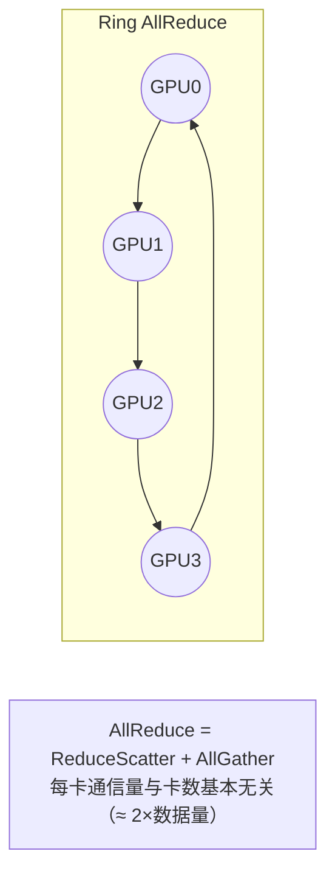
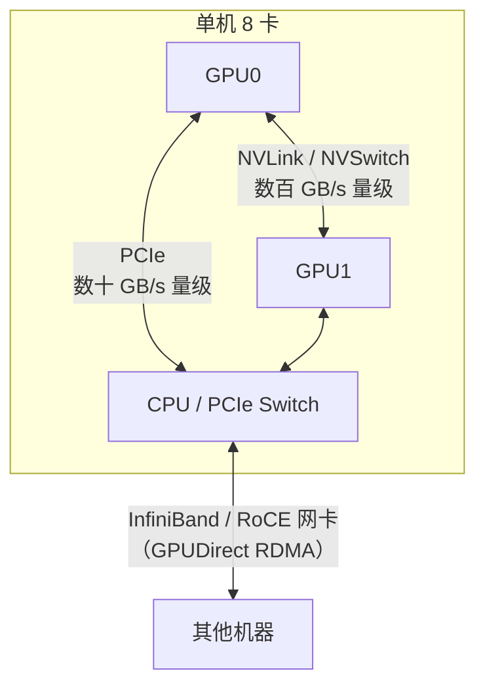

=== m5w2 | 第 18 周：集合通信与 NCCL | 第 5 月 · 分布式训练 + MLOps
# 第 18 周：集合通信与 NCCL

> **本周一句话**：上周的五种并行，落到底层就是五六个**集合通信原语**。本周在 CPU 上用 `torch.distributed`（gloo 后端）把 AllReduce、AllGather、ReduceScatter、Broadcast、All-to-All 全部跑一遍，**亲手写一个 Ring AllReduce** 并验证“每卡通信量 ≈ 2 倍数据量、与卡数基本无关”，再用仿 nccl-tests 的脚本学会读 algbw/busbw。有多卡机器时用真正的 nccl-tests 量 NVLink 与 PCIe 的差距。

**预计投入：约 9 小时**（阅读 ≈ 3.5h，本地动手 ≈ 3h，多卡动手 ≈ 1h，自测与产出 ≈ 1.5h）。{{local}} {{gpuN}}

**本周结束时你应该能：**

1. 说出每个集合通信原语的输入输出语义，以及它在哪种并行中出现。
2. 推导 Ring AllReduce 的通信量与时间模型，解释为什么 AllReduce = ReduceScatter + AllGather。
3. 读懂 nccl-tests 的 algbw 与 busbw，以及 `nvidia-smi topo -m` 的拓扑输出。
4. 知道 NCCL 排障的常用环境变量和思路。

> **验证说明**：实验 1–3 用 `torchrun` 在本站 CPU 上以 gloo 后端启动 4 个进程**真实运行**（torch 2.14.1+cpu），输出均为真实输出；gloo 走本机回环，**带宽数字只代表本站 CPU 环境，与 GPU/NCCL 无可比性**，用来学习测量方法。**实验 4（nccl-tests）未在本站实测，需多卡 GPU**。实验文件在仓库 `labs/w18/`。

---

## 1. 本周学习路线


| 天 | 时间 | 先读 | 再读（外部资料） | 再做 |
|---|---|---|---|---|
| Day 1 | 2h | 2.1、2.2 | ③ NCCL 集合通信说明、④ PyTorch 分布式教程 | 实验 1 |
| Day 2 | 2h | 2.3 | ① Playbook 附录中的集合通信部分 | 实验 2 |
| Day 3 | 2h | 2.4、2.5 | ⑤ nccl-tests PERFORMANCE.md | 实验 3 |
| Day 4 | 1.5h | — | ⑥ nccl-tests README | 实验 4（多卡） |
| Day 5 | 1.5h | 2.6 | ⑦ NCCL 环境变量、⑧ ml-engineering 网络章节 | 自测、产出 |

---

## 2. 核心概念讲解

### 2.1 五个原语

设 n 个 rank，rank i 持有数据 xᵢ：

| 原语 | 输入 | 输出（每个 rank） | 大数据类比 |
|---|---|---|---|
| AllReduce | xᵢ | Σ xᵢ（全部相同） | `reduce` 之后再广播结果 |
| AllGather | xᵢ | [x₀, x₁, …, xₙ₋₁] | `collect` 到每个节点 |
| ReduceScatter | xᵢ = [xᵢ⁰, …, xᵢⁿ⁻¹] | rank j 得到 Σᵢ xᵢʲ | 按 key 分区的 `reduceByKey` |
| Broadcast | x₀ | x₀ | 广播变量 |
| All-to-All | xᵢ = [xᵢ⁰, …, xᵢⁿ⁻¹] | rank j 得到 [x₀ʲ, x₁ʲ, …] | **shuffle** |

### 2.2 原语 ↔ 并行策略

| 并行 | 用到的原语 | 时机 |
|---|---|---|
| DP | AllReduce（梯度） | 反向传播中按桶触发，与计算重叠 |
| ZeRO-1/2 | ReduceScatter（梯度）+ AllGather（更新后的参数） | 每步 |
| ZeRO-3 / FSDP | AllGather（参数，前向和反向各一次）+ ReduceScatter（梯度） | 每层每步 |
| TP | AllReduce（激活/梯度），或 AllGather + ReduceScatter（序列并行） | 每层前向/反向 |
| PP | Send/Recv（点对点） | 每个 micro-batch |
| EP（MoE） | All-to-All | 每个 MoE 层前后 |
| 初始化 | Broadcast（rank 0 的初始参数） | 启动时 |

### 2.3 Ring AllReduce



数据切成 n 块，排成环，每步每个 rank 只给右邻居发一块：

1. **ReduceScatter 阶段**（n−1 步）：每步把收到的块累加到自己对应的块上。结束后每个 rank 恰好持有某一块的全体之和。
2. **AllGather 阶段**（n−1 步）：把完成的块沿环传一圈，每个 rank 都得到全部结果。

每个 rank 发送的数据量：

$$V = 2(n-1)\cdot\frac{S}{n} \;\approx\; 2S$$

时间模型（α 为每步延迟，β 为每字节传输时间）：

$$T \approx 2(n-1)\,\alpha + 2\frac{n-1}{n}\,S\,\beta$$

结论：**大消息时由带宽项主导，几乎与卡数无关；小消息时由延迟项主导，随卡数线性增长**。所以框架要把小梯度合并成“桶”（DDP 的 bucket）再通信；NCCL 在大规模和小消息时还会选择树形算法。

### 2.4 algbw 与 busbw

nccl-tests 报告两种带宽（⑤）：

$$\text{algbw} = \frac{S}{t},\qquad \text{busbw}_{AllReduce} = \text{algbw}\times\frac{2(n-1)}{n}$$

busbw 把算法本身的通信放大系数折算进去，反映**硬件链路的实际利用**，可以直接和链路峰值带宽（NVLink、PCIe、IB 的规格）比较，也可以跨不同卡数比较。

### 2.5 GPU 互联拓扑



`nvidia-smi topo -m` 的矩阵中，`NV#` 表示 # 条 NVLink 直连；`PIX/PXB` 经过 PCIe 交换芯片；`PHB` 经过 CPU 的 PCIe 主桥；`SYS` 要跨 CPU 插槽（NUMA）。从 NV# 到 SYS 带宽依次下降。租卡时要特别留意：很多廉价多卡机是 PCIe 互联，TP 性能会很差。

### 2.6 NCCL 排障要点

- `NCCL_DEBUG=INFO`：打印选用的网卡、传输方式（P2P/SHM/NET）、拓扑与算法。**首先看它**。
- `NCCL_SOCKET_IFNAME`：多网卡时指定用于引导的网卡（错选 docker0 等虚拟网卡是常见坑）。
- `NCCL_IB_DISABLE`、`NCCL_P2P_DISABLE`：排查时用来隔离问题。
- 卡住（hang）：常见原因是各 rank 调用集合通信的顺序/形状不一致，或某个 rank 已崩溃；PyTorch 的 `TORCH_NCCL_ASYNC_ERROR_HANDLING`/超时设置可让作业报错退出而不是永远挂住。

具体变量含义以 ⑦ 为准。**大数据类比**：这和排查 Spark shuffle 慢/卡住几乎一样——先看走的是哪张网卡、哪种传输，再看是否有掉队的节点（straggler）。

---

## 3. 动手实验

### 实验 1：五个原语一次看全（本地，30 分钟）{{local}}

```python
@@CODE:w18/collectives.py@@
```

```bash
torchrun --nproc_per_node=4 collectives.py
```

真实输出：

```text
rank 0 all_reduce      [10.0]
rank 1 all_reduce      [10.0]
rank 2 all_reduce      [10.0]
rank 3 all_reduce      [10.0]
rank 0 all_gather      [0.0, 1.0, 2.0, 3.0]
rank 1 all_gather      [0.0, 1.0, 2.0, 3.0]
rank 2 all_gather      [0.0, 1.0, 2.0, 3.0]
rank 3 all_gather      [0.0, 1.0, 2.0, 3.0]
rank 0 reduce_scatter  [60.0]
rank 1 reduce_scatter  [64.0]
rank 2 reduce_scatter  [68.0]
rank 3 reduce_scatter  [72.0]
rank 0 broadcast       [42.0]
rank 1 broadcast       [42.0]
rank 2 broadcast       [42.0]
rank 3 broadcast       [42.0]
rank 0 all_to_all      [0.0, 10.0, 20.0, 30.0]
rank 1 all_to_all      [1.0, 11.0, 21.0, 31.0]
rank 2 all_to_all      [2.0, 12.0, 22.0, 32.0]
rank 3 all_to_all      [3.0, 13.0, 23.0, 33.0]
```

验算：all_reduce 1+2+3+4=10；reduce_scatter 中 rank j 得到 Σᵣ(10r + j) = 60 + 4j；all_to_all 中 rank j 收到的是每个 rank 发给它的第 j 块（10r + j）——这正是矩阵转置，也就是 shuffle。

### 实验 2：手写 Ring AllReduce（本地，45 分钟）{{local}}

```python
@@CODE:w18/ring_allreduce.py@@
```

```bash
torchrun --nproc_per_node=4 ring_allreduce.py
```

真实输出（4 个 rank 相同）：

```text
rank 0: 与 dist.all_reduce 最大误差 9.5e-07，本 rank 发送 6000 个元素 = 1.50× 数据量（理论 2(n-1)/n = 1.50）
```

- 结果与库函数一致（9.5e-07 是浮点累加顺序不同造成的）。
- 每个 rank 发送 1.5 倍的数据量，恰好等于 2(n−1)/n。n=8 时为 1.75，n→∞ 时趋近 2——**与卡数基本无关**。
- 代码里用 `isend` + `recv`：如果所有 rank 都先阻塞 `send` 再 `recv`，大消息时可能互相等待而死锁。这和 NCCL 内部的实现思想一致，只是 NCCL 还做了分块流水、多通道并行。

### 实验 3：学会读带宽（本地，30 分钟）{{local}}

```python
@@CODE:w18/bw_bench.py@@
```

```bash
torchrun --nproc_per_node=4 bw_bench.py
```

真实输出（本站 CPU，gloo，4 进程）：

```text
      size   time(ms)  algbw(GB/s)  busbw(GB/s)
      1024      0.583        0.002        0.003
      8192      0.546        0.015        0.023
     65536      0.356        0.184        0.276
    524288      0.550        0.953        1.430
   4194304      2.102        1.995        2.993
  33554432     13.367        2.510        3.765
 268435456    146.339        1.834        2.752
```

- **小消息（≤ 64KB）耗时几乎不变（约 0.4–0.6ms）**：延迟项 2(n−1)α 主导，带宽极低。这就是 DDP 要把梯度合并成桶的原因。
- **大消息时 busbw 在 3–4 GB/s 附近饱和**：带宽项主导；256MB 时略降，可能与内存带宽/缓存有关（本站未深究）。
- 这条“先升后平”的曲线形状，与你在 GPU 上用 nccl-tests 看到的一致，只是数值会高出两三个数量级。

### 实验 4：多卡 nccl-tests（GPU，约 1 小时）{{gpuN}}

> 未在本站实测，需多卡 GPU。命令来自 ⑥。

```bash
nvidia-smi topo -m                 # 看卡间连接：NVLink(NV#) 还是 PCIe(PHB/SYS)
git clone https://github.com/NVIDIA/nccl-tests.git && cd nccl-tests
make                               # 需要 CUDA 与 NCCL；路径参数见 nccl-tests README
./build/all_reduce_perf -b 8 -e 1G -f 2 -g 2
NCCL_DEBUG=INFO ./build/all_reduce_perf -b 1G -e 1G -g 2 2>&1 | grep -iE "via|channel|ring|tree" | head
```

记录 `busbw`（总线带宽）随消息大小变化，与实验 3 的曲线形状对照；把大消息时的 busbw 与该机型 NVLink/PCIe 规格对比。如果平台机器是 PCIe 互联，带宽会明显低于 NVLink——这就是 TP 偏好机内 NVLink 的原因。

> 本实验可以和第 19 周安排在同一次租用中完成，减少开关机次数。

### 常见错误与排查

| 现象 | 原因 | 解决 |
|---|---|---|
| 多 rank 输出交错在一行（本站实测） | 并发写 stdout | 按 rank 轮流打印 + barrier（实验 1 的 `show`），或只让 rank 0 打印 |
| 手写环形通信卡住 | 所有 rank 先阻塞 send 再 recv | 用 isend/irecv，或奇偶 rank 交换顺序 |
| 作业永远挂住 | 某 rank 少调用一次集合通信、形状不一致或已崩溃 | 设置超时；检查各 rank 代码路径；看崩溃 rank 的日志 |
| NCCL 选错网卡、带宽极低 | 自动探测到虚拟网卡 | `NCCL_DEBUG=INFO` 确认；用 `NCCL_SOCKET_IFNAME` 指定 |
| 多卡带宽远低于预期 | PCIe 互联或跨 NUMA | `nvidia-smi topo -m` 确认拓扑；选 NVLink 机型 |
| gloo 不支持某原语 | 不同后端支持的原语不同 | 查 ② 的后端支持表；GPU 训练用 NCCL |

### 扩展练习

1. 把 `ring_allreduce.py` 改成测时版本，与 `dist.all_reduce` 比较大消息时的耗时，思考库实现做了哪些优化。
2. 用 `bw_bench.py` 分别以 2、4、8 个进程运行，比较小消息耗时随进程数的变化，验证延迟项 2(n−1)α。
3. 实现基于 all_to_all 的“MoE token 路由”：每个 rank 有 8 个 token，各自随机选一个目标 rank，交换后统计每个 rank 收到多少 token（负载均衡问题）。
4. 阅读 ⑤，写出 AllGather 与 ReduceScatter 的 busbw 换算系数并解释。

---

## 4. 精读指南

- **① [Ultra-Scale Playbook](https://huggingface.co/spaces/nanotron/ultrascale-playbook)**：附录中的集合通信与 Ring AllReduce 图解（40 分钟）。
- **② [PyTorch Distributed](https://docs.pytorch.org/docs/stable/distributed.html)**（30 分钟）：后端（gloo/NCCL/MPI）支持哪些原语、在什么设备上。
- **③ [NCCL 集合通信说明](https://docs.nvidia.com/deeplearning/nccl/user-guide/docs/usage/collectives.html)**（20 分钟），[NCCL 用户指南](https://docs.nvidia.com/deeplearning/nccl/user-guide/docs/index.html)（浏览）。
- **④ [PyTorch 分布式教程](https://docs.pytorch.org/tutorials/intermediate/dist_tuto.html)**（40 分钟）：教程中也实现了 Ring AllReduce，与实验 2 对照。
- **⑤ [nccl-tests PERFORMANCE.md](https://github.com/NVIDIA/nccl-tests/blob/master/doc/PERFORMANCE.md)**（20 分钟）。**读完回答**：为什么 busbw 能跨卡数比较？
- **⑥ [nccl-tests](https://github.com/NVIDIA/nccl-tests)**、[NCCL 源码](https://github.com/NVIDIA/nccl)（README）。
- **⑦ [NCCL 环境变量](https://docs.nvidia.com/deeplearning/nccl/user-guide/docs/env.html)**（查阅式）。
- **⑧ [ml-engineering：网络章节](https://github.com/stas00/ml-engineering/tree/master/network)**（40 分钟）与 [全书](https://github.com/stas00/ml-engineering)：NVLink/IB 的实际数字与排障经验。
- **⑨ [torchrun](https://docs.pytorch.org/docs/stable/elastic/run.html)**（20 分钟）：多机启动参数与弹性。

---

## 5. 自测题

<details>
<summary>1. AllReduce 与 ReduceScatter + AllGather 是什么关系？</summary>

AllReduce 可以分解为先 ReduceScatter（每个 rank 得到一块的全局和）再 AllGather（把各块收集到每个 rank）。Ring AllReduce 就是这样实现的，ZeRO 也利用这种分解，在两步之间只更新自己负责的那块参数。

</details>

<details>
<summary>2. 为什么 Ring AllReduce 每卡通信量与卡数基本无关？</summary>

每卡发送 2(n−1)·S/n 的数据，n 增大时趋近 2S，与 n 基本无关。增加卡数主要增加步数（延迟项），大消息时影响很小。

</details>

<details>
<summary>3. 实验 3 中小消息为什么带宽极低？对训练框架有什么启示？</summary>

小消息时每步固定延迟（α）占主导，传输时间可以忽略，耗时几乎不随大小变化，有效带宽极低。框架应把许多小梯度合并成较大的桶再通信，并让通信与反向计算重叠。

</details>

<details>
<summary>4. 列出每种并行使用的通信原语。</summary>

DP：AllReduce；ZeRO-1/2：ReduceScatter + AllGather；ZeRO-3/FSDP：AllGather（参数）+ ReduceScatter（梯度）；TP：AllReduce（或序列并行下的 AllGather/ReduceScatter）；PP：Send/Recv；EP：All-to-All；初始化：Broadcast。

</details>

<details>
<summary>5. busbw 与 algbw 有何区别？</summary>

algbw = 数据量/耗时，是从应用角度看的带宽；busbw 乘以算法的通信放大系数（AllReduce 为 2(n−1)/n），反映链路实际传输的速率，可以和硬件峰值以及不同卡数的结果直接比较。

</details>

<details>
<summary>6. nvidia-smi topo -m 中 NV4、PHB、SYS 分别表示什么？</summary>

NV4：两卡间有 4 条 NVLink 直连；PHB：通过 CPU 的 PCIe 主桥通信；SYS：需要跨 CPU 插槽（经过 NUMA 互联），带宽最低。

</details>

### 思考题

1. 把 All-to-All 与 Spark shuffle 做详细对比：数据量、对网络的压力、数据倾斜的影响和应对方法。
2. 一个 1024 卡的训练作业突然变慢 30%，你会如何定位是某台机器/某张网卡的问题？（提示：straggler、NCCL 日志、逐机 nccl-tests）
3. 为什么大规模训练集群的网络常常设计成“轨道优化（rail-optimized）”拓扑？查阅 ⑧ 后用自己的话解释。

---

## 6. 本周产出与掌握清单

### 本周产出

- [ ] 实验 1–3 的代码与输出，特别是手写 Ring AllReduce
- [ ] 本地带宽曲线（实验 3），有多卡时补上 nccl-tests 曲线（实验 4）
- [ ] 笔记：通信原语 ↔ 并行策略对应表 + NCCL 排障清单

## 参考资料

- [HuggingFace Ultra-Scale Playbook](https://huggingface.co/spaces/nanotron/ultrascale-playbook)（书·进阶）：图解 DP/TP/PP/ZeRO 与通信开销，第 5 月主读
- [NCCL](https://github.com/NVIDIA/nccl)（仓库·高级）：集合通信库本体，了解 all-reduce 等原语的实现位置
- [nccl-tests](https://github.com/NVIDIA/nccl-tests)（仓库·进阶）：第 18 周测多卡通信带宽用的标准工具
- [Stas Bekman：ml-engineering](https://github.com/stas00/ml-engineering)（书·进阶）：大模型训练/推理的硬件、网络、排障实战手册

> 完整列表见 [参考资料库](/resources.html)。

## 检查清单
- [ ] 本地 torchrun 跑通 all_reduce / all_gather
- [ ] 看懂 `nvidia-smi topo -m` 输出
- [ ] （多卡）记录 nccl-tests 带宽曲线
- [ ] 笔记：通信原语 ↔ 并行策略对应关系
- [ ] 能推导 Ring AllReduce 的通信量与时间模型
- [ ] 能解释 algbw 与 busbw 的区别
