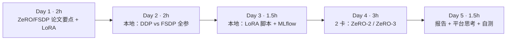
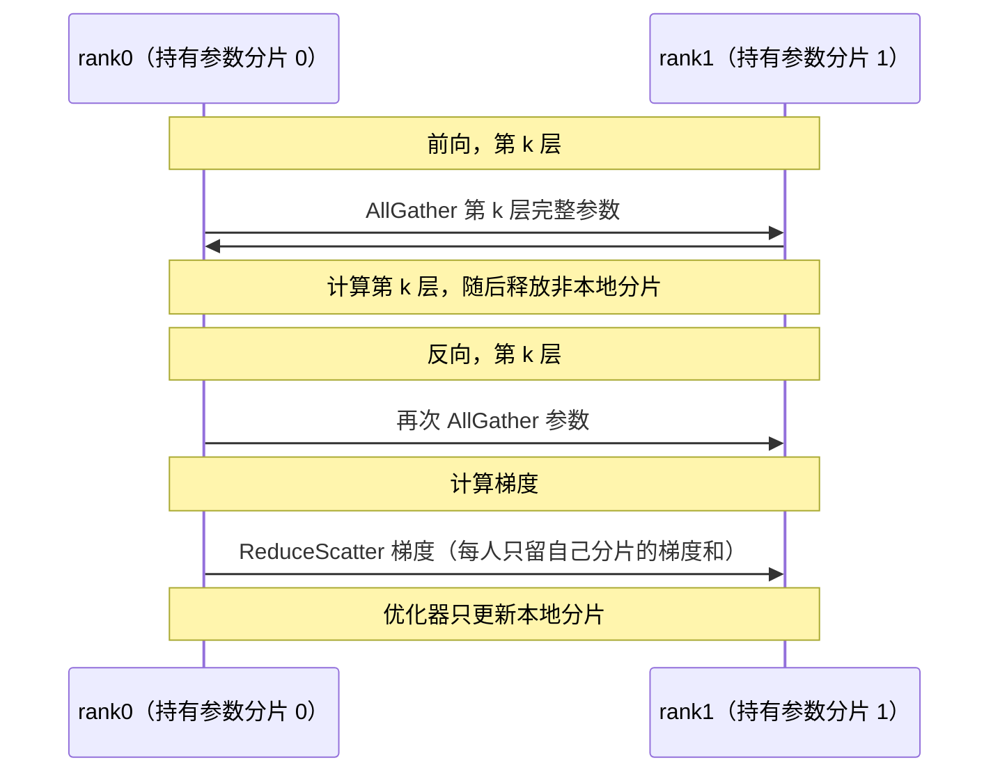

=== m5w3 | 第 19 周：ZeRO / FSDP 微调对比 | 第 5 月 · 分布式训练 + MLOps
# 第 19 周：ZeRO / FSDP 微调对比

> **本周一句话**：把前两周的理论落到一次真实的微调上。先在本地 CPU 上用 2 个进程对 SmolLM2-135M 做**全参训练**，量出 DDP 与 FSDP 的每进程状态大小、峰值内存和每步耗时（状态减半、速度慢了约 1.6 倍、loss 完全一致）；再用 HF Trainer + LoRA 把微调脚本调通并接上 MLflow；最后在 2 卡 GPU 机器上用 DeepSpeed ZeRO-2/3 完成正式对比。

**预计投入：约 10 小时**（阅读 ≈ 3h，本地动手 ≈ 3h，多卡动手 ≈ 2.5h，报告 ≈ 1.5h；2 卡机器约 2–3 小时）。{{local}} {{gpuN}}

**本周结束时你应该能：**

1. 用实测数据说明 DDP 与 FSDP/ZeRO-3 在显存（内存）与速度上的取舍，并能拆解“状态”与“激活”各占多少。
2. 解释 LoRA 为什么大幅降低训练显存，以及它与 ZeRO 组合时各级 ZeRO 的差异来自哪里。
3. 写出可在 CPU 调通、在多卡直接运行的微调脚本（Trainer + PEFT + DeepSpeed 配置 + MLflow）。
4. 说出分布式训练作业在平台上需要的能力：分片 checkpoint、弹性与故障恢复、K8s 训练作业 CRD。

> **验证说明**：实验 1、2 在本站 CPU 上真实运行（torch 2.14.1+cpu，transformers 5.20.2，peft 0.21.2，mlflow 3.17.1；数据为第 7 周的 FineWeb 样本 `labs/w7/input`），输出均为真实输出。**DeepSpeed ZeRO-2/3 的多卡运行（实验 3）未在本站实测，需多卡 GPU**；DeepSpeed 在本站没有安装。实验文件在仓库 `labs/w19/`。

---

## 1. 本周学习路线



| 天 | 时间 | 先读 | 再读（外部资料） | 再做 |
|---|---|---|---|---|
| Day 1 | 2h | 2.1、2.2 | ② FSDP 论文（第 3 节）、⑥ LoRA 论文（摘要+图 1） | — |
| Day 2 | 2h | 2.3 | ⑤ HF FSDP 指南 | 实验 1 |
| Day 3 | 1.5h | 2.4 | ⑦ PEFT 文档 | 实验 2 |
| Day 4 | 3h | — | ③ DeepSpeed ZeRO 教程、④ 配置说明、⑧ HF DeepSpeed 集成 | 实验 3 |
| Day 5 | 1.5h | 2.5 | ⑩ Kubeflow Trainer、⑪ DLRover、⑨ 分布式 checkpoint | 报告、自测 |

---

## 2. 核心概念讲解

### 2.1 FSDP 与 ZeRO-3 是同一个思想



DeepSpeed ZeRO-3 和 PyTorch FSDP（②）都在“用时 AllGather、用完释放”。区别主要在工程上：FSDP 是 PyTorch 原生组件，新版 FSDP2（`fully_shard`）基于 DTensor 按参数分片；DeepSpeed 提供更多附加功能（CPU/NVMe offload、更多配置项）。HF Trainer/Accelerate 两者都支持，切换只需改配置（⑤、⑧）。

**分片单元（wrap 粒度）**：每个 Transformer 层作为一个单元，前向时一次只需要 AllGather 一层的完整参数，峰值显存 ≈ 分片状态 + 一层完整参数 + 激活。粒度太粗省不了显存，太细通信次数多。

### 2.2 训练时内存的组成

$$M_{peak} \approx \underbrace{M_{参数}+M_{梯度}+M_{优化器}}_{\text{状态：DDP 全量，FSDP } \div N} + \underbrace{M_{激活}}_{\propto\, batch \times seq} + M_{临时缓冲}$$

实验 1 会看到：模型很小时，**激活与框架开销占了峰值的大头**，状态减半对峰值的影响没有想象的大；模型越大，状态占比越高，ZeRO/FSDP 的收益越明显。

### 2.3 为什么 FSDP 更慢

每层前向和反向都多了 AllGather，通信量约为 DDP 的 1.5 倍（第 17 周）。GPU 上框架会把下一层的 AllGather 与当前层的计算重叠（prefetch），隐藏大部分通信；CPU/gloo 上重叠效果差，所以实验 1 中慢得比较明显。

### 2.4 LoRA

LoRA（⑥）冻结原始权重 W，只训练一个低秩增量：

$$W' = W + \frac{\alpha}{r}BA,\qquad B \in \mathbb{R}^{d\times r},\; A \in \mathbb{R}^{r\times k},\; r \ll \min(d,k)$$

可训练参数极少（实验 2 中只有 0.22%），所以梯度和优化器状态几乎为零，显存主要是冻结的权重 + 激活。与 ZeRO 组合时：ZeRO-1/2 切的是（很小的）优化器状态和梯度，几乎省不了什么；**ZeRO-3 会把冻结的权重也切开**，这才是 LoRA 场景下 ZeRO-2 与 ZeRO-3 显存差异的主要来源。

### 2.5 训练作业对平台的要求

| 需求 | 为什么 | 平台能力 |
|---|---|---|
| 分片 checkpoint | FSDP/ZeRO-3 的状态分散在各 rank；恢复时卡数可能变化 | PyTorch Distributed Checkpoint（⑨）支持重分片 |
| gang 调度 | 所有 rank 必须同时在线 | 第 11 周的 Volcano/原生 PodGroup |
| 故障恢复/弹性 | 千卡作业中任何一卡故障都会停下整个作业 | torchrun 弹性、DLRover（⑪） |
| 训练作业 CRD | 统一描述 master/worker、环境变量、重启策略 | Kubeflow Trainer（⑩） |

**大数据类比**：这和 Spark 作业的 checkpoint（RDD checkpoint、Structured Streaming 的 offset/state checkpoint）、YARN AM 失败重试是同一类问题，只是训练作业的状态更大、同步更严格（一个 rank 掉了全部都得停）。

---

## 3. 动手实验

### 实验 1：DDP vs FSDP 全参训练（本地 CPU，40 分钟）{{local}}

```python
@@CODE:w19/shard_compare.py@@
```

```bash
torchrun --nproc_per_node=2 shard_compare.py ddp
torchrun --nproc_per_node=2 shard_compare.py fsdp
```

真实输出：

```text
[ddp] rank 0: 参数    538MB 梯度    538MB 优化器   1076MB 合计   2152MB | 进程峰值内存   4144MB | 每步 1.17s | 第 6 步 loss 3.686
[ddp] rank 1: 参数    538MB 梯度    538MB 优化器   1076MB 合计   2152MB | 进程峰值内存   4151MB | 每步 1.17s | 第 6 步 loss 3.686
[fsdp] rank 0: 参数    269MB 梯度    269MB 优化器    538MB 合计   1076MB | 进程峰值内存   3430MB | 每步 1.84s | 第 6 步 loss 3.686
[fsdp] rank 1: 参数    269MB 梯度    269MB 优化器    538MB 合计   1076MB | 进程峰值内存   3358MB | 每步 1.85s | 第 6 步 loss 3.686
```

解读：

- **状态精确减半**：134.5M 参数 × 4 字节 = 538MB；AdamW 两个状态 = 1076MB。FSDP 下每个 rank 各持一半。
- **峰值内存只降了约 750MB（17%）**，而不是状态减少的 1076MB 全部体现：峰值还包括加载阶段的完整模型（脚本先加载完整模型再分片）、激活（batch 2 × 128 token，词表 49152 的 logits 就不小）和框架开销。模型越大，状态占比越高，差距越明显。
- **每步慢了约 1.6 倍**：多出的 AllGather/ReduceScatter 在 CPU/gloo 上无法与计算很好地重叠。
- **loss 完全一致（3.686）**：分片不改变数学结果。
- 第一次运行时 batch 4 × 256 token 导致进程被系统 OOM killer 杀掉（本站实测，表现为 gloo `Connection reset by peer`，见排障表），降到 batch 2 × 128 后正常。这正是“状态之外，激活也要算进预算”的直接体验。

### 实验 2：LoRA 微调脚本在 CPU 上调通 + MLflow（本地，30 分钟）{{local}}

```python
@@CODE:w19/ft.py@@
```

```bash
pip install torch transformers datasets peft accelerate mlflow
export MLFLOW_TRACKING_URI=sqlite:///$PWD/../mlflow.db       # 第 20 周继续使用这个库
python ft.py --steps 15 --run-name lora-cpu-0.5b
```

真实输出（省略了进度条与警告）：

```text
trainable params: 1,081,344 || all params: 495,114,112 || trainable%: 0.2184
{'loss': '3.601', 'grad_norm': '1.41', 'learning_rate': '3.667e-05', 'epoch': '0.005'}
{'loss': '3.245', 'grad_norm': '1.378', 'learning_rate': '2e-05', 'epoch': '0.01'}
{'loss': '2.85', 'grad_norm': '1.225', 'learning_rate': '3.333e-06', 'epoch': '0.015'}
{'train_runtime': '11.32', 'train_samples_per_second': '2.65', 'train_steps_per_second': '1.325', 'train_loss': '3.232', 'epoch': '0.015'}
总耗时 12.6s，每步 0.84s，峰值显存 GB: n/a (CPU)
```

- 可训练参数只有 108 万（0.22%）：q_proj、v_proj 上 r=16 的低秩矩阵。
- 比实验 1 的 135M 全参（每步 1.17s）更大的 0.5B 模型，LoRA 每步只要 0.84s——反向只需要为极少量参数计算权重梯度，优化器几乎没有工作。
- `report_to=["mlflow"]` 已经把参数和 loss 曲线写进了 MLflow，下周直接查看。
- 15 步 loss 从 3.6 降到 2.85 只说明流程跑通，不代表效果。

### 实验 3：2 卡 ZeRO-2 vs ZeRO-3（GPU，约 2.5 小时）{{gpuN}}

> 未在本站实测，需多卡 GPU。命令与配置以 ③、④、⑧ 为准。

```json
// ds_z2.json（ds_z3.json 把 stage 改成 3）
@@CODE:w19/ds_z2.json@@
```

```bash
pip install deepspeed
export MLFLOW_TRACKING_URI=sqlite:///$PWD/mlflow.db
deepspeed --num_gpus 2 ft.py --deepspeed ds_z2.json --run-name z2-lora
deepspeed --num_gpus 2 ft.py --deepspeed ds_z3.json --run-name z3-lora
# 想看到明显差异：对小模型做全参对比（去掉 get_peft_model 一行，或另写一个开关）
```

| 配置 | 模型 | 每卡峰值显存 | 每步耗时 | 最终 loss |
|---|---|---|---|---|
| ZeRO-2 + LoRA | | | | |
| ZeRO-3 + LoRA | | | | |
| ZeRO-3 全参（可选，小模型） | | | | |

> 提示：LoRA 下可训练参数很少，ZeRO-2/3 的显存差异主要来自冻结参数是否被切分（2.4）；想看到明显差异，可以对小模型做全参微调对比。完成后把 `mlflow.db`（或 `mlruns/`）拷回本地，**立即释放多卡实例**。

### 常见错误与排查

| 现象 | 原因 | 解决 |
|---|---|---|
| `Asking to pad but the tokenizer does not have a padding token`（本站实测，SmolLM2） | 部分模型的 tokenizer 没有 pad token | `tok.pad_token = tok.eos_token` |
| gloo `Connection reset by peer`、退出码 -9（本站实测） | 某个 rank 被系统 OOM killer 杀掉，另一个 rank 通信失败 | 看 `dmesg`；减小 batch/序列长度；不要只看幸存 rank 的报错 |
| 被 OOM 时只看到 NCCL/gloo 错误 | 真正的错误在第一个死掉的 rank 上 | 查看所有 rank 的日志，找最早的异常 |
| ZeRO-3 下保存的模型文件很小或无法加载 | 保存的是分片状态 | 使用框架提供的汇总保存方法（如 Trainer 的保存逻辑、DCP 转换） |
| DeepSpeed 安装时编译失败 | CUDA 版本与 PyTorch 不匹配 | 对齐版本；按需预编译算子 |
| LoRA 下 ZeRO-2/3 显存几乎一样 | 可训练状态本来就很小 | 正常；比较全参训练才能看到差异 |

### 扩展练习

1. 修改 `shard_compare.py`，把加载完整模型改为在 meta 设备上初始化后再分片（参考 ⑤），观察峰值内存的变化。
2. 在 `shard_compare.py` 中调大 batch/序列长度，记录 DDP 与 FSDP 各自在多大的配置下 OOM。
3. 给 `ft.py` 增加 `--full` 开关（不使用 LoRA），在 CPU 上对 SmolLM2-135M 做全参与 LoRA 的每步耗时对比。
4. 阅读 ⑨，写一个 2 进程 FSDP 保存分片 checkpoint、再用 4 进程加载的小实验。

---

## 4. 精读指南

- **① [ZeRO 论文](https://arxiv.org/abs/1910.02054)**（复习第 5 节，结合实验 1 的数字）。
- **② [PyTorch FSDP 论文](https://arxiv.org/abs/2304.11277)**（60 分钟，第 3–4 节）。**读完回答**：FSDP 如何重叠通信与计算？分片单元如何选择？
- **③ [DeepSpeed ZeRO 教程](https://www.deepspeed.ai/tutorials/zero/)**、**④ [配置说明](https://www.deepspeed.ai/docs/config-json/)**（40 分钟）。
- **⑤ [HF FSDP 指南](https://huggingface.co/docs/transformers/fsdp)**、[PyTorch FSDP 教程](https://docs.pytorch.org/tutorials/intermediate/FSDP_tutorial.html)（30 分钟）。
- **⑥ [LoRA 论文](https://arxiv.org/abs/2106.09685)**（30 分钟，摘要、图 1、第 4 节）。
- **⑦ [PEFT 文档](https://huggingface.co/docs/peft/index)**（20 分钟）。
- **⑧ [HF DeepSpeed 集成](https://huggingface.co/docs/transformers/deepspeed)**、[Accelerate + DeepSpeed 博客](https://huggingface.co/blog/accelerate-deepspeed)（30 分钟）。
- **⑨ [PyTorch Distributed Checkpoint](https://docs.pytorch.org/docs/stable/distributed.checkpoint.html)**（20 分钟）：分片保存与重分片加载。
- **⑩ [Kubeflow Trainer](https://www.kubeflow.org/docs/components/trainer/)**、**⑪ [DLRover](https://github.com/intelligent-machine-learning/dlrover)**（各 20 分钟，README 与架构图）。
- 背景：[HF LLM Course](https://huggingface.co/learn/llm-course)（微调章节）、[DeepSpeed 仓库](https://github.com/deepspeedai/DeepSpeed)、[ml-engineering](https://github.com/stas00/ml-engineering)（训练排障章节）、[SmolLM2-135M](https://huggingface.co/HuggingFaceTB/SmolLM2-135M)。

---

## 5. 自测题

<details>
<summary>1. 实验 1 中 FSDP 的状态减半了，为什么峰值内存只降了 17%？</summary>

峰值内存除了参数、梯度、优化器状态外，还包括激活、临时缓冲、框架开销，以及加载时的完整模型。小模型时这些非状态部分占比很大，所以状态减半对峰值影响有限。模型越大，状态占比越高，收益越明显。

</details>

<details>
<summary>2. 为什么实验 1 中 FSDP 每步更慢？GPU 上会怎样？</summary>

FSDP 每层前向和反向都需要 AllGather 参数，再 ReduceScatter 梯度，通信量约为 DDP 的 1.5 倍。CPU/gloo 上通信难以与计算重叠，因而明显变慢；GPU 上框架会预取下一层参数并与计算重叠，开销小得多。

</details>

<details>
<summary>3. LoRA 为什么省显存？LoRA 下 ZeRO-2 与 ZeRO-3 的差异来自哪里？</summary>

LoRA 冻结原始权重，只训练很少的低秩参数，梯度和优化器状态几乎为零。ZeRO-1/2 切分的正是这些很小的状态，收益很小；ZeRO-3 还会把冻结的权重也切分到各卡，这才是两者显存差异的主要来源。

</details>

<details>
<summary>4. 分布式训练中一个 rank 被 OOM 杀掉，其他 rank 会报什么样的错？怎样定位？</summary>

其他 rank 通常报通信错误（如 gloo Connection reset by peer、NCCL 超时或远端关闭），容易误判为网络问题。应查看所有 rank 的日志与退出码（-9 表示 SIGKILL），检查 dmesg 中的 OOM 记录，找到最早出错的 rank。

</details>

<details>
<summary>5. 为什么 FSDP/ZeRO-3 的 checkpoint 需要特殊处理？</summary>

状态分散在各个 rank 上，每个 rank 只保存自己的分片。恢复时如果卡数或并行布局不同，需要重分片能力（如 PyTorch DCP）；导出给推理使用时还需要把分片汇总成完整权重。

</details>

<details>
<summary>6. 训练作业在 K8s 平台上需要哪些能力？</summary>

gang 调度（所有 rank 同时启动）、描述多角色作业的 CRD（如 Kubeflow Trainer）、分片 checkpoint 存储、故障检测与弹性恢复（如 torchrun elastic、DLRover）、拓扑感知放置（TP 组放同机）。

</details>

### 思考题

1. 你的团队要在 16 张 80GB 卡上微调 70B 模型。用第 17 周的公式估算全参 ZeRO-3 是否放得下，如果放不下，有哪些选择（LoRA/QLoRA、offload、更多卡）？
2. 千卡训练平均每天会遇到硬件故障。如果每次故障都要从上一个 checkpoint 重启，checkpoint 间隔应如何选择？（提示：权衡保存开销与丢失的计算量）
3. 结合你的 YARN/Spark 经验，设计一个“训练作业失败自动重试”的策略：哪些错误应该重试、哪些应该直接失败？

---

## 6. 本周产出与掌握清单

### 本周产出

- [ ] 本地 DDP vs FSDP 实测表（实验 1）及解读
- [ ] 可在 CPU 调通、多卡直接运行的 `ft.py` + ZeRO 配置
- [ ] 2 卡 ZeRO-2/3 对比表（实验 3），结果记录在 MLflow

## 参考资料

- [Hugging Face LLM Course](https://huggingface.co/learn/llm-course)（课程·入门）：tokenizer、transformers、微调的官方教程，命令可直接照做
- [HuggingFace Ultra-Scale Playbook](https://huggingface.co/spaces/nanotron/ultrascale-playbook)（书·进阶）：图解 DP/TP/PP/ZeRO 与通信开销，第 5 月主读
- [ZeRO 论文](https://arxiv.org/abs/1910.02054)（论文·进阶）：ZeRO-1/2/3 分片思想的出处，对照显存实测
- [PyTorch FSDP 论文](https://arxiv.org/abs/2304.11277)（论文·进阶）：FSDP 的设计与工程取舍，理解与 ZeRO-3 的关系
- [DeepSpeed ZeRO 教程](https://www.deepspeed.ai/tutorials/zero/)（文档·进阶）：ZeRO 配置项的官方说明，第 19 周照着配
- [PyTorch FSDP 教程](https://docs.pytorch.org/tutorials/intermediate/FSDP_tutorial.html)（文档·进阶）：FSDP 官方上手教程
- [HF Accelerate + DeepSpeed 博客](https://huggingface.co/blog/accelerate-deepspeed)（博客·进阶）：用 Accelerate 一套脚本切换 DeepSpeed 配置的实操
- [HuggingFace PEFT 文档](https://huggingface.co/docs/peft/index)（文档·入门）：LoRA 等参数高效微调，单卡/双卡实验都要用
- [DeepSpeed](https://github.com/deepspeedai/DeepSpeed)（仓库·进阶）：ZeRO 实现与示例
- [Stas Bekman：ml-engineering](https://github.com/stas00/ml-engineering)（书·进阶）：大模型训练/推理的硬件、网络、排障实战手册
- [Kubeflow Trainer 文档](https://www.kubeflow.org/docs/components/trainer/)（文档·进阶）：K8s 上的分布式训练作业 CRD
- [蚂蚁 DLRover](https://github.com/intelligent-machine-learning/dlrover)（仓库·高级）：训练作业弹性与故障自愈，国内开源代表

> 完整列表见 [参考资料库](/resources.html)。

## 检查清单
- [ ] 本地用 CPU / 单卡把 ft.py 调通（少量 step）
- [ ] 2 卡上完成 ZeRO-2 与 ZeRO-3 对比
- [ ] 填完对比表并解释差异
- [ ] 结果拷回本地，**立即释放多卡实例**
- [ ] 能用实验 1 的数据解释状态、激活与峰值内存的关系
- [ ] 能说出训练作业对平台的四项要求
