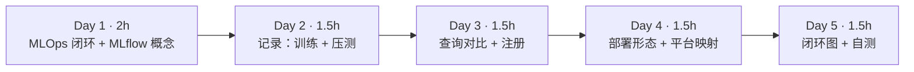
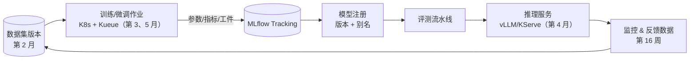
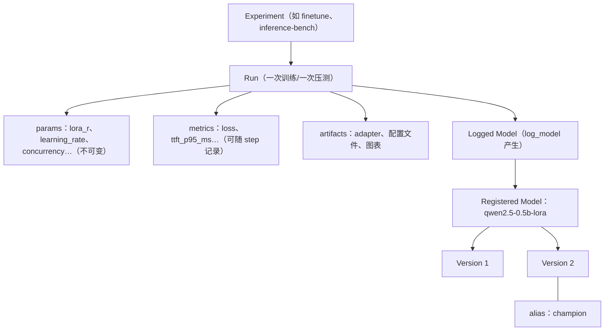
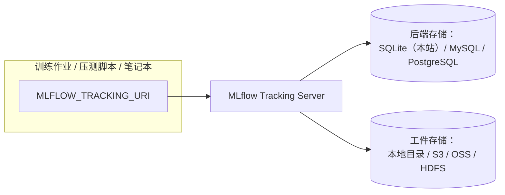

=== m5w4 | 第 20 周：MLOps：MLflow 实验管理 | 第 5 月 · 分布式训练 + MLOps
# 第 20 周：MLOps —— 用 MLflow 管理实验与模型

> **本周一句话**：前 19 周你已经产出了一堆数字：压测表、微调 loss、显存对比……它们散落在终端输出和笔记里。MLOps 的第一步就是把它们**结构化地记录、可查询、可对比、可追溯**。本周用 MLflow 把第 14 周的真实压测和第 19 周的真实微调放进同一个跟踪库，用 API 和 REST 接口查询对比，把最好的 LoRA adapter 登记进模型注册表并打上 `champion` 别名——然后用你做数据平台的经验，思考公司现有平台能承担 MLOps 的哪些部分。

**预计投入：约 8 小时**（阅读 ≈ 3h，动手 ≈ 3h，产出与自测 ≈ 2h）。{{local}}

**本周结束时你应该能：**

1. 画出 MLOps 闭环（数据 → 训练 → 跟踪 → 注册 → 评测 → 部署 → 监控 → 数据），说出每个环节的系统。
2. 使用 MLflow Tracking 记录参数、指标、工件，理解 experiment / run / model / registered model / alias 的关系。
3. 用 Python API 和 REST API 查询、排序、对比 run，并用模型注册表管理版本与别名。
4. 说出 MLflow 后端存储与工件存储的部署选择，以及与数据平台（元数据中心、调度系统）的对应关系。

> **验证说明**：本周全部在本站 CPU 上真实运行（mlflow 3.17.1，SQLite 后端存储）。跟踪库里的数据都是真实实验结果：第 14 周 mini_server 的压测数值、第 19 周两次 LoRA 微调（r=4 与 r=16，各 30 步）。本页所有输出均为真实输出。实验文件在仓库 `labs/w20/`，跟踪库为 `labs/mlflow.db`。

---

## 1. 本周学习路线



| 天 | 时间 | 先读 | 再读（外部资料） | 再做 |
|---|---|---|---|---|
| Day 1 | 2h | 2.1、2.2 | ⑥ Google MLOps 架构、⑦ ML 系统的技术债 | — |
| Day 2 | 1.5h | 2.3 | ② Tracking 文档、⑨ Trainer 回调 | 实验 1、实验 2 |
| Day 3 | 1.5h | 2.4 | ③ 模型注册表、④ REST API | 实验 3、实验 4 |
| Day 4 | 1.5h | 2.5 | ⑤ 后端存储 | 思考题 |
| Day 5 | 1.5h | — | ⑧ Made With ML（浏览） | 闭环图、自测 |

---

## 2. 核心概念讲解

### 2.1 MLOps 闭环



| 环节 | 回答的问题 | 典型系统 | 数据平台类比 |
|---|---|---|---|
| 数据版本 | 这个模型用哪份数据训练的？ | 数据湖表版本、DVC | Hive 分区 / Iceberg 快照 |
| 实验跟踪 | 哪组参数效果最好？结果能复现吗？ | MLflow、W&B | 调度平台的作业运行记录 |
| 模型注册 | 线上用的是哪个版本？谁批准的？ | MLflow Registry | 数据资产目录中的版本化资产 |
| 评测 | 新版本比旧版本好吗？ | 评测流水线 | 数据质量校验 |
| 部署与监控 | 上线后表现如何？ | vLLM/KServe + Prometheus | 数据服务 + 监控告警 |

⑦ 指出：在真实 ML 系统中，模型代码只占一小部分，周围的数据、配置、监控、服务基础设施才是大头——这正是数据平台架构师的主场。

### 2.2 MLflow 的对象模型



- **params 与 metrics 的区别**：params 是输入（记录一次、不可改），metrics 是输出（可以按 step 记录成曲线）。
- **别名（alias）**：如 `champion`、`challenger`，部署侧通过 `models:/名称@champion` 引用，换版本只需移动别名——类似数据平台里把视图指向新的表快照。较早版本的 MLflow 使用 Staging/Production “阶段”，新版本推荐使用别名（③）。

### 2.3 怎样记录才有用

1. **记录足以复现的信息**：代码版本（git commit）、数据版本、全部超参、环境（库版本、硬件）。
2. **统一命名**：参数名、指标名在不同 run 之间保持一致，才能横向对比（如统一用 `ttft_p95_ms`）。
3. **自动化优先**：HF Trainer 的 `report_to=["mlflow"]` 会自动记录训练参数与 loss 曲线（⑨），但**不会记录 PEFT 的 LoRA 秩等配置**（本站实测，见实验 3），需要手动补充或在 run 名中体现。
4. **工件放对象存储**：大文件（权重、adapter）不要放在跟踪数据库里。

### 2.4 查询与对比

MLflow 的 search 支持类 SQL 的过滤与排序：

```text
filter_string="attributes.run_name LIKE 'lora-r%' and metrics.train_loss < 3.5"
order_by=["metrics.train_loss ASC"]
```

UI 的对比视图、Python API（`MlflowClient.search_runs`）和 REST API（`/api/2.0/mlflow/runs/search`）背后是同一套查询。REST API 意味着你可以把 MLflow 接入已有的 BI、调度和告警系统。

### 2.5 部署形态



本站用 SQLite 单文件（`labs/mlflow.db`），适合个人；团队部署用 MySQL/PostgreSQL + 对象存储（⑤）。这和你部署 Hive Metastore（元数据进 MySQL、数据进 HDFS/S3）是同一种架构。

---

## 3. 动手实验 {{local}}

所有实验共用同一个跟踪库：

```bash
pip install mlflow
export MLFLOW_TRACKING_URI=sqlite:////绝对路径/labs/mlflow.db
```

### 实验 1：训练自动记录——两次 LoRA 微调（30 分钟）

第 19 周的 `ft.py` 增加了 `--lora-r` 与 `--save` 参数（见仓库 `labs/w19/ft.py`）。运行 r=4 和 r=16 两组：

```bash
cd labs/w19
for r in 4 16; do python ft.py --steps 30 --lora-r $r --run-name lora-r$r --save adapter-r$r; done
```

真实输出（节选）：

```text
trainable params: 270,336 || all params: 494,303,104 || trainable%: 0.0547
{'train_runtime': '22.46', 'train_samples_per_second': '2.671', 'train_steps_per_second': '1.336', 'train_loss': '3.296', 'epoch': '0.03'}
总耗时 24.1s，每步 0.80s，峰值显存 GB: n/a (CPU)
trainable params: 1,081,344 || all params: 495,114,112 || trainable%: 0.2184
{'train_runtime': '22.26', 'train_samples_per_second': '2.696', 'train_steps_per_second': '1.348', 'train_loss': '3.295', 'epoch': '0.03'}
总耗时 23.9s，每步 0.80s，峰值显存 GB: n/a (CPU)
```

r 从 4 增加到 16，可训练参数变为 4 倍，但每步耗时几乎相同——LoRA 的计算量相对整个模型的前向/反向可以忽略。

### 实验 2：手动记录——把压测结果放进 MLflow（20 分钟）

```python
@@CODE:w20/log_bench.py@@
```

```text
logged 3 runs
```

训练和推理的结果从此在同一个地方，用同样的方式查询。GPU 上的 vLLM/SGLang 压测结果（第 14、15 周）按同样格式追加即可。

### 实验 3：对比与模型注册（30 分钟）

```python
@@CODE:w20/compare_and_register.py@@
```

真实输出（这是第二次运行，所以创建的是版本 2；第一次运行时 lora_r 列显示为 `?`，因为 Trainer 没有记录 PEFT 的 r，之后改为从 run 名解析）：

```text
run_name   lora_r train_loss runtime_s
lora-r16       16     3.2949     22.26
lora-r4         4     3.2964     22.46
Registered model 'qwen2.5-0.5b-lora' already exists. Creating a new version of this model...
Created version '2' of model 'qwen2.5-0.5b-lora'.
已登记 qwen2.5-0.5b-lora 版本 2，别名 champion → 来源 run 47b36914（lora-r16）
```

重要提醒：两组 loss 只差 0.0015，30 步的训练 loss **完全不足以说明哪个更好**。这里按 loss 选“冠军”只是为了演示注册流程；真实流程中应该用独立评测集上的指标、多次运行的方差来决定，并由评测流水线（而不是训练 loss）把别名移到新版本。

### 实验 4：REST API——让其他系统读取 MLflow（20 分钟）

```bash
mlflow server --backend-store-uri $MLFLOW_TRACKING_URI --host 127.0.0.1 --port 5000 &
# 按 TTFT p95 倒序列出压测 run
EXP=$(curl -s "localhost:5000/api/2.0/mlflow/experiments/get-by-name?experiment_name=inference-bench" \
      | python3 -c "import json,sys;print(json.load(sys.stdin)['experiment']['experiment_id'])")
curl -s -X POST localhost:5000/api/2.0/mlflow/runs/search -H 'Content-Type: application/json' \
  -d '{"experiment_ids":["'$EXP'"],"order_by":["metrics.ttft_p95_ms DESC"]}'
# 部署侧：查询 champion 别名指向哪个版本
curl -s "localhost:5000/api/2.0/mlflow/registered-models/alias?name=qwen2.5-0.5b-lora&alias=champion"
```

真实输出（JSON 已用 python 提取关键字段）：

```text
mini_server-cpu-c8 ttft_p95_ms= 13456.0 throughput= 25.7
mini_server-cpu-c4 ttft_p95_ms= 6510.0 throughput= 26.6
mini_server-cpu-c1 ttft_p95_ms= 118.0 throughput= 25.8
champion -> qwen2.5-0.5b-lora v2 READY
```

部署系统只要查询别名，就能知道应该加载哪个版本、来源于哪次训练——这就是“可追溯”。打开浏览器访问 `http://127.0.0.1:5000` 可以在 UI 中看到同样的内容，并用对比视图并排比较 run。

### 常见错误与排查

| 现象 | 原因 | 解决 |
|---|---|---|
| 不同脚本的 run 分散在不同地方 | 没有统一 `MLFLOW_TRACKING_URI`，默认写到当前目录 | 所有脚本使用同一个 URI（绝对路径或服务器地址） |
| Trainer 记录里找不到 LoRA 的 r（本站实测） | Trainer 只记录 TrainingArguments 与模型 config | 手动 `mlflow.log_params`，或写在 run 名/标签中 |
| `Registered model ... already exists`（本站实测） | 重复注册同名模型 | 正常行为：会创建新版本；用别名指向需要的版本 |
| `Failed to resolve installed pip version` 警告（本站实测） | 用 uv 创建的虚拟环境中没有 pip | 不影响记录；需要完整环境描述时安装 pip |
| 大模型工件上传很慢、数据库膨胀 | 把大文件放进了跟踪存储 | 配置对象存储作为工件存储 |
| 多人共用 SQLite 时报锁错误 | SQLite 不适合并发写 | 团队使用 MySQL/PostgreSQL |

### 扩展练习

1. 修改 `ft.py`，在训练结束后用 `mlflow.log_params` 补记 `lora_r`、`target_modules`、数据文件路径和 git commit。
2. 写一个“评测 + 移动别名”的脚本：对 champion 和新版本在同一组 prompt 上计算某个指标（例如困惑度），新版本更好才把 `champion` 移过去。
3. 把第 16 周 Prometheus 中的 TTFT p95 定期写入 MLflow 的一个 run，作为线上表现的记录。
4. 阅读 ⑤，画出团队版 MLflow 的部署图（K8s Deployment + PostgreSQL + 对象存储 + 认证）。

---

## 4. 精读指南

- **① [MLflow 文档](https://mlflow.org/docs/latest/index.html)**（30 分钟）：整体结构。
- **② [Tracking](https://mlflow.org/docs/latest/ml/tracking/)**（30 分钟）。**读完回答**：run、experiment、logged model 的关系？
- **③ [Model Registry](https://mlflow.org/docs/latest/ml/model-registry/)**（30 分钟）。**读完回答**：别名与旧的“阶段”机制有何不同？
- **④ [REST API](https://mlflow.org/docs/latest/api_reference/rest-api.html)**（查阅式）。
- **⑤ [后端存储](https://mlflow.org/docs/latest/ml/tracking/backend-stores/)**（20 分钟）。
- **⑥ [Google：MLOps 持续交付与自动化流水线](https://cloud.google.com/architecture/mlops-continuous-delivery-and-automation-pipelines-in-machine-learning)**（40 分钟）：MLOps 成熟度 0/1/2 级。
- **⑦ [Hidden Technical Debt in ML Systems](https://papers.nips.cc/paper/5656-hidden-technical-debt-in-machine-learning-systems)**（40 分钟）：经典论文，图 1 值得记住。
- **⑧ [Made With ML](https://madewithml.com/)**（浏览）与 [ml-ops.org](https://ml-ops.org/)（浏览）。
- **⑨ [HF Trainer 回调](https://huggingface.co/docs/transformers/main_classes/callback)**（10 分钟）：MLflowCallback 记录了什么、相关环境变量。
- 源码：[mlflow/mlflow](https://github.com/mlflow/mlflow)。

---

## 5. 自测题

<details>
<summary>1. params 和 metrics 有何区别？各举两个例子。</summary>

params 是 run 的输入配置，记录一次、不可修改，如 learning_rate、lora_r、concurrency；metrics 是输出结果，可以按 step 多次记录形成曲线，如 train_loss、ttft_p95_ms。

</details>

<details>
<summary>2. 为什么部署侧应该通过别名而不是版本号引用模型？</summary>

别名把“部署用哪个模型”与具体版本解耦：上线、回滚只需移动别名，部署配置不变；同时别名指向的版本可以追溯到训练 run、参数和数据，便于审计。

</details>

<details>
<summary>3. 实验 3 中按训练 loss 选择冠军有什么问题？</summary>

两组 loss 只差 0.0015，30 步训练噪声远大于这个差距；训练 loss 也不代表泛化效果。应使用独立评测集指标、多次运行的统计，并由评测流水线决定是否晋升。

</details>

<details>
<summary>4. MLflow 团队部署的推荐架构是什么？与哪个大数据组件相似？</summary>

Tracking Server + 关系型数据库（MySQL/PostgreSQL）作为后端存储 + 对象存储（S3/OSS/HDFS）作为工件存储，前面加认证。与 Hive Metastore（元数据在关系库、数据在 HDFS/S3）的架构相似。

</details>

<details>
<summary>5. 列出 MLOps 闭环的环节，并为每个环节举一个本课程中用到的系统。</summary>

数据版本（第 2 月的 Ray Data/Spark 清洗产物）→ 训练（第 19 周 Trainer/FSDP，第 3 月 K8s + Kueue 调度）→ 实验跟踪（MLflow）→ 模型注册（MLflow Registry）→ 评测（评测流水线）→ 部署（第 4 月 vLLM/Ray Serve）→ 监控（第 16 周 Prometheus）→ 反馈数据回到数据环节。

</details>

### 思考题

1. 你所在公司的调度平台、元数据平台、数据质量平台，分别可以承担 MLOps 的哪些部分？哪些需要新建？
2. 如果要让“训练 → 评测 → 晋升 → 部署”全自动，你会在哪些环节设置人工审批？为什么？
3. 一个线上模型突然效果变差，你需要哪些记录才能在 30 分钟内定位原因（数据变化、模型版本、服务配置）？

---

## 6. 本周产出与掌握清单

### 本周产出

- [ ] 包含训练与压测实验的 MLflow 跟踪库，以及一次注册 + 别名操作
- [ ] 一张 MLOps 闭环图（标出每个环节在你公司对应的系统）
- [ ] 一页笔记：现有平台如何承担 MLOps（本月产出之一）

## 参考资料

- [MLflow 文档](https://mlflow.org/docs/latest/index.html)（文档·入门）：实验跟踪、模型注册
- [MLflow 仓库](https://github.com/mlflow/mlflow)（仓库·入门）：示例代码
- [Made With ML](https://madewithml.com/)（课程·入门）：端到端 ML 工程与 MLOps 文字教程（基于 Ray）

> 完整列表见 [参考资料库](/resources.html)。

## 检查清单
- [ ] MLflow UI 中能看到训练与压测实验
- [ ] 用 MLflow 的对比视图比较两次 run
- [ ] 画出自己理解的 MLOps 闭环图
- [ ] 写下：你所在公司的调度平台/元数据平台可以怎样承担 MLOps 的哪些部分
- [ ] 能用 API 查询 run 并管理模型版本与别名
