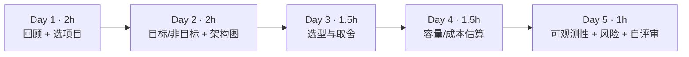
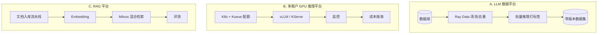
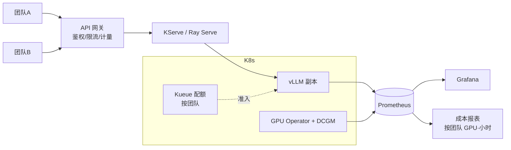

=== m6w1 | 第 21 周：毕业项目设计 | 第 6 月 · 作品集 + 求职
# 第 21 周：毕业项目设计——像做架构评审一样写设计文档

> **本周一句话**：毕业项目的价值不在代码量，而在于你能否像架构师一样**定义问题、做取舍、给出带假设的估算**。本周三选一确定毕业项目，写出一份可评审的设计文档：目标与非目标、架构图、选型理由、容量与成本估算、可观测性、风险与降级。容量估算用一个真实可运行的小脚本完成——把第 4 月的压测表变成“需要几张卡、每个团队配多少额度”。

**预计投入：约 8 小时**（回顾前 5 个月 ≈ 2h，设计文档 ≈ 4h，估算与评审 ≈ 2h）。{{none}}

**本周结束时你应该能：**

1. 选定毕业项目，并说清它要解决的问题、给谁用、不做什么。
2. 写出包含架构图、选型理由（每个“为什么不选另一个”）、容量与成本估算的设计文档。
3. 用 Little 定律把压测数据转换为所需卡数与配额，并明确列出全部假设。
4. 为项目设计可观测性指标与降级方案。

> **验证说明**：本周以设计为主。`capacity.py` 在本站真实运行，输出均为真实输出；但**它的所有输入参数都是假设值**（已在代码中注明），必须替换成你自己第 14–15 周的压测结果。实验文件在仓库 `labs/w21/`。

---

## 1. 本周学习路线



| 天 | 时间 | 先读 | 再读（外部资料） | 再做 |
|---|---|---|---|---|
| Day 1 | 2h | 2.1 | 月度概览中的三个项目、[招聘市场](/jobs.html) | 选定项目 |
| Day 2 | 2h | 2.2 | ① Google 设计文档 | 文档第 1–3 节 |
| Day 3 | 1.5h | 2.3 | ② ADR（架构决策记录） | 文档第 4 节 |
| Day 4 | 1.5h | 2.4 | ③ Little 定律 | 实验 1，文档第 5 节 |
| Day 5 | 1h | 2.5 | ④ SRE：SLO | 文档第 6–8 节，自评审 |

---

## 2. 核心概念讲解

### 2.1 三个项目怎么选



| 项目 | 复用 | 最能展示的能力 | 适合目标岗位 | 本地可完成比例 |
|---|---|---|---|---|
| A. LLM 数据平台 | 第 2 月（第 6–8 周）、第 20 周 | 数据管道、版本化、批量推理吞吐 | Data for AI、数据平台转 AI | 高（第 22 周有完整 CPU 版） |
| B. 多租户推理平台 | 第 3、4 月 | 多租户调度、SLO、成本治理 | AI Infra 平台 / 推理平台 | 中（调度部分用 KWOK，推理需 GPU） |
| C. RAG 平台 | 第 2、4 月 | 检索存储、数据管道、评测 | AI 应用平台 | 中高（小 Embedding 模型可在 CPU 跑） |

选择原则：**选与目标岗位 JD 最贴近、且你过去经验能讲出“类比和差异”的那个**。如果犹豫，选 A——它与大数据背景衔接最自然，第 22 周给出了可直接运行的骨架。

### 2.2 设计文档结构

```text
1. 背景与目标（解决什么问题，给谁用，成功标准是什么）
2. 非目标（明确不做什么，避免范围蔓延）
3. 架构图（mermaid 或手绘）
4. 关键组件选型与理由（为什么 Kueue 而不是 Volcano / 为什么 Ray Data 而不是 Spark…）
5. 容量与成本估算（标明“估算”，写清假设）
6. 可观测性：看哪些指标
7. 风险与降级方案
8. 和大数据平台的类比 / 可复用经验
```

① 强调：设计文档的核心是**记录取舍**，而不是描述实现细节。评审者最想看到的是“你考虑过哪些方案、为什么选这个、代价是什么”。

### 2.3 选型写法：每个决定都要有“为什么不”

借用 ADR（②）的格式，每个关键决定写成：

| 字段 | 示例（项目 B） |
|---|---|
| 决定 | 用 Kueue 做多团队配额 |
| 备选 | Volcano；原生 ResourceQuota |
| 理由 | 不替换 kube-scheduler；cohort 借用直接对应 YARN 队列弹性（第 10 周实测） |
| 代价 | 不提供 gang 放置（需要时结合原生 PodGroup，第 11 周） |
| 何时重新考虑 | 出现大量多机训练作业时 |

示例：项目 B 架构草图



### 2.4 容量估算：Little 定律

稳定系统中，平均在系统内的请求数 L、到达率 λ、平均停留时间 W 满足（③）：

$$L = \lambda W \quad\Rightarrow\quad \lambda_{单卡} = \frac{L_{SLO}}{W_{E2E}}$$

其中 L_SLO 取压测中**仍满足 TTFT/TPOT SLO 的最大并发**，W_E2E = TTFT + (N_out − 1) × TPOT（第 14 周）。所需卡数：

$$N_{GPU} = \Big\lceil \frac{\lambda_{峰值}}{\lambda_{单卡}} \times (1 + \text{冗余}) \Big\rceil$$

**大数据类比**：和你按“峰值 TPS ÷ 单节点 TPS × 冗余”规划 Kafka/HBase 集群是同一件事，只是单节点能力要用 SLO 约束下的压测值，而不是极限吞吐。

### 2.5 可观测性与降级

| 层 | 指标 | 告警示例 |
|---|---|---|
| 业务 | 各团队 QPS、错误率、token 用量 | 某团队错误率 > 1% |
| 服务 | TTFT/TPOT p95、排队请求数、KV 使用率（第 16 周） | TTFT p95 > SLO 持续 5 分钟 |
| 资源 | GPU 利用率、显存、温度（DCGM） | GPU 掉卡、温度过高 |
| 成本 | 各团队 GPU·小时、空闲 GPU 比例 | 空闲率 > 30% 持续一天 |

降级方案示例：过载时对低优先级团队限流；L4 不够时回退到 A100（Kueue flavor，第 10 周）；模型服务故障时返回缓存结果或切换到小模型。SLO 的定义方法见 ④。

---

## 3. 动手实验 {{none}}

### 实验 1：容量与配额估算（30 分钟）

```python
@@CODE:w21/capacity.py@@
```

```bash
python capacity.py                                                   # 默认假设
python capacity.py --peak-qps 20 --slo-conc 64 --tpot-ms 60 --ttft-ms 900
```

真实输出：

```text
单请求 E2E = 0.50 + 299×0.040 = 12.5s
单卡在 SLO 内的并发 16 → 可承载 1.28 请求/s（385 输出 token/s）
峰值 20 请求/s，冗余 30% → 需要 21 张卡
Kueue nominalQuota 建议（按流量占比向上取整，余量放进 cohort 共享）： {'A': 13, 'B': 9}
每月 GPU·小时 = 21×24×30 = 15,120（未填写单价）
===
单请求 E2E = 0.90 + 299×0.060 = 18.8s
单卡在 SLO 内的并发 64 → 可承载 3.40 请求/s（1019 输出 token/s）
峰值 20.0 请求/s，冗余 30% → 需要 8 张卡
Kueue nominalQuota 建议（按流量占比向上取整，余量放进 cohort 共享）： {'A': 5, 'B': 4}
每月 GPU·小时 = 8×24×30 = 5,760（未填写单价）
```

- 同样的业务峰值，**SLO 放宽一些（允许更高并发、更大的 TPOT/TTFT）卡数从 21 降到 8**。这就是为什么容量规划必须先和业务方对齐 SLO：SLO 每放宽一点都直接换算成钱。
- 两个团队的配额向上取整后合计 22（第一组），比 21 张卡多 1 张：Kueue 的 nominalQuota 之和可以与物理资源不完全相等，靠 cohort 借用与抢占调节——但要在文档中写明这种超配。
- 所有输入都是假设值。把第 14 周的真实压测表代进去，并在设计文档里**列出每个假设和它的来源**。

### 实验 2：写设计文档并自评审（3–4 小时）

按 2.2 的结构写，完成后用下面的清单自评审（每项写“是/否 + 证据”）：

| 检查项 | 是/否 | 证据（文档中的位置） |
|---|---|---|
| 目标可度量（有成功标准） | | |
| 非目标至少 3 条 | | |
| 每个关键选型都有备选与代价 | | |
| 估算标明“估算”，列出全部假设与来源 | | |
| 有 SLO 与对应的监控指标 | | |
| 有至少 2 个风险及降级方案 | | |
| 标出哪些步骤需要 GPU、预计时长与费用上限 | | |
| 写了与大数据平台的类比和差异 | | |

### 常见错误与排查

| 问题 | 表现 | 改进 |
|---|---|---|
| 范围太大 | 想把 A、B、C 都做 | 只选一个；其余写进“非目标”或“下一步” |
| 只有架构图没有取舍 | 评审者问“为什么不用 X”答不上来 | 每个组件写 ADR 式的一行理由 |
| 估算没有假设 | 数字看起来精确但无法复核 | 每个输入写来源；标“估算” |
| 用极限吞吐做容量规划 | 上线后 TTFT 超标 | 使用 SLO 约束下的压测值 |
| GPU 计划分散 | 多次开关机，费用翻倍 | 把所有 GPU 步骤集中到一次租用 |

### 扩展练习

1. 给 `capacity.py` 增加“峰谷比”参数，计算夜间缩容后每月可节省的 GPU·小时。
2. 为项目 A 写一个类似的估算：每天新增多少 TB 原始数据，清洗、去重、打分各需要多少 CPU/GPU 小时（用第 6–8 周的实测吞吐）。
3. 找一位同事（或让 AI 扮演）按自评审清单评审你的文档，记录被问倒的问题。

---

## 4. 精读指南

- **① [Design Docs at Google](https://www.industrialempathy.com/posts/design-docs-at-google/)**（20 分钟）。**读完回答**：设计文档什么时候不值得写？
- **② [Architecture Decision Record](https://github.com/joelparkerhenderson/architecture-decision-record)**（20 分钟）：选一个模板用于第 4 节。
- **③ [Little 定律](https://en.wikipedia.org/wiki/Little%27s_law)**（10 分钟）。
- **④ [Google SRE：服务等级目标](https://sre.google/sre-book/service-level-objectives/)**（30 分钟）：SLI、SLO、SLA 的区别。
- **⑤ [ai-system-design-guide](https://github.com/ombharatiya/ai-system-design-guide)**（40 分钟）：参考其中的系统设计模式。
- 背景：[长凡访谈](https://mp.weixin.qq.com/s/2tYO1z5pt-nU6duANzDlbg)、[丁远普：火山引擎 Data for AI 转型](https://www.infoq.cn/article/lmg6blihf5yslvwgmzz2)（本站 curl 访问超时，浏览器可打开）。

---

## 5. 自测题

<details>
<summary>1. 为什么设计文档一定要写“非目标”？</summary>

明确不做什么可以防止范围蔓延，让评审者把注意力放在关键问题上，也让你在有限时间内完成项目。毕业项目时间只有两周，非目标尤其重要。

</details>

<details>
<summary>2. 用 Little 定律解释：为什么单卡可承载的请求率与输出长度成反比？</summary>

λ = L / W。SLO 约束下的最大并发 L 固定时，输出越长，W（端到端时间 ≈ TTFT + 输出长度 × TPOT）越大，单卡每秒能完成的请求数就越少。

</details>

<details>
<summary>3. 实验 1 中两组参数的卡数为什么相差这么大？对业务沟通有什么启示？</summary>

第二组允许更高并发（64 vs 16）和更宽松的 TTFT/TPOT，单卡可承载的请求率从 1.28 升到 3.40，卡数从 21 降到 8。SLO 直接决定成本，容量规划前必须先与业务方对齐 SLO。

</details>

<details>
<summary>4. 为什么不能用压测中的极限吞吐做容量规划？</summary>

极限吞吐通常出现在很高的并发下，此时 TTFT/TPOT 已经远超 SLO；按它规划会导致上线后延迟不达标。应使用满足 SLO 的最大并发对应的吞吐，并加上冗余。

</details>

<details>
<summary>5. 一个好的选型理由应包含哪些要素？</summary>

决定内容、考虑过的备选、选择的理由（最好有实验证据）、代价或限制，以及在什么条件下应该重新考虑。

</details>

### 思考题

1. 你过去做过的一次大数据平台架构评审中，最常被问到的问题是什么？把它们改写成适用于毕业项目的问题。
2. 如果预算只够 4 张卡，而估算需要 8 张，你会在设计上做哪些调整（SLO、模型大小、量化、限流、错峰）？
3. 项目 A 的“数据版本”应该细化到什么粒度（每天、每次运行、每个参数组合）？为什么？

---

## 6. 本周产出与掌握清单

### 本周产出

- [ ] 毕业项目设计文档（含架构图、选型理由、估算与假设、可观测性、风险）
- [ ] 容量/成本估算脚本输出（替换为你自己的压测数据）
- [ ] 自评审清单

## 参考资料

- [ai-system-design-guide](https://github.com/ombharatiya/ai-system-design-guide)（仓库·入门）：AI 系统设计题与架构模式，面试准备
- [长凡访谈《走近 AI Infra 架构师》](https://mp.weixin.qq.com/s/2tYO1z5pt-nU6duANzDlbg)（博客·入门）：从大数据到 ML Infra 的架构师视角
- [丁远普：火山引擎 Data for AI 转型（InfoQ）](https://www.infoq.cn/article/lmg6blihf5yslvwgmzz2)（博客·入门）：大数据产品负责人转 AI 数据湖（建站时自动检查超时，浏览器可打开）
- [本站：招聘市场与 JD 分析](/jobs.html)（文档·入门）：JD 样本与本教程对应关系

> 完整列表见 [参考资料库](/resources.html)。

## 检查清单 {{none}}
- [ ] 选定毕业项目
- [ ] 完成设计文档初稿（含架构图与估算）
- [ ] 列出要复用的前几个月代码
- [ ] 规划需要租 GPU 的步骤与时长，尽量集中在一次完成
- [ ] 能用 Little 定律把压测结果换算成卡数
