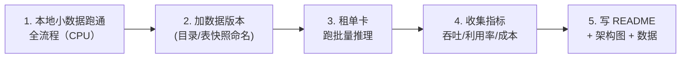
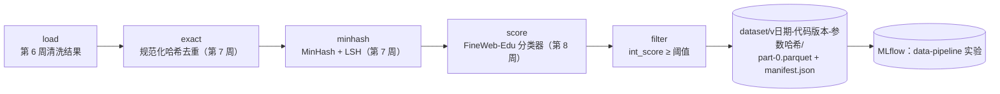

=== m6w2 | 第 22 周：毕业项目实现 | 第 6 月 · 作品集 + 求职
# 第 22 周：毕业项目实现——先端到端跑通，再逐段换成“大规模”版本

> **本周一句话**：实现的顺序决定成败：**先用最小数据在本地把全流程串起来，再逐段替换成分布式/GPU 版本**，每一步都留下可量化的记录。本周以项目 A 为例给出一个可直接运行的骨架 `pipeline.py`：清洗结果 → 精确去重 → MinHash 近重复 → 教育价值打分 → 过滤 → 带版本号的输出 + manifest + MLflow 记录。在本站 CPU 上处理 600 篇文档用时 73 秒，其中 97% 花在模型打分——这就是你下一步该往哪里投入资源的直接证据。

**预计投入：约 12 小时**（实现 ≈ 7h，GPU 环节 ≈ 2h，README 与整理 ≈ 3h）。{{local}} {{gpu1}}

**本周结束时你应该能：**

1. 交付一个能一条命令端到端运行的毕业项目，带版本化输出与运行记录。
2. 用各阶段的耗时与条数找出瓶颈，并说明扩展方案（Ray Data actor 池、GPU、Spark）。
3. 写出一个让面试官 5 分钟内看懂的 README：架构图、运行步骤、实验数据、已知问题。

> **验证说明**：项目 A 的骨架 `pipeline.py` 在本站 8 核 CPU 上真实运行（输入为第 6 周的清洗结果 `labs/w6/clean`，分类器为 HuggingFaceFW/fineweb-edu-classifier，datasketch 2.0.0，mlflow 3.17.1），输出均为真实输出。**GPU 环节、项目 B 与项目 C 的步骤未在本站实测**，给出的是基于前几周实验的组合指引。实验文件在仓库 `labs/w22/`。

---

## 1. 本周学习路线



| 天 | 时间 | 内容 | 产出 |
|---|---|---|---|
| Day 1 | 2.5h | 读 2.1–2.2，运行实验 1，理解骨架 | 本地端到端跑通 |
| Day 2 | 2.5h | 按你的设计文档改造骨架（换数据、加步骤） | 自己的 pipeline |
| Day 3 | 2h | 实验 2：扩展瓶颈阶段（Ray Data actor 池 / 分区） | 扩展前后对比 |
| Day 4 | 2h | 实验 3：GPU 环节（一次租用完成） | GPU 吞吐与成本数据 |
| Day 5 | 3h | 2.3 README；整理已知问题 | GitHub 仓库 |

---

## 2. 核心概念讲解

### 2.1 骨架优先（walking skeleton）

先让每个环节都有一个“最笨但能跑”的实现，把输入输出、版本、记录都打通；之后每次只替换一段，并用同样的度量比较前后差异。**大数据类比**：和上线新 ETL 链路一样——先用一个分区的数据跑通整条 DAG（含落盘和元数据登记），再放量。



### 2.2 数据版本与 manifest

输出目录名由三部分组成：日期、代码版本（git 短哈希）、参数哈希。同样的代码 + 同样的参数会得到同样的版本号，任何一项变化都会产生新目录——**不可变、可追溯**，相当于 Iceberg 的快照或 Hive 按运行 ID 分区。`manifest.json` 记录输入、参数、每阶段的输入输出条数与耗时、分数分布；MLflow 中同时登记一条 run，下游训练作业通过版本号引用数据集，模型就能追溯到数据。

### 2.3 README 结构

```text
# 项目名（一句话说明解决什么问题）
## 架构图（mermaid）
## 一条命令运行（含环境与数据准备）
## 实验数据（表格：规模、各阶段耗时/条数、吞吐、成本；注明硬件与版本，区分“实测/估算”）
## 设计取舍（链接设计文档；最重要的 3 个决定）
## 已知问题与下一步
## 与大数据平台的对应（你的独特视角）
```

---

## 3. 动手实验

### 实验 1：项目 A 骨架端到端运行（本地，1 小时）{{local}}

```python
@@CODE:w22/pipeline.py@@
```

```bash
export MLFLOW_TRACKING_URI=sqlite:///$PWD/../mlflow.db      # 与第 20 周共用
python pipeline.py --input ../w6/clean --n 600 --threshold 2
cat dataset/*/manifest.json
```

真实输出：

```text
[load      ]     0 →   600    0.15s
[exact     ]   600 →   599    0.04s
[minhash   ]   599 →   599    0.54s
[score     ]   599 →   599   71.09s
[filter    ]   599 →   168    0.01s
输出 dataset/v20261020-nogit-1d70bf/  共 168 行，总耗时 73.1s
```

manifest（节选）：

```json
{
 "version": "v20261020-nogit-1d70bf",
 "params": {"input": "../w6/clean", "n": 600, "threshold": 2, "jaccard": 0.8, "code_rev": "nogit"},
 "seconds": {"load": 0.15, "exact": 0.04, "minhash": 0.54, "score": 71.09, "filter": 0.01},
 "rows": 168,
 "int_score_hist": {"2": 135, "3": 31, "4": 2}
}
```

解读：

- **打分阶段占总耗时的 97%**（71.1s / 73.1s）。去重类阶段在这个规模下可以忽略——优化方向一目了然：扩展批量推理（第 8 周的 actor 池 / GPU），而不是去优化去重。
- 输入已经过第 6 周清洗（含精确去重），这里规范化空白与大小写后又发现 1 条重复；600 篇样本中没有 Jaccard ≥ 0.8 的近重复。在第 7 周人工注入近重复的数据上，这一步会删掉大量文档。
- 阈值 2 保留了 28%（168/599）；FineWeb-Edu 使用的阈值 3 只会保留 33 篇（31 + 2）。阈值是数据质量与数量的取舍，应该写进设计文档。
- `code_rev` 为 `nogit`：本站的教程目录不是 git 仓库。你的项目应先 `git init` 并提交，版本号才有意义。

### 实验 2：扩展瓶颈阶段（本地，2 小时）{{local}}

把 `score` 阶段替换为第 8 周的 Ray Data 版本（`labs/w8/edu_score.py` 的 `EduScorer` + `ActorPoolStrategy`），用同样的 600 篇比较耗时。第 8 周的经验：不先 `repartition`，只有 1 个 actor 在工作；分成 8 个 block 后耗时从 91.8s 降到 27.4s。把结果记录进 manifest 的 `seconds` 和 MLflow，形成“扩展前/后”对照。

| 版本 | score 阶段耗时 | 总耗时 | 备注 |
|---|---|---|---|
| pandas 单进程（实验 1） | 71.09s | 73.1s | 本站实测 |
| Ray Data actor 池 | | | 你的结果 |
| GPU（实验 3） | | | 你的结果 |

### 实验 3：GPU 环节（GPU，约 2 小时）{{gpu1}}

> 未在本站实测，需 GPU。

- 项目 A：把打分换成 GPU（模型 `.to("cuda")`，增大 batch），或换成用 vLLM 做 LLM 打标签（第 8 周），在**一次租用**中处理更大的样本（如 5 万篇），记录吞吐（篇/s、token/s）、GPU 利用率和费用。
- 项目 B：组合第 10、12、16 周的 YAML；用 Kueue 为两个 namespace 配置配额；成本报表先按“GPU 数 × 运行时长”计算 GPU·小时（单价填写平台实际价格）。调度部分可以在 KWOK 上本地完成（第 9–11 周的做法）。
- 项目 C：文档切分 → Embedding（小模型如 sentence-transformers 系列可在 CPU 运行，见 [Sentence Transformers](https://www.sbert.net/)）→ 写入 Milvus（参考 [Milvus 仓库](https://github.com/milvus-io/milvus) 的部署说明）→ 混合检索 → 用一组人工标注问题做评测。

### 常见错误与排查

| 现象 | 原因 | 解决 |
|---|---|---|
| `AttributeError: Can only use .str accessor with string values`（本站实测） | 新版 pandas 中 `.str.split()` 结果再链式 `.str.join` 的类型推断问题 | 用 `.map(lambda s: ...)` 直接处理字符串 |
| `TypeError: object of type 'NoneType' has no len()`（本站实测，骨架初版） | 计时装饰器对第一阶段的空输入取长度 | 对首阶段输入做空值判断 |
| 版本号里是 `nogit`（本站实测） | 目录不是 git 仓库 | `git init` 并提交后再运行 |
| 打分阶段极慢 | 单进程 CPU 推理 | 实验 2/3：actor 池或 GPU |
| 重复运行覆盖了旧结果 | 输出目录不含版本信息 | 使用“日期-代码-参数哈希”目录，不可变 |
| 下游不知道用哪个数据版本 | 没有登记 | 在 MLflow 或元数据系统中登记版本，并在训练 run 中记录 |

### 扩展练习

1. 给 `pipeline.py` 增加 `--resume`：若某阶段的中间结果已存在则跳过（类似 Spark checkpoint / Airflow 任务幂等）。
2. 把每阶段写成独立脚本，用一个 DAG 调度工具（你熟悉的 Airflow/DolphinScheduler 等）编排。
3. 增加数据质量检查：语言分数分布、长度分布、去重率，超出阈值时让流水线失败。
4. 在 MLflow 中让第 19 周的微调 run 记录它使用的数据集版本号，完成“模型 → 数据”的追溯链。

---

## 4. 精读指南

- **① [Ray Data 文档](https://docs.ray.io/en/latest/data/data.html)**（复习第 6–8 周用过的 API）。
- **② [datasketch MinHash LSH](https://ekzhu.com/datasketch/lsh.html)**（15 分钟）。
- **③ [FineWeb-Edu 分类器](https://huggingface.co/HuggingFaceFW/fineweb-edu-classifier)**（10 分钟）：阈值与标注方式。
- **④ [datatrove](https://github.com/huggingface/datatrove)**（30 分钟）：HF 用于 FineWeb 的数据处理库，对照你的流水线结构。
- **⑤ [Apache Iceberg](https://iceberg.apache.org/docs/latest/)**、[DVC](https://dvc.org/doc)（各 20 分钟）：数据版本化的两种思路（表格式快照 vs 文件版本）。
- 项目 B/C：[Kueue 概览](https://kueue.sigs.k8s.io/docs/overview/)、[Milvus](https://github.com/milvus-io/milvus)、[Sentence Transformers](https://www.sbert.net/)。

---

## 5. 自测题

<details>
<summary>1. 为什么要先用小数据端到端跑通，而不是先把某一段做到最好？</summary>

端到端跑通能尽早暴露接口、数据格式、版本与记录方面的问题，并用真实度量找出瓶颈。先优化某一段可能在不重要的环节上浪费时间（实验 1 中去重只占 1% 的时间）。

</details>

<details>
<summary>2. 实验 1 的数据说明下一步应该优化什么？为什么？</summary>

打分阶段占总耗时的 97%，应扩展批量推理（Ray Data actor 池、合理分区、GPU）。优化去重阶段对总耗时几乎没有影响。

</details>

<details>
<summary>3. 输出目录名为什么要包含代码版本和参数哈希？</summary>

保证数据集不可变且可追溯：同一代码和参数得到同一版本，任何变化都会产生新版本，不会覆盖旧结果；下游训练记录版本号后即可追溯到产生数据的代码与参数。

</details>

<details>
<summary>4. manifest 中应该记录哪些信息？</summary>

版本号、创建时间、输入路径与版本、全部参数、代码版本、每阶段的输入输出条数与耗时、关键分布（如分数直方图）、输出行数。

</details>

<details>
<summary>5. 过滤阈值从 2 改为 3 会怎样？如何决定？</summary>

本例中保留条数从 168 降到 33。阈值是数量与质量的取舍，应结合下游训练效果的实验（不同阈值的数据训练后在评测集上的表现）来决定，并写入设计文档。

</details>

### 思考题

1. 你的流水线如何处理“增量数据”（每天新增文档）？近重复去重需要和历史数据比较，怎样设计？
2. 如果打分模型升级了，已经产出的数据集版本怎么办？全量重算还是只对新数据使用新模型？
3. 你会如何把这条流水线接入公司现有的数据平台（调度、元数据、权限）？

---

## 6. 本周产出与掌握清单

### 本周产出

- [ ] 可一条命令运行的毕业项目代码（GitHub）
- [ ] 带版本的输出与 manifest，MLflow 中的运行记录
- [ ] 扩展前后的耗时对照表，GPU 环节的吞吐与成本数据
- [ ] README（架构图、运行步骤、实验数据、已知问题）

## 参考资料

- [Milvus](https://github.com/milvus-io/milvus)（仓库·入门）：RAG 毕业项目的向量库

> 完整列表见 [参考资料库](/resources.html)。

## 检查清单
- [ ] 本地端到端跑通
- [ ] GPU 环节完成并记录量化数据
- [ ] 代码推到 GitHub，README 含架构图、运行步骤、实验数据
- [ ] 记录所有已知问题与下一步
- [ ] 能用各阶段耗时说明瓶颈和扩展方案
