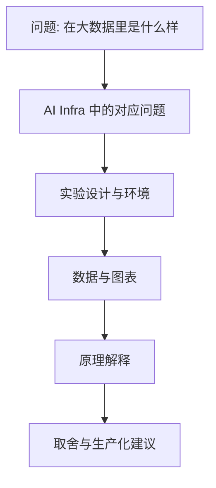

=== m6w3 | 第 23 周：写技术博客 | 第 6 月 · 作品集 + 求职
# 第 23 周：写技术博客——把实验变成“能讲清楚原理与取舍”的文章

> **本周一句话**：架构师面试看的不是代码量，而是**能否讲清楚问题、证据和取舍**。博客就是最好的证明。本周把前 5 个月的实验写成 2–3 篇文章：用“大数据里是什么样 → AI Infra 中的对应问题 → 实验 → 数据 → 原理 → 取舍”的结构，配图从 MLflow 里的真实数据生成，发布前用一个自查脚本检查环境、版本、实测/估算是否交代清楚。

**预计投入：约 10 小时**（每篇约 4 小时：提纲 0.5h、实验补充 1h、写作 2h、配图与自查 0.5h）。{{none}}

**本周结束时你应该能：**

1. 用固定结构把一次实验写成技术文章，突出你的“大数据 → AI Infra”视角。
2. 从实验记录（MLflow）生成可复现的数据图，保证图、表与原始记录一致。
3. 在文章中清楚区分实测、估算与引用，写明环境、版本和局限。
4. 发布 2 篇文章，并把它们链接到简历和毕业项目 README。

> **验证说明**：`make_chart.py`（从 MLflow 读取第 14 周的真实压测数据画图）和 `blog_lint.py`（草稿自查）在本站真实运行，输出与生成的图均为真实结果。实验文件在仓库 `labs/w23/`。

---

## 1. 本周学习路线


| 天 | 时间 | 先读 | 再读（外部资料） | 再做 |
|---|---|---|---|---|
| Day 1 | 2h | 2.1、2.2 | ① Google 技术写作（Technical Writing One 前几节） | 两篇提纲 |
| Day 2 | 2h | 2.3 | 范文：② Inside vLLM、③ 字节 Ray Data 博客 | 实验 1 |
| Day 3 | 2h | 2.4 | ④ 中文文案排版指北 | 实验 2，发布第 1 篇 |
| Day 4 | 2h | — | ⑤ LMSYS SGLang 博客（看数据如何呈现） | 第 2 篇 |
| Day 5 | 2h | 2.5 | — | 发布，复盘 |

---

## 2. 核心概念讲解

### 2.1 推荐选题（都来自本教程的实验）

| 选题 | 素材 | 你的独特视角 |
|---|---|---|
| 《从 YARN 容量调度到 Kueue/Volcano：一个大数据架构师的 GPU 调度笔记》 | 第 9–11 周（KWOK 上真实的配额、借用、抢占、gang 事件） | 队列模型的逐项对照、半调度死锁 |
| 《同一条去重管线，Ray Data 与 Spark 的执行模型差异》 | 第 6–7 周 | 流式执行 vs BSP、groupby 的代价（第 7 周 driver 分桶 9.9s vs groupby 235.5s） |
| 《单卡 24GB 上 vLLM vs SGLang 压测：TTFT、TPOT 与吞吐的取舍》 | 第 13–15 周（+ GPU 实测） | 容量规划、SLO 与成本 |
| 《没有 batching 的推理服务会怎样？用 70 行代码看懂 continuous batching 的价值》 | 第 14 周实验 2–3（CPU 实测） | 排队论直觉，任何人都能复现 |

### 2.2 文章结构



- **开头三段定生死**：第一段说清读者能得到什么；第二段给出最重要的一个数字或结论；第三段说明你凭什么写（实验环境与方法）。
- **一节只讲一个观点**，用小标题直接写结论（如“TTFT 随并发线性增长”），而不是“实验结果”。
- **类比要讲差异**：只说“Kueue 就是 YARN 队列”会显得浅；讲清“像在哪里、不像在哪里（Kueue 只做准入，不做放置）”才体现理解。

### 2.3 数据与图

- 图的数据**从实验记录中读取**（MLflow、manifest），而不是手抄，避免图表与正文数字不一致。
- 一张图回答一个问题，标题直接写结论；坐标轴写单位；注明硬件、模型、版本。
- 表格用于精确数字，图用于趋势。

### 2.4 诚实原则

| 要求 | 写法示例 |
|---|---|
| 区分实测/估算/引用 | “（实测，8 核 CPU）”“（估算，假设激活预留 1.5GB）”“（引自 vLLM 文档）” |
| 写明环境与版本 | “KWOK v0.8.0 模拟集群，K8s v1.37.1，Kueue v0.20.2” |
| 写出局限 | “KWOK 不运行真实容器，抢占后恢复时间无法测量” |
| 不夸大 | 用“在本实验条件下”，避免“X 比 Y 快 3 倍”这种脱离条件的结论 |

这和本教程每页开头的“验证说明”是同一个原则——面试官往往会追问细节，诚实的边界反而是加分项。

### 2.5 发布与传播

知乎或掘金各选一个主阵地；标题包含具体技术词（Kueue、vLLM、Ray Data）便于检索；文末附 GitHub 仓库链接；把文章链接放进简历和毕业项目 README。

---

## 3. 动手实验 {{none}}

### 实验 1：从 MLflow 生成配图（30 分钟）

```python
@@CODE:w23/make_chart.py@@
```

```bash
export MLFLOW_TRACKING_URI=sqlite:///$PWD/../mlflow.db
python make_chart.py
```

真实输出：

```text
并发 1: TTFT p95 0.12s, 吞吐 25.8 tok/s
并发 4: TTFT p95 6.51s, 吞吐 26.6 tok/s
并发 8: TTFT p95 13.46s, 吞吐 25.7 tok/s
已保存 ttft_vs_concurrency.png
```

生成的图（本站真实生成）：


这张图一眼说清了第 14 周的结论：没有 batching 时吞吐是一条水平线，TTFT 随并发线性上升。标题直接写结论，并注明模型与硬件。图中文字用英文，是为了避免不同环境下的中文字体问题；正式发布时可以配置中文字体。

### 实验 2：发布前自查（20 分钟）

```python
@@CODE:w23/blog_lint.py@@
```

对一篇示例草稿（`sample_draft.md`，《从 YARN 容量调度到 Kueue》的开头片段）运行：

```bash
python blog_lint.py sample_draft.md
```

真实输出：

```text
[✓] 写明硬件/环境（例：GPU）
[✓] 写明软件版本（例：v1.37.1）
[✓] 区分实测与估算（例：实测）
[✗] 至少一张图
[✓] 有大数据类比（例：YARN）
[✓] 有取舍/局限讨论（例：局限）
[✓] 给出复现方式（例：```bash）
疑似缺少单位的数字：0 处
通过 6/7 项
```

- 自查发现示例草稿缺少图：补一张 Kueue 借用/回收的时序图或 Workload 状态表。
- 注意“写明硬件/环境”这一项命中的是标题里的“GPU 调度”，而不是真正的环境说明——**这是一个基于关键词的粗略检查，只能提醒，不能代替人工通读**。把它当作发布前的检查清单，而不是质量评分。

### 实验 3：写作与发布（每篇 3–4 小时）

1. 按 2.2 结构写提纲，每节一句话结论。
2. 补实验：缺什么数据就回到对应周补跑，记录进 MLflow。
3. 成稿 → 用实验 2 自查 → 请一位同事读开头三段，问他“这篇文章讲了什么”。
4. 发布，并把链接写进毕业项目 README 和简历。

### 常见问题与改进

| 问题 | 表现 | 改进 |
|---|---|---|
| 写成实验日志 | 按时间顺序罗列命令 | 按观点组织，命令放附录或仓库 |
| 类比流于表面 | “X 就是 Y” | 补充“相同点/不同点”表格 |
| 数字没有条件 | “快 3 倍” | 写明硬件、规模、版本、实测/估算 |
| 图表与正文不一致 | 手抄数字出错 | 从记录生成图表（实验 1） |
| 篇幅过长 | 读者看不到结论 | 开头给结论，细节折叠或放附录 |
| 自查脚本误判（本站实测） | 关键词命中了无关位置 | 人工通读确认 |

### 扩展练习

1. 用 `make_chart.py` 的方式，从第 19 周的 MLflow 记录画 DDP vs FSDP 的状态大小与每步耗时对比图。
2. 给 `blog_lint.py` 增加一项：检查是否所有外部链接都能访问（参考本站用 curl 校验链接的做法）。
3. 把一篇文章改写成 5 分钟的口头讲述稿，录音回听——这正是面试中“介绍一个你做过的项目”的准备。

---

## 4. 精读指南

- **① [Google Technical Writing](https://developers.google.com/tech-writing)**（2 小时，可分几天）：短句、主动语态、先结论。
- **② [Inside vLLM](https://blog.vllm.ai/2025/09/05/anatomy-of-vllm.html)**（作为范文，看它如何用图解释复杂系统）与 [vLLM 博客](https://blog.vllm.ai/)。
- **③ [字节跳动：Ray Data 200TB 多模态离线推理](https://www.anyscale.com/blog/how-bytedance-scales-offline-inference-with-multi-modal-llms-to-200TB-data)**（范文：业务问题 → 架构 → 数据）。
- **④ [中文文案排版指北](https://github.com/sparanoid/chinese-copywriting-guidelines)**（15 分钟）：中英文之间加空格等规范。
- **⑤ [LMSYS：SGLang 发布博客](https://lmsys.org/blog/2024-01-17-sglang/)**（看性能数据的呈现方式）。
- 工具：[matplotlib](https://matplotlib.org/stable/index.html)；发布平台：[知乎](https://www.zhihu.com/)、[掘金](https://juejin.cn/)。

---

## 5. 自测题

<details>
<summary>1. 技术文章的开头三段应该分别写什么？</summary>

第一段：读者能得到什么；第二段：最重要的结论或数字；第三段：你凭什么写（实验环境与方法）。

</details>

<details>
<summary>2. 为什么配图的数据要从实验记录中读取？</summary>

避免手抄错误，保证图、表、正文数字与原始记录一致，并且可以随实验更新重新生成，读者也可以复现。

</details>

<details>
<summary>3. 怎样写“大数据类比”才能体现深度？</summary>

不仅说相同点，还要说清不同点和原因。例如 Kueue 像 YARN 队列（配额、借用、抢占），但它只负责准入，Pod 放置仍由 kube-scheduler 完成，所以不能保证 gang 放置。

</details>

<details>
<summary>4. 实验 2 的自查脚本有什么局限？</summary>

它只做关键词匹配，可能误判（例如“GPU”出现在标题而非环境说明中），也无法判断内容是否正确。只能作为提醒清单，必须人工通读。

</details>

<details>
<summary>5. 文章中哪些信息必须标注？</summary>

实测/估算/引用的区分，硬件与软件版本，数据规模，局限与适用条件。

</details>

### 思考题

1. 你的第一篇文章最想让哪类读者（招聘方、同行、转型者）看到？这会怎样影响选题和写法？
2. 哪些实验结论在你的环境下成立、换到 GPU 环境可能不成立？在文章中应该怎样表述？
3. 如果读者指出文章中的错误，你会如何处理（勘误、更新、致谢）？

---

## 6. 本周产出与掌握清单

### 本周产出

- [ ] 2 篇已发布的技术文章（链接）
- [ ] 每篇至少一张由实验记录生成的图
- [ ] 一份 5 分钟的项目口头讲述稿

## 参考资料

- [Inside vLLM: Anatomy of a High-Throughput LLM Inference System](https://blog.vllm.ai/2025/09/05/anatomy-of-vllm.html)（博客·进阶）：vLLM 官方博客长文，串起调度器、KV cache、prefix cache、PD 分离
- [字节跳动：Ray Data 200TB 多模态离线推理](https://www.anyscale.com/blog/how-bytedance-scales-offline-inference-with-multi-modal-llms-to-200TB-data)（博客·进阶）：Spark BSP 与 Ray 流水线的真实对比

> 完整列表见 [参考资料库](/resources.html)。

## 检查清单 {{none}}
- [ ] 第 1 篇发布
- [ ] 第 2 篇发布
- [ ] 每篇都注明环境、版本和“估算/实测”区分
- [ ] 每篇至少一张架构图或数据图
- [ ] 文章链接已加入简历与毕业项目 README
