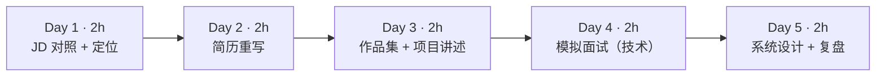
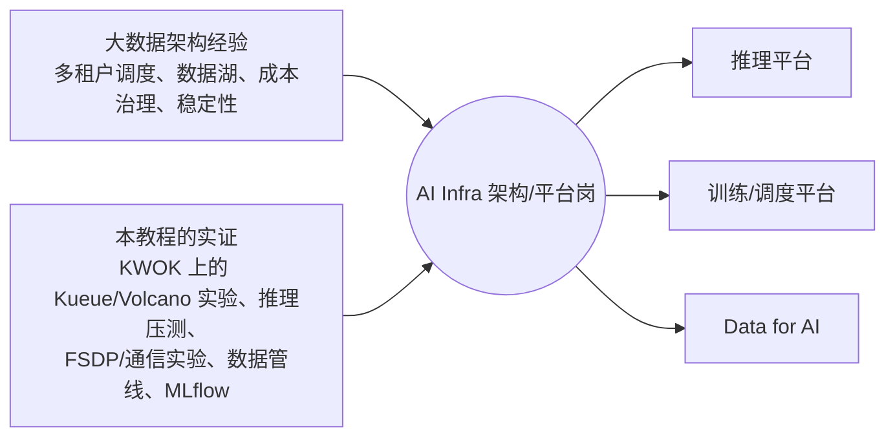
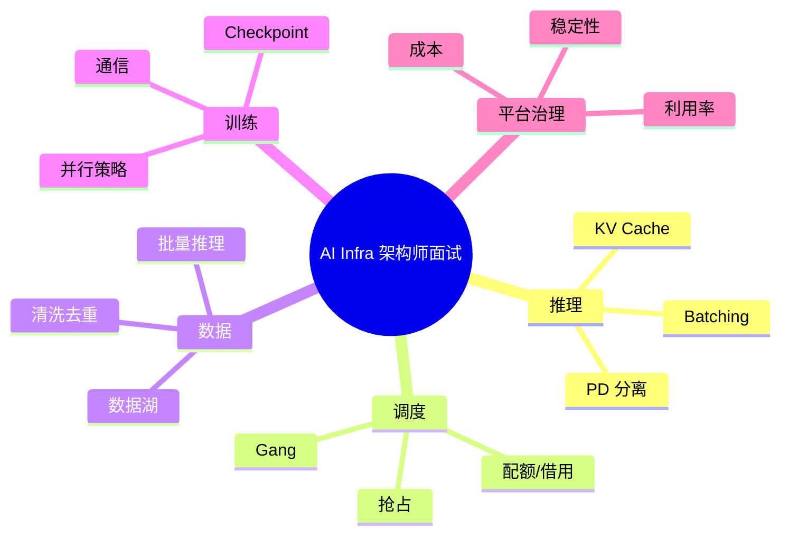

=== m6w4 | 第 24 周：简历与面试准备 | 第 6 月 · 作品集 + 求职
# 第 24 周：简历与面试准备——把 24 周的积累讲成一个可信的故事

> **本周一句话**：你的竞争力不是“也会一点 CUDA”，而是<strong>“大数据平台经验 + 亲手验证过的 AI Infra 知识”</strong>。本周把过去的项目用 AI Infra 的语言重写进简历（只写真实数字），把毕业项目和博客整理成作品集，再用一个离线题库做模拟面试：每道题都能对应到你在本教程里亲手跑过的实验和数字。

**预计投入：约 10 小时**（简历 ≈ 3h，作品集整理 ≈ 2h，模拟面试 ≈ 3h，JD 对照与复盘 ≈ 2h）。{{none}}

**本周结束时你应该能：**

1. 写出突出复合背景、以量化成果为主的简历，并附作品集链接。
2. 用“问题 → 方案 → 取舍 → 数据”的结构讲清楚毕业项目和一个过去的大数据项目。
3. 回答推理、调度、数据、训练、平台五类高频问题，每题都能引用自己的实验证据。
4. 对照真实 JD 找出剩余差距，制定转型后的学习计划。

> **验证说明**：本周以准备材料为主。`mock_interview.py` 与题库 `questions.json` 在本站真实运行，输出为真实输出。题目要点来自本教程各周内容，不代表任何公司的真实面试题。实验文件在仓库 `labs/w24/`。

---

## 1. 本周学习路线



| 天 | 时间 | 先读 | 再读（外部资料） | 再做 |
|---|---|---|---|---|
| Day 1 | 2h | 2.1 | [招聘市场](/jobs.html)、② 转型差距指南、JD 样本 | 差距表 |
| Day 2 | 2h | 2.2 | — | 简历初稿 |
| Day 3 | 2h | 2.3 | — | 作品集页、两个 5 分钟讲述稿 |
| Day 4 | 2h | 2.4 | 本周自测题 | 实验 1 |
| Day 5 | 2h | 2.5 | ① ai-system-design-guide | 实验 2，复盘 |

---

## 2. 核心概念讲解

### 2.1 定位：复合背景的优势



定位上讲“大数据 + AI Infra”的复合优势，不要和应届生拼 CUDA。面试官最担心转型者“只看过文章”——你的回答是：每个结论都有自己跑过的实验和数字（并清楚说明哪些是模拟环境、哪些需要 GPU 验证）。

### 2.2 简历：用 AI Infra 的语言重写过去的项目

| 原来的写法 | 重写后（只写真实数据） | 对应 AI Infra 问题 |
|---|---|---|
| 负责 YARN 集群运维 | 设计多租户队列与弹性配额，支持 N 个团队、集群利用率从 X% 提升到 Y% | GPU 配额、借用与抢占（Kueue） |
| 建设数据湖 | 治理 PB 级数据湖：分区、版本、血缘与生命周期，存储成本下降 X% | 训练数据版本化、数据血缘 |
| Spark 作业调优 | 定位 shuffle 倾斜与长尾 task，核心作业耗时从 X 降到 Y | 分布式训练 straggler、All-to-All 负载均衡 |
| 搭建监控告警 | 建立以 SLO 为核心的监控与容量规划体系 | 推理 SLO、按排队数扩缩容 |

再加一个“AI Infra 项目”栏：毕业项目（GitHub 链接 + 关键数字）、博客链接。**X、Y 必须是真实数字**；没有就写定性描述，不要编。

### 2.3 项目讲述：问题 → 方案 → 取舍 → 数据

5 分钟讲述稿结构：

1. **问题**（30 秒）：什么场景，为什么难。
2. **方案**（90 秒）：架构图上的关键组件。
3. **取舍**（90 秒）：考虑过什么、为什么没选、代价是什么。
4. **数据**（60 秒）：最重要的 2–3 个数字及其条件（实测还是估算、什么环境）。
5. **如果重来**（30 秒）：下一步或改进。

### 2.4 面试题与证据对照

| 主题 | 题目 | 你的证据 |
|---|---|---|
| 推理 | 解释 PagedAttention 和 continuous batching；TTFT 高可能是什么原因？ | 第 13 周模拟：利用率 41.6% → 99.6%；第 14 周：无 batching 时 TTFT p95 从 0.12s 涨到 13.5s |
| 推理 | 24GB 卡部署 7B 模型，怎样估算最大并发？ | 第 13 周 `kv_budget.py`：56KiB/token，约 20 个 4K 并发 |
| 调度 | Gang 调度解决什么问题？Kueue 与 Volcano 的区别？ | 第 9 周死锁复现；第 11 周原生 PodGroup / Volcano 的 Unschedulable 消息 |
| 调度 | 如何设计多团队 GPU 配额与借用、抢占策略？ | 第 10 周 Kueue：借用、回收、优先级抢占的真实事件 |
| 数据 | 设计一个 PB 级预训练数据清洗去重管线，Ray 还是 Spark？为什么？ | 第 7 周对比；第 22 周：打分占 97% 耗时 |
| 训练 | ZeRO-1/2/3 分别切了什么？TP 为什么放在机内？ | 第 17 周 FSDP 分片实测；第 18 周手写 Ring AllReduce |
| 平台 | 怎样衡量和提升 GPU 集群利用率？ | 第 9 周碎片化实验；第 16 周扩缩容 |



### 2.5 系统设计题的答题框架

1. **澄清需求**：用户、规模（QPS、模型大小、数据量）、SLO、预算。
2. **估算**：用第 13、21 周的方法当场算卡数（写出假设）。
3. **架构**：画出主路径，再补可观测性与控制面。
4. **深挖 1–2 个点**：调度（配额、gang）、推理（batching、扩缩容）或数据（版本、去重）。
5. **取舍与演进**：MVP 和规模化之后分别怎么做。

**大数据类比**：这和你做过的“设计一个实时数仓/日志平台”面试是同一套方法，只是资源单位从 CPU 核、磁盘变成了 GPU 卡、显存和网络带宽。

---

## 3. 动手实验 {{none}}

### 实验 1：离线模拟面试（2 小时）

```python
@@CODE:w24/mock_interview.py@@
```

题库 `questions.json` 有 10 道题（推理 3、调度 2、数据 1、训练 2、平台 2），每题附要点与复习位置。复习模式运行：

```bash
python mock_interview.py --n 3 --seed 1 --show
```

真实输出：

```text
第 1 题【推理】解释 PagedAttention 和 continuous batching。
  要点：KV 分块 + 块表；按需分配，浪费 < 1 块；前缀共享/写时复制；迭代级调度，完成即离开、排队即补位；吞吐与延迟同时改善
  复习：第 13 周  自评：命中 __/5 个要点

第 2 题【推理】TTFT 高可能是什么原因？如何定位？
  要点：排队（并发超过 batch/KV 容量）；prompt 长导致 prefill 慢；长 prefill 干扰（chunked prefill）；看排队请求数与 KV 使用率指标；前缀缓存命中率
  复习：第 14、16 周  自评：命中 __/5 个要点

第 3 题【调度】如何设计多团队 GPU 配额、借用与抢占？
  要点：按团队 ClusterQueue + nominalQuota；cohort 借用闲置额度；reclaimWithinCohort 回收；优先级抢占；ResourceFlavor 区分卡型与回退；被抢占作业需要 checkpoint
  复习：第 10 周  自评：命中 __/6 个要点
```

练习方式：去掉 `--show`，每题先口头作答 2–3 分钟（录音），再看要点自评。命中率低于一半的题回到对应周复习。也可以把题目交给 AI 扮演面试官追问（“为什么？代价是什么？你怎么验证的？”）。往题库里补充你在 JD 中看到的新题。

### 实验 2：系统设计演练（1.5 小时）

题目：“为公司设计一个支持 3 个业务团队的 LLM 推理平台，峰值 50 QPS，模型 7B–70B。”按 2.5 的框架作答，用第 21 周的 `capacity.py` 当场估算（写明假设），画出架构图，并准备回答追问：

- 70B 模型需要几张卡做张量并行？放在一台机器内吗？（第 17 周）
- 团队 A 突发流量时如何不影响团队 B？（第 10 周 Kueue + 第 16 周扩缩容）
- 如何按团队计费？（第 21 周 GPU·小时）

### 实验 3：JD 差距表（1 小时）

从 [招聘市场](/jobs.html) 中选 3 份目标 JD，逐条填表：

| JD 要求 | 我的证据（本教程/过去项目） | 差距 | 补足计划 |
|---|---|---|---|
| | | | |

### 常见问题与改进

| 问题 | 表现 | 改进 |
|---|---|---|
| 简历堆技术名词 | 罗列 vLLM、Ray、K8s… | 每个技术都配一句“用它解决了什么、结果如何” |
| 数字无法自证 | 面试官追问时答不上条件 | 只写能讲清环境与方法的数字 |
| 回避模拟环境 | 被追问后显得不诚实 | 主动说明“调度在 KWOK 上实测，GPU 部分基于文档/云上短时实验” |
| 只讲新技术不讲旧经验 | 失去差异化 | 每个回答都带一句“这和大数据里的 X 类似/不同” |
| 系统设计直接画图 | 漏掉需求与估算 | 先澄清、再估算、后画图 |

### 扩展练习

1. 给题库增加 10 道你从 JD 和面经中收集的题目，并为每题写出“我的证据”。
2. 录一段 5 分钟的毕业项目讲述，按 2.3 的结构计时，回听后改进。
3. 写一份转型后 3 个月的学习计划（例如：深入一个推理引擎的源码，或参与一个开源调度项目）。

---

## 4. 精读指南

- **① [ai-system-design-guide](https://github.com/ombharatiya/ai-system-design-guide)**（1 小时）：系统设计题与架构模式。
- **② [TRANSITION_GUIDE](https://github.com/ombharatiya/ai-system-design-guide/blob/main/TRANSITION_GUIDE.md)**（30 分钟）：Data/Platform Engineer 转 AI Infra 的技能差距。
- **③ [Chip Huyen《AI Engineering》配套仓库](https://github.com/chiphuyen/aie-book)**（浏览）：理解上层应用对平台的需求。
- **JD 样本**：[阿里巴巴 AI Infra（计算方向）](https://campus-talent.alibaba.com/campus/position/199904060014)、[仪电智算推理平台](https://www.liepin.com/job/1983042681.shtml)、[Seekr Senior AI Infrastructure Engineer](https://www.seekr.com/careers/?gh_jid=4712814005)、[Inferact Cloud Orchestration](https://jobs.ashbyhq.com/inferact/1f7ff2b3-bcbf-46e3-abcc-ada332250a64)（招聘页面可能随时下线）。
- 本站：[招聘市场与 JD 分析](/jobs.html)、[给架构师的建议](/advice.html)。

---

## 5. 自测题

<details>
<summary>1. 用一句话介绍你的定位。</summary>

参考：有多年大数据平台（多租户调度、数据湖、成本治理）架构经验，过去半年系统学习并亲手验证了 AI Infra 的调度、推理、训练与数据环节，能把平台治理经验迁移到 GPU 集群和 LLM 服务上。（用你自己的真实经历改写）

</details>

<details>
<summary>2. 面试官问“你的调度实验是在模拟环境做的，可信吗？”怎么回答？</summary>

说明 KWOK 运行的是真实的 kube-apiserver、scheduler 和控制器，Kueue/Volcano 的准入、借用、抢占、gang 决策与事件都是真实的；模拟的只是 Pod 的运行和 GPU 设备本身。因此调度逻辑的结论可信，而真实设备相关的部分（device plugin 分配、训练恢复时间）需要在真实集群上验证，并说明你计划或已经如何验证。

</details>

<details>
<summary>3. 如何用一个数字说明 continuous batching 的价值？</summary>

例如第 14 周：无 batching 的服务并发从 1 到 8，吞吐保持约 26 tok/s 不变，TTFT p95 从 0.12s 涨到 13.5s；而静态 batch 16 时总吞吐提升到 8 倍。continuous batching 让吞吐随 batch 提升，同时避免排队导致的 TTFT 爆炸。（注明是 CPU 小模型实测）

</details>

<details>
<summary>4. 系统设计题的五个步骤是什么？</summary>

澄清需求（用户、规模、SLO、预算）→ 估算（卡数、存储、带宽，写明假设）→ 架构（主路径 + 可观测性 + 控制面）→ 深挖 1–2 个关键点 → 取舍与演进路径。

</details>

<details>
<summary>5. 简历中的量化成果应遵守什么原则？</summary>

只写真实且能讲清条件（环境、规模、方法）的数字；没有数字就写定性描述；每个技术名词都要配上解决的问题和结果。

</details>

### 思考题

1. 内部转岗和外部求职，各自的优势是什么？你更适合哪条路？（参考[给架构师的建议](/advice.html)）
2. 如果面试官的问题超出了你的实践范围（例如 CUDA kernel 优化），你会如何回答？
3. 回顾 24 周的学习，哪三个实验最能代表你的能力？为什么？

---

## 6. 本周产出与掌握清单

### 本周产出

- [ ] 更新后的简历（附毕业项目与博客链接）
- [ ] 两个 5 分钟讲述稿：毕业项目、一个过去的大数据项目
- [ ] 模拟面试记录与扩充后的题库
- [ ] JD 差距表与转型后的学习计划

## 参考资料

- [Chip Huyen《AI Engineering》配套仓库](https://github.com/chiphuyen/aie-book)（书·入门）：从工程视角看基础模型应用全貌，帮助理解上层需求
- [ai-system-design-guide](https://github.com/ombharatiya/ai-system-design-guide)（仓库·入门）：AI 系统设计题与架构模式，面试准备
- [ai-system-design-guide：TRANSITION_GUIDE](https://github.com/ombharatiya/ai-system-design-guide/blob/main/TRANSITION_GUIDE.md)（仓库·入门）：Data/Platform Engineer 转 AI Infra 的技能差距梳理
- [本站：招聘市场与 JD 分析](/jobs.html)（文档·入门）：JD 样本与本教程对应关系
- [阿里巴巴 AI Infra 工程师（计算方向）JD](https://campus-talent.alibaba.com/campus/position/199904060014)（文档·入门）：国内大厂训练/计算方向要求
- [仪电智算 AI Infra（推理平台）JD](https://www.liepin.com/job/1983042681.shtml)（文档·入门）：推理平台岗的典型要求
- [Seekr Senior AI Infrastructure Engineer JD](https://www.seekr.com/careers/?gh_jid=4712814005)（文档·入门）：海外 AI Infra 岗位要求
- [Inferact MTS, Cloud Orchestration JD](https://jobs.ashbyhq.com/inferact/1f7ff2b3-bcbf-46e3-abcc-ada332250a64)（文档·入门）：K8s + GPU 运维 + vLLM 部署方向

> 完整列表见 [参考资料库](/resources.html)。

## 检查清单
- [ ] 简历更新，突出复合背景与量化成果
- [ ] 用自测题做一次模拟面试（可以请 AI 扮演面试官）
- [ ] 浏览 [招聘市场](/jobs.html) 页面中的 JD，对照差距
- [ ] 考虑内部转岗机会（见 [给架构师的建议](/advice.html)）
- [ ] 每道高频题都能引用一个自己的实验数字
